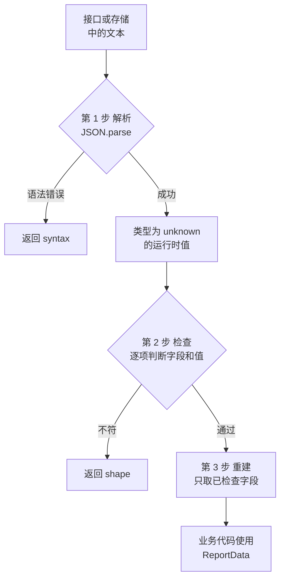

# TypeScript 能保证什么，外部数据又该怎样验证？

TypeScript 检查的是我们自己写的代码：参数传得对不对、属性名拼没拼错、联合类型的分支漏没漏。它的类型在编译成 JavaScript 时被擦除，因此不检查网络响应和浏览器存储里实际是什么。本章先说明这条边界，再给出外部数据进入应用的三步做法：解析、检查、重建；接着用手写解析器和 Zod 各实现一遍，最后用穷尽性检查守住数据进入应用之后的分支。

沿用主线一的报表页。本章关心报表 42 的接口响应：服务端返回当前查看者和行数据，其中一行是 r-104（标题 May，金额 `amount` 取重试后的 120，负责人 Ada）。本章把这一行的接口字段写成 `id`、`title`、`month`、`status`、`amount` 和 `ownerEmail`（`ada@example.com`），其中 `month`、`status`、`ownerEmail` 是本章新增的字段；同一份 JSON 也可能被缓存进浏览器存储，下次从那里读出。

## 编译后，类型还剩下什么？

TypeScript 的类型注解、接口和类型别名在输出 JavaScript 时全部删掉，运行时什么都不剩。由此得出四条容易被忽略的结论：

- **声明类型不会检查数据。** `const data: ReportData = await response.json()` 能通过编译，但运行时 `data` 就是服务器发来的任何东西。标准库把 `response.json()` 和 `JSON.parse` 的返回类型声明为 `any`，赋给什么类型都不报错。
- **`as` 是断言，不是转换。** `value as ReportRow` 只是告诉编译器“相信我”，运行时没有任何检查，值原样保留。
- **类型谓词是函数对编译器的承诺。** 返回类型写成 `value is X` 的函数，编译器在它返回 `true` 后把值当作 `X`，但不会验证函数体真的检查到位。
- **类型不检查授权。** 即使结构完全正确，也证明不了 `viewer.id` 是当前登录用户，或该用户有权看这份报表。这些判断只能由可信的服务端完成。

所以外部数据的可信度不能靠类型声明获得，只能靠运行时代码建立。

## 外部数据进入应用的三步

来自网络、浏览器存储、`postMessage`、URL 参数等程序外部的数据，都按同一套三步处理：

1. **解析。** 按数据格式把文本变成 JavaScript 值，例如 `JSON.parse`。语法错误在这一步失败。
2. **检查。** 在运行时逐项检查结构和取值：类型对不对、枚举值在不在允许范围、格式规则是否满足。结构错误在这一步失败。
3. **重建。** 只用检查过的字段构造新的应用对象。从这里开始，静态类型和运行时值才一致，后续代码可以依赖类型。



图里的 `syntax` 和 `shape` 是解析函数返回的失败原因。文本来自浏览器存储时还有第三种：`getItem` 返回 `null`（从没存过），在进入流程之前就返回 `missing`。

三步都是运行时代码。第 1 步之后把值标成 `unknown`，只改变编译器看到的类型，不对应任何运行时转换；到第 3 步构造出新对象，静态类型才有了运行时依据。

## unknown 和类型谓词怎样配合检查？

`unknown` (未知类型)可以接收任何值，但在缩窄到更具体的类型之前，编译器不允许读取它的属性。这正好逼着我们在第 2 步先检查再读取。

把检查封装成函数时，用 type predicate (类型谓词)把运行时的检查结果告诉编译器：

```typescript
function isRecord(value: unknown): value is Record<string, unknown> {
  return typeof value === "object" && value !== null && !Array.isArray(value);
}
```

`typeof`、`!== null`、`Array.isArray` 这几个条件在运行时真正执行；`value is Record<string, unknown>` 只是承诺。编译器据此放行 `isRecord(input)` 之后的属性访问，但不替函数证明承诺成立，所以函数体的布尔检查必须和谓词一致。

还有一个陷阱：标准库里 `Array.isArray` 的谓词会把值缩窄成 `any[]`。如果直接遍历，每个元素都是 `any`，检查就形同虚设。下面的解析器因此先把数组赋给 `unknown[]`，让每个元素仍要先检查再读取。

## 手写解析器怎样实现三步？

报表 42 的数据类型如下。`ParseResult` 把成功值和三种失败原因放进同一个可辨识联合：

```typescript
type Role = "admin" | "reader";
type ReportStatus = "open" | "published" | "archived";

type ReportRow = {
  id: string;
  title: string;
  month: string;
  status: ReportStatus;
  amount: number;
  ownerEmail: string;
};

type ReportData = {
  viewer: { id: string; role: Role };
  rows: ReportRow[];
};

type ParseResult<T> =
  | { ok: true; value: T }
  | { ok: false; reason: "syntax" | "shape" | "missing" };
```

解析器沿三步走。`parseRow` 负责一行的检查和重建，`parseReportData` 负责整体：

```typescript
const MONTH = /^\d{4}-(0[1-9]|1[0-2])$/;

function parseRow(candidate: unknown): ReportRow | undefined {
  if (
    !isRecord(candidate) ||
    typeof candidate.id !== "string" ||
    typeof candidate.title !== "string" ||
    typeof candidate.month !== "string" ||
    !MONTH.test(candidate.month) ||
    (candidate.status !== "open" &&
      candidate.status !== "published" &&
      candidate.status !== "archived") ||
    typeof candidate.amount !== "number" ||
    !Number.isFinite(candidate.amount) ||
    typeof candidate.ownerEmail !== "string"
  ) {
    return undefined;
  }
  // 重建：只取已检查的字段
  return {
    id: candidate.id,
    title: candidate.title,
    month: candidate.month,
    status: candidate.status,
    amount: candidate.amount,
    ownerEmail: candidate.ownerEmail,
  };
}

function parseReportData(text: string): ParseResult<ReportData> {
  let input: unknown;
  try {
    input = JSON.parse(text); // 1. 解析
  } catch {
    return { ok: false, reason: "syntax" };
  }

  if (                         // 2. 检查外层
    !isRecord(input) ||
    !isRecord(input.viewer) ||
    typeof input.viewer.id !== "string" ||
    (input.viewer.role !== "admin" && input.viewer.role !== "reader") ||
    !Array.isArray(input.rows)
  ) {
    return { ok: false, reason: "shape" };
  }

  const rows: unknown[] = input.rows; // 避开 Array.isArray 的 any[]
  const checkedRows: ReportRow[] = [];
  for (const candidate of rows) {
    const row = parseRow(candidate);
    if (row === undefined) return { ok: false, reason: "shape" };
    checkedRows.push(row);
  }

  return {                     // 3. 重建
    ok: true,
    value: {
      viewer: { id: input.viewer.id, role: input.viewer.role },
      rows: checkedRows,
    },
  };
}

function readStoredReport(storage: Storage): ParseResult<ReportData> {
  const text = storage.getItem("report-42");
  if (text === null) return { ok: false, reason: "missing" };
  return parseReportData(text);
}
```

用 r-104 这一行走一遍。输入里故意多带一个未声明的字段 `note`：

```typescript
const reportText = `{
  "viewer": { "id": "u-17", "role": "reader" },
  "rows": [
    {
      "id": "r-104", "title": "May", "month": "2026-05",
      "status": "open", "amount": 120,
      "ownerEmail": "ada@example.com", "note": "extra"
    }
  ]
}`;

const manualResult = parseReportData(reportText);
// { ok: true, value: { viewer: {...}, rows: [ { id: "r-104", ..., amount: 120, ... } ] } }
// 结果里没有 note。

parseReportData(reportText.replace("120", '"120"')); // { ok: false, reason: "shape" }
parseReportData("{");                                  // { ok: false, reason: "syntax" }
```

`amount` 换成字符串 `"120"` 后仍是合法 JSON，但运行时 `typeof` 检查不通过，得到 `shape`；字符串不会被悄悄转成数字。

## 手写解析器保证到哪里？

这个解析器的保证范围要说清楚：

- **格式规则只在运行时生效。** 它检查了月份符合 `YYYY-MM`、`amount` 是有限数值，但返回类型里两者仍是普通的 `string` 和 `number`。业务若还要求金额非负、状态来自配置清单，应把规则加进运行时检查，只改 TypeScript 类型没有用。
- **未声明的字段被丢弃。** 重建时只取已检查的字段，上例的 `note` 不会出现在结果里。
- **它不做授权判断。** 解析成功不能证明 `viewer.id` 是当前用户。
- **它不处理存储故障。** `readStoredReport` 只把缺失项变成 `missing`，不捕获访问存储时的异常：读取 `localStorage` 属性本身就可能因来源或浏览器策略抛出 `SecurityError`，`getItem` 的其他异常也会向上抛。调用方应按自己的降级策略处理，不要把存储故障误报成 JSON 语法错误。浏览器存储怎样选、读出的值怎样按本章的三步校验，见[浏览器能把状态存在哪里，标签页和窗口之间怎样互相通知？](../ui-state/browser-storage-and-cross-context-messaging.md)。

## 实例：用 Zod 一次声明检查和类型

手写检查一长，字段路径和类型判断就大量重复，而且类型声明和检查代码可能各改各的。schema (结构模式)库让我们只声明一次结构，同时得到运行时检查和静态类型。下面用 Zod 4.6.7（截至 2026-11-17 的 npm 最新版）在同一个报表入口重写：

```typescript
import * as z from "zod"; // zod@4.6.7

const ReportRowSchema = z.strictObject({
  id: z.string(),
  title: z.string(),
  month: z.string().regex(/^\d{4}-(0[1-9]|1[0-2])$/),
  status: z.enum(["open", "published", "archived"]),
  amount: z.number(), // Zod 4 的 number 只接受有限数值
  ownerEmail: z.email(),
});

const ReportDataSchema = z.strictObject({
  viewer: z.strictObject({
    id: z.string(),
    role: z.enum(["admin", "reader"]),
  }),
  rows: z.array(ReportRowSchema),
});

type ReportDataFromSchema = z.infer<typeof ReportDataSchema>;

function parseReportDataWithZod(text: string): ParseResult<ReportDataFromSchema> {
  let input: unknown;
  try {
    input = JSON.parse(text);
  } catch {
    return { ok: false, reason: "syntax" };
  }

  const parsed = ReportDataSchema.safeParse(input);
  if (!parsed.success) {
    const firstIssue = parsed.error.issues[0];
    console.log(firstIssue?.path, firstIssue?.message);
    return { ok: false, reason: "shape" };
  }
  return { ok: true, value: parsed.data };
}
```

三步仍然一样：`JSON.parse` 负责语法；`safeParse` 在运行时检查字段和值；成功分支的 `parsed.data` 是 Zod 按 schema 构造的结果，类型是推导出的 `ReportDataFromSchema`。

失败时，`ZodError.issues` 是结构化的问题列表，每个问题的 `path` 用字段名和数组下标定位，而不是 JSON 文本的行列号。用前面的输入实际运行：

| 输入（在 r-104 一行上改动） | 第一个问题 | 结果 |
| --- | --- | --- |
| 去掉 `note`，其余不变 | 无 | `ok: true` |
| 去掉 `note`，`amount` 改成 `"120"` | path `["rows", 0, "amount"]`，期望 number、收到 string | `shape` |
| 保留 `note` | path `["rows", 0]`，未声明的键 `"note"` | `shape` |
| 去掉 `note`，`ownerEmail` 改成 `"ada"` | path `["rows", 0, "ownerEmail"]`，邮箱格式无效 | `shape` |

未声明键的问题只指到包含它的对象，具体键名写在消息里。包装函数只打印第一个问题，返回给调用方的只有 `reason: "shape"`。

两种实现接受的输入并不完全相同：

| 情况 | 手写解析器 | `z.strictObject` | `z.object`（默认） |
| --- | --- | --- | --- |
| 有未声明的键 | 重建时丢弃，通过 | 拒绝 | 去掉未知键，通过 |
| `ownerEmail` 不是邮箱格式 | 只要是字符串就通过 | 拒绝（因为用了 `z.email()`） | 同左 |
| `amount` 为 `NaN` 或无穷 | 拒绝（`Number.isFinite`） | 拒绝（Zod 4 的 `z.number()` 本身就拒绝） | 同左 |

拒不拒绝额外键、邮箱校验多严格，应按接口契约决定，而不是按库的默认值决定。

同样的思路也用于服务端：Python 服务可以用 Pydantic 模型检查请求，FastAPI 还能根据路由和模型生成 OpenAPI 契约，但实际响应是否符合契约仍要另外核验，见[OpenAPI 描述与运行时是否一致](../../engineering-foundations/services/api-contracts-errors-and-evolution.md#OpenAPI%20描述与运行时是否一致)。

## as 和 z.infer 为什么都不算验证？

`z.infer<typeof ReportDataSchema>` 只是从 schema 推出一个 TypeScript 类型，和手写的 `ReportData` 一样会被擦除。它让后续代码在编译期沿用同一份结构，本身不检查任何数据。

所以下面两种写法都跳过了第 2 步，虽然编译能通过，运行时拿到的仍是未经检查的外部值：

```typescript
const a = JSON.parse(text) as ReportData;
const b = JSON.parse(text) as z.infer<typeof ReportDataSchema>;
```

只有走过 `safeParse`（或手写检查）的成功分支，值才真正符合类型。

## 数据进入应用后，怎样让新增分支不被漏掉？

通过检查的数据进入应用后，还有另一类风险：类型定义改了，使用它的代码没跟上。调用端按角色分支处理时，可以在 `default` 分支把值赋给 `never` (不可能出现的类型)，这叫 exhaustiveness checking (穷尽性检查)：

```typescript
function roleLabel(role: Role): string {
  switch (role) {
    case "admin":
      return "管理员";
    case "reader":
      return "只读用户";
    default: {
      const unhandled: never = role;
      throw new Error(`未处理的角色：${unhandled}`);
    }
  }
}

if (manualResult.ok) {
  console.log(roleLabel(manualResult.value.viewer.role)); // 只读用户
}
```

前两个分支处理完后，`role` 在 `default` 里被缩窄成 `never`，赋值合法。以后若把 `"editor"` 加进 `Role` 却忘了补分支，`role` 在这里就是 `"editor"`，赋给 `never` 会编译报错。这里的标签只用于显示，不是授权判断。

这道检查和运行时解析器守的是不同边界。只扩充 `Role` 和显示分支并不够：外部数据真的会出现 `editor` 时，还必须同步修改解析器（手写版的角色判断、Zod 版的 `z.enum`），否则 `editor` 会在第 2 步被拒绝。

## 已验证的数据交给界面之后

本章划出了 TypeScript 的保证范围：类型在编译期检查我们自己的代码，运行时全部擦除；外部数据要经过解析、检查、重建三步，才能让运行时值和静态类型一致；`as` 和 `z.infer` 都不做检查；穷尽性检查守住数据进入应用之后的分支。

主线三到这里结束：值、对象、函数、异步、模块和类型的规则都已就位。已验证的 `ReportData` 接下来会进入组件状态。用户点了排序按钮之后，React 怎样把这一次操作变成界面更新？这由主线四的[React 怎样把一次用户操作变成界面更新？](../ui-state/react-update-model.md)接手。

想继续深入类型系统本身，可以读两条支线：[泛型和工具类型怎样从已有类型推出新类型？](./typescript-generics-and-utility-types.md)和[TypeScript 的两种装饰器模式有什么不同？](./typescript-decorators.md)。

> [!info]- 来源
> - **类型擦除**（“编译后，类型还剩下什么”）：TypeScript Handbook [Erased Types](https://www.typescriptlang.org/docs/handbook/2/basic-types.html#erased-types)；`as` 断言与类型兼容：[Type Assertions](https://www.typescriptlang.org/docs/handbook/2/everyday-types.html#type-assertions)、[A Note on Soundness](https://www.typescriptlang.org/docs/handbook/type-compatibility.html#a-note-on-soundness)。
> - **unknown、缩窄与类型谓词**（“unknown 和类型谓词怎样配合检查”）：TypeScript Handbook [Narrowing](https://www.typescriptlang.org/docs/handbook/2/narrowing.html)。
> - **穷尽性检查**（“数据进入应用后，怎样让新增分支不被漏掉”）：TypeScript Handbook [Exhaustiveness checking](https://www.typescriptlang.org/docs/handbook/2/narrowing.html#exhaustiveness-checking)。
> - **存储访问异常**（“手写解析器保证到哪里”）：HTML Standard [localStorage](https://html.spec.whatwg.org/multipage/webstorage.html#dom-localstorage)（属性访问可能抛 `SecurityError`）。核对日期 2026-11-12。
> - **Zod 4.6.7**（实例节、接受面对照）：[v4.6.7 发布记录](https://github.com/colinhacks/zod/releases/tag/v4.6.7)、[4.6.7 文档与源码](https://github.com/colinhacks/zod/tree/v4.6.7/packages/docs/content)、[对象 schema 与 strict keys](https://zod.dev/api?id=objects)、[`safeParse` 与 `z.infer`](https://zod.dev/basics)、[issue 路径](https://zod.dev/packages/core#issues)、[Zod 4 的格式 API 与 number 变化](https://zod.dev/v4)。原稿在隔离目录安装此版本、TypeScript 编译后于 Node v26.13.0 运行核对（2026-11-12）；本章改用 r-104 数据后，以 zod 4.6.7、TypeScript 5.7.2（`strict`、`noUncheckedIndexedAccess`）、Node v26.13.1 重新运行，对照表四行均为实测输出。
