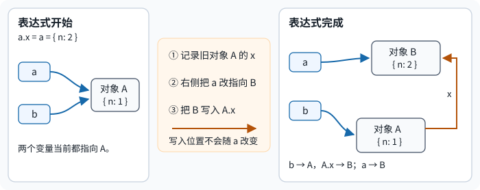

# JavaScript 的值有哪些类型，“相等”又有几种？

本章回答两件事：JavaScript 的值分成哪些类型、在条件和算术里怎样转换；以及代码说“两个值相等”时，实际用的是哪一种相等规则。读者手上是报表页请求代码拿到的两份行数据，读完应能判断金额 `0` 算不算“没有数据”、两条记录算不算“同一条”，并知道结构比较为什么必须先写契约。

## 案例：同一行数据到了两次

沿用主线一的报表页 `/reports/42?sort=recent#summary`。主线一只用到 May 行 `r-104` 的 `id`、`date` 和 `label`；请求代码拿到的完整行数据还有金额 `amount` 和负责人 `owner`（Ada，用户 ID `u-17`）。第一次响应里金额是 `0`。用户点了重试，第二次响应里同一行的金额变成 `120`。代码把两份结果都留着：

~~~javascript
const owner = { id: "u-17", name: "Ada" };
const first = { id: "r-104", amount: 0, owner };
const retry = {
  id: "r-104",
  amount: 120,
  owner: { id: "u-17", name: "Ada" }, // 第二次响应解析出的新对象
};
~~~

接下来要回答三个问题：`first.amount` 为 `0` 是不是“缺数据”；`first` 和 `retry` 是不是同一条记录；两个 `owner` 是不是同一个人。答案取决于用哪种转换、哪种相等。主线三后面几章继续用这组数据。

## 七种原始类型，其余都是对象

JavaScript 有七种 primitive type（原始类型），其余的值都是 object（对象），函数也是对象。

| 类型 | 本章用到的行为 |
|---|---|
| `undefined` | 读取不存在的属性或越界索引的常见结果；也可以显式存进属性 |
| `null` | 显式表示“当前没有对象”；历史原因使 `typeof null` 为 `"object"` |
| `Boolean` | `true` 与 `false` |
| `Number` | IEEE 754 `binary64`（64 位二进制浮点）；包含 `NaN`、正负无穷和 `+0`/`-0` |
| `BigInt` | 任意精度整数；不能直接与 `Number` 混合做算术 |
| `String` | 不可变的 UTF-16 code unit（码元）序列 |
| `Symbol` | 每次 `Symbol()` 都产生一个新的唯一值；`Symbol.for(key)` 从全局注册表取回同一个值；可作属性键 |

对象和原始值的关键区别在“身份”。把对象赋给另一个变量，复制的是指向它的引用，两个变量从此指向同一个对象；修改其中一个看到的属性，另一个也看得到。常说的 reference type（引用类型）只是这条语义的简称：值在内存里放在栈上还是堆上，由引擎决定，语言并不规定。

案例里，`first.owner` 和变量 `owner` 是同一个对象；`retry.owner` 是第二次响应解析出来的另一个对象，只是字段内容相同。

## 真值转换和数值转换是两套规则

条件判断只问一个值算真还是算假，这叫真值转换，`Boolean(value)` 和 `!!value` 都执行它。假值只有 `false`、`0`、`-0`、`0n`、`""`、`null`、`undefined` 和 `NaN`；其他值都为真，包括空数组、空对象和字符串 `"false"`。

转成数字是另一套规则：空字符串和 `null` 变成 `0`，`undefined` 变成 `NaN`，带尾随字符的字符串整体变成 `NaN`。

~~~javascript
Boolean("false");  // true
Boolean([]);       // true
Boolean({});       // true

Number("");        // 0
Number(null);      // 0
Number(undefined); // NaN
Number("12px");    // NaN；parseInt("12px", 10) 才会读出 12

Number.isNaN("x"); // false：不做转换，只认真正的 NaN
isNaN("x");        // true：先把 "x" 转成数字 NaN
~~~

对象转布尔值一律为 `true`，唯一例外是浏览器的历史对象 `document.all`：标准附录为兼容旧网页，规定它转布尔值为 `false`、`typeof` 为 `"undefined"`、`document.all == null` 为 `true`。普通对象不受影响，业务代码不该依赖它。

逻辑运算符 `&&`、`||` 返回的是其中一个操作数，不一定是布尔值：`0 && "x"` 的结果是 `0`，`"" || "默认"` 的结果是 `"默认"`。React 里写 `{count && <List />}` 时页面会显示一个 `0`，原因就在这里，见[一份界面状态该由谁持有？](../ui-state/state-ownership-and-composition.md)。

回到案例：`first.amount` 是 `0`，所以 `if (!first.amount)` 会把合法的零金额当成缺数据。要问“有没有值”，就直接比较 `first.amount === undefined`，或者用只认 `null`/`undefined` 的 `??`，见[读写一个属性时，JavaScript 沿什么规则查找、落在哪里？](objects-properties-and-prototypes.md#缺失属性：可选链、空值合并与解构默认值)。

## == 会先转换，=== 不会

strict equality（严格相等，`===`）不做跨类型转换，类型不同直接为 `false`。loose equality（宽松相等，`==`）在类型不同时按一串规则转换后再比，结果常常出人意料：

~~~javascript
5 == "5";          // true：字符串转成数字
"" == 0;           // true
"0" == false;      // true：两边都转成数字 0
[] == false;       // true：[] 先转成 ""，再转成 0
null == undefined; // true：规范里的特例
null == 0;         // false：null 只与 undefined 宽松相等
~~~

所以默认用 `===`。`value == null` 是少数有意的用法：它恰好匹配 `null` 和 `undefined`，不匹配 `0`、`""` 或 `false`（`document.all` 这个历史例外除外）。

比较对象时，两个运算符都只看 identity（身份）：

~~~javascript
first.id === retry.id;       // true：业务字段相同
first === retry;             // false：两个对象
first.owner === retry.owner; // false：内容相同，身份不同
first.owner === owner;       // true：同一个对象
~~~

`id` 相同，说明两条记录描述同一个业务实体；但在语言层面它们是两个对象。“按 `id` 认定同一行”是应用定下的规则，语言不会替你推断。

## 三种相等规则：===、Object.is 与 SameValueZero

除了带转换的 `==`，语言里还有三种不做转换的相等规则。它们对对象都只看身份，差别只在 `NaN` 和带符号的零上：

| 规则 | `NaN` 与自身 | `+0` 与 `-0` | 对象 | 谁在用 |
|---|---|---|---|---|
| IsStrictlyEqual（严格相等） | 不等 | 相等 | 按身份 | `===`、`!==`；数组 `indexOf`、`lastIndexOf`；`switch` 的 `case` 匹配 |
| SameValue（同值） | 相等 | 不等 | 按身份 | `Object.is`；React 判断 state 是否变化、依赖是否变化 |
| SameValueZero（同值零） | 相等 | 相等 | 按身份 | `Map` 的键、`Set` 的成员、数组 `includes` |

~~~javascript
NaN === NaN;                      // false
Object.is(NaN, NaN);              // true
Object.is(+0, -0);                // false
+0 === -0;                        // true

[NaN].indexOf(NaN);               // -1：indexOf 用 ===
[NaN].includes(NaN);              // true：includes 用 SameValueZero
new Set([NaN, NaN, -0, +0]).size; // 2：一个 NaN，一个 0
~~~

记住两条就能推出大多数结果：`===` 是唯一认为 `NaN` 不等于自身的规则；`Object.is` 是唯一区分 `+0` 与 `-0` 的规则。用 `indexOf` 找 `NaN` 永远找不到，用 `Set` 去重会把 `-0` 和 `+0` 合成一个。

三种规则都不比较对象内容。React 用 `Object.is` 比较新旧 state，所以原地修改一个对象再把同一引用交给 setter，React 会认为没有变化；原地修改从哪里来，见[复制一个对象到底复制了什么？](copying-and-object-graphs.md)；React 怎样据此决定是否重渲染，见[React 怎样把一次用户操作变成界面更新？](../ui-state/react-update-model.md)。`Map`、`Set` 怎样用 SameValueZero 去重和建索引，见[数组、Map、Set 和普通对象怎样选，空位和去重有哪些坑？](arrays-maps-and-sets.md)。

## 浮点数比较要先定容差

`Number` 是二进制浮点数，`0.1`、`0.2` 这类十进制小数大多不能用有限位二进制精确表示，相加后会带上舍入误差：

~~~javascript
0.1 + 0.2;                           // 0.30000000000000004
0.1 + 0.2 === 0.3;                   // false
Math.abs((0.1 + 0.2) - 0.3);         // 5.551115123125783e-17
Math.abs((0.1 + 0.2) - 0.3) < 1e-12; // true：对这个量级的数成立
~~~

容差要按领域定：数值量级、业务能接受的误差和舍入规则共同决定它，没有对所有场景都成立的固定 epsilon（误差容限）。`Number.EPSILON`（约 `2.22e-16`）只是 `1` 附近相邻两个浮点数的间距，数值变大后间距随之变大，它不是通用容差。

金额这类需要精确相等的量，可在币种规则允许时换成最小单位的整数：`0.10 + 0.20` 元改记为 `10 + 20` 分，得到精确的 `30`。整数在 `Number.MAX_SAFE_INTEGER`（2⁵³ − 1 = 9007199254740991）以内才能精确表示，超出时用 `BigInt` 或明确舍入规则的十进制库。

## 变量保存引用：赋值顺序与传参

对象按引用共享，带来两个常见的推理题。

第一个是连续赋值。属性赋值先确定左边要写哪个对象的哪个属性，再求右边的值；右边即使让变量改指别处，已经确定的写入位置也不变：

~~~javascript
let a = { n: 1 };
const b = a;
a.x = a = { n: 2 };

a.x; // undefined
b.x; // { n: 2 }：写入落在先前记下的旧对象上
~~~

设旧对象为 A、新对象为 B。求值分三步：先记下写入位置 `A.x`；再执行右边的 `a = { n: 2 }`，让 `a` 改指 B；最后把 B 写进记下的 `A.x`。

*图：左侧求值时固定写入位置；表达式结束后，`a` 指向新对象 B，`b` 仍指向旧对象 A，且 `A.x` 指向 B。*

第二个是函数传参。JavaScript 一律按值传递：形参拿到实参值的副本。实参是原始值时，修改形参不影响调用方；实参是对象时，副本是同一个引用，所以改属性对调用方可见，但给形参重新赋一个对象，调用方的变量不会改指。

~~~javascript
function update(count, profile) {
  count += 1;
  profile.name = "Grace";            // 改的是调用方也指向的那个对象
  profile = { name: "Replacement" }; // 只让形参改指，调用方不受影响
}

let count = 1;
const profile = { name: "Ada" };
update(count, profile);
count;        // 1
profile.name; // "Grace"
~~~

这也是浅复制会共享嵌套对象的原因：新数组或新记录里装的仍是原来那些对象的引用，见[复制一个对象到底复制了什么？](copying-and-object-graphs.md)。

## 类型检查各回答什么

几种常见检查各自只回答一个窄问题：

- `typeof` 适合区分原始值和函数：`typeof 1n` 为 `"bigint"`，`typeof (() => {})` 为 `"function"`；但 `typeof null` 是 `"object"`，数组也是 `"object"`。
- `Array.isArray(value)` 检查是不是数组，也能认出来自另一个 realm（执行环境，例如 iframe 或另一个窗口各有一套全局对象）的数组。
- `value instanceof C` 检查 `C.prototype` 是否在 `value` 的原型链上。不同 realm 的 `Array` 各有自己的 `prototype`，所以 iframe 里创建的数组 `instanceof Array` 为 `false`；`Symbol.hasInstance` 还能改写这项检查。
- `Object.prototype.toString.call(value)` 给出 `"[object Array]"` 这类内建标签，但 `Symbol.toStringTag` 可以伪造它：

~~~javascript
const misleading = { [Symbol.toStringTag]: "Array" };
Object.prototype.toString.call(misleading); // "[object Array]"，但它不是数组
~~~

这些检查都证明不了“这个值具有程序需要的形状”。处理响应、存储这类外部数据时，应按需要的形状逐项检查，见[TypeScript 能保证什么，外部数据又该怎样验证？](typescript-guarantees-and-runtime-validation.md)。

## 结构相等：先写契约再比较

`===` 对对象只看身份，可业务常要问另一件事：两份数据的内容是否一样。比如判断用户改过的筛选条件和初始值是否相同。语言没有内建的统一答案，因为“内容一样”要先回答很多问题：键的顺序算不算、`{ amount: undefined }` 和 `{}` 算不算相同、`NaN` 等不等于自身、`Date` 怎么比。所以先写比较契约，再写代码。

下面的教学实现针对接口返回值、筛选条件这类纯数据，契约是：

- **整体形状**：有限、无环的对象图；不同属性可以共享同一个子对象。代码不检测循环，由调用方保证无环。
- **容器**：当前 realm 的普通数组、普通对象或 null 原型对象。只比较自有、可枚举、字符串键的数据属性；对象键的顺序不重要，数组的索引顺序重要；键缺失和“键存在但值为 `undefined`”算不同。数组的 `length` 是不可枚举的自有属性，单独比较。
- **叶子**：`null`、`undefined`、布尔值、字符串或数字，用 `Object.is` 比较。
- **契约之外**：Symbol 键或其他不可枚举属性、访问器、Proxy、函数、BigInt 和 Symbol 值，以及 `Date`、`Map` 等带内部状态的对象。

递归分四步：先区分叶子与容器，叶子直接用 `Object.is`；再确认两边同为数组或同为对象；然后对象比较原型类别、数组比较 `length`；最后比较可枚举自有键的集合，并对每个键的值递归。

> [!example]- 契约内的 deepEqual 教学实现
>
> ~~~javascript
> function isPlainObject(value) {
>   const prototype = Object.getPrototypeOf(value);
>   return prototype === Object.prototype || prototype === null;
> }
>
> function deepEqual(left, right) {
>   const leftIsObject = left !== null && typeof left === "object";
>   const rightIsObject = right !== null && typeof right === "object";
>   if (!leftIsObject || !rightIsObject) {
>     return !leftIsObject && !rightIsObject && Object.is(left, right);
>   }
>
>   const leftIsArray = Array.isArray(left);
>   const rightIsArray = Array.isArray(right);
>   if (leftIsArray !== rightIsArray) return false;
>
>   if (leftIsArray) {
>     if (Object.getPrototypeOf(left) !== Array.prototype ||
>         Object.getPrototypeOf(right) !== Array.prototype) {
>       throw new TypeError("只支持当前 realm 的普通数组");
>     }
>     if (left.length !== right.length) return false;
>   } else {
>     if (!isPlainObject(left) || !isPlainObject(right)) {
>       throw new TypeError("只支持普通对象或 null 原型对象");
>     }
>     if (Object.getPrototypeOf(left) !== Object.getPrototypeOf(right)) {
>       return false;
>     }
>   }
>
>   if (Object.is(left, right)) return true;
>
>   const leftKeys = Object.keys(left);
>   const rightKeys = Object.keys(right);
>   if (leftKeys.length !== rightKeys.length) return false;
>
>   for (const key of leftKeys) {
>     if (!Object.hasOwn(right, key)) return false;
>
>     const leftDescriptor = Object.getOwnPropertyDescriptor(left, key);
>     const rightDescriptor = Object.getOwnPropertyDescriptor(right, key);
>     if (!Object.hasOwn(leftDescriptor, "value") ||
>         !Object.hasOwn(rightDescriptor, "value")) {
>       throw new TypeError("只支持数据属性");
>     }
>     if (!deepEqual(leftDescriptor.value, rightDescriptor.value)) {
>       return false;
>     }
>   }
>   return true;
> }
> ~~~

实现里有几处值得注意。它通过属性描述符读值，不会调用输入里的 getter，遇到可枚举的访问器就抛 `TypeError`。数组的空位不出现在 `Object.keys` 里，所以“某个索引是否存在”会影响结果。两边是同一个引用时，通过类别检查后直接由 `Object.is` 判为相等，不再看内部内容，这也是它不能充当输入校验器的原因之一。

| 输入 | 差异 | 结果 |
| --- | --- | --- |
| `{ a: 1, b: 2 }` 与 `{ b: 2, a: 1 }` | 只有键的插入顺序不同 | `true` |
| `{ amount: undefined }` 与 `{}` | 一边缺少自有键 | `false` |
| `[]` 与 `[,]` | `length` 分别为 0 和 1 | `false` |
| `[,]` 与 `[undefined]` | 前者索引 0 是空位，后者有自有元素 | `false` |
| `[1, 2]` 与 `[2, 1]` | 索引顺序不同 | `false` |
| `{ value: NaN }` 与 `{ value: NaN }` | `Object.is(NaN, NaN)` | `true` |
| `{ value: -0 }` 与 `{ value: +0 }` | `Object.is(-0, +0)` | `false` |
| `{}` 与 `Object.create(null)` | 自有键相同，原型类别不同 | `false` |
| 左边两个属性共享同一子对象，右边各存一份等值副本 | 只比值，不比共享关系 | `true` |
| 两个不同的 `new Date(0)` | `Date` 在契约之外 | 抛 `TypeError` |

回到案例，三个问题都有了答案：

~~~javascript
deepEqual(first.owner, retry.owner); // true：两个对象，内容相同
deepEqual(first, retry);             // false：amount 一个是 0，一个是 120
first.id === retry.id;               // true：按业务规则是同一行
~~~

所以“同一行”和“内容相同”是两个问题：按 `id` 认定同一行，再按契约比较内容，才能知道重试带来了哪些变化。

这份契约依赖调用方提供可信的纯数据，例如刚由 `JSON.parse` 得到的值。原型检查证明不了对象是纯数据：把一个 `Date` 的原型改成 `Object.prototype`，它就能混过检查。递归深度还受调用栈限制，过深的对象图会栈溢出。

有人用 `JSON.stringify` 的结果字符串代替结构比较，但两者不等价：键的插入顺序会改变输出，值为 `undefined` 的属性被省略，`-0` 写成 `0`，`NaN` 写成 `null`。

~~~javascript
JSON.stringify({ a: 1, b: 2 }) === JSON.stringify({ b: 2, a: 1 }); // false
JSON.stringify({ amount: undefined }) === JSON.stringify({});    // true
JSON.stringify({ amount: -0 }) === JSON.stringify({ amount: 0 }); // true
~~~

## 从值到属性

本章给案例定下了几条判断：金额 `0` 是合法值，判断缺失要比较 `undefined` 或用 `??`；`first` 和 `retry` 是两个对象，“同一行”由 `id` 这条业务规则决定；`Object.is`、`===`、SameValueZero 只在 `NaN` 和 `±0` 上有分歧，对象一律比身份；内容是否相同需要一份写明范围的比较契约。

这些判断都要先读出 `first.amount`、`first.owner` 这样的属性。下一章接着问：读写一个属性时，JavaScript 到哪些对象上去找，写入又落在哪个对象上？见[读写一个属性时，JavaScript 沿什么规则查找、落在哪里？](objects-properties-and-prototypes.md)。

> [!info]- 来源
> - 七种原始类型、`Number` 的 binary64 表示、对象与引用语义（“七种原始类型，其余都是对象”“浮点数比较要先定容差”）：[ECMAScript 2026 §6.1 ECMAScript Language Types](https://tc39.es/ecma262/2026/multipage/ecmascript-data-types-and-values.html)；安全整数上限：[§21.1.2.6 Number.MAX_SAFE_INTEGER](https://tc39.es/ecma262/2026/multipage/numbers-and-dates.html#sec-number.max_safe_integer)、[§21.1.2.1 Number.EPSILON](https://tc39.es/ecma262/2026/multipage/numbers-and-dates.html#sec-number.epsilon)。
> - 真值转换与数值转换（“真值转换和数值转换是两套规则”）：[ECMAScript 2026 §7.1.2 ToBoolean、§7.1.4 ToNumber](https://tc39.es/ecma262/2026/multipage/abstract-operations.html)；`Number.isNaN` 与全局 `isNaN`：[§21.1.2.4](https://tc39.es/ecma262/2026/multipage/numbers-and-dates.html#sec-number.isnan)、[§19.2.3 isNaN](https://tc39.es/ecma262/2026/multipage/global-object.html#sec-isnan-number)；`&&`、`||` 返回操作数：[§13.13 Binary Logical Operators](https://tc39.es/ecma262/2026/multipage/ecmascript-language-expressions.html#sec-binary-logical-operators)。
> - `document.all` 的历史例外：[ECMAScript 2026 Annex B IsHTMLDDA internal slot](https://tc39.es/ecma262/2026/multipage/additional-ecmascript-features-for-web-browsers.html#sec-IsHTMLDDA-internal-slot)。
> - 宽松相等、严格相等、SameValue、SameValueZero（“== 会先转换，=== 不会”“三种相等规则”）：[ECMAScript 2026 §7.2.9 SameValue、§7.2.10 SameValueZero、§7.2.13 IsLooselyEqual、§7.2.14 IsStrictlyEqual](https://tc39.es/ecma262/2026/multipage/abstract-operations.html)，访问于 2026-11-12；`indexOf` 与 `includes` 的比较规则：[§23.1.3.17 Array.prototype.indexOf](https://tc39.es/ecma262/2026/multipage/indexed-collections.html#sec-array.prototype.indexof)、[§23.1.3.16 Array.prototype.includes](https://tc39.es/ecma262/2026/multipage/indexed-collections.html#sec-array.prototype.includes)；`switch` 匹配：[CaseClauseIsSelected](https://tc39.es/ecma262/2026/multipage/ecmascript-language-statements-and-declarations.html#sec-runtime-semantics-caseclauseisselected)；`Map`/`Set` 使用 SameValueZero：[§24.1–24.2 Keyed Collections](https://tc39.es/ecma262/2026/multipage/keyed-collections.html)。
> - React 用 `Object.is` 判断新 state 是否与当前 state 相同并跳过重渲染（“三种相等规则”表中“谁在用”一列）：[React 文档 useState — Caveats](https://react.dev/reference/react/useState)；依赖逐项用 `Object.is` 比较：[React 文档 useEffect — Parameters](https://react.dev/reference/react/useEffect)，访问于 2026-11-26；React 条件渲染中 `0` 会被渲染（“真值转换”一节）：[React 文档 Conditional Rendering](https://react.dev/learn/conditional-rendering)，访问于 2026-11-06。
> - 赋值先求左侧引用、再求右侧值并写回（“变量保存引用”）：[ECMAScript 2026 §13.15.2 Assignment Operators — Runtime Semantics](https://tc39.es/ecma262/2026/multipage/ecmascript-language-expressions.html#sec-assignment-operators-runtime-semantics-evaluation)，访问于 2026-11-12。
> - `instanceof` 与 `Object.prototype.toString` 的检查行为（“类型检查各回答什么”）：[ECMAScript 2026 §13.10.2 InstanceofOperator](https://tc39.es/ecma262/2026/multipage/ecmascript-language-expressions.html#sec-instanceofoperator)、[§20.1.3.6 Object.prototype.toString](https://tc39.es/ecma262/2026/multipage/fundamental-objects.html#sec-object.prototype.tostring)；`Array.isArray`：[§23.1.2.3](https://tc39.es/ecma262/2026/multipage/indexed-collections.html#sec-array.isarray)。
> - 教学 `deepEqual` 用到的属性描述符、数组 `length` 与自有性检查（“结构相等”）：[ECMAScript 2026 OrdinaryGetOwnProperty](https://tc39.es/ecma262/2026/multipage/ordinary-and-exotic-objects-behaviours.html#sec-ordinarygetownproperty)、[Array Exotic Objects](https://tc39.es/ecma262/2026/multipage/ordinary-and-exotic-objects-behaviours.html#sec-array-exotic-objects)、[Object.hasOwn](https://tc39.es/ecma262/2026/multipage/fundamental-objects.html#sec-object.hasown)、[数组实例的 length](https://tc39.es/ecma262/2026/multipage/indexed-collections.html#sec-properties-of-array-instances-length)，访问于 2026-11-12。比较契约、不支持的类型和“输入必须无环”由本章示例定义。
> - `JSON.stringify` 对 `undefined` 属性、`-0`、`NaN` 与键顺序的处理（“结构相等”末段）：[ECMAScript 2026 §25.5.4.2 SerializeJSONProperty、§25.5.4.5 SerializeJSONObject](https://tc39.es/ecma262/2026/multipage/structured-data.html#sec-json.stringify)、[§10.1.11.1 OrdinaryOwnPropertyKeys](https://tc39.es/ecma262/2026/multipage/ordinary-and-exotic-objects-behaviours.html#sec-ordinaryownpropertykeys)，访问于 2026-11-12。
> - 本章示例在 Node.js v26.13.1 / V8 14.6.202.34-node.40 复跑，2026-11-26；原稿在 Node.js v26.13.0 下执行于 2026-11-12，`deepEqual` 边界用例原始复演日期 2026-11-09。
