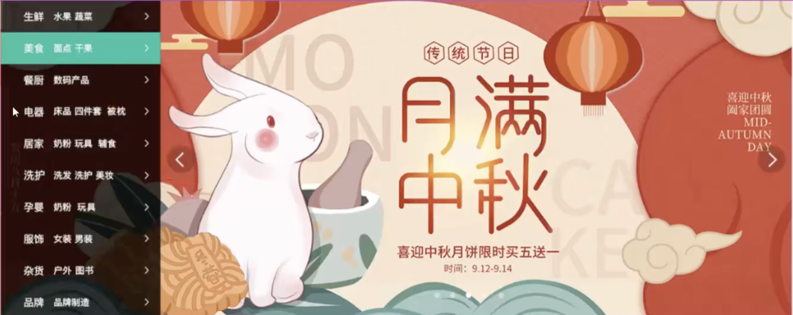

# 怎样为报表图标选择资源形式？

报表工具栏的图标可以内嵌 SVG（可缩放矢量图形）、使用可缓存的外部 SVG/图片、从雪碧图中裁取，或沿用图标字体。选择时要看图标颜色能否随状态改变、是否跨页面复用、下载与缓存边界，以及控件怎样获得可访问名称。

## SVG 怎样兼顾颜色、复用与替代文本？

同页面中的行内 SVG 是文档的一部分，可以用 CSS 设置颜色；让形状使用 `currentColor`（当前文字颜色），就能跟随按钮的 `color`（文字颜色）。按钮已有可见文字时，图标只是装饰：

~~~html
<button type="button" class="report-action">
  <svg class="report-action__icon" viewBox="0 0 16 16" aria-hidden="true">
    <path d="M7 2h2v5h5v2H9v5H7V9H2V7h5z" fill="currentColor" />
  </svg>
  <span>添加筛选条件</span>
</button>
~~~

~~~css
.report-action { color: #24547d; }
.report-action__icon { width: 1em; height: 1em; }
~~~

如果图标内容固定、在多个页面复用，可把 SVG 作为独立资源交给 ``，从而按 URL 单独缓存。宿主页面的 CSS 不能直接选择外部 SVG 文档中的路径，SVG 里的 `currentColor` 也不会继承按钮颜色；信息图像应在 `` 写替代文本，按钮内已有可见名称时用 `alt=""`：

~~~html
<button type="button">
  
  <span>添加筛选条件</span>
</button>
~~~

行内 SVG 便于按主题换色，但标记会随 HTML 一同传输；外部 SVG 可独立缓存和复用，缓存策略允许时多个页面可重用同一 URL、减少重复传输，却不适合直接由宿主页面逐路径改色。控件名称应来自控件内的可见文字、图片的替代文本，或显式关联的可访问名称；孤立的相邻文字不会自动成为控件名称。

## CSS Sprite 怎样裁出图集中的一格？

CSS Sprite（雪碧图）把多个小图排进同一张 sprite sheet（精灵图集），再用固定尺寸的盒子和 `background-position`（背景图像定位）露出目标区域。假设图集是 `64 × 32px`，每格 `16 × 16px`，共有 4 列、2 行：

```text
x →    0      16      32      48
y   ┌──────┬──────┬──────┬──────┐
0   │  1   │  2   │  3   │  4   │
    ├──────┼──────┼──────┼──────┤
16  │  5   │  6   │ [7]  │  8   │
    └──────┴──────┴──────┴──────┘
```

> [!example] 第二行第三列的坐标
> 以左上角为原点，该格左上角在 `(32, 16)`；背景向左、向上移动对应距离后，它落在 `16 × 16px` 的视窗内，所以两个定位偏移写成 `-32px -16px`。

~~~css
.icon-edit {
  display: inline-block;
  width: 16px;
  height: 16px;
  background-image: url("/assets/report-icons.png");
  background-repeat: no-repeat;
  background-position: -32px -16px;
}
~~~

图集变化时，每个图标坐标都可能要更新；改动一个格子也会改变整张图集资源，页面需要获取更新后的整份图像。若用内容哈希命名，文件 URL 也随之变化。图标多时可由资源构建步骤生成坐标，避免人工维护数字。背景图本身不提供有意义的替代文本；功能图标要由按钮或链接的可访问名称表达。

若图片本身承载信息，使用 `` 提供替代文本，并按[图片资源加载规则](../browser-apis/image-lazy-loading.md)处理宽高、候选资源和加载时机。

## Sprite 是否一定比独立图片快？

合并能减少一些独立资源请求，但并不自动减少总传输量：页面可能为一个图标下载整张图集。HTTP/2 可在一个连接上多路复用多个流，图片请求数也不等于每张图都新建连接。比较时按实际页面测总字节、压缩、缓存复用和更新频率；图标经常独立变化或只在少数页面出现时，分开缓存可能更合适。

## 图标字体怎样保留可访问名称？

icon font（图标字体）把图案映射到字体字形，因此可按文字方式用 CSS 控制颜色和尺寸。每个私用区码点只对配套字体文件有意义；字体载入失败时，外形可能缺失或变成替代符号。把图标保持为装饰，让按钮或链接文字承担功能名称：

~~~css
@font-face {
  font-family: "report-icons";
  src: url("/assets/report-icons.woff2") format("woff2");
}

.icon {
  font-family: "report-icons";
  font-size: 1.25rem;
  line-height: 1;
}
~~~

~~~html
<button type="button">
  <span class="icon" aria-hidden="true">&#xe900;</span>
  <span>编辑报表</span>
</button>
~~~

`aria-hidden="true"` 把纯装饰字形从辅助技术呈现中隐藏，按钮的可见文字仍提供名称。若设计确实是无文字图标按钮，应给按钮本身设置合适名称，例如 `aria-label="编辑报表"`；不要让私用区字符成为唯一可理解的名称。

## 旧横幅图展示的是静态选中项

雪碧图从同一张资源里裁出装饰性小图；横幅则按状态显示完整图片，图片角色不同会影响替代文本和加载时机。下面保留归档横幅图与 `.current` 片段，展示静态选中项。图片原件保持不变：



旧例用 `.current` 显示选中的一项，是静态横幅切换状态的 CSS 片段：

~~~html
<ul class="report-banner">
  <li class="current">
    <a href="/reports/monthly"></a>
  </li>
  <li>
    <a href="/reports/quarterly"></a>
  </li>
</ul>
~~~

~~~css
.report-banner {
  position: relative;
  overflow: hidden;
  aspect-ratio: 16 / 5;
  margin: 0;
  padding: 0;
  list-style: none;
}
.report-banner li { position: absolute; inset: 0; display: none; }
.report-banner li.current { display: block; }
.report-banner img { display: block; width: 100%; height: 100%; object-fit: cover; }
~~~

这段代码只决定哪项显示；它没有自动轮换、前后按钮、键盘模式或暂停控制，因此不构成完整轮播。真正的自动轮播需提供操作控制并照顾焦点、悬停和减少动态效果；连续移动图片的装饰演算见[CSS 过渡与动画](../html-css/css-transitions-and-animations.md)。

> [!info]- 来源
> - 背景图像坐标：W3C CSS Backgrounds and Borders Level 3，Candidate Recommendation Draft（2024-03-11），[background-position](https://www.w3.org/TR/css-backgrounds-3/#the-background-position)，检查于 2026-11-06。
> - 多路复用：IETF RFC 9113，HTTP/2，Standards Track（2022-06），[Streams and multiplexing](https://www.rfc-editor.org/rfc/rfc9113.html#name-streams-and-multiplexing)，检查于 2026-11-06。
> - HTTP 缓存语义：IETF RFC 9111，HTTP Caching，Standards Track（2022-06），[HTTP Caching](https://www.rfc-editor.org/rfc/rfc9111.html)，检查于 2026-11-06。
> - 可下载字体及 <code>@font-face</code>：W3C CSS Fonts Level 4，Working Draft（2026-11-04），[CSS Fonts Level 4](https://www.w3.org/TR/css-fonts-4/)，检查于 2026-11-06。
> - 隐藏装饰字形并保留控件名称：W3C WAI-ARIA 1.2，Recommendation（2023-06-06），[`aria-hidden`](https://www.w3.org/TR/wai-aria-1.2/#aria-hidden)，及 WAI [Images Tutorial](https://www.w3.org/WAI/tutorials/images/)，检查于 2026-11-06。
> - SVG 文档、形状与呈现：W3C SVG 2，Candidate Recommendation Snapshot（2026-10-06），[SVG 2](https://www.w3.org/TR/SVG2/)，检查于 2026-11-06；该快照预计不早于 2026-12-01 进入 Recommendation 阶段。
> - `currentColor` 值：W3C CSS Color Level 4，Candidate Recommendation Draft（2026-11-03），[currentcolor](https://www.w3.org/TR/css-color-4/#valdef-color-currentcolor)，检查于 2026-11-06。
> - `` 的替代文本和图标规则：WHATWG HTML Living Standard（2026-11-05 更新），[Images](https://html.spec.whatwg.org/multipage/images.html#the-img-element)，检查于 2026-11-06；外部 SVG 作为图像资源时的处理见 [SVG 2: embedded content](https://www.w3.org/TR/SVG2/embedded.html)。
> - 自动轮播控制：W3C WAI [ARIA APG Carousel Pattern](https://www.w3.org/WAI/ARIA/apg/patterns/carousel/)，检查于 2026-11-06。
