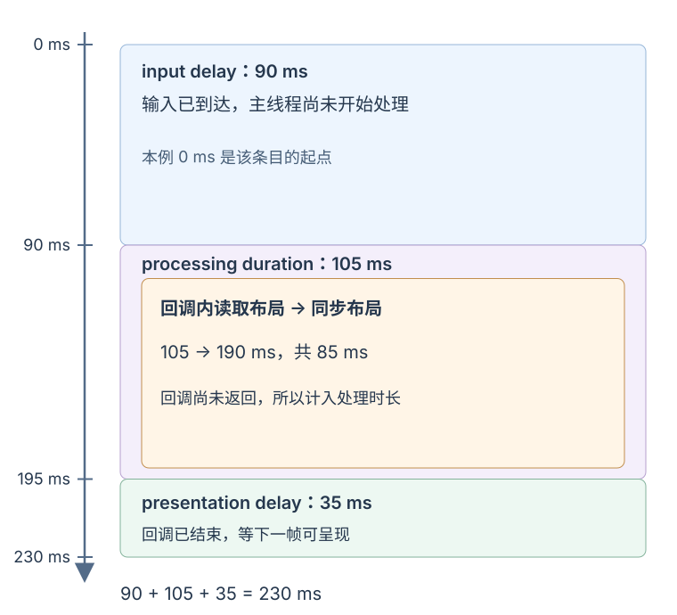

# 如何测量并诊断网页性能问题？

案例背景：用户打开 `https://example.test/reports?sort=recent#summary`，等报表首屏出现，再点击“最早优先”，把 May → April 排成 April → May。有人说“页面开得慢”，有人说“点击没反应”；这两句话描述的是不同体验。先用现场数据确定用户在哪条路径遇到问题，再用受控录制拆出浏览器花时间的阶段，最后用相同输入和动作验证修复。

为复现排序问题，下面把原来的两条示意报表扩成 **50,000 条合成记录**，仍执行同一次“最早优先”操作。测试只把排序后前 50 行写入表格，避免把全量 Document Object Model (文档对象模型，DOM)的成本混进排序计算。这个规模只用于暴露重复日期解析，**不是浏览器门槛，也不是实际站点数据**。

## 先判断用户感受到的是加载、交互还是位移

Core Web Vitals（核心网页指标）是三项衡量实际用户体验的稳定指标。良好阈值用于评价现场样本分布，不是单次访问的保证，也不能单独指出根因。

| 指标 | 用户感受到什么 | 良好目标 |
| --- | --- | ---: |
| Largest Contentful Paint（最大内容绘制，LCP） | 视口中最大的合格图片、文字块或视频何时绘制，近似反映主要内容何时可见 | ≤ 2.5 秒 |
| Interaction to Next Paint（交互到下一次绘制，INP） | 点击、触屏或键盘操作开始后，浏览器何时首次能呈现下一帧 | ≤ 200 毫秒 |
| Cumulative Layout Shift（累积布局偏移，CLS） | 页面中意外的内容移动有多严重 | ≤ 0.1 |

这些目标看现场访问分布的第 75 百分位（p75），并分别按移动端和桌面端检查。INP 的分布只包含有可测交互值的访问；纯阅读或只滚动的访问可能没有 INP，不能把缺失值当作 0 毫秒。若某页面的 p75 达到目标，至少四分之三的该组样本不高于该值；其余访问仍可能更慢。INP 针对一次访问中的点击、触屏和键盘交互，通常记录最慢的一次；一页有很多交互时，每 50 次忽略其中最慢的一次。CLS 不是把页面生命周期内的所有偏移相加，而取分数最大的 session window（会话窗口）：连续偏移之间少于 1 秒，整个窗口最多 5 秒。离散点击、触屏或按键后 500 毫秒内的偏移可按近期输入规则排除；连续滚动不适用此规则，较晚发生的异步位移仍可能计入。

指标各自回答不同问题。同一路由的 LCP 良好，不表示排序点击响应也良好；INP 良好也不表示异步请求返回得快，因为 INP 截止于浏览器能呈现下一帧的时点，不等待所有网络或业务工作完成。对长操作，若希望“正在排序”先出现在屏幕上，需要在同步工作前让出主线程，或启动异步工作；同一回调里先改文字再做同步排序，浏览器通常要等回调结束才有机会绘制。

## 用现场分布选择要重现的动作

field data（现场数据）来自真实访问，包含用户设备、网络、缓存与操作路径的差异；lab data（实验室数据）在指定环境中运行，适合重复动作、检查主线程和比较改动。两者回答不同问题，不能把一次实验室录制的数字当作真实用户分布。

假设一个**纯教学用的合成报表**显示：`/reports?sort=recent` 的移动端 INP p75 为 430 毫秒，桌面端为 170 毫秒；路由 LCP、CLS 的 p75 都在良好目标内。这组数字不是来自任何站点。430 毫秒落在 INP“需改进”区间（高于 200 毫秒、至多 500 毫秒），170 毫秒达到良好目标；它只告诉我们移动端的交互响应需要调查，不能证明排序是根因。实际排查时，Real User Monitoring（真实用户监测，RUM）若自行保留页面路径、查询参数、版本、设备组、操作类型，并把 INP 归因到“最早优先”点击，就能更快选择复现路径。RUM 也可按版本分组，在同一时间比较灰度版和对照版。

Chrome User Experience Report（Chrome 用户体验报告，CrUX）适合查看公开页面或整个来源的现场分布，但分组维度更少：它会去掉查询参数和片段，因此 `/reports?sort=recent#summary` 会归到 `/reports`；CrUX API 可以按页面或来源及设备类型查询，日常结果是 28 天滚动汇总，不提供应用部署版本这一维度。它能补充总体趋势，不能代替 RUM 的版本对照或具体按钮归因。

先按相同页面、交互目标、设备组和版本查看 RUM，再针对慢交互在实验室录制。版本效果优先用同一时间的灰度/对照分组；若只能前后比较，至少选时长和星期分布相近的窗口，并检查设备、操作和加载状态组成是否变化。CrUX 的 28 天滚动窗口适合看更广的趋势；相邻窗口会重叠，且没有应用版本标签，不能当成精确的发布前后对照。Chrome DevTools（Chrome 开发者工具）的 Performance（性能）面板可以单独录制导航或运行时点击：Interactions（交互）轨道标出输入、处理和呈现延迟，Main（主线程）轨道则显示对应的 JavaScript 调用、框架工作和浏览器任务。若只运行一次 Lighthouse 页面加载且没有执行点击，它没有观察到该排序交互的 INP。Total Blocking Time（总阻塞时间，TBT）把 First Contentful Paint（首次内容绘制，FCP）后指定窗口内每个超过 50 毫秒的主线程长任务中、超出 50 毫秒的部分相加；Lighthouse 的默认页面加载窗口通常在 Time to Interactive（可交互时间，TTI）结束。它能提示“用户此时点击可能要等”，却不含真实用户何时点击，所以只能作为 INP 的诊断线索，不能替代现场 INP。

## 把一次慢交互分成三个时间段

INP 不是单个事件处理器的耗时。一次触屏点击可能包含 `pointerdown`、`pointerup`、`click` 等 Event Timing（事件计时）条目；浏览器用 `interactionId` 把同一动作关联起来，交互延迟取这些条目中最长的 `duration`。不要把最早条目的起点到最晚条目的终点当成交互时长：一次长按里，按下事件用了 80 毫秒，约 288 毫秒后抬起和 `click` 各用了 40 毫秒，交互延迟仍是 80 毫秒；328 毫秒的跨条目包络把手指等待时间也算进去了。

阶段归因也要跟随这个最长条目所映射的帧。web-vitals 的当前实现按估算呈现时点 `startTime + duration` 分组，时点相差不超过 8 毫秒的条目作为同帧候选；输入延迟和处理时长取该帧组的处理边界，再以最长条目起点和时长做夹取。若最长时长并列且起点相同，库会保留这些并列条目用于归因；它仍不会把不同帧之间的等待并入处理时间。事件时长会按约 8 毫秒粒度量化，因此三段是定位主导阶段的估计值，不应按小数位理解为精确帧时间。下面的本地脚本按同一归因思路复核一个受控动作，不实现完整 INP 页面指标。

其三段时间可按下面的问题定位：

| 阶段 | 起止点 | 排查方向 |
| --- | --- | --- |
| input delay（输入延迟） | 最长 Event Timing 条目的 `startTime`，到其所属帧组开始处理；起点按这个条目夹取 | 此前的长任务、脚本执行或其他主线程占用 |
| processing duration（处理时长） | 最长条目所属帧组的事件处理边界 | 排序、筛选、组件计算、同步布局读取或监听器工作 |
| presentation delay（呈现延迟） | 该帧组处理结束，到最长条目估算的下一次呈现时点 | 后续主线程任务、样式计算、布局、绘制及帧提交 |

一个合成时间线可以帮助分清归属：输入在 `0 ms` 开始，回调到 `90 ms` 才开始；回调内在 `105 ms` 读取布局信息，触发 `85 ms` 同步布局；回调在 `195 ms` 返回，下一帧在 `230 ms` 可呈现。三个阶段分别为 `90 / 105 / 35 ms`，合计 `230 ms`。那 `85 ms` 布局发生在回调内部，因此属于处理时长；如果布局在回调返回后才发生，它才会落入呈现延迟。这是阶段分类示例，不是报表测量结果。

点击回调、微任务和浏览器何时获得下一次渲染机会的边界见[浏览器 JavaScript 何时运行，画面何时更新？](../runtime/event-loop.md)。如果轨迹显示处理器中的几何读取触发同步布局，或样式/布局/绘制延迟下一帧，再沿[为什么一次 DOM 改动会增加布局或绘制工作？](../html-css/rendering-pipeline-and-forced-layout.md)检查具体读写顺序。

若算法和输入规模已经合理，纯计算仍是主线程长任务，可以评估分块让出主线程，或把不依赖 DOM 的计算移到 Web Worker（网页工作线程）；Worker 会释放主线程处理界面，但不会消除总计算量，消息传递和结果提交也要计入。排序例子已通过预处理消除重复解析，先复测这个更简单的改动，再决定是否需要额外线程。

点“最早优先”后处理时长很高，可能是排序数据计算，也可能是 React 更新；若处理时长低而呈现延迟高，再看浏览器样式、布局和绘制轨迹。看到 `Layout` 或 `Paint` 本身不证明它是缺陷：应沿具体调用关系找出占时的那段工作。若 React render（渲染）/commit（提交）占了主要时间，再沿[如何测量并减少不必要的 React 工作？](./react-rendering-optimization.md)定位组件；若 DOM 规模或数据量是疑点，再分辨[长报表列表何时适合虚拟滚动？](./rendering-and-computation-optimization.md)里的网络、计算与挂载成本。

## 沿同一动作从症状走到证据

| 用户反馈 | 先看哪段证据 | 若证据支持，再检查什么 |
| --- | --- | --- |
| `/reports` 主要内容迟迟不出现 | 本次实际 LCP 元素、资源发现/请求/响应/绘制阶段 | LCP 图片是否过晚发现或被延迟加载；服务器响应或关键资源是否迟到；见下方 LCP 路径 |
| 点击后很久才开始处理 | INP 输入延迟及点击之前的 Main 轨道 | 阻塞任务来自应用脚本、第三方脚本还是先前交互；若是路由脚本的解析/执行，检查[构建产物拆分](../tooling/build-tools.md) |
| 回调开始后列表迟迟未变 | 处理时长、事件调用栈、React render/commit | 排序、筛选、重复解析或框架计算是否占主导 |
| 回调已结束，下一帧仍迟 | 呈现延迟及其后的样式、布局、绘制轨迹 | 是否有实际可避免的 DOM、样式或同步布局工作 |
| 图片或异步内容出现时页面跳动 | CLS 的 Layout shifts（布局偏移）轨道及发生时刻 | 内容空间是否预留；变化是否由用户操作触发，是否确属意外偏移 |
| 按钮已看见但无法操作 | 主线程是否阻塞、按钮处理器何时注册 | 可见时点与应用脚本就绪是否错开，见[脚本如何影响 HTML 解析与文档就绪？](../html-css/browser-html-and-css.md) |

对“页面开得慢”要录制导航，查看 LCP 候选和资源瀑布；对“点击没反应”要在相同页面状态下实际点按钮。不要用导航时的总耗时推断点击成本，也不要因为按钮已绘制就假设其处理器已经可用。一次轨迹只解释当前浏览器、设备模拟、缓存和数据条件；要说明多少真实用户遇到问题，还要回到相同设备组的现场分布。

报表行数变多时，也要把网络传输、客户端筛选/排序等数据计算、同时挂载的行与 DOM/布局工作分开测。服务端分页或缩小输入可以减少传输和客户端数据处理；虚拟化主要减少视口外的挂载节点，并不会撤销已经下载的全量数据，也不会自动消除一次全量排序。这个例子仅渲染 50 行，所以不能把长交互归因给大量 DOM；更完整的成本与虚拟化取舍见[长报表列表何时适合虚拟滚动？](./rendering-and-computation-optimization.md)。

## 若主要内容迟到，沿实际 LCP 资源路径处理

导航录制先确认本次视口里被选为 LCP 的元素，再按首字节、资源发现等待、资源下载和元素绘制延迟拆分；视口和内容不同，最大候选元素也可能变化。若候选是文字，资源发现等待和下载两段可以为零。若图片是 LCP，不要对它启用延迟加载；为图片或嵌入内容声明尺寸主要是预留布局空间、降低位移，不会普遍缩短 LCP。只有轨迹显示非关键资源争抢关键路径时才延迟它们；若发现晚源于 CSS（层叠样式表）阻塞，内联首屏必需的少量 CSS 可能减少等待，但会增大 HTML（超文本标记语言）文档，且重复样式不能像独立 CSS 文件一样单独缓存。服务端渲染或静态输出可让内容更早进入 HTML，却不自动保证 LCP 或交互响应良好。结合[图片延迟加载](../browser-apis/image-lazy-loading.md)和[HTTP（超文本传输协议）缓存](../../engineering-foundations/networking/http-protocols-and-websockets.md)按这条实际路径复测。

## 复现报表排序后，修掉重复日期解析

本次受控重现从相同的 50,000 条合成数据开始，每条 `createdAt` 都是 ISO 8601 时间字符串；首屏先显示按日期从新到旧排列的 50 行，点“最早优先”后复制数组、按日期升序排序，再生成并同步写入前 50 行。Performance 的主线程轨迹把时间集中在排序处理器中。计时器中的“50 行”阶段覆盖 HTML 字符串生成和 `innerHTML` 同步更新 DOM，计时在浏览器后续样式计算、布局和绘制之前结束；因此它不是浏览器渲染时间。DevTools 轨迹中的 Layout、PrePaint、Paint 出现在事件回调之后，属于后续呈现工作。

基线在每次比较时都调用两次 `Date.parse`；Chrome 这组重放中点击内共调用 1,293,094 次。预处理把每条记录复制并增加毫秒字段、解析一次，再由点击只比较数值。两种排序都保留同一全量顺序；初始化预处理是额外成本，不是免费优化。

`Date.parse` 对这些带 `Z` 的 UTC ISO 8601 时间返回自 Unix 纪元起的毫秒数。比如 2026 年 4 月 1 日的数值小于 5 月 1 日；升序比较器 `a.createdAtMs - b.createdAtMs` 因而返回负数，把更早的 4 月记录排在前面。

~~~javascript
const normalized = source.map(report => ({
  ...report,
  createdAtMs: Date.parse(report.createdAt)
}));

const oldestFirst = normalized
  .slice()
  .sort((a, b) => a.createdAtMs - b.createdAtMs);
~~~

`slice()` 让本次排序使用副本，避免 `sort()` 改写原数组。预处理把解析工作移到数据准备阶段，代价是增加一份数值字段并占用初始化时间；如果日期本来已是数值、只排序一次，或初始化成为新瓶颈，这种预处理未必划算。应按真实访问顺序选择在哪一阶段承担成本。

在此浏览器中观察到的结果如下。每次点击可观察到 `pointerdown`、`pointerup`、`click` 条目；表中交互延迟取同一 `interactionId` 的最长 `duration`。九次实验的 p75 按最近秩法取第 `ceil(0.75 × 9) = 7` 个排序结果，只是重复单击这一固定操作的实验室摘要，不是一次真实页面访问的 INP，也不是稳定的现场百分位。处理器和 DOM 写入等阶段各自单独取 p75；阶段拆分例子则取达到交互延迟 p75 的那次原始样本，并按最长条目所属帧组计算。

| 同一排序交互 | 优化前 | 优化后 |
| --- | ---: | ---: |
| Event Timing 最长条目交互延迟 p75 | 832 毫秒 | 128 毫秒 |
| 监听器入口至结果记录的同步工作 p75 | 766.2 毫秒 | 70.6 毫秒 |
| 数组复制与排序 p75 | 764.8 毫秒 | 69.2 毫秒 |
| 生成 50 行标记并同步写入 DOM p75 | 1.7 毫秒 | 1.4 毫秒 |
| 点击内的 `Date.parse` 次数 | 1,293,094 次 | 0 次 |
| 数据准备（复制记录并解析日期）p75 | 未预处理 | 34.9 毫秒 |

作为阶段例子，优化前达到交互 p75 的原始样本为 `1 / 762.3 / 68.7 ms`，合计 `832 ms`；优化后相应样本为 `1.5 / 76 / 50.5 ms`，合计 `128 ms`。九次点击的 p75 里，主要下降发生在处理阶段，与日期解析调用数和主线程轨迹相互印证。其他阶段各自的 p75 是独立统计，不能相加成表中的交互 p75。Event Timing 的时长量化也意味着这组阶段值只用于找出主导区段。

独立复算比较了修复前后全部 50,000 个 ID 的排序位置，结果完全一致；排序后前三个 ID 是 `18771, 37492, 6263`。这证明本次固定合成输入的顺序一致，不覆盖其他日期格式、无效值或并列日期策略；生产代码还应按产品规则处理这些输入。

## 用同口径复测，分别回答是否修好与是否惠及用户

受控比较固定了浏览器、视口、4 倍 CPU（中央处理器）节流、50,000 条输入和同一点击动作；每种版本先预热 2 次，再交替测量 9 次。Event Timing 原始条目全部保留，并可从每次记录重算最长事件和帧组阶段；计时器分别记录数组复制/排序、标记生成/同步 DOM 写入和数据准备。因此这组结果回答的是：“在这个 Chromium 与节流条件下，这项计算修复是否缩短了该动作？”它不代表真实低端手机、网络下载、页面导航、完整报表渲染，也没有测 LCP 或 CLS；4 倍节流不是某一种真实手机的性能画像。

部署后沿用上文的版本与时间窗规则，查看相同页面、相同移动/桌面分组的现场数据，确认 RUM 中慢交互确实减少；同时检查排序正确性和回退路径。实验室结果证明可复现环境中的变化，现场结果判断用户分布是否改善，两者应分别报告。若处理阶段已经下降而端到端 INP 仍高，就按新轨迹转查输入延迟或呈现延迟，不要继续优化已不占主导的排序。

## 加载时间点能说明什么

这些加载指标可补充导航诊断，但没有一个单独代表“页面已可用”。

| 时间点 | 可用于观察 | 不能单独证明 |
| --- | --- | --- |
| FCP（首次内容绘制） | 首次有文本、图片等内容绘制 | 主要内容已经出现，或按钮已能响应 |
| Time to First Byte（首字节时间，TTFB） | 导航开始到收到第一个响应字节的时间，包含重定向、连接、服务器处理等路径 | HTML 已接收完、应用已执行或内容已绘制 |
| `DOMContentLoaded`（文档内容加载完成事件，DCL） | HTML 解析结束、解析后延迟脚本流程完成后到达该事件的时点 | 图片和所有资源已加载、应用异步初始化或请求已全部完成 |
| `load` | 当前文档中延迟该事件的资源流程已经完成 | 用户何时首次看到有用内容，或交互何时有反馈 |

DCL 会等 HTML 解析完成，并先执行延迟脚本；阻塞这些脚本的样式表也可能间接推迟它。模块脚本中 `top-level await` 暂停之后的部分、脚本启动的 `fetch()`、定时器或后续 Promise 工作仍可在 DCL 之后继续。`load` 也只等待会延迟该事件的文档资源，不是“所有应用逻辑结束”。First Input Delay (首次输入延迟，FID) 曾是核心网页指标，现已由 INP 取代；FCP、TTFB、TBT 仍可作为各自范围内的诊断信号。

需要加载路径细节时，继续看[浏览器如何把 URL 变成第一帧？](../browser/browser-basics.md)；此处用这些里程碑回答导航阶段问题，再回到真实 LCP 元素与资源时序，而不是把 DCL 或 `load` 当成体验终点。

> [!info]- 来源与版本核验（核验日期：2026-11-13）
> - Core Web Vitals 的当前三项指标、建议阈值和移动/桌面分组 p75：[web.dev：Web Vitals](https://web.dev/articles/vitals)，核心指标与评估阈值，2024-10-31 更新；[定义核心网页指标阈值](https://web.dev/articles/defining-core-web-vitals-thresholds)，阈值方法。
> - LCP 候选内容、加载时间和 2.5 秒目标：[web.dev：Largest Contentful Paint](https://web.dev/articles/lcp)，2025-09-04 更新；CLS 会话窗口、间隔和 5 秒上限：[web.dev：Cumulative Layout Shift](https://web.dev/articles/cls)，定义与阈值。
> - LCP 资源发现、请求到绘制的分段及延迟加载/尺寸建议：[web.dev：Optimize Largest Contentful Paint](https://web.dev/articles/optimize-lcp)，2025-03-31 更新，LCP breakdown 与图片优先级章节。
> - INP 对页面生命周期内交互的汇总、每 50 次忽略最慢交互、交互条目及三阶段定义：[web.dev：Interaction to Next Paint](https://web.dev/articles/inp)，2025-09-02 更新，第“What is INP?”与“What’s in an interaction?”节；实验室应跟随现场数据选择真实动作：[web.dev：Optimize Interaction to Next Paint](https://web.dev/articles/optimize-inp)，2025-09-02 更新。
> - 受控实验室与现场数据的来源差异，以及 TBT 不能观察用户何时交互：[web.dev：Why lab and field data can be different](https://web.dev/articles/lab-and-field-data-differences)，INP 与 TBT 节；TBT 长任务及超 50 毫秒部分的计算：[web.dev：Total Blocking Time](https://web.dev/articles/tbt)，2025-10-15 更新。
> - Chrome DevTools 的 Main、Interactions 与 Layout shifts 轨道：[Performance features reference](https://developer.chrome.com/docs/devtools/performance/reference)，查看主线程、交互及布局偏移章节，核验日期 2026-11-13。
> - 让出主线程以及把不依赖 DOM 的计算移入 Worker：[web.dev：Use web workers to run JavaScript off the browser's main thread](https://web.dev/articles/off-main-thread)，网页工作线程能力和适用场景；核验日期 2026-11-13。
> - `interactionId` 和 Event Timing 条目定义：[W3C Event Timing API](https://www.w3.org/TR/2026/WD-event-timing-20261013/)，W3C Working Draft，2026-10-13；此稿是工作草案，不是 W3C Recommendation。本文的本地采样脚本仅用 Chromium 暴露的 Event Timing 条目复核单次动作，不是 Web Vitals 官方库的完整 INP 实现。
> - 单次交互取最长 Event Timing 条目，以及将归因阶段映射到同帧组、对并列最长条目的处理：[GoogleChrome/web-vitals `InteractionManager`](https://github.com/GoogleChrome/web-vitals/blob/main/src/lib/InteractionManager.ts) 与 [`onINP` 阶段归因](https://github.com/GoogleChrome/web-vitals/blob/main/src/attribution/onINP.ts)，读取主分支实现，核验日期 2026-11-13。本文的实验脚本只复现最长条目与同帧分组这段测量，不是该库的完整 INP 实现。
> - CrUX 页面归并会去掉查询参数与片段：[CrUX methodology](https://developer.chrome.com/docs/crux/methodology#page)；CrUX API 的页面/来源标识、设备类型和 28 天滚动采集期：[CrUX API](https://developer.chrome.com/docs/crux/api#collection-period)，核验日期 2026-11-13。
> - FCP 的首次内容绘制含义：[web.dev：First Contentful Paint](https://web.dev/articles/fcp)；TTFB 定义及其连接/请求阶段：[web.dev：Time to First Byte](https://web.dev/articles/ttfb)，2025-11-18 更新。导航时间戳定义：[W3C Navigation Timing Level 2](https://www.w3.org/TR/navigation-timing-2/)，W3C Working Draft，2026-11-02。
> - DCL 的解析完成、延迟脚本与事件顺序，及 load-delay 等待条件：[WHATWG HTML Living Standard，解析完成](https://html.spec.whatwg.org/multipage/parsing.html#the-end)，2026-11-12 更新。FID 由 INP 接替：[web.dev：First Input Delay](https://web.dev/articles/fid)，旧指标说明。
