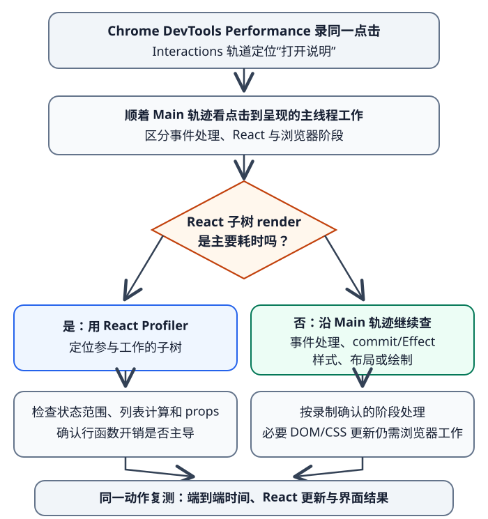

# 如何测量并减少不必要的React工作？

**案例背景。** 沿用报表页 `/reports?sort=recent#summary`：服务端给 May、April 两行，用户选择 **Oldest first** 后，`sort=oldest` 让可见顺序变成 April、May。打开说明面板只改变面板自身，不改变报表数据。若这次点击让大量行重复执行组件函数，先定位主线程上由谁触发了哪些工作；若 React 组件计算不是主耗时，就按 Performance 轨迹标出的阶段继续排查，记忆化是否影响端到端时间仍要复测。排序 URL 和 Back 恢复由[浏览器历史栈机制](../browser/browser-navigation-and-history.md#让排序状态跟随地址栏与前进后退)负责，本章聚焦这两个动作的工作量。

**测量路径：** 先用浏览器 Performance 定位打开说明的点击，再按时间轨迹判断是否需要 React Profiler。

## 先分清render和DOM变化

React 的 render（渲染）是组件函数计算下一份界面描述；commit（提交）才把必要的变化应用到 DOM（文档对象模型）。组件运行了，不代表 DOM 一定改变；React 可能比较出宿主属性与顺序不变。浏览器还要根据 DOM 和 CSS 决定后续的样式、布局、绘制或合成，因此 React 的 render 耗时也不是用户完整等待时间。

先用同一 URL、同一组报表、同一交互和目标设备在 Chrome DevTools（Chrome 开发者工具）的 Performance 面板录一次基线。Interactions（交互）轨道可定位“打开说明”这次点击及其输入、处理和呈现延迟；再顺着 Main（主线程）轨迹看时间花在事件处理、React、commit/Effect，还是样式、布局和绘制。若记录显示 React 子树 render 占主要成本，再用 React Developer Tools（React 开发者工具）的 Profiler（性能分析器）定位参与的组件；`<Profiler>` API 可在指定子树记录 `phase`、`actualDuration` 和 `baseDuration`。`actualDuration` 是该次已提交更新中子树实际花在 render 的时间；`baseDuration` 是按最近各组件耗时估计、没有跳过子树时的成本。Profiler 有额外开销，生产构建默认关闭程序化分析；比较线上构建时需使用启用 profiling 的构建，不能把开发构建耗时当成生产时延。

render 不是主耗时时，不要只看提交后的浏览器工作：继续检查点击处理器、React commit 与 Effect，以及其后的样式、布局和绘制。`useLayoutEffect` 及其状态更新会在浏览器重绘前处理；其中测量 DOM 的操作可能把同步布局带入这段交互。React Performance tracks（React 性能轨道）可以在浏览器 Performance 时间线上区分 React render、commit/layout Effect 与剩余 Effect；这些 React 专用轨道只在开发构建和 profiling 构建中可见，且有额外开销。普通 `useEffect` 通常在 paint 后，但与交互相关时也可能在 paint 前运行。按轨迹里实际占时的阶段处理，不要从“React render 较短”直接推断布局/绘制就是唯一瓶颈。浏览器阶段边界见[如何测量并诊断网页性能问题？](./performance-metrics-and-analysis.md)与[为什么一次 DOM 改动会增加布局或绘制工作？](../html-css/rendering-pipeline-and-forced-layout.md)。render 次数或控制台日志只能提示“谁可能运行过”，不能单独证明交互更快。

若说明面板只在面板内部使用，最直接的修法通常是把 `helpOpen` 状态移进独立的 `HelpPanel`。这样面板自己的更新不必从 `ReportBoard` 向整张报表列表传播：

~~~jsx
import { useState } from "react";

function HelpPanel() {
  const [open, setOpen] = useState(false);
  return (
    <section>
      <button type="button" onClick={() => setOpen(value => !value)}>
        {open ? "隐藏说明" : "显示说明"}
      </button>
      {open && 
说明面板
}
    </section>
  );
}
~~~

由 `ReportBoard` 同时渲染 `<HelpPanel />` 和报表列表，并让 `open` 由 `HelpPanel` 自己持有；点击时只有这棵子树更新，兄弟列表不必因 `helpOpen` 重算。组件状态由谁持有、何时该拆开组件见[如何在 React 中组合组件与复用行为？](../frameworks/react-component-composition.md)。下例故意把 `helpOpen` 留在列表父组件，单独展示它触发父组件 render 时，手工缓存怎样影响传给行的值；这是为了分析依赖身份的教学路径，不表示应先给每个组件加缓存。

从同一个合成起点读下面这段代码：`reports` 为 May、April 两个对象，`query` 为空，`helpOpen=false`。此刻 `visible` 是两行的筛选结果，`toggleReviewed` 是切换某行状态的函数。

| `id` | `title` | `reviewed` |
| --- | --- | --- |
| `may` | `May summary` | `false` |
| `april` | `April summary` | `false` |

先把案例入口的排序变化说清：初始 `sort=recent` 时，列表为 May、April；选择 **Oldest first** 后，`sort=oldest` 让同一组报表显示为 April、May。排序只改变列表顺序，不修改两个报表对象；稳定的 `key` 保留每行身份，但 key 本身不会跳过 render。在下方手工 `memo` 路径中，如果每行的对象与回调 props（属性）保持同一引用，行函数可以跳过，React 仍需协调并重排列表节点。下面的代码没有实现排序或 URL 历史处理，只隔离说明面板、搜索词和本地 `reviewed` 三种更新。

> [!example]- 查看这个案例的 React 实现
> ~~~jsx
> import { memo, useCallback, useMemo, useState } from "react";
>
> function filterReports(reports, query) {
>   const normalizedQuery = query.toLowerCase();
>   return reports.filter(report =>
>     report.title.toLowerCase().includes(normalizedQuery)
>   );
> }
>
> function replaceReviewed(reports, id) {
>   return reports.map(report =>
>     report.id === id
>       ? { ...report, reviewed: !report.reviewed }
>       : report
>   );
> }
>
> function ReportBoard({ initialReports }) {
>   const [reports, setReports] = useState(initialReports);
>   const [query, setQuery] = useState("");
>   const [helpOpen, setHelpOpen] = useState(false);
>
>   const visible = useMemo(
>     () => filterReports(reports, query),
>     [reports, query]
>   );
>   const toggleReviewed = useCallback((id) => {
>     setReports(current => replaceReviewed(current, id));
>   }, []);
>
>   return (
>     <>
>       <input
>         aria-label="筛选报表"
>         value={query}
>         onChange={event => setQuery(event.target.value)}
>       />
>       <button
>         type="button"
>         onClick={() => setHelpOpen(open => !open)}
>       >
>         {helpOpen ? "隐藏说明" : "显示说明"}
>       </button>
>       {helpOpen && 
说明面板
}
>       <ul>
>         {visible.map(report => (
>           <ReportRow
>             key={report.id}
>             report={report}
>             onToggle={toggleReviewed}
>           />
>         ))}
>       </ul>
>     </>
>   );
> }
>
> const ReportRow = memo(function ReportRow({ report, onToggle }) {
>   return (
>     <li>
>       {report.title}
>       <button type="button" onClick={() => onToggle(report.id)}>
>         {report.reviewed ? "已读" : "标为已读"}
>       </button>
>     </li>
>   );
> });
> ~~~

在这条手工记忆化路径里，`useMemo` 首次 render 仍会筛选；缓存仍在时，后续 render 只有 `reports` 或 `query` 按 `Object.is` 比较发生变化，才重跑筛选函数。`useCallback` 在依赖不变的后续 render 返回同一个函数引用；空依赖成立，是因为回调只调用 updater，并不读取某一轮的 `reports` 快照。`memo(ReportRow)` 默认逐项用 `Object.is` 比较 props；若同一行对象和回调都相同，React 可以跳过这行的父级传播 render。

表中每项操作都从同一初始状态独立重放：`query=""`，May 与 April 两行都挂载。输入 `apr` 会让 May 行离开树；因此“把 May 标为已读”不是在该行后面连续进行，而是从初始两行仍可见时单独开始。作为对照，若不用缓存，打开说明会让父组件、过滤函数和两行函数重新执行，但不必改变行 DOM；使用这段手工缓存时，父组件与 `visible.map` 仍执行，依赖不变且缓存仍在时可以复用过滤结果，稳定 props 可让 memo 行跳过函数调用。

| 操作 | 状态与引用如何变化 | 行组件会发生什么 |
| --- | --- | --- |
| 初始显示两行 | `reports`、`query` 首次出现，执行过滤并创建 `visible`；第一次创建 `toggleReviewed` | 两行首次 render |
| 打开说明面板 | 只改 `helpOpen`；`reports`、`query` 不变，缓存仍在时 `useMemo` 可返回原 `visible`，`useCallback` 可返回原函数 | 父组件和 `visible.map` 仍执行；两行的 `report` 与 `onToggle` props 相同，已包 `memo` 的行可以跳过。React Compiler 生效时也可能自动建立等价缓存 |
| 输入 `apr` | `query` 改变，过滤必须再扫描当前 `reports`，`visible` 只含 April | May 行离开树；April 仍有相同的行对象与回调，手工 memo 边界可以跳过它 |
| 把 May 标为已读 | 不可变更新创建新 `reports` 数组和新的 May 对象；April 对象保持原引用 | 过滤重算；May 行 props 改变而需更新，April 行 props 不变时仍可能跳过 |

这张表说明几种优化作用在不同环节：memoization（记忆化）中的 `useMemo` 省掉依赖未变时的 `filter`；`useCallback` 保持传给行的回调身份；`memo` 才检查行 props（属性）并决定是否跳过组件函数。行接收的是单个 `report` 对象，不是 `visible` 数组；即使 React 因特殊原因丢弃 `useMemo` 缓存、重新生成了数组，只要数组里的行对象引用没变，行 props 仍可相同。`memo` 管的是父组件传入的 props；行自身 state（状态）或它读取的 Context（上下文）变化，仍可让行 render。少了 `memo`，稳定值不会单独阻止子组件 render；若回调每次新建或行对象被原地改写，默认 props 比较也无法可靠地区分更新。筛选词变化时仍需检查每一条记录，`useMemo` 不能让一次新的全量过滤变成常数时间。对 May 的更新若要让 React 看见变化，应创建新数组和新对象，同时保留未变的 April 对象；不能为追求身份稳定而原地改写数据。

这段 `reviewed` 示例只演示本地对象的不可变更新；真实写入服务端还要处理请求身份、确认和失败状态，见[React 服务端状态与乐观更新](../frameworks/react-server-state-and-optimistic-updates.md)。若说明面板只需暂时隐藏，CSS 隐藏会让它留在 React 树中，state 与 Effect 仍存在；条件移除则会卸载组件并运行 cleanup（清理），再次显示时创建新实例，按交互和生命周期需求选择。Fragment（片段）可避免纯包装用的额外 DOM 节点，但是否有性能收益仍要测量。

## React Compiler改变手工memo的默认做法

React Compiler（React 编译器）v1.0 已稳定；截至 2026-11-12，React 官方文档版本为 React 19.3。Compiler 是可选的构建期优化：项目必须在构建链中配置它，且具体文件和组件要被编译器识别。启用后，它可以在组件与 Hook（钩子）内自动记忆化可复用的子树和计算，通常无需新代码先手写 `memo`、`useMemo`、`useCallback`。先检查项目是否接入、构建是否覆盖本文件，再用 Profiler 观察结果；仅安装插件或看到新版本号，不足以证明某个组件已获得优化。

编译范围有边界：Compiler 主要优化 React 组件和 Hook，不会将任意工具函数自动变成跨组件共享的缓存。同一昂贵纯函数若在多个独立组件中分别调用，组件内的记忆化不会自然共用一次结果；是否需要显式的共享缓存，要根据实际调用和数据所有权另作设计。启用 Compiler 后仍可保留确有意图的手工 memo，但不要叠加一层只为“更安全”的缓存。

未启用 Compiler、某个模块未被覆盖，或 Profiler 显示一个稳定边界仍反复做昂贵工作时，才考虑手工 API。React 在特定情况下可丢弃 `useMemo` / `useCallback` 缓存，例如初次挂载时发生 Suspense；需要语义持久状态时应使用 state（状态）或 ref（引用）。新建的对象、数组和函数每次身份都不同；自定义 `memo` 比较必须保证函数行为和可见输出等价，否则可能保留旧闭包。React Compiler、组件编译范围与手工 memo 当前用途见下方来源。

## 用结果决定优化是否值得保留

按相同交互复测，从点击到界面呈现，并沿 Performance 轨迹比较原先占时阶段。若 Compiler 已覆盖，可比较编译前后的同一操作；若手工拆分状态或加入 `memo`，确认可见界面仍正确，并且目标 render 成本或点击到呈现时间能稳定、可重复地改善。是否覆盖 Compiler 只是解释优化从哪里来，不单独决定保留缓存；没有可重复收益，或维护成本超过收益时，可以移除手工缓存后复测。已有代码的手工缓存可能影响 Compiler 的编译结果，移除后也要重新验证界面行为和性能，不能仅凭启用 Compiler 就批量删除。Profiler 有额外开销，最终判断还要回到目标构建和设备上的浏览器 Performance 轨迹。

稳定 `key`（列表键）用来保留列表项在排序、插入和删除中的身份，不是跳过 render 的性能 API；虚拟列表卸载行后，原组件的局部 state 也会销毁。如果测量显示成本随同时挂载的行数增加——无论来自 React 创建/更新行，还是 DOM、样式与布局——再评估[长报表列表何时适合虚拟滚动？](./rendering-and-computation-optimization.md)。若主要耗时在窗口选择之前的全量过滤，虚拟化不一定能缩短那段计算。React commit 后的浏览器工作与组件 render 分开看，并用同一交互复测端到端结果。

> [!info]- 来源与版本核验（React 19.3；React Compiler v1.0；核验日期 2026-11-12）
> - React 官方文档当前版本为 19.3，npm 版本 `v19.3.0` 发布于 2026-09-09：[Versions](https://react.dev/versions)、[React 19.3](https://react.dev/blog/2026/09/09/react-19-3)。
> - render 是 React 调用组件求得界面，commit 才更新 DOM，render 不必导致 DOM 变化：[Render and Commit](https://react.dev/learn/render-and-commit)，React 19.3。
> - Chrome Performance 的 Interactions 轨道显示输入、处理和呈现延迟，Main 轨道显示主线程调用栈和事件耗时：[Performance features reference](https://developer.chrome.com/docs/devtools/performance/reference#view-interactions)，核验日期 2026-11-12。
> - React 性能轨道将 Update、Render、Commit（含 layout Effects）和剩余 Effects 放在浏览器时间线上；`useLayoutEffect` 与其状态更新会在重绘前执行：[React Performance tracks](https://react.dev/reference/dev-tools/react-performance-tracks#renders)、[useLayoutEffect](https://react.dev/reference/react/useLayoutEffect)，React 19.3。
> - React Developer Tools 的 Profiler 面板与组件检查：[React Developer Tools](https://react.dev/learn/react-developer-tools)，React 19.3；`<Profiler>` 的 commit 回调、`actualDuration`、`baseDuration` 及生产 profiling 开销：[Profiler](https://react.dev/reference/react/Profiler)，React 19.3。
> - Compiler 是可选且稳定的构建期优化；它主要在组件与 Hook 中跳过级联 render 和重复计算，不对任意工具函数共享缓存；先 profile 后再增加复杂度：[React Compiler Introduction](https://react.dev/learn/react-compiler/introduction)，React Compiler v1.0，2025-10-07。
> - `memo` 默认以 `Object.is` 比较 props，状态或所读 Context 改变仍可 render；`useMemo` 的缓存与依赖比较、缓存可在特定条件丢弃：[memo](https://react.dev/reference/react/memo)、[useMemo](https://react.dev/reference/react/useMemo)，React 19.3。
> - `useCallback` 只返回稳定函数引用、不主动执行函数，依赖按 `Object.is` 比较；缓存可被丢弃：[useCallback](https://react.dev/reference/react/useCallback)，React 19.3。
> - 条件移除组件会重置其树位置上的 state、Effect 会在卸载时清理、Fragment 不增加包装 DOM：[Preserving and Resetting State](https://react.dev/learn/preserving-and-resetting-state)、[useEffect](https://react.dev/reference/react/useEffect)、[Fragment](https://react.dev/reference/react/Fragment)，React 19.3。
> - 状态所有权、组件边界和向下传值：本库[如何在 React 中组合组件与复用行为？](../frameworks/react-component-composition.md)；提交后的样式、布局与绘制：本库[为什么一次 DOM 改动会增加布局或绘制工作？](../html-css/rendering-pipeline-and-forced-layout.md)。
