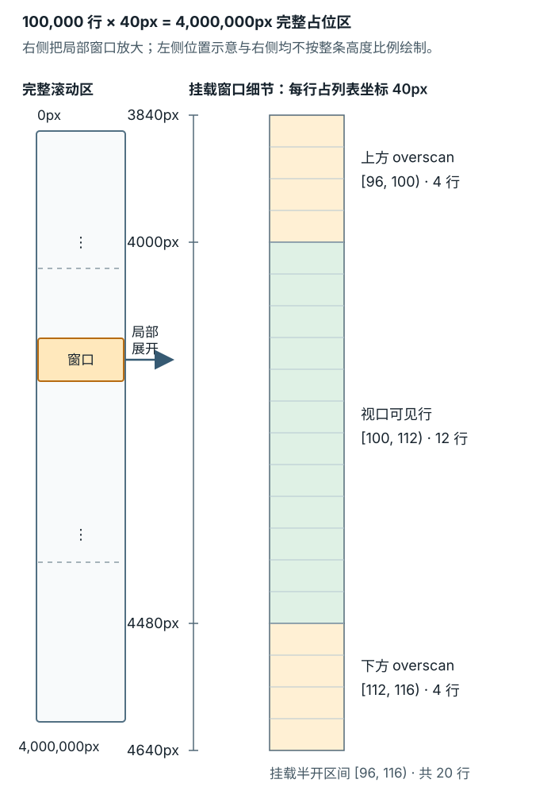

# 长报表列表何时适合虚拟滚动？

**案例背景。** 报表页从 `/reports?sort=recent#summary` 得到 May、April 两行；选择 **Oldest first** 后，`sort=oldest` 让可见顺序变成 April、May。两行列表不需要虚拟化。下面有意把这个案例扩大为假设的 **100,000 条**历史报表，问题变成：用户到底要看什么，客户端要拿到哪些数据，浏览器要同时挂载多少节点？十万只是演算规模，不是启用虚拟滚动的门槛。先按真实交互分辨网络、React render（渲染）、DOM（文档对象模型）与布局成本，再选择处理方式。

## 十万条报表先决定哪些数据需要传输

把历史增长到 100,000 条后，至少有三种不同成本：从服务端拿来多少字节；客户端为筛选、排序和转换跑多少 JavaScript 并保留多少数据对象；React 与浏览器同时要处理多少组件、DOM 节点、样式和布局。100,000 条不是通用阈值：是否能承受全量处理还取决于设备、行复杂度、数据形状和交互，应分别测量请求、脚本、渲染与内存。用户只看总数或月度趋势时，服务端聚合可直接返回结果；用户要搜索、排序、分页浏览时，接口可以按条件处理后只发送当前页；若用户确实需要连续浏览已加载数据，虚拟滚动才处理挂载窗口。客户端过滤十万条仍要检查十万条：若 `n` 是记录数且每条记录的判定成本近似固定，扫描一次的过滤成本随 `n` 线性增长，常记作 `O(n)`；把剩余行从 DOM 移走，不会减少这次扫描、已下载数据或其 JavaScript 内存。

| 经同一任务录制确认的主要成本 | 优先处理方向 | 要计入的代价或边界 |
| --- | --- | --- |
| 网络传输包含用户尚不需要的记录 | 服务端过滤、排序、分页或按需请求；只需统计时返回聚合 | 加载、错误、重试、结束状态和排序一致性 |
| 客户端全量变换或查询占主线程 | 改算法、缩小输入、分块，或把可移出的纯计算交给 Web Worker（网页工作线程） | Worker 不减少算法工作量；对象消息通常要结构化复制，数据传递也要计时 |
| React 组件函数反复执行 | 按[React 渲染优化](./react-rendering-optimization.md)检查状态范围、稳定的 `props`（属性）和已测量的 `memo`（记忆化）边界；若成本主要随同时挂载的行数增加，也可评估虚拟化 | 缓存跳过重复计算，虚拟化减少参与工作的行，两者作用不同 |
| 大量已挂载节点让样式、布局或呈现变慢 | 虚拟化当前可视窗口 | 测量、滚动、焦点、键盘、读屏、打印和查找行为更复杂 |

若从开场的 `sort=oldest` 切到跨请求分页，下面明确改用 `sort=recent`：按 `periodStart` 降序，再以唯一 `report.id` 升序打破同日并列。唯一 ID 让固定数据集的顺序确定；keyset pagination（键集分页）的游标记录页尾的完整排序键值，服务端按同一排序定义和方向继续，排序方向若已由查询配置固定，不必重复编码在游标里。只带可能重复的日期不足以区分并列报表。

偏移边界如何移动，可以用页大小为 2 的小例子单独看：原顺序为 `A, B, C, D`，第一页是 `A, B`。若下一次请求前在头部插入 `X`，新顺序是 `X, A, B, C, D`；`OFFSET 2` 会返回 `B, C`，重复了 `B`。若另一种变化是第一页之后删除头部的 `A`，剩余顺序 `B, C, D` 的 `OFFSET 2` 只返回 `D`，跳过了 `C`。稳定的次级 ID 不会冻结两次请求间变化的数据集；需要一致的历史浏览时，还要由服务端定义快照或版本边界。分页减少单次传输；在客户端收到全量数据后再虚拟化，不会追溯减少之前的网络流量。

## 固定行高怎样算出挂载窗口

先用一个固定行高的小模型，明确索引约定：以下行号从 `0` 开始，区间右端不包含在内；每行的重复高度步长为 `40px`（若有行间距，也计入此步长），滚动窗口高 `480px`，上下各多渲染 4 行的 overscan（预渲染缓冲区）。在 `scrollTop = 4000px` 时，视口恰好从第 100 行开始，到第 112 行之前结束，因此可见区间是 `[100, 112)`，共 12 行。加上前后缓冲，挂载区间成为 `[96, 116)`，共 20 行。窗口顶端偏移为 `96 × 40 = 3840px`；整条列表仍要用 `100,000 × 40 = 4,000,000px` 的占位高度保留滚动范围。

下面函数只演算固定高度窗口。示例中的 `items` 是浏览器已持有的 100,000 条合成报表；`totalRows` 是非负整数；`rowHeight` 是有限正数；视口高度是有限正数，`scrollTop` 是有限数；`overscan` 是非负整数。尚未测到正高的滚动容器先不计算窗口。滚动位置会限制在整条列表可滚动范围内。实际容器的尺寸和位置应从浏览器测量，不能一直把示例常数写死。

~~~javascript
const items = Array.from({ length: 100_000 }, (_, id) => ({ id }));

function getWindow(
  totalRows,
  scrollTop,
  viewportHeight,
  rowHeight,
  overscan = 4
) {
  const totalHeight = totalRows * rowHeight;
  const maxScrollTop = Math.max(0, totalHeight - viewportHeight);
  const offset = Math.min(Math.max(scrollTop, 0), maxScrollTop);
  const firstVisible = Math.floor(offset / rowHeight);
  const start = Math.max(0, firstVisible - overscan);
  const end = Math.min(
    totalRows,
    Math.ceil((offset + viewportHeight) / rowHeight) + overscan
  );

  return {
    start,
    end,
    offsetY: start * rowHeight,
    totalHeight
  };
}

const range = getWindow(items.length, 4_000, 480, 40);
// { start: 96, end: 116, offsetY: 3840, totalHeight: 4000000 }
const mountedItems = items.slice(range.start, range.end);
~~~

下图对应 `scrollTop=4000px`，局部窗口把视口中实际可见的 12 行与上下缓冲的 8 行分开；左侧只标出它在完整列表中的位置，不按 4,000,000px 高度比例绘制：

在真实组件中，滚动容器的 `scroll` 更新 `scrollTop` 后会重新计算窗口；下面列出前后两次状态。`getWindow` 本身只算范围，真正挂载和卸载由组件按新范围重绘时发生。

| `scrollTop` | 可见半开区间 | 挂载半开区间 | 窗口容器 `offsetY` | 与上次相比 |
| ---: | --- | --- | ---: | --- |
| `4000px` | `[100, 112)` | `[96, 116)` | `3840px` | 初始窗口，挂载 20 行 |
| `4040px` | `[101, 113)` | `[97, 117)` | `3880px` | 卸载第 96 行，挂载第 116 行；第 97–115 行继续挂载 |

实现会把 `mountedItems` 放进一个从 `range.offsetY` 开始的定位容器；外层占位区高度为 `range.totalHeight`，让滚动条仍代表完整列表，内层只创建窗口中的报表行。代码逐项满足边界处理：靠近开头时 `start` 不会小于 0；靠近结尾时 `end` 不会超过 `totalRows`；列表短于视口时最大滚动位置为 0。窗口滚动只是选择当前要挂载的下标，不会改变 `items` 本身。

`report.id` 应是跨排序和翻页稳定的唯一 key（键），不用当前窗口内的索引。React `key`（列表键）帮助 React 在同一棵已挂载列表中识别行；当某行滚出窗口并从树中卸载，它的局部 state 也会结束。若“已选中”或编辑草稿要在离开窗口后保留，把状态放在列表外并按报表 ID 关联。若离开页面后还要回到原阅读位置，可保存可见行 ID 与该行内的滚动偏移，再恢复到对应位置。窗口索引不是报表身份，排序后以 index 当 key 可能把旧行状态交给另一份报表。

虚拟化只让当前窗口的行进入 DOM。用户必须看到所有数据时，它仍可与分页或增量请求组合；但请求下一页、保持 API 游标和处理失败，是独立的数据加载流程。若首要目标是让查询少扫描记录，应减少查询输入或改变算法；若主要成本是全量数据对象占用内存，减少挂载节点也不会清除那批对象。

## 固定高度不适用时怎样跟上实际尺寸

报表标题可能换行，说明行可能展开，字体或图片也可能在挂载后改变高度。此时初始只能按每行估算高度累加出后续位置；真实行挂载后，虚拟器测得实际高度，并更新它之后行的起点和总高度。沿用 `scrollTop=4000px` 的算例：视口上方的第 96 行原估 `40px`、实测 `52px`，相差 `12px`；第 100 行的内容坐标便从 `4000px` 移到 `4012px`。若滚动位置仍是 `4000px`，第 100 行会比原来低 `12px`；若它是锚点且实现把 `scrollTop` 补偿到 `4012px`，它仍在视口原位置。使用动态尺寸的虚拟器应有估算、实际测量及滚动锚定策略，并应在目标浏览器中检查展开行、异步内容和视口尺寸变化。TanStack Virtual 当前文档以 `estimateSize` 提供初始估计、`measureElement` 取得实际尺寸，并用 `shouldAdjustScrollPositionOnItemSizeChange` 控制视口上方行尺寸变化时是否校正滚动位置；具体配置按项目安装版本核对。

## 让被卸载的行仍能被键盘和辅助技术使用

虚拟窗口之外的行不存在于当前 DOM。若键盘焦点落在某行按钮上，而下一次滚动将该行卸载，焦点可能丢失；交互列表应按报表 ID 跟踪活动项，保证它仍被挂载，或在卸载前按其控件模式移动并恢复焦点。对使用方向键的虚拟 `grid`（网格），若目标单元格在窗口外，先算出目标报表 ID/索引并滚动到包含该行的窗口，待目标行挂载后再把焦点移到单元格。不要因为数据看起来像列表就随手加 `role="listbox"`：列表框是选择选项的复合控件，不适合把按钮或复选框等独立交互控件塞进每个选项；列表框、grid（网格）等复合控件也要求各自的方向键和焦点行为。只需展示和浏览报表时，带正确表头的原生 `<table>` 配合服务端分页通常更容易使用；单页表格呈现的仍只是当前页，要搜索或打印全量结果时还需相应的应用级搜索或导出能力。当测量确认同时挂载的行数带来主要成本——可能在 React 计算，也可能在 DOM、样式与布局——且用户需求能接受部分节点时，再承担虚拟表格的复杂性。

当部分集合被渲染时，无障碍富互联网应用规范（WAI-ARIA）对适用的 `listitem` / `treeitem` 提供 `aria-posinset` 与 `aria-setsize`；位置从 1 开始，若总数未知，`aria-setsize="-1"` 表示未知。`table`、`grid`、`treegrid` 使用 `aria-rowindex` 与 `aria-rowcount`；行位置相对完整表格从 1 开始，总行数未知时 `aria-rowcount="-1"`。例如 100,000 条数据再加一行表头，完整表格应报告 `aria-rowcount="100001"`；表头行为 `aria-rowindex="1"`，挂载窗口首条数据（数组下标 96）为 `aria-rowindex="98"`。每一条当前挂载的表格行都要标出它在完整表格中的索引。ARIA 属性只描述集合中当前行的位置和总数，不会把未挂载行放回 DOM，也不能补上错误角色、缺失表头或不完整键盘模型。最终应在目标浏览器与屏幕阅读器中验证读序、焦点、滚动、加载、空结果和总数未知时的表达。

决定虚拟化后，在[如何测量并诊断网页性能问题？](./performance-metrics-and-analysis.md)用同一 URL、设备、数据和滚动交互比较挂载节点、布局与呈现成本；分别记录 React 计算与浏览器呈现的成本，再比较端到端交互。即使布局耗时不变，减少原先占主导的 React 工作仍可能有收益；若 React 计算仍是主要瓶颈，再沿[如何测量并减少不必要的React工作？](./react-rendering-optimization.md)继续定位。

> [!info]- 来源与核验（核验日期 2026-11-12）
> - 本章的成本区分、固定高度公式和是否虚拟化的选择来自本例的状态与计算推演；`100,000` 行不是库或浏览器规定的阈值。React render 与 commit 的边界见 React 19.3 官方[Render and Commit](https://react.dev/learn/render-and-commit)。
> - TanStack Virtual 当前官方 v3 [Virtualizer API](https://tanstack.com/virtual/latest/docs/api/virtualizer) 的 `count`、`estimateSize`、`overscan`、`getItemKey`、`measureElement`、`getTotalSize`；`shouldAdjustScrollPositionOnItemSizeChange` 说明它处理视口上方测量值与估算值不同时的滚动位置校正，默认在未反向滚动时才应用，并且是实例属性。核验日期 2026-11-12；文中未把 `/latest` 当作具体安装版本。
> - 分页的排序要求：[PostgreSQL 18，Sorting Rows (`ORDER BY`)](https://www.postgresql.org/docs/18/queries-order.html) 说明后续排序项在前项相等时继续决定顺序；[`LIMIT` and `OFFSET`](https://www.postgresql.org/docs/18/queries-limit.html) 要求分页查询使用能约束到唯一顺序的 `ORDER BY`，并说明 offset 会先跳过前序行。新数据插在两次请求间导致页边界移动是基于该规则的跨请求推演，不是 PostgreSQL 特有承诺。
> - Web Worker 的 `postMessage()` 可发送结构化数据，`ArrayBuffer` 可放入 transfer list 转移；跨 realm 的序列化/反序列化称为 structured cloning：[WHATWG HTML Living Standard，Web Workers](https://html.spec.whatwg.org/multipage/workers.html)、[Safe passing of structured data](https://html.spec.whatwg.org/multipage/structured-data.html#structured-cloning)，核验日期 2026-11-12。
> - 虚拟窗口只呈现集合子集时，`aria-rowcount` 包含表头行，且每个挂载行（包括表头）都用 `aria-rowindex` 标出其在完整表格中的 1 基位置：[WAI-ARIA 1.2，`aria-rowindex` / `aria-rowcount`](https://www.w3.org/TR/wai-aria-1.2/#aria-rowindex)，W3C Recommendation，2023-06-06；[WAI-ARIA APG Grid and Table Properties](https://www.w3.org/WAI/ARIA/apg/practices/grid-and-table-properties/#using-aria-rowcount-and-aria-rowindex)，核验日期 2026-11-12。
> - `grid` 是需要作者管理内部焦点移动的复合控件，而表格中的可聚焦元素仍在页面 Tab 顺序中：[WAI-ARIA APG Grid Pattern](https://www.w3.org/WAI/ARIA/apg/patterns/grid/)，核验日期 2026-11-12。listbox 用于选择选项，其交互模型不支持在选项内操作链接、按钮或复选框：[WAI-ARIA APG Listbox Pattern](https://www.w3.org/WAI/ARIA/apg/patterns/listbox/)，核验日期 2026-11-12。
> - 对适用的 `listitem` / `treeitem` 使用 `aria-posinset` 与 `aria-setsize` 时，位置从 1 开始，未知总数为 `-1`：[WAI-ARIA 1.2，`aria-setsize`](https://www.w3.org/TR/wai-aria-1.2/#aria-setsize) 与 [`aria-posinset`](https://www.w3.org/TR/wai-aria-1.2/#aria-posinset)，W3C Recommendation，2023-06-06。
