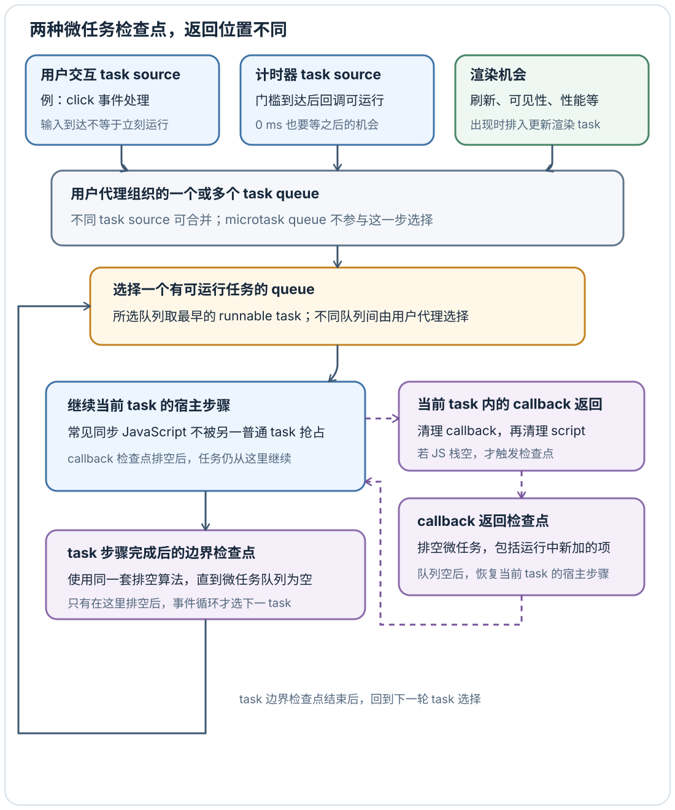
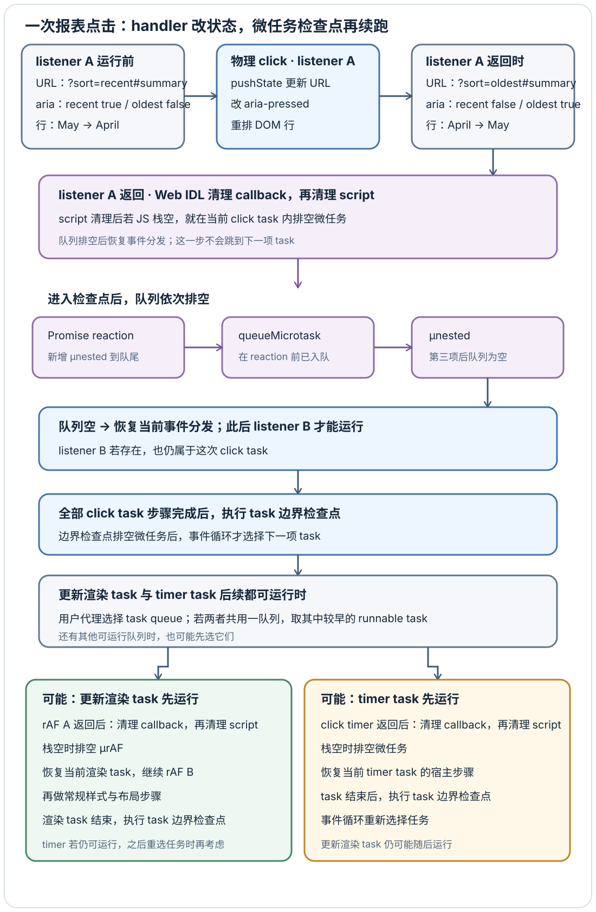

# 浏览器 JavaScript 何时运行，画面何时更新？

案例背景：上一章的报表页已显示 `https://example.test/reports?sort=recent#summary`，`/reports.js` 也已注册“最早优先”按钮的 click 处理器。用户点击后，处理器同步把当前 URL 改为 `sort=oldest`、切换按钮的 `aria-pressed` 并把行重排为 April、May。这里追问：如果点击到达时该窗口事件循环正运行一段同步 JavaScript，处理器何时开始？这些同步改动何时有机会变成新的画面？[浏览器首帧与点击交接](../browser/browser-basics.md#从首帧交接到筛选更新)给出页面和操作，本章沿一次处理过程追踪调度边界。

## task source 怎样交出下一次工作？

HTML 的窗口事件循环协调事件、脚本、渲染和网络等工作；这是宿主调度模型，不对应所有浏览器固定的线程流水线。一个 task（任务）封装宿主安排的一段工作；task source（任务源）按工作类别分组，例如用户交互、定时器和更新渲染。事件循环的 task queue（任务队列）不是所有回调共用的单一先进先出队列：规范允许用户代理把不同任务源合并到一个或多个队列，并在有可运行任务的队列中选择下一项。它会保留同一任务源要求的顺序；不同队列之间由用户代理选择。

**图：task 完成与 callback 返回后的检查点分别回到哪里**

常见的页面处理路径里，事件循环选中的一个普通 task 会运行到任务步骤结束，期间同步 JavaScript 不会被另一个普通 task 抢占。因此，点击到达时如果当前同步脚本很长，或它后续排入的微任务一直新增，click handler 就只能等待。task 步骤结束后，事件循环执行 task 边界检查点；这次检查点排空后，事件循环才会选择下一项 task。若某次脚本或 Web IDL callback 的清理先让 JavaScript execution context stack（执行上下文栈）变空，也会先进入同一套排空算法；但这种检查点排空后会回到调用它的宿主步骤，让当前 task 继续执行，并不会直接跳到下一项 task。两种入口都会持续取出微任务，直到队列为空。

规范没有规定跨所有 task queue 的固定优先级。HTML 举例说明，用户代理可以将鼠标和键盘工作分到一队列，并在四次选择中三次优先处理该队列，同时仍让其他队列推进；这是展示实现自由度的例子，不是浏览器必须采用的公平策略。因而一次点击可以等当前工作结束，也可能在微任务排空后再等候 task 选择；规范不保证每个点击之后立刻更新画面。

渲染机会（rendering opportunity）由用户代理根据显示刷新、页面可见性、性能和其他条件判断。HTML 把机会判断和排入更新渲染 task 的步骤定义为与事件循环主步骤并行；同步 JavaScript 正在运行时，这个机会仍可能出现并把 task 排入队列。被延迟的是事件循环之后选择并执行更新渲染 task 的时刻，不是这一步机会判断本身。页面隐藏或当前没有渲染机会时，文档不会进入本轮更新；若用户代理认为更新没有可见效果且没有待运行的 rAF callback，也可以跳过文档更新，此外还有其他允许跳过的理由。更新渲染 task 仍要参与队列选择；若 timer 和渲染 task 都已可运行且属于同一队列，就先取该队列中较早的可运行 task；不同队列间如何选择由用户代理决定。

## 微任务的先后顺序与让出的边界

microtask（微任务）是当前 JavaScript 工作完成后、下一个普通 task 运行前处理的短小延续，例如已满足 Promise 上注册的 reaction（处理器）。ECMAScript 定义 Promise reaction job，HTML 宿主把它们接入事件循环的微任务队列。下面保留一个最小可追踪例子，并让一个微任务在执行时再排入另一个微任务：

~~~javascript
console.log("start");
setTimeout(() => console.log("timer task"), 0);
Promise.resolve().then(() => {
  console.log("Promise reaction");
  queueMicrotask(() => console.log("queued by reaction"));
});
queueMicrotask(() => console.log("queued microtask"));
console.log("end");
~~~

顺序是 `start`、`end`、`Promise reaction`、`queued microtask`、`queued by reaction`，随后计时器回调在其延迟门槛达到且被选中时运行。同步代码先入队 Promise reaction，再入队 `queueMicrotask()`；reaction 执行时，新微任务排到现有队列尾部，所以它在 `queued microtask` 之后运行。微任务检查点不会因为某个微任务返回就结束，而是把其间新增的微任务也排空。

`setTimeout(fn, 0)` 只安排一个之后可运行的 timer task，不会在当前同步段中途切走，也不保证它一定先于或后于一次渲染更新。类似地，`await Promise.resolve()` 会把续接安排为微任务，不会主动让浏览器先处理输入或绘制。长同步循环和不断追加微任务会阻止事件循环选择并执行更新渲染 task，因此可能错过预期呈现时机；HTML 定义的渲染机会判断与 task 排入仍可在并行步骤中发生。有界计算若要主动让出，应拆成后续 task、交给 Worker，或使用框架提供且目标环境支持的调度策略。

在报表页的 click handler 中，URL 与 DOM 的状态转换都在同步处理时完成：`history.pushState()` 新增同文档历史条目并更新当前文档 URL，脚本可立即从 `location` 读到 `sort=oldest`；它不会重取文档，也不会替页面排序。handler 随后分别把按钮状态从 `true/false` 改为 `false/true`，并把 DOM 行从 May、April 改为 April、May。handler 返回时 DOM 已是新顺序，但屏幕仍可能显示上一帧。下面先画出“状态 → handler → 新状态”，再沿该 listener 返回后的宿主步骤追踪观察用的 Promise、微任务、`requestAnimationFrame()` 和 timer；它们不是排序功能本身的依赖。两次本地重放分别用 CDP 模拟鼠标输入和同步 `.click()` 触发：模拟鼠标输入那次观察到渲染 task 先运行，脚本 `.click()` 那次观察到 timer 先运行。这只是两次运行记录，不能推出触发类型决定顺序，也不代表 task source 有固定优先级。

**图：一次点击中的状态转换、listener 检查点和后续 task 选择**

理解图里的 listener 交接要看两个规范调用点。DOM 的事件分发通过 Web IDL `call a user object's operation` 调用 `EventListener`；rAF 则由 HTML 用 Web IDL callback function 调用。两条 Web IDL 返回路径都会先执行 `clean up after running a callback`，再执行 HTML 的 `clean up after running script`。前一步清理 callback 宿主状态，本身不运行微任务；后一步从 JavaScript 执行上下文栈移除脚本，若栈此时为空才触发微任务检查点。因此，物理输入的 click task 中 listener A 返回时，微任务可在事件分发继续调用 listener B 前运行；排空后恢复的是当前事件分发，而非下一项 task。若 JavaScript 正在调用 `element.click()`，外层脚本仍在栈上，listener A 返回不会让栈变空；A、B 都会先返回，外层脚本结束后才运行检查点。无论 callback 中途是否触发过检查点，task 自身步骤结束后仍有 task 边界检查点；HTML 的防重入标志会阻止嵌套检查点重复排空同一队列。

## `requestAnimationFrame` 把写入对齐到渲染更新

`requestAnimationFrame(callback)` 把 callback 注册到文档的动画帧 callback 列表。它不是独立 task，也不是微任务；用户代理选中更新渲染 task 后，HTML 在执行这一轮的常规样式和布局更新之前运行列表中的动画帧 callbacks。若页面有可呈现的渲染机会且用户代理没有跳过更新，这能让动画写入和当前更新对齐。DOM 修改并不要求应用一定调用 rAF，普通 DOM 改动也可以在后续更新渲染中反映出来。

rAF callback 本身通过 Web IDL callback 调用。callback 返回后，Web IDL 先清理 callback 状态，再清理 script；如果执行上下文栈变空，后者就在同一个渲染 task 内运行微任务检查点。排空后控制返回当前更新渲染算法，继续运行后续 rAF callback，再进入常规样式和布局步骤；检查点不会把这次渲染 task 结束掉。rAF callback 内排入的 Promise reaction 因而能在该轮样式与布局步骤之前执行，但不会额外获得一轮输入或绘制机会。HTML 的更新渲染算法随后按需重算样式、布局和其他文档更新步骤。浏览器如何把更新结果继续交给绘制、合成和屏幕呈现，取决于引擎实现；见[一次 DOM 改动怎样进入布局与绘制？](../html-css/rendering-pipeline-and-forced-layout.md)。

rAF 的回调时刻受渲染机会与页面状态影响，不是固定的 `60 Hz` 定时器；隐藏页面或被节流时，回调可能延迟。它给出的时间戳适合计算动画经过时间，但 callback 中大量计算仍会拖慢当前渲染更新。读几何值还可能促使同步布局，不能假定把读写放进 rAF 就只做合成。

## `requestIdleCallback` 只安排可推迟的小块工作

`requestIdleCallback(callback, { timeout })` 让用户代理在它认为空闲时安排低优先级工作，并把剩余空闲时间的估计传给 `deadline.timeRemaining()`。空闲期何时开始、可有多长由用户代理决定；页面忙或隐藏时，回调可能很久都不运行。提供正数 `timeout` 后，若回调没有在 idle period 内运行，超过期限后，用户代理会安排超时 task；规范允许它再等待一段由实现决定的时间才入队，入队后仍要等该 task 被选中运行，`didTimeout` 只说明这个 callback 是因 timeout 才执行。`timeRemaining()` 是估计值，不是执行预算或抢占点。

~~~javascript
function runIdleSlice(deadline) {
  if (!workQueue.length) return;
  if (deadline.didTimeout || deadline.timeRemaining() > 0) {
    processNext(workQueue.shift()); // processNext 只处理一个有界项目
  }
  if (workQueue.length) requestIdleCallback(runIdleSlice, { timeout: 2000 });
}

requestIdleCallback(runIdleSlice, { timeout: 2000 });
~~~

这里的 `workQueue` 和 `processNext` 是应用自己的队列与工作函数。`requestIdleCallback()` 在目标浏览器中需做能力检测；不支持时可以退回普通 task 分片，但 `setTimeout()` 不能保证回调发生时浏览器正空闲。React 等框架的 scheduler 也建立在宿主机制之上，不是 HTML 规范统一规定的 task source。

Node.js 有另一套宿主边界：它按 libuv 阶段处理 I/O、定时器和 `setImmediate()`，并额外提供 `process.nextTick()` 队列；CommonJS 顶层和 ES module 顶层中，nextTick 与 Promise 微任务的相对顺序也可能不同。这里的渲染机会与 rAF 讨论针对浏览器窗口，不要把它改写成 Node 的固定阶段图；见 [Node.js 事件循环阶段与微任务队列如何交互？](../../engineering-foundations/backend/node-event-loop-and-microtasks.md)。

**延伸：**[脚本如何影响 HTML 解析与文档就绪？](../html-css/browser-html-and-css.md)说明解析期间的脚本调度；[DOM 事件如何传播，何时适合事件委托？](../browser-apis/dom-manipulation-and-events.md)说明 click 如何到达处理器；[JavaScript 异步](../javascript/asynchronous-javascript.md)解释 Promise 本身的语言行为；[如何测量并诊断网页性能？](../performance/performance-metrics-and-analysis.md)帮助区分点击前等待、handler 执行和后续呈现延迟。

> [!info]- 来源
> - **任务源、task queue、task 结束检查点、task 选择与渲染机会。** [WHATWG HTML §8.1.7 Event loops](https://html.spec.whatwg.org/multipage/webappapis.html#event-loops)，Living Standard，核对日期：2026-11-11；重点对照 §8.1.7.1 Definitions、§8.1.7.2 Queuing tasks 和 [§8.1.7.3 Processing model](https://html.spec.whatwg.org/multipage/webappapis.html#event-loop-processing-model)。定义段说明 task source 如何映射到 task queue、不同来源可合并；processing model 规定从所选队列取最早的可运行 task、task 步骤结束后的微任务检查点，以及渲染机会如何在并行步骤中排入 rendering task source。规范的用户交互优先示例只是实现自由度示意，不是固定策略。
> - **DOM listener、callback 清理与空栈检查点。** [WHATWG DOM inner invoke](https://dom.spec.whatwg.org/#concept-event-listener-inner-invoke) 对事件 listener 执行 Web IDL 的 [§3.11 call a user object's operation](https://webidl.spec.whatwg.org/#call-a-user-objects-operation)；rAF callback 路径见 [§3.12 invoke a callback function](https://webidl.spec.whatwg.org/#invoke-a-callback-function)，Web IDL Living Standard 核对日期：2026-11-11。两条返回算法依次运行 `clean up after running a callback` 和 `clean up after running script`；前者不做 checkpoint，后者调用 [WHATWG HTML §8.1.4.4 clean up after running script](https://html.spec.whatwg.org/multipage/webappapis.html#clean-up-after-running-script)，在 JS 执行上下文栈变空时触发 [§8.1.7.3 perform a microtask checkpoint](https://html.spec.whatwg.org/multipage/webappapis.html#perform-a-microtask-checkpoint)，Living Standard 核对日期：2026-11-11。
> - **History API 与当前文档 URL。** [WHATWG HTML §7.2.5 The `History` interface](https://html.spec.whatwg.org/multipage/nav-history-apis.html#the-history-interface)，Living Standard，核对日期：2026-11-11。`pushState()` 更新同一文档的 session history 与当前 URL，不会触发文档重取；列表排序是报表 handler 的另一项 DOM 操作。
> - **Promise reaction 与微任务队列。** [ECMAScript 2026 §27.2.1.8 TriggerPromiseReactions](https://tc39.es/ecma262/2026/#sec-triggerpromisereactions) 为 reaction 生成 job；[§9.5.5 HostEnqueuePromiseJob](https://tc39.es/ecma262/2026/#sec-hostenqueuepromisejob) 要求按调用顺序运行这些 Promise jobs。[WHATWG HTML §8.1.6.6.4 HostEnqueuePromiseJob](https://html.spec.whatwg.org/multipage/webappapis.html#hostenqueuepromisejob) 将其接入浏览器宿主队列；[§8.8 Microtask queuing](https://html.spec.whatwg.org/multipage/timers-and-user-prompts.html#microtask-queuing) 规定 `queueMicrotask()` 使用同一事件循环的微任务队列，Living Standard，核对日期：2026-11-11。
> - **rAF 与更新渲染步骤。** [WHATWG HTML §8.12 run the animation frame callbacks](https://html.spec.whatwg.org/multipage/imagebitmap-and-animations.html#run-the-animation-frame-callbacks) 定义按序调用；[§8.1.7 update the rendering](https://html.spec.whatwg.org/multipage/webappapis.html#update-the-rendering) 将运行动画帧 callbacks 排在样式/布局更新之前，Living Standard，核对日期：2026-11-11。
> - **空闲回调。** [W3C `requestIdleCallback()` Working Draft，2025-05-21，§§2、4.1、4.3、5](https://www.w3.org/TR/requestidlecallback/) 定义用户代理决定的 idle period、deadline 与超时 callback；[WHATWG HTML §8.1.7.3 Processing model](https://html.spec.whatwg.org/multipage/webappapis.html#event-loop-processing-model) 说明浏览器窗口事件循环在无可运行 task 时才启动 idle period，Living Standard，核对日期：2026-11-11。
> - **Node 边界。** [Node.js v26.13.0 Event Loop](https://nodejs.org/learn/asynchronous-work/event-loop-timers-and-nexttick) 说明 libuv 阶段；[Node.js v26.13.0 `process.nextTick()` 与 `queueMicrotask()`](https://nodejs.org/api/process.html#when-to-use-queuemicrotask-vs-processnexttick) 说明 nextTick 队列、CommonJS/ES module 排序差异和 Legacy 状态，核对日期：2026-11-11。
> - **本地重放。** 用 headless Chrome `157.0.8103.50` 经 CDP `Input.dispatchMouseEvent` 对本地按钮模拟一次鼠标输入，产生可信的 click 事件，观察到 `click A → promise microtask → queueMicrotask → microtask queued by promise → click B → rAF A → microtask from rAF A → rAF B → timer task`。另一次从同步脚本调用 `button.click()`，观察到 `click A → click B → outer end → promise microtask → queueMicrotask → microtask queued by promise → timer task → rAF A → microtask from rAF A → rAF B`。这两次本机运行观察到相反先后；它们不构成不同 task source 的固定优先级保证。另以文档中的同一语句块重放同步代码例，只在 `console.log` 外包了一层记录器，观察到 `start → end → Promise reaction → queued microtask → queued by reaction → timer task`。本地 CDP 模拟鼠标输入 trace 和代码示例的运行记录在本轮报告目录；同步 `.click()` 的对照记录来自独立复读。
