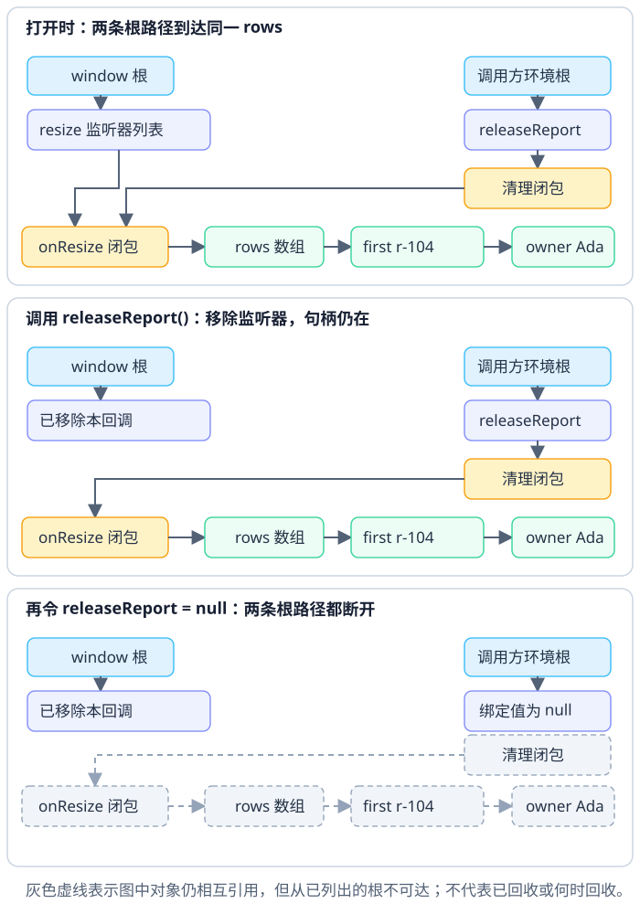

# JavaScript 对象为何会在不再有用后仍留在内存中？

报表页面关闭后，记录 `first`（业务 id `r-104`，owner 为 Ada）虽不再显示，却可能仍被全局事件监听器、计时器闭包或缓存引用。垃圾回收不会根据“这行业务上已过期”自动解除程序仍持有的引用。本章沿 `resize` 事件监听器和调用方保存的清理函数追踪这个记录，再用堆快照找具体保留者。弱集合不创建同类的强键路径，但也不会替你删除这些其他引用；其语言保证见[弱集合与弱引用能保证什么？](../javascript/javascript-memory-weakmap-and-weakset.md)。

## 可达性是保留问题，不是对象之间是否成环

JavaScript 语言不规定一种垃圾回收算法，也不承诺某个不可达对象何时被回收。用追踪式回收作为模型：从全局对象、活动执行状态等 GC root（垃圾回收根）开始，沿强引用标记对象；循环引用本身不阻止回收，从根仍能到达的对象则须保留。V8 的 Orinoco 只作一个实现例：V8 团队 2019 年的说明介绍了它的分代布局和并行、增量、并发技术。这是该引擎的实现资料，不是 ECMAScript 对所有运行时的承诺；实际算法与时机由引擎决定。

下面沿用 `r-104` / Ada 记录。报表打开时，`rows` 数组保存 `first`；`onResize` 闭包读取这组行，`window` 的事件监听器列表（event listener list）保存回调。`openReport` 返回的清理函数也捕获同一个回调，所以调用方的 `releaseReport` 绑定形成第二条路径：

~~~javascript
function openReport(target) {
  const owner = { id: "u-17", name: "Ada" };
  const first = { reportId: "r-104", amount: 0, owner };
  const rows = [first];

  function render(currentRows) {
    console.log(currentRows.map(row => `${row.reportId}:${row.owner.name}`).join(", "));
  }

  function onResize() {
    render(rows);
  }

  target.addEventListener("resize", onResize);
  return () => target.removeEventListener("resize", onResize);
}

let releaseReport = openReport(window);
// 关闭报表时先移除事件监听器，再放弃保存清理函数的绑定：
releaseReport();
releaseReport = null;
~~~

**图：报表关闭时两条强引用路径的变化**

报表未关闭时，`window` 的事件监听器列表与 `releaseReport` 清理函数分别可达同一个 `onResize` 闭包；它再保留 `rows`、`first` 和嵌套 `owner`。执行 `releaseReport()` 会从 `window` 的事件监听器列表移除回调，但返回的清理函数仍在调用方绑定里，所以这一步单独做完后 `rows` 仍可达。再将绑定置为 `null`，图中这两条路径才都断开。如果还有其他所有者或根路径，对象仍会存活；即使这里没有已知路径，也只是具备回收条件，不能推断何时实际回收。

若某个 `WeakMap` 以 `first` 为键，手头持有这个对象的代码仍可用它查元数据。事件监听器仍在时，`first` 也沿着监听器路径存活；WeakMap 不会额外保住键，却不会替你删除 `window → callback → rows → first` 这条强引用路径。

常见保留路径还包括：

- `setTimeout`、`setInterval` 定时器、订阅或未结束任务仍持有回调；回调闭包保留旧报表。
- 应用级 `Map`（映射）缓存未删除条目，强持有键及关联值。
- 脱离文档对象模型（DOM）树且仍能从根到达的节点仍会被保留；仅有节点和自身监听器之间的引用环不足以证明泄漏。
- 调试器控制台、断点或堆分析工具暂时保留对象。

这些只是检查线索，必须沿实际对象的保留链确认，不能只凭“用了闭包”或“数组很大”就认定泄漏。

## 用重复操作和堆快照定位所有者

为比较重复操作后留下的对象，先把页面回到关闭状态并等它稳定：先打开报表、切换到固定筛选、正常关闭，再取基线 heap snapshot（堆快照）。随后按相同顺序重复打开报表、切换到该筛选、关闭；重复数次后再次回到关闭且稳定的状态，取第二份快照。让两次快照处于相同页面与应用状态，才能把新增的残留对象作为候选。Chrome DevTools 取快照前会先执行一次 GC；在 Comparison（比较）视图展开新增对象条目，查看实例属性，确认 `reportId` 是否为 `"r-104"`；也可从有辨识度的 `onResize` 回调查起。再选中对象检查 retainers（保留者）和到根的路径：本例应沿事件监听器、闭包捕获的行数组，或调用方仍持有的清理函数查找所有者。控制台或断点可能暂时保留对象，取快照前清除不必要的 console 结果并停用断点。

若路径来自 `window` 上的监听器，应由注册监听器的报表生命周期调用 `removeEventListener`；若来自应用缓存，则由缓存所有者删除条目；若来自定时器，创建它的生命周期应在关闭时调用 `clearInterval` 或 `clearTimeout`。清理点要与资源的真实所有权一致，而不是把 `FinalizationRegistry`（最终化注册表）当成释放按钮。

Chrome DevTools 的 Heap Snapshot 比较视图可检查打开再关闭是否持续留下对象，Retainers 区会显示选中对象的直接保留者。Node.js 也可通过 `v8.writeHeapSnapshot()` 生成 V8 堆快照；它会同步阻塞事件循环，采集时约需堆大小两倍的内存，应先评估实例余量。这些呈现和诊断功能属于运行时工具，不是 ECMAScript 语义。

> [!info]- 来源
> - 追踪式 GC 沿 root set 标记可达对象，以及 V8 的分代布局和 Orinoco 并行/增量/并发技术：[V8 “Trash talk: the Orinoco garbage collector” 的 Marking](https://v8.dev/blog/trash-talk#marking)、[Generational layout](https://v8.dev/blog/trash-talk#generational-layout) 与 [Orinoco](https://v8.dev/blog/trash-talk#orinoco)，2019-01-03；后两节是 V8 实现示例，不代表 ECMAScript 规定的算法。
> - 浏览器事件目标把监听回调加入 listener list，`removeEventListener` 可按 type/callback/capture 移除：[WHATWG DOM §2.7 EventTarget](https://dom.spec.whatwg.org/#interface-eventtarget)，Living Standard，核验于 2026-11-12。
> - ECMAScript 不保证不可达目标何时回收或最终化回调一定执行：[ECMAScript 2026 §9.9 Processing Model](https://tc39.es/ecma262/2026/multipage/executable-code-and-execution-contexts.html#sec-weakref-processing-model)。
> - 快照开始前执行 GC、比较操作前后快照并查看对象保留者：[Chrome DevTools “Record heap snapshots”](https://developer.chrome.com/docs/devtools/memory-problems/heap-snapshots) 中的 Take a snapshot、Comparison view 与 Retainers，访问于 2026-11-12。
> - 控制台或断点可能保留对象，官方建议清空 console 且不留活动断点再取快照：[Chrome DevTools “Memory terminology”](https://developer.chrome.com/docs/devtools/memory-problems/get-started)，访问于 2026-11-12。
> - Node.js 服务端快照工具、V8 格式及其同步阻塞和约两倍堆内存开销：[Node.js v26.13.1 `v8.writeHeapSnapshot()`](https://nodejs.org/api/v8.html#v8writeheapsnapshotfilenameoptions)，读取于 2026-11-12。
