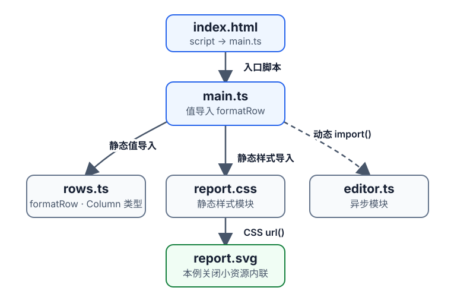
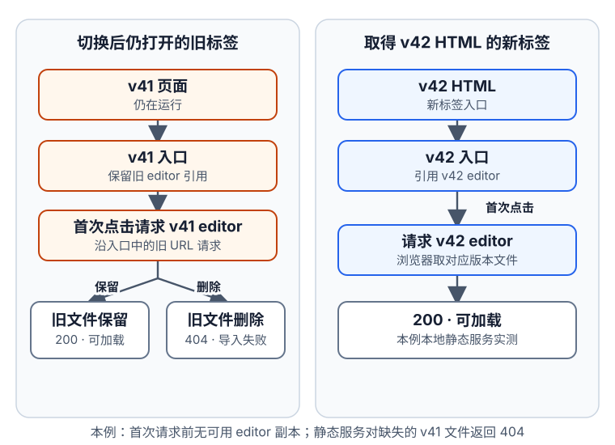

# 构建工具怎样把源码变成可发布产物？

本文用一张合成的月度报表页，跟踪源码怎样变成浏览器实际请求的 URL；最后再看发布 v42 之后，仍开着的 v41 页面为什么还可能去取旧的编辑器代码分块，以及发布时必须保留哪些文件。例子使用 Node.js 26.13.0、Vite 8.3.5 和 Webpack 5.109.0。文中的文件名来自固定版本和配置的独立小项目，不是这些工具的默认输出。

项目结构如下：入口 `index.html` 引用 `src/main.ts`；`main.ts` 从 `rows.ts` 导入 `formatRow`，并静态导入 `report.css`；CSS 用 `url()` 引用一个 SVG 图标；用户点击“打开编辑器”后，事件处理器才调用 `import("./editor.ts")`。`import()` 语法在构建时就形成一条异步依赖边，点击处理器只决定运行时何时调用它。因此构建器会提前找到并转换 `editor.ts`；但如果没有预加载，浏览器要等这次调用发生才请求它的生成文件。

图中只画本例源码的模块关系。`main.ts` 对 `rows.ts` 中 `formatRow` 的导入是值导入，会保留到输出中；`rows.ts` 里的 `Column` 只用于类型标注，类型擦除后不会进入 JavaScript。`report.svg` 要等到处理 `report.css` 时，才由 CSS 解析器从 `url('./report.svg')` 中发现并加入待处理请求；本例关闭了小资源内联，所以图标会输出为单独的文件。

构建器从入口出发逐步扩展这张图，再把图中的关系变成浏览器能访问的产物：

1. **确定入口。** `package.json` 里的脚本只负责启动构建命令，它不是模块图的入口。Vite 默认从项目根目录的 `index.html` 开始；本例给 Webpack 显式设置 `entry: "./index.html"`，并配置生成页面的输出位置。
2. **递归发现依赖。** 每处理一个请求，模块解析器（resolver）先从导入方出发定位到实际资源，再由匹配的加载器（loader）或内置处理器读取并转换它。随后，构建器在转换后的内容里找出静态导入、动态导入和资源引用这几类依赖边，把还没处理过的目标加入待处理队列，直到队列清空。例如相对请求 `./rows.ts` 从导入方所在目录查找，包名则按安装位置和包元数据解析；本例只用到相对请求。
3. **优化并分块。** 队列清空后，模块图才算完整。tree shaking（摇树优化）删除能证明没有被使用的导出；code splitting（代码分割）决定哪些模块组成初始加载的代码分块（chunk），哪些组成异步加载的 chunk。所以最终有几个文件，不只取决于源码写了几个入口，还取决于 Webpack 的 `optimization.splitChunks` 等分组规则。本例在 `rows.ts` 中另放了一个从未被导入的导出 `unusedChart`，其中带有一段可搜索的哨兵字符串；实际输出中找不到这段字符串，说明它已被删除。
4. **生成文件并改写引用。** 构建器写出 HTML、JavaScript、CSS 和资源文件，把源码中的请求改写为生成文件之间的引用；还可以按配置输出 manifest，记录源入口到输出文件的映射。文件名里的哈希还受图中引用关系和其他构建输入影响，不能只凭某个源文件或最终 JS 的字节单独推算；后文的 v41/v42 表格列出了同一配置下的实际文件名。
5. **部署并运行。** 整套产物要部署到与公开路径（public path）相符的位置。浏览器先按 HTML 请求初始 JS 和 CSS，CSS 再引用图标；执行到生成代码中的动态导入时，Vite 产物直接请求改写后的 ESM URL，Webpack 产物则由运行时用 chunk ID、文件名映射和 `output.publicPath` 拼出 URL。在本例中，只有首次点击、且没有预加载或可复用的缓存时，才会产生编辑器的网络请求。HTML 中相对 URL 的实际解析结果见下文实测。

## 为什么要固定 Node.js 与包管理器版本？

要复现一份构建，至少需要知道 Node.js、包管理器、锁文件和构建器的版本。`package.json` 的 `packageManager` 字段可记录项目采用的管理器及版本，但不会安装 Node.js；Node 版本仍应由版本文件、CI 镜像或运行环境固定。锁文件复用依赖解析结果，却不能固定操作系统、环境变量、系统工具或构建脚本读取的任意外部输入。

Node.js 25 起，发行包不再附带 Corepack。如果项目靠 Corepack 按 `packageManager` 字段代理 `pnpm`、`yarn` 等命令，需要按当前 Corepack 文档单独安装它；也可以按所选包管理器的官方方式固定版本。例如 `package.json` 的 `build` 脚本写成 `vite build`，本地和 CI 都用同一版本的 pnpm 执行 `pnpm build`。两边使用相同的工具和锁文件可以减少依赖解析差异，但仍要检查实际生成的路径和部署结果。

## Webpack 的模块加载器与插件分别处理什么？

讨论 loader 和插件之前，先把两件事分开：构建时发现了哪些依赖关系，和浏览器运行时实际请求哪些生成文件。下表按本例逐项对照：

| 源码或入口 | 构建时发现的关系 | 本例浏览器何时请求生成文件 |
|---|---|---|
| `index.html` | Vite 默认入口；Webpack 显式指定 `./index.html` | 取得页面 HTML 时 |
| `src/main.ts` | HTML 的 `
<link rel="stylesheet" href="/reports/assets/index-QsJV6IX7.css">
~~~

~~~css
background: url(/reports/assets/report-D2wE4vR2.svg);
~~~

本例把这次构建记为 v41。它的入口脚本中，动态导入的目标已改写为生成文件名（实际输出外面还包了一层预加载辅助函数）：

~~~javascript
await import("./editor-x2UHusWa.js");
~~~

脚本从 `/reports/assets/` 加载，浏览器因此请求 `/reports/assets/editor-x2UHusWa.js`，而不是请求源码 `editor.ts`。本例用无界面 Chromium 首次打开页面时未请求编辑器；点击后该 URL 返回 200。

Vite 默认不生成 manifest。本例打开它，是为了核对源入口到输出文件的映射：例如 `"index.html"` 一项记录了 `dynamicImports: ["src/editor.ts"]`，而 `"src/editor.ts"` 一项的 `file` 是 `"assets/editor-x2UHusWa.js"`。这些 `file` 值是相对输出目录的路径，不带 `/reports/` 前缀。浏览器只按 HTML、CSS 和生成的 JavaScript 中的引用请求文件，不会读取 manifest；需要这份映射的是服务端渲染或后端集成工具。

如果恢复默认的内联阈值，本例的小 SVG 会变成 CSS 中的 data URL，不再单独发请求。部署到子路径时，`base` 必须与静态站点的挂载路径一致。`vite preview` 只用来本地预览生产构建，不是生产服务器；上线前仍要在实际部署 URL 下检查 HTML、初始脚本和样式、异步分块、图像、缓存头、压缩和路由回退。

另外两点也不能靠构建成功来证明。第一，Vite 用 Oxc 转译 TypeScript，只删除类型，不做类型检查。第二，Vite 8.3.5 的 `build.target` 默认面向 2026-01-01 时 Baseline Widely Available 的浏览器范围（即 Chrome/Edge 111、Firefox 114、Safari 16.4）；它只决定语法转换到什么程度，不会补齐运行时 API，`tsconfig.json` 的 `target` 也不能代替它。要支持更早的浏览器，还需单独引入 API polyfill（兼容补丁）并在目标环境中验证。参见[怎样判断目标浏览器或 Node.js 是否支持一项 JavaScript 特性？](../javascript/modern-javascript-features.md)。

## 新入口与带哈希代码分块怎样作为同一版本发布？

v41 和 v42 是两次独立构建，源码中唯一的差别是编辑器里的文字。编辑器内容变了，它的文件名哈希随之改变；而入口脚本里写着编辑器的生成文件名，所以即使 `main.ts` 源码没动，生成的入口 JavaScript 内容也变了，入口文件名同样改变。下面是这个合成测试项目（fixture）的实际输出，没有变化的 CSS 和 SVG 保持原文件名：

| 浏览器请求（`base` 为 `/reports/`） | v41 | v42 |
|---|---|---|
| 新页面从 HTML 取得的入口 JS | `/reports/assets/index-gRN8M4PG.js` | `/reports/assets/index-ClYpL0PO.js` |
| 首次点击时的编辑器分块 | `/reports/assets/editor-x2UHusWa.js` | `/reports/assets/editor-BLsXx8VX.js` |
| 初始 CSS | `/reports/assets/index-QsJV6IX7.css` | 相同 |
| CSS 图标 | `/reports/assets/report-D2wE4vR2.svg` | 相同 |

该命名来自这组构建器输出，不应推断为仅凭入口脚本最终字节就能独立计算文件名的通用规则。

发布 v42 时，先把整套入口、样式、图像和异步分块写入目标存储，确认它们都能从对应 URL 读取，最后才切换源站上的 HTML 或 release 指针。这次切换只保证指针本身是原子更新的；CDN 边缘节点可能在短时间内仍返回旧 HTML，已打开的旧页面也还在运行。因此，不要改写同一个哈希 URL 下的内容；只要还可能有旧 HTML、旧标签页或旧 Service Worker 引用某个文件，就不要删除它。

图中的 200 和 404 来自实际浏览器测试。测试时，v41 标签页已经加载入口，但还没点开编辑器：保留旧 chunk 时，首次点击请求旧 URL，返回 200；提前删除旧 chunk 时，这次请求返回 404，动态导入失败。如果该页面已经加载过编辑器，之后再调用通常直接复用已加载的模块，不会重复请求；如果浏览器缓存或 Service Worker 中有可用副本，也可能不走网络。还有一种容易误判的情况：服务器把缺失的 chunk 回退成 HTML 页面时，网络状态是 200，但动态导入仍会因为响应不是 JavaScript 而失败。

回滚同样要成套进行：把入口 HTML 和对应的 manifest（如果服务端会读取）一起指回 v41；已经打开的 v42 页面仍可能需要 v42 的文件，所以也不能立即删除。旧版本文件的保留时长，要覆盖仍在提供的 HTML、用户仍开着的页面，以及可能继续控制旧页面的 Service Worker。后端 API 能否同时兼容新旧页面，是另一项需要单独检查的发布条件。缓存方面，HTTP 缓存和 Service Worker 的 Cache Storage 是两套机制，要分开设置：

| 资源 | 缓存边界 |
|---|---|
| 可变 HTML 或当前 release 指针 | 可用 `Cache-Control: no-cache` 保存响应，但复用前要重新验证；也可缩短新鲜时间 |
| 带哈希的脚本、CSS 与图片 | 只有同一路径永不改写内容时才适合长缓存和 `immutable` |
| manifest | 浏览器通常不请求；服务端读取时按版本保存，或与入口一同重新验证 |
| Service Worker Cache Storage | 独立于 HTTP 缓存；按版本保留旧页仍需的文件 |

`no-cache` 允许缓存保存响应，只是每次复用前都要先向服务器验证；它不等于禁止存储的 `no-store`。`immutable` 表示响应在新鲜期内不会变化，浏览器无需重新验证。动态 chunk 加载失败时，应先判断是不是可恢复的新旧版本错配；如果是，保留用户未保存的草稿，让用户保存后自行选择刷新。不要把所有导入错误都当成版本错配，也不要自动无限重载。本页止于静态资源部署；构建一次、逐环境验证、渐进放量和服务端回滚见[如何晋级并回滚已验证的报表服务产物](../../engineering-foundations/infrastructure/application-deployment-and-ci-cd.md)。

## Source map 怎样用于调试，又会暴露什么？

生产代码经过转换和压缩，报错时的行列号对应的是生成文件，很难直接读懂。source map（源映射）记录生成代码位置与原始源码位置的对应关系，调试器或错误收集工具可以据此把生成代码中的行列位置映射回源码；映射本身并不能还原出原始文件。映射精确到行还是列、是否使用 loader 提供的映射、映射内嵌在文件中还是单独存放、是否附带源码文本，这些选择分别影响定位精度、构建成本和对外暴露的信息。

| Webpack `devtool` 例子 | 主要含义 | 适用边界 |
|---|---|---|
| `eval-source-map` | 逐模块用 `eval` 关联完整映射 | 开发定位精度高；官方将初次构建列为 slowest |
| `cheap-source-map` | 行级映射，忽略 loader 提供的映射 | 不支持列级断点；映射可能停留在转换后的行 |
| `cheap-module-source-map` | 使用 loader 映射后简化到行级 | 能映回更早源码，但不保留列级位置 |
| `source-map` | 外置完整映射，bundle 通常写引用 | 错误定位可恢复行列；需检查 `.map` 是否可公开请求 |
| `hidden-source-map` | 外置映射但 bundle 不写 `sourceMappingURL` | 可将 `.map` 单独上传到私有错误工具；隐藏引用不等于访问控制 |
| `nosources-source-map` | 不内嵌 `sourcesContent` | 仍可能泄露文件名和映射关系，不是源码权限边界 |

`cheap-` 只保留行级位置。`module-` 只在 cheap 组合中表示消费 loader 映射；完整 `source-map` 本身就会使用可用的 loader 映射。Webpack 5.105 起可用数组按 JavaScript、CSS 或两者设置 source map 类型；这里的 `all` 指 JavaScript 与 CSS，不是任意图像、字体或资源。当前完整语法还含 `-debugids`，Webpack 5.112.0 加入 `-scopes`；组合顺序与可用性按锁定版本核对。旧预设的详细映射见[Webpack source map 预设对照](../../archive/front-end/Deprecated_Interview_Notes/webpack-source-map-presets.md)。

Source map 不是权限边界：若 `.map` URL 仍由服务器公开提供，去掉 bundle 引用不能阻止知道路径的人请求。`nosources` 只去掉内嵌源码文本，仍可能暴露目录和文件名。发布时分别检查输出文件、服务器静态资源规则和错误收集工具的访问权限。

> [!info]- 来源
> - **Node 与包管理器：** [Node.js 25.0.0 发布说明](https://nodejs.org/en/blog/release/v25.0.0) 与 [Corepack 配置项目](https://nodejs.org/download/release/v25.8.0/docs/api/corepack.html)：Corepack 从 Node 25 起不随发行包提供；[Corepack 的 `packageManager` 字段](https://github.com/nodejs/corepack#when-authoring-packages)说明包管理器版本声明。[Node.js 22.6.0 发布说明](https://nodejs.org/en/blog/release/v22.6.0)说明当时加入的是 `--experimental-strip-types` 命令行功能；[`module.stripTypeScriptTypes()` 文档](https://nodejs.org/download/release/v22.13.0/docs/api/module.html#modulestriptypescripttypescode-options)、[22.13.0 发布说明](https://nodejs.org/en/blog/release/v22.13.0)、[23.2.0 发布说明](https://nodejs.org/en/blog/release/v23.2.0)确认 API 版本边界。核对日期：2026-11-12。
> - **Webpack 模块图与浏览器 URL：** [NormalModule.js](https://github.com/webpack/webpack/blob/v5.109.0/lib/NormalModule.js#L1576-L1650)、[Compilation.js](https://github.com/webpack/webpack/blob/v5.109.0/lib/Compilation.js#L1766-L1810) 及 [ImportParserPlugin.js](https://github.com/webpack/webpack/blob/v5.109.0/lib/dependencies/ImportParserPlugin.js#L580-L620)说明转换后解析依赖和异步边；[Webpack chunk runtime](https://github.com/webpack/webpack/blob/v5.109.0/lib/web/JsonpChunkLoadingRuntimeModule.js#L135-L196)说明运行时如何组合 public path 和文件名。Webpack HTML 配置和发布路径见[原生 HTML](https://webpack.js.org/guides/native-html/)与[输出管理](https://webpack.js.org/guides/output-management/)。
> - **Webpack CSS、HTML 与 TypeScript：** [v5.109 defaults.js](https://github.com/webpack/webpack/blob/v5.109.0/lib/config/defaults.js#L649-L686) 展示 `auto` 合成路径探测与原生 TypeScript 默认；[RuleSetCompiler.js](https://github.com/webpack/webpack/blob/v5.109.0/lib/rules/RuleSetCompiler.js#L473-L578) 包含宽松规则探测与扩展名正则判断；[implicitTypeLoaderFallback.js](https://github.com/webpack/webpack/blob/v5.109.0/lib/util/implicitTypeLoaderFallback.js#L13-L51) 展示 loader 逐模块退让条件。Native CSS/HTML 及[experiments.typescript](https://webpack.js.org/configuration/experiments/#experimentstypescript)文档核对 5.109/5.110 边界；[HtmlWebpackPlugin 当前 README](https://github.com/jantimon/html-webpack-plugin#readme)标记弃用。Node API feature detection 见 [TypeScriptPlugin.js](https://github.com/webpack/webpack/blob/v5.109.0/lib/typescript/TypeScriptPlugin.js#L119-L134)。
> - **Webpack loader、插件与压缩：** [processAssets 阶段与 additionalAssets](https://webpack.js.org/api/compilation-hooks/#processassets)说明新增产物的阶段顺序及后续资源回调；[minimizer-webpack-plugin v5.6.1](https://github.com/webpack/minimizer-webpack-plugin/blob/v5.6.1/src/index.js) 的 `OPTIMIZE_SIZE` 订阅启用 `additionalAssets: true`，匹配的后续资源仍可进入该处理器；[HTML 默认入口](https://webpack.js.org/configuration/experiments/#html-as-the-default-entry)说明默认扩展名顺序。[Loaders](https://webpack.js.org/concepts/loaders/)解释 pitch/normal 次序；[ts-loader `transpileOnly`](https://github.com/TypeStrong/ts-loader#transpileonly)说明默认类型检查和纯转译选项；[Asset Modules](https://webpack.js.org/guides/asset-modules/)解释资源处理；[Compiler.js](https://github.com/webpack/webpack/blob/v5.109.0/lib/Compiler.js#L1081-L1106)、[Compilation.js](https://github.com/webpack/webpack/blob/v5.109.0/lib/Compilation.js#L3806-L3834)和 [defaults.js backCompat 默认值](https://github.com/webpack/webpack/blob/v5.109.0/lib/config/defaults.js#L622-L623)核实 emit、processAssets、资源封存与兼容模式。[CompressionWebpackPlugin 当前 README](https://github.com/webpack/compression-webpack-plugin#readme)标记弃用；压缩迁移选项要求 `minimizer-webpack-plugin@5.11.0`，见[迁移文档](https://github.com/webpack/compression-webpack-plugin#migrating)。[Terser minimizer 5.6.0](https://github.com/webpack/minimizer-webpack-plugin/releases/tag/v5.6.0)记录包名变更。
> - **Vite 与 source map：** 固定版本 [Vite 8.3.5 build](https://github.com/vitejs/vite/blob/v8.3.5/docs/guide/build.md)、[assets](https://github.com/vitejs/vite/blob/v8.3.5/docs/guide/assets.md)、[features](https://github.com/vitejs/vite/blob/v8.3.5/docs/guide/features.md)、[HMR API](https://github.com/vitejs/vite/blob/v8.3.5/docs/guide/api-hmr.md)、[build options](https://github.com/vitejs/vite/blob/v8.3.5/docs/config/build-options.md)、[manifest](https://github.com/vitejs/vite/blob/v8.3.5/docs/guide/backend-integration.md)及[生产动态导入辅助逻辑](https://github.com/vitejs/vite/blob/v8.3.5/packages/vite/src/node/plugins/importAnalysisBuild.ts#L314-L344)。Source map 版本与预设见[Webpack devtool 表](https://webpack.js.org/configuration/devtool/)、[5.105 数组配置](https://webpack.js.org/blog/2026-02-03-webpack-5-105/)和[5.112 scopes](https://webpack.js.org/blog/2026-10-13-webpack-5-112/)。缓存语义见 [RFC 9111 §5.2](https://www.rfc-editor.org/rfc/rfc9111.html#section-5.2)、[RFC 8246](https://www.rfc-editor.org/rfc/rfc8246.html)与[Service Workers](https://www.w3.org/TR/service-workers/)。
>
> v41/v42 的具体文件名和请求是 Node.js 26.13.0、Vite 8.3.5 的合成 fixture 实测；Webpack HTML 路径与 chunk 文件名是 Node.js 26.13.0、Webpack 5.109.0 的独立 fixture 实测。它们是版本与配置结果，不是稳定 API。
