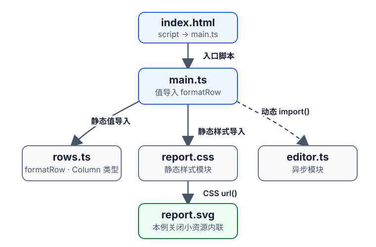
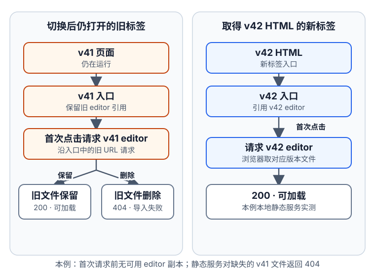

# 构建工具怎样把源码变成可发布产物？

用一张合成的月度报表页跟踪源码如何变成浏览器请求的 URL。最后再看 v42 发布后，仍打开的 v41 页面为什么可能要取回旧的编辑器分块，以及发布时要保留什么。这个例子采用 Node.js 26.13.0、Vite 8.3.5 和 Webpack 5.109.0；文件名来自固定版本和配置的独立小项目，不代表产品默认值。

入口 `index.html` 引用 `src/main.ts`。主文件从 `rows.ts` 导入 `formatRow`，并静态导入 `report.css`；CSS 的 `url()` 引用图标；用户点击“打开编辑器”时，事件处理器才调用 `import("./editor.ts")`。`import()` 语法形成异步依赖边，点击处理器决定何时调用它。构建时会先找到并转换 `editor.ts`，但没有预加载时，浏览器等到这次调用才请求其生成文件。

`package.json` 中的脚本启动构建命令；它不是浏览器模块图的入口。Vite 默认以项目根目录的 `index.html` 开始。本例给 Webpack 显式设置 `entry: "./index.html"`，并配置生成页面的位置。

图只画本例源码的模块关系。`main.ts` 保留对 `rows.ts` 中 `formatRow` 的值导入；`rows.ts` 的 `Column` 只作类型标注，TypeScript 擦除后不进入 JavaScript。处理 `report.css` 时，CSS 解析器才发现 `url('./report.svg')` 并排入该资源请求；本例关闭小资源内联，所以图标输出为单独文件。编辑器的异步边由 `import()` 语法建立，点击处理器只决定调用时机。

构建器按请求逐步扩展这张图，再把图中的关系变成浏览器可访问的产物：

1. **选入口。** `package.json` 的脚本启动构建器，但不是模块图入口。Vite 默认从项目根目录的 `index.html` 开始；本例为 Webpack 显式设置 `entry: "./index.html"`。
2. **递归发现依赖。** 对每个待处理请求，模块解析器（resolver）从导入方定位资源，再由匹配的加载器（loader）或内置处理器读取并转换。解析器检查转换后的内容，记录发现的静态、动态和资源依赖边，再把尚未处理的目标请求入队；继续处理，直到待处理请求队列为空。比如相对请求 `./rows.ts` 从导入方目录定位，包名则按安装位置和包元数据解析；本例只使用相对请求。
3. **优化并分块。** 队列清空时，本例的模块图才完整。摇树优化（tree shaking）删除可证明未使用的导出；代码分割（code splitting）决定模块怎样组成初始或异步的代码分块（chunk）。因此 Webpack 的 `optimization.splitChunks` 等规则会影响文件分组，不能只看源码写了几个入口。本例实际输出中没有 `unusedChart` 的哨兵字符串。
4. **生成并改写引用。** 构建器写出 HTML、JavaScript、CSS 和资源文件，把源请求改为生成文件间的引用；可选 manifest 记录入口到输出文件的映射。v41/v42 表格展示同一配置的实际文件名。哈希还会受图中引用和其他构建输入影响，不能只用某个源文件或最终 JS 字节独立推算。
5. **部署并运行。** 将整套产物部署在与公开路径相配的位置。浏览器沿 HTML 请求初始 JS 和 CSS，CSS 再引用图标；运行到生成代码里的动态导入时，Vite 请求改写后的 ESM URL，Webpack 则用 chunk ID、运行时文件名映射和 `output.publicPath` 组装 URL。此例只有在首次调用且没有预加载或可复用缓存时才会产生编辑器网络请求；HTML 相对 URL 的具体结果见下文实测。

## 为什么要固定 Node.js 与包管理器版本？

要复现一份构建，至少需要知道 Node.js、包管理器、锁文件和构建器的版本。`package.json` 的 `packageManager` 字段可记录项目采用的管理器及版本，但不会安装 Node.js；Node 版本仍应由版本文件、CI 镜像或运行环境固定。锁文件复用依赖解析结果，却不能固定操作系统、环境变量、系统工具或构建脚本读取的任意外部输入。

Node.js 25 起不再随发行包提供 Corepack。若项目依赖 Corepack 提供的命令代理，应按当前 Corepack 文档单独安装；也可按所选包管理器的官方流程固定版本。比如 `package.json` 把 `build` 脚本映射到 `vite build`，再由 `pnpm build` 运行。CI 与本地使用相同工具和锁文件能减少解析差异，仍需检查实际生成路径和部署结果。

## Webpack 的模块加载器与插件分别处理什么？

先把合成页面的请求关系和浏览器看到的产物分开：

| 源码或入口 | 构建时发现的关系 | 本例浏览器何时请求生成文件 |
|---|---|---|
| `index.html` | Vite 默认入口；Webpack 显式指定 `./index.html` | 取得页面 HTML 时 |
| `src/main.ts` | HTML 的 `
<link rel="stylesheet" href="/reports/assets/index-QsJV6IX7.css">
~~~

~~~css
background: url(/reports/assets/report-D2wE4vR2.svg);
~~~

v41 的入口脚本保留 `import('./editor-x2UHusWa.js')` 这个改写后的目标（实际输出由预加载辅助函数包装）：

~~~javascript
await import("./editor-x2UHusWa.js");
~~~

脚本从 `/reports/assets/` 加载，浏览器因此请求 `/reports/assets/editor-x2UHusWa.js`，而不是请求源码 `editor.ts`。本例用无界面 Chromium 首次打开页面时未请求编辑器；点击后该 URL 返回 200。

Vite 的 manifest 默认不生成。本例打开它是为核对源入口到输出文件的映射，例如 `"index.html"` 记录 `dynamicImports: ["src/editor.ts"]`，而 `"src/editor.ts"` 的 `file` 是 `"assets/editor-x2UHusWa.js"`。这些 `file` 值是相对输出目录的路径，不含 `/reports/` URL 前缀；浏览器按 HTML、CSS 和生成 JavaScript 中的引用请求文件，不请求 manifest。服务端或集成工具若需要这份映射，可打开 `build.manifest`。

若恢复默认内联阈值，本例的小 SVG 会变成 CSS 的 data URL，不再单独发 SVG 请求。部署到子路径时，`base` 要与静态站点挂载路径一致。`vite preview` 可预览生产构建，不是生产服务器；还要在实际部署 URL 检查 HTML、初始脚本/样式、异步分块、图像、缓存头、压缩和路由回退。Vite/Oxc 转译 TypeScript 不等于类型检查。Vite 8.3.5 的 `build.target` 默认面向 2026-01-01 的 Baseline Widely Available 浏览器范围；它决定语法转换范围，不补齐运行时 API，也不由 `tsconfig.json` 的 `target` 代替。若要支持更早浏览器，还要单独安排 API polyfill（应用程序接口兼容补丁）并在目标环境验证。参见[怎样判断目标浏览器或 Node.js 是否支持一项 JavaScript 特性？](../javascript/modern-javascript-features.md)。

## 新入口与带哈希代码分块怎样作为同一版本发布？

独立构建的 v41 与 v42 只改变编辑器文字。构建器改写入口中的编辑器目标，所以即使 `main.ts` 源码不变，生成的入口 JavaScript 内容也变了，入口和编辑器文件名都随之变化。下面是这个合成 fixture 的实际输出；未变的 CSS 与 SVG 文件保持原名：

| 浏览器请求（`base` 为 `/reports/`） | v41 | v42 |
|---|---|---|
| 新页面从 HTML 取得的入口 JS | `/reports/assets/index-gRN8M4PG.js` | `/reports/assets/index-ClYpL0PO.js` |
| 首次点击时的编辑器分块 | `/reports/assets/editor-x2UHusWa.js` | `/reports/assets/editor-BLsXx8VX.js` |
| 初始 CSS | `/reports/assets/index-QsJV6IX7.css` | 相同 |
| CSS 图标 | `/reports/assets/report-D2wE4vR2.svg` | 相同 |

该命名来自这组构建器输出，不应推断为仅凭入口脚本最终字节就能独立计算文件名的通用规则。

发布前把一整套 v42 入口、样式、图像和异步分块写到目标存储，再核对它们能从对应 URL 读取，最后切换源站的 HTML 或 release 指针。这个切换只能保证指针更新本身的原子性；CDN 边缘可能短时仍返回旧 HTML。因此不要覆写同一个哈希 URL 的内容，也不要在仍有旧 HTML、旧标签或旧 Service Worker 时删除其引用的文件。

上面的 200/404 来自实际浏览器测试。v41 标签已加载入口但尚未点编辑器；保留旧 chunk 后首次点击请求旧 URL 并返回 200，提前删除后该首次请求返回 404，导入失败。若编辑器已由该页面加载，之后重复调用通常复用已加载模块，不会再发同一请求；若浏览器/Service Worker 有可用副本，也可能不请求网络。若服务器把缺失 chunk 回退到 HTML，网络状态可以是 200，但动态导入仍会因响应不是 JavaScript 而失败。

回滚静态发布时，把入口 HTML 与其清单（若有服务端消费者）配对指回 v41；已打开的 v42 页面仍可能需要 v42 文件。旧版保留窗口要覆盖仍服务的 HTML、打开的页面和可能继续接管旧页面的 Service Worker。后端 API 是否兼容新旧页面是另一条发布边界。HTTP 缓存和 Service Worker Cache Storage 也需分开看：

| 资源 | 缓存边界 |
|---|---|
| 可变 HTML 或当前 release 指针 | 可用 `Cache-Control: no-cache` 保存响应，但复用前要重新验证；也可缩短新鲜时间 |
| 带哈希的脚本、CSS 与图片 | 只有同一路径永不改写内容时才适合长缓存和 `immutable` |
| manifest | 浏览器通常不请求；服务端读取时按版本保存，或与入口一同重新验证 |
| Service Worker Cache Storage | 独立于 HTTP 缓存；按版本保留旧页仍需的文件 |

`no-cache` 允许存储响应，但再次使用前要求验证；它不是 `no-store`。`immutable` 表示新鲜期内内容不变。遇到动态 chunk 加载失败时，应识别可恢复的发布错配，保留用户未保存的草稿，并让用户保存或选择刷新；不要把所有导入错误都判成发布错配，也不要无限重载。本页止于静态资源部署；构建一次、逐环境验证、渐进放量和服务端回滚见[如何晋级并回滚已验证的报表服务产物](../../engineering-foundations/infrastructure/application-deployment-and-ci-cd.md)。

## Source map 怎样用于调试，又会暴露什么？

Source map（源映射）记录生成代码位置与原始源码位置的对应关系。调试器或错误收集工具可用它把生成代码中的行列位置映回源码；映射本身不重建原始文件。映射粒度、loader 是否提供映射、文件内嵌或外置、是否含源码文本，会影响定位、构建成本和公开信息。

| Webpack `devtool` 例子 | 主要含义 | 适用边界 |
|---|---|---|
| `eval-source-map` | 逐模块用 `eval` 关联完整映射 | 开发定位精度高；官方将初次构建列为 slowest |
| `cheap-source-map` | 行级映射，忽略 loader 提供的映射 | 不支持列级断点；映射可能停留在转换后的行 |
| `cheap-module-source-map` | 使用 loader 映射后简化到行级 | 能映回更早源码，但不保留列级位置 |
| `source-map` | 外置完整映射，bundle 通常写引用 | 错误定位可恢复行列；需检查 `.map` 是否可公开请求 |
| `hidden-source-map` | 外置映射但 bundle 不写 `sourceMappingURL` | 可将 `.map` 单独上传到私有错误工具；隐藏引用不等于访问控制 |
| `nosources-source-map` | 不内嵌 `sourcesContent` | 仍可能泄露文件名和映射关系，不是源码权限边界 |

`cheap-` 只保留行级位置。`module-` 只在 cheap 组合中表示消费 loader 映射；完整 `source-map` 本身就会使用可用的 loader 映射。Webpack 5.105 起可用数组按 JavaScript、CSS 或两者设置 source map 类型；这里的 `all` 指 JavaScript 与 CSS，不是任意图像、字体或资源。当前完整语法还含 `-debugids`，Webpack 5.112.0 加入 `-scopes`；组合顺序与可用性按锁定版本核对。旧预设的详细映射见[Webpack source map 预设对照](../../archive/front-end/Deprecated_Interview_Notes/webpack-source-map-presets.md)。

Source map 不是权限边界：若 `.map` URL 仍由服务器公开提供，去掉 bundle 引用不能阻止知道路径的人请求。`nosources` 只去掉内嵌源码文本，仍可能暴露目录和文件名。发布时分别检查输出文件、服务器静态资源规则和错误收集工具的访问权限。

> [!info]- 来源
> - **Node 与包管理器：** [Node.js 25.0.0 发布说明](https://nodejs.org/en/blog/release/v25.0.0) 与 [Corepack 配置项目](https://nodejs.org/download/release/v25.8.0/docs/api/corepack.html)：Corepack 从 Node 25 起不随发行包提供；[Corepack 的 `packageManager` 字段](https://github.com/nodejs/corepack#when-authoring-packages)说明包管理器版本声明。[Node.js 22.6.0 发布说明](https://nodejs.org/en/blog/release/v22.6.0)说明当时加入的是 `--experimental-strip-types` 命令行功能；[`module.stripTypeScriptTypes()` 文档](https://nodejs.org/download/release/v22.13.0/docs/api/module.html#modulestriptypescripttypescode-options)、[22.13.0 发布说明](https://nodejs.org/en/blog/release/v22.13.0)、[23.2.0 发布说明](https://nodejs.org/en/blog/release/v23.2.0)确认 API 版本边界。核对日期：2026-11-12。
> - **Webpack 模块图与浏览器 URL：** [NormalModule.js](https://github.com/webpack/webpack/blob/v5.109.0/lib/NormalModule.js#L1576-L1650)、[Compilation.js](https://github.com/webpack/webpack/blob/v5.109.0/lib/Compilation.js#L1766-L1810) 及 [ImportParserPlugin.js](https://github.com/webpack/webpack/blob/v5.109.0/lib/dependencies/ImportParserPlugin.js#L580-L620)说明转换后解析依赖和异步边；[Webpack chunk runtime](https://github.com/webpack/webpack/blob/v5.109.0/lib/web/JsonpChunkLoadingRuntimeModule.js#L135-L196)说明运行时如何组合 public path 和文件名。Webpack HTML 配置和发布路径见[原生 HTML](https://webpack.js.org/guides/native-html/)与[输出管理](https://webpack.js.org/guides/output-management/)。
> - **Webpack CSS、HTML 与 TypeScript：** [v5.109 defaults.js](https://github.com/webpack/webpack/blob/v5.109.0/lib/config/defaults.js#L649-L686) 展示 `auto` 合成路径探测与原生 TypeScript 默认；[RuleSetCompiler.js](https://github.com/webpack/webpack/blob/v5.109.0/lib/rules/RuleSetCompiler.js#L473-L578) 包含宽松规则探测与扩展名正则判断；[implicitTypeLoaderFallback.js](https://github.com/webpack/webpack/blob/v5.109.0/lib/util/implicitTypeLoaderFallback.js#L13-L51) 展示 loader 逐模块退让条件。Native CSS/HTML 及[experiments.typescript](https://webpack.js.org/configuration/experiments/#experimentstypescript)文档核对 5.109/5.110 边界；[HtmlWebpackPlugin 当前 README](https://github.com/jantimon/html-webpack-plugin#readme)标记弃用。Node API feature detection 见 [TypeScriptPlugin.js](https://github.com/webpack/webpack/blob/v5.109.0/lib/typescript/TypeScriptPlugin.js#L119-L134)。
> - **Webpack loader、插件与压缩：** [processAssets 阶段与 additionalAssets](https://webpack.js.org/api/compilation-hooks/#processassets)说明新增产物的阶段顺序及后续资源回调；[minimizer-webpack-plugin v5.6.1](https://github.com/webpack/minimizer-webpack-plugin/blob/v5.6.1/src/index.js) 的 `OPTIMIZE_SIZE` 订阅启用 `additionalAssets: true`，匹配的后续资源仍可进入该处理器；[HTML 默认入口](https://webpack.js.org/configuration/experiments/#html-as-the-default-entry)说明默认扩展名顺序。[Loaders](https://webpack.js.org/concepts/loaders/)解释 pitch/normal 次序；[ts-loader `transpileOnly`](https://github.com/TypeStrong/ts-loader#transpileonly)说明默认类型检查和纯转译选项；[Asset Modules](https://webpack.js.org/guides/asset-modules/)解释资源处理；[Compiler.js](https://github.com/webpack/webpack/blob/v5.109.0/lib/Compiler.js#L1081-L1106)、[Compilation.js](https://github.com/webpack/webpack/blob/v5.109.0/lib/Compilation.js#L3806-L3834)和 [defaults.js backCompat 默认值](https://github.com/webpack/webpack/blob/v5.109.0/lib/config/defaults.js#L622-L623)核实 emit、processAssets、资源封存与兼容模式。[CompressionWebpackPlugin 当前 README](https://github.com/webpack/compression-webpack-plugin#readme)标记弃用；压缩迁移选项要求 `minimizer-webpack-plugin@5.11.0`，见[迁移文档](https://github.com/webpack/compression-webpack-plugin#migrating)。[Terser minimizer 5.6.0](https://github.com/webpack/minimizer-webpack-plugin/releases/tag/v5.6.0)记录包名变更。
> - **Vite 与 source map：** 固定版本 [Vite 8.3.5 build](https://github.com/vitejs/vite/blob/v8.3.5/docs/guide/build.md)、[assets](https://github.com/vitejs/vite/blob/v8.3.5/docs/guide/assets.md)、[features](https://github.com/vitejs/vite/blob/v8.3.5/docs/guide/features.md)、[HMR API](https://github.com/vitejs/vite/blob/v8.3.5/docs/guide/api-hmr.md)、[build options](https://github.com/vitejs/vite/blob/v8.3.5/docs/config/build-options.md)、[manifest](https://github.com/vitejs/vite/blob/v8.3.5/docs/guide/backend-integration.md)及[生产动态导入辅助逻辑](https://github.com/vitejs/vite/blob/v8.3.5/packages/vite/src/node/plugins/importAnalysisBuild.ts#L314-L344)。Source map 版本与预设见[Webpack devtool 表](https://webpack.js.org/configuration/devtool/)、[5.105 数组配置](https://webpack.js.org/blog/2026-02-03-webpack-5-105/)和[5.112 scopes](https://webpack.js.org/blog/2026-10-13-webpack-5-112/)。缓存语义见 [RFC 9111 §5.2](https://www.rfc-editor.org/rfc/rfc9111.html#section-5.2)、[RFC 8246](https://www.rfc-editor.org/rfc/rfc8246.html)与[Service Workers](https://www.w3.org/TR/service-workers/)。
>
> v41/v42 的具体文件名和请求是 Node.js 26.13.0、Vite 8.3.5 的合成 fixture 实测；Webpack HTML 路径与 chunk 文件名是 Node.js 26.13.0、Webpack 5.109.0 的独立 fixture 实测。它们是版本与配置结果，不是稳定 API。
