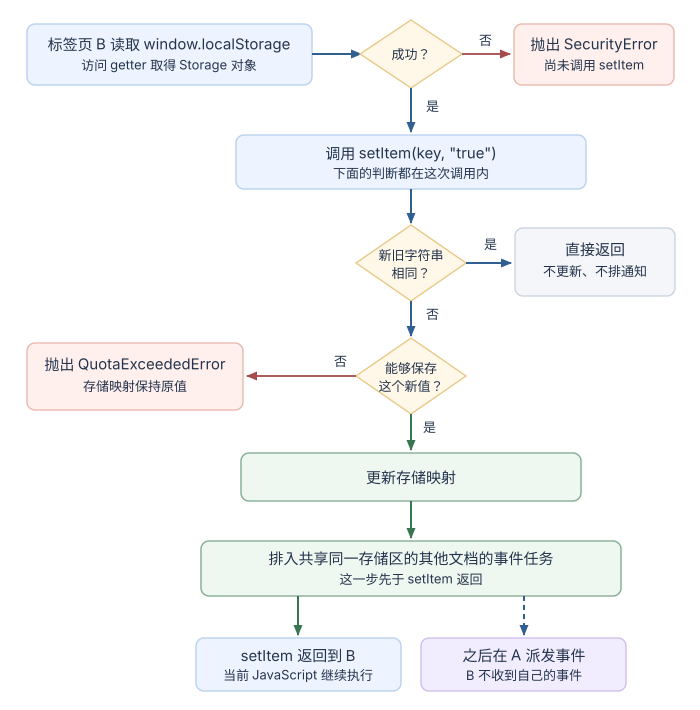
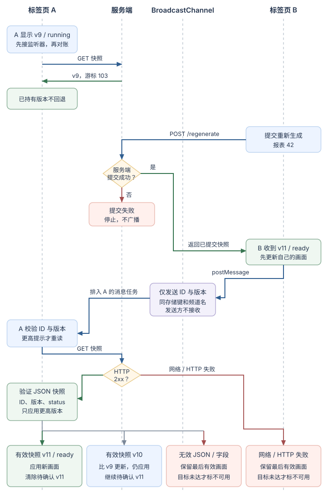

# 浏览器能把状态存在哪里，标签页和窗口之间怎样互相通知？

本章讲浏览器提供的存储与跨上下文通信原语：每种原语存什么、谁能看见、什么时候会失败，以及一个页面怎样让另一个页面知道“状态变了”。某份状态该归 URL、缓存、组件还是服务端，由[状态所有权表](state-ownership-and-composition.md)决定；本章只处理已经决定放进浏览器、或需要在浏览器上下文之间传递的那部分。结论是：本地存储只保存本机的偏好和草稿；任何“变了”的消息都只是通知，收到后要向权威来源重新读取。

**案例。** 沿用主线一的报表页 `/reports/42?sort=recent#summary`。本章新增三样东西，都是教学用合成数据：

- 一项本地偏好“紧凑列”，存在 `localStorage` 的键 `reports:compact-columns` 下，取值是字符串 `"true"` 或 `"false"`；
- 服务端报表快照 `{ id: 42, version: 9, status: "running", event_cursor: "103" }`，其中版本号只增不减，`event_cursor` 是事件流的续读位置，下一章才用到；
- 同一用户开了两个标签页 A、B，都显示版本 9。用户在 B 里点“重新生成”，服务端提交成功，返回版本 11、状态 `ready`（中间的版本 10 可能来自别处的更新）。

## 浏览器提供了哪些存储与通信原语？

按所有权表，报表页里落到浏览器的只有几类：“紧凑列”这类小型偏好进 `localStorage`，本标签页未提交的筛选草稿进 `sessionStorage`，登录会话由服务端设置的 Cookie 承载，报表本身仍归服务端。页面之间互相提醒，则要用下表后半部分的通信原语。

| 原语 | 谁能看见 | 形态 | 主要边界 |
|---|---|---|---|
| `localStorage` | 同一 storage key (存储键) 下的所有页面，通常跨标签页和重载保留 | 同步字符串键值 | 无事务、无锁、无过期；用户代理可清除或限制 |
| `sessionStorage` | 同一来源、同一顶层浏览上下文（通常是一个标签页） | 同步字符串键值 | 另一个标签页有自己的一份 |
| IndexedDB (索引数据库) | 同一存储键 | 异步请求，结构化记录 | `readwrite` 事务内的改动原子提交 |
| `HttpOnly` Cookie | 浏览器按 Cookie 规则随请求发送，脚本读不到 | 由服务端设置 | 需要服务端防 CSRF |
| `storage` 事件 | 共享同一存储区的其他文档 | 写入后的变化通知 | 写入者自己收不到；不重放历史 |
| `BroadcastChannel` | 同一存储键、同一频道名的活动上下文 | 结构化克隆的广播消息 | 不保存历史；发送方收不到 |
| `SharedWorker` | 满足复用条件的页面，经各自的 `MessagePort` 连接 | worker 内存中的协调者 | 内存不是持久状态；没有通用的对端关闭事件 |
| `window.postMessage()` | 指定的另一个窗口或 iframe，可以跨源 | 定向消息 | 发送方限定目标来源，接收方校验来源、窗口和数据 |
| SSE、Fetch 流、WebSocket | 浏览器页面与服务端 | 服务端推送或双向消息 | 补发、去重和恢复要靠应用协议 |

前四行是存储，后五行是通信。下面先讲存储，再讲通信；两部分在“[收到通知后，向权威核实](#收到通知后，向权威核实)”一节汇合。

## Web Storage：同步的字符串键值表

Web Storage (网页存储) 指 `localStorage` 和 `sessionStorage`。两者接口相同：`getItem`、`setItem`、`removeItem`、`clear`。它们有三个共同特点，决定了适用范围：

- **同步。** 每次读写都在当前 JavaScript 执行中完成，会阻塞主线程。
- **只存字符串。** `setItem(key, true)` 存进去的是 `"true"`，存一个对象会变成 `"[object Object]"`；结构化数据要自己 `JSON.stringify`。
- **没有条目过期，也没有多键事务。** 两个键要么各写各的，要么都不写，做不到“一起成功”。

小型、可重建的偏好适合这里；结构化的大记录，或多个键必须一起提交的数据，改用 IndexedDB。

### localStorage 和 sessionStorage 的作用域

`localStorage` 不按 URL 路径区分页面：同一来源下 `/reports/42` 和 `/settings` 通常读写同一个存储区。但“同源就共享”并不总成立。存储按 storage key 划分，它目前以来源为主，浏览器可能再按顶层站点分区：同一来源的页面嵌在不同网站里时，可能拿到不同的存储区，也可能被禁止访问。

`sessionStorage` 再按顶层浏览上下文隔离。同一标签页里导航到另一个来源，新来源读写自己的存储区；回到原来源或重载后，原来的值还在。另一个标签页则有自己独立的一份。关闭标签页通常结束这份会话存储；浏览器恢复已关闭的标签页时是否连同值一起恢复，取决于用户代理，所以它不能保存需要跨会话保留的数据。用带 `opener` 的方式打开同源新窗口时，新窗口一开始可能拿到一份 `sessionStorage` 副本，之后两边各改各的，这只是初始复制，不是持续共享。

规范建议每个存储端点（`localStorage`、`sessionStorage` 各算一个）配额 5 MiB；这只是建议值，浏览器策略仍可能让读取不可用或写入失败。`navigator.storage.estimate()` 返回的是整个 local storage shelf（本地存储架）的近似用量和配额，不是 `localStorage` 还剩多少空间。

### 读写会失败

Web Storage 有两个真实的异常分支：

- 取 `window.localStorage` 或 `window.sessionStorage` 这个对象本身就可能抛 `SecurityError`，例如策略禁止访问或文档是不透明来源。
- `setItem()` 存不下新值时抛 `QuotaExceededError`，存储区保持原值。

失败时不能假定值已写入。合理的做法是在当前页面的内存里保留用户的选择，让界面照常生效，同时告诉用户“这项偏好没有保存”。

### setItem 不是跨标签页的锁

假设 A、B 都从同一个键读到计数 `4`，各自加一后先后写回 `5`。应用执行了两次加一，最终值却是 `5`。下一节的 `storage` 事件只是事后通知，不能把这段读—改—写变成原子操作。需要协调更新时，有两条路：把读取、计算和写入放进覆盖这些记录的同一个 IndexedDB `readwrite` 事务，失败时整体回滚；或者设计明确的跨上下文协议，例如让唯一的协调者执行写入。

## storage 事件只说明“存储发生过变化”

一次成功的 `localStorage.setItem()` 会在返回之前做两件事：先更新存储区，再为共享这个存储区的**其他**文档各排一个 `storage` 事件任务。这些文档在之后的任务里才运行处理器；写入者自己收不到事件。下图拆开了 B 的一次写入：

图里还有两个不发事件的分支：新字符串与旧值相同时，`setItem()` 直接返回，既不更新也不通知；配额不够时抛异常，同样没有通知。`removeItem()` 和 `clear()` 只在真的删掉数据时才通知，`clear()` 的事件 `key` 为 `null`。事件的 `storageArea` 是接收文档自己的 `Storage` 对象，指向刚才变化的存储区；A 应拿它和自己的 `window.localStorage` 比较，A、B 并不共享同一个 JavaScript 对象。

这条通知有两个限制，决定了接收方的写法：

1. **不重放历史。** A 刚打开或刚重载时，之前发生过的写入不会再通知一次，所以 A 必须主动读一次当前值。顺序是先注册监听器、再读取，这样两步之间发生的写入也不会漏掉。
2. **`newValue` 只描述触发这次事件的那一次写入。** 同一个键之后可能又被改过，处理器重新 `getItem()` 才能拿到当前值。

> [!example] 两个标签页怎样保存并同步“紧凑列”
> 两个标签页都能访问同一个 `localStorage` 存储区。`applyCompactColumns` 和几个提示函数代表页面已有的界面更新。初始化读取失败时显示存储不可用；B 写入失败时仍在当前页面应用选择，只提示“未保存”。
>
> 标签页 A：
>
> ~~~javascript
> const compactKey = "reports:compact-columns";
>
> window.addEventListener("storage", event => {
>   try {
>     if (event.storageArea !== window.localStorage) return;
>     if (event.key !== compactKey && event.key !== null) return;
>     applyCompactColumns(window.localStorage.getItem(compactKey) === "true");
>   } catch {
>     showPreferenceStorageUnavailable();
>   }
> });
>
> try {
>   applyCompactColumns(window.localStorage.getItem(compactKey) === "true");
> } catch {
>   showPreferenceStorageUnavailable();
> }
> ~~~
>
> 标签页 B：
>
> ~~~javascript
> const compactKey = "reports:compact-columns";
>
> try {
>   applyCompactColumns(localStorage.getItem(compactKey) === "true");
> } catch {
>   showPreferenceStorageUnavailable();
> }
>
> function chooseCompactColumns(enabled) {
>   applyCompactColumns(enabled);
>   try {
>     localStorage.setItem(compactKey, String(enabled));
>     showPreferenceSaved();
>   } catch {
>     showPreferenceNotSaved();
>   }
> }
>
> chooseCompactColumns(true);
> ~~~
>
> B 把值从 `"false"` 改成 `"true"` 后，A 在后续任务里收到事件，重读得到 `"true"`，应用紧凑列。若 B 再次写 `"true"`，值没变，A 不会收到任何事件。

## 读回来的值是不可信输入

`getItem()` 只保证返回字符串或 `null`。值可能来自旧版本代码、用户手动修改、浏览器扩展，或同源下另一段脚本。TypeScript 里写 `JSON.parse(raw) as Prefs` 只改变编译期类型，运行时什么也不检查；为什么类型声明管不到运行时，见[TypeScript 保证什么，运行时还要校验什么](../javascript/typescript-guarantees-and-runtime-validation.md)。

> [!example] 实例：带格式版本的偏好读写
> 偏好变多后，可以把它们存成一个 JSON 对象，并带上格式版本 `v`，方便以后迁移。读取时逐字段校验，任何不符合的值都回到默认值，而不是让页面带着坏数据运行。
>
> ~~~javascript
> const prefsKey = "reports:prefs";
> const defaultPrefs = { compact: false };
>
> function readPrefs() {
>   const raw = localStorage.getItem(prefsKey); // 可能抛 SecurityError，按上一节处理
>   if (raw === null) return defaultPrefs;
>   let data;
>   try {
>     data = JSON.parse(raw);
>   } catch {
>     return defaultPrefs; // 不是 JSON：旧格式或被改坏
>   }
>   if (data === null || typeof data !== "object" ||
>       data.v !== 1 || typeof data.compact !== "boolean") {
>     return defaultPrefs;
>   }
>   return { compact: data.compact };
> }
>
> function writePrefs(prefs) {
>   localStorage.setItem(prefsKey, JSON.stringify({ v: 1, compact: prefs.compact }));
> }
> ~~~
>
> 存进去的 `{"v":1,"compact":"yes"}` 会因为 `compact` 不是布尔值而回到 `{ compact: false }`；存进去的 `"[object Object]"`（有人直接 `setItem` 了一个对象）会在 `JSON.parse` 处失败，同样回到默认值。

## 登录会话为什么不放 Web Storage？

Web Storage 里的内容，当前页面上任何脚本都能读。页面一旦出现 cross-site scripting (跨站脚本攻击，XSS)，存在那里的 bearer token (持有者令牌) 也可能被读走。服务端设置的 `HttpOnly` Cookie 不向页面脚本开放，这是会话标识通常放在 Cookie 里的原因。代价是浏览器会按规则自动附带它，于是服务端必须防护 Cross-Site Request Forgery (跨站请求伪造，CSRF)。

浏览器决定是否附带 Cookie，看的是这几个属性：

- **host-only 或 `Domain`、`Path`：** 决定哪些主机名和路径能收到它。Cookie 不按端口隔离，同一主机不同端口的服务会收到同一份 Cookie。
- **`Secure`：** 只在安全连接上发送。
- **`SameSite`：** 控制跨站请求是否附带；当前 IETF Cookie 文稿要求 `SameSite=None` 必须同时带 `Secure`。
- **`HttpOnly`：** 不让脚本通过 `document.cookie` 读到。

换一个存储位置本身不完成认证或授权。Cookie、XSS 和 CSRF 的服务端防护见[Web 安全与认证](../../engineering-foundations/services/per-request-authorization.md)。

## 收到通知后，向权威核实

存储讲完了，接下来是页面之间的通信。`storage` 事件、`BroadcastChannel` 消息、`SharedWorker` 转发、跨源 `postMessage`，以及服务端推来的变更提示，形式各不相同，但接收方都要遵守同一条规则：**通知只说明“某份状态可能变了”，它本身不是新状态，也不证明某个业务步骤已经完成。** 接收方按下面五步处理：

1. **校验通知本身。** 检查消息类型、资源 ID，版本号是否为非负安全整数。不认识的消息直接丢弃。
2. **只把更新的版本当作新目标。** 版本不高于当前显示版本的通知直接忽略；更高的版本只记作“待确认版本”，不直接改画面。
3. **向权威来源读取。** 本地偏好的权威是存储区里的当前值，所以重新 `getItem()`；报表的权威是服务端，所以重新请求快照。
4. **只单调推进。** 读回的结果版本更高才渲染；读取失败就保留最后一次有效的画面，不回退，也不把错误画成业务失败。
5. **假定通知会丢。** 通知通道都不补发历史，所以在初始化、从缓存恢复、重新连接之后都主动读一次；并且先装监听器再读，避免漏掉两步之间的变化。

上一节的 `storage` 示例已经是这五步的最小形态：处理器不信 `newValue`，而是重读当前值；页面启动时也主动读一次。本章其余各节和[下一章的流式恢复](streaming-updates-and-resume.md)都按这五步展开。多个读取请求并发时，迟到的结果归谁，属于[异步结果按身份归属](server-state-and-optimistic-updates.md)的问题，下面会用到它的一个实例。

## BroadcastChannel：同一浏览器里的临时广播

`new BroadcastChannel("reports")` 按频道名和存储键找到可以接收的活动上下文。几条语义决定了它只能当通知用：

- **发送方收不到自己的消息。**
- **存储键可能包含顶层站点。** 同一来源的页面嵌在不同网站下时会被分区隔开，同源不保证能互通。
- **对象按 structured clone (结构化克隆) 序列化**，每个接收方得到自己的副本。
- **不保存历史。** 刚打开、已关闭或当时不符合条件的页面，收不到之前的消息。
- **发送不等待处理。** `postMessage()` 序列化消息，为每个接收方排一个 message task (消息任务) 后就返回；接收方的处理器在各自的事件循环里运行。

### 两个版本游标：当前显示版本与待确认版本

下图把案例拆成步骤。A 先接好频道并向服务端对账；B 只在服务端确认提交成功后才广播；A 在自己的后续任务里校验提示，再取回权威快照。

逐步看：

1. A、B 初始化时都先装监听器，再 GET 快照，得到版本 9。
2. B 的重新生成请求成功，响应里是版本 11、状态 `ready`。B 先更新自己的画面，再广播 `{ type: "report:changed", reportId: 42, version: 11 }`。消息里只有 ID 和版本，没有报表内容。
3. A 收到提示，校验通过，11 高于当前的 9，于是把**待确认版本**提高到 11，并调用与初始化相同的快照函数。
4. 快照 GET 返回什么，决定 A 的下一步：
   - 返回有效的 v11：渲染 v11，待确认版本已达到，清除“待刷新”提示。
   - 返回有效的 v10（例如读到了一个稍旧的副本）：v10 比 v9 新，照样渲染；但待确认版本仍是 11，继续等待。
   - 网络错误、非 2xx、缺字段：保留 v9 画面，提示“v11 暂时取不到”。

A 因此要分开记两个数：`currentVersion` 是已经显示的版本，`pendingVersion` 是通知承诺过、还没核实到的版本。只有拿到不低于 `pendingVersion` 的有效快照，才算追平。读取失败后不无限重试，而是等下一条提示、页面恢复、重载或用户手动重试时再对账；单纯切回这个标签页不会触发对账。

### 序列化失败与并发的快照请求

消息无法结构化克隆时，发送方的 `postMessage()` 同步抛 `DataCloneError`；接收方无法反序列化时会收到 `messageerror` 事件。本例收到 `messageerror` 就提示协议异常，并强制重读一次快照。

一个页面可能先后发出几个快照请求，它们的完成顺序不确定。代码用两条规则防止迟到的结果搞乱界面：

- **每个有效响应只能把版本向前推。** 晚到的 v10 不会覆盖已显示的 v11。
- **只有最近发出的请求能设置提示，失败分支重新比较实时状态。** `refreshRequestId` 标出最近一次请求。若另一个请求已经应用了 v11，较晚失败的重复请求会清除旧提示，不会把已确认的 v11 标成不可用；只有当前仍是 v9、待确认 v11、且最新请求失败时，才显示“v11 暂不可用”。

### 提交结果不明时不广播

B 只在服务端确认提交后才广播。本例的合成 API 约定：非 2xx 表示没有提交，B 显示错误、不广播。请求断线或成功响应体解析失败时，提交结果未知：B 不能报告失败，也不能盲目重试，而是显示“结果待确认”并 GET 对账。怎样让重试不重复提交（幂等键、操作状态查询），见[编辑表单怎样在别人同时修改时安全保存？](editing-sessions-and-conditional-writes.md#结果不明的写入)。

反过来，即使 B 的广播失败，服务端已提交的 v11 依然有效，A 会在下一次对账时取回它。

> [!example]- 可选实现：广播提示触发可恢复的重读
> 片段用于已经显示版本 9 的 A 和 B，两页运行同一段代码；只有 B 在重新生成请求成功后调用 `announceCommittedSnapshot`。`renderReport`、`showRefreshUnavailable` 等界面函数由页面提供，测试时可用记录调用的替身代替。`showRefreshUnavailable(version)` 表示该版本目标尚未核实；不带参数表示初次或恢复读取失败、当前没有可确认的新目标。
>
> ~~~javascript
> const reportId = 42;
> let currentVersion = 9;
> let pendingVersion = currentVersion;
> let channel = null;
> let refreshRequestId = 0;
>
> function isReportSnapshot(value, id) {
>   return value !== null &&
>     typeof value === "object" &&
>     value.id === id &&
>     Number.isSafeInteger(value.version) &&
>     value.version >= 0 &&
>     typeof value.status === "string";
> }
>
> function receiveReportHint(message) {
>   if (!message ||
>       message.type !== "report:changed" ||
>       message.reportId !== reportId ||
>       !Number.isSafeInteger(message.version) ||
>       message.version < 0) return;
>   if (message.version <= currentVersion) return;
>
>   pendingVersion = Math.max(pendingVersion, message.version);
>   void reloadReportFromServer(reportId, pendingVersion);
> }
>
> async function reloadReportFromServer(
>   id,
>   minimumVersion = currentVersion,
>   { requireFreshRead = false } = {}
> ) {
>   const requestId = ++refreshRequestId;
>   const versionAtStart = currentVersion;
>   pendingVersion = Math.max(pendingVersion, minimumVersion);
>   try {
>     const response = await fetch("/api/reports/" + id, { cache: "no-store" });
>     if (!response.ok) throw new Error("Snapshot request failed");
>     const snapshot = await response.json();
>     if (!isReportSnapshot(snapshot, id)) throw new Error("Invalid snapshot");
>
>     if (snapshot.version > currentVersion) {
>       currentVersion = snapshot.version;
>       renderReport(snapshot);
>     }
>     if (currentVersion >= pendingVersion) {
>       pendingVersion = currentVersion;
>       clearRefreshMessage();
>     } else if (requestId === refreshRequestId) {
>       showRefreshPending(pendingVersion);
>     }
>   } catch {
>     if (requestId !== refreshRequestId) return;
>     if (currentVersion >= pendingVersion) {
>       pendingVersion = currentVersion;
>       clearRefreshMessage();
>       if (requireFreshRead && currentVersion === versionAtStart) {
>         showRefreshUnavailable();
>       }
>     } else {
>       showRefreshUnavailable(pendingVersion);
>     }
>   }
> }
>
> function connectReportChannel() {
>   channel?.close();
>   try {
>     channel = new BroadcastChannel("reports");
>     channel.addEventListener("message", event => receiveReportHint(event.data));
>     channel.addEventListener("messageerror", () => {
>       showMessageDecodeError();
>       void reloadReportFromServer(reportId, currentVersion, { requireFreshRead: true });
>     });
>   } catch {
>     channel = null;
>     showCrossTabSyncUnavailable();
>   }
>   void reloadReportFromServer(reportId, currentVersion, { requireFreshRead: true });
> }
>
> function closeReportChannel() {
>   channel?.close();
>   channel = null;
> }
>
> function announceCommittedSnapshot(committed) {
>   if (!isReportSnapshot(committed, reportId)) {
>     showRegenerationOutcomeUnknown();
>     void reloadReportFromServer(reportId, currentVersion, { requireFreshRead: true });
>     return;
>   }
>   if (committed.version > currentVersion) {
>     currentVersion = committed.version;
>     renderReport(committed);
>   }
>   pendingVersion = Math.max(pendingVersion, currentVersion);
>   if (currentVersion >= pendingVersion) {
>     pendingVersion = currentVersion;
>     clearRefreshMessage();
>   }
>   try {
>     if (!channel) throw new Error("Channel is unavailable");
>     channel.postMessage({
>       type: "report:changed",
>       reportId,
>       version: committed.version
>     });
>   } catch {
>     showOtherTabsMayBeStale();
>   }
> }
>
> async function regenerateReport() {
>   let response;
>   try {
>     response = await fetch("/api/reports/42/regenerate", { method: "POST" });
>   } catch {
>     showRegenerationOutcomeUnknown();
>     void reloadReportFromServer(reportId, currentVersion, { requireFreshRead: true });
>     return;
>   }
>   if (!response.ok) {
>     showRegenerationError();
>     return;
>   }
>   try {
>     announceCommittedSnapshot(await response.json());
>   } catch {
>     showRegenerationOutcomeUnknown();
>     void reloadReportFromServer(reportId, currentVersion, { requireFreshRead: true });
>   }
> }
>
> connectReportChannel();
> window.addEventListener("pagehide", closeReportChannel);
> window.addEventListener("pageshow", event => {
>   if (event.persisted) connectReportChannel();
> });
> ~~~
>
> 初次连接、BFCache 恢复和结果未知后的强制对账都带 `requireFreshRead`：即使没有更高的目标版本，读取失败也显示通用的不可用提示。

## 页面离开和返回时，关闭通道并重新对账

上面代码的最后三行处理页面生命周期。页面进入 back-forward cache (前进/后退缓存，BFCache) 时，`pagehide` 事件的 `persisted` 为真；用户回到这个历史页面时，`pageshow` 的 `persisted` 也为真。页面在缓存里期间收不到任何消息，所以离开时关闭频道，恢复时重建频道并按第 5 步主动读一次快照。

`pagehide` 只是尽力而为的清理时机，不能证明页面已经退出。浏览器可能冻结或直接丢弃后台页面，丢弃时脚本没有机会运行清理代码；重新加载时会走初始化路径，同样会主动读取。具体的冻结与丢弃策略由用户代理决定。

## SharedWorker：多个页面需要一个协调者时

`BroadcastChannel` 不保留消息。如果通知要在刷新后仍可读，可以写进 `localStorage` 并靠 `storage` 事件传播，但这仍然没有事务或锁。如果页面要共享一个内存里的协调者，或者共用一条服务端连接，就用 `SharedWorker` (共享工作线程)。

浏览器判断能否复用已有的 worker 时，比较调用者的存储键、脚本 URL、名字和相关选项；所以“同源页面共用一个 worker”的说法漏掉了存储分区和构造参数两个条件。worker 与每个页面通过一个 `MessagePort` (消息端口) 收发消息；它可以维护已连接端口的集合，转发 `report:changed` 提示，但它不是报表数据的权威，收到转发的页面仍按五步向服务端核实。

使用时有三个要点：

- **启动时序要握手。** worker 处理 `connect` 是一个异步任务，页面拿到端口时，worker 可能还没把它加入转发集合。下面的实现让 worker 先登记端口、装监听、启动端口，再发 `worker:ready`；页面收到 ready 后才做初始对账。握手前发生的提交，页面只暂存该报表最新的一条提示，ready 后再转发。
- **没有通用的对端关闭事件。** 端口接口只定义了 `message` 和 `messageerror`。正常 `pagehide` 时页面发注销消息并关闭端口；崩溃或资源回收可能跳过这一步。必须及时清除失联端口时，可以按业务需要加心跳或租约。
- **内存不是持久状态。** worker 的端口集合和页面端口只活在各自的生命周期里。BFCache 恢复时重连；重载自然重新初始化。

worker 方案和上一节的 `BroadcastChannel` 是二选一的传输方式：保留共享的快照函数，换掉初始化和生命周期监听，不要同时连两条通道。SharedWorker API 不可用、构造器抛错，或 worker、端口发出 `error`/`messageerror` 时，页面退回普通快照 GET，并提示其他页面可能暂时收不到通知。若 worker 静默、始终不发 ready，本例没有设超时，也不会自动退回 GET。

> [!example]- 可选实现：SharedWorker 内存中继
> worker 独立运行，所以在 worker 里也要校验报表 ID 和版本字段；生产代码还应按报表权限过滤哪些端口能收到哪些记录。页面侧复用上一节的 `isReportSnapshot`、`receiveReportHint` 与 `reloadReportFromServer`。
>
> worker（`/report-worker.js`）：
>
> ~~~javascript
> const ports = new Set();
>
> function validReportHint(data) {
>   return data !== null &&
>     typeof data === "object" &&
>     data.type === "report:changed" &&
>     data.reportId === 42 &&
>     Number.isSafeInteger(data.version) &&
>     data.version >= 0;
> }
>
> function dropPort(port) {
>   ports.delete(port);
>   port.close();
> }
>
> self.addEventListener("connect", event => {
>   const port = event.ports[0];
>   ports.add(port);
>   port.addEventListener("message", ({ data }) => {
>     if (data?.type === "report:disconnect" && data.reportId === 42) {
>       dropPort(port);
>       return;
>     }
>     if (!validReportHint(data)) return;
>     for (const peer of ports) {
>       if (peer !== port) peer.postMessage(data);
>     }
>   });
>   port.addEventListener("messageerror", () => dropPort(port));
>   port.start();
>   port.postMessage({ type: "worker:ready" });
> });
> ~~~
>
> 页面：
>
> ~~~javascript
> let reportPort = null;
> let reportWorkerReady = false;
> let queuedWorkerHint = null;
>
> function connectReportWorker() {
>   if (typeof SharedWorker === "undefined") {
>     showWorkerUnavailable();
>     void reloadReportFromServer(reportId, currentVersion, { requireFreshRead: true });
>     return;
>   }
>   let worker;
>   try {
>     worker = new SharedWorker("/report-worker.js", { name: "reports" });
>   } catch {
>     showWorkerUnavailable();
>     void reloadReportFromServer(reportId, currentVersion, { requireFreshRead: true });
>     return;
>   }
>   reportWorkerReady = false;
>   worker.onerror = () => {
>     showWorkerUnavailable();
>     void reloadReportFromServer(reportId, currentVersion, { requireFreshRead: true });
>   };
>   const port = worker.port;
>   reportPort = port;
>   port.addEventListener("message", event => {
>     if (reportPort !== port) return;
>     const message = event.data;
>     if (message?.type === "worker:ready") {
>       reportWorkerReady = true;
>       if (queuedWorkerHint) {
>         try {
>           port.postMessage(queuedWorkerHint);
>           queuedWorkerHint = null;
>         } catch {
>           showOtherTabsMayBeStale();
>         }
>       }
>       void reloadReportFromServer(reportId, currentVersion, { requireFreshRead: true });
>       return;
>     }
>     if (reportWorkerReady) receiveReportHint(message);
>   });
>   port.addEventListener("messageerror", () => {
>     showMessageDecodeError();
>     void reloadReportFromServer(reportId, currentVersion, { requireFreshRead: true });
>   });
>   port.start();
> }
>
> function disconnectReportWorker() {
>   const port = reportPort;
>   reportPort = null;
>   reportWorkerReady = false;
>   if (!port) return;
>   port.postMessage({ type: "report:disconnect", reportId: 42 });
>   port.close();
> }
>
> function announceThroughWorker(snapshot) {
>   if (!isReportSnapshot(snapshot, reportId)) return;
>   if (snapshot.version > currentVersion) {
>     currentVersion = snapshot.version;
>     renderReport(snapshot);
>   }
>   pendingVersion = Math.max(pendingVersion, currentVersion);
>   if (currentVersion >= pendingVersion) {
>     pendingVersion = currentVersion;
>     clearRefreshMessage();
>   }
>   const hint = {
>     type: "report:changed",
>     reportId,
>     version: snapshot.version
>   };
>   if (!reportPort) {
>     showOtherTabsMayBeStale();
>     return;
>   }
>   if (!reportWorkerReady) {
>     if (!queuedWorkerHint || hint.version > queuedWorkerHint.version) {
>       queuedWorkerHint = hint;
>     }
>     return;
>   }
>   try {
>     reportPort.postMessage(hint);
>   } catch {
>     showOtherTabsMayBeStale();
>   }
> }
>
> connectReportWorker();
> window.addEventListener("pagehide", disconnectReportWorker);
> window.addEventListener("pageshow", event => {
>   if (event.persisted) connectReportWorker();
> });
> ~~~
>
> B 的 POST 仍按上一节处理 HTTP 失败、断线和解析错误；收到成功响应体后先用 `isReportSnapshot` 验证，有效才交给 `announceThroughWorker`，无效则显示结果待确认并 GET 对账。

## 跨源窗口：postMessage 的三道校验与握手

前面的机制都只在同一个存储分区内有效。如果报表以 iframe 嵌在另一个来源的页面里，同源策略不允许两边直接读对方的页面对象；互相合作的父页和 iframe 可以用 `window.postMessage(data, targetOrigin)` 交换有限的消息。安全靠三道校验，第一道在发送方，后两道在接收方：

1. **发送方限定 `targetOrigin`。** 浏览器只按协议、主机名和端口比较目标窗口的来源，写了路径也会被忽略；目标窗口已导航到别的来源时，消息被丢弃。不要用 `"*"` 发送不该公开的数据。
2. **接收方检查 `event.origin` 和 `event.source`。** 来源要等于预期的精确来源，发送窗口要是预期的那个窗口（例如 `frame.contentWindow` 或 `window.parent`）。
3. **接收方校验数据。** 只认允许的消息类型和字段。可信来源的页面也可能有 XSS，所以消息只能触发有限动作，不能当作授权凭证。

还有一个时序问题：父页的消息可能早于子页的监听器到达。解决办法是握手。父页先装监听器、再设 iframe 的 `src`；子页先装监听器、再发 `ready`；父页收到来自该 iframe 的 `ready` 后才发命令。本例只交换报表 ID 和动作名，子页仍通过自己的服务端会话请求它有权访问的数据。

> [!example] 父页与报表 iframe 握手
> `https://app.example` 与 `https://reports.example` 是合成来源，部署时换成实际允许的精确来源。父页的容器 `#report-slot` 已存在。
>
> ~~~javascript
> // 父页：https://app.example
> const childOrigin = "https://reports.example";
> const frame = document.createElement("iframe");
>
> window.addEventListener("message", event => {
>   if (event.origin !== childOrigin || event.source !== frame.contentWindow) return;
>   if (!event.data ||
>       event.data.type !== "ready" ||
>       event.data.reportId !== 42) return;
>   frame.contentWindow.postMessage(
>     { type: "refresh", reportId: 42 },
>     childOrigin
>   );
> });
>
> frame.src = childOrigin + "/embed/reports/42";
> document.querySelector("#report-slot").append(frame);
> ~~~
>
> ~~~javascript
> // 子页：https://reports.example
> const parentOrigin = "https://app.example";
>
> window.addEventListener("message", event => {
>   if (event.origin !== parentOrigin || event.source !== window.parent) return;
>   if (!event.data ||
>       event.data.type !== "refresh" ||
>       event.data.reportId !== 42) return;
>   refreshEmbeddedReport();
> });
>
> window.parent.postMessage(
>   { type: "ready", reportId: 42 },
>   parentOrigin
> );
> ~~~
>
> 子页收到 `refresh` 后调用 `refreshEmbeddedReport()`，它按五步向服务端取快照，而不是信任消息里的任何数据。数据不能结构化克隆时，发送方得到 `DataCloneError`。

## 更新来自服务端时，换用推送通道

频道和 worker 只在当前浏览器的上下文之间转发。更新若来自服务端，或要同步到别的设备，就必须经过服务端通信，各页面再按自己的权限核实状态。

| 通道 | 方向与形态 | 断线后的恢复由谁负责 |
|---|---|---|
| Server-Sent Events (服务器发送事件，SSE) | 服务端到页面的文本事件流，浏览器接口是 `EventSource` | 浏览器通常自动重连并带 `Last-Event-ID`；能否补发取决于服务端是否保留历史；HTTP 204 让它停止重连 |
| Fetch 响应流 | 响应体是 `ReadableStream`，请求方法、请求头和正文可自定义 | 应用自己读字节、组帧、取消、重试和续读 |
| WebSocket | 握手后双向发送消息 | 应用协议定义重连、事件 ID、确认、去重和补发 |

WebSocket 适合与服务端双向通信，但不是同一浏览器里两个标签页互相提醒的默认方案。它的握手与 Fetch 流程集成，却使用 WebSocket 专有的握手模式，不是普通 Fetch 的 Cross-Origin Resource Sharing (跨来源资源共享，CORS) 授权。服务端可以用握手请求的 `Origin` 限制浏览器来源，但非浏览器客户端能伪造这个头，所以它不是身份认证；仍要验证用户身份、逐条检查操作权限，并规定断线重放、确认与去重。通道选型的完整比较见[何时选择轮询、SSE、流式 Fetch 或 WebSocket](../../engineering-foundations/services/real-time-channels-and-resume.md)。

## 下一步：推送事件怎样接上快照

到这里，同一浏览器里的页面已经能按“通知 → 校验 → 向权威读取 → 单调推进”跟上报表版本：A 从 v9 走到 v11，中途读到 v10 也不会误报追平。B 广播的版本 11 只是一个版本号，不能替代事件流的游标。快照里还有一个没用上的 `event_cursor: "103"`：服务端持续推送报表事件时，页面怎样从 103 之后接着读、断线后怎样不丢也不重，由[服务端持续推送时，界面怎样合并更新并从断线恢复](streaming-updates-and-resume.md)接手。

> [!info]- 来源
> - Web Storage 接口、`localStorage`/`sessionStorage` 的来源与顶层浏览上下文作用域、`opener` 初始复制、同值写入不发事件、`SecurityError`/`QuotaExceededError`、`storage` 事件任务与 `storageArea`、读—改—写不加锁（“Web Storage：同步的字符串键值表”“storage 事件只说明‘存储发生过变化’”）：[WHATWG HTML Standard，Web Storage §§12.1–12.2.4](https://html.spec.whatwg.org/multipage/webstorage.html)，Living Standard 更新于 2026-11-11；2026-11-12 核对。
> - 两种 Web Storage 端点各自建议 5 MiB；存储键当前按来源定义、第三方存储分区模型仍在演进；`navigator.storage.estimate()` 返回 local storage shelf 的近似用量与配额（“localStorage 和 sessionStorage 的作用域”）：[WHATWG Storage Standard §§4.1–4.2、6、8](https://storage.spec.whatwg.org/)，Living Standard 更新于 2026-10-19；2026-11-12 核对。
> - 用户代理可限制第三方文档访问 `localStorage`；Chrome 115+ 按顶层站点分区第三方存储，WebKit 按第一方网站分区第三方 `localStorage` 与 IndexedDB（同上节）：[WHATWG HTML Standard §12.3.1](https://html.spec.whatwg.org/multipage/webstorage.html#user-tracking)、[Chrome Storage Partitioning](https://privacysandbox.google.com/cookies/storage-partitioning)、[WebKit Tracking Prevention](https://webkit.org/tracking-prevention/#partitioned-third-party-storage)，2026-11-12 核对。
> - IndexedDB `readwrite` 事务的作用域、原子提交与失败回滚（“setItem 不是跨标签页的锁”）：[Indexed Database API 3.0 §2.7.1](https://www.w3.org/TR/2026/WD-IndexedDB-3-20261030/)，W3C Working Draft 2026-10-30；2026-11-12 核对。
> - Cookie 的 host-only/`Domain`、`Path`、`Secure`、`HttpOnly` 与发送规则，§8.5 说明 Cookie 不按端口隔离（“登录会话为什么不放 Web Storage？”）：[RFC 6265 §§4.1.2.3–4.1.2.6、5.1.3–5.1.4、5.3–5.4、8.5](https://www.rfc-editor.org/rfc/rfc6265.html)，2011-04。
> - `SameSite=None` 须同时带 `Secure`（同上节）：[draft-ietf-httpbis-rfc6265bis-22 §§4.1.2.7、5.7](https://datatracker.ietf.org/doc/html/draft-ietf-httpbis-rfc6265bis-22)；2026-11-12 核对时 Datatracker 仍标记 RFC Editor “Final Approval Pending”，因此按文稿表述。
> - `BroadcastChannel` 的接收条件（存储键、频道名、活动上下文）、发送方排除、消息任务与序列化错误；跨窗口 `postMessage` 的目标来源比较、丢弃规则与安全校验；`MessagePort` 的事件与关闭（“BroadcastChannel”“跨源窗口”“SharedWorker”各节）：[WHATWG HTML Standard，Web Messaging §§9.3、9.4.4、9.5](https://html.spec.whatwg.org/multipage/web-messaging.html)，Living Standard 更新于 2026-11-12；2026-11-12 核对。
> - 结构化克隆副本与 `DataCloneError`（“序列化失败与并发的快照请求”）：[WHATWG HTML Standard，Structured data §2.7](https://html.spec.whatwg.org/multipage/structured-data.html)，2026-11-12 核对。
> - SharedWorker 连接、复用条件与 worker 生命周期（“SharedWorker”）：[WHATWG HTML Standard，Web Workers §§10.1.3.3、10.2.3、10.2.6.4](https://html.spec.whatwg.org/multipage/workers.html)，Living Standard 更新于 2026-11-12；2026-11-12 核对。
> - `pageshow`/`pagehide` 的 `persisted` 与历史缓存复用（“页面离开和返回时”）：[WHATWG HTML Standard §7.2.7.6](https://html.spec.whatwg.org/multipage/nav-history-apis.html#the-pagetransitionevent-interface)，2026-11-12 核对；后台页面可能被冻结或丢弃、丢弃时不运行脚本：[Chrome Page Lifecycle API](https://developer.chrome.com/docs/web-platform/page-lifecycle-api)，最后更新 2026-10-16；2026-11-12 核对。
> - Fetch 响应体流与 `websocket` 请求模式（“更新来自服务端时”）：[WHATWG Fetch Standard §§2.2.5、5.3、5.6](https://fetch.spec.whatwg.org/)，Living Standard 更新于 2026-10-19；SSE 重连与 `Last-Event-ID`：[WHATWG HTML Standard §§9.2.2–9.2.5](https://html.spec.whatwg.org/multipage/server-sent-events.html)；WebSocket 握手与 Fetch 集成：[WHATWG WebSockets Standard §§2.1–2.2](https://websockets.spec.whatwg.org/)；浏览器来源检查与非浏览器客户端可伪造 `Origin`：[RFC 6455 §§4.2.1、10.1–10.2](https://www.rfc-editor.org/rfc/rfc6455.html)。均于 2026-11-12 核对。服务端保留历史并按 ID 重放是应用协议的条件。
