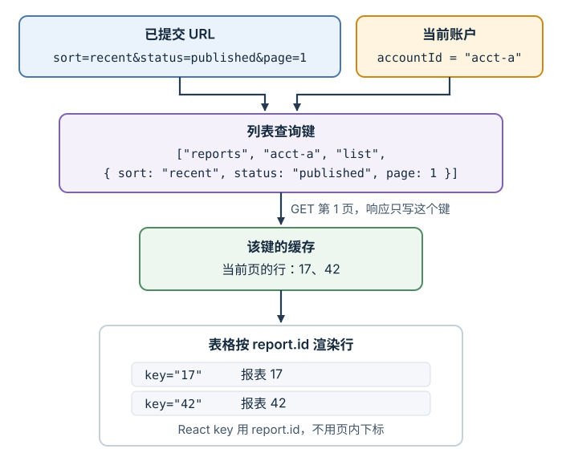
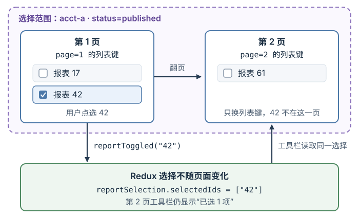
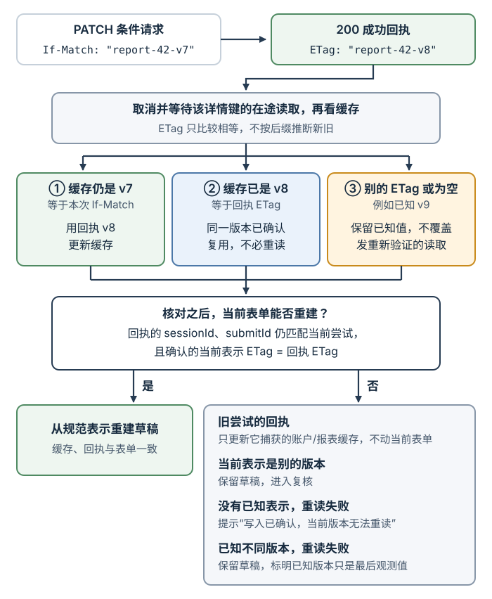

# 编辑表单怎样在别人同时修改时安全保存？

上一章解决了读路径：每份服务端副本有身份，迟到的读取结果只落到自己的格里，见[服务端数据的缓存与乐观更新](server-state-and-optimistic-updates.md)。本章是它之下的写路径。用户打开一个编辑抽屉，填多个字段，等异步校验，再保存；同一时刻，表格在刷新，旧校验在返回，另一位管理员可能先保存了同一份报表。本章回答：表单怎样只接收属于自己的结果，怎样只发送用户改过的字段，以及服务器说“你基于的版本已经过时”时怎样让用户安全地合并。

## 案例：从报表列表打开报表 42 的编辑抽屉

沿用主线一的报表页：报表 42 就是 `/reports/42` 那份报表。本章从报表**列表**进入它。管理员在合成账户 `acct-a` 打开 `/reports?sort=recent&status=published&page=1#summary`；每页两行，已发布第 1 页是报表 `17`、`42`，第 2 页是 `61`。管理员勾选 `42`，翻到第 2 页，再从工具栏的“已选 1 项”打开编辑抽屉。账户、地址、字段和响应都是合成数据。

报表 42 的详情和它的强 ETag (entity tag，实体标签) `"report-42-v7"` 一起返回：

~~~json
{"id":42,"title":"Monthly summary","delivery":{"channel":"email","recipients":["reader@example.test"]},"note":"Draft"}
~~~

抽屉有两步：第 1 步编辑通知方式 `delivery.channel` 和收件人 `delivery.recipients`，第 2 步编辑备注 `note` 并确认。`title` 在表单里只读，用来演示服务端同时改了别的字段时怎样比较。保存沿用[两个客户端同时修改同一资源时，API 怎样防止互相覆盖？](../../engineering-foundations/services/conditional-updates-and-etags.md)定下的 JSON Merge Patch、`If-Match`、强 ETag 和 `412`/`428` 语义，本章只讲界面侧怎样用它们。客户端的选择、URL 和缓存都不授予任何权限，每次读写仍由服务端按当前身份授权。

示例的本地验证组合是 React 19.3.1、React Router 8.5.1 Declarative Mode（组件用 `useSearchParams` 读查询、`useNavigate` 写地址，不用 loader）、TanStack Query 5.107.1。

## 本章用到的身份

上一章说明了异步结果为什么要按身份归属。编辑流程里有好几种身份，各管一段：

| 名称 | 由什么组成 | 何时生成 | 守住什么 |
|---|---|---|---|
| 选择范围（selection scope） | `accountId + status` | 用户点选时记录 | 已选 ID 只在这个范围内可操作 |
| 打开意图（open intent） | `sessionId + accountId + reportId` | 点“编辑”、发 GET **之前** | 只有它的详情响应能把抽屉变成可编辑 |
| 编辑会话（session） | 每次打开新建的 `sessionId` | 详情校验通过时 | 草稿、基线、字段状态都属于它 |
| 基线（baseline） | GET 返回的规范表示 | 同上 | 补丁从“基线 → 草稿”的差异算出 |
| ETag | 与基线同一响应返回的强版本标签 | 同上 | 写入的前提条件：服务器仍是这个版本 |
| 校验票据（ticket） | `sessionId + clientId + generation + snapshot` | 每次发起异步校验 | 只有最新票据的响应能改字段错误 |
| 代次（generation） | 每个字段的计数器 | 重新校验或作废时加 1 | 让更早的票据失效 |
| 尝试所有者（attempt owner） | `kind`（`step` 或 `save`）+ `sessionId` | 点“继续”或“保存”时同步取得 | 一个会话同时只有一次校验或保存在进行 |
| 提交 ID（submitId） | 每次保存尝试新建 | 点“保存”时 | 迟到的回执只有仍匹配才改当前表单 |

## 每份状态归谁

各类状态的通用归属规则见[界面状态的所有权](state-ownership-and-composition.md)。在这个案例里，它们落成五份互不覆盖的状态：

- **`sort`、`status`、`page`** 在 URL 里，可复制、刷新、由历史恢复。改筛选时页码重置为 1；解析后校验允许值，无效值回退到默认或替换成规范地址。
- **当前页的行** 归服务器，查询缓存按键 `["reports", accountId, "list", { sort, status, page }]` 保存副本。列表摘要不是编辑基线。
- **已选报表 ID** 在 Redux 的 `reportSelection.selectedIds` 里（slice 写法同 [Redux 与异步工作流](redux-state-and-async-workflows.md)），表格路由另记它的选择范围。
- **编辑会话** 在编辑器本地：`sessionId`、基线、ETag、草稿、字段校验状态、提交阶段。列表响应不会重置草稿。
- **详情的权威表示和版本** 在服务器，查询缓存按 `["reports", accountId, "detail", reportId]` 保存已确认的副本。

分开存，表格排序或后台刷新才能改行而不动输入，编辑器也不会把未提交的草稿伪装成服务器已确认的数据。

## 选择怎样跨页保留，又在何时作废

列表从已提交的 URL 读参数，组成查询键，再按 `report.id` 渲染行：

用户点选 `42` 时，行把数值 ID 转成稳定字符串，派发 `reportToggled("42")`，并把当前 `{ accountId, status }` 记为选择范围。翻页只改 `page`、切换列表键；行以 `report.id` 作 React key，不用页内下标，所以分页和排序都不会把选择挪到另一条记录。

| 用户操作 | 地址与列表键 | 已选 ID |
|---|---|---|
| 首次打开已发布报表 | `…status=published&page=1`；键含 `acct-a / recent / published / 1` | `[]` |
| 点选第 1 页的 42 | 不变 | `["42"]` |
| 翻到第 2 页 | `page=2`；该页结果 `[61]` | `["42"]`，工具栏仍显示已选 1 项 |
| 切换排序 | `sort` 改变、页码回到 1 | `["42"]`，仍指同一报表 |
| 筛选改为 `open` | `status=open&page=1` | `[]`，并提示已清除 |
| 在 `open` 下选 81，再按 Back 回 `published` | URL 与键回到历史项所指的筛选页 | 范围守卫立即隐藏并清空 `["81"]`；Forward 回 `open` 也仍是 `[]` |

“改筛选就清空选择”是本例的产品政策：旧筛选里看不见的 ID 不应悄悄跟着新筛选执行批量操作。清空不能只挂在筛选按钮的事件上，因为 Back/Forward 和切换账户也会改变范围，而它们不经过按钮。所以表格在每次渲染时比较“已提交地址的范围”和“选择记录的范围”：不一致时，这次渲染就把可操作 ID 当作空集，再在 layout effect 里清空 Redux 并记下新范围。这样旧 ID 连在 effect 执行前的那一帧也不可用。首次挂载同样先建立范围，清掉无法证明归属的旧 ID。

URL 不编码选择，所以 Back/Forward 恢复的是地址和查询键，不恢复选择。若产品要求跨筛选保留，就要把它定义成独立的“已选对象集合”，批量操作前再次展示范围并重新验证。

## 打开意图守住抽屉

工具栏只从当前范围内的已选集合取 ID。切换记录前先处理未保存的草稿：留下、保存或明确丢弃。然后，在发 GET **之前**创建打开意图 `{ sessionId, accountId, reportId }`，立即把抽屉置为 loading。

先后打开报表 A 和 B 时，即使 A 的 GET 晚于 B 返回，也只有仍匹配当前意图的响应能把抽屉从 loading 变为可编辑。关闭、切账户或改开另一条记录都会同步作废旧意图；旧响应最多写进自己 account/ID 的详情缓存，不能初始化新抽屉。

加载、错误和重试是抽屉自己的三种状态。GET 失败、JSON 结构错误、返回的 ID 与请求不符、ETag 不是强标签时，都不建立可编辑基线，仍匹配的抽屉显示固定提示和“重试 / 关闭”。重试沿用当前意图，并重新核验响应；用户期间若关掉或改开了另一条，重试结果同样因意图不匹配而作废。

这次 GET 要拿到**当前**版本，所以有两个细节：

- **先清掉同键的旧读取。** 先取消并等待同一详情键上的旧请求结束，再发新请求。这一步不能省：即使设了 `staleTime: 0`，TanStack Query 仍会把同键的新读取并入在途的旧请求，一条更早开始的读取就会被当成当前值。
- **要求 HTTP 缓存重新验证。** 请求用 Fetch 的 `cache: "no-cache"`：HTTP 缓存里有对应响应就发条件请求，没有就发普通请求，然后更新缓存。它不同于完全跳过缓存的 `no-store`（HTTP 缓存的 `no-cache` 与 `no-store` 语义见[一份 HTTP 响应什么时候可以直接复用，什么时候必须回源确认？](../../engineering-foundations/services/http-caching-and-conditional-requests.md#常用指令各允许什么)）。本例假定 Service Worker 不会把它替换成旧的本地响应。

还有一个跨挂载周期的协调：若同一账户/报表还有旧 PATCH 没结算（包括它的缓存回调），新的打开意图先显示等待，不发详情 GET；等旧 mutation 完全结算、再确认意图仍有效，才开始读取。否则旧成功回调“取消同键 GET”时，会把新抽屉刚发出的读取一起取消。这份协调状态不能随旧编辑器卸载而消失。不同详情键互不影响。

## 一次编辑会话由五件东西组成

详情校验通过后，编辑器新建会话：

1. **基线**：GET 返回的规范表示，保存一份用于比较。
2. **ETag**：与基线同一响应返回的强版本，例如 `"report-42-v7"`；提交时与基线一起作为前提。
3. **草稿**：从基线复制出来的用户输入。键入只改草稿，列表查询的更新不会覆盖它。
4. **字段状态**：同步错误、异步校验票据与结果、dirty 标记、服务器返回的字段错误。
5. **会话身份**：每次打开新建的 `sessionId`。表单子树用它作 React `key`，切换记录或重新打开时整棵表单状态重建；不能用“当前页第 0 行”作会话身份（key 与状态身份见 [React 更新模型](react-update-model.md)）。

两步共用这一份会话、基线和草稿，切换步骤不重置。第 2 步的“返回”回到第 1 步，草稿和基线不变；“保存”从任何一步都对整份草稿做最终校验，收件人有错就回第 1 步，备注等字段有错就回第 2 步。草稿有改动时，离开前让用户保存、继续编辑或明确丢弃。

## 联动字段与动态行

`delivery.channel` 为 `email` 时显示收件人，且至少要有一个有效地址；为 `download` 时隐藏收件人。未保存的会话可以暂存隐藏的输入，但序列化器只提交当前模式允许的字段。本例 API 还约定：服务器规范化 `download` 表示时删除 `recipients`。成功后从服务端的规范表示重建草稿，已被服务端移除的字段就不会因为本地暂存而复活。

收件人在 API 里是字符串数组，表单里每一行另有一个只存在于客户端的 `clientId`。它在添加时生成一次，行移动、删除或显示错误时继续用作 React `key` 和焦点关联；它不是邮箱，也不是服务器 ID，不进请求。

## 异步校验用票据认领结果

校验分两层。同步检查看字段是否适合当前模式，例如 email 至少一条地址；异步检查调用可用性接口。客户端的检查只为及时反馈，服务端校验才是最终裁决。

每次异步请求发一张票据，绑定 `sessionId + clientId + generation + snapshot`。快照包含 trim 后的地址和 `organizationId` 等依赖。输入值或依赖变化时，在同一事件里用新快照立即发起新校验、替换旧票据，不等失焦或提交才发现变化；切到 download、删除行或关闭会话时作废票据（代次加 1 并删除）。只有会话、代次、快照都仍匹配的响应能改写字段错误。

| 事件 | `recipient-1` 当前的票据 | 可接受的响应 |
|---|---|---|
| 输入旧地址并请求校验 | `edit-A / recipient-1 / gen=1 / old@example.test / org-a` | 只有 gen 1 且快照匹配的结果 |
| 改成新地址；第二次请求先返回 | `edit-A / recipient-1 / gen=2 / reader@example.test / org-a` | gen 2 更新当前错误；gen 1 更晚返回也被忽略 |
| 切到 download | 收件人隐藏；作废把代次推到 3 并删除票据 | 请求 1、2 都不能改写隐藏字段的错误 |
| 切回 email | 以当前草稿值发起 gen 4 | 只接受这次快照 |
| 关闭并重开 | `edit-B / recipient-1`，即使 `clientId` 相同 | `edit-A` 的 Promise 不能写进新会话 |

每个校验返回四种明确结果之一：`valid`、`invalid`（含字段和所在步骤）、`unavailable`（网络失败，显示“暂时无法验证”，保留草稿、允许重试，绝不当作通过）、`stale`（票据已过期）。不要用 `undefined` 同时表示“通过”“失败”和“过期”；接口返回 `ok:false` 却没有可用消息时，显示固定提示“该地址未通过校验”，空字符串也不能被当作“清除错误”。

## 一次只能有一个尝试所有者

“继续”要校验第 1 步，“保存”要校验整份草稿，两者都会为同一收件人行发票据。如果允许它们并行，同一行会同时有两张票据，保存也可能抢在步骤校验之前推进。所以会话里有一个闩锁（下文代码中的 `formAttemptGate`），任一时刻只有一个尝试所有者：

- 点“继续”时，**同步**取得 `kind="step"`；点“保存”时，同步取得 `kind="save"`。已有所有者时，后来者立即得到 busy，不运行校验也不发请求。同步取得是为了在 React 重渲染之前挡住双击。
- 持有期间，界面禁用两步内的输入、继续/返回、保存、校验重试、切换记录和关闭；同时，这些入口的事件处理器自己也要检查闩锁，不能只依赖按钮的 `disabled`。
- 所有者一直持有到结果已提交到界面状态（步骤已推进或错误已显示）才释放。`await` 之后再次核对所有者、会话和快照，只有仍归属的结果能推进步骤或显示错误。
- 步骤校验出错时留在第 1 步，把错误关联到字段并聚焦第一个错误控件（错误提示的写法见[可访问的表单](../html-css/accessible-forms-and-submission.md)）。

关闭抽屉不一定经过关闭按钮：浏览器历史变化、切换账户、父组件卸载都可能直接拆掉它。关闭处理器因此必须按所有者类型收尾：取消 step 尝试，或在 save 仍处于 validating 时取消它并作废它的票据；然后作废打开意图和当前 `sessionId`。处于 saving 时不能释放写入所有者去启动别的尝试，只能断开旧会话的界面归属，这不是回滚。

## 从校验到写入：validating → saving

保存分两个阶段，共用同一个所有者：

1. **validating。** 取得 save 所有者后，立即冻结一份不可变快照：`sessionId`、`submitId`、`accountId`、`reportId`、基线、ETag、`organizationId` 和草稿。此时还没有 mutation，TanStack 的 `isPending` 仍为 false，由表单自己的 validating 状态负责显示和锁定。异步校验只读这份快照，不再读可编辑的表单。用户可以点“取消本次保存”：它同步清除所有者、作废票据、恢复编辑，之后返回的校验只能是 stale，不会触发 PATCH；它不承诺取消网络请求。
2. **saving。** 全部校验通过后，再核对一次所有者、`sessionId`、`submitId`。仍属于当前会话，才从**同一份快照、同一份基线**生成补丁，以同一个 ETag 发 PATCH。之后 mutation 的 pending 状态驱动“正在保存…”。invalid 时跳到第一个错误所在的步骤；unavailable 时不发 PATCH，保留输入并提示重试。

### 补丁只写改过的字段

JSON Merge Patch（`application/merge-patch+json`）的规则决定了补丁怎样写：省略成员表示不改；`null` 表示删除；空字符串是一个普通值；数组整体替换，不做元素级合并。所以：

- 切到下载模式发 `{"delivery":{"channel":"download"}}`，不触及 `recipients`，由服务端规则移除它；
- 显式删除备注发 `{"note":null}`；
- 邮件模式下改了收件人，发送完整的新数组。

本例用户新增了 `analyst@example.test`，把备注改为 “Send after review”。基线是 v7：

~~~http
PATCH /api/accounts/acct-a/reports/42 HTTP/1.1
Content-Type: application/merge-patch+json
If-Match: "report-42-v7"

{"delivery":{"recipients":["reader@example.test","analyst@example.test"]},"note":"Send after review"}
~~~

PATCH 的目标 URL 用快照里冻结的账户构造，不从可能已切换的当前账户读。若服务器当前仍是 v7 且字段通过校验，它返回规范表示和新强标签：

~~~http
HTTP/1.1 200 OK
Content-Type: application/json
ETag: "report-42-v8"

{"id":42,"title":"Monthly summary","delivery":{"channel":"email","recipients":["reader@example.test","analyst@example.test"]},"note":"Send after review"}
~~~

这个 mutation 关闭自动重试（`retry: false`），以免把结果不明的写入悄悄重放。`sessionId` 和 `submitId` 只在客户端标识这次提交，用于判断迟到回执是否仍属于当前界面；它们不进 HTTP 正文，也不替代 ETag、授权或服务端幂等键。编辑器不对 PATCH 做乐观替换：它展示本地草稿和明确的 pending 状态，直到服务器确认。

| 返回 | 会话与界面 | 下一步 |
|---|---|---|
| `200`，正文和新强 ETag 可验证 | 按下一节核对缓存 | 失效该账户的列表查询；仍是当前尝试且当前表示与回执一致，才重建草稿 |
| `422` + 可识别的 Problem Details | 保留基线、ETag 和输入，把稳定的字段错误放回对应控件 | 修正后重新校验、提交；不要把响应原文或解析异常栈直接给用户看 |
| `412 Precondition Failed` | 不更新基线或 ETag，保留完整草稿和字段状态 | mutation 结算后重读当前表示，进入三方比较（见下文） |
| 网络中断、`5xx`、成功响应正文无法验证 | 保留草稿和原基线，说明“写入结果未确认” | 见[结果不明的写入](editing-sessions-and-conditional-writes.md#结果不明的写入) |

## 成功回执后先核对缓存

拿到 v8 回执时，详情缓存里可能已经不是 v7 了：别的读取可能已把 v8 写进来，也可能已经读到了别人更新的 v9。若无条件用回执覆盖缓存，晚到的 v8 就会盖掉已知的 v9。所以成功回调先取消并等待该详情键的在途读取，再按缓存里的 ETag 分三种情况：

1. **缓存仍等于本次 `If-Match` 的基线（v7）**：用回执 v8 更新缓存。
2. **缓存已等于回执的 ETag（v8）**：同一版本已确认，复用缓存，不必重读。
3. **缓存是别的 ETag（如 v9）或为空**：保留已知值，不让回执覆盖，发一次重新验证的读取确定当前表示。

ETag 是不透明的标签，只比较相等，不按字符串推断新旧；图中的 v7、v8、v9 只是帮助追踪案例的后缀。

核对之后才决定当前表单怎么办。只有回执仍属于当前会话和提交尝试（`sessionId`、`submitId` 都匹配），且确认的当前表示的 ETag 等于回执的 ETag，才从规范表示重建草稿。当前表示是别的版本时，保留草稿进入复核；没有已知表示且重读失败时，提示“写入已确认，当前版本无法重读”；已知不同版本但重读失败时，保留旧草稿，并说明这份已知版本是最后观测值、尚未重新确认，不把编辑器静默重置到较旧的 v8。旧尝试的回执只更新它捕获的账户/报表的缓存，不动当前表单。

成功回调用 mutation variables 里的账户、报表和提交身份，而不是组件当前的 props。列表前缀失效后，活跃列表查询按配置重取；若服务端把报表从 published 改成了 open，校准后的列表会按服务端集合移走这一行。

上述“取消同键旧读取再重读”的做法，前提是编辑器是这个详情键唯一的读取者。若应用另有焦点重取、轮询或组件级详情查询，就要让它们共用同一个协调器，或者用独立的核对请求并显式决定是否写缓存。

## 412：三份值比较后由用户确认

这是与上一节并列的另一条分支。编辑器读的是 v7，用户新增收件人 A、把备注改成 “Send after review”。与此同时，另一位管理员先把 title 改成 “Monthly summary — May”、note 改成 “Reviewed”，服务器版本变成 v8。我们的 PATCH 带 `If-Match: "report-42-v7"`，收到 412，服务器没有应用这次补丁。

客户端等 mutation 结算后，取消并等待同一详情键的旧 GET，再以 `cache: "no-cache"` 发新 GET，读到 v8 的表示和 ETag。它不把缓存里的 v7、也不把更早开始的读取当成冲突基线。下表用 R 表示 reader@example.test，A 表示 analyst@example.test：

| 字段 | v7 基线 / 本地草稿 / v8 当前值 | 用户确认 |
|---|---|---|
| title | Monthly summary / 未改 / Monthly summary — May | 采用服务端标题 |
| delivery 组 | email + [R] / email + [R, A] / email + [R] | 保留 email 模式和本地新增的 A；该组重新校验收件人 |
| note | Draft / Send after review / Reviewed | 用户选择服务端的 Reviewed |

`delivery.channel` 和 `recipients` 是联动字段组，不能无条件逐字段拼接。若 v8 已改成 download 并移除了 recipients，而本地新增了 A，逐字段套用会把地址隐藏或丢掉。这时把整个 delivery 组标为冲突，同时展示服务端的下载模式和本地的邮件草稿，让用户明确选择：保留 download 并丢弃收件人，或切回 email 并保留收件人。确认后按最终模式重新跑同步和异步校验，再生成条件补丁。

按上表的选择，以 v8 为新基线构造新草稿：title 和 note 用服务端值，delivery 保留 email 与 [R, A]。与 v8 比较后，唯一的差异是收件人数组，所以补丁里没有 title 和 note：

~~~http
PATCH /api/accounts/acct-a/reports/42 HTTP/1.1
Content-Type: application/merge-patch+json
If-Match: "report-42-v8"

{"delivery":{"recipients":["reader@example.test","analyst@example.test"]}}
~~~

若 v8 期间没有再变化，服务器返回 v9：

~~~http
HTTP/1.1 200 OK
Content-Type: application/json
ETag: "report-42-v9"

{"id":42,"title":"Monthly summary — May","delivery":{"channel":"email","recipients":["reader@example.test","analyst@example.test"]},"note":"Reviewed"}
~~~

这次成功仍按上一节的三种情况核对缓存。若读取或用户确认之后资源又变了，新的 412 重新走一遍比较和确认；客户端从不静默换 ETag 重发。`If-Match` 用强比较，条件不满足时服务器不执行该方法。

## 结果不明的写入

网络中断、`5xx`，或者 `200` 的正文无法通过校验，都意味着客户端**不知道**写入有没有发生。已发出的 PATCH 即使在客户端中止，服务器也可能已经完成了它，所以不能把 Abort 当作回滚，也不能断定“写入没发生”然后盲目重发。

客户端能做的是：保留草稿和原基线，告诉用户“写入结果未确认”；等客户端请求结算后，发一次重新验证的 GET 核对当前资源。核对也有边界：若服务端仍可能处理那条断开的写请求，GET 的结果和那次写入孰先孰后，要由 API 的回执或一致性契约确定；即使读到的值和草稿一样，也不能证明是这次写入造成的。同理，若更早一次尝试的回执丢失，后来的 412 也不能证明那次写入一定没发生。

“结果不明”之后怎样查清、何时允许用同一个幂等键重放，是通用的未知结果机制，见[写请求超时后，怎样查清结果并安全重试？](../../engineering-foundations/services/deadlines-retries-and-unknown-outcomes.md#超时之后，调用方处于什么状态？)；`PATCH` 不保证幂等、响应丢失后重放得到 `412` 无法区分“自己已写入”与“别人先写”，见条件写章的[412 之后客户端怎么办](../../engineering-foundations/services/conditional-updates-and-etags.md#412%20之后客户端怎么办)。AI 工程里的退款状态机是同一机制的一个领域实例，见[退款请求超时后，怎样查清结果而不重复扣款？](../../ai-engineering/runs/external-writes-and-reconciliation.md)。

## 代码：意图、票据、闩锁与补丁

下面的片段只展示上文的关键纯逻辑。HTTP 授权、原子 `If-Match` 检查、错误契约和版本并发由服务器实现。`getReport`、`validateDetailAndStrongETag`、`isCurrentAttempt`、`rebaseEditor` 等是应用代码。

> [!example]- 打开意图、成功回执核对、校验票据、尝试闩锁与补丁生成
>
> ~~~ts
> // ---- 选择范围守卫（表格渲染时）----
> const selectionIsCurrent =
>   selectionScope?.accountId === accountId && selectionScope?.status === status;
> const activeIds = selectionIsCurrent ? selectedIds : [];   // 本次渲染就不可用
> useLayoutEffect(() => {
>   if (!selectionIsCurrent) {
>     dispatch(selectionCleared());
>     setSelectionScope({ accountId, status });
>   }
> }, [accountId, status, selectionIsCurrent, dispatch]);
>
> // ---- 读取当前详情：先清同键旧读取，再要求 HTTP 重新验证 ----
> const detailKey = (v: { accountId: string; reportId: string }) =>
>   ["reports", v.accountId, "detail", v.reportId] as const;
>
> async function readCurrentDetail(v: { accountId: string; reportId: string }) {
>   const key = detailKey(v);
>   await queryClient.cancelQueries({ queryKey: key, exact: true });
>   return queryClient.fetchQuery({
>     queryKey: key,
>     queryFn: async ({ signal }) => validateDetailAndStrongETag(
>       await getReport(v.reportId, { accountId: v.accountId, signal, cache: "no-cache" }),
>       v.reportId),
>     staleTime: 0,
>   });
> }
>
> // ---- 打开意图 ----
> type OpenIntent = { sessionId: string; accountId: string; reportId: string };
>
> async function loadOpenIntent(intent: OpenIntent) {   // 调用方已等同键旧 PATCH 结算
>   setDrawer({ kind: "loading", intent });
>   try {
>     const saved = await readCurrentDetail(intent);
>     if (!sameIntent(activeOpen.current, intent)) return;      // 旧意图：只留在缓存
>     setDrawer({ kind: "editing", session: makeSession(intent, saved) });
>   } catch {
>     if (sameIntent(activeOpen.current, intent)) {
>       setDrawer({ kind: "error", intent, message: "详情无法读取或验证；可重试或关闭" });
>     }
>   }
> }
>
> function closeDrawer() {          // 历史变化、切账户、卸载也必须走这里
>   if (submitPhase.current === "validating") saveCoordinator.cancelValidation();
>   if (activeSessionId.current) {
>     formAttemptGate.cancelStep(activeSessionId.current);
>     invalidateSessionTickets(activeSessionId.current);
>   }
>   activeSessionId.current = null;
>   activeOpen.current = null;
>   setDrawer({ kind: "closed" });
> }
>
> // ---- 成功回执：按缓存 ETag 三分 ----
> type PatchVars = {
>   sessionId: string; submitId: string; accountId: string;
>   reportId: string; etag: string; patch: Patch;
> };
>
> async function onPatchSuccess(saved: Detail, vars: PatchVars) {
>   const key = detailKey(vars);
>   await queryClient.cancelQueries({ queryKey: key, exact: true });
>   const cached = queryClient.getQueryData<Detail>(key);
>   let latest = cached;
>   let revalidationFailed = false;
>   if (cached?.etag === vars.etag) {                 // 1. 仍是基线：写入回执
>     queryClient.setQueryData(key, saved);
>     latest = saved;
>   } else if (cached?.etag !== saved.etag) {         // 3. 别的版本或空：重读
>     try { latest = await readCurrentDetail(vars); } catch { revalidationFailed = true; }
>   }                                                 // 2. 已等于回执：复用
>   void queryClient.invalidateQueries({ queryKey: ["reports", vars.accountId, "list"] });
>   if (!isCurrentAttempt(vars)) return;              // 旧尝试：不动当前表单
>   if (latest && latest.etag !== saved.etag) showSavedButChangedReview(saved, latest, { revalidationFailed });
>   else if (latest) rebaseEditor(saved);
>   else showSavedButCurrentUnconfirmed(saved);
> }
>
> // ---- 校验票据 ----
> type Recipient = { clientId: string; value: string };
> type Ticket = { sessionId: string; clientId: string; generation: number; snapshot: string };
> type Outcome =
>   | { kind: "valid" } | { kind: "invalid"; message: string }
>   | { kind: "unavailable"; message: string } | { kind: "stale" };
>
> const latestTicket = new Map<string, Ticket>();
> const generation = new Map<string, number>();
> const keyOf = (sessionId: string, clientId: string) => `${sessionId}:${clientId}`;
>
> async function validateRecipient(
>   sessionId: string, row: Recipient, organizationId: string,
>   check: (i: { value: string; organizationId: string }) => Promise<{ ok: boolean; message?: string }>,
>   showIssue: (message: string | undefined) => void,
> ): Promise<Outcome> {
>   const key = keyOf(sessionId, row.clientId);
>   const value = row.value.trim();
>   const snapshot = JSON.stringify({ value, organizationId });
>   const ticket = { sessionId, clientId: row.clientId, generation: (generation.get(key) ?? 0) + 1, snapshot };
>   generation.set(key, ticket.generation);
>   latestTicket.set(key, ticket);
>   const stillCurrent = () => {
>     const t = latestTicket.get(key);
>     return t?.generation === ticket.generation && t.snapshot === snapshot;
>   };
>   try {
>     const result = await check({ value, organizationId });
>     if (!stillCurrent()) return { kind: "stale" };
>     if (result.ok) { showIssue(undefined); return { kind: "valid" }; }
>     const message = result.message?.trim() || "该地址未通过校验";
>     showIssue(message);
>     return { kind: "invalid", message };
>   } catch {
>     if (!stillCurrent()) return { kind: "stale" };
>     const message = "暂时无法验证；保留当前草稿";
>     showIssue(message);
>     return { kind: "unavailable", message };
>   }
> }
>
> function invalidate(sessionId: string, clientId: string, showIssue: (m: string | undefined) => void) {
>   const key = keyOf(sessionId, clientId);
>   generation.set(key, (generation.get(key) ?? 0) + 1);
>   latestTicket.delete(key);
>   showIssue(undefined);
> }
>
> // ---- 会话级尝试闩锁：Continue、Save、Retry 共用 ----
> type FormAttempt = { token: object; sessionId: string; kind: "step" | "save" };
>
> function createFormAttemptGate() {
>   let active: FormAttempt | null = null;
>   return {
>     begin(a: FormAttempt) { if (active) return false; active = a; return true; },
>     owns(a: FormAttempt) { return active === a; },
>     release(a: FormAttempt) { if (active === a) active = null; },
>     cancelStep(sessionId: string) {
>       if (active?.kind === "step" && active.sessionId === sessionId) active = null;
>     },
>     busy() { return active !== null; },
>   };
> }
>
> async function runStepAttempt(gate, sessionId, snapshot, isCurrent, validate, commit) {
>   const attempt: FormAttempt = { token: {}, sessionId, kind: "step" };
>   if (!gate.begin(attempt)) return { kind: "busy" };        // 同步取得
>   try {
>     const outcome = await validate(structuredClone(snapshot));
>     if (!gate.owns(attempt) || !isCurrent(sessionId, snapshot) || outcome.kind === "stale") {
>       return { kind: "stale" };
>     }
>     commit(outcome);                                       // 先提交结果，再释放
>     return { kind: "checked", outcome };
>   } finally {
>     gate.release(attempt);
>   }
> }
>
> function createSaveCoordinator(gate, currentSessionId, validateSnapshot, mutate, invalidateSnapshot) {
>   let active: { token: object; phase: "validating" | "saving"; owner: FormAttempt; snapshot: SaveInput } | null = null;
>   return {
>     async submit(input: SaveInput) {
>       const token = {};
>       const snapshot = structuredClone(input);             // 冻结：基线、ETag、草稿、账户
>       const owner: FormAttempt = { token, sessionId: snapshot.sessionId, kind: "save" };
>       if (active || !gate.begin(owner)) return { kind: "busy" };
>       active = { token, phase: "validating", owner, snapshot };
>       const stillMine = () =>
>         active?.token === token && gate.owns(owner) && currentSessionId() === snapshot.sessionId;
>       try {
>         const validation = await validateSnapshot(snapshot);
>         if (!stillMine()) return { kind: "stale" };
>         if (validation.kind !== "valid") return validation;
>         active.phase = "saving";
>         const saved = await mutate({ ...snapshot, patch: makePatch(snapshot.baseline, snapshot.draft) });
>         return stillMine() ? { kind: "saved", saved } : { kind: "stale" };
>       } finally {
>         if (active?.token === token) active = null;
>         gate.release(owner);
>       }
>     },
>     cancelValidation() {                                   // 只在 validating 阶段有效
>       if (active?.phase !== "validating") return false;
>       const { snapshot, owner } = active;
>       active = null;
>       gate.release(owner);
>       invalidateSnapshot(snapshot);
>       return true;
>     },
>   };
> }
>
> // ---- 补丁与重建 ----
> type Report = {
>   id: number; title: string;
>   delivery: { channel: "email" | "download"; recipients?: string[] }; note?: string;
> };
> type Draft = { channel: "email" | "download"; recipients: Recipient[]; note?: string };
> type Patch = {
>   delivery?: { channel?: "email" | "download"; recipients?: string[] }; note?: string | null;
> };
>
> function makePatch(baseline: Report, draft: Draft): Patch {
>   const patch: Patch = {};
>   const delivery: NonNullable<Patch["delivery"]> = {};
>   if (draft.channel !== baseline.delivery.channel) delivery.channel = draft.channel;
>   if (draft.channel === "email") {                        // 隐藏的收件人不序列化
>     const recipients = draft.recipients.map(row => row.value.trim());
>     if (JSON.stringify(recipients) !== JSON.stringify(baseline.delivery.recipients ?? [])) {
>       delivery.recipients = recipients;                    // 数组整体替换
>     }
>   }
>   if (Object.keys(delivery).length) patch.delivery = delivery;
>   if (draft.note !== baseline.note) patch.note = draft.note ?? null;   // null = 删除
>   return patch;
> }
>
> function draftFromServer(saved: Report, newClientId: () => string): Draft {
>   return {
>     channel: saved.delivery.channel,
>     recipients: (saved.delivery.recipients ?? []).map(value => ({ clientId: newClientId(), value })),
>     ...(saved.note === undefined ? {} : { note: saved.note }),
>   };
> }
> ~~~

同一套生命周期也适用于独立的详情路由：它不依赖表格入口，只要新建会话、读取当前详情与 ETag，再沿用同样的草稿、校验和条件提交规则。换用表单库时，库里的 dirty、error、reset 状态同样要按会话和结果归属来处理。

## 本章交出了什么

一次安全的编辑由四道守卫串起来：打开意图决定哪次读取能建立会话；票据决定哪次校验能改字段；尝试所有者保证一个会话同时只有一次校验或保存，并从同一份快照生成最小补丁；ETag 让服务器拒绝基于旧版本的写入，412 之后由用户在三份值之间确认。成功回执先按 ETag 核对缓存，结果不明的写入只做只读核对。主线四接下来离开“谁的结果”，转向“结果多贵”：当一次更新的渲染很昂贵时，怎样让输入仍然即时，见[紧急更新与延后更新](urgent-and-deferred-updates.md)。

> [!info]- 来源
> - 路由模式、查询参数与导航（“案例”“选择怎样跨页保留”）：[React Router: Picking a Mode](https://reactrouter.com/start/modes)、[`useSearchParams`](https://reactrouter.com/api/hooks/useSearchParams)、[`useNavigate`](https://reactrouter.com/api/hooks/useNavigate)；截至 2026-11-13 官方文档为 v8.5.1，示例用 Declarative Mode。
> - 查询键、pending/error/fetching、取消、mutation 缓存更新与失效（“打开意图”“成功回执后先核对缓存”）：[Query Keys](https://tanstack.com/query/latest/docs/framework/react/guides/query-keys)、[Queries](https://tanstack.com/query/latest/docs/framework/react/guides/queries)、[Query Cancellation](https://tanstack.com/query/latest/docs/framework/react/guides/query-cancellation)、[`useMutation`](https://tanstack.com/query/latest/docs/framework/react/reference/functions/useMutation)、[Updates from Mutation Responses](https://tanstack.com/query/latest/docs/framework/react/guides/updates-from-mutation-responses)、[Query Invalidation](https://tanstack.com/query/latest/docs/framework/react/guides/query-invalidation)；截至 2026-11-13 为 v5 Latest，本地复现版本 `@tanstack/react-query` 5.107.1。
> - Fetch 的 `no-cache` 模式（有缓存响应时发条件请求、否则普通请求，并更新缓存）：[Fetch Standard §2.2.5 Requests](https://fetch.spec.whatwg.org/#concept-request-cache-mode)，Living Standard 截至 2026-10-19。
> - 会话状态与 key 重置（“一次编辑会话由五件东西组成”）：[Preserving and Resetting State](https://react.dev/learn/preserving-and-resetting-state)。
> - 强 `If-Match` 比较与 `412`（“412：三份值比较”）：[RFC 9110 §13.1.1](https://www.rfc-editor.org/rfc/rfc9110.html#section-13.1.1)；Merge Patch 的 `null` 删除与数组整体替换（“补丁只写改过的字段”）：[RFC 7396](https://www.rfc-editor.org/rfc/rfc7396.html)。字段形状、下载模式规范化和错误映射是本合成 API 的约定。
> - 选择 slice 的 Redux 版本：Redux Toolkit 2.14.0、React Redux 9.3.1，见 [Redux 与异步工作流](redux-state-and-async-workflows.md)。
