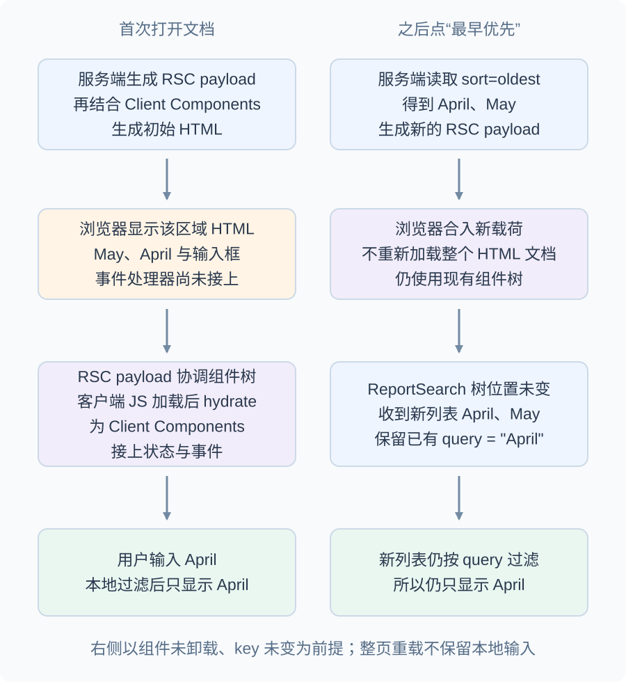
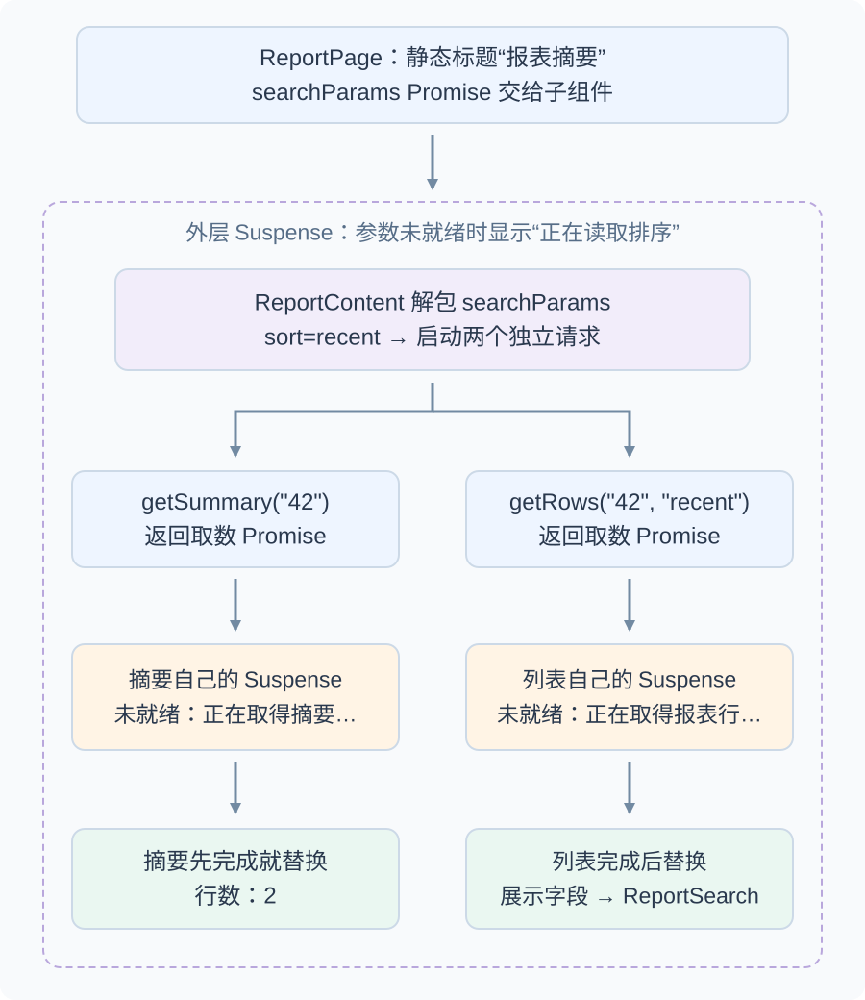

# Next.js App Router 怎样把服务端渲染、缓存和客户端交互分开？

前几章的路由和数据读取都在浏览器里发生。Next.js App Router 把一部分工作移到服务端：页面默认在服务端渲染、在服务端取数，只把需要交互的部分作为客户端代码发给浏览器。本章是一个综合实例，沿报表页从文件路由走到首屏、排序、Back 和失败重试，回答四个问题：哪段代码在哪一侧运行；首屏怎样从服务端结果变成可交互的页面；哪些等待可以分块显示；缓存存在哪一层。读者需要知道[路由怎样把 URL 变成已提交的数据](routing-and-loaders.md)，以及 React 的 render/commit 与 key 身份（见 [React 更新模型](react-update-model.md)）。

主例采用 Next.js 16.4.6 App Router，按官方建议同时开启 Cache Components (组件缓存)与 Partial Prefetching (部分预取)，核对于 2026-11-12。

## 案例：服务端读取报表 42

沿用主线一的报表页：用户打开 `/reports/42?sort=recent#summary`，先看到摘要和 May、April 两行，再点“最早优先”换成 April、May，并在搜索框里按标题筛选。本章新增一个外部报表服务（下文称上游），只由 Next 服务端访问；浏览器不直接调用它。上游的合成接口如下（`reports.example.test` 仅作示意，运行时要换成可达的服务）：

| 上游请求 | 上游响应 | 页面呈现 |
|---|---|---|
| `GET /api/reports/42/rows?sort=recent` | May → April | May、April |
| `GET /api/reports/42/rows?sort=oldest` | April → May | April、May |
| `GET /api/reports/42/summary` | `{ "rowCount": 2 }` | “行数：2” |

行数据的形状：

~~~json
[
  { "id": "r-104", "period": "2026-05", "title": "May report" },
  { "id": "r-103", "period": "2026-04", "title": "April report" }
]
~~~

## 文件约定把路径落到页面与布局

App Router 用 `app/` 下的特殊文件组成路由：

- `app/reports/[reportId]/page.tsx` 对应 `/reports/:reportId`；方括号是动态段，`42` 通过 `params` 交给页面。
- `layout.tsx` 给一组子路由提供共享外壳，共享段在客户端导航时可以保留。从零搭建至少需要根 `app/layout.tsx`。
- `app/api/reports/route.ts` 这样的 Route Handler (路由处理器)是独立的 HTTP 端点：按方法导出 `GET`、`POST` 等函数，返回 Web `Response`，不生成页面。
- 同一段下的 `loading.tsx` 和 `error.tsx` 分别是该段的等待边界和错误边界，不是端点（见后文）。

Cache Components 要求 Node.js runtime，不支持 Edge，也不支持路由段里的 `runtime` 导出。托管平台可以把 Node.js 服务打包成 serverless function (无服务器函数)；运行时与托管形态是两个独立的选择。

## params 与 searchParams 都是 Promise

Next.js 16 中，页面收到的 `params` 和 `searchParams` 都是 Promise，要 `await` 或用 React `use` 解包。`searchParams` 解包后是普通对象，不是 `URLSearchParams`：`?sort=recent` 得到字符串，重复的 `?sort=recent&sort=oldest` 得到字符串数组。

`searchParams` 代表**这次请求**的查询串，所以读它的组件必须等这次请求到来才能渲染。共享 layout 不接收 `searchParams`，因为 layout 可能跨不同查询被复用。客户端组件也能用 `useSearchParams` 读查询，但在静态渲染的页面里调用它，外层要有 `Suspense` 边界。本例不在客户端读查询，而是让 Suspense 里的服务端子组件解析参数，只把展示字段传给客户端。

参数校验是应用自己的契约，框架不会替你做。本例规定：只有值为单个字符串 `oldest` 时用最早顺序，缺失、`recent`、其他非法值和重复值（数组）都回退到 `recent`。[路由章](routing-and-loaders.md)的 React Router 例子选择了另一种契约，对非法值返回 400；两种都合理，关键是写清楚。

URL 三段在这里跨越不同边界：path `/reports/42` 决定匹配的页面和 `reportId`，query `sort=recent` 决定服务端排序，fragment `#summary` 留在浏览器，用来定位 `id="summary"` 的标题，不随 HTTP 请求发出。

## 服务端组件与客户端组件的分界线

layout 和 page 默认是 Server Component (服务端组件)：可以在服务端读数据库、非公开环境变量或后端 API，这些模块不会因此进入浏览器的 JavaScript。组件需要本地 state、事件处理器、Effect 或浏览器 API 时，才在**最小的交互子树**的文件顶部写 `"use client"`，它就成为 Client Component (客户端组件)。

这条指令划分的是 module graph (模块图)：该文件直接和间接导入的运行时模块都进入客户端模块图，不必在每个子组件重复标记。反方向不行：客户端模块不能导入并执行需要服务端能力的组件。但服务端可以把一个**已经渲染好的** Server Component 作为 `children` 交给 Client Component。

服务端传给客户端组件的 props 必须满足 React 的可序列化规则，而且会原样进入发往浏览器的载荷。可序列化不等于保密：只传标题、期间、ID 这类展示字段，不传凭证或内部记录；普通回调和数据库连接也不能作为 props。以 `NEXT_PUBLIC_` 开头的环境变量会编进客户端 bundle，服务端密钥不能用这个前缀命名。

本例的分界：读取上游、校验响应、决定排序都在服务端；只有搜索框和本地过滤是客户端组件 `ReportSearch`。

## 首屏：RSC payload → HTML → hydration

首次打开文档时，服务端结果经过三种表示才变成可交互的页面：

1. **RSC payload (React Server Component Payload，服务端组件载荷)。** Server Component 先渲染成一份载荷，里面有服务端组件的渲染结果、Client Component 的位置占位与 JavaScript 文件引用，以及传给客户端组件的 props。
2. **初始 HTML。** Next.js 用这份载荷加上 Client Component 生成 HTML。这一步是 SSR (服务端渲染)，给首次文档可显示的标记，不会因此把 Server Component 的代码发给浏览器。
3. **hydration (水合)。** 浏览器先显示不可交互的 HTML，再用载荷对齐两侧的组件树，最后运行客户端 JavaScript，把事件处理器接上去。

流式页面可以逐区完成，数据交付和水合交错进行；下图画的是一个交互区域从“看得见”到“能操作”的条件。

图的右栏是后续导航：用户先在搜索框输入 `April`，再点“最早优先”。客户端导航不重新下载整份 HTML，而是请求新的 RSC payload 合进现有组件树。`ReportSearch` 若仍在同一树位置，就保留本地的 `query = "April"`，并继续过滤新列表；它若被卸载、key 改变或整页重载，没写进 URL 的 `query` 不会恢复。

服务器的第一次渲染和浏览器的第一次渲染必须得到同样的结果，否则会出现 hydration mismatch (水合不匹配)。时间、随机数、地区设置和浏览器专属值都是常见来源：需要浏览器值时，先渲染稳定的占位，再在首次提交后的 Effect 里读取。这类问题的更多处理见[紧急更新与延后更新](urgent-and-deferred-updates.md)。

## 用 Suspense 分块等待

页面里有三件事要等：本次请求的参数、摘要、行列表。它们彼此独立，没必要互相等。本例的嵌套方式是：

1. 外层 `ReportPage` 立即返回标题 `<h1 id="summary">`，并把**尚未解包**的 `params`、`searchParams` Promise 交给 Suspense 里的 `ReportContent`；参数没到时显示“正在读取排序…”。
2. `ReportContent` 解包参数、决定 `sort`，然后**同时**启动 `getRows("42", sort)` 和 `getSummary("42")`，各自把 Promise 交给一个局部 Suspense。
3. 摘要先完成就先显示“行数：2”，不必等列表；列表完成后，把 May、April 的展示字段作为 props 交给 `ReportSearch`。

嵌套顺序有实质作用。如果 Page 在返回 JSX **之前**就 `await searchParams`，Page 自己创建的 Suspense 此时还不存在，保护不了这次等待；这时必须有外部的祖先边界（例如同段的 `loading.tsx`）。本例把读取放进子组件，标题就成了可以先返回的静态外壳。

Suspense 只处理等待，读取失败会向错误边界传播。实际哪个 fallback 先被看到，取决于完成顺序和传输是否被缓冲；边界存在不意味着每次都能看见它。

这条数据链路与 React Router 的浏览器 loader 不同：这里是 Next 服务端访问外部上游，不是浏览器访问同源 `/api/...`。两种路由器的数据加载位置和导航协议不能互换。

> [!example]- 实现：静态标题、请求参数与两个独立等待区
>
> ~~~tsx
> // app/reports/[reportId]/page.tsx
> import { Suspense } from "react";
> import Link from "next/link";
> import { ReportSearch } from "./report-search";
>
> type SortOrder = "recent" | "oldest";
> type Row = { id: string; period: string; title: string };
> type Summary = { rowCount: number };
> type PageProps = {
>   params: Promise<{ reportId: string }>;
>   searchParams: Promise<{ sort?: string | string[] }>;
> };
>
> const UPSTREAM = "https://reports.example.test";
>
> function isRow(value: unknown): value is Row {
>   if (typeof value !== "object" || value === null) return false;
>   const row = value as Record<string, unknown>;
>   return typeof row.id === "string" && typeof row.period === "string" &&
>     typeof row.title === "string";
> }
>
> function parseRows(value: unknown): Row[] {
>   if (!Array.isArray(value)) throw new Error("Invalid rows response");
>   return (value as unknown[]).map(row => {
>     if (!isRow(row)) throw new Error("Invalid row");
>     return { id: row.id, period: row.period, title: row.title }; // 只投影展示字段
>   });
> }
>
> function parseSummary(value: unknown): Summary {
>   const s = value as Record<string, unknown> | null;
>   if (typeof s !== "object" || s === null || typeof s.rowCount !== "number" ||
>       !Number.isSafeInteger(s.rowCount) || s.rowCount < 0) {
>     throw new Error("Invalid summary response");
>   }
>   return { rowCount: s.rowCount };
> }
>
> async function getRows(reportId: string, sort: SortOrder): Promise<Row[]> {
>   const response = await fetch(
>     `${UPSTREAM}/api/reports/${encodeURIComponent(reportId)}/rows?sort=${sort}`,
>     { cache: "no-store" }
>   );
>   if (!response.ok) throw new Error("Could not load rows");
>   return parseRows(await response.json());
> }
>
> async function getSummary(reportId: string): Promise
 {
>   const response = await fetch(
>     `${UPSTREAM}/api/reports/${encodeURIComponent(reportId)}/summary`,
>     { cache: "no-store" }
>   );
>   if (!response.ok) throw new Error("Could not load summary");
>   return parseSummary(await response.json());
> }
>
> export default function ReportPage({ params, searchParams }: PageProps) {
>   return (
>     <main>
>       <h1 id="summary">报表摘要</h1>
>       <Suspense fallback={
正在读取排序…
}>
>         <ReportContent params={params} searchParams={searchParams} />
>       </Suspense>
>     </main>
>   );
> }
>
> async function ReportContent({ params, searchParams }: PageProps) {
>   const { reportId } = await params;
>   const { sort: rawSort } = await searchParams;
>   const sort: SortOrder = rawSort === "oldest" ? "oldest" : "recent";
>   const rowsPromise = getRows(reportId, sort);       // 两个请求同时启动
>   const summaryPromise = getSummary(reportId);
>   const href = (s: SortOrder) => `/reports/${encodeURIComponent(reportId)}?sort=${s}#summary`;
>
>   return (
>     <>
>       <nav aria-label="行排序">
>         <Link href={href("oldest")} aria-current={sort === "oldest" ? "page" : undefined}>
>           最早优先
>         </Link>
>         {" · "}
>         <Link href={href("recent")} aria-current={sort === "recent" ? "page" : undefined}>
>           最近优先
>         </Link>
>       </nav>
>       <Suspense fallback={
正在取得摘要…
}>
>         <ReportSummary promise={summaryPromise} />
>       </Suspense>
>       <Suspense fallback={
正在取得报表行…
}>
>         <ReportRows promise={rowsPromise} />
>       </Suspense>
>     </>
>   );
> }
>
> async function ReportSummary({ promise }: { promise: Promise
 }) {
>   const summary = await promise;
>   return 
行数：{summary.rowCount}
;
> }
>
> async function ReportRows({ promise }: { promise: Promise<Row[]> }) {
>   return <ReportSearch rows={await promise} />;
> }
> ~~~
>
> ~~~tsx
> // app/reports/[reportId]/report-search.tsx
> "use client";
>
> import { useState } from "react";
>
> type Row = { id: string; period: string; title: string };
>
> export function ReportSearch({ rows }: { rows: Row[] }) {
>   const [query, setQuery] = useState("");
>   const visible = rows.filter(row => row.title.toLowerCase().includes(query.toLowerCase()));
>   return (
>     <section>
>       <label>
>         搜索报表行
>         <input value={query} onChange={event => setQuery(event.target.value)} />
>       </label>
>       <ol aria-label="报表行">
>         {visible.map(row => <li key={row.id}>{row.period} — {row.title}</li>)}
>       </ol>
>     </section>
>   );
> }
> ~~~
>
> 排序控件用 `<Link>` 而不是主线一的 `aria-pressed` 按钮：切换排序就是切换地址，Link 保留链接语义，并让 Next 能预取目标。

示例在服务边界把 `response.json()` 当作 `unknown`，逐行检查并投影成只含展示字段的 DTO (Data Transfer Object，数据传输对象)，避免把上游行里可能存在的内部字段带进 RSC payload；摘要的 `rowCount` 也必须是非负安全整数（见 [TypeScript 能保证什么](../javascript/typescript-guarantees-and-runtime-validation.md)）。本例没有身份提供者，省略了鉴权接线；真实读取要先验证会话，再确认用户有权看报表 42。数据量大、需要分页，或过滤受权限影响时，把条件写进 URL，由服务端按条件查询，而不是把全部行发给浏览器再本地过滤。

## 缓存存在哪一层

“页面变快了”可能来自几层完全不同的缓存，它们存的东西、失效方式和陈旧风险都不同：

| 层 | 存什么 | 本例怎样配置 |
|---|---|---|
| fetch 响应 | 某次 `fetch` 的响应，键依据请求信息 | 两次上游请求都用 `cache: "no-store"`，实际执行时不读写 Next 的持久数据缓存；`force-cache` 才显式保存 |
| 函数或组件结果 | `use cache` 标记的取数函数或组件的返回值；输入和捕获的可序列化值参与缓存键 | 未使用。允许陈旧一段时间的数据可以用它，并用 `cacheLife` 写明生命周期 |
| 浏览器里的 RSC 页面载荷 | 客户端路由器保存的已访问路由结果 | 框架管理；Back 可能直接复用，也可能重新请求 |

Cache Components 的作用是让静态外壳先返回，把只有本次请求才知道的数据留在等待边界里；它并没有把所有数据自动变成跨请求可复用。`fetch` 的 `force-cache` 在开启 Cache Components 后仍然有效，但它缓存的是 fetch 响应，与 `use cache` 的函数/组件结果缓存是两回事。与身份有关的数据，还要把权限范围纳入缓存设计，不能把一个用户的结果共享给另一个用户。

`no-store` 约束的只是那次 fetch，不能迫使每次 Link 或 Back 都重跑服务端。选择缓存时要说清：缓存的是哪一层、能陈旧多久、变更后怎样失效；不能因为页面变快就推断数据仍然正确。浏览器自身的 HTTP 缓存是另一层，语义见[一份 HTTP 响应什么时候可以直接复用，什么时候必须回源确认？](../../engineering-foundations/services/http-caching-and-conditional-requests.md)；静态资源的哈希发布策略见[发布新版本时，怎样让缓存和还开着的旧页面都不出错？](../delivery/hashed-release-and-caching.md)。

> [!info] 实例：Next.js 16.4.6 的缓存配置与旧模型识别
> ~~~ts
> // next.config.ts
> import type { NextConfig } from "next";
> const nextConfig: NextConfig = { cacheComponents: true, partialPrefetching: true };
> export default nextConfig;
> ~~~
> 官方要求开启 `cacheComponents` 时显式设置 `partialPrefetching`，不设会输出警告，因为 Cache Components 的首个版本不含部分预取；只有迁移更早采用 Cache Components 的应用时才暂设为 `false`。官方计划在下一个大版本默认启用二者并移除这两个选项。维护未开启 Cache Components 的旧项目时，按上一缓存模型理解：动态页面的默认 fetch 在请求时执行，静态页面可能在构建时读取；`dynamic`、`revalidate` 等路由段选项不能原样套到新模型。开发模式的 HMR (Hot Module Replacement，热模块替换)可能复用部分 `no-store` 结果，实际缓存契约要在生产运行中检验。

## 等待与失败各有自己的边界

`app/reports/[reportId]/loading.tsx` 会自动在该段的 Page 及其后代外建立一个 Suspense 边界，子树没准备好时显示整段的等待壳。它不包住同目录的 `layout.tsx`，也不捕获读取失败；layout 自己若要等未缓存的数据，需要在对应位置另设等待边界。本例 Page 能立即返回标题，并把等待放进更小的边界，所以段级 loading 是否真的可见取决于导航和完成时序。

`app/reports/[reportId]/error.tsx` 必须是 Client Component，它捕获本段 Page 和子段的错误，但不捕获同段 `layout.tsx` 抛出的错误，那会交给更上一级的边界；根 `layout.tsx` 失败时由 `app/global-error.tsx` 接手，它要自己包含 `html` 与 `body`。本例故意让请求失败和不合约的响应抛出异常，以演示段级边界：摘要请求一失败，整个报表页段都换成 fallback，而不只是摘要那一小块。产品若把上游 503 视作可预期状态，也可以在数据组件里捕获它，呈现局部失败，不把整段判为异常。哪类错误该由哪个边界接住，见 [React 错误边界](react-error-boundaries.md)。

> [!example]- 段级等待壳与错误边界（`retry` 自 Next.js 16.3 起稳定）
> ~~~tsx
> // app/reports/[reportId]/loading.tsx
> export default function Loading() {
>   return 
正在打开报表…
;
> }
> ~~~
>
> ~~~tsx
> // app/reports/[reportId]/error.tsx
> "use client";
> import { useEffect } from "react";
>
> export default function ReportError({ error, retry }: { error: unknown; retry: () => void }) {
>   useEffect(() => { console.error(error); }, [error]);
>   return (
>     <section>
>       
报表暂时无法显示。

>       <button type="button" onClick={() => retry()}>重新读取</button>
>     </section>
>   );
> }
> ~~~

`retry()` 重新读取并渲染边界内的子树。URL 仍是 `sort=oldest` 时，重试沿同一个查询值重新渲染，成功后列表恢复为 April、May，不会悄悄改回 recent。服务端组件的错误传到客户端时，不要把原始的私密错误消息展示给用户；生产环境可以用 `error.digest` 关联服务端日志，用户只看到通用提示。

## Server Action 不是私有接口

若之后要加“标记已读”这样的变更，可以用 Server Action (服务端动作)处理表单：它是一个用 `"use server"` 标记的 Server Function (服务端函数)，客户端通过 POST 调用。它在网络上就是一个可以被直接请求的端点，按钮隐藏了、action ID 不好猜，都不能让它变成私有接口。每次调用都要重新认证调用者、授权这次操作、校验输入。需要给其他消费者提供独立 HTTP API 时，用 Route Handler。

## 排序、Back 与取消

点“最早优先”时，`<Link>` 做客户端过渡。Partial Prefetching 可以预取可复用的外壳和等待状态，需要当前请求数据的部分仍由导航时的新载荷补全：服务器按 `oldest` 取得 April、May，浏览器把新载荷合进现有组件树。期间看到旧内容还是等待界面，取决于预取到了什么和完成时序，不能从一次点击推出固定的 URL 更新时点。这一点与 React Router Data Mode“PUSH 等 loader 结算后才改地址”的确定规则不同。

Back 把地址恢复成 `sort=recent`，但可能复用客户端已有的路由结果，也可能重新请求载荷；不能断言一定发生了上游读取，也不保证恢复某个旧数据快照。数据没变时顺序仍是 May、April；URL 固定的只是排序条件。

服务端组件没有 React Router loader 那样的 `request.signal`。切换路由不等于 Next 已经取消了服务器端的 fetch 或数据库操作。只有客户端自己创建的 fetch，才能用客户端 `AbortController` 在组件清理时取消等待；服务端的工作要靠请求超时、幂等性和一致性约束兜底（见[取消与超时停得住什么](../javascript/cancellation-timeouts-and-concurrency.md)）。

这份主例的等价版本（路径为 `/reports`、不含动态段）在隔离的生产运行中检查过：Next.js 16.4.6、React 19.3.1、Node 26.13.0、Chrome 157，本地合成上游。排序、Back 和输入保留都符合上文；列表延迟 700 ms 时摘要先出现、列表仍显示等待；摘要第一次失败后，重试仍按当前的 `oldest` 读取。真实的身份授权和不同托管链路仍由应用接线决定。

## 识别旧版 Pages Router 代码

同一项目可以逐段从 Pages Router 迁移到 App Router，但每段代码都必须明确属于哪种路由器，不要把两套 API 拼进同一个文件。`next/router`、`router.query` 和 Pages Router 的数据函数不适用于 `app/` 下的页面；App Router 的客户端导航用 `next/link`，客户端代码里的程序化导航用 `next/navigation` 的 `useRouter`。

> [!info]- 维护 Pages Router 时的对照与再生规则
>
> | 需求 | Pages Router | App Router |
> |---|---|---|
> | 动态路径参数 | `next/router` 的 `router.query` | 页面收到 Promise `params`，`await` 后读取 |
> | 查询参数 | `router.query`；自动静态优化时首屏可能暂为空，客户端代码要在 Effect 里等 `router.isReady` | 页面收到 Promise `searchParams`，读取请求时的 URL |
> | 服务端数据 | `getServerSideProps` 按请求读；`getStaticProps` 读静态数据；动态路径用 `getStaticPaths` 列出构建路径 | 默认由 Server Component 读取；本例等待边界里的 `no-store` fetch 执行时取新数据 |
> | 刷新静态结果 | `getStaticProps` 的 `revalidate`，即 ISR (Incremental Static Regeneration，增量静态再生) | 按当前 App Router 缓存配置 |
> | API 端点 | `pages/api` 的默认处理器 | `app/**/route.ts` 按 HTTP 方法导出 |
>
> `revalidate: 60` 不是后台每分钟定时重建：构建出的页面先被缓存，60 秒后遇到的第一个请求仍拿到旧页并触发后台生成，生成成功后，之后的请求才拿到新页。对构建时未列出的动态路径，`getStaticPaths` 的 `fallback: false` 直接 404；`fallback: true` 在普通浏览器首次直达时先给 fallback 并在后台生成，但爬虫以及经 `next/link` 或 `next/router` 的客户端导航按 blocking 行为等待；`"blocking"` 对首次访问也等生成完成再返回。

## 本章交出了什么

App Router 把一次页面请求分成三条线：服务端组件读数据、决定排序、只投影展示字段；RSC payload 先生成 HTML 再经 hydration 接上客户端交互；Suspense 让参数、摘要和列表各自等待，错误交给段级边界。缓存分 fetch 响应、函数/组件结果和浏览器路由载荷三层，各自说明存什么、能陈旧多久。主线四的状态与异步规则在这里同样适用：URL 只记住条件，迟到的工作要按身份处理，服务端的工作不随客户端导航自动取消。

> [!info]- 来源
> 版本：Next.js 16.4.6（[v16.4.6 release](https://github.com/vercel/next.js/releases/tag/v16.4.6)，2026-11-09 发布），官方文档核对于 2026-11-12。
> - 文件约定、动态段、layout/page 共享、Route Handler 的方法导出（“文件约定把路径落到页面与布局”）：[Project Structure](https://nextjs.org/docs/app/getting-started/project-structure)、[Dynamic Segments](https://nextjs.org/docs/app/api-reference/file-conventions/dynamic-routes)、[Route Handler](https://nextjs.org/docs/app/api-reference/file-conventions/route)。
> - `params` 与 `searchParams` 的 Promise 形状、重复查询参数变数组、共享 layout 不接收 `searchParams`（“params 与 searchParams 都是 Promise”）：[page.js — Props](https://nextjs.org/docs/app/api-reference/file-conventions/page#props)；运行时 API 置于 Suspense 之下与参数 Promise 下传：[Uncached data was accessed outside of Suspense](https://nextjs.org/docs/messages/blocking-route#params-and-searchparams)。
> - `"use client"` 模块边界、children 插槽、序列化 props，以及 RSC payload → HTML → hydrate 的顺序（“分界线”“首屏”）：[Server and Client Components — How they work](https://nextjs.org/docs/app/getting-started/server-and-client-components#how-do-server-and-client-components-work-in-nextjs)；水合一致性与 Effect 只在客户端运行：[React hydrateRoot](https://react.dev/reference/react-dom/client/hydrateRoot)、[React useEffect](https://react.dev/reference/react/useEffect)。
> - `<Link>` 客户端导航、部分预取、loading fallback 与后续 RSC 载荷（“排序、Back 与取消”）：[Linking and Navigating](https://nextjs.org/docs/app/getting-started/linking-and-navigating#prefetching)。
> - `cacheComponents` 要求 Node.js runtime、不支持段 `runtime` 导出，16.0 稳定；须显式设置 `partialPrefetching`，下一大版本将默认启用；`use cache`（“缓存存在哪一层”及实例 callout）：[cacheComponents](https://nextjs.org/docs/app/api-reference/config/next-config-js/cacheComponents)、[Caching — Enabling Cache Components](https://nextjs.org/docs/app/getting-started/caching#enabling-cache-components)、[`use cache`](https://nextjs.org/docs/app/api-reference/directives/use-cache)。
> - 上一缓存模型与新模型的 fetch 响应缓存 / 函数组件结果缓存，启用新模型后显式 fetch 缓存仍有效：[Caching and Revalidating (Previous Model)](https://nextjs.org/docs/app/guides/caching-without-cache-components)、[Migrating to Cache Components](https://nextjs.org/docs/app/guides/migrating-to-cache-components)、[fetch — options.cache](https://nextjs.org/docs/app/api-reference/functions/fetch#optionscache)。
> - `loading.tsx` 包围 Page 与后代但不包同目录 layout；`error.tsx` 的捕获范围、`retry`（16.3.0 起稳定）与全局错误边界（“等待与失败各有自己的边界”）：[loading.js — Behavior](https://nextjs.org/docs/app/api-reference/file-conventions/loading#behavior)、[error.js — retry / Global Error](https://nextjs.org/docs/app/api-reference/file-conventions/error#retry)。
> - Server Functions 使用 POST、可被直接请求，每次调用都要校验输入、认证并授权（“Server Action 不是私有接口”）：[Mutating Data](https://nextjs.org/docs/app/getting-started/mutating-data#what-are-server-functions)、[Data Security — Validating Client Input](https://nextjs.org/docs/app/guides/data-security#validating-client-input)、[Authentication and Authorization](https://nextjs.org/docs/app/guides/data-security#authentication-and-authorization)。
> - Pages Router 的 `getServerSideProps`、`getStaticProps`、`getStaticPaths` fallback 与 ISR 时序、`router.isReady`（“识别旧版 Pages Router 代码”）：[getServerSideProps](https://nextjs.org/docs/pages/building-your-application/data-fetching/get-server-side-props)、[getStaticProps](https://nextjs.org/docs/pages/api-reference/functions/get-static-props)、[getStaticPaths](https://nextjs.org/docs/pages/api-reference/functions/get-static-paths#fallback-true)、[Incremental Static Regeneration](https://nextjs.org/docs/pages/guides/incremental-static-regeneration)、[Pages Router useRouter](https://nextjs.org/docs/pages/api-reference/functions/use-router)。
> - 主例等价版本的生产运行检查（Next.js 16.4.6、React 19.3.1、Node 26.13.0、Chrome 157，本地合成上游）为 2026-11-12 的本地运行结果。
