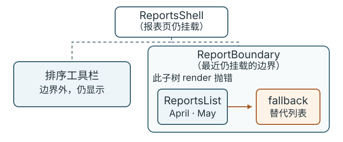

# 错误发生在哪里，决定了谁能接住它？

本章回答：React 应用里的一次失败，什么时候会被错误边界接住、换成局部的备用界面，什么时候必须由抛出它的那段代码自己处理；以及边界该放多大、“重试”按钮实际重试了什么。读者已经知道 render、commit 和 Effect 的分工，也知道 Suspense 怎样表示“还在等待”；这里处理“已经失败”。

[一次失败该由哪一层处理？](../javascript/error-handling-across-layers.md)给出了三个问题：哪个操作失败、哪一层还有足够的上下文、这一层选择恢复还是继续传播。错误边界是其中 UI 层的一个答案：它知道“这块界面坏了，换成什么给用户看”，但不知道请求为什么失败、数据该怎样修。

**案例。** 沿用主线一的报表页。用户已选“最早优先”，父组件把排好序的 April、May 交给列表组件 `ReportsList`。本章新增一个错误边界 `ReportBoundary` 包住列表，排序工具栏留在边界外。行为按 React 19.3 核对。

## 错误边界是什么

Error Boundary（错误边界）是一个包住子树的组件：子树出错时，它改为显示 fallback（备用界面）。React 内置的边界只能写成类组件，靠两个方法：

- `static getDerivedStateFromError(error)` 根据错误返回新状态，让下一次 render 显示 fallback；
- `componentDidCatch(error, info)` 在 commit 阶段运行，用来记录错误和 `info.componentStack`（组件栈）。

排查时注意：React 开发构建会把已被边界接住的错误继续报告到 `window`，全局 `error` 监听器因此也能看到它；这不代表边界没有接手。生产构建里，被边界接住的错误不会冒泡到 `window`。全局错误事件本身只是诊断信号，见[一次失败该由哪一层处理？](../javascript/error-handling-across-layers.md)。

页面其他部分用函数组件写时，在子树外包一个类边界即可，也可以用现成的边界库。

## 哪些失败会交给边界

关键在于失败发生时，是不是 React 正在调用你的代码。React 调用组件、生命周期和 Effect 时同步抛出的错误，它能接住；代码自己启动、之后才失败的异步工作，已经离开了 React 的那次调用，必须自己处理。下表按 React 19.3 列出各类失败的去向：

| 失败发生在哪里 | 去向 |
| --- | --- |
| 子组件的构造、render 或类组件生命周期中同步抛错 | 最近的边界显示 fallback。错误发生在边界自身的 render 或生命周期里时，交给更外层的边界。 |
| `useEffect` / `useLayoutEffect` 的 setup 或 cleanup 同步抛错 | 由最近的、仍挂载的边界接住。内层边界随子树一起卸载时，仍挂载的外层边界接住；没有仍挂载的祖先边界时，没有地方显示 fallback。 |
| `useTransition()` 返回的 `startTransition` 中，Action 同步抛错或返回的 Promise 被拒绝 | 交给包住调用 `useTransition()` 的那个组件的边界。Action 里另行启动、既没 `return` 也没 `await` 的 Promise，它的拒绝不算这个 Action 的。 |
| 从 `react` 直接导入的独立 `startTransition` 回调抛错或返回被拒绝的 Promise | 不交给边界，进入全局错误报告。它只用来标记更新，和 Hook 返回的同名函数是两回事。 |
| `use(promise)` 在 render 中读到被拒绝的 Promise | 最近的边界。Promise pending 时归 Suspense 管。 |
| 普通事件处理器、定时器、Effect 里启动的 Promise 后来被拒绝 | 边界接不住。处理器里用 `try/catch`，异步任务显式处理拒绝，或把错误写进状态再由界面显示。 |
| `useEffect` 里的普通请求失败 | 边界接不住，也不会变成 Suspense 挂起。把失败和重试放进请求状态。 |
| 服务端渲染期间抛错 | 类错误边界不捕获服务端错误，由服务端渲染管线处理。流式 SSR 可由最近的 `Suspense` 输出 fallback，客户端随后重试渲染；重试仍出错时，才可能由客户端的边界接住。 |

React 文档把错误边界的用途描述为捕获子树的渲染错误，明确排除事件处理器、一般异步代码、服务端渲染和边界自身的错误。Effect 需要单独说明：普通 `useEffect` 通常在绘制之后才运行，但 setup 和 cleanup 仍由 React 调用，其中同步抛出的错误会被捕获；Effect 启动的 Promise 之后才被拒绝，就已经不在这次调用里了。表中关于 Effect 和“仍挂载的边界”的结论按 React 19.3.0 的浏览器回放核对；`useTransition` 是文档列出的异步例外，独立导入的 `startTransition` 没有这条路径，按 19.3.0 实现核对。

### 为什么 try/catch 包住 JSX 接不住

在父组件里写 `try { return <ReportsList reports={reports} /> } catch { … }` 不能代替边界。这一行只是创建一个元素描述；`ReportsList` 要等 React 稍后 render 这棵树时才被调用，那时早已离开了这个 `try` 块。

## 边界放在用户能理解、能恢复的位置

图中虚线是组件树的父子关系，橙色箭头表示列表出错后被 fallback 替换。列表 render 抛错时，最近仍挂载的 `ReportBoundary` 用 fallback 替换列表，边界外的排序工具栏照常显示。

粒度按“用户能理解、能恢复的区域”来定：

- **整页包一个边界**，列表一出错，工具栏、导航也一起消失，用户连换个排序都做不到。
- **每一行包一个边界**，可能留下许多零散的错误框，用户难以判断列表是否完整。
- **一块功能区域一个边界**（这里是报表列表），出错时其余区域可用，用户也知道是哪块坏了。

> [!example]- 完整示例：类边界与报表区域
>
> ~~~jsx
> import { Component } from "react";
>
> class ReportBoundary extends Component {
>   state = { hasError: false };
>
>   static getDerivedStateFromError() {
>     return { hasError: true };
>   }
>
>   componentDidCatch(error, info) {
>     console.error("报表区域渲染失败", error, info.componentStack);
>   }
>
>   render() {
>     if (this.state.hasError) {
>       return (
>         <section>
>           
报表列表暂时无法显示。

>           <button type="button" onClick={() => this.setState({ hasError: false })}>
>             重新渲染列表
>           </button>
>         </section>
>       );
>     }
>     return this.props.children;
>   }
> }
>
> function ReportsShell({ accountId, reports }) {
>   return (
>     <main>
>       
当前排序：最早优先

>       <ReportBoundary key={accountId}>
>         <ReportsList reports={reports} />
>       </ReportBoundary>
>     </main>
>   );
> }
>
> function ReportsList({ reports }) {
>   return (
>     <ol>
>       {reports.map(report => <li key={report.id}>{report.title}</li>)}
>     </ol>
>   );
> }
>
> const initialReports = [
>   { id: "r-103", title: "April report" },
>   { id: "r-104", title: "May report" }
> ];
>
> function App() {
>   return <ReportsShell accountId="acct-a" reports={initialReports} />;
> }
> ~~~
>
> 工具栏固定显示“当前排序：最早优先”，只代表边界外仍留在页面上的区域；示例省略 URL 和排序逻辑，父组件直接传入排好的 April、May。

### 用 key 让边界随数据域重置

`<ReportBoundary key={accountId}>` 让切换账户时边界和列表子树整个重新创建，边界里的失败状态不会带到新账户。换 key 重置状态的规则见[React 怎样把一次用户操作变成界面更新？](./react-update-model.md#key%20决定状态属于谁)。它只重置 React 子树的身份，不隔离查询缓存，也不校验数据；多个账户共用查询缓存时，查询键同样必须包含账户，见[服务端数据怎样缓存、刷新和乐观更新，迟到的响应又归谁？](./server-state-and-optimistic-updates.md)。

## “重试”按钮到底重试了什么

fallback 里的“重新渲染列表”只是把边界的 `hasError` 设回 `false`，让 React 再试一次渲染子树。它不修复数据，也不重新发请求。跟着一组输入走一遍：

1. 起始调用用账户 `acct-a` 和 `initialReports` 显示 April、May。
2. 父组件为同一账户传入 `reports = [null]`。列表 render 这条记录、读取 `report.id` 时抛出 `TypeError`，边界显示 fallback，工具栏仍在。
3. 输入不变时点“重新渲染列表”：子树再次 render，再次抛错，回到 fallback。
4. 父组件改传有效的行：边界的 `hasError` 仍为 `true`，继续显示 fallback；要等用户再点一次重试，列表才恢复。
5. 若同时换成新的账户 ID 并传入有效行：`key` 变了，边界直接重建，不需要点重试。

所以真正的恢复顺序是：先由持有数据的一方修复输入、重新读取或离开出错的路由，再重置或重新挂载边界。这里人为注入的 render `TypeError` 只用来演示边界；真实的 API 响应应该在数据边界做运行时校验，校验失败作为数据状态处理，不要等它在 render 里炸开，见[TypeScript 能保证什么，外部数据又该怎样验证？](../javascript/typescript-guarantees-and-runtime-validation.md)。

## 查询错误怎样交给边界（TanStack Query v5 实例）

报表数据常由 TanStack Query 读取，它的失败默认**不走**错误边界。v5 的普通 `useQuery` 把失败作为结果状态交给组件，组件读 `isError`、`error`、`data` 自己决定怎样报错和重试。这条路径下不必再套一层错误边界。

要让查询错误进边界，有三种方式：配置 `throwOnError`；改用 `useSuspenseQuery`；或在 render 里自己抛出查询错误。`useSuspenseQuery` 也不是“任何失败都丢弃数据”：没有缓存数据时，错误交给边界；已有缓存而后台刷新失败时，默认继续显示缓存。

用边界承接查询错误、并在 fallback 里提供重试时，要用 TanStack 的 `QueryErrorResetBoundary`（或 `useQueryErrorResetBoundary`）把查询的错误重置和边界的重置连起来。只把 React 边界的 `hasError` 清掉，查询仍处于错误状态，子树一 render 又会抛同一个错误。

## Suspense fallback 不是错误 fallback

两者表达的状态不同：

- **Suspense 的 fallback** 表示资源还没就绪、仍在等待。首次挂载，或不保留旧内容的更新，会切到它。
- **错误边界的 fallback** 表示子树已经失败。

`use(promise)` 把两者连在一起：Promise pending 时挂起，交给 Suspense；被拒绝时抛出，交给错误边界。所以一块用 `use` 读取数据的区域通常两种边界都要有，错误边界一般包在 Suspense 外面。写在 `useEffect` 或点击处理器里的普通 `fetch` 两者都不会触发。

更新包在 Transition 里时，若新内容暂时挂起，React 可以继续显示已提交的旧内容，而不立即换成 Suspense fallback；但 Transition 不会把旧数据变成新请求的结果。等待时保留什么，见[昂贵更新时，怎样让输入保持即时？](./urgent-and-deferred-updates.md)。

## 内存之外，状态还能存在哪？

现在可以按失败发生的位置判断去向：React 调用代码时的同步错误、Hook 返回的 Transition 里的 Action 失败、`use` 读到的拒绝，交给最近仍挂载的边界；事件处理器、定时器和自行启动的 Promise 由各自的代码处理；查询失败默认作为数据状态。边界按可恢复的功能区域放置，用 `key` 随数据域重置，重试之前先修好输入。到这里，报表页的状态都活在当前页面的内存里，刷新就没了，另一个标签页也看不到。浏览器能把哪些状态存下来、标签页和窗口之间怎样互相通知，是[浏览器能把状态存在哪里，标签页和窗口之间怎样互相通知？](./browser-storage-and-cross-context-messaging.md)的问题。

> [!info]- 来源
>
> - 类边界的 `getDerivedStateFromError`、`componentDidCatch`（含开发构建把已接住的错误报告到 `window`、生产构建不冒泡）、粒度建议，以及事件处理器、一般异步代码、服务端渲染和边界自身错误的排除范围（“错误边界是什么”“哪些失败会交给边界”“边界放在哪”）：[Component — Catching rendering errors with an Error Boundary](https://react.dev/reference/react/Component#catching-rendering-errors-with-an-error-boundary)，React 19.3。
> - `useTransition()` 返回的 `startTransition` 把 Action 的同步抛错或返回的 Promise 拒绝交给最近边界（分类表第 3 行）：[useTransition — Displaying an error to users with an error boundary](https://react.dev/reference/react/useTransition#displaying-an-error-to-users-with-an-error-boundary)，React 19.3；独立导入的 `startTransition` 走全局错误报告（第 4 行）：[React 19.3.0 `ReactStartTransition.js`](https://github.com/react/react/blob/v19.3.0/packages/react/src/ReactStartTransition.js)。
> - `use(promise)` pending 进入 Suspense、拒绝进入错误边界、Promise 应复用（第 5 行，“Suspense fallback 不是错误 fallback”）：[use](https://react.dev/reference/react/use)，React 19.3。
> - Effect setup 由 React 在 commit 后调用、cleanup 在依赖变化或卸载时运行、普通 `useEffect` 可能在绘制后运行（第 2 行）：[useEffect](https://react.dev/reference/react/useEffect)，React 19.3；Effect 同步错误由仍挂载的最近边界接住，按原章节 React 19.3.0 浏览器回放核对，核对 2026-11-12。
> - 流式 SSR 中服务端错误由最近 `Suspense` 输出 fallback、客户端重试（第 8 行）：[Suspense — Providing a fallback for server errors and client-only content](https://react.dev/reference/react/Suspense#providing-a-fallback-for-server-errors-and-client-only-content)，React 19.3。
> - 换 key 重置子树状态（“用 key 让边界随数据域重置”）：[Preserving and Resetting State](https://react.dev/learn/preserving-and-resetting-state)，React 19.3。
> - `useQuery` 的 `throwOnError` 与错误作为状态（“查询错误怎样交给边界”）：[useQuery](https://tanstack.com/query/latest/docs/framework/react/reference/useQuery)；`useSuspenseQuery` 无数据时进边界、有缓存时后台刷新错误的规则、`QueryErrorResetBoundary`：[Suspense guide](https://tanstack.com/query/latest/docs/framework/react/guides/suspense)、[QueryErrorResetBoundary](https://tanstack.com/query/latest/docs/framework/react/reference/QueryErrorResetBoundary)，TanStack Query v5，核对 2026-11-12。
> - Suspense 不侦测 Effect/事件处理器里的普通请求；Transition 中再次挂起时保留已显示内容（“Suspense fallback 不是错误 fallback”）：[Suspense — What activates a Suspense boundary](https://react.dev/reference/react/Suspense#what-activates-a-suspense-boundary)，React 19.3。
