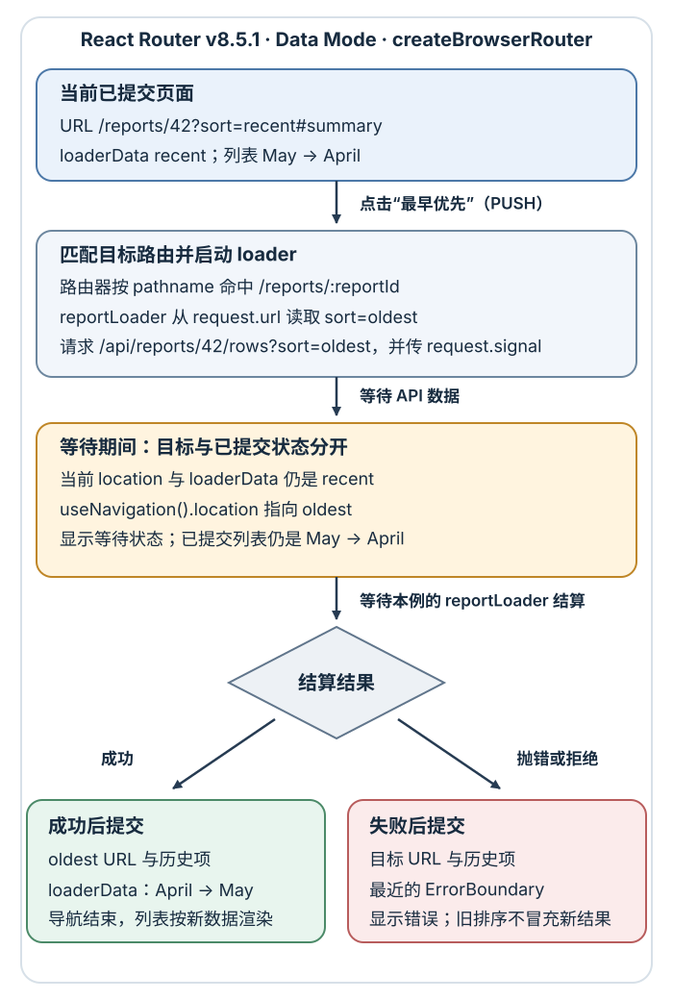

# 路由怎样把 URL 变成已提交的数据和界面？

地址栏里的 URL 已经说明“用户想看哪份报表、按什么顺序”。路由器要做的是三件事：按路径匹配页面，按参数读取数据，等数据就绪后把新地址和新界面一起**提交**。本章回答这三步各自怎样工作，尤其是“正在前往的地址”和“已经提交的地址”为什么必须分开读。读者需要知道 URL 的 path、query、fragment 各自管什么，以及 `pushState` 和 `popstate` 怎样改写会话历史，这两点由[浏览器导航与 URL 状态](../browser/navigation-history-and-url-state.md)讲清。

## 案例：报表页的排序切换

沿用主线一的报表页：用户打开 `/reports/42?sort=recent#summary`，报表 42 显示 May、April 两行；点“最早优先”后应显示 April、May，并新增一条历史项；按 Back 后回到“最近优先”和 May、April。本章新增的标识符只有两个：路由模式 `/reports/:reportId`，以及浏览器访问的同源行数据接口 `GET /api/reports/42/rows?sort=…`，它返回 `{ id, period, title }` 组成的数组。

URL 的三段在这里分工明确：

- path `/reports/42` 选中报表页路由，并把 `reportId="42"` 交给数据读取；
- query `sort=recent` 是读取的输入，决定服务端返回的行序；
- fragment `#summary` 只供浏览器定位到 `id="summary"` 的标题，不随 HTTP 请求发出，也不进入数据读取。

排序只存在 URL 里。读取函数从本次导航的 URL 取 `sort`，组件用读取结果渲染。如果再用 React state 另存一份排序，刷新、直接打开链接和 Back 都可能让两份值分叉。URL 状态该怎样校验、设默认值和规范化，见[浏览器导航与 URL 状态](../browser/navigation-history-and-url-state.md)；一份状态该归谁，见[界面状态的所有权](state-ownership-and-composition.md)。

## 路由器怎样匹配、加载和提交

一次客户端导航从“用户点了一个指向新 URL 的控件”开始，到“新 URL 和新数据一起成为当前页面”结束。中间是三步：

1. **匹配**：路由器拿目标 URL 的 pathname 对照路由表，`/reports/42` 命中 `/reports/:reportId`，得到参数 `{ reportId: "42" }`。
2. **加载**：路由器调用该路由的 loader (数据加载函数)，传入一个代表本次导航的 `Request`：`request.url` 是目标的完整 URL（含 origin、path 和 query，不含 fragment），`request.signal` 是一个会在导航被放弃时中止的 `AbortSignal`。
3. **提交**：loader 成功后，路由器把目标位置、loader 的返回值和匹配结果一起写成“已提交状态”，组件据此重新渲染；loader 抛错时，提交的是目标位置和这份错误。

报表页的 loader 只做四件事：

1. 从 `request.url` 解析 `sort`，只接受 `recent` 和 `oldest`；其他值抛出 400，而不是把任意字符串转发给服务端。
2. 用 `params.reportId` 和 `sort` 构造 `/api/reports/42/rows?sort=…`，把 `request.signal` 传给 `fetch`。
3. 检查 HTTP 状态（`fetch` 履行不代表成功，见 [Promise 与 async 函数](../javascript/promises-and-async-functions.md)），再在运行时校验返回的行（见 [TypeScript 能保证什么](../javascript/typescript-guarantees-and-runtime-validation.md)）。接口 404 时抛出“报表不存在”，不要让它显示成“加载失败”。
4. 返回 `{ sort, rows }`。组件只从已提交的 loader 数据读取这两项。

这里的结构校验只证明 JSON 符合页面需要的字段，不是身份、授权或数据完整性的边界；那些仍由服务端负责。

> [!info] 实例：React Router v8.5.1 的三种模式（核对于 2026-11-13）
> React Router 是同一产品的三层接口。**Declarative Mode (声明式模式)** 只做路径匹配、`Link` 和程序化导航；**Data Mode (数据模式)** 在此之上提供 `loader`、`action`、导航等待状态和路由错误边界，用 `createBrowserRouter` 建路由器、`<RouterProvider>` 挂载；**Framework Mode (框架模式)** 再加 Route Module API、类型生成、代码拆分，以及 SPA、SSR 和静态预渲染策略，其路由模块可以有在服务端运行的 loader。本章示例是独立的 Data Mode，loader 在浏览器里运行。Next.js App Router 有自己的文件路由和服务端组件约定（见 [Next.js App Router](next-js-app-router.md)），两者的 loader、执行位置和导航 API 不能互换。v8.5.1 要求 `react` 与 `react-dom` 不低于 19.2.7。

## 已提交的导航与待定的导航

点“最早优先”之后、loader 返回之前，页面上同时存在两个位置：用户要去的 oldest，和屏幕上仍在显示的 recent。路由器把它们放在两个不同的读取口：

- `useLoaderData()`（以及 `useLocation()`）读的是**已提交**状态：当前屏幕上那份数据和它对应的位置。
- `useNavigation()` 读的是**待定**导航：`state` 为 `"loading"` 或 `"submitting"` 时，`navigation.location` 是正在前往的目标；空闲时 `state` 为 `"idle"`，`location` 为 `undefined`。

两者回答的是不同问题。“列表该显示哪几行”只能看已提交数据；“该不该提示正在切换、切到哪里”看待定导航。把 `navigation.location` 里的 `sort=oldest` 提前当成当前排序，界面就会把 recent 的行标成 oldest。

地址栏何时变化，取决于导航类型。PUSH（新增历史项，点击链接或调用 `navigate` 的默认行为）由路由器发起：它先等 loader，成功或失败后才调用 `history.pushState` 写入新历史项，所以等待期间地址栏仍是旧地址。POP（在已有历史项之间移动，即 Back/Forward）由浏览器发起：浏览器先移动历史指针、改地址栏，再派发 `popstate`，路由器这时才开始运行 loader，所以地址栏先变，已提交数据后变。

下表假设首次加载成功，且用户等 oldest 导航结束后才按 Back。表中 recent / oldest 指完整地址中的 `sort` 值，path 始终是 `/reports/42`，fragment 始终是 `#summary`。

| 时点 | 地址栏与历史 | `useLoaderData()` 与屏幕 | `useNavigation()` |
|---|---|---|---|
| 首次打开，loader 等待中 | recent；初始文档的历史项 | 还没有已提交数据，显示 `HydrateFallback` | `idle`（不反映首次读取） |
| 首次加载完成 | recent | recent；May → April | `idle` |
| 点“最早优先”（PUSH），loader 等待中 | 仍为 recent；目标历史项尚未写入 | 仍为 recent；May → April，并提示“正在切换到最早顺序…” | `loading`，`location` 为 oldest |
| oldest loader 成功 | 提交 oldest，新增历史项 | oldest；April → May | `idle` |
| oldest loader 失败（另一分支） | 仍提交 oldest 地址和历史项 | 路由 `ErrorBoundary` 替换列表 | `idle` |
| 成功后按 Back（POP），loader 等待中 | 浏览器已回到 recent 历史项 | 仍为 oldest；April → May，并提示正在加载 | `loading`，`location` 为 recent |
| POP 的 loader 成功 | recent | recent；May → April | `idle` |

最后一行按旧 URL **重新读取**，得到的是服务端此刻的数据，不保证与首次访问时那份相同。URL 记住的是读取条件，不是数据快照。

### 页面里另起的请求也要跟已提交值走

有时 loader 只负责解析参数，列表由组件里的请求 Hook 或查询缓存去读。这时组件必须用 `useLoaderData()` 里已提交的 `sort` 作为请求输入，不能用 `navigation.location` 里的待定值，否则请求会在路由提交前就切到新排序，Back 时也会与地址栏对不上。

只改 query 的导航不会卸载页面组件：路由匹配没变，React 复用同一个组件实例，组件本地的 state 会保留。设报表页另有一个只存在组件 state 里、300 ms 防抖后才生效的搜索框（防抖语义见[包装函数](../javascript/wrapping-functions.md)）。用户在空搜索框输入 `Ops`，紧接着点“最早优先”，且路由在 300 ms 内提交了 oldest：

1. 页面挂载时按已提交值请求 `(recent, "")`；
2. oldest 提交后，组件收到新的 `sort`，请求 `(oldest, "")`；
3. 300 ms 到期，搜索值稳定为 `Ops`，请求 `(oldest, "Ops")`；
4. 按 Back，搜索词不在 URL 里，仍是 `Ops`，POP 提交 recent 后请求 `(recent, "Ops")`，而不是 `(recent, "")`。

若路由比防抖慢，第 2、3 步会对调。决定请求参数的永远是“当时已提交的排序”和“当时已稳定的搜索词”。同一份列表只应由一个读取者负责：loader、查询缓存或请求 Hook 三者择一，不要叠加。

## 首次加载：HydrateFallback

直接打开 `/reports/42?sort=recent#summary` 时，还没有任何已提交的 loader 数据，`useNavigation()` 也不描述这次初始读取。Data Mode 用路由对象上的 `HydrateFallback` 填这段空白。本例的 fallback 与正式页面渲染同样的 `<main>` 和 `<h1 id="summary">`，于是首次 URL 里的 `#summary` 在 loader 等待期间就有定位目标；之后的导航由 `useNavigation()` 提示，旧列表留在屏幕上。

## 片段导航与滚动恢复

fragment 不进 loader，但片段变化会不会重新运行 loader，有专门的规则。在 v8.5.1 中，如果 pathname 和 query 都不变，导航只是从无片段变为有片段，或把一个非空片段换成另一个非空片段，并且没有显式要求重验证（revalidation，重新运行 loader），路由器直接提交新位置，不运行 loader。**移除**已有片段（如从 `#rows` 回到无片段）不走这条快速路径，按默认规则重验证，本例会再读一次同一排序。query 变化默认会让相关 loader 重验证。

`Link` 或 `navigate` 的 `defaultShouldRevalidate` 可以改变这个默认值；路由若定义了 `shouldRevalidate`，它收到默认值后作最终决定。调整这些规则时，要确认不会跳过真正影响结果的 `sort`。嵌套路由时，每个匹配路由各有自己的默认判定，不能从“只改了排序”推断其他 loader 都不会运行。

根组件挂载 `<ScrollRestoration />` 后，它管理普通 GET 导航的窗口滚动：有保存位置就恢复；没有就尝试滚到目标 fragment 指向的元素；再没有就回到顶部。位置按每次 location 的 `key` 存在 `sessionStorage` 里，所以按 Back 能恢复之前在 recent 页面的滚动位置；若尚无保存位置，`#summary` 提供定位目标。它只管理窗口滚动，自定义滚动容器由应用自己负责。`preventScrollReset` 只阻止“无法恢复时回到顶部”，不关闭 Back/Forward 的位置恢复。

## 导航被打断：取消与过期结果

若 oldest 的 loader 还没返回，用户又发起了另一次导航，路由器放弃前一次，转而处理新目标。被放弃的导航有两层后果：

- 传给 `fetch` 的 `request.signal` 发出 abort，浏览器停止这次客户端请求；
- 即使那份结果仍然返回，路由器也会丢弃它，不让过期导航覆盖较新的界面。

第二层是“按身份认领结果”的一个实例：结果属于发起它的那次导航，导航已不是当前导航，结果就作废。这种模式在前端各层的共同原理见[异步结果按身份归属](server-state-and-optimistic-updates.md#异步结果按身份归属)。第一层只停得住客户端：请求若已抵达服务器，服务器可能继续处理，取消客户端读取也不能代替服务端写操作的幂等、权限或事务约束，见[取消与超时停得住什么](../javascript/cancellation-timeouts-and-concurrency.md)。

## loader 失败：路由错误边界与重验证

loader 抛出的状态数据或异常，交给最近匹配路由的 `ErrorBoundary`。它也接住该路由组件树里的渲染错误；按钮事件处理器或计时器里随后产生的 Promise 拒绝不归它管，要在触发处处理。各类错误该由哪一层接住，见 [React 错误边界](react-error-boundaries.md)。

本例的边界区分三种失败：

| 失败 | 来源 | 显示 | 是否给“重新加载” |
|---|---|---|---|
| `sort=other` | loader 自己抛出带 `unsupported-sort` 标记的 400 | “不支持这个排序方式。” | 否：重读结果不会变 |
| 报表 42 不存在 | 接口 404，loader 转成 `not-found` | “报表不存在。” | 否 |
| 接口 5xx、网络失败、行结构错误 | 非成功状态或非路由异常 | “报表暂时无法显示。” | 是 |

“重新加载”借用了 `useRevalidator()`。它本来用于页面之外的原因触发重读，例如窗口重新聚焦或轮询；这里用它实现一个明确的重试按钮。正常的写入不需要手动刷新：通过路由 `action`、`<Form>`、`useFetcher` 或 `useSubmit` 提交成功后，路由器会自动重验证页面数据。

## 客户端导航、整页导航与渲染策略

应用内的 `Link` 用客户端路由切换页面，同时保留 `<a href>` 的链接语义（可复制、可在新标签打开）。外部 URL、下载，或明确要浏览器请求另一份完整文档时，用普通 `<a>`，或给路由链接加 `reloadDocument`。链接默认新增历史项，`replace` 改为替换当前项。`useNavigate()` 适合事件后的程序化跳转，例如本例的排序按钮或保存成功后的跳转。不要在路由器之外自己调用 `history.pushState()`，否则路由器和应用会争夺历史状态。

客户端导航保留当前文档，服务器不会重新发送整份 HTML。因此部署时，直接打开或刷新 `/reports/42` 必须由站点入口返回应用文档，而 `/api/reports/42/rows` 仍要交给 API，不能被同一个 HTML 回退规则吞掉。

SPA (单页应用)与 MPA (多页应用)说的是页面之间怎样导航；SSR (服务端渲染)与静态预渲染说的是初始文档怎样产生。这是两个维度，可以组合。若爬虫或不执行 JavaScript 的读者需要直接看到内容，先要让初始 HTML 包含它；后续点击仍可以走客户端导航。需要共享布局、在导航间保留上下文时，客户端导航更容易做到。

部署环境不能提供路径回退时，可以改用 Data Mode 的 `createHashRouter`，loader 和错误边界照旧；代价是应用路径进入 fragment，地址形式改变，`#summary` 也不能再单独作页面锚点。测试或非浏览器环境可用 `createMemoryRouter`，它以内存历史运行并保留数据路由能力。`HashRouter` 和 `MemoryRouter` 属于 Declarative Mode，直接替换会失去 loader。

## 识别旧版路由代码

维护旧项目时，先看它实际安装的主版本，再按对应文档处理，不要把旧 API 混进当前的 route object。

`react-router-dom@6.3.0` 的声明式写法用 `BrowserRouter` 提供历史上下文，`Routes` 选择匹配分支，`Route` 的 `element` 指定元素：

~~~jsx
import { BrowserRouter, Routes, Route } from "react-router-dom";

<BrowserRouter>
  <Routes>
    <Route path="reports" element={<ReportsLayout />}>
      <Route path=":reportId" element={<ReportPage />} />
    </Route>
  </Routes>
</BrowserRouter>
~~~

访问 `/reports/42` 时，布局里的 `Outlet` 显示 `ReportPage`，`useParams()` 得到字符串 `reportId="42"`；`Link`、`useNavigate()`、`useLocation()` 分别负责链接导航、程序化导航和读取位置。6.3.0 的这套写法没有 loader，数据读取由应用自己负责。

更早的 v5 代码里，`component={Post}`、`withRouter` 和 `match.params` 属于旧的路由上下文；旧版 `StaticRouter` 的固定 location 服务端匹配，也不能当作当前 Framework Mode 的服务端入口。

## 完整实现

运行时需挂载一次 `App`，同源 `GET /api/reports/:reportId/rows?sort=…` 返回 `{ id, period, title }` 数组。

> [!example]- React Router v8.5.1 Data Mode：loader、待定提示、错误边界与滚动恢复
>
> ~~~tsx
> import {
>   createBrowserRouter,
>   data,
>   isRouteErrorResponse,
>   Outlet,
>   ScrollRestoration,
>   useLoaderData,
>   useNavigate,
>   useNavigation,
>   useParams,
>   useRevalidator,
>   useRouteError,
>   type LoaderFunctionArgs
> } from "react-router";
> import { RouterProvider } from "react-router/dom";
>
> type SortOrder = "recent" | "oldest";
> type Row = { id: string; period: string; title: string };
>
> function isRow(value: unknown): value is Row {
>   if (typeof value !== "object" || value === null) return false;
>   const row = value as Record<string, unknown>;
>   return typeof row.id === "string" &&
>     typeof row.period === "string" &&
>     typeof row.title === "string";
> }
>
> function parseRows(value: unknown): Row[] {
>   if (!Array.isArray(value)) {
>     throw data("行数据服务返回的不是列表", { status: 502 });
>   }
>   return (value as unknown[]).map(row => {
>     if (!isRow(row)) throw data("行数据服务返回了无效行", { status: 502 });
>     return row;
>   });
> }
>
> async function reportLoader({ request, params }: LoaderFunctionArgs) {
>   const pageUrl = new URL(request.url);
>   const rawSort = pageUrl.searchParams.get("sort") ?? "recent";
>   if (rawSort !== "recent" && rawSort !== "oldest") {
>     throw data({ kind: "unsupported-sort" }, { status: 400 });
>   }
>   const sort: SortOrder = rawSort;
>   const reportId = params.reportId ?? "";
>
>   const apiUrl = new URL(
>     `/api/reports/${encodeURIComponent(reportId)}/rows`,
>     pageUrl.origin
>   );
>   apiUrl.searchParams.set("sort", sort);
>   const response = await fetch(apiUrl, { signal: request.signal });
>   if (response.status === 404) {
>     throw data({ kind: "not-found" }, { status: 404 });
>   }
>   if (!response.ok) {
>     throw data("行数据读取失败", { status: response.status });
>   }
>   const payload: unknown = await response.json();
>   return { sort, rows: parseRows(payload) };
> }
>
> function Root() {
>   return (
>     <>
>       <Outlet />
>       <ScrollRestoration />
>     </>
>   );
> }
>
> function ReportPage() {
>   const { sort, rows } = useLoaderData<typeof reportLoader>();
>   const { reportId = "" } = useParams();
>   const navigation = useNavigation();
>   const navigate = useNavigate();
>   const loading = navigation.state !== "idle";
>   const pendingSort = navigation.location
>     ? new URLSearchParams(navigation.location.search).get("sort")
>     : null;
>   const go = (next: SortOrder) =>
>     navigate(`/reports/${encodeURIComponent(reportId)}?sort=${next}#summary`);
>
>   return (
>     <main>
>       <h1 id="summary">报表 {reportId}</h1>
>       

>         <button type="button" aria-pressed={sort === "recent"}
>           onClick={() => go("recent")}>Most recent</button>
>         <button type="button" aria-pressed={sort === "oldest"}
>           onClick={() => go("oldest")}>Oldest first</button>
>       

>       {loading && (
>         

>           {pendingSort === "oldest" ? "正在切换到最早顺序…" : "正在加载所选排序…"}
>         

>       )}
>       <ol aria-label="报表行" aria-busy={loading}>
>         {rows.map(row => (
>           <li key={row.id}>{row.period} — {row.title}</li>
>         ))}
>       </ol>
>     </main>
>   );
> }
>
> function ReportHydrateFallback() {
>   return (
>     <main>
>       <h1 id="summary">报表</h1>
>       
正在首次读取报表…

>     </main>
>   );
> }
>
> function errorKind(error: unknown) {
>   if (!isRouteErrorResponse(error)) return "unexpected";
>   const body = error.data as { kind?: unknown } | null;
>   if (error.status === 400 && body?.kind === "unsupported-sort") return "unsupported-sort";
>   if (error.status === 404 && body?.kind === "not-found") return "not-found";
>   return error.status >= 500 ? "retryable" : "client";
> }
>
> function ReportErrorBoundary() {
>   const error = useRouteError();
>   const revalidator = useRevalidator();
>   const kind = errorKind(error);
>   const message =
>     kind === "unsupported-sort" ? "不支持这个排序方式。" :
>     kind === "not-found" ? "报表不存在。" :
>     "报表暂时无法显示。";
>
>   return (
>     <section>
>       
{message}

>       {(kind === "retryable" || kind === "unexpected") && (
>         <button
>           type="button"
>           onClick={() => { void revalidator.revalidate(); }}
>           disabled={revalidator.state !== "idle"}
>         >
>           重新加载
>         </button>
>       )}
>     </section>
>   );
> }
>
> const router = createBrowserRouter([
>   {
>     path: "/",
>     Component: Root,
>     children: [
>       {
>         path: "reports/:reportId",
>         loader: reportLoader,
>         Component: ReportPage,
>         HydrateFallback: ReportHydrateFallback,
>         ErrorBoundary: ReportErrorBoundary
>       },
>       { path: "*", Component: () => <h1>页面不存在</h1> }
>     ]
>   }
> ]);
>
> export function App() {
>   return <RouterProvider router={router} />;
> }
> ~~~

## 本章交出了什么

路由把 URL 变成两份状态：已提交的位置与数据决定屏幕显示，待定导航只决定等待提示；PUSH 在 loader 结算后才改地址，POP 先改地址再读数据。被放弃的导航结果按身份作废。下一章[服务端数据的缓存与乐观更新](server-state-and-optimistic-updates.md)接手这份已提交的 `sort`：当行数据交给查询缓存而不是 loader 管理时，缓存怎样用 query key 标识每份结果，迟到的响应又怎样只落到它所属的那一格。

> [!info]- 来源
> 版本与日期：React Router v8.5.1（Changelog 标为 2026-10-27 发布），核对于 2026-11-12 至 2026-11-13。
> - 三种模式及能力范围（实例 callout）：[Picking a Mode](https://raw.githubusercontent.com/remix-run/react-router/refs/tags/react-router@8.5.1/docs/start/modes.md)；Framework Mode 服务端 loader 与 clientLoader：[Framework Data Loading](https://raw.githubusercontent.com/remix-run/react-router/refs/tags/react-router@8.5.1/docs/start/framework/data-loading.md)；版本与发布日期：[React Router Changelog](https://reactrouter.com/changelog)。
> - 路由对象、loader、query 变化时的默认重验证（“路由器怎样匹配、加载和提交”“片段导航与滚动恢复”）：[Route Object](https://raw.githubusercontent.com/remix-run/react-router/refs/tags/react-router@8.5.1/docs/start/data/route-object.md)、[Data Loading](https://raw.githubusercontent.com/remix-run/react-router/refs/tags/react-router@8.5.1/docs/start/data/data-loading.md)。
> - 已提交与待定状态的读取口（“已提交的导航与待定的导航”）：[createBrowserRouter](https://raw.githubusercontent.com/remix-run/react-router/refs/tags/react-router@8.5.1/docs/api/data-routers/createBrowserRouter.md)、[useLoaderData](https://raw.githubusercontent.com/remix-run/react-router/refs/tags/react-router@8.5.1/docs/api/hooks/useLoaderData.md)、[useNavigation](https://raw.githubusercontent.com/remix-run/react-router/refs/tags/react-router@8.5.1/docs/api/hooks/useNavigation.md)、[Pending UI](https://reactrouter.com/start/data/pending-ui)。
> - PUSH 在导航完成后才写入历史项：[v8.5.1 `completeNavigation`](https://github.com/remix-run/react-router/blob/react-router%408.5.1/packages/react-router/lib/router/router.ts#L1613-L1619)；POP 时浏览器先更新地址：[HTML Standard 历史条目应用算法](https://html.spec.whatwg.org/multipage/browsing-the-web.html#update-document-for-history-step-application)，核对于 2026-11-12。
> - 页面内请求跟随已提交 `sort`、搜索词保留与请求序列（“页面里另起的请求也要跟已提交值走”）：以等价的合成报表列表在 Node 26.13.0、React 19.3.1、React Router 8.5.1、ahooks 3.11.0、jsdom 26.1.0 下隔离重放 PUSH/Back 时序，2026-11-12；服务为模拟 Promise。
> - `HydrateFallback` 与路由属性：[createBrowserRouter](https://reactrouter.com/api/data-routers/createBrowserRouter)、[Route](https://reactrouter.com/api/components/Route)。
> - 片段变化的 loader 快速路径与默认重验证判定：[v8.5.1 路由器实现](https://github.com/remix-run/react-router/blob/react-router%408.5.1/packages/react-router/lib/router/router.ts#L7126)；覆盖方式：[Revalidation Optimization](https://raw.githubusercontent.com/remix-run/react-router/refs/tags/react-router@8.5.1/docs/how-to/optimize-revalidation.md)。
> - 滚动恢复与 fragment 定位：[Link](https://raw.githubusercontent.com/remix-run/react-router/refs/tags/react-router@8.5.1/docs/api/components/Link.md)、[ScrollRestoration](https://raw.githubusercontent.com/remix-run/react-router/refs/tags/react-router@8.5.1/docs/api/components/ScrollRestoration.md)；hash 定位、位置保存与恢复流程另核对了[同版本实现](https://github.com/remix-run/react-router/blob/react-router%408.5.1/packages/react-router/lib/dom/lib.tsx)。
> - 导航取消、过期结果丢弃与服务端可能继续处理（“导航被打断”）：[Race Conditions](https://raw.githubusercontent.com/remix-run/react-router/refs/tags/react-router@8.5.1/docs/explanation/race-conditions.md)。
> - 路由错误边界：[Error Boundaries](https://raw.githubusercontent.com/remix-run/react-router/refs/tags/react-router@8.5.1/docs/how-to/error-boundary.md)；显式重读与 action 后自动重验证：[useRevalidator](https://raw.githubusercontent.com/remix-run/react-router/refs/tags/react-router@8.5.1/docs/api/hooks/useRevalidator.md)、[Actions](https://raw.githubusercontent.com/remix-run/react-router/refs/tags/react-router@8.5.1/docs/start/data/actions.md)。
> - 保留数据路由能力的 hash 与内存路由器：[createHashRouter](https://reactrouter.com/api/data-routers/createHashRouter)、[createMemoryRouter](https://reactrouter.com/api/data-routers/createMemoryRouter)。
> - 旧版声明式路由（“识别旧版路由代码”）：[React Router v6.3.0 API](https://raw.githubusercontent.com/remix-run/react-router/v6.3.0/docs/api.md)。
