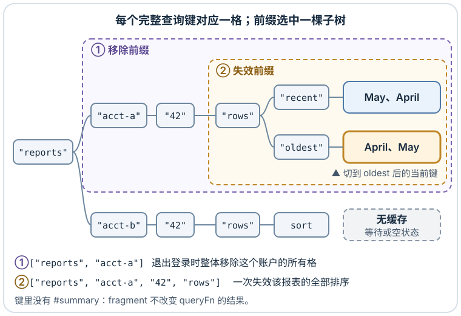
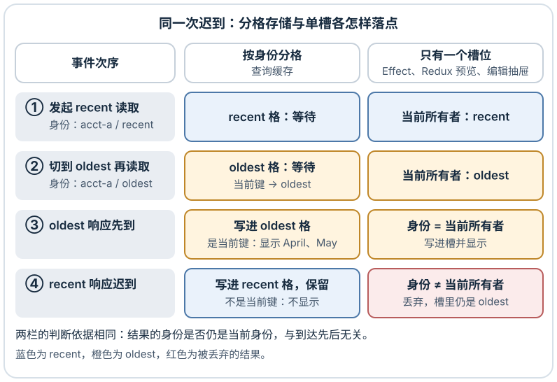
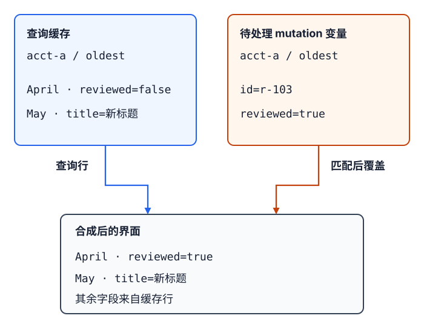

# 服务端数据怎样缓存、刷新和乐观更新，迟到的响应又归谁？

报表的行数据归服务端所有，浏览器里只有它的副本。副本会过期，会被乱序到达的响应改写，用户的修改还要在服务器确认之前就显示出来。本章回答四个问题：客户端怎样标识每一份副本；一个迟到的异步结果凭什么决定自己该落在哪里；什么时候重新读取；乐观更新怎样在失败和并发读取下仍然正确。读者手上已有上一章的结论：路由给出已提交的 `sort`，见[路由与 loader](routing-and-loaders.md)。

## 案例：同一份报表、两个排序、两个账户

沿用主线一的报表页 `/reports/42?sort=recent#summary`，报表 42 的两行 May、April 的行 ID 分别是 `r-104`、`r-103`。本章新增三点：当前账户 `acct-a`；行数据由查询缓存而不是 loader 读取；每行有“标为已审阅”按钮，把该行的 `reviewed` 写成 `true`。

用户依次做这些事：先看 recent（May、April），切到 oldest（April、May），在 oldest 下把 April 标为已审阅，最后切换到账户 `acct-b`。我们要保证三件事：每个排序显示自己那份服务端结果；April 的已审阅状态在保存期间立即可见、失败后撤去、成功后与服务器一致；`acct-a` 的行永远不会出现在 `acct-b` 下。

示例用 TanStack Query v5（官方 v5 Latest 文档，核对于 2026-11-12；相关章节的本地复现版本为 5.107.1）。机制本身不依赖这个库，本章末尾另给 ahooks 的对应实例。

## 查询键就是结果的身份

查询缓存把一次读取描述成两样东西：`queryFn` (查询函数)负责取数，`queryKey` (查询键)标识这次取数的**结果**。规则只有一条：凡是会改变 `queryFn` 返回值的输入，都要进键。本例的行数据取决于账户、报表和排序：

~~~ts
["reports", "acct-a", "42", "rows", "recent"]
~~~

键按段组成一棵树。完整键选中一格结果，前缀选中一棵子树，失效和移除都按前缀批量操作：

若再加筛选、搜索词或页码，它们也要进键，各占一段。fragment `#summary` 不随请求发送、不改变结果，所以不进键；只有应用明确把某个片段转成请求参数时，转换后的值才属于查询输入。

| 阶段 | 当前键 | 列表与提示 |
|---|---|---|
| 初始路由 | `…/rows/recent` | 路由随页面交付的 May、April 作为这个键的初始数据，直接显示 |
| 点“最早优先” | 路由提交 `sort=oldest`，键变为 `…/rows/oldest` | 若该键无缓存：把同账户、同一完整行集合的路由行在本地排成 April、May，标明“正在等待服务端确认”，行内操作禁用 |
| oldest 响应到达 | 只写 `…/rows/oldest` | 列表换成该键的服务端数据；较早的 recent 请求此后才完成，也只写进 recent 的键 |
| 切换到 `acct-b` | `["reports", "acct-b", "42", "rows", sort]` | 没有 B 的缓存或路由行时，显示等待或空状态；绝不把 A 的行当成 B 的结果 |

第二行的本地重排有严格前提：行的成员完全相同，只是顺序不同。只要账户、筛选、搜索词或页码改变了集合，旧集合重排后就不能冒充当前结果，切换期间只能显示当前键的缓存或等待状态。

## 异步结果按身份归属

上表最后两行用到了一条贯穿整个前端的规则。它值得单独说清，因为几乎每一层都会重新遇到它。

**问题。** 一个异步操作在 t₀ 发起、在 t₁ 返回。到 t₁ 时，界面可能已经换了排序、换了账户、关掉了抽屉、发起了更新的请求。响应本身不知道这些。如果代码在 t₁ 时“把结果写进当前界面”，那么只要两次请求的返回顺序和发起顺序不同，旧结果就会覆盖新界面。网络、缓存、服务器负载都不保证顺序，所以这不是边角情况。

**原理。** 每个异步结果都要带着它所属的身份回来，并只落到这个身份对应的位置：

1. **身份在发起时铸造，随结果一起回来。** 它存在闭包、请求变量或 action 的 `meta` 里；结果到达时不要回头读“现在的”props 或 state 来推断它属于谁。
2. **身份覆盖所有会改变结果的输入，以及结果所属的作用域。** 排序、筛选、页码是输入；账户、编辑会话是作用域。少一项，两份不同的结果就会共用一个身份。
3. **到达时与唯一的当前所有者比较。** “最后到达的赢”和“最后发起的赢”都不是判断依据，判断依据只有“这份结果的身份是否仍是当前身份”。
4. **落点有两种。** 按身份分格存储时，每份结果都写进自己的格，旧结果不浪费，只是不显示（查询缓存）；只有一个槽位时，身份不匹配的结果直接丢弃（Effect、Redux 预览、编辑抽屉）。
5. **认领与取消是两件事。** 取消尽量省掉客户端工作，但不保证结果不回来，也不撤销服务端已发生的事（见[取消与超时停得住什么](../javascript/cancellation-timeouts-and-concurrency.md)）；按身份认领才保证界面正确。两者通常一起用。
6. **写入的回执不能丢弃。** 读取结果过期了可以扔掉；写入的回执说明服务器状态已经改变，必须按发起时捕获的身份更新对应的缓存，只有“要不要改当前界面”才看它是否仍属于当前会话。

用案例里先 recent、后 oldest 的两次读取走一遍第 3、4 条：

下表是本书各处的实例。它们的身份长得不一样，机制相同：

| 场景 | 身份是什么 | 当前所有者在哪里 | 不匹配时 | 详见 |
|---|---|---|---|---|
| Effect 里手写请求 | 每次 Effect setup 一份：cleanup 置位的 `ignore` 标志或请求序号 | 最近一次 setup 的闭包 | 丢弃 | [React 更新模型](react-update-model.md) |
| 页面处理器里的请求 | 递增的请求序号，配合中止 | 组件持有的最新序号 | 丢弃，并中止旧请求 | [失败该由哪一层处理](../javascript/error-handling-across-layers.md) |
| 防抖搜索、请求 Hook | 请求代次（generation），每次输入或参数变化加 1 | ref 里的最新代次 | 丢弃 | [包装函数](../javascript/wrapping-functions.md)；ahooks 实例见本章末 |
| 路由导航 | 每次导航本身 | 路由器的当前导航 | 丢弃，并 abort `request.signal` | [路由与 loader](routing-and-loaders.md) |
| 查询缓存 | query key：输入本身就是身份 | 每个键一格 | 写进自己的格，不显示 | 本章 |
| mutation 回执 | 提交时的 variables（账户、排序、行 ID） | 变量所指的那个键 | 仍更新那个键；不改其他键 | 本章 |
| Redux 异步请求 | `createAsyncThunk` 的 `meta.requestId` | state 里的 `currentRequestId` | 丢弃 | [Redux 与异步工作流](redux-state-and-async-workflows.md) |
| 编辑抽屉的打开 | open intent：`sessionId + accountId + reportId` | 当前打开意图 | 只写自己的详情缓存，不初始化抽屉 | [编辑会话与条件写入](editing-sessions-and-conditional-writes.md) |
| 字段异步校验 | validation ticket：`sessionId + clientId + generation + snapshot` | 每个字段的最新 ticket | 返回 stale，不改字段错误 | 同上 |
| 保存尝试 | `sessionId + submitId` | 当前会话的 attempt owner | 只更新缓存，不改当前表单 | 同上 |

最常见的两种错误都来自违反第 1 条：一是在响应到达时读当前 props 决定写到哪里，二是用数组下标或“当前第几行”当身份。另一种错误是用值相等代替身份：两份结果碰巧相等，并不说明它们来自同一次请求或同一次写入。

## 首屏数据、占位与新鲜度

**`initialData` (初始数据)** 把路由交付的行写进对应键的缓存，只用于 `initialAccountId`、`initialSort` 对应的那个键，其他排序和账户不使用它。缓存需要知道这批数据是什么时候生成的：若路由给出了生成时间，就以毫秒时间戳传给 `initialDataUpdatedAt`，否则客户端会把初始化的时刻当作数据时间，从而高估它的新鲜度。

**`placeholderData` (占位数据)** 不写入缓存，查询结果带 `isPlaceholderData` 标记。它常用来在切换键时暂留上一个键的行。用之前先确认上一个键的账户就是当前账户，在界面上标明这些行尚未得到新条件的确认，并禁止在占位行上操作；绝不能拿其他账户的数据作占位。本例主线不用它，而是在成员完全相同的同账户行上做本地重排。

**`staleTime` (新鲜期)** 只决定客户端在多长时间内不按“过期”策略自动重取。本例设 30 秒，意思是 30 秒内挂载、窗口重新聚焦或网络恢复都不会触发后台重取；它不表示服务器数据 30 秒内不变，手动失效仍可强制重读。若用户切到 oldest 再按 Back，路由把 `sort` 恢复成 recent，键随之切回 recent 的缓存，是否后台重取由它是否已过期决定。

## 用 status 和 data 一起决定显示

查询结果有两个独立的维度。`status` 描述数据：`pending`（还没有任何数据）、`success`、`error`；`fetchStatus` 描述 `queryFn` 是否正在运行：`fetching`、`paused`（等网络）、`idle`。只看 `status` 判断不了有没有可显示的数据：后台刷新失败时 `status` 是 `error`，同一个键却仍保留上次成功的 `data`。

本例用普通 `useQuery`，没有开 `throwOnError`，失败留在返回值里。改成抛错或 Suspense 查询后，失败走错误边界，见 [React 错误边界](react-error-boundaries.md)。

| 查询状态 | 判断 | 显示 |
|---|---|---|
| 新键尚无缓存 | `status: pending`，通常 `fetching`；断网时 `paused` | 有同账户的路由行就本地重排并标明未确认，否则显示等待；禁止行操作 |
| 已有缓存，后台刷新中 | `success` + `fetching` | 保留行，加轻量的“正在更新”提示 |
| 成功但没有行 | `success`，`data` 为 `[]` | “此报表没有匹配的行”；这是空结果，不是错误 |
| 首次读取失败 | `error`，`data` 为空 | 有同账户路由行就显示它并说明“确认失败”；否则显示错误；都给重试 |
| 后台刷新失败 | `error`，`data` 仍在 | 保留上次成功的行，说明“刷新失败” |
| 旧键的请求在切换后完成 | 结果属于旧键 | 旧结果留在自己的格里，不显示在当前键下 |

## 乐观更新：在界面层叠加待处理的值

假设 `acct-a/oldest` 已显示服务端确认的行，用户点 April 行的“标为已审阅”。点击事件把 `{ accountId: "acct-a", sort: "oldest", id: "r-103", reviewed: true }` 交给 mutation (服务端变更)。保存期间，TanStack Query 暴露这份待处理的 variables；组件按账户、排序和行 ID 找到 April，把它的 `reviewed` 暂时显示为 `true`。查询缓存里仍是上次服务端确认的行。这种只在界面层叠加待处理值、不改缓存的做法，下文称为 overlay (界面覆盖层)。

上图是失败分支里的一个时刻：保存仍在等待时，窗口重新获得焦点，触发了一次焦点重取，把服务端最新的行写进缓存；这时 May 的标题已被别人改过。overlay 不碰缓存，所以 May 的新标题和 April 的待处理值能同时显示。接下来保存请求失败，`onSettled` 发起的校准重取也失败：

| 时点 | `acct-a/oldest` 的缓存；匹配的待处理变量 | 界面 |
|---|---|---|
| 焦点重取到达，保存仍在等待 | April `reviewed=false`，May 是新标题；变量为 April `reviewed=true` | April 显示 `true`；May 显示新标题 |
| 保存失败，`onSettled` 重取中 | 缓存不变；mutation 仍算 pending | 同上 |
| `onSettled` 重取结束（也失败） | 缓存保留焦点重取的结果；变量解除 | overlay 消失，April 回到 `false`；May 新标题仍在 |

成功分支更简单：`onSuccess` 用这次提交的 variables（而不是可能已切换的组件 props）找到原来的键，把服务器返回的 April 行写进去；`onSettled` 让该报表的整个行前缀失效。联网且查询活跃时，匹配的活跃查询立即重取；非活跃的排序只标为失效，等下次使用时再读。`onSettled` 返回的 Promise 完成前，mutation 仍处于 pending，所以 overlay 会一直盖到校准读取结束，不会在“保存成功、校准未到”的间隙闪回旧值。

## 整表快照回滚为什么会丢数据

另一种常见做法是在 `onMutate` 里直接改缓存，并保存整表快照：

~~~tsx
onMutate: async (change, context) => {
  const key = rowKeys.list(change.accountId, change.reportId, change.sort);
  await context.client.cancelQueries({ queryKey: key, exact: true });
  const previous = context.client.getQueryData<Row[]>(key);
  context.client.setQueryData<Row[]>(key, rows =>
    rows?.map(row => row.id === change.id ? { ...row, reviewed: change.reviewed } : row));
  return { key, previous };
},
onError: (_error, _change, snapshot, context) => {
  if (snapshot?.previous !== undefined) {
    context.client.setQueryData(snapshot.key, snapshot.previous);
  }
},
~~~

它只在“保存期间没有任何其他写入碰这个键”时可靠。`cancelQueries` 只取消调用那一刻已在途的读取，不是锁；新鲜期过后的焦点重取、轮询或手动 `refetch` 仍会在保存期间写缓存。下图是一次踩中这一点的本地回放：

~~~mermaid
%%{init: {"sequence": {"mirrorActors": false, "actorMargin": 40, "width": 130}}}%%
sequenceDiagram
    participant UI as 界面
    participant C as 查询缓存 acct-a/oldest
    participant M as mutation
    participant S as 服务端
    UI->>M: 点 April“标为已审阅”
    M->>C: onMutate：cancelQueries 只取消此刻在途的读取
    Note over M: 存快照 previous April false，May 旧标题
    M->>C: 写入 April reviewed=true （乐观值）
    M->>S: 发出保存请求
    Note over UI,S: 时钟推进 31 秒，超过 30 秒的 staleTime；窗口重新聚焦
    C->>S: 焦点重取
    S-->>C: April false，May 新标题
    Note over C: 乐观的 true 被盖掉
    S-->>M: 保存失败
    M->>C: onError：写回快照 previous
    Note over C: April false，May 旧标题 ✕ May 的新标题丢失
~~~

快照代表的是“某一刻的整张表”，回滚时它已不是权威值。

overlay 不会出这个问题，因为它从不把待处理的值写进共享缓存，也不需要回滚。缓存法的好处是其他读者（例如另一个显示同一行的组件）也能看到乐观值；选它时要保证同一个键在保存期间没有并行写入。

## 同时只允许一次保存

本例用同一个 mutation key 加共享的 QueryClient 实现一道全局门闩：`useIsMutating({ mutationKey })` 禁用所有行的按钮；`submit` 在启动前再用 `client.isMutating({ mutationKey })` 检查一次，挡住绕过按钮的调用入口（例如键盘快捷键或测试代码）；封装的 Hook 只暴露 `submit` 和状态，不暴露可以绕过门闩的原始 `mutate`。

若产品允许多行并发提交，`useMutationState` 会返回多份 pending variables。这时必须按账户、排序、行 ID 过滤，同一行有多份时，按 `submittedAt` 或明确的冲突策略决定显示哪一份。本例刻意不开放这种并发。

## 保存成功之后，读取仍可能更旧

上面的成功路径假设：保存之后发起的校准读取能看到刚才的写入。这叫 read-your-writes (读己之写)，它是服务端读取契约的一部分，客户端无法自行保证；它能保证什么、版本门槛怎样设，见[版本号和 read-your-writes 能保证什么？](../../engineering-foundations/data/caching-and-staleness.md#版本号和%20read-your-writes%20能保证什么？)。若这次读取落到落后的副本上，它会把刚确认的新行换回旧值，而且客户端看到的只是“一次正常的成功读取”。

修复只能在契约层：让校准读取到达权威数据源，或让服务端返回修订号，客户端拒绝低于已确认修订的结果。延长 overlay 不能修复读取契约。写入后怎样按版本核对缓存，下一章用 ETag 给出完整做法。

## 取消停在哪一层

取消分三层，每层只停得住自己那一段：

1. **查询状态。** `queryFn` 若读取了 TanStack Query 提供的 `signal`，查询过时或不再被观察时会被取消，查询状态回退。若根本不读 `signal`，切换键后请求通常照常完成，并写进它自己的旧键。
2. **传输。** 网络适配器要把 `signal` 继续传给 `fetch`，浏览器才会中止底层请求。适配器忽略它时，请求仍会完成，但已取消的查询不会接收结果。
3. **服务端。** 无论前两层做了什么，请求一旦到达服务器，服务器都可能继续执行。客户端取消读取只是节省工作，不是授权或写入回滚。

这三层的通用语义见[取消与超时停得住什么](../javascript/cancellation-timeouts-and-concurrency.md)。

## 缓存生命周期与账户隔离

查询缓存和页面上任何“已确认”的数据，都只是服务端状态的副本，不是授权来源：每次读写仍由服务端按当前主体逐次授权，见[服务怎样逐次确认这个主体能对这份资源做这个动作？](../../engineering-foundations/services/per-request-authorization.md)。客户端这一侧的账户隔离要分三处做：

- **键。** 账户进键，组件读到的缓存自然按账户隔开。
- **组件身份。** 路由组件以 `accountId` 作 React key，切换账户时整个页面重建，组件本地 state 和 overlay 不会带到新账户。
- **生命周期。** 退出登录或权限范围变化时，若旧账户的数据不该留在客户端，要按账户前缀显式移除缓存（`removeQueries`），而不只是失效。

同一份行若另有详情键，也要按账户更新或失效，不能只修当前列表。任何账户对不上的备用显示，都不应临时展示旧账户的行。

## 实例：TanStack Query v5 的报表行组件

下面的组件只接收路由解析出的 `accountId`、`reportId`、已提交的 `sort`、与之匹配的初始行和排序回调；`pushState`、`popstate` 由路由负责（见[路由与 loader](routing-and-loaders.md)），`QueryClient` 由祖先的 `<QueryClientProvider>` 提供。`fetchRows` 与 `saveReviewed` 是应用的网络适配器：它们检查 HTTP 状态，把 JSON 当作 `unknown` 做运行时校验（见 [TypeScript 能保证什么](../javascript/typescript-guarantees-and-runtime-validation.md)），并确认保存回执的 `saved.id` 等于提交的 `id`，不匹配按错误处理，不能交给 `onSuccess` 改另一行。账户由已授权的请求资源范围绑定。

> [!example]- 报表行查询与 overlay 乐观更新（TanStack Query v5）
>
> ~~~tsx
> import {
>   useIsMutating, useMutation, useMutationState, useQuery, useQueryClient
> } from "@tanstack/react-query";
>
> type SortOrder = "recent" | "oldest";
> type Row = {
>   id: string;
>   period: string;
>   periodStart: string; // 规范化的 YYYY-MM-DD，可按字典序排序
>   title: string;
>   reviewed: boolean;
> };
>
> const rowKeys = {
>   account: (accountId: string) => ["reports", accountId] as const,
>   lists: (accountId: string, reportId: string) =>
>     [...rowKeys.account(accountId), reportId, "rows"] as const,
>   list: (accountId: string, reportId: string, sort: SortOrder) =>
>     [...rowKeys.lists(accountId, reportId), sort] as const,
>   markReviewed: () => ["reports", "mark-reviewed"] as const
> };
>
> type MarkReviewed = {
>   accountId: string; reportId: string; sort: SortOrder; id: string; reviewed: boolean;
> };
>
> declare function fetchRows(
>   accountId: string, reportId: string, sort: SortOrder, signal: AbortSignal
> ): Promise<Row[]>;
> declare function saveReviewed(
>   accountId: string, reportId: string, id: string, reviewed: boolean
> ): Promise<Row>;
>
> function sortRows(rows: Row[], sort: SortOrder) {
>   return [...rows].sort((a, b) => {
>     const order = a.periodStart.localeCompare(b.periodStart);
>     return sort === "recent" ? -order : order;
>   });
> }
>
> type ReportRowsProps = {
>   accountId: string;            // 当前已登录/选中的账户
>   reportId: string;             // 路由参数
>   sort: SortOrder;              // 已提交的排序
>   onSortChange: (sort: SortOrder) => void;
>   initialAccountId: string;     // 路由行所属的账户与排序
>   initialSort: SortOrder;
>   initialRows: Row[];
>   initialRowsUpdatedAt: number | undefined;
> };
>
> function useRows(p: ReportRowsProps) {
>   const routeRowsMatchKey = p.accountId === p.initialAccountId && p.sort === p.initialSort;
>   return useQuery({
>     queryKey: rowKeys.list(p.accountId, p.reportId, p.sort),
>     queryFn: ({ signal }) => fetchRows(p.accountId, p.reportId, p.sort, signal),
>     initialData: routeRowsMatchKey ? p.initialRows : undefined,
>     initialDataUpdatedAt: routeRowsMatchKey ? p.initialRowsUpdatedAt : undefined,
>     staleTime: 30_000
>   });
> }
>
> function useMarkReviewed() {
>   const client = useQueryClient();
>   const mutation = useMutation({
>     mutationKey: rowKeys.markReviewed(),
>     mutationFn: (c: MarkReviewed) => saveReviewed(c.accountId, c.reportId, c.id, c.reviewed),
>     // 用提交时的 variables 定位键，不读组件当前 props。
>     onSuccess: (saved, c, _onMutateResult, context) => {
>       context.client.setQueryData<Row[]>(
>         rowKeys.list(c.accountId, c.reportId, c.sort),
>         rows => rows?.map(row => (row.id === saved.id ? saved : row))
>       );
>     },
>     // 返回 Promise：校准重取结束前 mutation 仍为 pending，overlay 不会闪回。
>     onSettled: (_data, _error, c, _onMutateResult, context) =>
>       context.client.invalidateQueries({ queryKey: rowKeys.lists(c.accountId, c.reportId) })
>   });
>
>   function submit(change: MarkReviewed) {
>     // 提交级门闩：其他入口也必须经过这里。
>     if (client.isMutating({ mutationKey: rowKeys.markReviewed() }) > 0) return;
>     mutation.mutate(change);
>   }
>   return { isError: mutation.isError, isPending: mutation.isPending, submit };
> }
>
> export function ReportRowsRoute(props: ReportRowsProps) {
>   // 换账户就换组件身份，本地 state 与 overlay 不跨账户。
>   return <ReportRows key={props.accountId} {...props} />;
> }
>
> function ReportRows(props: ReportRowsProps) {
>   const { accountId, reportId, sort, onSortChange, initialAccountId, initialRows } = props;
>   const query = useRows(props);
>   const update = useMarkReviewed();
>   const saving = useIsMutating({ mutationKey: rowKeys.markReviewed() }) > 0;
>   const hasRouteRowsForAccount = accountId === initialAccountId;
>   const confirmedRows =
>     query.data ?? (hasRouteRowsForAccount ? sortRows(initialRows, sort) : []);
>   const pending = useMutationState<MarkReviewed>({
>     filters: { mutationKey: rowKeys.markReviewed(), status: "pending" },
>     select: m => m.state.variables as MarkReviewed
>   });
>   const visibleRows = confirmedRows.map(row => {
>     const change = pending.find(c =>
>       c.accountId === accountId && c.reportId === reportId &&
>       c.sort === sort && c.id === row.id);
>     return change ? { ...row, reviewed: change.reviewed } : row;
>   });
>
>   return (
>     <section>
>       

>         <button type="button" aria-pressed={sort === "recent"}
>           onClick={() => onSortChange("recent")}>Most recent</button>
>         <button type="button" aria-pressed={sort === "oldest"}
>           onClick={() => onSortChange("oldest")}>Oldest first</button>
>       

>       {query.isPending && (
>         

>           {hasRouteRowsForAccount ? "正在等待服务端确认当前排序…" : "正在读取当前账户的报表…"}
>         

>       )}
>       {query.isFetching && !query.isPending && 
正在更新…
}
>       {query.isError && (
>         

>           

>             {query.data === undefined
>               ? hasRouteRowsForAccount
>                 ? "确认失败；仍显示同账户的路由行。"
>                 : "读取失败；尚无当前账户的数据。"
>               : "刷新失败；仍显示上次成功的结果。"}
>           

>           <button type="button" onClick={() => query.refetch()}>重试读取</button>
>         

>       )}
>       {update.isError && 
保存失败；已撤去待处理显示，可再次提交。
}
>       {update.isPending && 
正在保存…
}
>       <ol aria-busy={query.isFetching}>
>         {visibleRows.map(row => (
>           <li key={row.id}>
>             {row.period} — {row.title}
>             {row.reviewed ? "已审阅" : "未审阅"}
>             <button
>               type="button"
>               disabled={!query.data || query.isPlaceholderData || row.reviewed || saving}
>               onClick={() => update.submit({ accountId, reportId, sort, id: row.id, reviewed: true })}
>             >
>               标为已审阅
>             </button>
>           </li>
>         ))}
>       </ol>
>     </section>
>   );
> }
> ~~~

## 实例：ahooks v3.11 的请求 Hook

ahooks（阿里巴巴开源的 React Hooks 库，按 v3.11.0 核对，2026-11-12 时仍是 latest release）提供另一组请求工具。它们管理的是**组件本地的请求状态**，不是跨组件共享的缓存，也不自动取得传输控制权。读同一份行数据时，loader、TanStack Query 和 ahooks 只选一个。

### useRequest：代次判断过期，cancel 只是忽略

`useRequest(service, options)` 默认在首次渲染后自动请求；`refreshDeps` 里的值变化时，用最新的服务函数再请求一次；等新结果期间，`data` 保留上次成功的值。报表页把已提交的 `sort` 和防抖后的搜索词放进 `refreshDeps`，请求序列就是[路由章给出的那一串](routing-and-loaders.md#页面里另起的请求也要跟已提交值走)。`data` 在新结果到达前仍是旧条件的结果，不代表它已经符合新条件。

它判断过期的方式正是“按身份归属”的单槽版本：每次发起请求，Hook 递增内部的请求代次（count）。v3.11.0 的 `Fetch.runAsync` 在服务 Promise 结算**之后**才比较代次；已过期的请求以 `CancelledError` 拒绝，`run` 会在内部吞掉这个错误。

| 返回值 | 契约 |
|---|---|
| `data / error / loading / params` | 保留的数据、最近记录的错误、当前等待状态、最近一次传给 `run` 的参数；这几项可能来自不同请求 |
| `run` | 启动服务，返回 `void`；失败走 `onError` 等回调 |
| `runAsync` | 启动服务并返回 Promise；调用方要处理失败，被取消的调用也会拒绝 |
| `refresh / refreshAsync` | 用最近一次参数重新请求 |
| `mutate` | 只改 Hook 当前展示的数据；不写服务端，也不同步其他数据所有者 |
| `cancel` | 立即忽略当前请求的结果并结束 `loading`；不是 `AbortController` |

`cancel()` 有两个容易误解的边界。`runAsync` 返回的 Promise 仍要等原服务 Promise 结算后才拒绝，服务 Promise 若永不结算，它也一直 pending；`cancel()` 也不撤销已经发出的网络请求。要停止传输，服务函数本身得接收 `AbortSignal` 并交给 `fetch`。

其他契约：`ready: false` 会阻止请求，手动调用 `run` 也绕不过去；`manual: true` 时要调用 `run` 或 `runAsync` 才请求。服务通过闭包读取 `sort` 时，自动请求不会把它作为参数传给 `run`，所以 `params` 里没有它。v3.11.0 还有 `defaultParams`、`onBefore` / `onSuccess` / `onError` / `onFinally`，以及适合可安全重放读取的 `retryCount` / `retryInterval`。

> [!info] 从 ahooks v2 迁移时的名称变化
> v2 的 `debounceInterval` / `throttleInterval` 在 v3 改名为 `debounceWait` / `throttleWait`；v2 的 `pagination`、`loadMore` 请求选项由 `usePagination`、`useInfiniteScroll` 取代；原来的 `formatResult` 转换要移到服务层。升级前先核对实际依赖版本，不要混用两代选项。

### usePagination：current 来自最近一次调用

`usePagination` 的服务函数接收 `{ current, pageSize }`，返回解析为 `{ total, list }` 的 Promise；`refreshDeps` 变化时页码重置为 1 并重新请求。下表假设报表 42 的行数增长到 45 行，每页 20 行（合成数据）：

| 操作 | 服务收到的参数 | 返回行数 | `current` 与总数 |
|---|---|---:|---|
| 打开 recent | `(recent, 1, 20)` | 20 | 1，共 45 |
| 下一页 | `(recent, 2, 20)` | 20 | 2，共 45 |
| 再下一页 | `(recent, 3, 20)` | 5 | 3，已到末页（3 × 20 ≥ 45） |
| 排序切到 oldest | `(oldest, 1, 20)` | 20 | 重置为 1，共 45 |

`pagination.current` 按最近一次**调用**的参数计算，不是按最近一次**成功**。所以第 2 页失败时，`data` 仍可能是第 1 页的行，而 `current` 已是 2；界面要把两者分开说：“第 2 页读取失败；下方仍是最近一次成功结果”，并用 `refresh()` 重试当前页。首次请求失败时没有任何行。若 URL 是页码的来源，分页控件也要从 URL 读、通过导航写；只把 URL 页码传进服务函数，不会让 Hook 自己的 `current` 跟着路由走。

~~~tsx
const { data, loading, error, refresh, pagination } = usePagination(
  ({ current, pageSize }) => fetchRowPage({ reportId, sort, current, pageSize }),
  { defaultPageSize: 20, refreshDeps: [reportId, sort] }
);
const lastPage = !data || pagination.current * pagination.pageSize >= data.total;
// “下一页”在 loading、error 或 lastPage 时禁用；错误时用 refresh() 重试当前页。
~~~

### useInfiniteScroll：游标属于排序

游标续页不按页码跳转，而是每次接着上一段往下取。`useInfiniteScroll` 把已累计的数据交回服务函数，服务从中取出游标（cursor，指向下一段起点的标记）获取下一段，Hook 把新行接到已有行后面。游标是某个排序专属的：用 recent 的游标去续 oldest，会得到一段属于错误序列的行。

本例让父组件以已提交的 `sort` 作子组件的 React key，切换排序时挂载一个空的新 Hook 实例，旧排序的累计数据和游标随旧组件一起丢弃；代价是切换时旧行暂时消失。若产品必须保留旧行，就要同时记录这些行属于哪个排序，并在新首页成功前禁止用旧游标续页。

~~~tsx
type RowPage = { list: Row[]; nextCursor: string | null };

function SortedRowFeed({ reportId, sort }: { reportId: string; sort: SortOrder }) {
  return <RowFeed key={sort} reportId={reportId} sort={sort} />;
}

function RowFeed({ reportId, sort }: { reportId: string; sort: SortOrder }) {
  const { data, loading, loadingMore, error, noMore, loadMore, reload } = useInfiniteScroll(
    (current?: RowPage) =>
      fetchNextRowPage({ reportId, sort, cursor: current?.nextCursor ?? null }),
    { isNoMore: current => current != null && current.nextCursor === null }
  );
  // 有 data 时失败按钮调用 loadMore（重试同一游标），没有 data 时调用 reload（重试首页）。
  // ...
}
~~~

下表假设 recent 和 oldest 各有两页（合成数据），展示首页失败和续页失败各该重试哪一段：

| 操作 | 服务输入 → 返回 | 累计 `data.list` | 界面与下一步 |
|---|---|---|---|
| 首次读取 recent | `(recent, null) → [May], recent:page-2` | `[May]` | 可加载下一页 |
| 加载 recent 下一页 | `(recent, recent:page-2) → [April], null` | `[May, April]` | `noMore` 为真 |
| 提交 oldest；key 更换后首页失败 | `(oldest, null) → error` | 空 | 只有“重试首页”；旧 recent 游标已随旧组件丢弃 |
| 重试 oldest 首页 | `reload() → (oldest, null) → [April], oldest:page-2` | `[April]` | 可加载下一页 |
| oldest 续页失败 | `(oldest, oldest:page-2) → error` | `[April]` | 保留首页；“重试这一页”再用同一游标 |
| 续页重试成功 | `(oldest, oldest:page-2) → [May], null` | `[April, May]` | `noMore` 为真 |

改成滚动自动续页时，可另传滚动容器 `target` 与 `threshold`；首屏太短、没填满容器时，Hook 可能自动继续取下一页。若自动滚动和按钮同时存在，两者可能撞上同一个在途游标，应在服务边界合并相同的 `(sort, cursor)` 请求。v3.11.0 修复了空页导致连续自动请求的问题，但仍要处理空列表、错误和没有下一页这三种状态。

## 本章交出了什么

读路径到此完整：查询键给每份服务端副本一个身份，异步结果只落到自己身份对应的格或槽里；`status` 与 `data` 一起决定显示；乐观更新用 overlay 叠在缓存之上，失败无需回滚，成功后按 variables 写回原键并校准；取消只停得住它所在的那一层。还没回答的是写路径：用户在一个抽屉里编辑多个字段、保存要过异步校验、别人可能同时改了同一份报表时，客户端怎样不覆盖别人的修改，也不把迟到的回执写进新打开的表单。下一章[编辑会话与条件写入](editing-sessions-and-conditional-writes.md)接着回答。

> [!info]- 来源
> TanStack Query 按官方 v5 Latest 文档核对于 2026-11-12；React 按 19.3 文档；ahooks 按 v3.11.0 源码与文档核对于 2026-11-12。
> - 查询键应包含会改变 `queryFn` 结果的变量（“查询键就是结果的身份”）：[Query Keys](https://tanstack.com/query/latest/docs/framework/react/guides/query-keys)。fragment 不作为请求目标发送：[RFC 3986 §3.5](https://www.rfc-editor.org/rfc/rfc3986#section-3.5)。
> - “异步结果按身份归属”汇总的各实例：Effect cleanup 防止过期读取写回：[Synchronizing with Effects](https://react.dev/learn/synchronizing-with-effects)；`createAsyncThunk` 的 `meta.requestId`：[createAsyncThunk](https://redux-toolkit.js.org/api/createAsyncThunk)；ahooks 请求代次：[v3.11.0 Fetch.ts](https://github.com/alibaba/hooks/blob/v3.11.0/packages/hooks/src/useRequest/src/Fetch.ts) L61–65、L90–114、L142–154；路由导航取消见 [React Router Race Conditions（v8.5.1）](https://raw.githubusercontent.com/remix-run/react-router/refs/tags/react-router@8.5.1/docs/explanation/race-conditions.md)。原理归纳是本书的综合。
> - `initialData` 写入缓存、`initialDataUpdatedAt`；`placeholderData` 不进缓存并带 `isPlaceholderData`：[Initial Query Data](https://tanstack.com/query/latest/docs/framework/react/guides/initial-query-data)、[Placeholder Query Data](https://tanstack.com/query/latest/docs/framework/react/guides/placeholder-query-data)。
> - `staleTime` 与过期查询的自动重取入口、按前缀失效：[Important Defaults](https://tanstack.com/query/latest/docs/framework/react/guides/important-defaults)、[Query Invalidation](https://tanstack.com/query/latest/docs/framework/react/guides/query-invalidation)；`invalidateQueries` 默认立即重取活跃查询、非活跃查询等下次使用：[QueryClient.invalidateQueries](https://tanstack.com/query/latest/docs/framework/react/reference/classes/QueryClient#invalidatequeries)。
> - `status` 与 `fetchStatus` 分离、`throwOnError`（“用 status 和 data 一起决定显示”）：[Queries](https://tanstack.com/query/latest/docs/framework/react/guides/queries)、[useQuery](https://tanstack.com/query/latest/docs/framework/react/reference/functions/useQuery)。
> - overlay 与缓存乐观更新两条受支持路径、多笔 pending variables 与 `submittedAt`；mutation 回调收到 variables，`onSettled` 返回的 Promise 会被等待（“乐观更新”“整表快照回滚”“同时只允许一次保存”）：[Optimistic Updates](https://tanstack.com/query/latest/docs/framework/react/guides/optimistic-updates)、[useMutation](https://tanstack.com/query/latest/docs/framework/react/reference/functions/useMutation)。31 秒焦点重取覆盖乐观值、快照回滚丢失新标题的时序，是对等价合成列表的本地回放结果。
> - `queryFn` 的 `AbortSignal`、取消回退查询状态、服务器不一定停止（“取消停在哪一层”）：[Query Functions](https://tanstack.com/query/latest/docs/framework/react/guides/query-functions)、[Query Cancellation](https://tanstack.com/query/latest/docs/framework/react/guides/query-cancellation)。
> - `QueryClientProvider` 与按前缀移除缓存（“缓存生命周期与账户隔离”）：[QueryClientProvider](https://tanstack.com/query/latest/docs/framework/react/reference/functions/QueryClientProvider)、[QueryClient](https://tanstack.com/query/latest/docs/framework/react/reference/classes/QueryClient)。
> - ahooks `useRequest` 自动执行、手动控制与状态：[useRequest](https://ahooks.js.org/hooks/use-request/)；`ready` 阻止调用：[v3.11.0 useAutoRunPlugin](https://github.com/alibaba/hooks/blob/v3.11.0/packages/hooks/src/useRequest/src/plugins/useAutoRunPlugin.ts) L34–41；选项类型：[v3.11.0 types.ts](https://github.com/alibaba/hooks/blob/v3.11.0/packages/hooks/src/useRequest/src/types.ts)；v2→v3 迁移：[upgrade guide](https://ahooks.js.org/guide/upgrade/)（2026-11-06）；版本：[v3.11.0 release](https://github.com/alibaba/hooks/releases/tag/v3.11.0)（2026-10-27 发布，含空页连续请求修复）。
> - `usePagination` 响应形状、页码与 `refreshDeps`：[usePagination](https://ahooks.js.org/hooks/use-pagination/)、[v3.11.0 实现](https://github.com/alibaba/hooks/blob/v3.11.0/packages/hooks/src/usePagination/index.ts) L32–45、L57–67；`useInfiniteScroll` 累积、游标、`loadMore` 与 `reload()`：[useInfiniteScroll](https://ahooks.js.org/hooks/use-infinite-scroll/)、[v3.11.0 实现](https://github.com/alibaba/hooks/blob/v3.11.0/packages/hooks/src/useInfiniteScroll/index.tsx) L29–30、L46–70、L94–100、L115–118。分页重置、续页同游标重试、短首屏自动加载与按钮并用可重复请求同一游标：2026-11-06 / 2026-11-12 以等价合成列表在 React 19.3.1、ahooks 3.11.0 下隔离重放，服务为模拟 Promise，不涵盖真实 HTTP 或滚动。
> - 以 key 重置子组件状态：[Preserving and Resetting State](https://react.dev/learn/preserving-and-resetting-state#option-2-resetting-state-with-a-key)。
