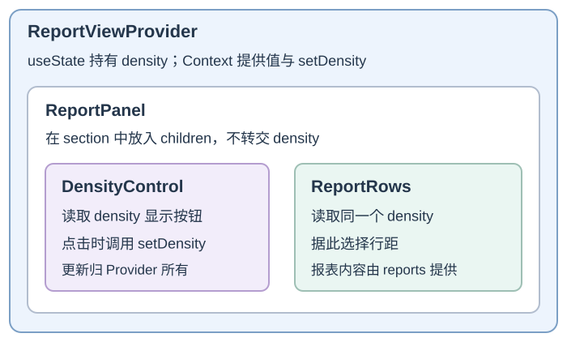

# 一份界面状态该由谁持有？

本章回答：报表页上的每一份状态（排序、报表行、勾选的行、编辑草稿、行距偏好）该放在哪里，由谁负责更新和恢复，以及 React 用哪些组合手段把它交给需要它的组件。读者已经知道一次更新怎样经过 render 和 commit，以及 `key` 怎样决定组件状态的身份；这里决定的是状态放在树的哪一层，或者干脆放到 React 之外。

**案例。** 沿用主线一的报表页 `/reports/42?sort=recent#summary`，以及上一章的排序控件 `sort` 和 May、April 两行。本章新增：管理员可以勾选多行（已选 ID 集合）、打开一行的编辑抽屉（一次编辑会话），以及一个行距偏好 `density`（`"comfortable"` 或 `"compact"`）。所有代码按 React 19.3 核对，数据为教学用合成示例。

## 所有权表：每份状态只有一个所有者

所有者是负责更新一份状态、并在刷新、Back、请求完成时决定它该是什么的那一方。同一份数据有两个所有者，就会有两份可能互相矛盾的副本，迟早有一份是错的。报表页上的状态按所有者分成六类：

| 所有者 | 管什么 | 报表页里的例子 | 刷新、Back、分享时 | 什么时候选它 |
| --- | --- | --- | --- | --- |
| URL 与路由 | 决定“看哪一页、按什么条件看”的可序列化参数 | `sort`、筛选 `status`、页码 `page`；片段 `#summary` 只供浏览器定位，不进请求 | 复制地址、刷新、前进后退都能恢复；值读出后要校验 | 用户期望能分享、收藏、刷新后仍在、用 Back 回到的状态 |
| 服务端 | 数据的权威表示与版本 | 报表 42 的详情和它的 ETag | 不受客户端操作影响；每次读写由服务端按当前身份授权 | 一切业务数据的最终真相 |
| 查询缓存 | 服务端数据在客户端的副本，按查询键区分 | 当前排序和页码对应的行；按 ID 读取的详情 | 内存缓存随页面消失；按新鲜度策略复用或重取 | 读服务端数据时；同一批数据只选一个缓存所有者 |
| 全局 store | 纯客户端、被多个相距较远的组件读写、需要统一可追踪更新的状态 | 已选报表 ID（行、批量工具栏、导出预览都要读写） | 默认只活在本次运行；Back 不会自动改它；刷新后是否恢复取决于是否另做持久化 | 状态提升到共同祖先会穿过太多层，或需要统一的更新日志和中间件 |
| 编辑会话 | 一次编辑尝试的基线、草稿和提交状态 | 抽屉打开时的详情基线、匹配的 ETag、当前草稿、校验和提交状态 | 关闭抽屉、切换记录或账户时整体作废；列表刷新不重置草稿 | 用户正在改一份服务端数据、提交前不能让外部变化覆盖输入 |
| 组件 | 只影响一个组件或一小块子树的展示状态 | 弹层是否打开、输入框的即时文本、行距偏好（放在 Provider 组件里） | 组件卸载即消失 | 只有它自己或它的子树用 |

判断时依次问：

1. **它是不是服务端数据？** 是，真相在服务端，客户端只用查询缓存保存副本。不要再把同一批行复制进 Redux 或 Context，否则两份副本各自更新，迟早不一致。
2. **用户是否期望刷新、分享或 Back 后它还在？** 是，放进 URL。
3. **它是不是一次编辑尝试的一部分？** 是，放进编辑会话。草稿和服务端已确认的数据是两份状态：表格后台刷新可以换掉列表行，但不能改写用户正在输入的字段。
4. **剩下的纯客户端状态有几个使用者？** 一个组件用就留在组件里；相邻几个组件共用就提升到最近的共同父组件；页面上多处相距较远的部分都要读写，或需要统一、可追踪的更新，再考虑全局 store。

这张表是本领域其他章节引用的权威版本。查询缓存怎样以查询键区分结果、乱序响应怎样按身份归属，见[服务端数据怎样缓存、刷新和乐观更新，迟到的响应又归谁？](./server-state-and-optimistic-updates.md)；编辑会话的完整协议见[编辑表单怎样在别人同时修改时安全保存？](./editing-sessions-and-conditional-writes.md)；URL 参数的设计、校验与默认值见[地址变了，浏览器什么时候加载新文档，界面状态何时该写进 URL？](../browser/navigation-history-and-url-state.md)；Redux store 的更新链见[Redux 怎样管理跨组件的客户端状态和异步请求？](./redux-state-and-async-workflows.md)；浏览器存储能持久化什么，见[浏览器能把状态存在哪里？](./browser-storage-and-cross-context-messaging.md)。

两个容易混淆的边界：

- **已选 ID 要记住它属于哪个范围。** 勾选的是稳定 ID，所以翻页和排序后仍指向同一份报表；但筛选或账户变了，旧 ID 就不再属于当前表格，要清空。这个范围检查不能只挂在筛选按钮上，浏览器 Back 也会改筛选。
- **客户端持有的任何状态都不授予权限。** 勾选、URL 和缓存里的 ID 只表示用户的意图，服务端每次读写仍按当前身份授权。

本章剩下的部分讲表中最后一行：状态留在 React 组件里时，怎样放在合适的层、怎样交给需要它的组件。

## 状态提升：放在共同使用者之上的最近一层

排序 `sort` 同时决定两块界面：工具栏要标出选中的按钮，列表要按它排序。两个组件都需要同一份值，就把 state 放到它们最近的共同父组件 `ReportsPage`，由它持有并向下传：

~~~mermaid
flowchart TD
    P["ReportsPage 持有 sort 派生有序 rows"] -->|"sort、onSortChange"| T["ReportToolbar 显示选中按钮"]
    P -->|"reports（有序 rows）"| L["ReportList 按顺序显示行"]
    T -->|"点击调用 onSortChange"| P
~~~

数据向下，意图向上。工具栏不直接改列表，它接收 `sort` 和 `onSortChange`（就是父组件的 `setSort`），点击“最早优先”时调用回调。父组件下一轮 render 从 `oldest` 派生出 April、May，commit 后工具栏和列表一起更新。`ReportList` 只显示收到的有序数组，用报表 ID 作 `key`。

状态提得比需要的更高，只会让更新路径和职责变宽，不会带来性能好处。两个组件没有共享的状态，就不要上移。

> [!example]- 完整示例：排序状态、工具栏与列表
>
> ~~~tsx
> import { useState } from "react";
>
> type SortOrder = "recent" | "oldest";
> type Report = { id: string; period: string; periodStart: string; title: string };
>
> function sortReports(reports: Report[], sort: SortOrder): Report[] {
>   return [...reports].sort((a, b) => {
>     const order = a.periodStart.localeCompare(b.periodStart);
>     return sort === "recent" ? -order : order;
>   });
> }
>
> export function ReportsPage({ reports, initialSort }: { reports: Report[]; initialSort: SortOrder }) {
>   const [sort, setSort] = useState(initialSort);
>   const rows = sortReports(reports, sort);
>   return (
>     <main>
>       <ReportToolbar sort={sort} onSortChange={setSort} />
>       <ReportList reports={rows} />
>     </main>
>   );
> }
>
> function ReportToolbar({ sort, onSortChange }: { sort: SortOrder; onSortChange: (sort: SortOrder) => void }) {
>   return (
>     

>       <button type="button" aria-pressed={sort === "recent"} onClick={() => onSortChange("recent")}>
>         最近优先
>       </button>
>       <button type="button" aria-pressed={sort === "oldest"} onClick={() => onSortChange("oldest")}>
>         最早优先
>       </button>
>     

>   );
> }
>
> function ReportList({ reports }: { reports: Report[] }) {
>   return (
>     <ol>
>       {reports.map(report => (
>         <li key={report.id}>{report.period} — {report.title}</li>
>       ))}
>     </ol>
>   );
> }
>
> const reports: Report[] = [
>   { id: "r-104", period: "May", periodStart: "2026-05-01", title: "May report" },
>   { id: "r-103", period: "April", periodStart: "2026-04-01", title: "April report" }
> ];
>
> export function ReportsDemo() {
>   return <ReportsPage reports={reports} initialSort="recent" />;
> }
> ~~~

## 初始值 prop 不会重置 state

`useState(initialSort)` 只在组件首次挂载时读取 `initialSort`。之后父组件把同一实例的 `initialSort` 从 `"recent"` 改成 `"oldest"`，按钮和列表仍停在“最近优先”、May 在前；只有调用 `setSort("oldest")` 才会排入更新。

完整的报表页里，排序的真正所有者是 URL：Back 之后路由拿到新的 `sort`，必须让界面跟上。有三种接法：

- **让 URL 直接持有，组件做受控组件。** 路由把已提交的 `sort` 作为普通 prop 传入，组件不再用 `useState` 复制一份。这是首选：只有一个所有者。
- **在收到新值时显式更新**组件自己的 state。
- **换 key 重新挂载**状态所有者，整个子树从新的初始值开始，见[React 怎样把一次用户操作变成界面更新？](./react-update-model.md#key%20决定状态属于谁)。

把同一个值既作 prop 又复制进 state，再用 Effect 同步两者，是最容易出错的做法：两份副本之间总有一轮 render 不一致。

## Context：远距离读取同一份值

`sort` 只跨一层父子关系，用 props 传很自然。行距偏好不同：读它的按钮和列表中间隔着布局组件，逐层转发 props 会让中间组件接收自己不用的值。这时用 Context (上下文)。

图中的框表示组件包含关系。几个要点：

- **Context 对象不保存状态。** 持有 `density` 的是 `ReportViewProvider` 里的 `useState`；Context 只负责把 Provider 给出的值送到子树里。
- **`useContext` 读最近的 Provider。** 子树里再嵌一个同类 Provider，它下面的消费者就改读内层值。消费者上方没有 Provider 时读到 `createContext` 的默认值；本例默认值是 `null`，`useReportView` 遇到 `null` 就抛错，提醒调用方补上 Provider。
- **中间组件只转交 `children`。** `ReportsView` 把按钮和列表作为 children 交给 `ReportPanel`，`ReportPanel` 只把它们放进 `<section>`，不知道 `density` 的存在。

走一遍：初始 `density="comfortable"`，按钮显示“切换紧凑行距”，列表 `lineHeight` 为 1.8。点击调用 `setDensity("compact")`，Provider 给出新值，两个消费者都更新：按钮变成“恢复舒适行距”，列表 `lineHeight` 为 1.2。

**更新语义。** React 用 `Object.is` 比较 Provider 的新旧 `value`。本例每次 Provider render 都新建 `{ density, setDensity }` 对象，引用总在变，所以只要 Provider 重新 render（哪怕是因为别的状态变了、`density` 没变），所有消费者都会更新；把消费者包进 `memo` 也挡不住 Context 值的变化。确认这造成了可见成本后，再用 `useMemo` 稳定 `value`，或把常变和不常变的值拆进不同的 Context。

**适用面。** Context 适合主题、地区、行距这类“很多远处组件要读、很少变”的值。它只是传递通道：报表行放进 Context 并不会获得缓存、请求身份、新鲜度或取消语义，服务端数据仍归查询缓存。TypeScript 里给 Context 值建立类型边界的旧例见[归档中的 TypeScript Context 与自定义 Hook 示例](../../archive/front-end/0-1_Learning_Notes/react_typescript/typed-hooks-and-context.md)。

> [!info] 版本差异：Provider 写法
> React 19 可以直接用 `<ReportViewContext value={…}>` 作 Provider；React 18 及更早要写 `<ReportViewContext.Provider value={…}>`。

> [!example]- 完整示例：Provider、children 与两个消费者
>
> ~~~jsx
> import { createContext, useContext, useState } from "react";
>
> const ReportViewContext = createContext(null);
>
> function ReportViewProvider({ children }) {
>   const [density, setDensity] = useState("comfortable");
>   return (
>     <ReportViewContext value={{ density, setDensity }}>
>       {children}
>     </ReportViewContext>
>   );
> }
>
> function ReportPanel({ children }) {
>   return <section>{children}</section>;
> }
>
> function useReportView() {
>   const value = useContext(ReportViewContext);
>   if (value === null) {
>     throw new Error("useReportView 必须在 ReportViewProvider 内调用");
>   }
>   return value;
> }
>
> function DensityControl() {
>   const { density, setDensity } = useReportView();
>   const next = density === "compact" ? "comfortable" : "compact";
>   return (
>     <button type="button" onClick={() => setDensity(next)}>
>       {density === "compact" ? "恢复舒适行距" : "切换紧凑行距"}
>     </button>
>   );
> }
>
> function ReportRows({ reports }) {
>   const { density } = useReportView();
>   return (
>     <ol style={{ lineHeight: density === "compact" ? 1.2 : 1.8 }}>
>       {reports.map(report => <li key={report.id}>{report.title}</li>)}
>     </ol>
>   );
> }
>
> export function ReportsView({ reports }) {
>   return (
>     <ReportViewProvider>
>       <ReportPanel>
>         <DensityControl />
>         <ReportRows reports={reports} />
>       </ReportPanel>
>     </ReportViewProvider>
>   );
> }
> ~~~

## 自定义 Hook 复用行为，不共享状态

Context 让多个组件读**同一份**值。另一类需求是多个组件重复**同一种行为**，结果各自持有，例如都要监听窗口尺寸。这时写自定义 Hook：

~~~jsx
import { useEffect, useState } from "react";

export function useWindowSize() {
  const [size, setSize] = useState({ width: 0, height: 0 });

  useEffect(() => {
    function update() {
      setSize({ width: window.innerWidth, height: window.innerHeight });
    }
    window.addEventListener("resize", update);
    update();
    return () => window.removeEventListener("resize", update);
  }, []);

  return size;
}
~~~

每次调用 `useWindowSize()` 都创建自己的 `size` state 和自己的 `resize` 监听器。两个组件都调用它，在 700×900 的窗口里，它们各自从占位值 0×0 更新到 700×900；窗口变成 720×900 后，各自的监听器再更新各自的 state。输出相同只是因为都读了同一个 `window`，不是共用一份 state。卸载时每次调用都移除自己的监听器。

首次 render 返回 0×0，是因为 Effect 要等首次 commit 后才运行。服务端不运行 Effect，所以服务端渲染和客户端首轮 hydration 都看到同一个占位值，不会产生不匹配。

如果确实想让很多组件订阅**同一个**外部数据源，就明确订阅它，而不是指望同一个自定义 Hook 自动共享。React 为此提供 `useSyncExternalStore`：传入订阅函数和读取快照的函数，React 保证所有订阅者在同一次 render 里读到一致的值。

~~~jsx
import { useSyncExternalStore } from "react";

function subscribe(onChange) {
  window.addEventListener("resize", onChange);
  return () => window.removeEventListener("resize", onChange);
}

export function useWindowWidth() {
  // 第三个参数给服务端渲染和 hydration 用。
  return useSyncExternalStore(subscribe, () => window.innerWidth, () => 0);
}
~~~

`getSnapshot` 在数据没变时必须返回同一个值（`Object.is` 相等）。这里返回数字没有问题；若每次都返回新建的 `{ width, height }` 对象，React 会认为快照一直在变而不断重新渲染。

## Hook 的调用规则

大多数 Hook 必须在组件或自定义 Hook 的顶层、以固定顺序调用：不能放进条件、循环或嵌套函数。React 按调用顺序把每个 Hook 和它保存的状态对应起来，顺序一变，状态就会错配。

两个较新的 API 有自己的规则：

- **`use`** 可以在条件和循环里调用，用来读 Promise 或 Context；但它仍必须在组件或 Hook 里调用，不能放进 `try/catch`。读 Promise 时的等待与复用要求见[昂贵更新时，怎样让输入保持即时？](./urgent-and-deferred-updates.md)。`useContext` 等普通 Hook 仍遵守固定顺序。
- **`useEffectEvent`** 是普通 Hook，在顶层创建；返回的 Effect Event 只能由同一组件或 Hook 里的 Effect（或另一个 Effect Event）调用，不能传给子组件或当点击回调。自定义 Hook 可以接收调用方传入的普通回调，用 `useEffectEvent(callback)` 包装后交给自己的 Effect 调用，这样回调变化不会让 Effect 重建。它解决什么问题见[React 怎样把一次用户操作变成界面更新？](./react-update-model.md#长期回调怎样读到最新值)。

> [!info] 版本：`use` 与 `useEffectEvent`
> `use` 自 React 19 提供；`useEffectEvent` 自 React 19.2 起为稳定 API。本章使用 React 19 要求的自动 JSX 转换。

## ref 与窄命令式接口

界面要随值变化时用 state。ref 持有不驱动界面的可变值，或者指向已提交的 DOM 节点。父组件偶尔需要让子组件做一个命令式动作（聚焦、滚动、播放），这时只暴露这个动作，不把内部节点整个交出去：

~~~tsx
import { useImperativeHandle, useRef, type Ref } from "react";

type SearchHandle = { focus(): void };

function ReportSearchInput({ ref }: { ref: Ref<SearchHandle> }) {
  const inputRef = useRef<HTMLInputElement>(null);
  useImperativeHandle(ref, () => ({
    focus() {
      inputRef.current?.focus();
    }
  }), []);
  return <input ref={inputRef} aria-label="搜索报表" />;
}

export function ReportFocusControl() {
  const searchRef = useRef<SearchHandle>(null);
  return (
    <>
      <ReportSearchInput ref={searchRef} />
      <button type="button" onClick={() => searchRef.current?.focus()}>聚焦搜索</button>
    </>
  );
}
~~~

输入节点始终由 `ReportSearchInput` 自己持有，父组件只能调用 `focus()`。调用者依赖的是子组件承诺的行为，子组件以后改内部结构也不影响它。

> [!info] 版本差异：把 ref 传给函数组件
> React 19 的函数组件可以把 `ref` 当普通 prop 接收；React 18 及更早要用 `forwardRef` 包装组件才能接收 ref。

## children、render prop 与 HOC

这三种都是“让调用方决定一部分内容”的组合方式：

- **children**：调用方提供内容，接收组件决定放在哪。前面的 `ReportPanel` 就是这样把按钮和列表放进 `<section>`。
- **render prop**（渲染属性）：组件接收一个返回 JSX 的函数，在需要时调用它。例如让 `ReportList` 接收 `renderRow`，调用方传 `renderRow={report => <strong>{report.title}</strong>}`，列表对每条报表调用一次，把结果放进对应行。
- **HOC**（higher-order component，高阶组件）：一个函数接收组件、返回包装后的新组件，常用来注入数据或行为。

复用带状态的逻辑，现在通常写自定义 Hook。但旧库里的 render prop 或 HOC 若接口稳定清楚，不必只为“改成 Hook”而重写。

## 条件渲染：`{n && <X/>}` 会渲染出 0

二选一用三元表达式，条件为真才渲染用逻辑与 `&&`，能提前返回时用 `if`。`&&` 有一个常见陷阱：

~~~tsx
{rows.length && <ReportList reports={rows} />}      // rows 为空时渲染出 "0"
{rows.length > 0 && <ReportList reports={rows} />}  // rows 为空时得到 false，什么也不渲染
~~~

`rows.length` 为 `0` 时，`0 && …` 的结果是数字 `0`，而 React 会把数字当文本渲染；`false`、`null`、`undefined` 才什么都不渲染。左侧写成明确的布尔表达式即可。

## 排序交给 URL 之后，路由要回答什么？

报表页的每份状态现在都有了唯一的所有者：排序和筛选归 URL，报表数据归服务端并由查询缓存保存副本，勾选的 ID 归 store，草稿归编辑会话，展示细节归组件。留在 React 里的状态，用提升、Context、自定义 Hook 和 ref 交给需要它的组件。所有权表的第一行把排序交给了 URL，接下来的问题是：路由怎样把一个新 URL 变成已提交的数据和界面，在数据到达前地址、屏幕和待定目标各是什么？这是[路由怎样把 URL 变成已提交的数据和界面？](./routing-and-loaders.md)的内容。若一次交互的 render 成本已经测出来，见[React 渲染慢时，先改什么？](../delivery/react-rendering-optimization.md)；本章不把 memoization 当作组合规则。

> [!info]- 来源
>
> - 所有权表中 URL、查询缓存、Redux store、组件本地状态的分工，已选 ID 不随 Back 改变、store 默认不持久化（“所有权表”）：整理自本仓库原 Redux 章节与管理表格章节的案例分析；Redux 何时使用：[Redux FAQ — General: When should I use Redux?](https://redux.js.org/faq/general#when-should-i-use-redux)；查询缓存保存服务端状态：[TanStack Query — Does this replace client state?](https://tanstack.com/query/latest/docs/framework/react/guides/does-this-replace-client-state)，核对 2026-11-12。
> - props 传递、children、状态提升到共同祖先（“状态提升”）：[Passing Props to a Component](https://react.dev/learn/passing-props-to-a-component)（含 Passing JSX as children）、[Sharing State Between Components](https://react.dev/learn/sharing-state-between-components)，React 19.3 文档。
> - `useState` 初始值只在首次 render 使用（“初始值 prop 不会重置 state”）：[useState — Parameters / Returns](https://react.dev/reference/react/useState#returns)；换 key 重置：[Preserving and Resetting State](https://react.dev/learn/preserving-and-resetting-state)，React 19.3 文档。
> - Context 的默认值、最近 Provider、`Object.is` 比较 value、React 19 Provider 新写法与旧 `.Provider`（“Context”）：[Passing Data Deeply with Context](https://react.dev/learn/passing-data-deeply-with-context)、[createContext](https://react.dev/reference/react/createContext)、[useContext](https://react.dev/reference/react/useContext)，React 19.3 文档。
> - 自定义 Hook 复用行为而非状态、Hook 调用规则（“自定义 Hook”“Hook 的调用规则”）：[Reusing Logic with Custom Hooks](https://react.dev/learn/reusing-logic-with-custom-hooks)、[Rules of Hooks](https://react.dev/reference/rules/rules-of-hooks)；订阅外部 store 与快照缓存要求：[useSyncExternalStore](https://react.dev/reference/react/useSyncExternalStore)，React 19.3 文档。
> - `use` 可在条件和循环中调用、不能在 `try/catch` 中：[use](https://react.dev/reference/react/use)；`useEffectEvent` 的定义与调用范围、在自定义 Hook 中使用：[useEffectEvent](https://react.dev/reference/react/useEffectEvent)（Caveats、Using Effect Events in custom Hooks）、[React 19.2](https://react.dev/blog/2025/10/01/react-19-2)；自动 JSX 转换要求：[React 19 Upgrade Guide — New JSX Transform is now required](https://react.dev/blog/2024/04/25/react-19-upgrade-guide#new-jsx-transform-is-now-required)。
> - ref 与命令式 handle，React 19 ref 作 prop、旧版 `forwardRef`（“ref 与窄命令式接口”）：[useRef](https://react.dev/reference/react/useRef)、[useImperativeHandle](https://react.dev/reference/react/useImperativeHandle)、[forwardRef](https://react.dev/reference/react/forwardRef)，React 19.3 文档。
> - render prop 与 HOC（“children、render prop 与 HOC”）：[Render Props](https://legacy.reactjs.org/docs/render-props.html)、[Higher-Order Components](https://legacy.reactjs.org/docs/higher-order-components.html)，React 旧版官方文档。
> - 逻辑与条件渲染与数字 0（“条件渲染”）：[Conditional Rendering — Logical AND operator](https://react.dev/learn/conditional-rendering#logical-and-operator)，React 19.3 文档。
> - 切换按钮的 `aria-pressed`：[WAI-ARIA APG — Button Pattern](https://www.w3.org/WAI/ARIA/apg/patterns/button/)，核对 2026-11-12。
> - 当前 React 文档版本：[Versions](https://react.dev/versions)，React 19.3，核对 2026-11-12。
