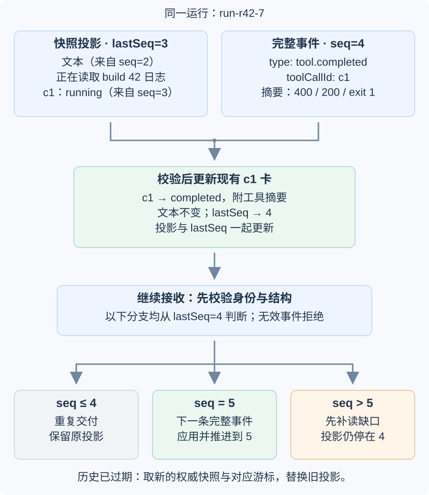
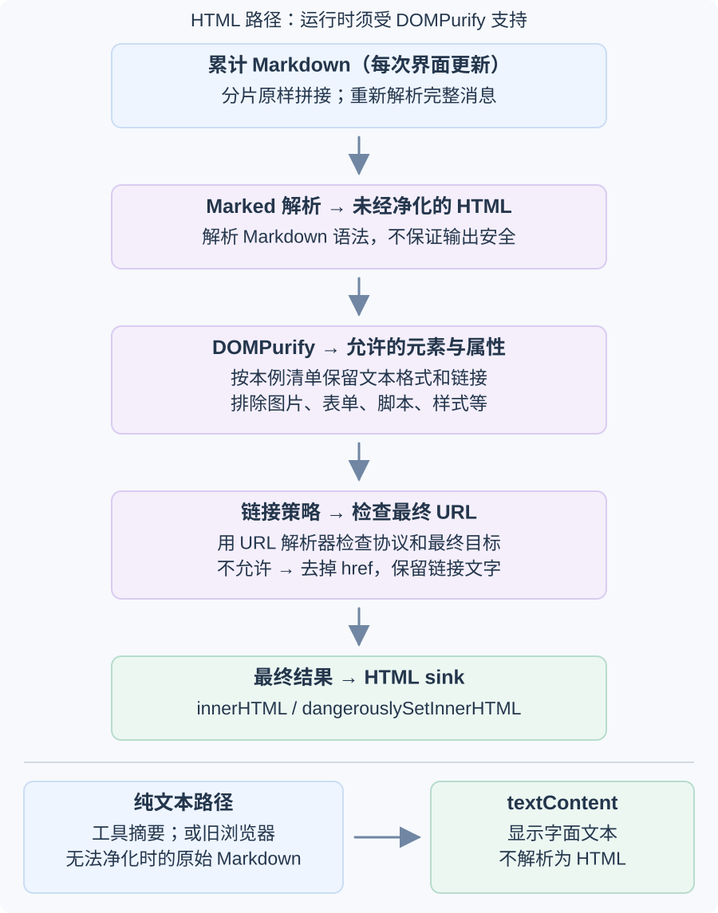
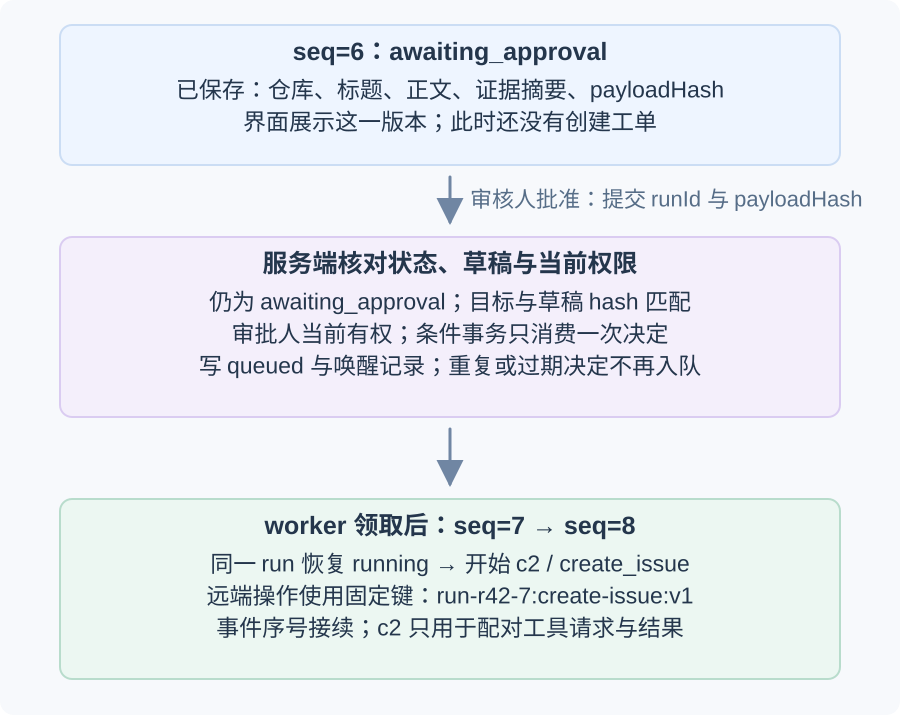
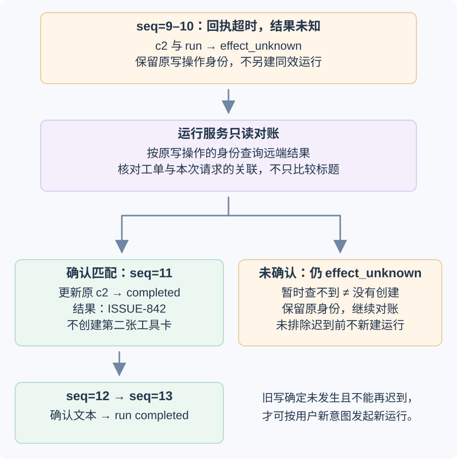

# AI 聊天界面怎样应用重放事件、安全渲染 Markdown，并处理停止与重试？

本章是[服务端持续推送时，界面怎样合并更新并从断线恢复](streaming-updates-and-resume.md)的支线：推送的不再是报表进度，而是一次持久 AI 运行的事件。读者已经知道快照与游标、按序号续读、连接状态与业务状态分开；本章回答三个前端独有的问题：重放的事件怎样更新已有的消息和工具卡而不重复；逐段到达的 Markdown 怎样安全地变成 HTML；用户点“停止”“继续”“重试”时，客户端该发什么请求、显示什么。运行在服务端怎样排队、审批、对账，属于 AI 工程领域的[运行恢复](../../ai-engineering/runs/run-identity-and-authoritative-state.md)主线；本章只在需要时说明它交给浏览器什么。

## 案例：先审核再建单的一轮聊天

开发者在聊天界面里输入：“解释 build 42 的失败并准备缺陷单；提交前让我审核。”运行服务鉴权后创建持久运行 `run-r42-7`。模型先调用只读工具 `read_build_log`（工具调用 ID `c1`），查到 `unit-tests` 中的测试 `reject_empty_name` 预期返回 HTTP `400`、实际返回 `200`，测试进程退出码为 `1`。运行据此生成解释和一份保存在服务端的缺陷单草稿，然后停在 `awaiting_approval`（等待审核）。审核人批准这份未改动的草稿后，同一运行才调用写工具 `create_issue`（`c2`）。建单请求超时，运行进入 `effect_unknown`（结果未知），经只读对账确认工单 `ISSUE-842` 已存在，最后完成。运行 ID、序号、工具调用 ID 和工单号都是教学用合成值。

客户端根据事件还原出的界面状态叫作 projection (投影)。下表是客户端依次收到的事件，后文都按序号引用：

| 序号与事件 | 客户端投影 | 此时不能误报什么 |
|---|---|---|
| `seq=1`：`run.status` → `running` | 本轮显示“正在检查” | 不能称为已完成 |
| `seq=2`：`assistant.delta` | 助手气泡出现“正在读取 build 42 日志” | 证据还没到，不能先写根因 |
| `seq=3`：`tool.started(c1)` | 建立“读取构建日志”卡片，状态为进行中 | 重放不能再建第二张卡 |
| `seq=4`：`tool.completed(c1)` | 同一张卡显示 `reject_empty_name` 预期 400、实际 200、退出码 1 | 工具摘要是数据，不是指令 |
| `seq=5`：`assistant.delta` | 同一气泡解释观测结果，说明正在准备草稿 | 草稿仍在生成 |
| `seq=6`：`run.status` → `awaiting_approval` | 显示已保存的仓库、标题、正文、证据摘要和审核入口 | 工单尚未创建 |
| `seq=7`：`run.status` → `running` | 审核人批准后，同一轮恢复 | `runId` 不变，序号接续 |
| `seq=8`：`tool.started(c2)` | 建立“创建缺陷单”卡片 | `c2` 不是远端去重键 |
| `seq=9–10`：`tool.effect_unknown(c2)`、`run.status` → `effect_unknown` | 卡片与运行都显示“提交结果待对账” | 超时不等于失败，也不等于未创建 |
| `seq=11`：`tool.completed(c2)` | 同一张 `c2` 卡显示经对账确认的 `ISSUE-842` | 不新建运行或第二张卡 |
| `seq=12–13`：`assistant.delta`、`run.status` → `completed` | 同一气泡告知工单已存在，本轮结束 | 只有运行服务确认后才显示完成 |

## 四类标识各管什么？

这些事件字段是本例应用自己约定的格式，不是 Server-Sent Events (服务器发送事件，SSE)、Fetch 或 Model Context Protocol (模型上下文协议，MCP) 自带的。四类标识各管一件事：

| 标识 | 本例取值 | 管什么 | 不能拿来做什么 |
|---|---|---|---|
| `runId` | `run-r42-7` | 一次持久运行；断线、审批、对账前后不变 | 不是凭证，不授权任何操作 |
| `seq` | 1 至 13 | 该运行中客户端可见事件的顺序，用于续读和去重 | 只在同一 `runId` 内有意义 |
| `toolCallId` | `c1`、`c2` | 把模型发出的工具请求与结果配对，也是工具卡的身份 | 不是远端写操作的去重键 |
| 幂等键 | `run-r42-7:create-issue:v1` | 让远端系统识别“同一次建单” | 由运行服务使用，客户端不拼装 |

SSE 连接 ID、MCP 底层 JSON-RPC (基于 JSON 的远程过程调用) 消息的请求 ID，与这四类标识用途不同，不能互相替代。若一个运行会产生多条助手消息，事件里还要有稳定的 `messageId`，见下文“[气泡和工具卡的 key](#气泡和工具卡的%20key)”。

## 怎样应用重放事件而不重复消息或工具卡？

投影规则建立在一个前提上：**同一个 `lastSeq` 总代表同一段已应用的事件前缀**。`lastSeq` 是投影已应用的最后一个序号。收到一条通过校验的事件后，只有三种结果：

- **`seq === lastSeq + 1`：** 正好是下一条，应用它并推进 `lastSeq`。
- **`seq <= lastSeq`：** 重放的旧事件，忽略，投影不变。
- **`seq > lastSeq + 1`：** 跳号。先向同一个 `runId` 补读缺失的事件；服务端已不保留这段历史时，取一份内容与游标一致的新快照。补齐前，已有文本和卡片保持不变。



### 三种恢复起点

**界面还在，续读。** 浏览器断线前已处理到 `seq=10`，`c2` 卡显示“提交结果待对账”。只要服务端还保留后续事件，重连时就用原运行 ID 请求 `events?after=10`：第 11 条把 `ISSUE-842` 填进原来的 `c2` 卡，第 12 条补上答复，第 13 条把本轮标为完成。服务端若重发 `seq=8` 到 `seq=11`，它们都落进“忽略”分支，`seq=12` 才继续追加。

**界面丢了或游标过期，取一致快照。** 换了新窗口，或服务端返回 `reset`、提示事件保留期已过时，取一份完整的界面快照：当前文本、工具卡、运行状态和对应的 `lastSeq`；仍在等待审批时，还要带上待审草稿的完整预览与版本摘要。内容和序号必须来自同一次一致读取，客户端才能整体替换旧投影，再从这个序号往后读。服务端也可以在同一响应里返回当前用户有权查看的运行记录，用来呈现审批、取消和建单结果。

一致性可以检查。上图的快照 `lastSeq=3` 应当包含 `seq=2` 写入的文本“正在读取 build 42 日志”，以及 `seq=3` 建立的、仍在进行中的 `c1` 卡；这样接下来的 `seq=4` 才能找到 `c1` 并更新它。若快照声称 `lastSeq=3` 却缺少 `c1` 卡，它与对应的事件前缀不一致，客户端应拒绝它，重新获取内容与游标匹配的快照。

**两者都没有，只显示已查证的状态。** 服务端保留整段历史时，可以从 `seq=1` 重建一个空白窗口。若本地没有可续读的界面，服务端又给不出完整快照或历史，就只能展示查到的运行状态；即使知道最新序号，也补不回中间的文本和工具卡。

### 逐字段校验事件

网络收到的 JSON 一律先当作类型未知的数据，逐项检查：是不是对象、身份和序号是否有效、事件类型是否认识、该类型必需的字段是否齐全。TypeScript 的类型声明不在运行时校验网络数据，见[TypeScript 保证什么，运行时还要校验什么](../javascript/typescript-guarantees-and-runtime-validation.md)。下面的代码只处理单条事件，拒绝未知事件类型，重复和跳号都原样返回旧投影；快照响应同样要按 schema (数据结构约束) 校验运行 ID、非负游标和完整内容，这里从略。生产环境的 schema 还应限制正文大小、工具名称和允许的状态转换。

> [!example]- 代码：校验事件并按运行游标投影
> ~~~javascript
> const RUN_STATUSES = new Set([
>   "running", "awaiting_approval", "effect_unknown", "completed",
>   "failed", "rejected", "cancel_requested", "canceled"
> ]);
> const TOOL_NAMES = new Set(["read_build_log", "create_issue"]);
>
> function isRecord(value) {
>   return value !== null && typeof value === "object" && !Array.isArray(value);
> }
>
> function validateRunEvent(raw) {
>   if (!isRecord(raw) || typeof raw.runId !== "string" ||
>       !Number.isSafeInteger(raw.seq) || raw.seq < 1) {
>     throw new Error("Invalid event identity");
>   }
>   switch (raw.type) {
>     case "assistant.delta":
>       if (typeof raw.text !== "string") throw new Error("Invalid text delta");
>       break;
>     case "tool.started":
>       if (typeof raw.toolCallId !== "string" || !raw.toolCallId ||
>           !TOOL_NAMES.has(raw.toolName)) throw new Error("Invalid tool start");
>       break;
>     case "tool.effect_unknown":
>       if (typeof raw.toolCallId !== "string" || !raw.toolCallId) {
>         throw new Error("Invalid unknown effect");
>       }
>       break;
>     case "tool.completed":
>       if (typeof raw.toolCallId !== "string" || !raw.toolCallId ||
>           typeof raw.summary !== "string") throw new Error("Invalid tool result");
>       break;
>     case "run.status":
>       if (!RUN_STATUSES.has(raw.status)) throw new Error("Invalid run status");
>       if (raw.status === "awaiting_approval" &&
>           (!isRecord(raw.approvalDraft) ||
>            typeof raw.approvalDraft.repositoryId !== "string" ||
>            typeof raw.approvalDraft.title !== "string" ||
>            typeof raw.approvalDraft.body !== "string" ||
>            typeof raw.approvalDraft.evidenceSummary !== "string" ||
>            typeof raw.approvalDraft.payloadHash !== "string")) {
>         throw new Error("Missing persisted approval draft");
>       }
>       break;
>     default:
>       throw new Error("Unknown event type");
>   }
>   return raw;
> }
>
> function applyRunEvent(view, raw) {
>   const event = validateRunEvent(raw);
>   if (event.runId !== view.runId) throw new Error("Wrong run");
>   if (event.seq <= view.lastSeq) return { kind: "ignore", view };
>   if (event.seq !== view.lastSeq + 1) return { kind: "catch-up", view };
>
>   const next = { ...view, lastSeq: event.seq, tools: new Map(view.tools) };
>   switch (event.type) {
>     case "assistant.delta":
>       next.assistantText += event.text;
>       break;
>     case "tool.started": {
>       const prior = next.tools.get(event.toolCallId);
>       if (prior && prior.name !== event.toolName) throw new Error("Tool ID reused");
>       if (!prior) next.tools.set(event.toolCallId, {
>         name: event.toolName, status: "running"
>       });
>       break;
>     }
>     case "tool.effect_unknown": {
>       const prior = next.tools.get(event.toolCallId);
>       if (!prior || prior.status === "completed") throw new Error("Unknown tool card");
>       next.tools.set(event.toolCallId, { ...prior, status: "effect_unknown" });
>       break;
>     }
>     case "tool.completed": {
>       const prior = next.tools.get(event.toolCallId);
>       if (!prior || prior.status === "completed") throw new Error("No pending tool card");
>       next.tools.set(event.toolCallId, {
>         ...prior, status: "completed", summary: event.summary
>       });
>       break;
>     }
>     case "run.status":
>       next.runStatus = event.status;
>       if (event.status === "awaiting_approval") {
>         next.approvalDraft = event.approvalDraft;
>       }
>       break;
>   }
>   return { kind: "applied", view: next };
> }
>
> const snapshotAt3 = {
>   runId: "run-r42-7",
>   lastSeq: 3,
>   assistantText: "正在读取 build 42 日志",
>   tools: new Map([["c1", { name: "read_build_log", status: "running" }]]),
>   runStatus: "running"
> };
> const seq4 = {
>   runId: "run-r42-7", seq: 4, type: "tool.completed", toolCallId: "c1",
>   summary: "reject_empty_name: expected HTTP 400, actual HTTP 200, exit 1"
> };
> const after4 = applyRunEvent(snapshotAt3, seq4);
> const duplicate4 = applyRunEvent(after4.view, seq4);
> const seq5 = {
>   runId: "run-r42-7", seq: 5, type: "assistant.delta",
>   text: "；reject_empty_name 预期 HTTP 400，实际返回 HTTP 200，导致 unit-tests 失败（退出码 1）。正在准备缺陷单草稿。"
> };
> const seq6 = {
>   runId: "run-r42-7", seq: 6, type: "run.status",
>   status: "awaiting_approval",
>   approvalDraft: {
>     repositoryId: "build-service",
>     title: "Build 42: reject_empty_name returned HTTP 200",
>     body: "The unit-tests check for reject_empty_name expected HTTP 400 but returned HTTP 200 (process exit 1).",
>     evidenceSummary: "Build 42 / unit-tests / reject_empty_name: expected HTTP 400; actual HTTP 200; exit 1.",
>     payloadHash: "synthetic-build-42-draft-v1"
>   }
> };
> const gap6 = applyRunEvent(after4.view, seq6);
> const after5 = applyRunEvent(gap6.view, seq5);
> const after6 = applyRunEvent(after5.view, seq6);
> const seq7 = { runId: "run-r42-7", seq: 7, type: "run.status", status: "running" };
> const after7 = applyRunEvent(after6.view, seq7);
> globalThis.projectionDemo = { snapshotAt3, after4, duplicate4, seq5, seq6, seq7, gap6, after5, after6, after7 };
> ~~~

代码末尾的演示从 `lastSeq=3` 的快照出发，依次走过各个分支（2026-11-26 在 Node 26.13.1 重跑，结果如下）：

- `after4`：`seq=4` 更新已有的 `c1` 卡，状态变为 `completed` 并附上摘要，`lastSeq` 变为 4。
- `duplicate4`：同一个 `seq=4` 再到一次，返回 `ignore`，不重复追加，`lastSeq` 仍是 4。
- `gap6`：在 `lastSeq=4` 时先收到 `seq=6`，返回 `catch-up`，投影不变。
- `after5`、`after6`：补上 `seq=5` 后文本追加、`lastSeq` 为 5；再应用同一条 `seq=6`，投影进入 `awaiting_approval` 并保存草稿。
- `after7`：`seq=7` 让运行回到 `running`。草稿作为历史仍在投影里，界面按 `runStatus` 隐藏审批入口。

### 气泡和工具卡的 key

投影里的每个元素要有稳定的身份，React 才能在重放和更新时复用同一个组件，而不是销毁重建或把状态挂到错的元素上；key 怎样决定组件身份，见[React 怎样把一次用户操作变成界面更新](react-update-model.md)。本例的取法：

- 每个运行只有一个助手气泡时，气泡 key 用 `runId`；一个运行可能产生多条消息时，事件和快照里要有稳定的 `messageId`，key 改为 `(runId, messageId)`。
- 工具卡的 key 始终用 `(runId, toolCallId)`。不要用数组下标或随机值：下标会在插入时错位，随机值会让每次渲染都重建卡片。

## 不完整的 Markdown 怎样安全显示？

事件能按序应用之后，下一个问题是怎样显示累积起来的文本。一条回答分散在多个 `assistant.delta` 里，危险内容可能恰好被切开。下面三个分片之间不插入任何字符：第二段以 `java` 结尾，第三段以 `script:` 开头，单看哪一段都不像危险链接，拼起来链接目标却是 `javascript:alert(1)`。

~~~javascript
const chunks = [
  "日志显示为：\n\n```text\n<not executed>\n",
  "```\n\n[打开链接](java",
  "script:alert(1))"
];
let accumulated = "";
const frames = [];
for (const chunk of chunks) {
  accumulated += chunk;
  frames.push(accumulated);
}
~~~

所以规则是：**每次更新界面，都把同一条消息到目前为止的完整 Markdown 重新解析，并在交给 HTML sink 之前净化**，而不是逐片转换后拼接 HTML。HTML sink 指把字符串当作 HTML 写进页面的接口，例如 `innerHTML`。第二帧里的 `[打开链接](java` 还不是完整链接，解析器把它当作普通文字；到第三帧才成为链接，这时整条消息重新走一遍净化。



每一帧都走同一条路径：

1. **拼出完整消息。**
2. **Markdown 解析器把它转成 HTML。** 解析器只管语法，输出未经净化。
3. **HTML 净化器按允许列表保留元素和属性。** 本例允许段落、标题、强调、列表、引用、代码块和普通链接；不允许图片、表单控件、样式、脚本和新窗口属性。
4. **链接策略检查每个链接最终解析到的 URL。** 不允许的只去掉 `href`，保留链接文字。
5. **结果交给 HTML sink。**

另一条是纯文本路径：工具摘要，以及净化器无法工作时的原始 Markdown，都用 `textContent` 显示字面文本，不解析为 HTML。如果产品不需要富文本，直接把助手内容也作为纯文本显示最简单。

### 链接策略：按最终 URL 判断，而不是看字符串前缀

链接在净化后的 DOM 里读取，再用浏览器的 `URL` 解析器算出最终目标，按写法分别检查：

- 包含用户名或密码的 URL 一律拒绝；
- `/docs/guide` 这样的站内根路径，必须解析回当前 origin；
- `//other.example/path`（协议相对地址）不在允许的写法内；
- 片段 `#...` 只能指向当前文档；
- 绝对链接只允许 HTTP(S)。

这比用字符串前缀判断“看起来像站内路径”可靠。不允许的 URL 只移除 `<a>` 的 `href`：上面拼出的“打开链接”仍然可读，但不能点击。这套允许范围是本例组件的选择，不代表所有产品都该开放相同的标签或协议。

### 实例：Marked 18.2.0 与 DOMPurify 3.4.17

> [!example]- 代码：最小显示策略
> ~~~javascript
> const chatPolicy = {
>   ALLOWED_TAGS: [
>     "a", "p", "br", "em", "strong", "del", "code", "pre",
>     "blockquote", "ul", "ol", "li", "h1", "h2", "h3", "h4",
>     "h5", "h6", "hr"
>   ],
>   ALLOWED_ATTR: ["href"],
>   ALLOW_DATA_ATTR: false,
>   ALLOW_ARIA_ATTR: false
> };
>
> function allowedHref(raw) {
>   if (typeof raw !== "string" || raw.trim() !== raw || raw === "") return null;
>   try {
>     const resolved = new URL(raw, window.location.href);
>     if (resolved.username || resolved.password) return null;
>     if (raw.startsWith("/") && !raw.startsWith("//") &&
>         resolved.origin === window.location.origin) return resolved.href;
>     if (raw.startsWith("#") && resolved.origin === window.location.origin &&
>         resolved.pathname === window.location.pathname &&
>         resolved.search === window.location.search) return resolved.href;
>     if (/^https?:\/\//i.test(raw) &&
>         (resolved.protocol === "http:" || resolved.protocol === "https:")) return resolved.href;
>   } catch {
>     return null;
>   }
>   return null;
> }
>
> function safeMarkdown(source) {
>   const generated = marked.parse(source, { async: false });
>   if (typeof generated !== "string") throw new Error("Expected synchronous HTML");
>   const sanitized = DOMPurify.sanitize(generated, chatPolicy);
>   const template = document.createElement("template");
>   template.innerHTML = sanitized;
>   template.content.querySelectorAll("a[href]").forEach((link) => {
>     const href = allowedHref(link.getAttribute("href"));
>     if (href) link.setAttribute("href", href);
>     else link.removeAttribute("href");
>   });
>   return template.innerHTML;
> }
> window.safeMarkdown = safeMarkdown;
> ~~~

两个库的分工：Marked 只解析 Markdown，README 明确警告它不净化输出；DOMPurify 负责净化，并允许用 `ALLOWED_TAGS`、`ALLOWED_ATTR` 替换默认的允许列表。本例列出的范围比 DOMPurify 自带的宽泛 HTML 配置更窄。

有三个使用条件会改变结论：

- **先确认运行环境受支持。** 按 DOMPurify 3.4.17 的 README，在它不支持的旧浏览器上，库不做净化，原样返回输入。所以组件先检查 `DOMPurify.isSupported`：为真才调用 `safeMarkdown` 走 HTML 路径；为假就用 `textContent` 或 React 的普通文本子节点显示原始 Markdown。不能先调用净化函数，再把原样返回的字符串当成安全 HTML。
- **React 的 `dangerouslySetInnerHTML` 就是 HTML sink。** 它把字符串直接交给 DOM 的 `innerHTML`，只能接收上面净化后的结果。
- **净化之后再改 DOM，就要再净化一次。** 若结果还要交给语法高亮器、插件或其他会改写 DOM 的库，最终输出必须按同一策略再净化。

> [!info] 复核结果（2026-11-26）
> 用 Node 26.13.1、jsdom 31.0.1、Marked 18.2.0、DOMPurify 3.4.17 重跑上面的三帧输入：第三帧 Marked 的原始输出是 `<a href="javascript:alert(1)">打开链接</a>`，经 `safeMarkdown` 后变成没有 `href` 的 `<a>打开链接</a>`；代码块内的 `<not executed>` 保持为转义文本，`class="language-text"` 因不在允许属性内被去掉。在这个环境里，`javascript:` 地址已被 DOMPurify 的默认 URI 检查移除，链接策略是第二层，额外挡住了 `//other.example/path` 和带用户名密码的地址；`/docs/guide` 和 `#sec` 被解析为当前 origin 下的绝对地址。Markdown 图片 `` 和原始 HTML `` 都没有进入输出。原稿另在 Chromium 131.0.6778.33 中拦截渲染请求，确认这些图片元素不会发出远程请求。以上只覆盖这组输入和版本，不是跨浏览器保证。

## 工具结果和卡片状态为什么不能照单全收？

工具返回的内容与模型输出一样不可信。`c1` 的只读摘要经过校验后，`step`、`failed_test`、`expected`、`actual`、`exit_status` 等字段都写成文本节点，例如 `summary.textContent = tool.summary`，不走 HTML 路径。工具摘要里即使出现“忽略之前的指令”或一段 HTML，它在界面上也只是字面文字；这类内容对模型的影响由应用的权限关卡处理，见[为什么提示注入防不住“模型听话”，应用该在哪里拦](../../ai-engineering/actions/prompt-injection-as-permission-confusion.md)。

卡片显示什么状态，只看运行事件（`tool.started`、`tool.effect_unknown`、`tool.completed`），而不看工具返回正文里的 HTML 或 “success” 字样。渲染本身不执行任何工具请求；校验并执行工具调用是运行服务的责任，见[模型“调用工具”时实际发生了什么，工具契约该怎样设计](../../ai-engineering/actions/tool-calls-are-requests.md)。同样，界面上的成功图标不等于服务端已确认操作：`c2` 只有在收到经对账的 `seq=11` 后才显示 `ISSUE-842`。

## 停止、继续和重试分别改变什么？

前面处理的是显示；用户还会对运行本身做操作。客户端要把三层状态分开展示：

- **连接状态：** 事件通道是否打开。传输层重连只恢复事件投递。
- **运行状态：** `running`、`awaiting_approval`、`effect_unknown`、`completed` 等，只来自运行服务。
- **审批与副作用状态：** 草稿是否获批、建单是否确认。

`EventSource` 连着，不代表后台运行还在进行；连接断了，也不代表运行停了。每个操作都要向运行服务发经过鉴权的请求，再按服务端状态更新界面。服务端那一侧怎样处理断线、取消和外部写入，AI 工程领域用一个退款案例讲同一套状态机：[用户断线、取消或要回答一个问题时，同一次运行怎样继续](../../ai-engineering/runs/disconnect-cancel-and-user-input.md)，以及[退款请求超时后，怎样查清结果而不重复扣款](../../ai-engineering/runs/external-writes-and-reconciliation.md)。

### 继续：批准一个确切的草稿版本

`seq=6` 带来服务端已保存的完整待审草稿：目标仓库、标题、正文、证据摘要和 `payloadHash`。`payloadHash` 标识这一版草稿；运行服务在账本里为目标和全部获批字段记一份摘要（退款案例里叫 `plan_digest`），它与识别原始用户请求的 `request_digest` 不同。代码里的 `"synthetic-build-42-draft-v1"` 只是教学占位，不是真的摘要。审核预览必须展示将要提交的全部目标和参数，因为摘要还原不了正文，也证明不了审核人看过什么。



客户端这一侧的流程：

1. **提交 `runId` 和 `payloadHash`，不在点击时重新拼装写入内容。** `payloadHash` 只标识版本，不是身份或授权凭据。
2. **界面上的审批入口只是显示。** 客户端按投影状态、草稿版本和已知权限决定是否显示按钮，但这些字段不授予批准权。服务端受理时按权威记录核对：运行仍在 `awaiting_approval`，哈希与当前草稿一致，审批人此刻仍有权限；并用条件事务保证一个决定只被消费一次，重复、过期或针对旧版本的决定都不会再次入队。
3. **`seq=7` 要等后台真正接手。** 批准事务写入决定、`queued` 状态和唤醒记录；worker 领取运行后，客户端才收到 `seq=7` 的 `running`。事件表只列客户端可见的进度，省略了排队和领取，见[请求受理后，怎样保证任务最终被执行且不被两个 worker 同时推进](../../ai-engineering/runs/accepting-queuing-and-claiming-runs.md)。
4. **恢复的仍是 `run-r42-7`，序号接续。** 真正发出建单请求前，运行服务还会再核对一次版本、租约、写权限和取消状态，并用稳定键 `run-r42-7:create-issue:v1` 调用远端。批准过一次，不代表以后任何时候都能直接发送。

`seq=7` 之后草稿仍作为历史留在投影里。草稿若被改动，就是一个新版本，必须重新审核。

### 重试：结果未知时先对账，不重发

建单请求超时，远端可能已经建好了工单，只是回执没回来。这时保留原来的 `c2` 卡和运行的 `effect_unknown` 状态，等运行服务按原操作身份只读对账：查到 `ISSUE-842` 后，用 `seq=11` 更新原卡片，再由 `seq=12–13` 显示最终结果。



暂时查不到记录，不能证明旧请求以后不会到达。结果仍未知时，界面不提供“再提交一次”，也不另建一个做同样事情的运行。只有远端接口的约定能确认旧写入没有发生、已发出的请求也不可能迟到，并且用户仍想再试时，才为新尝试创建新的 `runId`；旧运行和旧卡片留作审计。

### 停止：取消请求，不是关闭连接

`AbortController.abort()` 按 Fetch 的 abort 算法结束这次 fetch 调用或响应体读取；关闭 `EventSource` 或 Fetch 的 reader，结束的也只是当前的事件通道。这些客户端操作不会替应用写入持久的取消状态，也证明不了服务端任务已停止或副作用已回滚，见[取消、超时和并发上限各自停得住什么](../javascript/cancellation-timeouts-and-concurrency.md)。

所以“停止”按钮调用运行服务的取消操作，再查询权威状态。发出取消请求后仍可能收到事件，界面保留已应用的内容，继续按服务端状态更新。取消确认前显示“正在取消”。如果用户点停止时，运行已经为建单登记了发送意图，服务端会进入 `cancel_requested` 并继续对账；在外部结果确认之前，界面不能显示“取消成功”。

| 用户操作 | 客户端做什么 | 运行身份与显示 |
|---|---|---|
| 重连 | 用最后已应用的 `seq` 续读；重放忽略，缺口补齐或重取一致快照 | 仍是 `run-r42-7`；保留已有文本和卡片 |
| 停止 | 调用运行服务的取消操作，查询权威状态 | 仍是 `run-r42-7`；确认前显示“正在取消”；已有发送意图时等对账结果 |
| 继续 | 批准未变化的持久草稿版本，恢复暂停的运行 | `runId` 与序号延续；草稿变了必须重新审核 |
| 重试 | 仅在旧操作确定未发生且不能迟到后，按用户意图创建新运行 | 新请求用新 `runId`；旧运行和旧卡片留作审计 |

没有审批和外部写入的普通问答，同样适用本章的快照、序号、key 和 Markdown 规则，只是用不到后两种操作。

## 本章产出

聊天界面现在有了一套完整的投影规则：按 `(runId, seq)` 应用事件，重放忽略、缺口补齐、过期时整体换成一致快照；按 `(runId, toolCallId)` 和 `(runId, messageId)` 给元素稳定身份；每次都对完整 Markdown 重新解析、净化并检查链接，工具结果只当文本；停止、继续、重试各自发给运行服务一个明确请求，并等服务端状态确认后才改变显示。服务端怎样保证这些事件和状态本身可信，回到 AI 工程领域的[一次 AI 运行断线或崩溃后，凭什么恢复](../../ai-engineering/runs/run-identity-and-authoritative-state.md)。

> [!info]- 来源
> - 快照与事件游标的一致性、续读与重连规则（“怎样应用重放事件而不重复消息或工具卡？”）：沿用[服务端持续推送时，界面怎样合并更新并从断线恢复](streaming-updates-and-resume.md)的应用层约定；本章换用独立的 AI 运行 ID 与事件序号。
> - MCP 请求 ID 与应用事件序号的区别（“四类标识各管什么？”）：[MCP 2026-07-28 规范](https://modelcontextprotocol.io/specification/2026-07-28) 的 Overview/Base Protocol 说明 MCP 使用 JSON-RPC 2.0；[JSON-RPC 2.0 §4 Request Object](https://www.jsonrpc.org/specification#request_object) 说明请求与响应 ID 用于关联二者。它们不定义应用层的运行序号。
> - 权威运行记录、审批消费、发送意图、`effect_unknown` 对账与取消的状态转移（“停止、继续和重试分别改变什么？”）：[用户断线、取消或要回答一个问题时，同一次运行怎样继续](../../ai-engineering/runs/disconnect-cancel-and-user-input.md)、[退款请求超时后，怎样查清结果而不重复扣款](../../ai-engineering/runs/external-writes-and-reconciliation.md)、[一次 AI 运行断线或崩溃后，凭什么恢复](../../ai-engineering/runs/run-identity-and-authoritative-state.md)（`plan_digest` 与 `request_digest` 的区分见其标识符表）。本章的 `run-r42-7`、`c1/c2`、`run-r42-7:create-issue:v1`、`ISSUE-842` 与原 AI 应用架构章的建单案例一致。
> - Marked 输出未净化（“实例：Marked 18.2.0 与 DOMPurify 3.4.17”）：[Marked 18.2.0 npm README](https://www.npmjs.com/package/marked/v/18.2.0) 的 “Warning” 与 Browser/Node 使用段，2026-11-12 核对。
> - DOMPurify 的 `sanitize`、可配置 `ALLOWED_TAGS`/`ALLOWED_ATTR`、旧浏览器不支持时原样返回（同上节）：[DOMPurify 3.4.17 README](https://github.com/cure53/DOMPurify/blob/3.4.17/README.md) 的 Basic Usage、HTML profile、configuration 与 legacy browser 各段；[3.4.17 release](https://github.com/cure53/DOMPurify/releases/tag/3.4.17)，2026-11-12 核对。
> - `dangerouslySetInnerHTML` 把字符串交给 `innerHTML`，不可信数据进入 raw HTML sink 有 XSS 风险（同上节）：[React DOM 常见组件文档，Dangerously setting the inner HTML](https://react.dev/reference/react-dom/components/common#dangerously-setting-the-inner-html)，2026-11-12 核对。
> - 工具摘要用 `textContent` 显示字面文本（“工具结果和卡片状态为什么不能照单全收？”）：[WHATWG DOM Standard，`textContent`](https://dom.spec.whatwg.org/#dom-node-textcontent)；校验与赋值逻辑是本章示例。
> - 传输取消与运行取消的区别（“停止：取消请求，不是关闭连接”）：[WHATWG DOM Standard §3 Aborting ongoing activities](https://dom.spec.whatwg.org/#aborting-ongoing-activities) 说明 signal 的取消语义由接受它的 API 定义；[Fetch Standard，abort fetch call](https://fetch.spec.whatwg.org/#abort-fetch) 处理 fetch 调用和请求/响应体。2026-11-12 核对。
> - 实测：原稿用 Node.js 26.13.0、Marked 18.2.0、DOMPurify 3.4.17 与 Chromium 131.0.6778.33 运行了完整投影序列、重复/缺口分支和浏览器渲染请求拦截；2026-11-26 用 Node 26.13.1（投影演示）与 jsdom 31.0.1 + Marked 18.2.0 + DOMPurify 3.4.17（三帧 Markdown 与链接样例）复核。测试使用模拟事件，不代表生产服务或跨浏览器保证。
