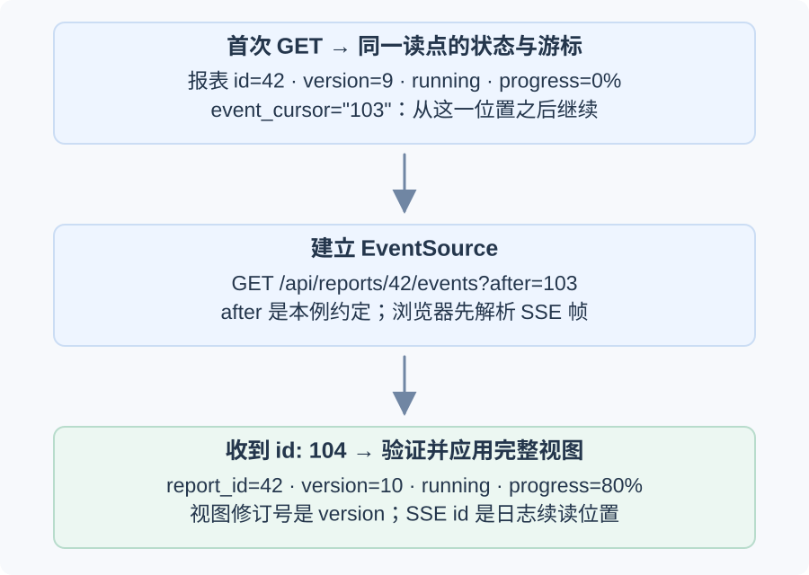
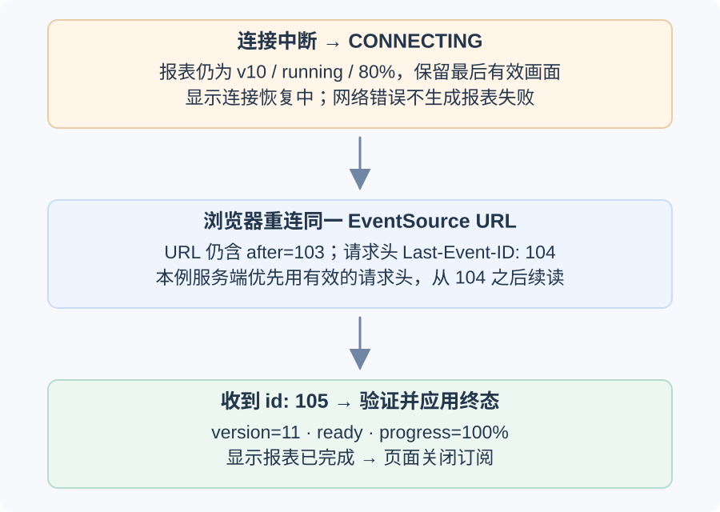
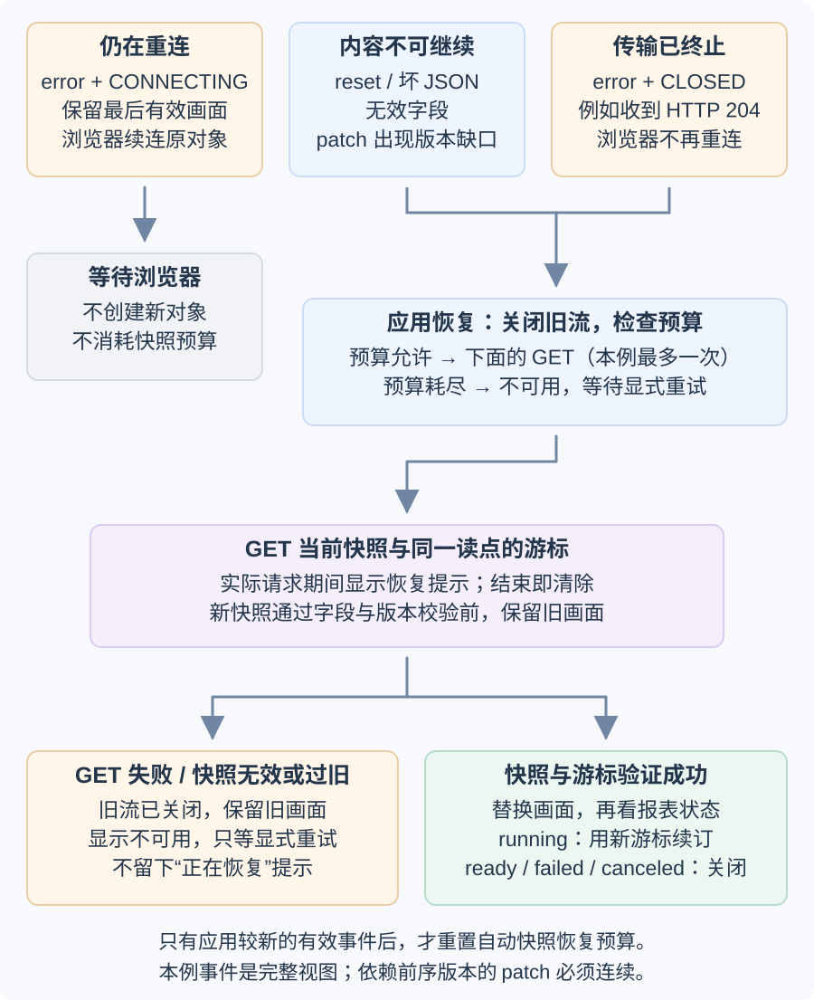
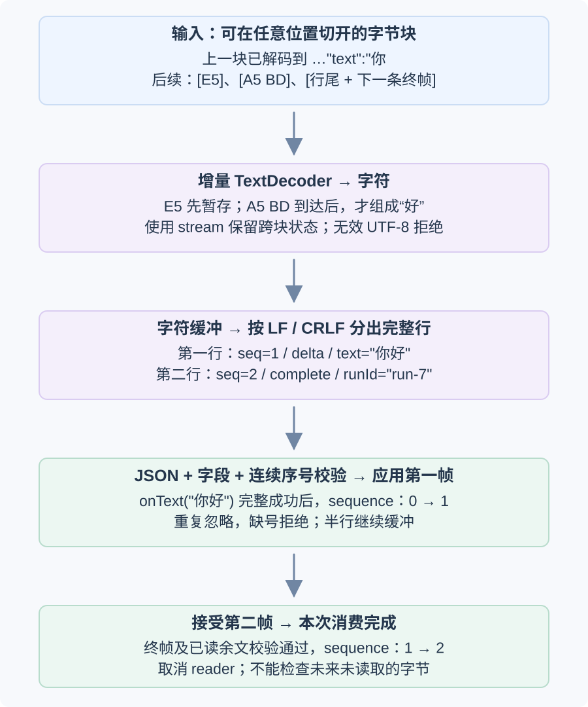

# 服务端持续推送时，界面怎样合并更新并从断线恢复？

本章回答：服务端不断推送更新时，页面怎样把每条更新合并进已有画面，连接断开后又怎样从正确的位置接着读，既不漏也不重。读者手上已有[上一章](browser-storage-and-cross-context-messaging.md)的规则：任何通知都要向权威核实、只单调推进。这里的权威是“快照 + 游标”：快照给出某一时刻的完整状态，游标指出从事件日志的哪里接着读。传输方式怎样选、SSE 线格式的完整定义，见[何时选择轮询、SSE、流式 Fetch 或 WebSocket](../../engineering-foundations/services/real-time-channels-and-resume.md)；本章只讲页面侧的责任。

**案例。** 沿用主线一的报表页和上一章的报表 42 快照，所有 ID 和响应都是教学用合成数据。页面先取得快照 `id=42, version=9, status=running, progress=0, event_cursor="103"`，然后用 Server-Sent Events (服务器发送事件，SSE) 订阅进度。连接在收到事件 104 之后中断，浏览器自动重连，服务端接着发送事件 105，报表变为 `ready`。页面要做到三件事：断线期间保留最后一份有效状态；正确合并后续更新；把“连接是否正常”和“报表运行到哪一步”分开显示。本章最后换用一个独立的 NDJSON 作业例子，讲页面自己读字节流时多出来的责任。

## 三种编号各回答什么问题？

案例里有三种容易混淆的编号，它们回答不同的问题，不能互相比较：

| 编号 | 本例取值 | 回答的问题 | 由谁推进 |
|---|---|---|---|
| 资源 ID | 快照的 `id=42`、事件里的 `report_id=42` | 这是哪张报表？ | 不变 |
| 版本 | `version=9`，之后 10、11 | 页面手上是报表的哪一版？只增不减 | 服务端每次改报表时 |
| 游标 | 快照的 `event_cursor="103"`，SSE 帧的 `id: 104`、`id: 105` | 从事件日志的哪里接着读？ | 服务端每追加一条事件时 |

版本描述状态修订，游标描述日志位置。两者各自递增，本例里数字恰好接近，并没有换算关系。上一章 B 广播的“版本 11”属于版本这一列，不能拿来当续读位置。事件号 104 也与主线一报表行 `r-104` 无关。

## 快照和游标必须来自同一个一致性点

页面先读快照，再从快照里的游标之后订阅事件。这一步成立的前提是：**服务端在同一个一致性点读出快照和游标**，也就是说，快照恰好包含了日志里直到 103 为止的所有事件。如果服务端分两次读取（先读报表状态，再读日志最新位置），两次之间写入的事件既不在快照里，也不在游标之后，就会被漏掉。这是应用 API 的约定，浏览器不提供任何保证。

```http
GET /api/reports/42 HTTP/1.1

HTTP/1.1 200 OK
Cache-Control: no-store
Content-Type: application/json

{"id":42,"version":9,"status":"running","progress":0,"event_cursor":"103"}
```

页面请求快照时用 `fetch(url, { cache: "no-store" })`，服务端也以 `Cache-Control: no-store` 返回，避免 HTTP 缓存交回一份带陈旧游标的旧快照。游标本身不是凭证：服务端每次 GET 和订阅都要认证、授权，并规定游标保留多久。

## 连接状态和报表状态分开显示

页面同时维护两种状态，来源不同：

- **报表状态**只来自服务端快照或已校验的事件：`running`、`ready`、`failed`、`canceled`。
- **连接状态**来自 `EventSource.readyState` 和页面自己的恢复动作。`readyState` 有三个值：`CONNECTING`（尚未连上或正在重连）、`OPEN`（连接已开）、`CLOSED`（不再连接，可能是页面调用了 `close()`，也可能是致命错误）。

网络断开时，页面还有最后一份有效快照，可以标出“可能过时”，但不能把报表改成 `failed`。两种状态组合起来，页面这样显示：

| 报表状态 | 连接状态 | 页面显示 |
|---|---|---|
| `running` | `OPEN` | “已连接”和最近已校验的进度；`OPEN` 不说明回放已经追平 |
| `running` | `CONNECTING` | 首次显示“正在连接”；断线后显示“正在重连，已有进度可能过时” |
| `ready` | `OPEN`，或页面主动关闭后的 `CLOSED` | 服务端终态；本例随后关闭订阅 |
| `failed` 或 `canceled` | 任意 | 服务端终态；网络错误永远不会生成这两个结果 |
| `running` | 意外 `CLOSED` | 浏览器不再自动重连；应用按有限策略重取快照，或提示恢复失败 |
| `running` | 旧连接已关闭、快照 GET 进行中 | 保留最后有效进度，连接显示关闭，另显示“正在恢复快照” |

`EventSource` 的 `error` 事件不能一概当成失败。事件触发后看 `readyState`：回到 `CONNECTING` 表示浏览器还会重连；变成 `CLOSED` 表示它已停止重试。`error` 事件也不把 HTTP 状态码和响应正文交给页面。服务端可以用 HTTP `204 No Content` 让 `EventSource` 停止重连，但浏览器只是不再重连，不会替页面重取快照；恢复快照是应用的事。

## 一次完整的续读：从游标 103 到事件 105

先看首次订阅。原生 `EventSource` 首次连接时不能设置任意请求头或请求正文，所以本例的服务端 API 约定用查询参数 `after` 传入快照游标：

```http
GET /api/reports/42/events?after=103 HTTP/1.1
Accept: text/event-stream

HTTP/1.1 200 OK
Content-Type: text/event-stream

id: 104
event: report.updated
data: {"report_id":42,"version":10,"status":"running","progress":80}

```

服务端从 103 之后回放历史，再接到同一条日志的实时尾部。页面收到 `id: 104` 的事件，校验后把画面更新到版本 10、进度 80：



然后连接在 104 之后中断。页面保留已收到的 v10，连接状态变为 `CONNECTING`。浏览器重连**同一个** URL，并自动附上它解析到的最后一个 SSE `id`：

```http
GET /api/reports/42/events?after=103 HTTP/1.1
Accept: text/event-stream
Last-Event-ID: 104

HTTP/1.1 200 OK
Content-Type: text/event-stream

id: 105
event: report.updated
data: {"report_id":42,"version":11,"status":"ready","progress":100}

```

URL 里仍是 `after=103`，请求头却是 `Last-Event-ID: 104`。本例服务端约定：请求头有效时优先用它，没有请求头才用 `after`。于是服务端从 104 之后续读，发出 105。事件 105 把画面整体更新为 v11、`ready`，页面显示完成并关闭订阅：



`event_cursor` 只来自首次快照或恢复快照；之后读到哪一条，由 `EventSource` 自己记录，页面不必每收到一帧就改写订阅 URL。分工上，浏览器负责解析 `text/event-stream` 帧；页面仍要 `JSON.parse` 事件数据，检查报表 ID、字段类型和版本，再更新界面。为什么网络数据要逐字段检查，见[TypeScript 保证什么，运行时还要校验什么](../javascript/typescript-guarantees-and-runtime-validation.md)。

### Last-Event-ID 只是解析位置，不是确认

按标准，浏览器先更新 `EventSource` 的 last-event-ID，再排队派发 JavaScript 事件。所以这个值只说明“浏览器解析到了哪里”，不是 acknowledgment (确认，ACK)：它不证明应用已经渲染、写入本地存储或完成了某个副作用。服务端可以用 `retry:` 字段给出重连等待的毫秒数，但网络和浏览器实现仍会影响实际恢复时间，页面不应假定固定间隔。

本例只需要最新的报表视图，所以够用：即使某条事件解析了却没来得及渲染，下一条完整视图或一次快照恢复都能把画面校正过来。如果每条事件都代表必须完成的副作用，`Last-Event-ID` 可能比应用真正完成的位置更靠后；这时要持久记录连续的应用层 ACK、按事件 ID 幂等处理，并处理 ACK 与副作用之间的崩溃窗口，见[断线后，客户端要重建状态还是补齐每条事件](../../engineering-foundations/services/real-time-channels-and-resume.md)。

## 合并更新：完整视图按版本覆盖，patch 必须连续

页面按 `version` 合并报表视图，不按 SSE `id`。规则取决于事件携带什么：

- **完整视图**（本例）：每条 `report.updated` 都带页面需要的全部字段。收到更高版本就整体替换；版本相同或更低的是重复或乱序，直接忽略，画面不回退。
- **依赖前序状态的 patch**：只能接受下一个连续版本，即 `update.version === report.version + 1`。在 v10 之后直接收到 v12 时，不能把 v12 的 patch 套在 v10 上，而要从权威快照重建。

## 续读接不上时：reset 事件与有界恢复

### SSE 的派发规则与 reset 事件

续读能否补齐，取决于服务端是否还保留游标之后的事件。游标过期（日志已不保留该位置）时，服务端需要告诉页面“接不上了”。先看几条 SSE 派发规则：

- `event` 字段决定由哪个命名监听器接收，缺省是 `message`；`data` 字段构成 `event.data`。
- 空行结束一条事件。没有 `data` 字段的事件不会被派发；而显式写出的 `data:` 即使值为空，也会派发为 `event.data === ""`。

所以服务端可以发送 `event: reset\ndata: {}\n\n`，用显式的 `data:` 保证事件一定被派发。`reset` 是本例服务端与页面约定的事件名，不是浏览器的内建状态。页面收到它时，关闭旧的 `EventSource`，重新取一份快照与游标一致的响应：快照已是 v11、`ready` 就显示终态并停止；仍是 `running` 就用新游标重新订阅。页面自己发现坏 JSON 或无效字段时，也走同一条恢复路径。

### 三类信号通向不同分支



图里三列对应三类信号：

1. **`error` 且仍是 `CONNECTING`：** 浏览器在续连原对象。页面保留最后有效画面，显示“正在重连”，不新建对象，也不消耗恢复预算。
2. **内容接不上：** 收到 `reset`、坏 JSON、无效字段，或 patch 出现版本缺口。页面关闭旧流，进入应用恢复。
3. **`error` 且已是 `CLOSED`：** 例如服务端返回了 204，浏览器不再重连。页面同样进入应用恢复。

应用恢复是**有界**的：本例自动恢复最多一次，只有在之后收到并应用了一条更新版本的有效事件，才重置这次预算。预算允许时，页面显示“正在恢复快照”并发出 GET；GET 结束后无论成败都清除该提示。新快照通过字段和版本校验前，保留旧画面。GET 失败或快照无效、过旧时，旧流已关、没有新流，页面显示“恢复不可用”，只等用户显式重试。预算的作用是防止服务端持续返回坏数据时，页面陷入“恢复—失败—恢复”的无限循环。

> [!example]- 代码：从首次快照到有界恢复的 EventSource 接收器
> `progress` 是 0–100 的百分比。`readSnapshot()` 把扁平 JSON 规范化成 `{ report, event_cursor }`。本例事件是完整视图，较高版本覆盖旧版；改成 patch 时，把比较条件换成 `update.version === report.version + 1`，缺号就恢复快照。
>
> ~~~javascript
> const statuses = new Set(["running", "ready", "failed", "canceled"]);
> const terminal = new Set(["ready", "failed", "canceled"]);
> let report;
> let source;
> let connectionState = "closed";
> let recoveryBusy = false;
> let recoveryAttempts = 0;
> let recoveryUnavailable = false;
>
> function setConnectionState(next) {
>   if (connectionState === next) return;
>   connectionState = next;
>   showConnectionState(next);
> }
>
> function validView(value, expectedId = 42) {
>   return value && value.id === expectedId &&
>     Number.isSafeInteger(value.version) && value.version >= 0 &&
>     statuses.has(value.status) && Number.isFinite(value.progress) &&
>     value.progress >= 0 && value.progress <= 100;
> }
>
> async function readSnapshot() {
>   const response = await fetch("/api/reports/42", { cache: "no-store" });
>   if (!response.ok) throw new Error("Snapshot HTTP " + response.status);
>   const body = await response.json();
>   if (!validView(body) || typeof body.event_cursor !== "string") {
>     throw new Error("Invalid snapshot or cursor");
>   }
>   return { report: body, event_cursor: body.event_cursor }; // 扁平响应来自同一一致性点
> }
>
> function closeCurrent(current) {
>   if (source !== current) return;
>   source = undefined;
>   current.close();
>   setConnectionState("closed");
> }
>
> function applyView(next) {
>   if (!validView(next) || (report && next.id !== report.id) ||
>       (report && next.version < report.version)) {
>     throw new Error("Invalid or older report view");
>   }
>   report = { id: next.id, version: next.version, status: next.status, progress: next.progress };
>   renderReport(report);
> }
>
> function subscribe(eventCursor) {
>   setConnectionState("connecting");
>   const current = new EventSource(
>     "/api/reports/42/events?after=" + encodeURIComponent(eventCursor),
>   );
>   source = current;
>   current.addEventListener("open", () => {
>     if (source === current) setConnectionState("connected");
>   });
>   current.addEventListener("report.updated", event => {
>     if (source !== current) return; // 忽略旧 EventSource 留下的任务
>     let update;
>     try {
>       update = JSON.parse(event.data);
>     } catch {
>       recoverFrom(current, "invalid JSON");
>       return;
>     }
>     if (!update || update.report_id !== report.id ||
>         !Number.isSafeInteger(update.version) || update.version < 0 || !statuses.has(update.status) ||
>         !Number.isFinite(update.progress) || update.progress < 0 || update.progress > 100) {
>       recoverFrom(current, "invalid event fields");
>       return;
>     }
>     if (update.version <= report.version) return; // 旧版本或重复视图不回退状态
>     try {
>       applyView({ id: report.id, version: update.version, status: update.status, progress: update.progress });
>     } catch {
>       recoverFrom(current, "invalid or older view");
>       return;
>     }
>     recoveryAttempts = 0; // 只在确实应用了较新、有效视图后重置预算
>     recoveryUnavailable = false;
>     if (terminal.has(report.status)) closeCurrent(current);
>   });
>   current.addEventListener("reset", () => recoverFrom(current, "server reset"));
>   current.addEventListener("error", () => {
>     if (source !== current || terminal.has(report.status)) return;
>     if (current.readyState === EventSource.CONNECTING) {
>       setConnectionState("reconnecting");
>     } else if (current.readyState === EventSource.CLOSED) {
>       recoverFrom(current, "event source closed");
>     }
>   });
> }
>
> function recoverFrom(current, reason) {
>   if (source !== current || recoveryBusy || terminal.has(report.status)) return;
>   closeCurrent(current);
>   void refreshSnapshotAndResume(reason);
> }
>
> async function refreshSnapshotAndResume(reason) {
>   if (recoveryBusy) return;
>   if (recoveryAttempts >= 1) {
>     recoveryUnavailable = true;
>     setConnectionState("closed");
>     showRefreshUnavailable(reason);
>     return;
>   }
>   recoveryAttempts += 1;
>   recoveryBusy = true;
>   showRefreshProgress(reason); // 通过预算检查后、真正发出快照 GET 前才显示
>   let nextCursor;
>   try {
>     const body = await readSnapshot();
>     if (report && body.report.version < report.version) {
>       throw new Error("Snapshot is older than the displayed view");
>     }
>     applyView(body.report);
>     recoveryUnavailable = false;
>     if (terminal.has(report.status)) {
>       setConnectionState("closed");
>     } else {
>       nextCursor = body.event_cursor;
>     }
>   } catch {
>     recoveryUnavailable = true;
>     setConnectionState("closed");
>     showRefreshUnavailable(reason); // 保留最后一份有效 report
>   } finally {
>     recoveryBusy = false;
>     clearRefreshProgress(); // GET 已成功或失败；恢复后的新流有自己的连接状态
>   }
>   if (nextCursor !== undefined) subscribe(nextCursor);
> }
>
> async function start() {
>   try {
>     const body = await readSnapshot();
>     applyView(body.report);
>     if (!terminal.has(report.status)) subscribe(body.event_cursor);
>   } catch {
>     showInitialUnavailable();
>   }
> }
>
> function retryAfterUserAction() {
>   if (!recoveryUnavailable || source || recoveryBusy || !report || terminal.has(report.status)) return;
>   recoveryUnavailable = false;
>   recoveryAttempts = 0;
>   void refreshSnapshotAndResume("user retry");
> }
>
> void start();
> ~~~
>
> `renderReport`、`showConnectionState` 和几个提示函数由应用提供。恢复提示共用一个区域：`showRefreshProgress` 用进度替换不可用提示，`showRefreshUnavailable` 用错误替换进度，`clearRefreshProgress` 只清除仍在显示的进度、不擦掉错误。所以手动重试成功会清掉旧错误，失败则显示新的不可用提示。`retryAfterUserAction()` 只在“恢复不可用”时生效，并要求没有活动流、没有进行中的恢复、报表未到终态，因此重复点击不会另建一个无人跟踪的 `EventSource`。每个监听器先检查 `source === current`，旧对象关闭后残留的任务不会改动新状态，这是[异步结果按身份归属](server-state-and-optimistic-updates.md)在连接对象上的一个实例。

## Fetch 流和 SSE 有什么不同？

`EventSource` 只能发 GET、只能设置 URL 和 `withCredentials`。API 若需要 `Authorization` 请求头、请求正文或 POST，就要改用 Fetch 响应流，代价是许多浏览器替你做的事要自己做：

| 需求 | `EventSource`（SSE） | Fetch 响应流 |
|---|---|---|
| 请求形状 | 只能 GET，不能设置任意请求头或正文 | 方法、请求头、正文与 `AbortSignal` 都可自定义 |
| 帧边界 | 浏览器解析 `text/event-stream` 并派发事件 | `reader.read()` 返回任意字节块，应用自己解码和组帧 |
| 断线恢复 | 可恢复的断开会自动重连并维护 `Last-Event-ID`；到 `CLOSED` 不再重连；服务端仍须支持可续读的游标 | 没有自动续读；应用按自己的作业 ID 和序号重连、去重与补缺 |
| 本例用途 | 订阅报表状态变化 | 提交带授权字段或正文的作业，读取自定义响应协议 |

## 自己读字节流：NDJSON 解析器的边界

下面切换到一个独立的合成案例，因为报表 42 的 SSE 接口用不到自定义字节流。它是一个 newline-delimited JSON (按行分隔的 JSON，NDJSON) 作业协议：客户端用幂等键提交作业，得到稳定的 `runId`（本例 `run-7`）；`seq` 是该作业私有日志里的应用游标，它既不是 SSE 的 `id`，也不是报表 `version`。续读时带上已接受的最后一个 `seq`，服务端重放的旧序号直接丢弃，跳号则拒绝。作业的最终状态以状态查询接口为准。

```text
POST /api/runs
Idempotency-Key: submit-7f2a
{"prompt":"Summarize the public release notes"}

202 Accepted
{"runId":"run-7","status":"queued"}

GET /api/runs/run-7/events?after=0

200 OK
Content-Type: application/x-ndjson

{"type":"delta","seq":1,"text":"The release adds "}
{"type":"delta","seq":2,"text":"a search filter."}
{"type":"complete","seq":3,"runId":"run-7"}
```

若流在 `seq: 1` 之后断开，客户端保留已应用的文本和长度，用同一 `runId` 请求 `after=1`；重放的 1 被忽略，下一帧从 2 接上。

### 从字节到记录要过三道关

`reader.read()` 给出的字节块可以在任意位置切开，一块不一定恰好是一条记录。把它变成可以应用的事件，要依次过三道关：

1. **字节 → 字符。** UTF-8 把“好”编码成三个字节 `E5 A5 BD`，网络可能先给 `E5`、下一次才给 `A5 BD`。单独一个 `E5` 解不出字符，增量 `TextDecoder`（`decode(chunk, { stream: true })`）会暂存它，等字节齐了才输出“好”。设置 `fatal: true` 时，无效的 UTF-8 直接报错，而不是悄悄变成替换字符。
2. **字符 → 完整行。** 解出字符后仍不能立刻 `JSON.parse`，要缓冲到换行符。NDJSON 允许 LF 或 CRLF 结尾，而 CRLF 本身也可能被切在两块之间。
3. **行 → 已应用事件。** 解析 JSON，校验字段和序号：重复的忽略，缺号的拒绝。只有整帧应用成功后，游标才前进。



图里用一个更小的输入：`run-7` 只有两帧，`seq=1` 输出“你好”，`seq=2` 宣告完成。第一帧完整应用后，游标从 0 到 1；第二帧通过校验后，本次消费结束。如果只收到“你好”就断流，页面保留文本并报告本地读取失败，不能猜测服务端已经完成。

### 解析器还要守住的边界

- **读到 EOF 不等于完成。** 只有收到终帧（`complete` 或 `error`）才算结束；没有终帧的 EOF 保留部分文本，但标记为失败。
- **大小有上限。** 本例把单帧限制为 8,192 个 UTF-16 代码单元、可见输出限制为 64 Ki 个代码单元，超出就失败，防止恶意或失控的服务端撑爆内存。
- **媒体类型精确匹配。** 只接受 `application/x-ndjson`（可带参数），`application/x-ndjsonx` 这类后缀变体在接受任何帧之前就被拒绝。
- **终帧之后不应再有数据。** 同一读取块里若在终帧后还缓冲着已解码内容，解析器拒绝转入终态；它也会 flush fatal `TextDecoder`，避免本次 `read()` 尾部未完成的 UTF-8 字节藏在解码器状态里。接受终帧后解析器取消 reader，不再读未来的网络数据，所以它无法证明服务端之后没再发东西；服务端协议仍要规定终帧后关闭流。
- **回调返回才推进游标。** `onText` 成功返回，表示整帧文本已经应用，此后才推进 `sequence` 和输出长度。回调若先应用一部分再失败，就无法确定安全的续读点。解析器不能强行打断一个任意的 Promise，所以回调必须有界，并自己响应传入的取消信号。

> [!example]- 代码：NDJSON 作业解析器
> 运行环境是 Node 的 Web Streams 与 `Response` API，这是合成协议模型，不是浏览器端到端测试。续读时把 `afterSequence` 和 `currentOutputChars` 传入，即可从已应用的位置接上。
>
> ~~~javascript
> const MAX_FRAME_CHARS = 8 * 1024;
> const MAX_OUTPUT_CHARS = 64 * 1024;
> const DECODE_SLICE_BYTES = 4 * 1024;
>
> function readWithSignal(reader, signal) {
>   if (!signal) return reader.read();
>   const abortReason = () => signal.reason ?? new DOMException("Aborted", "AbortError");
>   if (signal.aborted) return Promise.reject(abortReason());
>
>   return new Promise((resolve, reject) => {
>     const onAbort = () => reject(abortReason());
>     signal.addEventListener("abort", onAbort, { once: true });
>     reader.read().then(resolve, reject).finally(() => {
>       signal.removeEventListener("abort", onAbort);
>     });
>   });
> }
>
> async function consumeRun(response, {
>   runId,
>   signal,
>   afterSequence = 0,
>   currentOutputChars = 0,
>   onState = () => {},
>   onText = async () => {},
> } = {}) {
>   let state = "idle";
>   let sequence = afterSequence;
>   let outputChars = currentOutputChars;
>   let carry = "";
>   let terminal = false;
>   let errorCode;
>   let detail;
>   let reader;
>   const decoder = new TextDecoder("utf-8", { fatal: true });
>
>   const transition = next => {
>     const allowed = {
>       idle: ["connecting", "canceled"],
>       connecting: ["streaming", "completed", "failed", "canceled"],
>       streaming: ["connecting", "completed", "failed", "canceled"],
>     };
>     if (state === next) return;
>     if (!allowed[state]?.includes(next)) {
>       throw new Error("Invalid view-state transition: " + state + " -> " + next);
>     }
>     state = next;
>     onState(state);
>   };
>
>   const result = () => ({ state, sequence, outputChars, errorCode, detail });
>
>   async function acceptLine(line, hasBufferedDataAfterFrame = false) {
>     signal?.throwIfAborted();
>     if (terminal) throw new Error("Frame received after a terminal frame");
>     if (!line) throw new Error("Empty frame");
>     if (line.length > MAX_FRAME_CHARS) throw new Error("Frame exceeds the size limit");
>
>     let event;
>     try {
>       event = JSON.parse(line);
>     } catch {
>       throw new Error("Malformed JSON frame");
>     }
>
>     if (!event || Array.isArray(event) || typeof event !== "object") {
>       throw new Error("Frame must be a JSON object");
>     }
>     if (!Number.isSafeInteger(event.seq) || event.seq < 1) {
>       throw new Error("Frame has an invalid sequence number");
>     }
>     if (event.seq <= sequence) return; // replayed event already applied
>     if (event.seq !== sequence + 1) throw new Error("Event sequence gap");
>     if (typeof event.type !== "string") throw new Error("Frame has no event type");
>
>     if (event.type === "delta") {
>       if (typeof event.text !== "string") throw new Error("Delta text must be a string");
>       if (outputChars + event.text.length > MAX_OUTPUT_CHARS) {
>         throw new Error("Output exceeds the display limit");
>       }
>       if (state === "connecting") transition("streaming");
>       await onText(event.text, signal);
>       // onText 成功返回表示这一整帧已经应用；这才是可续读的位置。
>       sequence = event.seq;
>       outputChars += event.text.length;
>       signal?.throwIfAborted();
>       return;
>     }
>
>     if (event.type === "complete") {
>       if (event.runId !== runId) throw new Error("Terminal frame has the wrong runId");
>       if (hasBufferedDataAfterFrame) throw new Error("Frame buffered after terminal frame");
>       decoder.decode(); // flush fatal UTF-8 state so an incomplete byte in this read cannot hide after the terminal line
>       sequence = event.seq;
>       terminal = true;
>       transition("completed");
>       return;
>     }
>
>     if (event.type === "error") {
>       if (typeof event.code !== "string" || !event.code) {
>         throw new Error("Error frame has no error code");
>       }
>       if (hasBufferedDataAfterFrame) throw new Error("Frame buffered after terminal frame");
>       decoder.decode(); // 检查当前已读字节中的未完成 UTF-8 序列；后续网络块仍由终态协议结束
>       sequence = event.seq;
>       errorCode = event.code;
>       terminal = true;
>       transition("failed");
>       return;
>     }
>
>     throw new Error("Unknown event type");
>   }
>
>   async function feedText(text, moreBytesInRead = false) {
>     carry += text;
>     let newline;
>     while ((newline = carry.indexOf("\n")) !== -1) {
>       let line = carry.slice(0, newline);
>       carry = carry.slice(newline + 1);
>       if (line.endsWith("\r")) line = line.slice(0, -1);
>       const hasBufferedDataAfterFrame = carry.length > 0 || moreBytesInRead;
>       await acceptLine(line, hasBufferedDataAfterFrame);
>       if (terminal) return;
>     }
>     // A trailing CR may be the first half of a CRLF split across reads; measure it after the next byte decides the delimiter.
>     const pendingLineChars = carry.length - Number(carry.endsWith("\r"));
>     if (pendingLineChars > MAX_FRAME_CHARS) throw new Error("Frame exceeds the size limit");
>   }
>
>   transition("connecting");
>   try {
>     if (!response.body) throw new Error("Response has no body");
>     reader = response.body.getReader();
>     if (!response.ok) throw new Error("HTTP " + response.status);
>     const contentType = response.headers.get("content-type");
>     const mediaType = contentType?.split(";", 1)[0].trim().toLowerCase();
>     if (mediaType !== "application/x-ndjson") {
>       throw new Error("Unexpected response content type");
>     }
>
>     while (true) {
>       const { done, value } = await readWithSignal(reader, signal);
>       if (done) {
>         await feedText(decoder.decode());
>         if (terminal) return result();
>         if (carry.length) throw new Error("EOF inside an unterminated frame");
>         throw new Error("EOF before a terminal frame");
>       }
>
>       for (let offset = 0; offset < value.byteLength; offset += DECODE_SLICE_BYTES) {
>         const end = Math.min(offset + DECODE_SLICE_BYTES, value.byteLength);
>         const part = value.subarray(offset, end);
>         await feedText(decoder.decode(part, { stream: true }), end < value.byteLength);
>         if (terminal) return result();
>       }
>     }
>   } catch (error) {
>     detail = error instanceof Error ? error.message : String(error);
>     if (signal?.aborted && signal.reason?.name === "TimeoutError") {
>       transition("failed");
>     } else if (signal?.aborted) {
>       transition("canceled");
>     } else {
>       transition("failed");
>     }
>     return result();
>   } finally {
>     if (reader) {
>       try {
>         await reader.cancel();
>       } catch {
>         // Preserve the parse, read, timeout, or abort result.
>       }
>       reader.releaseLock();
>     }
>   }
> }
> ~~~

> [!example]- 测试：16 组分块与失败场景
> 把这段接在上面的解析器后面，存成一个 `.mjs` 文件运行。2026-11-26 在 Node 26.13.1 上重跑，16 组全部通过（原稿 2026-11-16 在 Node 22 上同样通过）。覆盖：UTF-8 与帧跨块、合并帧、服务端错误帧、坏 JSON、提前 EOF、突然断线、超时、本地中止、回调与中止竞争、终帧后的缓冲帧、重放与跳号、最大帧长加跨块 CRLF、媒体类型精确匹配、流未关闭时收到终帧，以及终帧后未完成的 UTF-8 字节。
>
> ~~~javascript
> import assert from "node:assert/strict";
>
> const encoder = new TextEncoder();
> const asBytes = text => encoder.encode(text);
>
> function responseFrom(chunks, {
>   open = false,
>   status = 200,
>   contentType = "application/x-ndjson; charset=utf-8",
> } = {}) {
>   const body = new ReadableStream({
>     start(controller) {
>       for (const chunk of chunks) controller.enqueue(chunk);
>       if (!open) controller.close();
>     },
>   });
>   return new Response(body, {
>     status,
>     headers: { "content-type": contentType },
>   });
> }
>
> function responseDisconnectAfter(chunk) {
>   let sent = false;
>   const body = new ReadableStream({
>     pull(controller) {
>       if (!sent) {
>         sent = true;
>         controller.enqueue(chunk);
>       } else {
>         controller.error(new Error("Connection dropped"));
>       }
>     },
>   }, { highWaterMark: 0 });
>   return new Response(body, {
>     headers: { "content-type": "application/x-ndjson; charset=utf-8" },
>   });
> }
>
> async function check(name, response, expectedState, expectedText = "", options = {}) {
>   const states = [];
>   let text = "";
>   const result = await consumeRun(response, {
>     runId: "run-7",
>     ...options,
>     onState: state => states.push(state),
>     onText: chunk => { text += chunk; },
>   });
>   assert.equal(result.state, expectedState, name);
>   assert.equal(text, expectedText, name + " partial text");
>   return { result, states };
> }
>
> // Split one multibyte character and one record across reads; the final read
> // also contains a coalesced complete record.
> const multibyte = asBytes("好");
> const normal = await check(
>   "split UTF-8 and coalesced frames",
>   responseFrom([
>     asBytes('{"type":"delta","seq":1,"text":"你'),
>     multibyte.slice(0, 1),
>     multibyte.slice(1),
>     asBytes('"}\n{"type":"complete","seq":2,"runId":"run-7"}\n'),
>   ]),
>   "completed",
>   "你好",
> );
> assert.deepEqual(normal.states, ["connecting", "streaming", "completed"]);
> console.log("PASS normal, multibyte split, frame split, and coalesced frames");
>
> const serverError = await check(
>   "server error frame",
>   responseFrom([asBytes('{"type":"error","seq":1,"code":"MODEL_UNAVAILABLE"}\n')]),
>   "failed",
> );
> assert.equal(serverError.result.errorCode, "MODEL_UNAVAILABLE");
> console.log("PASS terminal server-error frame");
>
> const malformed = await check(
>   "malformed JSON",
>   responseFrom([asBytes("{not-"), asBytes("json}\n")]),
>   "failed",
> );
> assert.match(malformed.result.detail, /Malformed JSON/);
> console.log("PASS malformed frame split across reads");
>
> const prematureEof = await check(
>   "premature EOF",
>   responseFrom([asBytes('{"type":"delta","seq":1,"text":"partial"}\n')]),
>   "failed",
>   "partial",
> );
> assert.match(prematureEof.result.detail, /EOF before a terminal frame/);
> console.log("PASS EOF preserves partial text but does not complete");
>
> const disconnected = await check(
>   "abrupt disconnect",
>   responseDisconnectAfter(asBytes('{"type":"delta","seq":1,"text":"partial"}\n')),
>   "failed",
>   "partial",
> );
> assert.match(disconnected.result.detail, /Connection dropped/);
> console.log("PASS abrupt disconnect preserves partial text but does not complete");
>
> const timeoutController = new AbortController();
> const timeoutTimer = setTimeout(() => {
>   timeoutController.abort(new DOMException("Deadline exceeded", "TimeoutError"));
> }, 5);
> const timeout = await check(
>   "timeout",
>   responseFrom([], { open: true }),
>   "failed",
>   "",
>   { signal: timeoutController.signal },
> );
> clearTimeout(timeoutTimer);
> assert.match(timeout.result.detail, /Deadline exceeded/);
> console.log("PASS timeout remains a failure, not completion");
>
> const stopController = new AbortController();
> const stopTimer = setTimeout(() => {
>   stopController.abort(new DOMException("Stopped by user", "AbortError"));
> }, 5);
> const stopped = await check(
>   "explicit abort after partial text",
>   responseFrom([asBytes('{"type":"delta","seq":1,"text":"partial"}\n')], { open: true }),
>   "canceled",
>   "partial",
>   { signal: stopController.signal },
> );
> clearTimeout(stopTimer);
> assert.match(stopped.result.detail, /Stopped by user/);
> console.log("PASS explicit abort keeps partial text and marks only the local view canceled");
>
> const bufferedRaceController = new AbortController();
> const bufferedRaceStates = [];
> let bufferedRaceText = "";
> const bufferedRace = await consumeRun(responseFrom([
>   asBytes('{"type":"delta","seq":1,"text":"partial"}\n{"type":"complete","seq":2,"runId":"run-7"}\n'),
> ]), {
>   runId: "run-7",
>   signal: bufferedRaceController.signal,
>   onState: state => bufferedRaceStates.push(state),
>   onText: async chunk => {
>     bufferedRaceText += chunk;
>     await Promise.resolve();
>     bufferedRaceController.abort(new DOMException("Stopped while rendering", "AbortError"));
>   },
> });
> assert.equal(bufferedRace.state, "canceled");
> assert.equal(bufferedRace.sequence, 1);
> assert.equal(bufferedRace.outputChars, "partial".length);
> assert.equal(bufferedRaceText, "partial");
> assert.deepEqual(bufferedRaceStates, ["connecting", "streaming", "canceled"]);
> assert.match(bufferedRace.detail, /Stopped while rendering/);
> console.log("PASS abort after text callback returns prevents a buffered terminal frame");
>
> const trailingTerminal = await check(
>   "frame buffered after terminal",
>   responseFrom([asBytes(
>     '{"type":"complete","seq":1,"runId":"run-7"}\n{"type":"delta","seq":2,"text":"late"}\n',
>   )]),
>   "failed",
> );
> assert.match(trailingTerminal.result.detail, /Frame buffered after terminal/);
> console.log("PASS reject a frame already buffered after a terminal record");
>
> const replayedSequence = await check(
>   "duplicate sequence ignored",
>   responseFrom([asBytes(
>     '{"type":"delta","seq":1,"text":"once"}\n' +
>     '{"type":"delta","seq":1,"text":"duplicate"}\n' +
>     '{"type":"complete","seq":2,"runId":"run-7"}\n',
>   )]),
>   "completed",
>   "once",
> );
> assert.equal(replayedSequence.result.sequence, 2);
> console.log("PASS duplicate sequence is not applied twice");
>
> const sequenceGap = await check(
>   "sequence gap",
>   responseFrom([asBytes(
>     '{"type":"delta","seq":1,"text":"partial"}\n' +
>     '{"type":"complete","seq":3,"runId":"run-7"}\n',
>   )]),
>   "failed",
>   "partial",
> );
> assert.equal(sequenceGap.result.sequence, 1);
> assert.match(sequenceGap.result.detail, /Event sequence gap/);
> console.log("PASS sequence gap fails the local consumer without advancing its cursor");
>
> const terminalPrefix = '{"type":"complete","seq":1,"runId":"run-7","padding":"';
> const terminalSuffix = '"}';
> const maxLengthTerminal = terminalPrefix + "x".repeat(
>   MAX_FRAME_CHARS - terminalPrefix.length - terminalSuffix.length,
> ) + terminalSuffix;
> assert.equal(maxLengthTerminal.length, MAX_FRAME_CHARS);
> const splitCrlfLimit = await check(
>   "maximum-size frame with CRLF split across reads",
>   responseFrom([asBytes(maxLengthTerminal + "\r"), asBytes("\n")]),
>   "completed",
> );
> assert.equal(splitCrlfLimit.result.sequence, 1);
> console.log("PASS an 8192-code-unit JSON line followed by split CRLF stays within the frame limit");
>
> const sameChunkCrlfLimit = await check(
>   "maximum-size frame with CRLF in one read",
>   responseFrom([asBytes(maxLengthTerminal + "\r\n")]),
>   "completed",
> );
> assert.equal(sameChunkCrlfLimit.result.sequence, 1);
> console.log("PASS the same 8192-code-unit line also accepts CRLF in one read");
>
> const invalidMediaType = await check(
>   "NDJSON media type with a suffix is rejected",
>   responseFrom([asBytes('{"type":"complete","seq":1,"runId":"run-7"}\n')], {
>     contentType: "application/x-ndjsonx",
>   }),
>   "failed",
> );
> assert.match(invalidMediaType.result.detail, /content type/);
> assert.equal(invalidMediaType.result.sequence, 0);
> console.log("PASS application/x-ndjsonx is rejected before any frame is accepted");
>
> const terminalLineBytes = asBytes('{"type":"complete","seq":1,"runId":"run-7"}\n');
> const openTerminal = await check(
>   "terminal frame completes before an open stream reaches EOF",
>   responseFrom([terminalLineBytes], { open: true }),
>   "completed",
> );
> assert.equal(openTerminal.result.sequence, 1);
> console.log("PASS a terminal frame with a real LF completes while the stream remains open");
>
> const terminalWithPendingUtf8 = new Uint8Array(terminalLineBytes.length + 1);
> terminalWithPendingUtf8.set(terminalLineBytes);
> terminalWithPendingUtf8[terminalLineBytes.length] = 0xf0; // first byte of a four-byte UTF-8 sequence
> const pendingUtf8AfterTerminal = await check(
>   "incomplete UTF-8 byte after terminal in the same read",
>   responseFrom([terminalWithPendingUtf8], { open: true }),
>   "failed",
> );
> assert.equal(pendingUtf8AfterTerminal.result.sequence, 0);
> assert.match(pendingUtf8AfterTerminal.result.detail, /encoded data|encoding/i);
> console.log("PASS a pending UTF-8 lead byte in the same read prevents terminal success");
> ~~~

`consumeRun()` 返回的 `state` 是这次页面消费的本地结果，不是后台作业的权威状态。本地超时、断线或解析失败会得到 `failed`，但服务端上的作业可能仍在运行，甚至已经完成，要查询状态接口才能确认。收到协议里的 `error` 终帧会记下 `errorCode` 并停止消费，但其他本地 `failed` 都不能当成服务端终态。

### 本地停止只结束本地通道

`AbortController.abort()`、取消 reader、关闭 `EventSource`，都只结束当前页面对这条响应的读取，不证明服务端工作已经停止。取消信号能停住什么、停不住什么，见[取消、超时和并发上限各自停得住什么](../javascript/cancellation-timeouts-and-concurrency.md)。产品若允许取消作业，就要另发取消请求，并查询权威状态，直到服务端报告终态。

## 背压、按帧更新与状态播报

解析器每帧都 `await onText(...)`，回调没返回就不读下一块，这本身就形成了背压 (backpressure，消费较慢时让上游减速)：页面不再拉取时，数据停在流和网络层的缓冲里，不会无限堆进应用自己的队列。暂停读取能限制本地缓冲，却不能让服务端停止生成。若回调只是把 DOM 写入排进一个队列，就应在队列保持较小时再读下一块。

渲染也要有界：

- **按帧合并。** 同一帧里到达的文本增量先合并，用 `requestAnimationFrame` 每帧更新一次 DOM，而不是每个 token 都刷新。rAF 只负责合并可见更新，不提供任何恢复保证。
- **限制长输出。** 输出很长时限制缓冲，或只渲染可见窗口。
- **路由卸载时释放资源。** 释放 reader 和事件源；有用但不完整的文本保留下来，并标为部分结果。
- **注意分发顺序。** 收到的状态若先交给本地 reducer 或事件总线，再分发到多个视图，监听器重入可能改变处理顺序，见[同步事件总线在分发途中增删监听器会怎样](../javascript/event-bus-and-observer-patterns.md)。

状态区域可以用 `role="status"` 播报连接、完成或失败。它隐含 polite live region (礼貌的实时区域) 语义，屏幕阅读器会在不打断用户的时机朗读；不要把逐字增长的正文放进去逐 token 播报。

## 主线四到这里收束

本章把上一章的“通知后核实”推到服务端推送：快照与游标在同一一致性点读出；页面按版本合并完整视图、按连续序号应用 patch；连接状态与业务状态分开；续读接不上时有界地回到快照；自己读字节流时，从字节到字符、到行、到事件逐层校验，游标只在应用成功后前进。至此，主线四的问题“界面状态归谁，异步结果怎样按身份落到对的界面上”已经从组件、路由、缓存、编辑会话一直讲到跨页面和服务端推送。

推送的若是持久 AI 运行的事件，事件到达后怎样把运行 ID、序号、工具调用和不完整的 Markdown 安全地投影到聊天界面，见支线[AI 聊天界面怎样应用重放事件、安全渲染 Markdown，并处理停止与重试](streaming-ai-chat.md)。主线五从另一端接手：这些代码怎样构建、测试、发布，并测出页面慢在哪里，从[构建器怎样把源码变成可部署的文件](../delivery/build-pipeline-and-bundling.md)开始。

> [!info]- 来源
> - SSE 字段解析与空行分发、显式空 `data:` 也会派发、命名事件、`readyState` 三值、204 停止重连、last-event-ID 先于事件派发更新、`Last-Event-ID` 请求头与 `retry:`（“连接状态和报表状态分开显示”“一次完整的续读”“续读接不上时”）：[WHATWG HTML Living Standard，Server-sent events §§9.2.2–9.2.6](https://html.spec.whatwg.org/multipage/server-sent-events.html)，2026-11-12 更新并核对。`after` 参数、优先采用 `Last-Event-ID`、`reset` 事件与报表 42 的快照/事件是本例应用约定，沿用[实时更新协议案例](../../engineering-foundations/services/real-time-channels-and-resume.md)。
> - Fetch 请求缓存模式 `cache: "no-store"` 不使用 HTTP 缓存（“快照和游标必须来自同一个一致性点”）：[WHATWG Fetch Standard §5.4 Request](https://fetch.spec.whatwg.org/#request-class)，2026-10-19 版本；2026-11-12 核对。
> - Fetch 响应状态与 `Response.body` 流（“Fetch 流和 SSE 有什么不同？”）：[WHATWG Fetch Standard §5.3 Response](https://fetch.spec.whatwg.org/#response-class)；`getReader()`、读取、取消与释放 reader、内部队列与背压（“NDJSON 解析器的边界”“背压”）：[WHATWG Streams Standard §§4.2、4.3.3、4.4、4.9.3](https://streams.spec.whatwg.org/)，2026-11-12 核对。
> - NDJSON 的 UTF-8、LF/CRLF 分隔与建议媒体类型（“从字节到记录要过三道关”）：[NDJSON Specification 1.0.0 §§3.1–3.3](https://github.com/ndjson/ndjson-spec)，2014-10-19。8,192 帧上限、64 Ki 输出上限、`seq`、`runId` 与终帧是本例教学协议扩展，不由 NDJSON 定义。
> - 增量 UTF-8 解码与 `TextDecoder` 的 `stream`/`fatal` 及 flush（同上）：[WHATWG Encoding Standard §7.2](https://encoding.spec.whatwg.org/#interface-textdecoder)，2026-10-19 版本；2026-11-12 核对。“好”= `E5 A5 BD` 于 2026-11-26 用 Node 复核。
> - `AbortController` 与 `AbortSignal` 的语义（“本地停止只结束本地通道”）：[WHATWG DOM Standard §3 Aborting ongoing activities](https://dom.spec.whatwg.org/#aborting-ongoing-activities)，2026-11-12 核对。
> - `role="status"` 的 polite live region 语义（“背压、按帧更新与状态播报”）：[W3C WAI-ARIA 1.2，status role](https://www.w3.org/TR/wai-aria-1.2/#status)，2026-11-12 核对。
> - NDJSON 解析器与 16 组测试为本笔记自带代码：原稿 2026-11-16 在 Node 22 运行通过；2026-11-26 在 Node 26.13.1 重跑，16 组 PASS。
