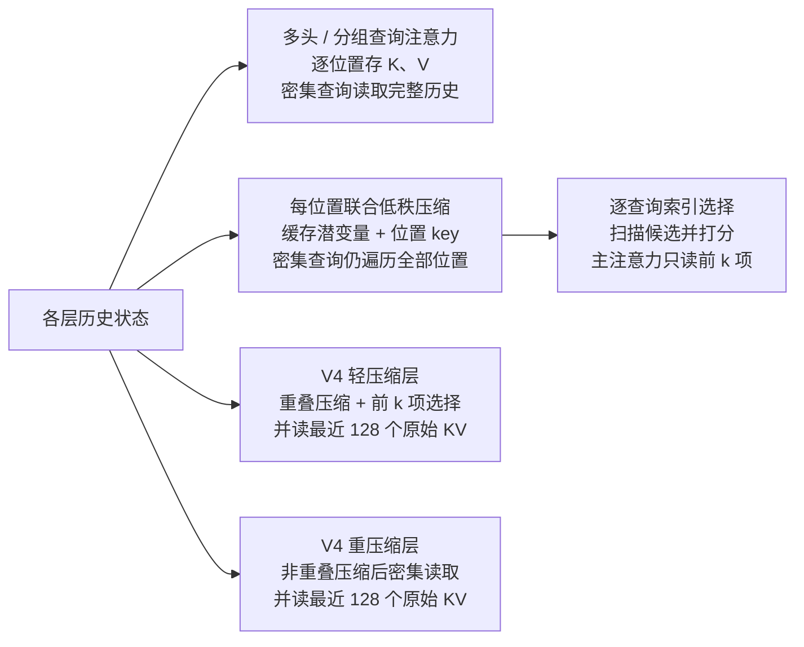
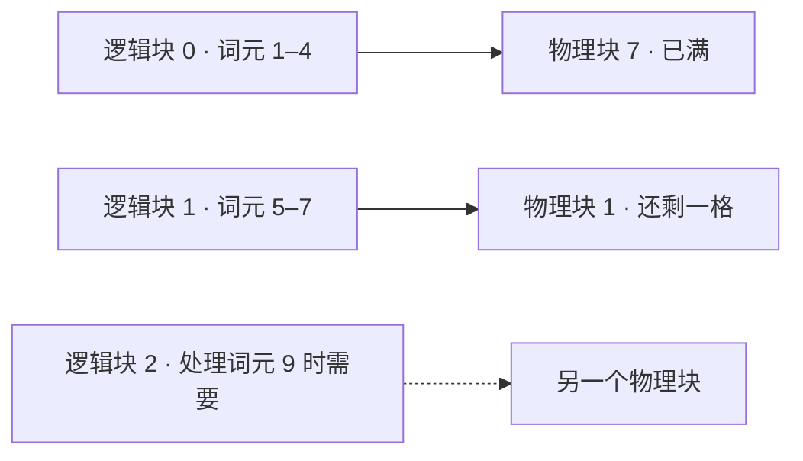
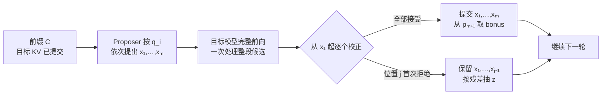

# AI Engineering

> Generated from the [ai-engineering reading map](../../ai-engineering/index.md). Edit the map and its linked source notes. Internal section links use Obsidian heading fragments; source notes remain standard Markdown.

## 1. AI 服务如何将一条消息变成完整回答？

### 案例：解释一次构建失败

想象一位开发者正在使用一款接入构建系统的 AI 助手。构建系统会对一次代码改动运行自动检查，而构建 `42` 失败了。开发者问：`Why did build 42 fail?` 失败详情保存在日志服务中，助手可以通过名为 `read_build_log` 的 tool (工具) 查询。

助手需要取回这些证据并解释日志说明了什么。我们将沿着这个问题走过整个服务流程，从准备模型输入，到返回一份以日志为依据的回答。应用负责管理日志服务的访问；模型先生成获取证据的请求，再利用证据生成说明。这是一个虚构的、由应用管理的 tool-call loop (工具调用循环) 示例。

下图展示成功完成的情形。本次运行包含两次模型调用：第一次生成工具请求；应用读取日志后，第二次生成回答。如果另一个问题本身已经包含足够证据，模型也可以在第一次调用时直接回答。

~~~mermaid
flowchart TD
    Input["1 准备输入 问题 + 指令 + 工具定义"]
    Model["2 运行模型 生成下一段输出"]
    Choice{"模型返回了什么？"}
    Tool["3 执行调用 c1 检查访问权限，再读取构建 42"]
    Context["4 更新输入 加入调用及其结果"]
    Answer["5 完成本次运行 保存并返回说明"]
    Input --> Model --> Choice
    Choice -->|工具请求| Tool
    Tool -->|日志证据或错误| Context
    Context -->|下一次模型调用| Model
    Choice -->|最终回答| Answer
~~~

### 1. 准备模型可见的内容

harness 是负责协调模型与工具的应用代码。它记录调用者身份、为模型选择信息、执行工具，并决定应用何时有结果可返回。本例中的第一次模型调用有三项输入。

| 输入 | 本例中的内容 |
| --- | --- |
| 应用指令 | 根据现有证据解释构建失败。 |
| 用户消息 | `Why did build 42 fail?` |
| 工具定义 | `read_build_log` 接受整数 `build_id`，并返回构建日志中的失败记录。 |

> [!info] 指令、对话与外部状态
> 每次模型调用都会收到经过选择的输入。模型不会自动看到日志服务、应用数据库，或用户此前说过的所有内容。应用必须提供这些信息，或执行能取回信息的工具。

工具定义描述了一个可用操作。只有应用取回日志后，日志内容才会进入对话。应用会保留调用者身份，用于权限检查。

这些输入构成了本次调用的模型 context (上下文)。在较长的对话中，应用还需要决定包含哪些较早的消息和证据。这个选择很重要，因为模型只能依据实际提供的信息，以及训练参数中编码的知识来生成输出。[如何为每次模型调用选择信息](#10.%20%E6%AF%8F%E6%AC%A1%E6%A8%A1%E5%9E%8B%E8%B0%83%E7%94%A8%E5%BA%94%E7%9C%8B%E5%88%B0%E4%BB%80%E4%B9%88%EF%BC%8C%E5%BA%94%E7%94%A8%E5%8F%88%E5%BA%94%E6%8C%81%E4%B9%85%E5%8C%96%E4%BB%80%E4%B9%88%EF%BC%9F)

### 2. 生成请求以获取缺失证据

现在，模型拿到了问题，也有办法请求日志。在 inference (推理) 过程中，它处理输入并一次生成一个 token (词元)。本次运行中，输出指定调用 `read_build_log`，并将 `build_id` 设为 `42`。

服务侧先格式化应用指令、用户消息和工具定义，再由 tokenizer (分词器) 转换为整数 ID。使用 `tiktoken 0.12.0` 和 `cl100k_base` 单独编码用户消息 `Why did build 42 fail?`，会得到七个片段 `["Why", " did", " build", " ", "42", " fail", "?"]`，对应 ID `[10445, 1550, 1977, 220, 2983, 3775, 30]`。这七个片段只说明用户原句的切分。实际调用会将应用指令、工具定义和用户消息按模型模板格式化后再编码；有对话历史时，还可加入选定的消息。令本次完整输入共有 `T` 个位置，不能直接把用户原句的七个 ID 当成完整模型输入。

embedding table (嵌入表) 会把每个 ID 映射为一个 vector (向量)。为说明张量形状，令词表大小为 `N`，示意模型宽度取 `8`；这不是实际服务配置，因此示意嵌入表形状为 `N × 8`。以单独编码用户原句的结果为例，ID `2983` 会查到索引为 `2983` 的行。完整输入则按实际编码出的 ID 查表，形成 `T × 8` 的 hidden state (隐藏状态)，每个位置占一行。每个 Transformer 层的 attention (注意力) 都能让一个位置从它可见的其他位置收集信息；feed-forward network (前馈网络，FFN) 则独立变换每一行的特征。于是，包含 `build` 和 `42` 的位置表示可以为后续位置提供信息；这只是位置交互的直觉，不表示我们测得本次推理实际关注了这两个位置。

经过最后一层和最终归一化后，模型使用最后一个输入位置的 `1 × 8` 状态预测下一个 token；这个位置有时是模板附加的 assistant 起始标记，不一定是用户消息的末尾。language model head (语言模型头，LM head) 将它映射为 `1 × N` 的 logits (未归一化分数)，每个词表条目一个分数。decoding (解码) 根据这些分数选择 token，将它追加到序列中，再对新位置继续前向计算。KV cache (键值缓存) 保存各层先前位置的 Key (键) 和 Value (值)：前者供新位置计算匹配分数，后者提供要按这些分数汇集的信息。新位置仍需计算自己的状态，并使用缓存中的 K/V。这个循环可以生成普通文本，也可以生成编码结构化工具请求的词元。

如果模型提供 temperature (温度) 设置，它会改变 token 采样分布的集中程度，但不能证明结果正确。[应用应如何选择解码设置？](#%E5%BA%94%E7%94%A8%E5%BA%94%E5%A6%82%E4%BD%95%E9%80%89%E6%8B%A9%E8%A7%A3%E7%A0%81%E8%AE%BE%E7%BD%AE%EF%BC%9F) 会通过特定任务的评估来分析这个选择。若要查看一条模型输入如何逐步经过数值运算，可继续阅读[语言模型如何将提示转换为文本](#2.%20%E8%AF%AD%E8%A8%80%E6%A8%A1%E5%9E%8B%E5%A6%82%E4%BD%95%E6%8A%8A%E6%8F%90%E7%A4%BA%E8%AF%8D%E5%8F%98%E6%88%90%E6%96%87%E6%9C%AC%EF%BC%9F)。

针对构建问题，这次生成会按照模型的 tool-call 格式 (工具调用格式) 产生工具名和参数。inference service (推理服务) 会按照模型的 tool-call protocol (工具调用协议) 解释这些词元，并将完整的工具名和参数作为结构化 API 条目提供给应用。用简化记法表示，应用会收到 `tool_call(c1, read_build_log, {build_id: 42})`。ID `c1` 会把工具结果与这次特定请求关联起来。当有多个待处理调用时，这种对应关系很重要，模型才能知道哪条观察结果属于哪个请求。服务侧协调代码会将拟议的调用交给校验流程，从而进入总览图中的工具分支。接下来的步骤会说明执行前的检查。

### 3. 执行请求并读取日志

应用会检查 `read_build_log` 是否可用、`build_id` 是否为所需的整数类型，以及调用者是否有权读取构建 `42`。参数校验确保请求可以被正确解释。authorization (授权) 则确定调用者可以访问哪个资源。只有这些检查全部通过后，应用才会读取日志。如果工具会改变外部状态，例如重启构建，那么重试时还需要考虑前一次尝试是否已经生效。[工具契约与授权](#12.%20How%20should%20an%20application%20execute%20a%20model%E2%80%99s%20tool%20request?%20/%20%E5%BA%94%E7%94%A8%E5%BA%94%E5%A6%82%E4%BD%95%E6%89%A7%E8%A1%8C%E6%A8%A1%E5%9E%8B%E7%9A%84%E5%B7%A5%E5%85%B7%E8%AF%B7%E6%B1%82%EF%BC%9F)

取回的结果包含模型此前缺少的证据。

| `c1` 的结果字段 | 构建 `42` 的值 |
| --- | --- |
| 失败步骤 | `unit-tests` |
| 失败测试 | `reject_empty_name` |
| 失败断言 | 空名称请求应返回 HTTP `400`，但实际返回了 `200`。 |
| 进程退出状态 | `1` |

如果 authorization 失败，应用可以为 `c1` 返回失败结果，让模型在下一次调用时说明无法获取证据。本例中，工具按照 ID 查询一条已知日志。如果问题需要在大量文档中查找相关段落，应用可以先检索这些段落，再提供给模型生成回答。这个检索与生成过程称为 retrieval-augmented generation (检索增强生成)，简称 RAG。[如何检索证据并据此生成回答](#11.%20%E6%80%8E%E6%A0%B7%E4%BB%8E%E6%8E%88%E6%9D%83%E6%96%87%E6%A1%A3%E4%B8%AD%E6%A3%80%E7%B4%A2%E5%B9%B6%E6%A0%B8%E9%AA%8C%E5%9B%9E%E7%AD%94%E4%BE%9D%E6%8D%AE%EF%BC%9F)

### 4. 让模型利用检索到的证据

应用现在发起另一次模型调用。除了原始问题和指令，还会包含模型的 `tool_call(c1, …)` 和与之匹配的 `tool_result(c1, …)`。调用记录了模型请求的内容，结果则提供工具实际观察到的信息。

第二次输入包含 `unit-tests`、`reject_empty_name`，以及预期的 `400` 与实际观察到的 `200`。这些细节会被格式化并编码为模型 context 的一部分。相同的推理机制会使用相同的训练权重处理扩展后的输入。新证据改变了模型可以据以回答的信息，不需要重新训练模型。权重是持久保存的学到的参数；输入和 hidden state 则是本次运行的数据。[训练如何改变模型参数](#%E4%B8%8B%E4%B8%80%E4%B8%AA%E8%AF%8D%E5%85%83%E8%AE%AD%E7%BB%83%E5%A6%82%E4%BD%95%E6%9B%B4%E6%96%B0%E8%BF%99%E4%BA%9B%E5%8F%82%E6%95%B0%EF%BC%9F) 会介绍独立的学习过程。

如果证据仍有缺口，模型可以再请求一次工具调用；应用会在配置的调用次数、耗时和成本限制内，重复执行校验、工具操作和结果收集。如果达到限制，应用应根据目前取得的证据，返回未完成或失败的结果。本例中的日志足以说明观察到的失败，因此模型会生成解释。要判断底层代码缺陷，还需要更多证据，例如具体实现和预期行为。[行动、观察与下一步决策](#ReAct%20and%20the%20decision%20loop%20/%20ReAct%20%E4%B8%8E%E5%86%B3%E7%AD%96%E5%BE%AA%E7%8E%AF)

### 5. 返回说明并完成本次运行

现在，回答可以陈述日志证实的内容。

> [!example] 根据日志返回说明
> 构建 42 在 `unit-tests` 步骤失败。`reject_empty_name` 测试预期空名称请求返回 HTTP `400`，但实际收到 `200`。测试进程以状态 `1` 退出。若要确认底层原因，请对照测试的预期行为检查请求校验逻辑。

第一次模型调用以工具请求结束，因此应用还需要继续工作。第二次调用则正常地以回答结束。在本例中，应用会先保存回答并将本次运行标记为完成，再把结果返回给调用者。如果应用在生成过程中流式传输文本，仍须跟踪生成最终是成功完成还是失败。[运行状态与恢复](#16.%20How%20can%20a%20production%20AI%20run%20survive%20disconnections%20and%20worker%20failures?%20/%20%E7%94%9F%E4%BA%A7%E7%8E%AF%E5%A2%83%E4%B8%AD%E7%9A%84%20AI%20%E8%BF%90%E8%A1%8C%E5%A6%82%E4%BD%95%E7%BB%8F%E5%8F%97%E6%96%AD%E8%BF%9E%E4%B8%8E%20worker%20%E6%95%85%E9%9A%9C%EF%BC%9F)

区分观察到的失败断言与其底层原因，也能帮助确定评估目标。改变提示词或解码设置后，系统仍应保留日志中的实际值，并避免臆造缺陷原因。评估时也应包含日志缺失或无法访问的情况。[如何判断 AI 系统是否满足任务契约？](#17.%20How%20can%20you%20tell%20whether%20an%20AI%20system%20meets%20its%20task%20contract?%20/%20%E5%A6%82%E4%BD%95%E5%88%A4%E6%96%AD%20AI%20%E7%B3%BB%E7%BB%9F%E6%98%AF%E5%90%A6%E6%BB%A1%E8%B6%B3%E4%BB%BB%E5%8A%A1%E5%A5%91%E7%BA%A6%EF%BC%9F) 会进一步说明验收标准和对比方法。

本次服务运行到此结束。若想进一步了解任一次模型调用中的计算过程，可以继续阅读[语言模型如何将提示转换为文本](#2.%20%E8%AF%AD%E8%A8%80%E6%A8%A1%E5%9E%8B%E5%A6%82%E4%BD%95%E6%8A%8A%E6%8F%90%E7%A4%BA%E8%AF%8D%E5%8F%98%E6%88%90%E6%96%87%E6%9C%AC%EF%BC%9F)。该章节会依次展开前向计算、解码和训练。

> [!info]- 来源
> 虚构的构建日志场景用于说明下列来源支持的服务机制。
>
> - **Attention 与逐位置变换。** [Attention Is All You Need, v7, §§3.2–3.5](https://arxiv.org/html/1706.03762v7#S3) 支持注意力的跨位置聚合，以及 FFN 对每个位置分别变换的结构。
> - **输入格式化、分词与缓存生成。** [Transformers chat templates](https://huggingface.co/docs/transformers/chat_templating#add_generation_prompt) 说明了生成标记；其[缓存说明](https://huggingface.co/docs/transformers/main/en/cache_explanation) 介绍了如何复用先前的 K/V。用户消息的片段和 ID 使用 [tiktoken 0.12.0](https://github.com/openai/tiktoken/tree/0.12.0) 与 `cl100k_base` 复现。
> - **结构化请求与应用循环。** [OpenAI function-calling guide](https://developers.openai.com/api/docs/guides/function-calling#the-tool-calling-flow) 和 [Claude tool-use guide](https://platform.claude.com/docs/en/agents-and-tools/tool-use/how-tool-use-works#the-agentic-loop-client-tools) 介绍了工具定义、模型请求、应用执行以及将结果反馈给模型的过程。此处的 `tool_call` 和 `tool_result` 记法仅供说明，并非 SDK schema。运行预算和针对构建日志提出的评估方式是本例中的工程选择。
>
> 查看 [AI 好文集](../ai-literature-index.md) 中的相关论文。
## 2. 语言模型如何把提示词变成文本？

### 沿着一段短输入追踪模型处理过程

[服务篇](#1.%20AI%20%E6%9C%8D%E5%8A%A1%E5%A6%82%E4%BD%95%E5%B0%86%E4%B8%80%E6%9D%A1%E6%B6%88%E6%81%AF%E5%8F%98%E6%88%90%E5%AE%8C%E6%95%B4%E5%9B%9E%E7%AD%94%EF%BC%9F)的第 2 步中，构建日志助手已经把 `Why did build 42 fail?`、应用指令和工具定义格式化为模型输入。本章从这次调用的完整输入开始，解释它如何变成输出序列，以及训练如何得到其中使用的参数。

为了让运算能在纸上跟下来，我们用 `ababca` 代替这个完整输入前缀，构造独立的 tokenizer (分词器) 和 258 项词表。示意的 decoder-only Transformer (仅解码器 Transformer) 宽度为 `8`，有两个 attention head (注意力头)，使用 gated feed-forward network (门控前馈网络，FFN)。它会把三个 token (词元) 位置一起送入模型，逐层更新。后文为各步骤选取局部数值演算，不提供一整套可复现完整前向计算的权重；这些值与构建助手的实测状态无关。真实消息的分词只用于对照词元边界，不与玩具词表混用。

~~~mermaid
flowchart TD
    Text["整理文本并分词 示例：ababca → 3 个 ID"] --> E["查找嵌入 3 个位置 × 8 个特征"]
    subgraph Pass["依次通过全部 Transformer 层"]
        A["注意力 Attention 汇集可见位置的信息"] --> F["FFN 变换各位置内部的特征"]
        F --> More{"还有下一层吗？"}
        More -->|有，使用下一层的权重| A
    end
    E -->|从第 1 层开始| A
    More -->|没有| L["最终归一化和语言模型头 LM head 根据最后一个位置为词表打分"]
    L --> D["选出一个词元 将其 ID 添加到前缀"]
    D --> Stop{"满足停止条件吗？"}
    Stop -->|没有| Next["嵌入新词元"]
    Next -->|从第 1 层重新开始 复用各层缓存的 K/V| A
    Stop -->|满足| Out["返回生成的序列 把词元字节解码为文本"]
~~~

生成还在继续时，也可以逐步解码文本。关键的循环在于：每次选出的词元都会成为下一次预测的输入之一。

### 分词器如何划分词元边界？

token 是特定词表中的一个条目。它可以表示标点、一个字节、部分单词、整个单词，也可以是带前导空格的一段文本。tokenizer 把文本映射为这些条目的整数 ID。ID 用来标识条目；ID 数字更大，并不表示对应的词更重要或更有力量。

在 byte-level byte pair encoding (字节级字节对编码，BPE) 中，训练从单字节片段开始，反复合并相邻且频繁出现的片段对。常见实现会先用正则表达式把文本分成若干段，再在每段内部执行 BPE。编码新文本时，会使用已经学到的合并优先级。

假设训练片段是 `abab`、`ab` 和 `ac`。先建立 256 个单字节条目，编号为 `0` 到 `255`。`a+b` 这一对出现三次，因此第一次合并会创建 `ab`，ID 为 `256`。此时各段变为 `[ab, ab]`、`[ab]` 和 `[a, c]`。接下来，`ab+ab` 和 `a+c` 都各出现一次。假定这个玩具示例的平局规则选择 `ab+ab`，于是创建 ID 为 `257` 的 `abab`。

| 步骤 | 对此前未见的输入 `ababca` 所做的处理 |
| --- | --- |
| 从字节开始 | `[a, b, a, b, c, a]` |
| 应用优先级最高的可用合并 | `[ab, a, b, c, a]`，然后是 `[ab, ab, c, a]` |
| 应用下一次合并 | `[abab, c, a]` |
| 查找这三个 ID | `[257, 99, 97]` |

作为真实词表的对照，服务章节中的用户消息 `Why did build 42 fail?` 使用 `tiktoken 0.12.0` 和 `cl100k_base` 单独编码后是七个片段 `["Why", " did", " build", " ", "42", " fail", "?"]`，对应 ID `[10445, 1550, 1977, 220, 2983, 3775, 30]`。这只覆盖用户原句；实际调用把应用指令、工具定义和用户消息按模型模板格式化后再编码，有历史时还可加入选定的消息。它与上面 `ababca` 的玩具词表是两套独立的 ID，不能互换。同一版本对 `The transformer architecture revolutionized NLP.` 的分词也显示边界不等于词界：`revolutionized` 被切成 `revolution` 与 `ized`，`NLP` 被切成 `N` 与 `LP`。

> [!info] 词元边界不一定是字符边界
> 一个 Unicode 字符可能由多个 UTF-8 字节组成。字节级词元片段可能会拆开这些字节，因此逐个把词元当作完整字符串解码，可能得到损坏的字符。增量文本解码会暂存尚未完整的字节，直到后续字节到达。

这会影响请求的 token 预算。统计输入时，要使用已部署模型的 tokenizer，并计入请求格式中的角色标记和工具定义。如果完整对话太长，接下来要决定的是[每次模型调用应保留哪些信息](#10.%20%E6%AF%8F%E6%AC%A1%E6%A8%A1%E5%9E%8B%E8%B0%83%E7%94%A8%E5%BA%94%E7%9C%8B%E5%88%B0%E4%BB%80%E4%B9%88%EF%BC%8C%E5%BA%94%E7%94%A8%E5%8F%88%E5%BA%94%E6%8C%81%E4%B9%85%E5%8C%96%E4%BB%80%E4%B9%88%EF%BC%9F)，而不是简单地数词。BPE 只是 tokenizer 的一种类型，并非后续 Transformer 计算的必需条件。

### 第一个 Transformer 块接收什么？

embedding table (嵌入表) 为词表中的每个条目保存一个已学习的 vector (向量)。设词表大小为 `N`、模型宽度为 `d`、输入长度为 `T`。在这个玩具模型中，`N = 258`、`d = 8`、`T = 3`，所以表 `E` 的形状是 `258 × 8`。

ID `257` 选出 `E` 中索引为 `257` 的行，ID `99` 和 `97` 则选出相应的行。把取出的行堆叠起来，就得到初始 hidden state (隐藏状态)`X₀`，形状为 `3 × 8`。此时第一个位置是 `abab` 的向量，第二个位置是 `c` 的向量，第三个位置是 `a` 的向量。

> [!info] 读数之前先看清各轴
> 在 `T × d` 中，行表示词元位置，列表示已学习的特征坐标。一行是一个 vector，也就是由 `d` 个数字按顺序组成的列表。一列则表示某个坐标在各个位置上的取值。如果添加一个 batch axis (批次维)，它就能把多个这样的序列放在一起。某个特征坐标并没有固定、可读作“篮球”之类的含义。

同一 ID 选出的初始行相同，但后续各层会根据位置和上下文改变它的表示。从数学上看，查表等价于用一个 one-hot vector (独热向量) 乘以 `E`：独热向量在对应 ID 的位置上是 `1`，其余位置都是 `0`。实际实现通常直接取出相应行。

attention sublayer (注意力子层) 使用这些向量之前，我们的模型会做 normalization (归一化)。例如，RMSNorm (均方根归一化) 会让每行除以其坐标均方值加上一个很小的稳定常数后所得的平方根，再乘上可学习的坐标缩放值。忽略这个很小的常数，并假定缩放值都为 `1`，`[3, 4]` 除以 `√((9+16)/2) ≈ 3.536` 后约为 `[0.849, 1.131]`。这能控制数值尺度，不会改变行数或列数。我们把归一化后的矩阵记为 `U`。接下来的步骤会在 Q 和 K 中引入位置信息。

### Q、K、V 如何生成注意力更新？

#### 将每一行投影为 Q、K、V

attention (注意力) 计算每个位置应从可见位置汇集哪些信息。它从当前 hidden state 推导出三种表示。query (查询，Q) 参与决定要匹配什么；key (键，K) 参与计算匹配分数；value (值，V) 提供将根据这些分数组合的内容。这些名称描述的是向量在计算中的用途。

每个 attention head 都有自己的 Q、K、V projection (投影)。在本例中，每个头的宽度为 `4`。将 `3 × 8` 的矩阵 `U` 乘以该头形状为 `8 × 4` 的查询投影权重，得到形状为 `3 × 4` 的 Q。K 和 V 也以相同方式计算，只是使用各自的矩阵。

> [!info] 矩阵乘法会得到什么？
> 每个输出坐标都是输入行与权重列的 dot product (点积)。例如，`[2, 3] · [4, 5] = 2×4 + 3×5 = 23`。如果权重的两列分别是 `[4, 5]` 和 `[1, −1]`，同一输入行就会变成 `[23, −1]`。每一列定义了输入特征的一种加权组合。因此，`3 × 8` 乘以 `8 × 4` 后仍有三个位置，每个位置产生四个特征。相乘的内侧维度相同，决定了哪些坐标会相乘并求和。

把两个头一起计算很方便。有 `Hq = 2` 个头、每个头宽度 `dh = 4` 时，每个合并投影矩阵的形状为 `d × (Hq·dh) = 8 × 8`。我们计算 `Q = UW_Q`、`K = UW_K` 和 `V = UW_V`，然后沿特征轴拆分为两个宽度为 `4` 的头。每个头各自得到一个 `3 × 4` 的 Q、K 和 V。这里使用行向量右乘权重的记法。库也可能按转置后的方向存储权重；例如 PyTorch `Linear` 会按输出特征数 × 输入特征数存储权重。

模型使用 rotary position embedding (旋转位置编码，RoPE)。它会根据 Q 和 K 所属的位置旋转其中成对的坐标，再计算点积。因此，所得分数可以受相对位置影响，但张量形状不变。

#### 把两两分数转换为加权混合

对一个头，计算每个 query 位置与每个 key 位置之间的分数。

$$
S = \frac{QK^\top}{\sqrt{d_h}} + M,\qquad
P = \operatorname{softmax}_{\mathrm{keys}}(S),\qquad
Z = PV.
$$

这里的 `Kᵀ` 表示 K 的 transpose (转置)，也就是交换 K 的行与列。`Q` 的形状是 `3 × 4`，`Kᵀ` 的形状是 `4 × 3`，所以乘积形状为 `3 × 3`。其中 `(i, j)` 项是位置 `i` 的 Q 与位置 `j` 的 K 的点积。现在每一行都列出一个位置对所有位置的分数。这次乘法比较的是各个位置；前面的 `UW_Q` 则是在每个位置内部变换特征。

随着头宽增大，除以 `√dh` 会控制分数的尺度。在一个用来解释这一做法的近似假设下，各坐标彼此独立、均值为 `0` 且方差为 `1`，那么 `dh` 个乘积之和的方差与 `dh` 成正比。缩放能抑制分数差异随头宽增大，降低 softmax 过度集中于单项的风险。

causal mask (因果掩码) `M` 在每个 query 行上，把未来 key 对应的分数加上 `−∞`，其他分数加 `0`。随后沿这一行的 key 维度做 softmax，再加权 V，因此当前位置无法读取未来 token。对第二个位置，也就是词元 `c`，假设已经按位置旋转的 Q 是 `[2, 0, 0, 0]`。设 `abab`、`c` 和 `a` 的旋转后 K 分别为 `[1, 0, 0, 0]`、`[0, 1, 0, 0]` 和 `[2, 0, 0, 0]`。这些 K 与 Q 的点积为 `[2, 0, 4]`。除以 `√4 = 2` 后得到 `[1, 0, 2]`。未来的词元 `a` 分数最高，但掩码会把它排除，结果是 `[1, 0, −∞]`。

> [!example] softmax 把分数变成相对权重
> softmax 对每个分数取指数，再除以所有指数之和。这里 `e ≈ 2.718`。`[1, 0, −∞]` 对应的权重为 `[e/(e+1), 1/(e+1), 0] ≈ [0.731, 0.269, 0]`，总和为 `1`。这些权重表示这个头如何混合 V 向量；它们不是对应词语为真的概率。

假设前两个 V 向量是 `(1, 0, 0, 0)` 和 `(0, 2, 0, 0)`。那么第二个位置的加权和为

$$
0.731(1,0,0,0)+0.269(0,2,0,0)=(0.731,0.538,0,0).
$$

对全部三个 query 位置而言，`P` 的形状是 `3 × 3`，`V` 的形状是 `3 × 4`，所以 `Z = PV` 的形状是 `3 × 4`。现在每个输出行都包含它能够看到的位置汇集来的信息。

#### 合并注意力头并保留已有状态

另一个头有自己的投影和加权和。concatenation (拼接) 会把两个宽度为 `4` 的输出逐个位置并排放好，得到 `3 × 8`。形状为 `8 × 8` 的输出投影 `W_O` 会混合这些特征。residual connection (残差连接) 会把注意力更新逐坐标加回该层原来的输入。

假设某一行原来是 `[1, 2]`，更新量是 `[0.1, −0.2]`，残差相加后得到 `[1.1, 1.8]`。两项的形状必须一致。每一层都能保留已有信息，同时计算一个更新。输出中每个词元位置仍有一行宽度为 `8` 的向量。

不同层、任务和输入中的 attention head 行为可能不同。某个头可能经常关注前一个位置，但仅凭权重图并不能确定它的完整功能。它的 V 向量、输出投影以及后续层也都会影响结果。

#### 注意力头共享 K 和 V 时会怎样？

上面的计算使用 multi-head attention (多头注意力，MHA)，每个 Q 头都有一个 K/V 头。grouped-query attention (分组查询注意力，GQA) 让一组 Q 头共享一个 K/V 头。如果仍保留两个 Q 头、但只使用一个 K/V 头，那么 `W_Q` 仍是 `8 × 8`，而 `W_K` 和 `W_V` 会变为 `8 × 4`。两个 Q 仍各自生成宽度为 `4` 的输出，所以拼接后的形状和 `W_O` 都不变。

`Hkv` 表示 K/V 头数。生成时会保留每层各位置的 K 和 V，供后续 token 复用。MHA 中 `Hkv = Hq`；multi-query attention (多查询注意力，MQA) 则是 `Hkv = 1` 的情况。这些选择会影响所学权重，以及生成过程中存储的 K/V 数量。把 MHA checkpoint 转为其他结构会改变 K/V 权重和模型行为；GQA 论文评估了基于权重平均的转换以及后续训练。在这个例子中，缓存了三个位置时，每层的 MHA 会存储 `2 × 3 × 2 × 4 = 48` 个 K/V 数值，依次对应 K/V 两种表示、三个位置、两个头和每头四个坐标。共享一个 K/V 头后，数量降为 `2 × 3 × 1 × 4 = 24`，而两个 Q 头仍各自计算分数。若想了解服务环节的影响，请继续阅读[KV cache 和调度如何决定推理容量](#4.%20KV%20%E7%BC%93%E5%AD%98%E4%B8%8E%E8%B0%83%E5%BA%A6%E6%80%8E%E6%A0%B7%E5%86%B3%E5%AE%9A%E5%A4%A7%E8%AF%AD%E8%A8%80%E6%A8%A1%E5%9E%8B%E7%9A%84%E6%9C%8D%E5%8A%A1%E5%AE%B9%E9%87%8F%EF%BC%9F)。Dense attention 的两两计算量随 `T²` 增长，但实际时延还取决于 kernel (计算内核)、其他层和硬件。

共享 K/V 头减少了每个位置的表示数量，却没有减少历史位置数。输入长到几十万甚至百万个 token 时，还可以追问：能否压缩每个位置的 K/V，或让当前 query 只读取部分历史？[长上下文的存储与读取](#3.%20%E9%95%BF%E4%B8%8A%E4%B8%8B%E6%96%87%E6%80%8E%E6%A0%B7%E5%B0%91%E5%AD%98%E3%80%81%E5%B0%91%E8%AF%BB%E5%8E%86%E5%8F%B2%EF%BC%8C%E5%90%8C%E6%97%B6%E4%BF%9D%E7%95%99%E9%9C%80%E8%A6%81%E7%9A%84%E4%BF%A1%E6%81%AF%EF%BC%9F)从这里展开 MLA 的矩阵吸收，以及选择、压缩历史各自会丢掉什么。

### FFN 增加了什么，多个块如何堆叠？

#### 变换每个位置的特征

attention 更新已经把上下文信息带入每一行。FFN 会在每行内部应用非线性变换。它也常被称为 multilayer perceptron (多层感知机，MLP)。同一层内的所有位置共用一套 FFN 权重，不同层通常使用不同权重。如果投影之间没有非线性操作，多次线性变换会合并为一次线性变换；加入非线性后，更新就能更丰富地取决于输入特征的组合。

以 SwiGLU FFN 为例，先对经过 attention 更新的状态做归一化，得到形状为 `3 × 8` 的 `R`。两个投影 `W_g` 和 `W_u` 的形状都是 `8 × 16`，分别生成门控输入和候选分支。对门控输入应用 SiLU，用 `⊙` 表示逐元素相乘两个分支，最后通过 down projection (降维投影) `W_d` 投影回去；它的形状为 `16 × 8`。

$$
F(R)=\big[\operatorname{SiLU}(RW_g)\odot(RW_u)\big]W_d,
\qquad \operatorname{SiLU}(x)=x\sigma(x),
\qquad \sigma(x)=\frac{1}{1+e^{-x}}.
$$

sigmoid `σ` 的取值介于 `0` 和 `1` 之间。SiLU 将输入乘以这个比例，形成平滑的非线性变换。在这里，最后得到的门控值可能是负数，也可能大于 `1`。它们连续地缩放候选特征，而不是像二进制开关那样只有开或关。

> [!example] SiLU 如何门控候选特征
> 对某一行取两个门控输入 `[0, 1]` 和候选值 `[2, 3]`。SiLU 先把门控输入变为约 `[0, 0.731]`，再逐元素相乘，得到 `[0, 2.193]`。这只是 `3 × 16` 中两个通道的例子；`W_d` 随后把整行的 16 个通道混合为 8 个，再将这个更新加回 attention 状态。逐元素乘法保持宽度为 16，不会像点积那样求和为单个数字。

由于门控分支和候选分支都取决于当前行，同一套权重可以针对不同上下文产生不同更新。

这有助于解释学习到的知识为何会影响预测。如果某一行代表篮球语境中的人名，学到的特征组合就可能激活某些方向，从而影响相关的输出词元。Geva 等人发现，他们所研究的部分 FFN 中存在文本模式关联和输出影响。这一发现适用于那些模型，并不表示每个 FFN 都是字面意义上的事实数据库。模型输出事实的能力也取决于 attention、多层计算和最终词表投影。若信息必须保持最新或能够核验，[检索与依据构建](#11.%20%E6%80%8E%E6%A0%B7%E4%BB%8E%E6%8E%88%E6%9D%83%E6%96%87%E6%A1%A3%E4%B8%AD%E6%A3%80%E7%B4%A2%E5%B9%B6%E6%A0%B8%E9%AA%8C%E5%9B%9E%E7%AD%94%E4%BE%9D%E6%8D%AE%EF%BC%9F) 介绍了应用如何提供外部证据。

#### 把更新后的状态传给下一层

这里的块使用 pre-normalization (预归一化)，也就是在 attention 和 FFN 之前分别做归一化。设 `Xℓ` 是第 `ℓ` 层的输入，两次更新为

$$
Y_\ell=X_\ell+\operatorname{Attention}_\ell(\operatorname{Norm}_{\ell,1}(X_\ell)),
$$
$$
X_{\ell+1}=Y_\ell+F_\ell(\operatorname{Norm}_{\ell,2}(Y_\ell)).
$$

~~~mermaid
flowchart TD
    X["层输入 X 3 × 8"] --> N1["归一化"] --> A["Attention 混合不同位置的信息"]
    A --> Y["加上 attention 更新 Y 的形状为 3 × 8"]
    X -->|残差| Y
    Y --> N2["归一化"] --> F["SwiGLU FFN 扩展至 3 × 16，门控，再投影至 3 × 8"]
    F --> Next["加上 FFN 更新 下一层接收 3 × 8"]
    Y -->|残差| Next
~~~

每一层都会对相同位置再做一次变换。在这个模型中，随着层数增加，序列长度和宽度都不会缩短。这里示例的 decoder-only 架构选择包括 RMSNorm、RoPE 和门控 FFN；是否共享 K/V 则是另一项独立的架构选择。2017 年提出的 Transformer 在翻译任务的 encoder–decoder (编码器–解码器) 模型中使用 attention 和逐位置 FFN。它的 decoder 也使用了 cross-attention (交叉注意力)，归一化方式和 FFN 选择也与此不同。这里的公式描述所选的 decoder-only 示例；具体模型采用的架构由其实现决定。

这里展示的是单条残差流。DeepSeek-V4 的 Manifold-Constrained Hyper-Connections（流形约束超连接，mHC）把每个词元的残差状态扩成 4 条宽度为 `d` 的流，再把它们读成普通层输入、混合旧流，并把新更新写回各流。这里每个 `l` 指一次残差更新：一个 Transformer block 里，attention 子层和 FFN 子层各自有一组 `A_l/B_l/C_l`。对一个词元，令 `X_l∈R^{4×d}`；`A_l∈R^{1×4}` 读出宽度为 `d` 的输入，`F_l` 表示带前置归一化的子层更新，输出宽度仍为 `d`；`C_l∈R^{4×1}` 把更新分配回 4 条流，`B_l∈R^{4×4}` 混合已有流：

$$
X_{l+1}=B_lX_l+C_lF_l(A_lX_l).
$$

若每层的旁路混合矩阵不受约束，连续相乘可能逐层放大已有状态；mHC 的约束针对这段纯流混合。

式子只画一个词元的残差流；当 `F_l` 是 attention 时，它仍对整段序列计算，上式中的 `F_l` 是该词元对应的输出切片。`A_l`、`B_l`、`C_l` 都由当前残差状态动态生成，并带有可学习的静态偏置与缩放；`A_l` 和 `C_l` 分别经 sigmoid 与 `2·sigmoid` 限制为非负有界权重。mHC 的目标是让 `B_l` 落在 doubly stochastic（双随机）矩阵集合：元素非负，每行与每列的和都为 `1`。直观地说，每行是加权平均，列和为 `1` 可避免把输入流重复计重后放大总平方长度。

V4 对 `B_l` 的原始分数先取指数，再用 20 步 Sinkhorn–Knopp 交替归一化行与列；官方 kernel 还加了 `eps`，所以有限步的数值结果是双随机约束的近似。对理想的双随机矩阵，`||B_l||₂≤1`，表示固定这个 `B_l` 后，它单独作用于残差状态不会增加其 Frobenius norm（弗罗贝尼乌斯范数，即矩阵元素平方和再开根）。`B_l` 本身又依赖当前状态，因此该界不能推出完整的输入到输出映射会如何随输入变化；它也不约束写入项 `C_lF_l(A_lX_l)`，更不是整层或全模型稳定性的证明。

> [!example] 四条流的两种双随机混合
> 单位矩阵 `I₄` 保持每条流不变；若 `B` 的 16 个元素全是 `0.25`，每条流就变成四条流的平均。例如，只看一个特征坐标，流值 `(1,0,0,0)` 会变为 `(0.25,0.25,0.25,0.25)`，长度从 `1` 降为 `√(4×0.25²)=0.5`。两者都满足理想的非负、行和为 `1`、列和为 `1` 条件；`||B||₂≤1` 意味着此类混合最大的长度放大倍数不超过 `1`。

#### 哪些数字属于可学习参数？

矩阵的参数数量等于行数乘以列数。在普通 MHA 且 `Hq·dh = d` 时，Q、K、V 和输出投影合计有 `4d²` 个参数。若 `d = 8`，则共有 `256` 个。三个 SwiGLU 投影合计有 `3d·dff` 个参数；若 `dff = 16`，则共有 `384` 个。

完整模型还包含 embedding table、归一化权重，有时还包含单独的词表投影。每一层都有自己权重时，逐层重复计算；共享权重只计一次。hidden state 和缓存的 K/V 是根据这些参数计算出来的临时数据。因此，参数数量本身无法决定 GPU 上能同时容纳多少请求。这也是继续阅读[推理内存与调度章节](#4.%20KV%20%E7%BC%93%E5%AD%98%E4%B8%8E%E8%B0%83%E5%BA%A6%E6%80%8E%E6%A0%B7%E5%86%B3%E5%AE%9A%E5%A4%A7%E8%AF%AD%E8%A8%80%E6%A8%A1%E5%9E%8B%E7%9A%84%E6%9C%8D%E5%8A%A1%E5%AE%B9%E9%87%8F%EF%BC%9F) 的原因之一。

### 有些模型为什么只运行部分 FFN？

Mixture-of-Experts (MoE，混合专家)把一层 FFN 分成多个专家网络，再由 router（路由器）根据每个词元当前的 hidden state 选择其中一部分。它改变的是 FFN 子层的计算路径；attention 仍负责汇集位置间的信息。一个 MoE 层可把 shared expert（共享专家）用于所有词元，再把 routed experts（路由专家）的加权输出加到残差上。专家是学习到的 FFN 参数组，不是预先命名的知识类别或外部检索库。

DeepSeek-V3 给出了具体配置：前 3 层仍用 dense FFN，其余 MoE 层各有 1 个共享专家和 256 个路由专家，每个词元选 8 个路由专家。为和前面的 pre-norm 块衔接，令 attention 残差后的状态为 `y_t`，FFN 前归一化后的路由/专家输入为 `u_t=Norm(y_t)`。路由器对 `u_t` 与专家向量 `e_i` 做点积，再经 sigmoid 得到亲和度 `s_i = sigmoid(u_tᵀe_i)`。`top-k` 决策选出亲和度最高的专家，选中项再按原始 `s_i` 归一化为混合权重 `g_i`；因此计算图中可以同时有“离散选谁”和“连续混多少”。为突出核心计算，下式与后面的手算均采用 `route_scale=1` 的简式，省略实际路由中的专家组、设备/节点限制。在只有一个共享专家时，这层更新为

$$
h'_t=y_t+\operatorname{FFN}_{shared}(u_t)+\sum_{i\in selected}g_i\operatorname{FFN}_i(u_t).
$$

> [!example] 偏置只参与选人，混合用原分数
> 用 3 个专家、每词元选 2 个的玩具路由器。原始亲和度为 `s=(0.80, 0.70, 0.60)`，偏置为 `b=(0, 0, 0.25)`。不加偏置时 top-2 是专家 1 和专家 2；加偏置后按 `s+b=(0.80, 0.70, 0.85)` 排序，候选集合变为专家 3 和专家 1。混合权重仍用原始亲和度：分母是 `0.80+0.60=1.40`，所以专家 1 的权重为 `0.80/1.40≈0.571`，专家 3 为 `0.60/1.40≈0.429`。若这两个专家对归一化输入 `u_t` 的 FFN 输出分别为 `(1,0)` 和 `(0,2)`，路由分量就是 `0.571(1,0)+0.429(0,2)≈(0.571,0.857)`；完整层输出还要加上共享专家的输出和残差 `y_t`。分数和向量值是人为设定的。这个例子中偏置确实让专家 3 进入 top-2，但偏置值本身不参与输出混合权重。

路由器中的专家向量是可学习参数。主任务损失可以沿被选专家的输出、归一化后的路由权重和 sigmoid 亲和度回传；但 `top-k` 返回的索引是离散值，普通反向传播不会直接求导“换选另一个专家”的效果。某个词元没有运行的专家不会从该词元的 FFN 输出获得主任务梯度。V3 还用 sequence-wise balance loss（序列级平衡损失）约束单条序列上的极端负载，所以未选路由的亲和度仍可经这项辅助损失受到训练信号。这是由论文公式和可学习 Gate 参数得到的梯度解释；论文没有公开其训练代码的完整自动微分路径。

V3 的 batch-level load balancing（批次级负载平衡）另维护每个专家的偏置：每个训练批次统计选中量，过载专家的偏置减 `γ`，低于平均负载的偏置加 `γ`。在同一个三专家玩具例子中，若一个批次有 6 个词元且每个词元只选 1 个，实际负载 `[4,1,1]`，均匀目标为 `[2,2,2]`；若教学用 `γ=0.01`，这一步就把偏置从 `(0,0,0)` 更新为 `(-0.01,+0.01,+0.01)`。这些偏置是在训练批次间调节的路由校正，不是输出混合权重；部署时的固定偏置也不是按每个请求的瞬时 GPU 队列随机改派专家。V3 前 14.3T 训练词元使用 `γ=0.001`，最后 500B 设为 `0`。称为“aux-loss-free（无辅助损失）”只是在说主要批次级平衡机制不依赖传统负载损失；V3 仍用 `α=0.0001` 的序列级辅助项来抑制单条序列的极端失衡。

路由也不是语义分类器。固定输入、权重和偏置时，top-k 路由是确定的；训练中不同领域可能使专家负载呈现统计上的专门化，但不保证某个专家只对应“数学”或“代码”。实际收益取决于稀疏计算节省能否覆盖专家分布、通信和热门专家带来的负载不平衡。服务容量需要按全部专家权重、路由通信和 KV 状态共同估算，可继续看[KV 缓存与调度怎样决定模型推理容量](#4.%20KV%20%E7%BC%93%E5%AD%98%E4%B8%8E%E8%B0%83%E5%BA%A6%E6%80%8E%E6%A0%B7%E5%86%B3%E5%AE%9A%E5%A4%A7%E8%AF%AD%E8%A8%80%E6%A8%A1%E5%9E%8B%E7%9A%84%E6%9C%8D%E5%8A%A1%E5%AE%B9%E9%87%8F%EF%BC%9F)。

### 模型如何选择词元并继续生成？

#### 为词表打分并选择一个 ID

生成下一个 token 时，模型在最后一层和最终归一化后，取最后一个输入位置的向量 `h_last` 交给 language model head (语言模型头，LM head)；这一行的形状是 `1 × 8`。对于 `[abab, c, a]`，它就是第三个位置 `a` 对应的更新后向量。前面的 attention 算例特意选了第二个位置来演示未来屏蔽；第三个位置也按同样规则计算，并继续经过所有层，才得到这里的 `h_last`。在 causal attention 中，这个位置可以关注整个输入前缀。格式化的对话中，它也可能是 assistant 起始标记，而不是用户问题的最后一个字符。

将 `h_last` 乘以形状为 `8 × 258` 的 `W_lm`，会得到形状为 `1 × 258` 的 logits (未归一化分数)，每个词表 ID 对应一个分数。`W_lm` 的每一列都会与 `h_last` 做点积，算出一个分数。weight tying (权重绑定) 会把 embedding table 的转置用作这个输出权重，从而省去一张单独的参数矩阵。有些架构会分别使用输入和输出权重。

做 sampling (采样) 时，temperature (温度)`τ > 0` 会在 softmax 之前缩放 logits。

$$
p_i=\frac{\exp(z_i/\tau)}{\sum_j\exp(z_j/\tau)}.
$$

为单独观察 temperature 的作用，下面只允许两个候选 token，其余词表项暂设为不参与采样。这个人为限制不代表完整词表的真实预测。两个候选是：`c` (ID `99`) 和 `a` (ID `97`)，为它们设定演算用的 logits `[2, 1]`，不由前面的局部 QKV 数字推导。温度为 `1` 时，概率约为 `[0.731, 0.269]`；温度为 `0.5` 时，概率变为 `[0.881, 0.119]`；温度为 `2` 时，则为 `[0.622, 0.378]`。温度越低，概率越集中于分数较高的候选项；温度越高，分数较低的候选项也越有机会被选中。这些是下一个词元的概率，并不代表答案在事实层面正确的置信度。

greedy decoding (贪心解码) 会直接选择分数最高的词元。API 的温度零设置可能表示请求采用贪心行为；上面的公式无法真的除以零。Top-k sampling 会保留分数最高的 `k` 个候选项。Top-p，也称 nucleus sampling (核采样)，会保留按概率降序排列、总和首次达到阈值的最短前缀，然后重新归一化。对于 `[0.50, 0.30, 0.15, 0.05]` 和 top-p `0.75`，保留前两个概率，除以它们的总和 `0.80` 后变为 `[0.625, 0.375]`。

#### 复用已有前缀并预测下一个词元

prefill (预填充) 会让初始序列通过各层。最后一个位置的 logits 选出第一个输出词元。假设我们选出 `c`，ID 为 `99`。词元序列由 `[257, 99, 97]` 增长为 `[257, 99, 97, 99]`。新生成的文本此时只有 `c`；前面的 `ababca` 是输入，仍留在模型上下文中。decode (增量解码) 会嵌入新位置上的 `c`，并从第一层开始处理它，以预测下一个词元。

在 causal model (因果模型) 中，对于相同的前缀和推理配置，添加新位置不会改变先前位置的 hidden state。因此，KV cache (键值缓存) 会存储每一层此前算出的 K 和 V。在新位置，该层会计算新的 Q、K 和 V。新位置上的 Q 会关注缓存中的 K/V 以及当前位置的 K/V，再把新的 K/V 追加到缓存中。更早位置的 Q 向量已经参与过各自位置的计算，不会作为输入再参与这个新 query 的 attention 运算。

每层的 cache 各自独立，因为每一层的输入表示和投影权重不同。输出变长时，cache 也会随之增大。生成会在模型结束词元、应用停止序列、长度上限或取消操作时结束。长度上限可能会截断尚未完成的回答，因此应用必须判断完成原因。[服务容量](#4.%20KV%20%E7%BC%93%E5%AD%98%E4%B8%8E%E8%B0%83%E5%BA%A6%E6%80%8E%E6%A0%B7%E5%86%B3%E5%AE%9A%E5%A4%A7%E8%AF%AD%E8%A8%80%E6%A8%A1%E5%9E%8B%E7%9A%84%E6%9C%8D%E5%8A%A1%E5%AE%B9%E9%87%8F%EF%BC%9F) 会进一步说明内存影响；[应用运行状态与恢复](#16.%20How%20can%20a%20production%20AI%20run%20survive%20disconnections%20and%20worker%20failures?%20/%20%E7%94%9F%E4%BA%A7%E7%8E%AF%E5%A2%83%E4%B8%AD%E7%9A%84%20AI%20%E8%BF%90%E8%A1%8C%E5%A6%82%E4%BD%95%E7%BB%8F%E5%8F%97%E6%96%AD%E8%BF%9E%E4%B8%8E%20worker%20%E6%95%85%E9%9A%9C%EF%BC%9F) 会展开生成结束或中断后的处理。

#### 应用应如何选择解码设置？

实际选择应从已部署的模型和 endpoint (端点) 入手。先确认支持哪些控制项、哪些组合可用，再以支持的默认值建立基线。采样控制取决于模型和 API 版本；一些托管接口会限制、固定或省略这些参数。不存在适用于所有模型和任务的最佳温度。

对于构建日志助手，如果多次运行的工具参数或证据报告不必要地发生变化，可以尝试一个受支持的较低温候选设置。将其与基线进行比较，覆盖常见故障、日志缺失、权限失败，以及带有误导性文字的日志。较低设置也可能反复偏向错误操作，所以结果稳定本身并不代表成功。

如果任务本来就需要生成多个候选解释或解法供后续核验，那么尝试更高的采样多样性可能有用。代价是出现更多质量较差或无效的候选结果，也需要更多核验工作。提高温度既不会补上缺失证据，也不会让没有依据的说法变得可接受。多样性是否能改善最终结果，取决于候选生成器与验证器的整体效果。

做受控比较时，应固定模型版本、指令、工具和案例集，只改变所选的解码设置。对每个候选设置重复完整运行，并衡量工具选择及参数是否正确、解释是否有依据、故障处理是否恰当，以及成本和时延。用一组数据开发设置，再用单独的留出集验收。这是一种工程测试方法，并非宣称较低或较高的温度必然更好。[如何构建可比较的评估集](#Build%20a%20comparable%20regression%20set%20/%20%E5%BB%BA%E7%AB%8B%E5%8F%AF%E6%AF%94%E8%BE%83%E7%9A%84%E5%9B%9E%E5%BD%92%E9%9B%86) 会进一步介绍评估方法，而不只关注这一项设置。

### 下一个词元训练如何更新这些参数？

#### 为每个位置设置目标

前面使用的都是已经学到的权重。训练会根据“接下来应该是什么”的示例来调整这些权重。沿用玩具 tokenizer，训练样本 `ababcac` 会被分成 `[abab, c, a, c]`，即 `[257, 99, 97, 99]`。用前三个位置预测后一个：前缀 `abab` 预测 `c`，前缀 `[abab, c]` 预测 `a`，前缀 `[abab, c, a]` 预测 `c`。后两个预测都能读取完整的左侧前缀，不是只看紧邻的前一个词元。这里末尾的 `c` 是训练语料中的真实目标，不是刚才生成步骤采出的结果。causal mask 允许并行计算这些位置，同时阻止每个位置读取右侧的目标词元。某些模型的训练格式还会加入 beginning-of-sequence marker (序列起始标记，BOS) 等特殊 token；它们需要由相应词表和模板定义，本例不额外加入。

teacher forcing (教师强制) 指训练时使用训练样本中真实的前序词元。生成时，后续输入则包含模型实际选出的词元。这就是为什么生成序列开头的错误可能改变后续预测。

#### 训练时如何预测多个未来词元？

multi-token prediction（多词元预测，MTP）在 next-token prediction（下一个词元预测）之外增加未来位置的训练目标。DeepSeek-V3 的 MTP 深度 `D=1`：对位置 `i`，主模型表示 `h_i` 预测真实的 `t_{i+1}`；MTP 模块再把 `h_i` 与训练样本中真实的 `Emb(t_{i+1})` 分别做 RMSNorm 后拼接。投影 `M_1∈R^{d×2d}` 把宽度 `2d` 的拼接向量压回 `d`，再送入附加 Transformer block 和与主模型共享的 output head（输出头），预测 `t_{i+2}`；词元 embedding 也与主模型共享。它训练的是“已知正确前一个词元时再预测下一个”，不是让多个互不相干的输出头同时猜同一个前缀之后的词。

> [!example] 同一训练串怎样多监督一个位置
> 沿用样本 `ababcac → [abab, c, a, c]`，把位置编号为 1 到 4。主模型在位置 1 用 `h₁` 预测位置 2 的真实词元 `c`。MTP 将 `RMSNorm(h₁)` 和 `RMSNorm(Emb(c))` 拼接后投影，再经过附加块，预测位置 3 的 `a`。同样，位置 2 的 `h₂` 与真实 `Emb(a)` 一起预测位置 4 的 `c`。因此训练标签仍来自右移后的语料；位置维度的计算可以并行，而更深的 MTP 预测模块彼此按深度串接。V3 只设一个额外预测深度。

每个深度各算一份交叉熵，深度间取平均，再乘训练权重 `λ`；总目标是主 next-token loss 加 MTP loss。V3 报告的 `λ` 前 10T 训练词元为 `0.3`，之后 4.8T 为 `0.1`。额外预测让每个训练位置提供更多监督，也可能帮助主模型形成对未来的表征；它不意味着推理时必须保留 MTP 模块。推理可以只运行主模型，也可把已训练的 MTP 模块用作推测解码的 proposer（提议器）。后者如何组织草稿状态、目标模型验证和缓存回滚，属于服务实现问题，见[推测解码如何验证候选并处理临时缓存](#%E6%8E%A8%E6%B5%8B%E8%A7%A3%E7%A0%81%E5%A6%82%E4%BD%95%E9%AA%8C%E8%AF%81%E5%80%99%E9%80%89%E5%B9%B6%E5%A4%84%E7%90%86%E4%B8%B4%E6%97%B6%E7%BC%93%E5%AD%98%EF%BC%9F)。

#### 计算误差并反向传播更新

在这里的训练过程中，`p` 是对完整词表的原始 logits 执行普通 softmax 的结果，没有使用推理时的温度或 top-k/top-p 过滤。对于目标 ID `y_i`，cross-entropy (交叉熵) 使用 `−log p(y_i)`，并对训练中包含的位置取平均。如果正确词元的概率是 `0.8`，损失约为 `0.223`；概率为 `0.25` 时，损失约为 `1.386`。两者的平均值约为 `0.805`，使用的是自然对数，其单位称为 nat。正确词元的概率越低，惩罚就越大。

对单个位置来说，该损失相对于 logits 的导数是 `p − onehot(y_i)`。这个结果保留了除正确项以外的所有概率项，并从正确项中减去 `1`。如果概率是 `[0.7, 0.2, 0.1]`，而第二个词元是正确答案，gradient (梯度) 就是 `[0.7, −0.8, 0.1]`。

> [!info] gradient 表示损失在局部如何变化
> 导数为正，表示稍微增大对应数值会使损失增大。因此 gradient descent (梯度下降) 会减去导数的一小部分。在这个例子中，如果直接更新 logits，就会降低第一个和第三个值，提高第二个值。实际训练更新的是产生这些 logits 的共享参数，并使用 chain rule (链式法则) 将它们的影响沿计算过程反向传播。

backpropagation (反向传播) 会把导数依次传过 LM head、残差相加、FFN、attention 和 embedding。对于简单的计算链 `z = wx`，若 `x` 固定，则 `∂L/∂w = (∂L/∂z)x`。矩阵形式会累加多个坐标和位置上的贡献。optimizer (优化器) 按照自己的步长和累积统计规则更新参数。训练利用前向计算的中间量，沿计算图反向求出各参数的梯度，再据此更新参数。

#### 矩阵权重如何由 Muon 更新？

DeepSeek-V4 报告把多数矩阵参数交给 Muon。对权重矩阵 `W` 的梯度 `G_t`，先维护 momentum buffer（动量缓冲）`M_t=μM_{t−1}+G_t`，再形成 Nesterov 型方向 `D_t=μM_t+G_t`；`μ` 是旧动量的保留系数。Newton–Schulz 迭代前，将更新方向按 Frobenius norm（弗罗贝尼乌斯范数，即矩阵元素平方和再开根）归一化。对归一化后的矩阵做 10 步 hybrid Newton–Schulz（混合 Newton–Schulz）迭代，近似正交化，再按矩阵形状缩放更新量：

$$
W_t=(1-ηλ_{wd})W_{t-1}-ηγ\sqrt{\max(n,m)}\,O'_t.
$$

其中 `η` 是学习率，`λ_wd` 是解耦权重衰减，`n×m` 是权重形状，`O'_t` 是正交化后的方向，`γ` 是更新 RMS 的整体缩放系数。这里 `γ` 指 Muon 的更新缩放，和前文 V3 路由偏置使用的 `γ` 不是同一项。Muon 调整的是梯度动量方向，不是把模型权重本身改成正交矩阵。

singular value decomposition（奇异值分解，SVD）提供了理解目标的参照。若 `D=UΣVᵀ`，`U`、`V` 给出配对方向，`Σ` 的奇异值表示沿这些方向的伸缩倍数。只取非零奇异值对应的列组成 `U_r`、`V_r`，目标 `U_rV_rᵀ` 保留这些配对方向并把伸缩倍数变为 `1`，零方向保持为零；满秩时才可直接写作 `UVᵀ`。Newton–Schulz 用矩阵乘法多项式逼近这一结果，不必显式计算完整 SVD。V4 对多数矩阵参数使用 Muon，但对 embedding、prediction head（预测头）、mHC 静态偏置和门控因子、RMSNorm 权重仍使用 AdamW；这是该报告的训练分工，不是所有模型的通用最佳优化器配方。

Muon 需要每个逻辑矩阵的完整梯度来做上述迭代。DeepSeek-V4 报告因此采用混合 Zero Redundancy Optimizer（零冗余优化器，ZeRO）bucket 分配；对稠密参数，超出 ZeRO 并行范围时，在额外数据并行组上冗余计算 Muon 更新，以计算换取更少的梯度桶内存。Muon 仍要保存动量缓冲，因此不是没有 optimizer state（优化器状态）的更新法。报告未给出这些状态逐参数的数据类型或总字节数，不能据此直接算出训练显存节省。

报告说明 Newton–Schulz 矩阵乘可用 bfloat16（BF16）；MoE 梯度在跨数据并行通信前随机舍入到 BF16，再在本地用 float32（FP32，单精度浮点）求和。这些是指定算子和通信路径的精度选择，不代表整个训练过程或 Muon 状态统一使用 BF16。

> [!example] 对角矩阵经过十步 hybrid Newton–Schulz 后怎样变化
> 取教学用更新方向 `D=diag(9,1)`。它的 SVD 可取 `U=V=I`、`Σ=diag(9,1)`；两个对角值表示沿两个配对方向分别伸缩 9 倍和 1 倍。Frobenius norm 是 `√(9²+1²)=√82`，所以迭代从 `D_0=diag(9/√82,1/√82)≈diag(0.993884,0.110432)` 开始。
>
> 对这个正对角矩阵，Newton–Schulz 多项式可逐个奇异值计算为 `x'=a x+b x³+c x⁵`。前 8 步使用 `(a,b,c)=(3.4445,-4.7750,2.0315)`，后 2 步使用 `(2,-1.5,0.5)`。普通浮点标量复算得到：第 1 步约 `(0.705643,0.373984)`，第 8 步约 `(1.094391,1.134267)`，第 10 步约 `(1.000030,1.000190)`。有限步把非零方向推近 `1`，没有精确到 `1`；初始为零的奇异值也因该多项式没有常数项而保持为零。这里是系数公式的标量示例，不是 BF16 内核或训练结果实测。

所选的训练目标也很重要。BERT 使用的 masked language modeling (掩码语言建模) 会根据左右两侧可见的上下文，预测选定的缺失位置。它的常规过程与上面从左向右的循环不同。研究者可以基于掩码模型构造迭代生成过程，但这需要另外的采样过程。

如果应用反复以稳定的方式失败，接下来要判断的是：它缺少证据、指令，还是已经学到的行为。[何时进行微调](#18.%20%E4%BD%95%E6%97%B6%E5%BA%94%E5%BE%AE%E8%B0%83%E6%9D%A5%E5%BC%A5%E8%A1%A5%E7%A8%B3%E5%AE%9A%E7%9A%84%E8%A1%8C%E4%B8%BA%E5%B7%AE%E8%B7%9D%EF%BC%9F) 会进一步说明这个选择，包括应更新哪些参数。把新证据加入 prompt (提示词) 会改变当前计算；训练则会改变能在后续运行中持续生效的参数。

> [!info]- 来源
> 下列来源为所列机制提供依据。较小的张量维度、虚构的向量和构建日志调参场景都是教学示例或工程扩展。
>
> - **词元化。** [Sennrich et al., 2016, §3.2](https://aclanthology.org/P16-1162/) 解释了子词 BPE。[tiktoken 0.12.0 educational implementation](https://github.com/openai/tiktoken/blob/0.12.0/tiktoken/_educational.py) 实现了字节级训练、合并优先级和解码。文中给出的精确英文词元序列使用该版本软件包和 `cl100k_base` 复现。
> - **Attention 与原始架构。** [Attention Is All You Need, v7, §§3.1–3.5 and §5.1](https://arxiv.org/html/1706.03762v7#S3) 支持缩放点积、掩码、多头拼接、逐位置 FFN，以及原始 encoder–decoder 的适用范围。论文中的翻译任务设定与这里演示的 decoder-only 模型不同。
> - **位置与归一化。** [RoFormer, v5, §3](https://arxiv.org/html/2104.09864v5#S3) 解释 RoPE；[Root Mean Square Layer Normalization, 2019, §3](https://arxiv.org/abs/1910.07467) 解释 RMSNorm。[The Llama 3 Herd of Models, v3, §3.2](https://arxiv.org/html/2407.21783v3#S3.SS2) 和 [Llama 3 参考实现](https://github.com/meta-llama/llama-models/blob/main/models/llama3/model.py) 为 decoder-only 架构选择和归一化顺序提供依据。具体配置由特定模型的实现决定。
> - **投影权重存储与 K/V 共享。** [PyTorch Linear](https://docs.pytorch.org/docs/stable/generated/torch.nn.Linear.html) 说明了权重的存储方向。[GQA, EMNLP 2023, §2](https://aclanthology.org/2023.emnlp-main.298/) 介绍了分组 K/V 头，以及通过 uptraining 转换模型的方法。
> - **FFN 门控与解释。** [GLU Variants Improve Transformer, 2020, §2](https://arxiv.org/html/2002.05202#S2) 定义了 SwiGLU。[Geva et al., EMNLP 2021](https://aclanthology.org/2021.emnlp-main.446/) 研究了 FFN memory 中的文本模式关联与输出影响；结论仅适用于其分析的模型。
> - **采样与部署控制。** [The Curious Case of Neural Text Degeneration, v2, §3](https://arxiv.org/abs/1904.09751v2) 介绍 nucleus sampling。[Transformers generation configuration](https://huggingface.co/docs/transformers/main/en/main_classes/text_generation) 记录了采样控制项。[OpenAI Responses parameters](https://developers.openai.com/api/reference/resources/responses/methods/create) 记录了托管 API 的契约。[OpenAI model guidance](https://developers.openai.com/api/docs/guides/latest-model) 和 [Claude model migration guidance](https://platform.claude.com/docs/en/about-claude/model-deprecations) (核对日期：2026-11-06) 展示了模型和 API 版本可能带来的限制。这里提出的调参比较是这些机制的一种工程应用，并非普遍适用的温度建议。
> - **缓存生成。** [Transformers cache explanation](https://huggingface.co/docs/transformers/main/en/cache_explanation) 解释了因果复用、逐层 K/V，以及新词元如何关注此前和当前位置。
> - **训练。** [Llama 3, v3, §3](https://arxiv.org/html/2407.21783v3#S3) 涉及预训练；[PyTorch CrossEntropyLoss](https://docs.pytorch.org/docs/stable/generated/torch.nn.CrossEntropyLoss.html) 说明了损失函数。[BERT, 2019, §3.1](https://arxiv.org/abs/1810.04805) 支持掩码目标的描述；[Wang and Cho, 2019](https://arxiv.org/abs/1902.04094) 探索了一种不同的迭代生成过程。
> - **mHC 与 Muon。** [DeepSeek-V4 Technical Report v1, §2.2](https://arxiv.org/html/2606.19348v1#S2.SS2) 给出多流残差映射与双随机约束；[§2.4](https://arxiv.org/html/2606.19348v1#S2.SS4) 和 [§3.4.1](https://arxiv.org/html/2606.19348v1#S3.SS4.SSS1) 给出 Muon 参数分工、Newton–Schulz 更新与混合精度训练实现。截至 2026-11-06，公开 arXiv 版本仍为 v1。官方 V4-Pro 推理参考代码的 [`TransformerBlock` 与 mHC kernel](https://huggingface.co/deepseek-ai/DeepSeek-V4-Pro/blob/b5968e9190ef611bbf34a7229255be88a0e937c1/inference/model.py#L648-L700) / [`hc_split_sinkhorn`](https://huggingface.co/deepseek-ai/DeepSeek-V4-Pro/blob/b5968e9190ef611bbf34a7229255be88a0e937c1/inference/kernel.py#L372-L421) 核对 `hc_mult=4`、20 次迭代和推理路径（代码 revision `b5968e9190ef611bbf34a7229255be88a0e937c1`）；它不是 Muon 训练代码。Muon 状态精度和总内存未在报告中完整列出。
> - **MoE、路由学习与负载。** [DeepSeek-V3 Technical Report, arXiv v2, §§2.1.2、4.2、4.5.2–4.5.3](https://arxiv.org/html/2412.19437v2#S2.SS1.SSS2) 给出 sigmoid 亲和度、top-k、路由偏置、序列级平衡损失、V3 的专家数量和训练系数。Gate 参数与推理路由可在 [DeepSeek-V3 官方参考实现 `inference/model.py`](https://github.com/deepseek-ai/DeepSeek-V3/blob/main/inference/model.py) 中核对（检查日期：2026-11-06）；关于 top-k 梯度的说明是基于上述公式和参数实现的数学推论。
> - **MTP 训练。** [DeepSeek-V3 Technical Report, arXiv v2, §2.2、§4.2、§4.5.1](https://arxiv.org/html/2412.19437v2#S2.SS2) 给出真实右移词元、串接的预测深度、共享 embedding/output head 和损失；V3 深度与权重见 §4.2。该报告 §5.4.3 的第二词元接受率与吞吐结果仅适用于论文评估设置。
> - **推测解码。** [Leviathan et al., ICML 2023, §2.1–2.3](https://proceedings.mlr.press/v202/leviathan23a.html) 说明并行目标验证和拒绝采样校正；当前框架对原生 MTP 的支持范围随模型与版本变化，可参见 [vLLM MTP 文档](https://docs.vllm.ai/en/latest/features/speculative_decoding/mtp/)（检查日期：2026-11-06）。
>
> 浏览[AI 好文集](../ai-literature-index.md)，可按主题查找相关论文。
## 3. 长上下文怎样少存、少读历史，同时保留需要的信息？

设模型读入一份百万词元的长技术报告，随后要回答一个需要拼接相隔多处内容的问题：查询既可能需要远处线索，也依赖最近句子；逐层保存并读取全部历史 KV 会增加缓存与读取成本。本文看模型结构怎样压缩状态或挑候选以降低这些成本；摘要和选择都可能漏掉回答所需线索，不保证答案信息一定保留。

自回归模型在 prefill（提示预填充）后进入 decode（增量解码）；每次处理一个新位置，每层都会计算当前位置的 query（查询）、key（键，K）和 value（值，V），并把新 KV 添入 key-value cache（键值缓存，KV cache）。更早位置的 K/V 则直接复用。但普通注意力仍会让新查询读取每个历史位置。长上下文因此有两种不同成本：缓存占多少空间，以及一次查询要从历史读取多少表示。不同模型通过共享 K/V 头、压缩每个位置的表示、按查询选择候选，或组合这些方法来降低成本；DeepSeek-V4 还把这些做法分配到不同层。

> [!info] 先约定符号
> `T` 是已处理的词元数，`H_q` 是查询头数，`H_kv` 是实际存储的 K/V 头数，`d_h` 是每头宽度，`b` 是每个缓存数值的字节数。向量点积要求两个向量坐标数相同；矩阵乘向量的结果维度等于矩阵的行数。这里的 KV cache 指同一请求生成过程中的状态，不是跨请求的提示缓存或应用的长期记忆。

下图把两条优化轴放在一起：压缩改变“每个历史位置存什么”，选择改变“当前查询读哪些位置”。V3.2 将低维缓存表示与逐查询索引结合；V4 则在序列压缩后，对不同层采用稀疏或密集读取。

### 多头注意力和分组查询注意力缓存了什么？

Multi-Head Attention（多头注意力，MHA）为每个查询头保存各自的 K/V 表示。Grouped-Query Attention（分组查询注意力，GQA）让一组查询头共享一组 K/V 头；查询头数仍可不变，但每个历史词元需要保留的 K/V 坐标变少。

若每个 K/V 头宽 `d_h`、缓存精度占 `b` bytes，则每个词元、每层的数值载荷为

$$
\text{bytes/token/layer}=2H_{kv}d_hb,
$$

其中 `2` 分别代表 K 和 V。以一个合成例子说明：`H_q=32`、`d_h=128`、BF16 每数值 2 bytes。MHA 保存 32 组 K/V，每词元每层是 `2×32×128×2=16,384 bytes=16 KiB`；GQA 若用 8 组 K/V，则是 `2×8×128×2=4,096 bytes=4 KiB`。一百万词元时，两者分别约为 `15.26 GiB` 和 `3.81 GiB` **每层**；总量还要乘层数和活跃请求数。

这减少的是**每个历史词元要存的 K/V 坐标数**，不改变历史位置数。dense attention（密集注意力）的新查询仍要逐头查看所有历史 K/V。GQA 改变模型所学的 K/V 投影；不能把头数变少就当作对任意 MHA checkpoint 的无损推理开关。生成阶段缓存让旧位置不必重复投影，但本身不改变注意力的历史读取集合。更完整的注意力计算见[语言模型如何把提示词变成文本？](#2.%20%E8%AF%AD%E8%A8%80%E6%A8%A1%E5%9E%8B%E5%A6%82%E4%BD%95%E6%8A%8A%E6%8F%90%E7%A4%BA%E8%AF%8D%E5%8F%98%E6%88%90%E6%96%87%E6%9C%AC%EF%BC%9F)。

### 怎样把每位置的 K/V 收进一个潜变量？

Multi-Head Latent Attention（多头潜注意力，MLA）用一组学习到的低秩投影共同生成各头的内容 K/V。`h_t∈R^d` 是当前层、当前位置的 hidden state（隐藏状态）；先把它投影成共享的低维表示 `z_t^KV=W_DKV h_t∈R^{d_c}`，其中 `W_DKV∈R^{d_c×d}`。如果具体实现会在展开前归一化 latent（潜变量），就令 `c_t^KV=Norm(z_t^KV)`。DeepSeek-V3 的 absorb 路径确实对 latent 调用 RMSNorm（均方根归一化）；为突出维度与乘法结合律，下文省略这个不改变形状的算子，并用 `c_t^KV` 表示模型实际使用的 latent。`d_c` 是一份共享表示的宽度；“低秩”指它可以比逐头 K/V 内容坐标总数 `H_q(d_k+d_v)` 小，不代表能无损压缩任意 MHA 缓存。对第 `i` 个注意力头，`d_k`、`d_v` 分别是内容 key、value 的每头宽度；`W^UK_i∈R^{d_k×d_c}` 与 `W^UV_i∈R^{d_v×d_c}` 分别展开内容 key 和 value：

$$
k^C_{t,i}=W^UK_i c_t^{KV},\qquad
v^C_{t,i}=W^UV_i c_t^{KV}.
$$

如果把展开后的每头 K/V 内容都写入缓存，每位置要存 `H_q(d_k+d_v)` 个内容数值；latent 缓存路径只保留 `c_t^KV`，未来需要时再用同一组投影恢复该模型定义的 K/V。推理实现也不一定选择 latent 缓存：DeepSeek-V3 官方参考代码同时提供 `naive`（展开缓存路径）和默认 `absorb`（矩阵吸收路径）；前者缓存逐头 K/V，后者缓存经过 RMSNorm 的 latent 与独立位置 key。仅对后一路径，V3 配置示例每层缓存 512 维 latent 加 64 维位置 key，即 576 个数值；字节数还取决于两支的存储精度。它减少的是每位置缓存坐标，不是历史位置数；如果整段 latent 仍做 dense attention，候选位置数依旧随 `T` 增长。

#### 怎样把 K/V 投影移到查询和输出侧？

matrix absorption（矩阵吸收）利用的是乘法结合律：不用先把 `c_s^KV` 展开成每头的内容 key，再和查询点积。下式把模型规定的归一化视为已包含在 `c_s^KV` 中，并省略不会改变维度推导的其他算子。给定当前头的内容查询 `q^C_{t,i}∈R^{d_k}`，可将查询变换为 `q̃_{t,i}=(W^UK_i)^T q^C_{t,i}∈R^{d_c}`，于是

$$
(q^C_{t,i})^T k^C_{s,i}
= (q^C_{t,i})^T W^UK_i c_s^{KV}
= (q̃_{t,i})^T c_s^{KV}.
$$

维度可逐步核对。直接展开时，`W^UK_i` 的 `d_k×d_c` 矩阵乘 `d_c` 维 `c_s^KV` 得到 `d_k` 维 key，再与 `d_k` 维 query 点积成一个标量。吸收到 query 一侧时，`(W^UK_i)^T` 是 `d_c×d_k`，乘 `d_k` 维 query 得到 `d_c` 维 `q̃` 向量；它本身还不是分数，继续与 `d_c` 维缓存 latent 点积后才得到同一个标量。值侧同样可把上投影延后：

$$
\sum_s \alpha_{t,s,i} W^UV_i c_s^{KV}
=W^UV_i\left(\sum_s \alpha_{t,s,i}c_s^{KV}\right).
$$

其中 `α_{t,s,i}` 是当前位置 `t` 的第 `i` 个 query head 分给历史位置 `s` 的注意力权重。因此推理可以先对缓存 latent 算注意力并做加权和，再把结果投影到该头的 value 空间；各头的 value 投影也可与输出投影合并。等式成立是因为同一个线性矩阵可以分配到加权和的每一项：先分别投影再相加，或先相加再投影，结果相同。这个计算重排减少了中间展开，不会缩短 dense attention 仍要扫描的历史长度。

> [!example] 用 2 维向量手算矩阵吸收
> 取 `q=[1,2]^T`、`c=[3,4]^T`，并令
>
> $$
> W=\begin{bmatrix}2&1\\0&3\end{bmatrix}.
> $$
>
> 先展开 key：`Wc=[10,12]^T`，所以 `q^T(Wc)=1×10+2×12=34`。反过来先吸收矩阵：`W^Tq=[2,7]^T`，再算 `(W^Tq)^Tc=2×3+7×4=34`。两条路径对这个线性投影得到相同分数。实际模型维度大得多，示例只展示形状与结合律。

#### 为什么还要单独缓存位置 key？

Rotary Position Embedding（旋转位置编码，RoPE）让查询和 key 的一部分坐标随位置旋转。若对已展开的内容 key 逐位置施加不同 RoPE，再把 `W^UK_i` 吸收到查询侧，位置相关旋转会夹在投影中；查询侧没有一个对全部历史位置都通用的单一变换可以替代它。

MLA 因此把内容与位置分开。query latent（查询潜变量）`c_t^Q∈R^{d'_c}` 由当前位置的隐藏状态生成；MLA 论文写作 `c_t^Q=W_DQ h_t`，而 V3 参考实现把这条路径写成 `wq_b(RMSNorm(wq_a(h_t)))`。下式用 `c_t^Q` 指上投影实际接收的 latent；对 V3 参考实现，它已包含 RMSNorm。内容查询也从同一 latent 投影：`q^C_{t,i}=W^UQ_i c_t^Q∈R^{d_k}`，其中 `W^UQ_i∈R^{d_k×d'_c}`。令 `d_R` 为 RoPE 支路的宽度，`W^QR_i∈R^{d_R×d'_c}`；先由 query latent 投影出位置分量，再施加 RoPE，得到 `q^R_{t,i}=RoPE(W^QR_i c_t^Q)∈R^{d_R}`。每个历史位置则独立生成并保存 `k^R_s=RoPE(W^KR h_s)∈R^{d_R}`。每头打分可写为

$$
\text{score}_{t,s,i}=
\frac{(q^C_{t,i})^T W^UK_i c_s^{KV}+(q^R_{t,i})^T k^R_s}{\sqrt{d_k+d_R}},
\qquad
\text{cache}_s=[c_s^{KV};k_s^R].
$$

这是基础的注意力分数缩放式，省略了长上下文实现可能采用的 YaRN 缩放修正和因果 mask。

位置 key 单独保留，内容投影就能在另一侧吸收；代价是 latent 缓存还需要每位置的 RoPE 支路。查询 latent `c_t^Q` 只用于构造当前 query，不是每个历史词元的持久 KV 状态。若实现选择 latent 路径，MLA 降低每个位置要存和要读的坐标数；若仍对整段 latent 做 dense attention，候选位置数依旧随 `T` 增长。使用 naive 展开缓存的实现并不会获得同样的每位置坐标节省。

### 怎样按当前查询挑历史？

DeepSeek Sparse Attention（DeepSeek 稀疏注意力，DSA）在主注意力之前增加 lightning indexer（闪电索引器）：它用轻量的查询/key 表示给每个候选历史位置打分，再只取前 `k` 项（top-k）对应的主 KV 进入主注意力。索引 key 是单独生成、用于打分的状态；它既不是被选中后送入主注意力的 KV，也不是原始历史 KV 的另一个名字。其一类打分形式为

$$
I_{t,s}=\sum_{j=1}^{H^I}w^I_{t,j}\,\operatorname{ReLU}\!\left((q^I_{t,j})^Tk^I_s\right),
\qquad
\mathcal{S}_t=\operatorname{TopK}_s(I_{t,s}).
$$

`q^I` 来自当前查询，`k^I_s` 是缓存的索引 key，`w^I` 调整各索引头的贡献；ReLU（修正线性单元）把负分数截为零。比如玩具分数 `[2.3,1.9,0.3]`、`k=2` 时，主注意力只读取前两个候选对应的 K/V。这个选择由当前查询决定，不是全局固定窗口；不同查询可以挑不同位置。

V3.2 的 top-k 单位是历史位置，选出的索引再指向对应的主 KV 条目；其解码 MQA 路径让所有查询头共享同一个 MLA latent 条目。短序列 prefill 则可用带掩码的 MHA 模拟 DSA，因此不要把索引单位与所有阶段的实体缓存表示画等号。它让主注意力从遍历 `T` 个位置变为处理 `k` 个位置，但索引器仍要为当前查询给全部候选打分：单步 decode 的打分工作随 `T` 增长，整段 prefill 对所有查询评分仍有近似 `T²` 的候选对。于是 **前 k 项选择减少主注意力的历史读取，不会自动让候选搜索成为常数成本**。精度/量化、索引器头数、选择条数、计算内核（kernel）和检索召回都会影响实际速度与任务质量；纸面复杂度不能替代端到端测量。

### V4 怎样压缩后再选择或密集读取？

V4 预览模型沿用“按查询选择历史”的 DSA 思路，但先沿序列轴把 KV 压成更少条目。轻压缩的稀疏层把条目交给索引器选择；重压缩层则对更短的压缩序列做密集注意力。CSA/HCA 压缩分支采用 Multi-Query Attention（多查询注意力，MQA）：所有查询头共享压缩 KV，每个 512 维条目同时作为 key 和 value。也就是说，后文的“512 维 KV 条目”是一个共享向量，不是独立的 512 维 key 加 512 维 value，也不应乘查询头数。两类层还各自保留最近 128 个未压缩 KV，补回局部细节；这个分支称为 Sliding Window Attention（滑动窗口注意力，SWA）。配置中的 `compress_ratio=0` 层只走这个局部分支。

#### 轻压缩稀疏层怎样每 4 个位置出一条重叠摘要？

Compressed Sparse Attention（压缩稀疏注意力，CSA）为每个原始位置生成两组学习投影 `a`、`b` 和对应的门控分数；分数还会加上可学习的块内位置偏置。令每块有 `m=4` 个位置：第 `i` 条压缩 KV 由当前块的 `a` 流和前一块的 `b` 流共同加权汇总，归一化权重在两组共 `2m` 个投影位置上做 softmax（归一化指数函数）。第一块前面没有 `b` 流，用零向量和 `−∞` 分数补齐。

把三个连续输入块记为 `B0、B1、B2`，则输出关系可简写为 `C0≈a(B0)`、`C1≈b(B0)+a(B1)`、`C2≈b(B1)+a(B2)`。这里 `+` 代表带可学习权重的逐坐标求和，不是普通平均。虽然每条 `C_i` 汇总两块，共涉及 8 个投影位置，但相邻输出重叠，输出步长仍为 4，因此 `N` 个原始位置产生约 `N/4` 条可寻址条目，而不是 `N/8`。它增加压缩投影和状态管理，却避免块边界把相邻信息硬切成互不相关的摘要。

CSA 也用同一分组方式得到独立的索引 key。每个 query 的索引器扫描所有已完成的 C4 候选，选出 `top-k` 条主 KV，再由多头查询与这些共享 KV 进行核心注意力。选择到的是压缩条目，不是精确还原出的原始词元；索引器候选数约降为 `N/4`，但仍须扫这些候选。

#### 重压缩密集层怎样每 128 个位置保留一条摘要？

Heavily Compressed Attention（重度压缩注意力，HCA）将 `m′=128` 个位置的 KV 投影汇总为一条压缩 KV，不做相邻块重叠，也不设稀疏索引器。对第 `i` 个 128 词元块，令 `u_j∈R^{512}` 是位置 `j` 的 KV 投影，`z_j` 是由输入计算并加上可学习块内位置偏置的压缩分数；对每个坐标分别沿块内 128 个位置做 softmax，得到权重向量 `s_j`。符号 `⊙` 表示逐坐标相乘：

$$
C_i^{\mathrm{comp}}=
\sum_{j=128i}^{128(i+1)-1}s_j\odot u_j.
$$

后续查询会密集查看所有已完成的 HCA 条目，长度约 `N/128`。它的优点是远距离摘要不再经过前 k 项决策；代价是原来每个位置的独立地址被合并，细节只能通过这条学习到的摘要保留。CSA 和 HCA 都是模型学习的表示压缩，不是无损存档。

#### 最近 128 个原始位置与未完成尾块

压缩分支只让当前 query 访问截至当前词元已完成的压缩块：一个分组中途尚未凑齐时，尾块还不能供它读取；到组末词元时，参考实现先生成压缩条目，再运行 attention，所以这个刚完成的块可以被当前 query 看到，其中不含未来词元。以 C4 为例，从 0 计的位置 `t=2` 还看不到完整压缩条目，`t=3` 可见刚完成的第一条。临近词元关系通常需要细节，因此 CSA 和 HCA 还并行使用最近 128 个按词元区分的局部 KV；这些位置仍可能量化，且窗口无法替代任意远处词元的原文。

这里有两类不同状态：局部注意力读取最近 128 个原始 KV；压缩分支则要留住未凑成一组、暂时还不能作为摘要寻址的尾部输入及其压缩状态。按逻辑上“尚未凑成一组”的输入位置计，尾部是每层 `N mod m`。`N=1,000,000` 时 C4 正好整除，C128 每个 HCA 层剩 64 个尾部位置；这些位置可能也在局部窗口里，但局部 KV 与压缩器尾部状态用途不同。尾部状态不是已完成的 HCA 条目，不能加进可供密集注意力搜索的压缩条目数。

这个逻辑尾数不等于压缩器运行时工作缓冲的分配量。CSA 的重叠路径还需保留两条相邻投影流：DeepSeek 官方朴素参考实现为每层分配 `kv_state` 与 `score_state`，各有 `2m=8` 个时槽、每槽宽 `2×512=1024`；`score_state` 记录与投影逐坐标对应的门控分数。HCA 两个状态缓冲各有 128 个时槽、每槽宽 512。即使 `N` 恰好整除，固定工作缓冲仍可能存在。这里的槽位是压缩中间状态，不是已完成的 attention KV 条目；当前 serving backend 的 pool / layout 也可以不同。最大长度 `1,048,576` 同时可被 4 和 128 整除，表示没有未完成的逻辑分组，**不表示状态缓冲归零**。部署状态池、块对齐、回收与并发预算见[KV 缓存与调度怎样决定模型推理容量](#4.%20KV%20%E7%BC%93%E5%AD%98%E4%B8%8E%E8%B0%83%E5%BA%A6%E6%80%8E%E6%A0%B7%E5%86%B3%E5%AE%9A%E5%A4%A7%E8%AF%AD%E8%A8%80%E6%A8%A1%E5%9E%8B%E7%9A%84%E6%9C%8D%E5%8A%A1%E5%AE%B9%E9%87%8F%EF%BC%9F)。

### 按层复算一百万词元时的状态

以下计数对应 DeepSeek-V4 论文预览的目标解码主干，不把 Multi-Token Prediction（多词元预测，MTP）草稿 attention 混入主干。Pro 有 61 个目标层，其中 30 个 CSA、31 个 HCA；Flash 有 43 个目标层，其中 21 个 CSA、20 个 HCA、2 个仅局部层。配置还各有一个单独的 MTP 仅局部 attention 层。各层共享 KV 条目宽度为 512，其中最后 64 维带 RoPE；局部窗口为 128，参考实现中局部 KV 也使用每层一个 512 维共享条目。索引器有 64 个、每个宽 128 的 query 头；每条完成的 C4 压缩候选对应一条所有头共享的 128 维索引 key。Pro `top-k=1024`，Flash `top-k=512`。

令 `N` 为当前已处理位置数。每个 CSA 层的完成条目数是 `⌊N/4⌋`，每个 HCA 层为 `⌊N/128⌋`；每个 target 层另有 `min(N,128)` 条局部原始 KV。于是主干的 512 维 KV 条目数为：

$$
\begin{aligned}
E_{\text{Pro}} &=30\lfloor N/4\rfloor+31\lfloor N/128\rfloor+61\times\min(N,128),\\
E_{\text{Flash}} &=21\lfloor N/4\rfloor+20\lfloor N/128\rfloor+43\times\min(N,128).
\end{aligned}
$$

Indexer key 是独立状态；CSA 每层各有一条压缩候选流，所以其条目数分别为 `30⌊N/4⌋` 和 `21⌊N/4⌋`。压缩尾部则按层保留：Pro 为 `30×(N mod 4)+31×(N mod 128)` 个未完成输入位置，Flash 为 `21×(N mod 4)+20×(N mod 128)` 个。尾部计数不等同于尾部字节数，缓冲还含压缩所需的中间状态。

| `N` | 模型 | 目标主干 KV 条目数 | C4 索引 key 条目数 | 未完成的逻辑输入位置（跨层） |
| ---: | --- | ---: | ---: | ---: |
| 1,000,000 | V4-Pro | 7,749,980 | 7,500,000 | 1,984（31 层各 64） |
| 1,000,000 | V4-Flash | 5,411,744 | 5,250,000 | 1,280（20 层各 64） |
| 1,048,576 | V4-Pro | 8,126,080 | 7,864,320 | 0 |
| 1,048,576 | V4-Flash | 5,674,368 | 5,505,024 | 0 |

压缩和 top-k 让主注意力读取更少，但索引器仍要比较全部 C4 候选。`N=1,000,000` 时，每个 CSA 层有 `250,000` 条候选；按 64 个、每个宽 128 的索引头计算，一条 decode query 需约 `250,000×64×128=2.048×10^9` 次乘加（multiply-accumulate，MAC）/CSA 层。Pro 的 30 个 CSA 层约为 `61.44×10^9 MAC`，若一个乘加按 2 浮点运算次数（floating-point operations，FLOPs）计约 `122.88 GFLOPs`；Flash 的 21 层约为 `43.008×10^9 MAC`、`86.016 GFLOPs`。随后主注意力每个 CSA query 才只处理至多 1,024 条（Pro）或 512 条（Flash）压缩 KV，再加 128 条局部 KV。到最大长度 `1,048,576` 时 C4 候选增至 `262,144` 条/层。这是从公开维度推算的算术量级，不含索引器投影、ReLU、top-k 排序、读写与 kernel 融合成本，也不是实测延迟。

这里的主 KV 条目数已包含目标主干每层的 128 条局部窗口。MTP 层若启用，另加每请求 128 条局部 KV；它不属于表中目标解码主干的条目数。尾部输入的位置可能也在局部窗口中，但仍需留在压缩器状态里；不要把“位置数”直接当成不重复的压缩 KV 条目数。上一段所述固定工作缓冲另算，不纳入主 KV 条目数。

按论文描述的混合精度，一个共享 KV 条目可粗略计为 `448×1 + 64×2 = 576 bytes`（非 RoPE 部分 FP8，RoPE 部分 BF16）；一条 128 维 FP4 索引 key 每个数值占 4 bit，数值载荷约为 `128×4/8=64 bytes`。以 `N=1,000,000`、不含 MTP 为例，Pro 的主 KV 数值载荷约 `7,749,980×576=4.464 GB`，索引器约 `7,500,000×64=0.480 GB`；Flash 分别约 `3.117 GB` 和 `0.336 GB`。这是论文精度口径下的纯数据载荷估算，不是参考 PyTorch 代码的实际分配量：该实现注释说明 KV 量化路径是在 BF16 中模拟，Indexer KV 当前也存 BF16。估算不含量化缩放元数据、逻辑尾部/固定工作缓冲、对齐、页空位、工作区、权重或并发请求，也不是实测显存占用。

### “10% KV、27% FLOPs”比较的是什么？

DeepSeek-V4 论文把 Pro 在 **约一百万词元上下文**的单步 decode 与 DeepSeek-V3.2 比较：单词元推理 FLOPs 约为 V3.2 的 27%（约 `1/3.7`），KV cache 约为 10%（约 `1/10`）。图 1 的终点为 1024K，这不同于上表用十进制 `N=1,000,000` 复算条目的场景。论文将 FLOPs 按 equivalent FP8 FLOPs 计。这两项是论文直接给出的配置估算，不由上面的层条目数单独重算；它不表示端到端时延、首 token latency、完整 GPU 显存或任意 MHA/GQA 模型都缩到同一比例。主文还另举了 BF16 GQA8、头宽 128 的通用 cache 基线，称 V4 在 1M 时约为其 2%；这个基线不是 V3.2，不能与 10% 混用。

该差距来自多项共同作用：C4 压缩后再 top-k，C128 密集读取更短序列，近邻窗口只留 128 个原始位置，Indexer 使用 FP4，主 KV 混合 FP8/BF16，且 top-k 配置也低于 V3.2。论文给出的是特定配置下的比例；本节条目数是依据公开层配置复算，字节数是按论文精度估算，不足以推出某个 serving 后端的实占显存或端到端延迟。

本文的输入是模型各层已经计算出的历史 hidden state 与当前 query；输出是各层压缩后的 KV、Indexer 候选、近期原始 KV 和必要的未完成尾部状态，以及供 query 使用的 attention 更新。应用层仍要决定哪些对话、工具结果和文档进入 prompt（提示词）；模型内部 KV cache 不替应用选历史，也不是持久记忆。应用上下文选择见[每次推理应看到什么、应用应持久化什么？](#10.%20%E6%AF%8F%E6%AC%A1%E6%A8%A1%E5%9E%8B%E8%B0%83%E7%94%A8%E5%BA%94%E7%9C%8B%E5%88%B0%E4%BB%80%E4%B9%88%EF%BC%8C%E5%BA%94%E7%94%A8%E5%8F%88%E5%BA%94%E6%8C%81%E4%B9%85%E5%8C%96%E4%BB%80%E4%B9%88%EF%BC%9F)，文档检索见[RAG 怎样检索并使用经过授权的外部证据？](#11.%20%E6%80%8E%E6%A0%B7%E4%BB%8E%E6%8E%88%E6%9D%83%E6%96%87%E6%A1%A3%E4%B8%AD%E6%A3%80%E7%B4%A2%E5%B9%B6%E6%A0%B8%E9%AA%8C%E5%9B%9E%E7%AD%94%E4%BE%9D%E6%8D%AE%EF%BC%9F)。

> [!info]- 来源
> - **MHA/GQA 的每词元缓存量、MLA 的低秩 KV latent、矩阵吸收、RoPE 解耦与 query latent 边界：** DeepSeek-V2 最新公开版本 v5（2024-06-19），§2.1.1–2.1.4、式 (1)–(19)，[arXiv HTML](https://arxiv.org/html/2405.04434v5)。DeepSeek-V3 的 `d_c=512` 与 RoPE key 64 维参数见 [DeepSeek-V3 Technical Report v2](https://arxiv.org/html/2412.19437v2)，§2.1.1。实现路径上的限制由官方 [DeepSeek-V3 `inference/model.py`](https://github.com/deepseek-ai/DeepSeek-V3/blob/9b4e9788e4a3a731f7567338ed15d3ec549ce03b/inference/model.py) 核对：默认 `absorb` 见 [构造参数](https://github.com/deepseek-ai/DeepSeek-V3/blob/9b4e9788e4a3a731f7567338ed15d3ec549ce03b/inference/model.py#L17-L22)，`naive` 缓存展开 K/V、`absorb` 缓存归一化 latent 与独立位置 key 见[缓存和前向路径](https://github.com/deepseek-ai/DeepSeek-V3/blob/9b4e9788e4a3a731f7567338ed15d3ec549ce03b/inference/model.py#L430-L495)；该官方仓库 `main` commit `9b4e9788e4a3a731f7567338ed15d3ec549ce03b`，核对日期 2026-11-06。
> - **DSA 的 indexer 分数、top-k 选择、基于 MLA 的构造，以及稀疏主注意力仍有全候选索引成本：** DeepSeek-V3.2 技术报告 v1（2025-12-02），§2.1、§2.3；arXiv 版本查询截至 2026-11-06 仍只有 v1，[arXiv HTML](https://arxiv.org/html/2512.02556v1)。官方实现 [DeepSeek-V3.2-Exp `inference/model.py`](https://github.com/deepseek-ai/DeepSeek-V3.2-Exp/blob/87e509a2e5a100d221c97df52c6e8be7835f0057/inference/model.py#L435)，核对该仓库 `main` commit：`87e509a2e5a100d221c97df52c6e8be7835f0057`（2026-11-06）。
> - **CSA 的重叠双流压缩、每 `m` 个位置一个输出、压缩后 indexer/top-k 与共享 KV MQA；HCA 的非重叠 128 倍压缩、共享 KV MQA；RoPE、滑窗 128、状态尾部：** DeepSeek-V4 预览技术报告 v1（2026-04-26），§2.3.1–2.3.4、§3.5.1；截至 2026-11-06 arXiv API 仍只列 v1，[arXiv HTML](https://arxiv.org/html/2606.19348v1)。
> - **V4-Pro/Flash 每层数、窗口、宽度、Index top-k 与压缩率：** DeepSeek 官方公开配置快照，Pro commit `b5968e9190ef611bbf34a7229255be88a0e937c1` 的 [`config.json`](https://huggingface.co/deepseek-ai/DeepSeek-V4-Pro/blob/b5968e9190ef611bbf34a7229255be88a0e937c1/config.json) 与 [`inference/model.py`](https://huggingface.co/deepseek-ai/DeepSeek-V4-Pro/blob/b5968e9190ef611bbf34a7229255be88a0e937c1/inference/model.py)；参考代码的压缩状态见 [`Compressor`](https://huggingface.co/deepseek-ai/DeepSeek-V4-Pro/blob/b5968e9190ef611bbf34a7229255be88a0e937c1/inference/model.py#L279-L377)，索引掩码、FP4 模拟与 BF16 索引 KV 存储说明见 [`Indexer`](https://huggingface.co/deepseek-ai/DeepSeek-V4-Pro/blob/b5968e9190ef611bbf34a7229255be88a0e937c1/inference/model.py#L398-L427)；Flash commit `60d8d70770c6776ff598c94bb586a859a38244f1` 的 [`config.json`](https://huggingface.co/deepseek-ai/DeepSeek-V4-Flash/blob/60d8d70770c6776ff598c94bb586a859a38244f1/config.json)。每层计数由 `num_hidden_layers` 与压缩率数组复算，额外 MTP 项单独列出。
> - **V4 当前服务框架实现支持与状态布局核对：** 2026-11-06 的 vLLM `main` 快照 `86564975c5a5ba96b0bea94708101480ca18a2cd`，[attention.py](https://github.com/vllm-project/vllm/blob/86564975c5a5ba96b0bea94708101480ca18a2cd/vllm/models/deepseek_v4/attention.py)、[compressor.py](https://github.com/vllm-project/vllm/blob/86564975c5a5ba96b0bea94708101480ca18a2cd/vllm/models/deepseek_v4/compressor.py)；SGLang `main` 快照 `91fd6756e773ab857d5f6ddf3876fead1992b29b`，[deepseek_v4.py](https://github.com/sgl-project/sglang/blob/91fd6756e773ab857d5f6ddf3876fead1992b29b/python/sglang/srt/models/deepseek_v4.py)。这些是实现核对，不是本机运行测试或性能实测。
> - **10% KV / 27% FLOPs 的适用条件与其他 baseline：** V4 报告 v1，§1 图 1、§2.3.4；比较对象是 V3.2、上下文约 1M，FLOPs 为 equivalent FP8，另一个 2% 数字使用 BF16 GQA8 头宽 128 基线，见同一 [arXiv 报告](https://arxiv.org/html/2606.19348v1)。公开的 V4.1 后续发布使用新的非对称因果 encoder-decoder 架构，因此本文层数和 cache 比例仅适用于 V4 预览配置；见[DeepSeek-V4.1 官方发布](https://www.deepseek.com/en/news/deepseek-v4-1-flash/)。
## 4. KV 缓存与调度怎样决定大语言模型的服务容量？

一台模型服务要同时回答 32 个报表助手请求，每条请求的提示与已生成内容合计约 8,192 个词元。模型权重已经能放进 GPU，但请求一多仍会耗尽显存；另一些时候显存够用，回答却迟迟不开始。这一章沿着请求进入、保存历史状态、调度生成、结束回收的过程，解释该怎样算容量，以及哪些优化能改变哪一段成本。

### Prefill（提示预填充）和 decode（增量解码）为何有不同瓶颈？

[模型生成章节](#2.%20%E8%AF%AD%E8%A8%80%E6%A8%A1%E5%9E%8B%E5%A6%82%E4%BD%95%E6%8A%8A%E6%8F%90%E7%A4%BA%E8%AF%8D%E5%8F%98%E6%88%90%E6%96%87%E6%9C%AC%EF%BC%9F)说明了因果 attention（注意力）为何能复用历史状态。服务端先对完整提示做 prefill：逐层处理所有提示词元，把各位置的 key/value（键/值，K/V）存入 KV cache（键值缓存），并从最后位置得到第一个输出词元的分布。之后每一步只把新词元送进各层，用新位置的 query（查询）与缓存中的 key（键）以及当前位置的 key 计算分数，再经 softmax 得到权重并聚合对应的 value（值），算出新的状态并追加缓存。因果掩码保证旧位置不读取未来，所以旧 K/V 可沿用；旧 query 不供后续位置读取。

| 阶段 | 一条请求的典型注意力形状 | 常见成本 |
| --- | --- | --- |
| Prefill `T` 个提示词元 | 每个 query 头并行处理 `T` 个 query 和 `T` 个 key，并使用因果掩码 | 多次投影和 FFN 矩阵乘法；长序列要计算大量有效位置对并读写中间状态 |
| 带缓存的单步 decode | 每个 query 头只有一个新 query，与 `C` 个已缓存 key 和当前位置的 key 共 `C+1` 个 key 计算分数，再按权重聚合对应 value | 读取模型权重和历史 K/V，追加新位置的状态；更长前缀增大读取量，并发影响权重摊销与硬件利用率 |

`C` 是该步之前已缓存的词元数。普通 dense attention（稠密注意力）的 decode 注意力仍随历史长度增长；KV 缓存省去旧位置的重复投影与前向，但不省去新 query 对历史 K/V 的读取。Prefill 往往更受计算量影响，低批量 decode 往往更受显存带宽影响，实际瓶颈还取决于模型、并发、长度、精度与硬件。

### 先估 KV 显存，再决定并发

前篇玩具 MHA 缓存三个位置时得到 `2×3×2×4=48` 个数；通用普通注意力模型可把位置数、K/V 头数、头宽和元素字节数扩展为下面的容量估算。对每层都缓存同形状 K/V、元素字节数相同的普通全量注意力模型，单条序列的 KV 数据载荷近似为

$$
\text{bytes}=2\cdot L\cdot T\cdot H_{kv}\cdot d_h\cdot b.
$$

`L` 是层数，`T` 是缓存长度，`Hkv` 是实际存储的 K/V 头数，`dh` 是头宽，`b` 是每个元素的字节数；前面的 `2` 对应 K 和 V。以 32 层、8 个 K/V 头、头宽 128、BF16（每个元素 2 bytes）为例，每词元占 `2×32×8×128×2=131,072 bytes=128 KiB`。缓存到 8,192 个词元，一条序列需要 `1 GiB`；32 条同长度且没有共享前缀的序列需要 `32 GiB` 的 KV 数据载荷。权重、临时激活、块尾空位、量化元数据和调度余量另算。张量并行可能拆分或复制状态，单卡预算要按实际分片和测量核对。

Grouped-query attention (分组查询注意力，GQA) 从模型结构上减少缓存的 K/V 头；KV 量化则减少每个元素占用的字节数，两者可以同时使用。量化还会带来缩放参数、精度损失和内核支持条件，存储比例不能直接视为吞吐比例。滑动窗口、混合状态和潜变量注意力的每层持久状态不同，应按层核算。

如果模型权重本身装不进单卡，分页无法解决权重容量。先比较达到质量门槛的权重量化与多卡切分：tensor parallelism（张量并行）把同层的矩阵或注意力头分给多卡，层内需要交换或汇总结果；pipeline parallelism（流水线并行）把不同层放到不同卡，阶段间传递激活，流水线未填满时会有空转。模型装下后，再按各卡上的权重、KV 和临时缓冲预算接纳序列，并检查互连带宽与 K/V 头的分布。

### MLA 的实际缓存里保存什么？

Multi-Head Latent Attention (MLA，多头潜注意力)把历史 key 和 value 的内容表示联合压到低秩 latent（潜变量）`c_t^KV=W_DKV h_t`，每头内容 key 与 value 都可由它上投影得到。DeepSeek-V3 报告说明压缩 latent 后还加 RMSNorm；旋转位置编码（RoPE）所需的位置相关 key 另从 hidden state（隐藏状态）得到，记为 `k_t^R=RoPE(W_KR h_t)`。具体缓存字段取决于 serving 路径：DeepSeek-V3 官方参考实现默认使用 `absorb`，缓存经 RMSNorm 的 KV latent 与独立 RoPE key；压缩 query 的 `c_t^Q` 是另一条计算路径，不能当作 KV cache 内容。

> [!example] 复算 DeepSeek-V3 absorb 路径的缓存载荷
> V3 报告给出的每层 KV latent 维度 `d_c=512`，共享给各注意力头的解耦 RoPE key 维度 `d_h^R=64`，层数 `L=61`。按 BF16 的压缩 `absorb` 缓存，每词元、每层存 `512+64=576` 个数值，即 `576×2=1,152 bytes`；61 层合计 `1,152×61=70,272 bytes/token`，约 `68.6 KiB/token`。8,192 个词元的单条序列约需 `0.536 GiB` 载荷；32 条无前缀共享的同长度序列约需 `17.16 GiB`。这些数不含缓存块元数据、对齐、临时缓冲或其他模型状态。
>
> 若拿一个假设的普通 multi-head attention（多头注意力，MHA）作量纲基线，并设 128 个注意力头、每头 K 和 V 各 128 维，每词元每层需 `2×128×128=32,768` 个数，即 `65,536 bytes`。它与本例 `absorb` 路径的 `1,152 bytes` 相比约为 `56.9:1`。这不是 DeepSeek-V3 `naive` MLA 路径的缓存大小：该路径会按头展开 K/V，并将其写入不同的缓存字段；参考实现的 `naive` 与 `absorb` 分支实际缓存布局不同。此处比较只对照假设的标准 MHA 配置与压缩 `absorb` 缓存，不是端到端显存或速度承诺；并行分片、量化和运行时开销都会改变实测结果。

官方参考实现的 `absorb` 路径会把内容 K 上投影与 query 结合、把内容 V 上投影延后到 latent 加权之后；另一条 `naive` 路径则先展开逐头 K/V，再分别写入 `k_cache` 和 `v_cache`。因此 MLA 的持久缓存形状由具体计算路径决定，本例的 576 标量限定于参考实现的默认压缩 `absorb` 路径。这里关心容量估算与状态布局，矩阵吸收的投影代数见[长上下文注意力中的 MLA 与位置表示](#3.%20%E9%95%BF%E4%B8%8A%E4%B8%8B%E6%96%87%E6%80%8E%E6%A0%B7%E5%B0%91%E5%AD%98%E3%80%81%E5%B0%91%E8%AF%BB%E5%8E%86%E5%8F%B2%EF%BC%8C%E5%90%8C%E6%97%B6%E4%BF%9D%E7%95%99%E9%9C%80%E8%A6%81%E7%9A%84%E4%BF%A1%E6%81%AF%EF%BC%9F)。

### 区分注意力内核与持久缓存分配

FlashAttention 把 Q/K/V 分块，并在线合并 softmax 统计量，避免把完整注意力分数矩阵写入 HBM（高带宽显存）。它减少一次注意力运算的读写和临时显存，仍执行有效 query-key 对的 dense attention 计算，浮点舍入可能与直接实现不同。FlashAttention-4 进一步针对 Blackwell 的异步矩阵乘与流水线重叠优化；内核选择要看 GPU、形状和引擎版本。

PagedAttention（分页注意力）管理跨解码步骤持久存在的 KV 状态。每条请求的逻辑块按词元顺序增长，块表将它们映射到可不连续的显存物理块；支持该布局的 attention kernel（注意力内核）按映射读取历史 K/V，服务端按需申请和回收物理块。原论文的手算例使用每块 4 个词元：7 个提示词元映射到物理块 7 和物理块 1，第二块尚有一个空位。下一次 decode 填满该槽；再接收一个词元才需申请新块。请求完成后可还块；共享前缀可引用同一块，若两个分支要向同一共享块写入不同内容，则用 copy-on-write（写时复制）隔离改动。

最后一个块仍可能有空位，块表和间接访问也有成本；优势是按实际长度增长，不必为每条请求预留连续的最大序列区，因此可让更多请求驻留并批处理。原论文的吞吐与时延结论属于其 2023 年工作负载和对照系统，独立注意力内核的微基准也测到额外延迟。现代引擎保留分页思想，但计算后端应按模型、GPU 和引擎版本选择；vLLM 将原 CUDA 内核设计页标为历史说明。

#### V4 的异构缓存怎样命中、恢复和回收？

上面的普通 K/V 公式假设各层都按相同规则缓存两组随长度增长的张量。DeepSeek-V4 预览模型的 Compressed Sparse Attention（压缩稀疏注意力，CSA）和 Heavily Compressed Attention（重度压缩注意力，HCA）让每请求状态必须按层分类：两类层按压缩率保留已完成的历史 KV；CSA 还需要一条供 top-k 搜索的 indexer（索引器）key；带 sliding-window attention（滑动窗口注意力，SWA）的层保留最近 128 个原始位置；压缩器还保留继续处理下一词元所需的运行状态。下文把压缩率为 4 和 128 的分支简记为 C4、C128。论文把变长的压缩条目放在分页 KV 区，把每序列定长的 state cache（状态缓存）留给 SWA 窗口与压缩器状态。不同层的压缩率、记录宽度和运行状态不同，单一的“每词元字节数”会漏算它们。

定长状态池按活动序列分配槽位，所以即使已完成的压缩 KV 很少，并发序列也会占用各自的 SWA 与尾部状态空间。

| 每请求的状态 | 随新词元发生什么 | 前缀命中或回收时要处理什么 |
| --- | --- | --- |
| 已完成的 CSA/HCA 压缩 KV | 按各层压缩率追加历史条目；SWA 窗口前移不会删除这些远距条目 | 前缀缓存可复用完整压缩块；请求终止或回滚时，按有效前缀长度截断并释放独占页 |
| CSA indexer keys | 每个 CSA 层每完成一条 C4 主压缩 KV，就生成一条对应索引 key；截至 `N` 个位置，两者都是 `floor(N/4)` 条，但向量宽度、精度和每条载荷不同 | 若前缀命中后要继续 CSA 检索，对应索引 key 必须可用。论文未说明其磁盘存储格式；具体保存、恢复或重建方式依服务引擎实现 |
| SWA 最近窗口 | 保留各适用层的最近 128 个原始 KV，窗口移动时淘汰最旧位置 | 可从磁盘命中、最近 checkpoint（检查点）恢复，或从前缀重新计算；这些策略决定存储与重算量 |
| 压缩器运行状态 | HCA 留下尚未凑成 128 个位置的输入；C4 即使组已完整，也会保留上一整组的投影与分数作为下一条压缩记录的重叠输入；主 KV 与 indexer 各有自己的压缩器状态 | 完成的压缩条目本身不包含这些运行状态。继续压缩时必须取得等价状态；命中后恢复该状态或重算来源输入是工程要求，但报告未说明 C4 重叠状态或 indexer keys 的磁盘格式 |

令 `N` 表示已处理的词元数、`m` 表示某层压缩率；`N mod m` 是除以 `m` 的余数。以 V4-Pro 的十进制 `N=1,000,000` 前缀为例，每个 CSA 层有 `floor(N/4)=250,000` 条 C4 主 KV，也有 250,000 条 indexer key；两者条目数相同，载荷不同。每个 HCA 层有 `floor(N/128)=7,812` 条 C128 KV，覆盖至位置 999,936，另有 64 个未完成输入位置。SWA 最近 128 个原始 KV 是另一份状态，依所选窗口缓存策略单独恢复。

`N mod 4=0` 不表示 C4 压缩器没有运行状态：官方参考代码仍为主 KV 与 indexer 各保留最近完整 4 位置组的投影和分数；按一基位置编号，这组是 999,997–1,000,000。压缩条目之外还要取得这两份状态，或重算对应输入，才能继续压缩；这是由公开压缩器实现推出的恢复要求，论文没有说明该重叠状态或 indexer keys 的具体磁盘布局。各层完整的状态计数与载荷示例见[长上下文注意力的逐层 KV、索引器与尾部核算](#%E6%8C%89%E5%B1%82%E5%A4%8D%E7%AE%97%E4%B8%80%E7%99%BE%E4%B8%87%E8%AF%8D%E5%85%83%E6%97%B6%E7%9A%84%E7%8A%B6%E6%80%81)；这里的载荷不含量化 scale、页空位、对齐、临时缓冲或整卡其他占用。

V4 报告把 prefix cache（前缀缓存）的磁盘状态拆成压缩 KV 与 SWA KV 两类。报告明确未完成压缩块需要重算；官方参考代码还表明，继续 CSA 压缩需要 C4 主 KV 和 indexer 各自的最近完整组状态，但论文未给出它们的磁盘格式或持久化办法。SWA 可按三种存储与计算取舍恢复：完整缓存把所有 SWA 条目写盘，命中时只读前缀末尾 128 个；周期检查点每隔 `p` 个词元保存当时的末尾 128 个，再从不晚于命中边界的最近 checkpoint（检查点）重算其后的尾段；零 SWA 缓存不保存窗口条目；命中压缩 KV 后，长前缀重算末尾 `128×L` 个位置即可恢复 `L` 层的末尾窗口，较短前缀则从开头重算。这里的 `L` 倍来自逐层依赖：重建高一层的窗口，还需要前一层更早一个窗口的输入，往下追溯时范围逐层向前扩展。V4-Pro 的 `L=61`，最多重算 7,808 个位置。完整缓存省重算但写盘量较大，零缓存省存储但增加计算；周期检查点通过 `p` 调节两者。它们是报告提出的磁盘策略，不表示所有推理引擎都默认采用同一种方案。

分页池也要按异构状态分别估容量。论文的逻辑对齐单位是 4 与 128 的 least common multiple（最小公倍数，LCM）：`LCM(4,128)=128` 个原始位置；在各自对应层，每 128 个位置产生 32 条 C4 或 1 条 C128 压缩记录。实际逻辑块可以覆盖该单位的整数倍，这不是固定的物理页大小。当前 vLLM 的 V4 compressor 实现给 C4 和 C128 的状态页分别设 `block_size=4` 与 `8`，并让压缩器状态页与 KV block 共享物理张量；这是引擎状态页的另一层“块”。因此接纳并发时，应按每层压缩 KV、CSA indexer、SWA 窗口、尾部状态和引擎页粒度核算，再加量化元数据、填充、工作区与并行分片。纸面数据载荷是下界，不是实际 GPU 显存测量。

请求完成或取消时，调度器释放请求对状态页的引用；引用计数归零后，页才可被回收或复用，前缀缓存策略也可能暂时保留它。逻辑释放、物理页回收和前缀缓存淘汰是不同事件。

以从位置 127 继续验证位置 128 的候选为例。若候选被接受，各 C128 层完成一条压缩记录，各 C4 层的主 KV 与 indexer 也各完成一条记录；若候选被拒绝，逻辑前缀回到 127，就必须撤销这些新条目，并恢复到 127 对应的 HCA 未完成输入、C4 重叠状态、indexer 状态和 SWA 窗口。这里描述的是缓存正确性不变量，不限定引擎用暂存、检查点还是重算实现；替换词元尚未经过目标模型前向，因此不会作为已处理位置写入这些状态。通用目标 KV 的拒绝示例见[推测解码的临时缓存](#%E6%8E%A8%E6%B5%8B%E8%A7%A3%E7%A0%81%E5%A6%82%E4%BD%95%E9%AA%8C%E8%AF%81%E5%80%99%E9%80%89%E5%B9%B6%E5%A4%84%E7%90%86%E4%B8%B4%E6%97%B6%E7%BC%93%E5%AD%98%EF%BC%9F)。

### 推测解码如何验证候选并处理临时缓存？

[模型训练中的 MTP](#%E8%AE%AD%E7%BB%83%E6%97%B6%E5%A6%82%E4%BD%95%E9%A2%84%E6%B5%8B%E5%A4%9A%E4%B8%AA%E6%9C%AA%E6%9D%A5%E8%AF%8D%E5%85%83%EF%BC%9F)介绍了 MTP 的训练接口；服务端还需确定候选从哪里来。普通 draft model（草稿模型）可按 draft distribution（草稿分布）`q_i`逐步提出候选。DeepSeek-V3 的 `D=1` MTP 路径则先由主模型对当前前缀`C`给出$p_1=p(\cdot\mid C)$并产生下一词元`x_1`；MTP block 接收前缀最后位置的 hidden state（隐藏状态）和`Emb(x_1)`，再给出额外候选`x_2`的草稿分布$q_2(\cdot\mid C,x_1)$。因此这一配置的 MTP 模块不是从`C`独立提出任意长的候选串；多于一个额外未来词元需要更大的 MTP 深度或引擎提供的其他 proposer 路径。具体 MTP state（状态）接口和草稿长度随引擎变化。下文先用通用`q_i`说明随机接受与替换，再追踪目标模型的并行计算和 KV 状态。`p_i`是给定当前前缀和已接受候选后，第`i`个位置的目标分布，`q_i`是为该候选实际使用的草稿分布。

#### 随机接受和残差替换怎样保留目标分布？

从`q_i`抽到候选词元`x`时必有`q_i(x)>0`，再以`a_i(x)=min(1,p_i(x)/q_i(x))`的概率接受。若拒绝，则从归一化残差分布抽替换词元：

$$
r_i(y)=\frac{[p_i(y)-q_i(y)]_+}{\sum_z[p_i(z)-q_i(z)]_+},
\qquad [u]_+=\max(0,u).
$$

对任意词元`y`，若`q_i(y)>0`，被接受候选贡献的无条件概率质量是`q_i(y)a_i(y)=min(p_i(y),q_i(y))`；若`q_i(y)=0`，草稿不会提出`y`，其接受质量为 0，也等于`min(p_i(y),0)`。拒绝分支补上的质量是`[p_i(y)-q_i(y)]_+`。两者相加正好是`p_i(y)`，所以每个位置经校正后的输出仍服从目标分布。若残差分母为零，说明`p_i=q_i`，候选不会被拒绝，残差分支不会被调用。

> [!example] 复算一次拒绝与替换
> 人为限定没有 EOS 的词表`{A,B,C}`，令`q=(0.6,0.3,0.1)`、`p=(0.3,0.4,0.3)`。若本次提议`A`，接受概率是`min(1,0.3/0.6)=0.5`。未归一化残差为`[p-q]_+=(0,0.1,0.2)`，总和`0.3`，所以拒绝后替换分布是`(0,1/3,2/3)`。仅以“已提议 A”为条件，本次输出会是 A 的概率`0.5`、B 的`1/6`、C 的`1/3`；这里不能加上其他草稿提议情形的质量。要得到总体分布，应分别对所有可能的草稿提议加总：提议 A 贡献`(A:0.3,B:0.1,C:0.2)`；提议 B 因`p(B)/q(B)>1`而必被接受，贡献`(0,0.3,0)`；提议 C 同理必被接受，贡献`(0,0,0.1)`。合并为`(0.3,0.4,0.3)=p`。
>
> 对串行依赖的多个候选，按位置逐个验证并在第一次拒绝处停下。接受到位置`j-1`后若拒绝`x_j`，从该位置的残差分布抽替换词元，并丢弃依赖`x_j`的后续草稿；若替换词元是 EOS，也立即结束生成。若某个候选`x_j`被接受且它是 EOS，同样立即结束，不验证后续草稿，也不抽 bonus。只有全部`m`个候选都被接受、尚未遇到停止词元且长度上限仍允许时，才从目标的下一位置分布抽 bonus token（额外词元）。这保证的是使用相同目标`p_i`时的采样分布；greedy decoding（贪心解码）可以用目标 argmax 匹配、失败时回退到 argmax 的规则，但那是确定性算法，不是这里的随机接受与残差校正。引擎若使用不同的采样过滤、温度或特殊 token 处理，目标分布`p_i`和 draft 分布`q_i`应按实际路径取得。

#### 目标模型怎样并行计算整段候选？

设目标模型已经处理并缓存前缀`C`，其最后位置的 logits 已给出$p_1=p(\cdot\mid C)$，可用来验证草稿提出的第一个候选`x_1`。目标模型将整段候选`[x_1,…,x_m]`作为新位置输入完整网络一次；因果掩码使第`j`个候选位置可以读取`C`、此前候选和当前位置`x_j`，该位置随后得到的 logits 是`p_{j+1}`。草稿`x_j`则由位置前的目标 logits `p_j`校正，因此这一轮并行算出`p_2,…,p_{m+1}`。若全数接受，`p_{m+1}`提供 bonus token（额外词元）的分布。对于 DeepSeek-V3 的`D=1` MTP，主模型先给出`p_1`并产生`x_1`，MTP 再提出`x_2`；完整目标前向处理`[x_1,x_2]`得到验证`x_2`所需的`p_2`，并可在接受时从`p_3`取 bonus。这里的`x_1`已按目标分布产生，`q_2`校正针对的是 MTP 提出的额外词元`x_2`。

“并行验证”指候选位置的张量计算在同一轮目标前向中展开；目标模型仍为每个位置执行各层 attention、MoE/FFN 和输出头，层与层仍按顺序运行。这减少的是目标模型 token 步之间的串行等待，不会跳过目标模型对候选位置的计算。若采用抽样，前一小节的`p_i/q_i`校正仍是输出分布契约。

> [!example] 第一次拒绝时，哪些缓存状态有效？
> 已提交前缀为`C`，proposer 提出`[x₁,x₂,x₃]`。目标模型一次前向为这三个输入位置计算了结果和临时 K/V。若`x₁`接受、`x₂`被拒，并从残差抽到替换词元`z`，输出会接在前缀后成为`C,x₁,z`。目标 KV 可以保留`C,x₁`的状态；`x₂`与`x₃`对应的 K/V 是在候选路径上暂存的，应从逻辑缓存长度回退或标记为无效。`z`虽已作为输出词元提交，但目标模型尚未把`z`输入前向，因此它的目标 K/V 要等下一步处理`z`时再计算。若三项候选全被接受，可提交到`x₃`的目标 KV；bonus token 也尚未进入目标缓存。底层物理块不一定立即释放，但逻辑长度和下次读取边界必须只覆盖有效前缀。proposer 自身缓存的回退方式取决于引擎实现。

因此推测解码可同时占用目标与 proposer 的状态，以及候选对应的暂存目标 KV。若一次最多提议`m`个词元，单条活跃序列在目标侧新增的临时 KV 载荷上界约为每词元 KV 载荷乘`m`；峰值还包括 draft 状态、工作区、块尾空位及同批其他请求。以本章 V3 MLA 载荷为例，假设某实现一次输入 3 个候选位置，目标侧暂存上界约`3×70,272=210,816 bytes`（约 206 KiB）/请求；若`B`条序列同时验证，近似再乘`B`。这只是目标 KV 载荷估算，MTP block 状态和引擎分配粒度另算；容量不足时应测引擎如何降低草稿深度、推迟请求或回收缓存。

速度收益来自少做几轮串行的目标模型调用，并让目标计算在多个候选位置上并行；目标模型仍为每个候选位置执行完整计算，proposer 也有成本，拒绝后未提交的后缀计算会浪费。假设词表里没有 EOS、尚未触及长度上限且每轮都能追加词元，固定提议`m`个候选所产生的词元数是已接受前缀长度加一个替换词元，或在全接受时再加一个 bonus；此时其期望为`1 + P(x₁ 接受) + P(x₁,x₂ 均接受) + … + P(x₁,…,x_m 均接受)`。实际生成若接受的候选、拒绝后的替换词元或 bonus 是 EOS，或长度上限阻止继续输出，就立即停止，后续候选和 bonus 不再产生；带停止事件时的实际期望需按这些事件截断。较长草稿只有在前缀联合接受概率足够高、验证成本与额外缓存可承受时才有用。V3 报告在其生成主题评估中，第二词元接受率为 85–90%，并报告 1.8× TPS；该段未提供足以复算所有 batch、硬件、采样和时延分解的细节，所以不能当作不同 serving 配置的加速承诺。

### 按未达标的阶段调度和调优

| 观察到的限制 | 优先尝试 | 验证边界 |
| --- | --- | --- |
| 请求已到但 GPU 尚未开始工作 | 分开测排队、输入组装、分词与传输 | 只有分词确实在关键路径时，才换 tokenizer 后端或提高 CPU 处理能力；保持词元序列和特殊词元规则相同。 |
| 冷请求的长 prompt 首 token 慢 | 使用支持当前 GPU 与模型的内核，减少无用输入，比较长 prefill 的分块预算 | 同时记录 TTFT（请求至首词元时延）和排队时间。分块可让活跃 decode 插入，但长 prompt 本身可能要等更久。 |
| 重复的长 prompt 首 token 慢 | 把稳定模板或文档放在共同前缀，试用引擎 prefix cache（前缀缓存） | 检查实际复用词元数和命中率。语义相同不够，缓存须匹配实际词元序列、模型和适配器状态。 |
| 活跃序列经常碰显存上限 | 限制最大活跃长度与并发，再比较支持的 KV 精度、模型或设备数 | 跟踪实际 KV、抢占与重算。CPU offload（卸载）可用更慢传输换容量，需检查长请求尾时延。 |
| 短请求吞吐低，GPU 利用不足 | 连续批处理在迭代间补入请求并移除已完成请求 | 同看排队和 p95 首词元时延；扩大批次可能让单条请求等待更久。 |
| Decode 的词元间隔长 | 按输出长度与活跃数分桶，测显存带宽，再比较量化或推测解码 | 推测解码要同时测联合接受长度、每轮目标计算量、draft 成本、峰值暂存 KV 与拒绝比例。 |

vLLM V1 的 chunked prefill（分块预填充）把大型 prefill 切成小块并与 decode 混合调度，优先处理排队的 decode；词元预算影响 TTFT 和词元间隔，应按服务流量测试。跨请求 prefix cache 可以复用完整 KV 块与前缀身份。适配器、多模态内容和租户隔离要与部署一致，可用独立缓存范围或引擎支持的租户盐值隔离共享。跨请求命中减少 prefill 工作，但仍要生成新结果；应用层响应缓存则可能跳过整个模型调用。

若分块后长 prefill 仍拉高 decode 时延，可评估 prefill/decode disaggregation（预填充与解码分池）。分池允许分别调整两边容量，但每条请求的 KV 状态要从 prefill worker 传给 decode worker；传输与排队也应计入 TTFT 和吞吐。DistServe 的收益来自论文测过的请求分布、互连与时延目标。

做固定流量回放，记录模型版本、精度、GPU、输入输出长度分布、并发与到达速率、冷暖缓存比例。比较 TTFT、ITL（输出词元间隔）、端到端 p95、吞吐量和满足时延目标的请求数。能处理更多请求却超过交互时延目标的批次，不算解决了交互负载。服务内测量可从引擎基准命令的示例起步；应用级时延与成本见[应用端到端优化](#5.%20%E5%A6%82%E4%BD%95%E6%B5%8B%E9%87%8F%E5%B9%B6%E9%99%8D%E4%BD%8E%20AI%20%E5%BA%94%E7%94%A8%E7%9A%84%E6%97%B6%E5%BB%B6%E4%B8%8E%E6%88%90%E6%9C%AC%EF%BC%8C%E5%90%8C%E6%97%B6%E5%AE%88%E4%BD%8F%E4%BB%BB%E5%8A%A1%E8%B4%A8%E9%87%8F%EF%BC%9F)。

> [!info]- 来源
> 来源支持的范围与对应章节如下；容量数值是按列明的架构维度与精度复算的载荷估算，不是硬件实测。
>
> - **因果缓存、prefill 与 decode。** [Transformers 缓存说明](https://huggingface.co/docs/transformers/main/en/cache_explanation)；[Sarathi-Serve, §§2–4](https://arxiv.org/abs/2403.02310)。
> - **普通 K/V 容量、GQA 与量化。** [GQA, EMNLP 2023, §2](https://aclanthology.org/2023.emnlp-main.298/)；[KIVI, §3](https://arxiv.org/abs/2402.02750)；[vLLM KV cache 配置](https://docs.vllm.ai/en/latest/api/vllm/config/cache/)（文档核对日期：2026-11-06）。
> - **MLA 缓存维度与实现分支。** [DeepSeek-V3 Technical Report, arXiv v2, §2.1.1、§4.2](https://arxiv.org/html/2412.19437v2#S2.SS1.SSS1) 给出联合 KV latent、独立 RoPE key、压缩 latent 后的 RMSNorm，以及 `d_c=512`、`d_h^R=64`、61 层等参数。官方 [`inference/model.py`](https://github.com/deepseek-ai/DeepSeek-V3/blob/main/inference/model.py) 默认 `attn_impl="absorb"`，在 `absorb` 分支缓存经 `kv_norm` 的 latent 和独立 `pe_cache`；`naive` 分支会展开逐头 K/V 并写入 `k_cache/v_cache`（检查日期：2026-11-06）。MLA 代数的唯一详解见长上下文注意力章节。
> - **FlashAttention 内核。** [FlashAttention, §3](https://arxiv.org/abs/2205.14135)；[FlashAttention-4, 2026](https://arxiv.org/abs/2603.05451)。
> - **分页缓存。** [Kwon et al., PagedAttention, arXiv v1, §§4.2–4.5、§§6–7](https://arxiv.org/html/2309.06180v1) 说明逻辑块、物理块、共享和性能边界；[vLLM 原 PagedAttention 内核说明](https://docs.vllm.ai/en/latest/design/paged_attention/) 将早期 CUDA 内核页标为历史说明。
> - **DeepSeek-V4 异构 KV、前缀命中与 SWA 检查点。** [DeepSeek-V4 Technical Report v1, §3.5.1](https://arxiv.org/html/2606.19348v1#S3.SS5.SSS1) 描述按层变化的压缩 KV、独立 indexer 与固定状态池；[§3.5.2](https://arxiv.org/html/2606.19348v1#S3.SS5.SSS2) 描述未完成压缩尾部重算以及完整/周期/零 SWA 磁盘缓存。截至 2026-11-06，公开 arXiv 版本仍为 v1。官方 V4-Pro [`inference/model.py`](https://huggingface.co/deepseek-ai/DeepSeek-V4-Pro/blob/b5968e9190ef611bbf34a7229255be88a0e937c1/inference/model.py#L279-L359) 的 C4 `Compressor` 保留上一完整组投影与分数，独立 indexer 也有自己的 [`Compressor`](https://huggingface.co/deepseek-ai/DeepSeek-V4-Pro/blob/b5968e9190ef611bbf34a7229255be88a0e937c1/inference/model.py#L380-L421)；这证明运行时重叠状态存在，不代表论文披露了 indexer 或重叠状态的磁盘布局。当前框架快照核对：vLLM `86564975c5a5ba96b0bea94708101480ca18a2cd` 的 [`compressor.py`](https://github.com/vllm-project/vllm/blob/86564975c5a5ba96b0bea94708101480ca18a2cd/vllm/models/deepseek_v4/compressor.py) 展示状态页和 C4/C128 块设置；SGLang `91fd6756e773ab857d5f6ddf3876fead1992b29b` 的 [`deepseek_v4.py`](https://github.com/sgl-project/sglang/blob/91fd6756e773ab857d5f6ddf3876fead1992b29b/python/sglang/srt/models/deepseek_v4.py) 有模型专属 attention backend 与尾部 source 写入路径（核对日期：2026-11-06）。框架代码用于核对实现边界，不代表本文执行了后端或显存实测。
> - **推测采样与 MTP serving。** [Leviathan et al., ICML 2023, §§2.1–2.3](https://proceedings.mlr.press/v202/leviathan23a.html) 支持目标分布校正；[DeepSeek-V3 Technical Report, arXiv v2, §§2.2、5.4.3](https://arxiv.org/html/2412.19437v2#S2.SS2) 报告 MTP 与论文评估结果；vLLM 当前的[原生 MTP 文档](https://docs.vllm.ai/en/latest/features/speculative_decoding/mtp/)和[`deepseek_mtp.py` 实现](https://github.com/vllm-project/vllm/blob/main/vllm/model_executor/models/deepseek_mtp.py)展示了框架特定的草稿接口与配置（核对日期：2026-11-06）。
> - **并行、分块预填充、前缀缓存与负载测试。** [vLLM 并行与扩展](https://docs.vllm.ai/en/latest/serving/parallelism_scaling/)；[vLLM Chunked Prefill](https://docs.vllm.ai/en/stable/configuration/optimization/#chunked-prefill)；[vLLM v0.25.0 Prefix Caching](https://docs.vllm.ai/en/v0.25.0/design/prefix_caching/)；[vLLM Benchmark CLI](https://docs.vllm.ai/en/latest/benchmarking/cli/)。
> - **Prefill/decode 分池。** [DistServe](https://arxiv.org/abs/2401.09670)；收益受论文测过的负载、硬件互连与时延目标约束。
## 5. 如何测量并降低 AI 应用的时延与成本，同时守住任务质量？

先记录一份完整任务从进入应用到得到有效结果的时间、每个阶段的资源和最终任务结果，再针对已定位的瓶颈一次改变一个因素。time to first token（首 token 时延，TTFT）、完整响应、吞吐量和每份成功任务成本回答不同问题；更快吐出部分文本不一定减少总工作，较便宜的模型若增加重试或人工复核也未必省钱。

本篇承接[模型选择与任务契约](#6.%20%E5%A6%82%E4%BD%95%E4%B8%BA%E5%85%B7%E4%BD%93%E4%BB%BB%E5%8A%A1%E9%80%89%E6%8B%A9%E6%A8%A1%E5%9E%8B%EF%BC%8C%E5%B9%B6%E8%AE%A9%E9%83%A8%E7%BD%B2%E7%BA%A6%E6%9D%9F%E8%BF%9B%E5%85%A5%E5%86%B3%E7%AD%96%EF%BC%9F)的候选、通过门槛和流量目标，建立同一口径的时延/成本测量账本；[部署方式与回滚](#7.%20AI%20%E5%BA%94%E7%94%A8%E6%80%8E%E6%A0%B7%E9%80%89%E6%8B%A9%E9%83%A8%E7%BD%B2%E6%96%B9%E5%BC%8F%EF%BC%8C%E5%B9%B6%E9%80%90%E6%AD%A5%E4%B8%8A%E7%BA%BF%E6%88%96%E5%9B%9E%E6%BB%9A%EF%BC%9F)据此判断托管、自托管、端侧或混合运行能否满足条件。

月报助手承接候选甲的合成筛选结果；月目标为 10,000 份验收成功报告。筛选记录中的常规负载时延和模型 API 直接费用是独立假设，不是峰值或完整成本数据；实际请求/重试数、月末并发和全成本仍待测。本篇的单条 trace 与缓存算例仅演示计算，不作为甲的实测结果。

### 先把月报助手的端到端时延拆开

对虚构月报助手，每次报告包括：读取已授权汇总、排队、组装上下文、调用模型、校验结构和行号、返回完成结果。客户端还要计入网络与自身处理。若只看模型的生成速度，就会漏掉排队、数据访问或应用校验。

> [!example] 一条合成追踪记录：各阶段相加与首 token
> 以下时长只是演示如何相加的一条请求，不是分布统计或实测。以请求进入后端应用为计时起点：读取与上下文组装 0.12 秒，应用排队 0.08 秒，向模型发起调用到应用收到首 token 0.62 秒（不包括前面的应用排队），首 token 后生成剩余内容 0.58 秒，schema（结构模式）和行号校验 0.10 秒。
>
> - 后端请求完成时延：0.12 + 0.08 + 0.62 + 0.58 + 0.10 = **1.50 秒**。
> - 后端首 token 时延（TTFT）：0.12 + 0.08 + 0.62 = **0.82 秒**。
> - 若用户必须等报告校验通过才能使用，0.82 秒不能替代 1.50 秒的后端完成时间；客户端实际等待还要加网络与显示处理。

线上要按同一运行标识记录阶段起止时间，并分别报告后端时延和客户端观测时延的中位数 p50、第 95 百分位 p95（必要时 p99），以及请求完成量、排队、超时、重试、输入/输出 token（词元）长度与每份成功任务成本。标出模型、提示词、检索/数据版本、服务区域、并发和 GPU（图形处理器）等相关硬件配置。尾部时延可能来自高并发排队，不能仅凭平均值定位。自托管时，推理引擎的排队、prefill（预填充）、decode（解码）和端到端指标能帮助区分服务瓶颈；应用外部链路仍需自己计入。

### 根据瓶颈选一个可检验的改动

| 观察到的瓶颈 | 可测试的改动 | 需要一起检查的代价 |
|---|---|---|
| 模型在许多请求上都慢 | 比较已通过任务门槛的较小候选、受支持的推理格式或更快硬件 | 质量变化、硬件利用、尾部时延和成本是否真的改善 |
| 排队随并发上升 | 调整准入、容量、并发与 inference batching（推理批处理）；必要时拆分交互与异步工作负载 | 批处理可提升吞吐，但等待凑批可能加长单次响应 |
| 每次输入都很长 | 减少无关历史、只取必要证据、避免把结构化数据渲染成重复长文本 | 输入删减是否漏掉报表依据；输入 token 减少不保证全部延迟同比下降 |
| 输出很长或有多轮往返 | 明确简洁格式、合并确实可合并的独立工作、并行可并行阶段 | 不能合并有先后依赖的步骤；缩短输出不能牺牲必要解释或校验 |
| 数据或应用阶段占主导 | 聚合和算术改用确定性数据库/代码路径；减少重复读取 | 应用实现也需维护正确性、权限和缓存失效逻辑 |

几种常见优化须分别解释：

- **上下文裁剪与检索：** 只传入回答需要的数据。月报的合计、变化率可以在授权后的确定性聚合阶段计算，模型再把核对过的结果转成说明。保留已有算术测试与行号引用，确认裁剪未移除依据。
- **prompt caching（提示缓存）：** 重用相同请求前缀的计算状态，可能减少符合特定模型条件的输入处理时间和费用；它不会直接复用上一份答案，也不替代 response cache（响应缓存）。把稳定指令、schema 放在稳定前缀，把动态报表数据放在后缀；用实际缓存命中和账单字段验证收益。
- **应用响应缓存：** semantic cache（语义缓存）或整份回答缓存只有在可证明请求等价且数据仍新鲜、同租户同权限、同语言、同策略时才可重用。美国与欧盟的退款政策问题向量相近，却可能有不同正确答案；语义相似度本身不能证明回答可共享。
- **request routing（请求路由）：** 只有当低成本候选在对应任务切片上通过同一质量门槛时才路由。计入分类错误、附加延迟、回退频率和维护成本；候选筛选见[模型选择](#6.%20%E5%A6%82%E4%BD%95%E4%B8%BA%E5%85%B7%E4%BD%93%E4%BB%BB%E5%8A%A1%E9%80%89%E6%8B%A9%E6%A8%A1%E5%9E%8B%EF%BC%8C%E5%B9%B6%E8%AE%A9%E9%83%A8%E7%BD%B2%E7%BA%A6%E6%9D%9F%E8%BF%9B%E5%85%A5%E5%86%B3%E7%AD%96%EF%BC%9F)。
- **推理批处理与异步批任务：** 支持 continuous batching（连续批处理）的服务引擎可以在生成步骤之间接纳和结束请求，改善设备利用和总体吞吐，但排队与批次策略会改变单请求尾延迟。[GPU 推理容量](#4.%20KV%20%E7%BC%93%E5%AD%98%E4%B8%8E%E8%B0%83%E5%BA%A6%E6%80%8E%E6%A0%B7%E5%86%B3%E5%AE%9A%E5%A4%A7%E8%AF%AD%E8%A8%80%E6%A8%A1%E5%9E%8B%E7%9A%84%E6%9C%8D%E5%8A%A1%E5%AE%B9%E9%87%8F%EF%BC%9F)解释 KV 显存与调度关系。供应商的 Batch API 则是容忍延后完成的一种异步作业接口，不等于在线推理引擎的连续批处理。
- **quantization（量化）与 distillation（知识蒸馏）：** 量化以较低精度表示权重（某些方法也处理激活），通常可降低权重存储占用；有些格式在目标硬件和内核有高效实现时，也可能减少数据搬运或加快推理。量化误差可能影响任务表现，低位宽不保证端到端更快。蒸馏用较大的教师模型为选定输入生成训练信号，训练较小学生；它可能降低部署成本，也可能丢失能力，且数据生成和评测本身有成本。两者都要在具体模型、硬件、流量和保留集上实测。
- **streaming（流式输出）：** 可能让用户更早看到部分结果，改善感知响应；若用户必须等待完整结构、引用和安全校验，它不会自动降低任务完成时间。

#### 复算缓存成本，而不是只看“支持缓存”

下面保留一个简化的代数教学算例。假设 1,000 次月报调用，每次输入 1,000 token、输出 200 token；只为演算，假设未缓存输入每百万 token 2 美元、缓存输入每百万 1 美元、输出每百万 8 美元。**这些价格是虚构教学值，不是任何当前供应商的报价。** 此例把 500-token 前缀设为“符合缓存条件”，只计算 token 费，忽略写入、存储、检索、最低缓存长度、保留期限和其他费用；真实服务可能因模型、接口和配置而不接受这样的短前缀。

无缓存时，每次调用费用为：

$$
(1{,}000 \times \$2 + 200 \times \$8) / 1{,}000{,}000
= \$0.0036
$$

因此 1,000 次调用合计为 \$3.60。

若 1,000 次调用中恰有 400 次实际命中该 500-token 前缀、并按假设的缓存输入价计费，这 400 次仍须处理剩余 500 个未缓存输入 token，并生成完整的 200 个输出 token：

$$
600 \times \$0.0036
+ 400 \times
\frac{500 \times \$2 + 500 \times \$1 + 200 \times \$8}{1{,}000{,}000}
= \$2.16 + \$1.24 = \$3.40
$$

节省的 \$0.20 只来自 400 × 500 个输入 token 的价格差；模型仍为每份报告生成输出。

response cache 则是不同操作：若 400 次请求是权限、月份、数据版本、问题、提示词和格式均匹配的精确可复用命中，这些请求完全跳过模型调用，剩下 600 次调用的 token 费是 600 × \$0.0036 = \$2.16，尚未扣除缓存基础设施费用。若报表数据已刷新，旧月报就不再是有效命中。语义缓存也必须单独评估正确性、授权和新鲜度。

### 把单位成本换成成功任务预算

只计算每次 API 调用会漏掉失败和人工返工。适合决策的指标是：

$$
\text{每份成功报告成本}
=
\frac{\text{所有尝试费用}+\text{共享费用}}{\text{内容与结构均通过的报告数}}
$$

所有尝试费用包括每次模型与检索调用，含失败和重试；共享费用包括存储、人工复核以及分摊的运维与控制成本。两部分按同一统计周期归集。

本例把成功报告定义为内容与结构都通过的交集。举例说，若 100 次模型尝试各花 \$0.0036、无重试，其中 98 份最终报告通过两项检查，而且人工工作另计，则这组样本的推理费为 \$0.36 / 98 ≈ \$0.00367 每份成功报告。这是只计推理费用的独立演算，不是甲的 \$0.007 直接费估算，也不是长期失败率估计。预算分母必须是成功报告数；重试的推理/检索费用已在所有尝试中，只计一次，不再另加“重试费”。

月报助手预算还要按流量分布测量：日常与月末峰值、并发、最长输入、报告输出长度、缓存命中与失效率。吞吐增加但超过交互时延目标的批次，不算改善交互体验；费用降低但数值错误更多，也不能称为优化。

### 把测得的工作负载交给部署决策

本篇的目标交付是：候选甲在实际服务区的分阶段时延与尾部分布、实际请求/重试数量、峰值并发回放、每份成功报告完整费用和缓存命中。当前示例只给甲的合成筛选假设；单条 trace、缓存算例和 \$0.36/98 演算都不是这些实测。把仍待验证的项交给[如何选择 AI 部署方式并安全回滚](#7.%20AI%20%E5%BA%94%E7%94%A8%E6%80%8E%E6%A0%B7%E9%80%89%E6%8B%A9%E9%83%A8%E7%BD%B2%E6%96%B9%E5%BC%8F%EF%BC%8C%E5%B9%B6%E9%80%90%E6%AD%A5%E4%B8%8A%E7%BA%BF%E6%88%96%E5%9B%9E%E6%BB%9A%EF%BC%9F)：在月末峰值和完整成本通过约定门槛前，只能讨论可逆试点，不能宣布总成本预算已达标。

### 相关笔记

- [模型选择与生态](#6.%20%E5%A6%82%E4%BD%95%E4%B8%BA%E5%85%B7%E4%BD%93%E4%BB%BB%E5%8A%A1%E9%80%89%E6%8B%A9%E6%A8%A1%E5%9E%8B%EF%BC%8C%E5%B9%B6%E8%AE%A9%E9%83%A8%E7%BD%B2%E7%BA%A6%E6%9D%9F%E8%BF%9B%E5%85%A5%E5%86%B3%E7%AD%96%EF%BC%9F)：定义候选和任务质量门槛。
- [GPU 推理容量与 KV 缓存](#4.%20KV%20%E7%BC%93%E5%AD%98%E4%B8%8E%E8%B0%83%E5%BA%A6%E6%80%8E%E6%A0%B7%E5%86%B3%E5%AE%9A%E5%A4%A7%E8%AF%AD%E8%A8%80%E6%A8%A1%E5%9E%8B%E7%9A%84%E6%9C%8D%E5%8A%A1%E5%AE%B9%E9%87%8F%EF%BC%9F)：检查 KV 内存、批处理、服务吞吐和时延。
- [上下文工程原则](#10.%20%E6%AF%8F%E6%AC%A1%E6%A8%A1%E5%9E%8B%E8%B0%83%E7%94%A8%E5%BA%94%E7%9C%8B%E5%88%B0%E4%BB%80%E4%B9%88%EF%BC%8C%E5%BA%94%E7%94%A8%E5%8F%88%E5%BA%94%E6%8C%81%E4%B9%85%E5%8C%96%E4%BB%80%E4%B9%88%EF%BC%9F)：控制每次推理看到的历史和证据。
- [AI 应用架构](#16.%20How%20can%20a%20production%20AI%20run%20survive%20disconnections%20and%20worker%20failures?%20/%20%E7%94%9F%E4%BA%A7%E7%8E%AF%E5%A2%83%E4%B8%AD%E7%9A%84%20AI%20%E8%BF%90%E8%A1%8C%E5%A6%82%E4%BD%95%E7%BB%8F%E5%8F%97%E6%96%AD%E8%BF%9E%E4%B8%8E%20worker%20%E6%95%85%E9%9A%9C%EF%BC%9F)：持久化运行身份、状态、截止时间与恢复路径。
- [流式交互体验](../../frontend/browser-apis/streaming-ux.md)：处理浏览器侧部分输出与用户等待体验。

> [!info]- 来源
> - **提示缓存复用的是前缀状态，不是最终答案；缓存门槛、写入价、读取价依模型和配置变化：** OpenAI，[Prompt caching](https://developers.openai.com/api/docs/guides/prompt-caching)，核对日期：2026-11-06，“What is the prompt cache?”、“How caching works”和模型差异部分。页面当前说明 GPT-5.6 及更新模型的前缀门槛为 1,024 token；本文 500-token 算例明确是假设性代数练习，不是该接口的可直接执行参数。
> - **优化顺序、输出长度、缓存前缀与流式体验：** OpenAI，[Latency optimization](https://developers.openai.com/api/docs/guides/latency-optimization)，核对日期：2026-11-06，“Seven principles”及具体示例；提供方经验用于提示待测方向，不保证本案例的收益幅度。
> - **费用减少与异步处理的边界：** OpenAI，[Cost optimization](https://developers.openai.com/api/docs/guides/cost-optimization) 与 [Batch API](https://developers.openai.com/api/docs/guides/batch)，核对日期：2026-11-06；后者描述异步批作业接口，并非在线调度合同。
> - **自托管观测：** vLLM，[Production Metrics](https://docs.vllm.ai/en/latest/usage/metrics/)，核对日期：2026-11-06；“request latency”直方图将端到端、排队、推理、prefill 和 decode 分开。引擎指标仍需与应用端到端 trace 配合。
> - **量化实现和硬件边界：** vLLM，[Quantization](https://docs.vllm.ai/en/stable/features/quantization/index.html)，核对日期：2026-11-06；当前文档说明精度与存储占用的取舍，并列出格式与硬件兼容性；兼容表会随版本改变。
> - **量化与蒸馏机制：** Frantar et al., [GPTQ v2 (2023-03-22)](https://arxiv.org/abs/2210.17323)；Lin et al., [AWQ v6 (2026-04-25)](https://arxiv.org/abs/2306.00978)；Hinton et al., [Distilling the Knowledge in a Neural Network (2015)](https://arxiv.org/abs/1503.02531)。这些来源提供方法背景，不证明本案例的收益；具体效果受模型、数据、硬件和实现影响。
> - **推理迭代级调度：** Yu et al., [Orca: A Distributed Serving System for Transformer-Based Generative Models](https://www.usenix.org/conference/osdi22/presentation/yu)，2022；作为调度机制背景，不意味着某个当前服务引擎具有相同实现或性能。
## 6. 如何为具体任务选择模型，并让部署约束进入决策？

先把任务成功条件写成可测的契约，再淘汰不满足硬约束的候选模型。对剩余候选使用同一提示词、输入、工具和评估协议比较任务质量、时延与总成本；模型名称、排行榜和供应商档位只能帮助初筛，不能替代目标任务上的验证。本篇交付候选集、验收门槛和基线假设；[如何测量 AI 服务的时延与成本](#5.%20%E5%A6%82%E4%BD%95%E6%B5%8B%E9%87%8F%E5%B9%B6%E9%99%8D%E4%BD%8E%20AI%20%E5%BA%94%E7%94%A8%E7%9A%84%E6%97%B6%E5%BB%B6%E4%B8%8E%E6%88%90%E6%9C%AC%EF%BC%8C%E5%90%8C%E6%97%B6%E5%AE%88%E4%BD%8F%E4%BB%BB%E5%8A%A1%E8%B4%A8%E9%87%8F%EF%BC%9F)接着量化工作负载，[如何选择 AI 部署方式并安全回滚](#7.%20AI%20%E5%BA%94%E7%94%A8%E6%80%8E%E6%A0%B7%E9%80%89%E6%8B%A9%E9%83%A8%E7%BD%B2%E6%96%B9%E5%BC%8F%EF%BC%8C%E5%B9%B6%E9%80%90%E6%AD%A5%E4%B8%8A%E7%BA%BF%E6%88%96%E5%9B%9E%E6%BB%9A%EF%BC%9F)再据此选运行位置和发布路径。

~~~mermaid
flowchart TD
  A[任务契约与授权边界] --> B[筛选并评测候选模型]
  B --> C[测量峰值、时延与每份成功任务成本]
  C --> D[选择部署模式并逐步发布]
  D -->|门槛失败| B
~~~

图中月报助手先得到通过相同任务检查的候选，再用真实工作负载建立预算，最后选运行位置；上线回归会回到候选评测，不是一次性排名。下两篇分别解释预算测量和部署回滚。

### 从月报助手的任务契约开始

> [!example] 虚构案例：为月报生成可核对的摘要
> 一家虚构的报表助手接收已经过应用授权的区域销售汇总，回答“哪些区域环比变化率的绝对值超过 8%，总额变化多少？”。模型输入包含行号、区域名和两期原始金额；租户隔离和行级权限由应用完成。
>
> 以下数据是公开教学用的合成数值，单位为万元。表中前两期是模型输入；“环比变化”和“合计”是保留集上的验收参考，不发送给模型。行号必须随原始输入保留：
>
> | 行号 | 区域 | 2026-09 原始输入 | 2026-10 原始输入 | 环比变化验收参考 |
> |---|---|---:|---:|---:|
> | r1 | 华东 | 120 | 132 | +12（+10%） |
> | r2 | 华北 | 80 | 72 | -8（-10%） |
> | r3 | 华南 | 50 | 55 | +5（+10%） |
> | 合计 | — | — | — | 250→259；+9（+3.6%） |
>
> 验收参考答案：华东 +12 万元（+10%，r1）、华北 -8 万元（-10%，r2）、华南 +5 万元（+10%，r3）；合计 +9 万元（+3.6%，依据 r1–r3）。区域、变化额、变化率和支持它们的行号都是必填项；不得臆测促销、季节等原因。上期为零或缺失时百分比标为不可计算，不得除以零。

把此类要求写成验收契约，而不是“回答得好”：

| 维度 | 月报助手的检查方式 |
|---|---|
| 任务正确性 | 金额、方向、百分比和总额与授权输入一致；行号确实支持相应说法 |
| 边界行为 | 缺失、上期为零、负数、单位混用、相互矛盾或无数据时，按约定报告或升级 |
| 指令与格式 | 不猜测原因；输出能通过目标接口的结构校验 |
| 时延 | 约束明确是首 token、完整报告还是两者；按真实峰值与区域测量 |
| 成本 | 计算模型、重试、数据准备、托管、评测和人工复核后的每份成功报告成本 |
| 数据与运维 | 输入是否可发给托管服务，谁负责密钥、扩缩容、更新、监控和故障响应 |

**适用边界：** 对这类报表，算术可以留给模型并被严格评测，也可以由应用确定性地预先计算、让模型只负责解释。两种实现都要评估端到端结果；如果授权和计算交给模型猜测，就没有落实任务契约。

### 如何建立可比较的候选集？

先应用硬门槛：必要模态和输入形状是否支持；API 或本地引擎是否能实现需要的结构化输出；数据处理方式是否符合合同和内部规则；是否有可接受的故障与运维责任。只要候选不满足一项硬门槛，就不应靠低价格或高公开基准分补偿。

再在相同条件下做代表性评测：

1. 固定模型调用前的授权、上下文、工具与应用校验流程。
2. 用开发集迭代提示词和配置；把 held-out set（独立保留集）留给最终比较。
3. 覆盖普通请求、零值/缺失值、越权输入、格式边界和已知失败切片。
4. 分开记录任务通过、事实/数值正确、引用支持、格式有效、拒答或升级、时延和实际费用。
5. 报告样本分母和不确定性；小样本上的差异不能自动外推到生产总体。

> [!example] 教学用候选表：分开内容、格式与费用门槛
> 假设两种匿名候选都用同一组 200 个合成案例、同一提示词与应用路径筛选。内容判定检查金额、方向、行号和不臆测；结构有效率单独统计。一个报告只有内容与结构都通过，才算成功。
>
> | 候选 | 内容判定通过 | 结构有效 | 成功交集 | 常规筛选的后端完整报告时延 p95 | 模型 API 直接费/成功报告 |
> |---|---:|---:|---:|---:|---:|
> | 甲 | 198/200（99%） | 200/200（100%） | 198/200（99%） | 假设 1.7 秒 | 假设 $0.007 |
> | 乙 | 199/200（99.5%） | 198/200（99%） | 197–198/200（交集未知） | 假设 1.2 秒 | 假设 $0.004 |
>
> 本例要求内容通过率至少 99%、结构有效率 100%，并要求常规筛选负载的 p95≤2 秒；只有内容与结构交集才计成功。甲交集为 198/200，样本内容/结构门槛与假设 p95 都通过。乙的交集无法只由两项比例精确还原，但结构门槛无论如何都未通过，须先修复后重评。p95 和直接费用是分开设定的常规筛选假设，不是从这 200 个样例计算出来，也不是峰值测量。模型 API 直接费按所有尝试（含失败和重试）费用除以成功报告数；$0.01/成功报告是**直接 API 费用上限**，甲的假设值低于它。它不含人员、工程、评估、人工复核等总拥有成本，不能据此称完整成功成本已达标。所有数字均为教学假设，不是实测或模型排名。

公共基准可以帮助缩短候选列表，但基准的任务、样本、模型访问方式、评分协议和目标部署若不同，就不能直接推出本应用的质量。模型版本、上下文窗口、模态、工具和结构输出支持都会变化。上线前要核验确切模型标识、版本、接口能力、限制、区域和当前价格。

### hosted API（托管 API）、open-weight（开放权重）与 hybrid deployment（混合部署）如何进入候选筛选？

| 方式 | 可能合适的条件 | 仍需核对的成本与责任 |
|---|---|---|
| 托管 API | 希望快速试验托管推理，且合同、地域、功能和数据要求均允许。 | 精确服务条款、保留设置、速率限制、可用性、模型生命周期和按量费用由具体提供方与配置决定。 |
| 开放权重、自托管 | 模型版本或运行位置的控制是明确需求，并且团队能承担容量与运维。 | 开放权重不自动等于开源许可或所有用途的授权；团队还负责硬件、服务栈、安全更新、扩缩容和 on-call（值班响应）。 |
| 混合部署 | 不同任务确实需要不同模型或不同数据边界。 | routing（请求路由）、策略一致性、回退、监控和重复基础设施会增加复杂度；必须测量净收益。 |

“前沿”“均衡”“快速”等档位只是各家产品目录中的粗略称呼，不是共享标准。高档位不证明它在此报表任务上更好，低时延标签也不代表端到端服务更快。实际选型应看同任务评测与当前文档，而非复制过期榜单。

模态也要细分验证。multimodal（多模态）不说明一个模型支持哪种图片、音频或视频输入，也不说明它能否读准所需内容。若报表输入以后改成扫描件或图表，应用要用目标格式、分辨率和 API 逐项评测，不能把表格文本测试结果直接外推。

### 何时把请求路由到不同候选？

只有当不同请求类别表现出稳定、可测的需求差异，才值得增加模型路由。它可以把简单、低风险的摘要送给成本较低的候选，把经评测确实受益的请求交给其他候选；但需要把分类错误、路由时延、回退比例、维护、权限和策略一致性一起算入。

月报助手若按输入长度或报表类型路由，先给每个切片定义通过条件，再比较路由前后的成功率、每份成功报告成本和尾部时延。分类置信不足时，应回退到已验收候选或人工路径；高影响工具动作仍需应用逐项授权，模型路由本身不授予权限。不能假定“抽取”必然简单、某一行业请求必然困难。详细的请求阶段测量见[如何测量 AI 服务的时延与成本](#5.%20%E5%A6%82%E4%BD%95%E6%B5%8B%E9%87%8F%E5%B9%B6%E9%99%8D%E4%BD%8E%20AI%20%E5%BA%94%E7%94%A8%E7%9A%84%E6%97%B6%E5%BB%B6%E4%B8%8E%E6%88%90%E6%9C%AC%EF%BC%8C%E5%90%8C%E6%97%B6%E5%AE%88%E4%BD%8F%E4%BB%BB%E5%8A%A1%E8%B4%A8%E9%87%8F%EF%BC%9F)。

### 从候选评测交给预算与部署

选型交付候选甲的合成筛选结果和任务契约；服务目标暂设为每月 10,000 份通过内容与格式验收的成功报告（不是 10,000 次请求）。实际请求/重试数量、峰值并发、峰值时延和完整总成本留给后续测量。

### 相关笔记

- [如何测量 AI 服务的时延与成本](#5.%20%E5%A6%82%E4%BD%95%E6%B5%8B%E9%87%8F%E5%B9%B6%E9%99%8D%E4%BD%8E%20AI%20%E5%BA%94%E7%94%A8%E7%9A%84%E6%97%B6%E5%BB%B6%E4%B8%8E%E6%88%90%E6%9C%AC%EF%BC%8C%E5%90%8C%E6%97%B6%E5%AE%88%E4%BD%8F%E4%BB%BB%E5%8A%A1%E8%B4%A8%E9%87%8F%EF%BC%9F)：定位端到端瓶颈，计算每份成功任务成本。
- [如何选择 AI 部署方式并安全回滚](#7.%20AI%20%E5%BA%94%E7%94%A8%E6%80%8E%E6%A0%B7%E9%80%89%E6%8B%A9%E9%83%A8%E7%BD%B2%E6%96%B9%E5%BC%8F%EF%BC%8C%E5%B9%B6%E9%80%90%E6%AD%A5%E4%B8%8A%E7%BA%BF%E6%88%96%E5%9B%9E%E6%BB%9A%EF%BC%9F)：把候选和测得的工作负载映射到运行方式和发布计划。
- [AI 应用架构如何经受断连与 worker 故障？](#16.%20How%20can%20a%20production%20AI%20run%20survive%20disconnections%20and%20worker%20failures?%20/%20%E7%94%9F%E4%BA%A7%E7%8E%AF%E5%A2%83%E4%B8%AD%E7%9A%84%20AI%20%E8%BF%90%E8%A1%8C%E5%A6%82%E4%BD%95%E7%BB%8F%E5%8F%97%E6%96%AD%E8%BF%9E%E4%B8%8E%20worker%20%E6%95%85%E9%9A%9C%EF%BC%9F)：定义稳定运行标识、持久状态与恢复契约。
- [如何判断 AI 系统是否满足任务契约？](#17.%20How%20can%20you%20tell%20whether%20an%20AI%20system%20meets%20its%20task%20contract?%20/%20%E5%A6%82%E4%BD%95%E5%88%A4%E6%96%AD%20AI%20%E7%B3%BB%E7%BB%9F%E6%98%AF%E5%90%A6%E6%BB%A1%E8%B6%B3%E4%BB%BB%E5%8A%A1%E5%A5%91%E7%BA%A6%EF%BC%9F)：设计样本、评分维度、保留集与不确定性。
- [上下文工程原则](#10.%20%E6%AF%8F%E6%AC%A1%E6%A8%A1%E5%9E%8B%E8%B0%83%E7%94%A8%E5%BA%94%E7%9C%8B%E5%88%B0%E4%BB%80%E4%B9%88%EF%BC%8C%E5%BA%94%E7%94%A8%E5%8F%88%E5%BA%94%E6%8C%81%E4%B9%85%E5%8C%96%E4%BB%80%E4%B9%88%EF%BC%9F)、[微调策略](#18.%20%E4%BD%95%E6%97%B6%E5%BA%94%E5%BE%AE%E8%B0%83%E6%9D%A5%E5%BC%A5%E8%A1%A5%E7%A8%B3%E5%AE%9A%E7%9A%84%E8%A1%8C%E4%B8%BA%E5%B7%AE%E8%B7%9D%EF%BC%9F)和[检索增强生成架构](#11.%20%E6%80%8E%E6%A0%B7%E4%BB%8E%E6%8E%88%E6%9D%83%E6%96%87%E6%A1%A3%E4%B8%AD%E6%A3%80%E7%B4%A2%E5%B9%B6%E6%A0%B8%E9%AA%8C%E5%9B%9E%E7%AD%94%E4%BE%9D%E6%8D%AE%EF%BC%9F)：分别处理模型每次看到什么、何时训练行为，以及怎样使用外部证据。

> [!info]- 来源
> - **同任务比较与动态目录：** OpenAI，[Model selection](https://developers.openai.com/api/docs/guides/model-selection)，核对日期：2026-11-06；“Compare it with ... on the same inputs”及模型/产品可用性部分用于佐证同协议比较和目录变化。文中的产品建议是提供方示例，不作为通用模型排名。
> - **把行为写成评测条件：** OpenAI，[Working with evals](https://developers.openai.com/api/docs/guides/evals)，核对日期：2026-11-06；“Create an eval for a task”展示将任务、测试输入与判定条件对应。该文档标示 Evals 平台已进入弃用过渡期；此处只引用评测思路，不依赖其 API 可用性。
> - **部署前的确切能力与价格：** OpenAI，[Models](https://developers.openai.com/api/docs/models) 与 [API pricing](https://developers.openai.com/api/docs/pricing)，核对日期：2026-11-06；目录和价格是提供方当前页面，不应转抄为长期固定值。
> - **托管服务数据边界：** OpenAI，[Data controls in the OpenAI platform](https://developers.openai.com/api/docs/guides/your-data)，核对日期：2026-11-06，“Types of data stored”和“Data retention controls”；仅说明一个具体 API 如何文档化留存与控制，其他提供方和设置须另行核对。
## 7. AI 应用怎样选择部署方式，并逐步上线或回滚？

把已通过任务评测的模型候选、真实流量、数据边界、峰值和运维能力放在同一张表里比较，再制定渐进发布和 rollback（回滚）条件。托管推理可减少自营服务工作，自托管可增加模型与运行位置的控制，但也把容量、更新、安全和 on-call（值班响应）责任转给团队；端侧与混合架构对应特定设备或数据边界。部署标签本身不能证明成本更低、隐私更好或服务更快。

本篇承接[模型选择](#6.%20%E5%A6%82%E4%BD%95%E4%B8%BA%E5%85%B7%E4%BD%93%E4%BB%BB%E5%8A%A1%E9%80%89%E6%8B%A9%E6%A8%A1%E5%9E%8B%EF%BC%8C%E5%B9%B6%E8%AE%A9%E9%83%A8%E7%BD%B2%E7%BA%A6%E6%9D%9F%E8%BF%9B%E5%85%A5%E5%86%B3%E7%AD%96%EF%BC%9F)输出的候选与任务契约，以及[时延和成本测量](#5.%20%E5%A6%82%E4%BD%95%E6%B5%8B%E9%87%8F%E5%B9%B6%E9%99%8D%E4%BD%8E%20AI%20%E5%BA%94%E7%94%A8%E7%9A%84%E6%97%B6%E5%BB%B6%E4%B8%8E%E6%88%90%E6%9C%AC%EF%BC%8C%E5%90%8C%E6%97%B6%E5%AE%88%E4%BD%8F%E4%BB%BB%E5%8A%A1%E8%B4%A8%E9%87%8F%EF%BC%9F)提供的测量口径与待验证负载。它为月报助手选定一个有边界的运行决策，并把模型、提示词和应用版本一起纳入上线与回退。

### 先筛掉不满足数据、服务和团队硬约束的方案

| 部署方式 | 适合条件 | 成本、约束与责任 |
|---|---|---|
| **托管 API** | 托管推理、快速迭代符合任务与数据要求。 | 按具体合同与配置检查处理地区、保留行为、功能、限流、可用性、生命周期和用量价格；还要监控依赖供应商的变更。 |
| **自托管** | 控制服务位置、模型版本或基础设施有明确价值，团队有能力运营。 | 自己承担模型许可、硬件容量、服务引擎、扩缩容、安全更新、监控、值班响应和模型升级。 |
| **端侧** | 离线运行、设备本地响应或设备级数据处理是需求。 | 设备算力、内存、电量、机型覆盖、升级机制和模型体积约束质量与可用能力。 |
| **混合部署** | 不同请求类确实需要不同的数据或运行边界。 | routing（请求路由）、策略一致性、回退、故障处理和重复运维带来额外复杂度。 |

自托管的权重许可要按具体模型与用途核验；open-weight（开放权重）不自动授予所有商业用途，也不表示整个训练数据、代码和系统都开源。对托管服务，“云端”也不能替代查看实际合同、区域、保留设置、日志与功能例外。隐私结论来自具体数据流与控制，而不是部署名词。

### 如何估算总拥有成本（total cost of ownership，TCO）？

不要只把 API token（词元）费用与 GPU（图形处理器）租赁价相减。可比较的范围至少包括：

$$
\begin{aligned}
\text{总成本}={}&\text{推理运行成本}+\text{检索与额外存储}\\
&+\text{工程与运维}+\text{评估与风险控制}.
\end{aligned}
$$

其中，推理运行成本按实际路径计入托管调用费，或自托管计算与存储费；同一次推理只计一种运行路径。

为同一流量假设计入低谷、峰值、冗余、闲置、扩容、支持、更新、故障响应、质量差异和人工复核。托管 API 的推理费与自托管 GPU 账单是两条实际运行路径；同一份推理不能把供应商费用和 GPU 费用重复计算。明确是每请求、每成功报告、每用户还是每月成本，并用时延目标限制可接受的容量方案。[时延与成本测量](#5.%20%E5%A6%82%E4%BD%95%E6%B5%8B%E9%87%8F%E5%B9%B6%E9%99%8D%E4%BD%8E%20AI%20%E5%BA%94%E7%94%A8%E7%9A%84%E6%97%B6%E5%BB%B6%E4%B8%8E%E6%88%90%E6%9C%AC%EF%BC%8C%E5%90%8C%E6%97%B6%E5%AE%88%E4%BD%8F%E4%BB%BB%E5%8A%A1%E8%B4%A8%E9%87%8F%EF%BC%9F)中的 \$2 / \$1 / \$8 教学费率不是报价，真实 API 价格和缓存/区域规则要查部署时的官方价格页。自托管容量需在目标硬件、模型精度、输入/输出长度、并发和批处理条件下回放；平均 token 量不能证明峰值显存足够。

### 月报助手在什么假设下选择什么部署？

> [!example] 案例延续：先选一个可逆的试点
> 月报助手用公开合成数据，目标是每月交付 10,000 份通过内容与结构验收的成功报告；这不是请求数。选型筛选中，候选甲在 200 个合成案例上内容通过 198/200、结构有效 200/200；另设的常规负载 p95（第 95 百分位）=1.7 秒和模型 API 直接费 $0.007/成功报告只是教学假设，不是峰值实测。该直接费按所有模型尝试的费用（含失败和重试）除以同时通过内容与结构验收的报告数，$0.01/成功报告只约束直接 API 费。
>
> 按同一口径估算，10,000 份成功报告 × $0.007 = $70/月直接 API 费；直接费用上限对应 $100/月。这个预算不含人工复核、数据服务、评估与运维，不能推出完整总成本已达标。实际请求/重试数量、月末并发与 p95、完整 TCO 均未测。因此在假设的合成数据条件下，先做可逆的托管 API 试点；若首次试点失败，就关闭模型入口，回到当前人工编制的月报流程。只有后续模型版本已有验收基线时，才回滚到上一份已验收版本。团队没有现成 GPU 推理服务和值班能力，所以本例也没有自托管基线。

如果需要自托管，先用[GPU 推理容量](#4.%20KV%20%E7%BC%93%E5%AD%98%E4%B8%8E%E8%B0%83%E5%BA%A6%E6%80%8E%E6%A0%B7%E5%86%B3%E5%AE%9A%E5%A4%A7%E8%AF%AD%E8%A8%80%E6%A8%A1%E5%9E%8B%E7%9A%84%E6%9C%8D%E5%8A%A1%E5%AE%B9%E9%87%8F%EF%BC%9F)估计每个活跃序列的 KV 内存和批处理容量，再回放真实峰值并检查满足时延目标的吞吐量。若当前没测过同一工作负载，部署选型就仍未定，不能只凭账单或公开基准做盈亏平衡结论。

### 如何从试点走到上线，并保留回滚能力？

模型发布不是只换一个二进制。将以下配置作为可追溯、可比较的版本组合：模型标识/修订、提示词、schema（结构模式）、推理参数、数据与检索规则、服务镜像、任务评估集和验收门槛。遇到服务侧模型更新时，记录实际调用到的标识；若供应商不提供固定快照，就把每次重要变化当成需重新评估的候选。

1. **离线验收：** 内容判定至少 99%，结构校验为 100%；只有内容与结构同时通过才计一份成功报告。保存这两项的联合结果，不能只看单项较高的比例。
2. **影子运行或小流量试点：** shadow traffic（影子流量）不改变用户当前看到的结果，也不应触发外部副作用，但会增加模型调用费用；只有数据使用政策允许时才能复制真实载荷。本例只用合成公开数据。首次模型试点若停止，直接回到现有人工月报流程。
3. **逐步加量：** 先验证日常负载，再在月末代表性峰值窗口检查后端完整时延、内容通过率、结构校验、失败/重试数、供应商限流和每份成功报告费用。
4. **按不同严重度设停门槛：**

   | 检查项 | 案例门槛 | 触发后的动作 |
   |---|---|---|
   | 跨租户或越权数据泄漏 | 零容忍 | 立即关闭候选流量，转人工月报并调查 |
   | 输出结构 | 100% 有效；无效结果不得到达用户 | 暂停候选，修复并重跑离线门禁 |
   | 内容（金额、行号引用、不臆测原因） | 审核样本通过率至少 99% | 低于门槛即停止加量并退回人工流程；上述错误都计入内容失败率。若具体产品要求某类内容错误零容忍，需在上线前把该项另设硬门槛 |
   | 后端完成 p95 | 约定观测窗口内不高于 2 秒，并通过月末代表性峰值验证 | 超过门槛或峰值未验证时不继续加量；失败时退回人工流程 |
   | 模型 API 直接费用 | 每份成功报告不高于 $0.01，按所有尝试费用除以成功报告数（包含重试） | 超额就暂停候选；不可用直接费用替代完整 TCO |

   完整 TCO 上限尚未定出；在确定并验证总成本门槛前，不把试点当成全面上线许可。
5. **回滚并核实：** 首次模型试点切回人工月报；以后版本若已存在已验收模型组合，则将流量切回该版本。停止候选流量后，核对未完成运行、错误、数据影响和用户反馈。

Kubernetes Deployment 可以渐进替换副本并回退 Pod 模板修订；它不会自动恢复部署模板以外的提示词、供应商模型配置、数据状态或已产生的外部副作用。若用 Kubernetes，自身保留 Deployment 修订史并确认回退完成；其他平台也需有可重放的版本选择和回退机制。AI 运行的持久标识、断连恢复和副作用处理属于[生产 AI 运行架构](#16.%20How%20can%20a%20production%20AI%20run%20survive%20disconnections%20and%20worker%20failures?%20/%20%E7%94%9F%E4%BA%A7%E7%8E%AF%E5%A2%83%E4%B8%AD%E7%9A%84%20AI%20%E8%BF%90%E8%A1%8C%E5%A6%82%E4%BD%95%E7%BB%8F%E5%8F%97%E6%96%AD%E8%BF%9E%E4%B8%8E%20worker%20%E6%95%85%E9%9A%9C%EF%BC%9F)；上线后持续将任务反馈与版本关联，见[生产可观测性与反馈](#21.%20How%20do%20you%20monitor%20a%20production%20AI%20feature%20and%20turn%20feedback%20into%20a%20safe%20improvement?%20/%20%E5%A6%82%E4%BD%95%E7%9B%91%E6%8E%A7%E7%94%9F%E4%BA%A7%E4%B8%AD%E7%9A%84%20AI%20%E5%8A%9F%E8%83%BD%E5%B9%B6%E5%AE%89%E5%85%A8%E5%9C%B0%E6%94%B9%E8%BF%9B%EF%BC%9F)。

### 相关笔记

- [模型选择与生态](#6.%20%E5%A6%82%E4%BD%95%E4%B8%BA%E5%85%B7%E4%BD%93%E4%BB%BB%E5%8A%A1%E9%80%89%E6%8B%A9%E6%A8%A1%E5%9E%8B%EF%BC%8C%E5%B9%B6%E8%AE%A9%E9%83%A8%E7%BD%B2%E7%BA%A6%E6%9D%9F%E8%BF%9B%E5%85%A5%E5%86%B3%E7%AD%96%EF%BC%9F)：先得到满足任务门槛的候选。
- [时延与成本优化](#5.%20%E5%A6%82%E4%BD%95%E6%B5%8B%E9%87%8F%E5%B9%B6%E9%99%8D%E4%BD%8E%20AI%20%E5%BA%94%E7%94%A8%E7%9A%84%E6%97%B6%E5%BB%B6%E4%B8%8E%E6%88%90%E6%9C%AC%EF%BC%8C%E5%90%8C%E6%97%B6%E5%AE%88%E4%BD%8F%E4%BB%BB%E5%8A%A1%E8%B4%A8%E9%87%8F%EF%BC%9F)：提供真实负载、尾延迟、成功任务成本及缓存数据。
- [AI 应用架构](#16.%20How%20can%20a%20production%20AI%20run%20survive%20disconnections%20and%20worker%20failures?%20/%20%E7%94%9F%E4%BA%A7%E7%8E%AF%E5%A2%83%E4%B8%AD%E7%9A%84%20AI%20%E8%BF%90%E8%A1%8C%E5%A6%82%E4%BD%95%E7%BB%8F%E5%8F%97%E6%96%AD%E8%BF%9E%E4%B8%8E%20worker%20%E6%95%85%E9%9A%9C%EF%BC%9F)：在任何部署模式下保持稳定运行 ID 和权威状态。
- [GPU 推理容量与 KV 缓存](#4.%20KV%20%E7%BC%93%E5%AD%98%E4%B8%8E%E8%B0%83%E5%BA%A6%E6%80%8E%E6%A0%B7%E5%86%B3%E5%AE%9A%E5%A4%A7%E8%AF%AD%E8%A8%80%E6%A8%A1%E5%9E%8B%E7%9A%84%E6%9C%8D%E5%8A%A1%E5%AE%B9%E9%87%8F%EF%BC%9F)：测量自托管容量与请求调度。
- [生产可观测性与反馈](#21.%20How%20do%20you%20monitor%20a%20production%20AI%20feature%20and%20turn%20feedback%20into%20a%20safe%20improvement?%20/%20%E5%A6%82%E4%BD%95%E7%9B%91%E6%8E%A7%E7%94%9F%E4%BA%A7%E4%B8%AD%E7%9A%84%20AI%20%E5%8A%9F%E8%83%BD%E5%B9%B6%E5%AE%89%E5%85%A8%E5%9C%B0%E6%94%B9%E8%BF%9B%EF%BC%9F)：用线上结果决定保留或回滚。

> [!info]- 来源
> - **托管服务的数据和留存条件必须检查具体控制与 API 功能：** OpenAI，[Data controls in the OpenAI platform](https://developers.openai.com/api/docs/guides/your-data)，核对日期：2026-11-06，“Types of data stored with the OpenAI API”和“Data retention controls”；这些条款只适用于该平台，不能代替其他提供方的合同评估。
> - **当前目录、API 能力和用量价格会变化：** OpenAI，[Models](https://developers.openai.com/api/docs/models) 与 [API pricing](https://developers.openai.com/api/docs/pricing)，核对日期：2026-11-06；页面用于查当时具体模型与价格，不提供跨部署方式的总拥有成本比较。
> - **逐步替换与修订回退的具体例子：** Kubernetes，[Deployments](https://kubernetes.io/docs/concepts/workloads/controllers/deployment/)，文档版本 v1.37，核对日期：2026-11-06，“Rolling Back a Deployment”和“Rolling Update”；这里只将其作为 Kubernetes 实现实例。模型、提示词、数据版本及外部副作用仍需应用级协调。
> - **服务密钥、流量和上线准备：** OpenAI，[Production best practices](https://developers.openai.com/api/docs/guides/production-best-practices)，核对日期：2026-11-06；“API keys”与“Choose a model”章节用于提示凭据与生产边界，不作为平台无关清单。
## 8. How do you write a prompt that makes a task clear and testable? / 如何编写清楚且可检验的任务提示词？

A useful prompt makes the task, necessary context, constraints, and expected output clear. Add examples or structure when they address a measured failure. Prompt text can guide model behavior, but it cannot enforce access control, guarantee factual accuracy, or replace application validation. / 有效提示词要清楚说明任务、必要背景、约束和输出要求。只有在示例或结构能解决实测问题时，才加入它们。提示词能引导模型，但不能执行访问控制、保证事实正确，也不能替代应用校验。

**Key terms / 关键术语：** instruction / 指令；context / 上下文；few-shot example / 少样本示例；output contract / 输出约定；structured output / 结构化输出；validation / 校验。

### The “capable intern” heuristic / “能干的实习生”启发式

Treat the model as capable of using the information and tools actually supplied, but unaware of unstated product rules, source freshness, user permissions, or the format expected by a downstream system. State those requirements explicitly when they matter.

| Vague request | More useful instruction |
|---|---|
| “Handle the refund.” | “Look up the sample order, check the current refund policy, and explain the next step. The application must authorize any refund action before execution.” |
| “Classify the ticket.” | “Choose billing, technical, or general. If the message does not contain enough evidence, return needs_review.” |
| “Summarize the document.” | “Return three bullets about the decisions and open questions. Do not add claims absent from the supplied document.” |

These examples illustrate clarity; they do not imply that a prompt can verify an order, authorize a refund, or make a summary factually correct. The runtime must perform those checks.

### A practical prompt checklist / 提示词检查清单

Include only what helps this task:

1. **Goal / 目标：** State the requested result and audience.
2. **Relevant context / 相关背景：** Supply rules, terminology, source material, or assumptions the model cannot infer.
3. **Inputs / 输入：** Identify the content to transform and delimit untrusted source text.
4. **Constraints / 约束：** Explain required coverage, exclusions, uncertainty handling, and what should trigger a question or handoff.
5. **Examples / 示例：** Add aligned positive, negative, or edge examples when they reduce ambiguity.
6. **Output contract / 输出约定：** Specify fields, format, length, language, and validation expectations.
7. **Tools and side effects / 工具与副作用：** Explain intended tool use, while the application independently enforces permissions and business conditions.

This list is an organizing aid, not a universal seven-layer prompt architecture. Some APIs distinguish system, developer, and user messages; use the roles and precedence defined by the exact API. Put dynamic data in the request context rather than hard-coding user records in reusable instructions.

### Make constraints and examples useful / 让约束和示例真正有用

“Be concise” may be sufficient for a simple chat. A downstream parser may need a precise schema, while a support response may need an uncertainty path. More text is not automatically better: conflicting examples, repeated rules, or irrelevant context can hurt.

Use an example that demonstrates the intended boundary, not only the easiest typical input. If examples and instructions disagree, the model may follow the wrong pattern. Keep examples synthetic and avoid real customer records or secrets.

### Structured output / 结构化输出

For machine-consumed output, prefer an API-supported schema-constrained mode when it fits the task. In the OpenAI API documentation checked on 2026-10-15, Structured Outputs supports schema adherence for supported schemas and models; JSON mode guarantees valid JSON syntax but not adherence to an application schema. Refusals, incomplete responses, unsupported schema features, and semantic errors still need handling. Schema conformance does not prove that a field is true, authorized, or safe to execute. If the chosen API cannot enforce the schema, parse, validate, and use a bounded retry or explicit failure path.

For human-readable output, headings, bullets, XML tags, or code fences can make sections easier to interpret. Delimiters help organize content; they are not a security boundary and do not guarantee valid machine output.

**Small output contract / 简单输出约定:**

~~~json
{
  "summary": "A short account of the supplied text",
  "category": "billing",
  "needs_review": false
}
~~~

Application code should check allowed categories and required fields, and verify any consequential claim against its source. For the broader distinction between task success, factual correctness, source support, and instruction adherence, see [LLM Evaluation Methods / 大语言模型评估方法](#17.%20How%20can%20you%20tell%20whether%20an%20AI%20system%20meets%20its%20task%20contract?%20/%20%E5%A6%82%E4%BD%95%E5%88%A4%E6%96%AD%20AI%20%E7%B3%BB%E7%BB%9F%E6%98%AF%E5%90%A6%E6%BB%A1%E8%B6%B3%E4%BB%BB%E5%8A%A1%E5%A5%91%E7%BA%A6%EF%BC%9F).

### Optional organization pattern / 可选组织方式

Some teams group a long instruction by general-to-specific concerns. The following is a checklist, not a standard that every prompt needs:

| Section | What it contains |
|---|---|
| **Role and task context / 角色与任务背景** | Work setting and goal. |
| **Behavior / 行为** | Tone and response style. |
| **Tool guidance / 工具说明** | Intended use and limits of available tools. |
| **Procedure / 流程** | Steps that are useful to explain to the model. |
| **Output / 输出** | Format and length. |
| **Safety reminders / 安全提醒** | Human-readable reminders; code still enforces authorization and stop conditions. |
| **Request-specific context / 本轮背景** | Current task data and state, supplied only when needed. |

Do not put real names, ticket numbers, secrets, or private histories in a reusable prompt. Use a synthetic record when illustrating the format.

### Related notes / 相关笔记

- [Advanced Prompting Techniques / 高级提示技巧](#9.%20Which%20prompting%20technique%20should%20you%20try%20when%20a%20simple%20prompt%20fails?%20/%20%E7%AE%80%E5%8D%95%E6%8F%90%E7%A4%BA%E5%A4%B1%E8%B4%A5%E6%97%B6%E5%BA%94%E5%B0%9D%E8%AF%95%E5%93%AA%E7%A7%8D%E6%8F%90%E7%A4%BA%E6%8A%80%E5%B7%A7%EF%BC%9F) covers optional methods for failures that a clear baseline prompt does not resolve.
- [Context Engineering Principles / 上下文工程原则](#10.%20%E6%AF%8F%E6%AC%A1%E6%A8%A1%E5%9E%8B%E8%B0%83%E7%94%A8%E5%BA%94%E7%9C%8B%E5%88%B0%E4%BB%80%E4%B9%88%EF%BC%8C%E5%BA%94%E7%94%A8%E5%8F%88%E5%BA%94%E6%8C%81%E4%B9%85%E5%8C%96%E4%BB%80%E4%B9%88%EF%BC%9F) explains how to select and update the full information available to each inference.
- [AI Safety in Production / 生产环境中的 AI 安全](#15.%20How%20can%20a%20production%20AI%20system%20contain%20model%20errors%20and%20manipulation?%20/%20%E7%94%9F%E4%BA%A7%E7%8E%AF%E5%A2%83%20AI%20%E7%B3%BB%E7%BB%9F%E5%A6%82%E4%BD%95%E9%99%90%E5%88%B6%E6%A8%A1%E5%9E%8B%E9%94%99%E8%AF%AF%E4%B8%8E%E5%8F%97%E8%AF%B1%E5%AF%BC%E5%B8%A6%E6%9D%A5%E7%9A%84%E5%BD%B1%E5%93%8D%EF%BC%9F) explains why prompts cannot replace runtime authorization and stop controls.

### Sources / 来源

- OpenAI, [Model optimization: write effective prompts](https://developers.openai.com/api/docs/guides/model-optimization#write-effective-prompts), checked 2026-10-15.
- OpenAI, [Structured model outputs](https://developers.openai.com/api/docs/guides/structured-outputs), checked 2026-10-15. API behavior and supported schema features can change.
## 9. Which prompting technique should you try when a simple prompt fails? / 简单提示失败时应尝试哪种提示技巧？

Start with a clear, simple prompt, identify the failure on representative cases, and add only the method that addresses it. Few-shot examples, reasoning prompts, self-consistency, tool loops, prompt chains, and prompt generation can add tokens, calls, or control-flow complexity. Compare each change with the simpler baseline and application-side checks; published results support claims only for the tasks and setups actually evaluated. / 先用清楚、简单的提示词建立基线，再从有代表性的失败样本中定位问题，只增加能应对该问题的方法。少样本示例、推理提示、自一致性、工具循环、提示词链和提示词生成都会增加 token、调用或控制流复杂度。每种改动都应与简单基线及应用校验比较；论文结果只支持其实际评估过的任务和设置。

**Key terms / 关键术语：** zero-shot / 零样本；few-shot / 少样本；chain-of-thought (CoT) / 思维链；self-consistency / 自一致性；ReAct / 推理与行动；prompt chaining / 提示词链；meta-prompting / 元提示。

### When should you use few-shot vs. zero-shot prompting? / 何时使用少样本或零样本提示？

Start with a clear zero-shot instruction for a simple, well-defined task. Add a few examples when they resolve ambiguity, demonstrate a non-obvious label boundary, or show a required output format. Keep examples representative and include meaningful edge cases. More examples can consume context and can also bias the model toward an accidental pattern.

**Zero-shot / 零样本:**

~~~text
Classify the sentiment as positive, negative, or neutral.
Review: "The product arrived late, but the quality exceeded expectations."
Return one label.
~~~

**Few-shot / 少样本:**

~~~text
Classify each review as positive, negative, or neutral.
"Terrible experience, never buying again." → negative
"Exactly what I needed. Fast shipping." → positive
"It's okay. Nothing special." → neutral
"The product arrived late, but the quality exceeded expectations." →
~~~

For extraction, examples can demonstrate how a date or amount should be normalized. Keep them synthetic; validate required fields, allowed values, and source evidence in application code. Measure the example/no-example variants on the same held-out cases rather than assuming few-shot is more reliable.

### What is chain-of-thought, and when is it useful? / 什么是思维链，何时有用？

Chain-of-thought (CoT) prompting asks for intermediate reasoning text before a final answer, often through examples or an instruction. Research found gains on some multi-step arithmetic and reasoning benchmarks under particular model and prompt conditions. The result is task- and model-dependent: asking for step-by-step text does not guarantee correct reasoning, and a written rationale is not proof that it faithfully describes the model's internal computation.

A small arithmetic illustration is 4 × $2 + 2 × $3 = $8 + $6 = $14. A model may give a concise answer, a worked explanation, or an incorrect derivation. Verify consequential arithmetic with code or another trusted method.

OpenAI's reasoning-model guidance, checked 2026-10-15, recommends trying a straightforward prompt first; asking for step-by-step reasoning can be unnecessary or counterproductive for those models. API behavior differs by provider and model, so evaluate the actual target rather than carrying a prompt recipe across systems.

### What is self-consistency? / 什么是自一致性？

Self-consistency samples multiple candidate reasoning answers and aggregates their final answers, often by a majority vote. The research paper reported improvements on several tested reasoning benchmarks. It can help when the candidates make partly independent errors, but repeated samples can agree on the same wrong answer. Use a task-specific verifier for important results.

**Illustration, not model output / 示意，不是模型实测输出：** For 17 × 23, two valid decompositions are 17 × (20 + 3) = 340 + 51 = 391 and (10 + 7) × 23 = 230 + 161 = 391. If sampling several candidates, normalize equivalent answers before aggregation; voting does not replace checking.

Multiple samples increase token use and usually require more inference work. Exact cost and wall-clock impact depend on batching, provider behavior, and the selected model. Compare accuracy, latency, and cost with a single answer on the target task.

A model can also adapt its next action to a tool's observed result. See [the ReAct decision loop / ReAct 决策循环](#ReAct%20and%20the%20decision%20loop%20/%20ReAct%20%E4%B8%8E%E5%86%B3%E7%AD%96%E5%BE%AA%E7%8E%AF) for when that feedback loop is worth adding and how the runtime controls it.

### When should you chain prompts? / 何时串联提示词？

Use a fixed prompt chain when the task has separable steps and code can validate, branch, retry, or stop between them. If the sequence is known, developer-controlled stages can be easier to inspect than an open-ended agent loop. Each model call can still be wrong; validate intermediate outputs and test the whole chain. For broader workflow and delegation patterns, see [Orchestration Patterns / 编排模式](#14.%20How%20should%20a%20multi-step%20AI%20task%20be%20structured?%20/%20%E6%80%8E%E6%A0%B7%E7%BB%84%E7%BB%87%E5%A4%9A%E9%98%B6%E6%AE%B5%20AI%20%E4%BB%BB%E5%8A%A1%EF%BC%9F).

**Outline → validate → write / 大纲 → 校验 → 写作:**

1. Ask for an outline in a declared schema.
2. Parse it and check required sections and constraints in application code.
3. If valid, ask for a draft based on the outline; otherwise return an explicit failure or a bounded correction request.

~~~python
outline = call_model(make_outline_prompt(topic))
parsed = parse_schema(outline)
if not parsed.ok:
    return validation_error(parsed.issues)
if not deterministic_checks(parsed.value):
    return validation_error("outline violates required section rules")
return call_model(make_draft_prompt(parsed.value))
~~~

If five stages each succeed with probability 0.95 and failures are independent, the probability that all five succeed is 0.95⁵ ≈ 0.774. Real failures may be correlated, and retries or gates change the result; measure the actual workflow instead of treating this illustration as a reliability estimate.

### What is meta-prompting? / 什么是元提示？

Meta-prompting uses a model to generate candidate instructions or revise an existing prompt in response to concrete failures. Treat either output as a candidate. Evaluate variants on development examples, inspect failures, and keep a final held-out set untouched until selection; repeated tuning against the same set can overfit it.

Automatic Prompt Engineer (APE) is one research approach to generating and selecting instruction candidates for evaluated tasks. The templates here are a lightweight human-directed workflow, not a reproduction of that method or its reported results.

**Candidate generation / 生成候选提示词:**

~~~text
Task: Classify a support message as billing, technical, or general.
Success: Choose the supported category; return needs_review when evidence is insufficient.
Inputs: Only the supplied message and category definitions.
Output: Return the category and needs_review as JSON.
Generate three materially different candidate instructions. For each, state which ambiguity it addresses. Do not claim the candidates have been tested.
~~~

**Failure-driven revision / 根据失败样例修订:**

~~~text
Current prompt:
[insert the current synthetic prompt]

Observed failure:
[insert a synthetic input and the incorrect output]

Expected behavior:
[state the correct output and why]

Revise only the instruction needed to address this failure. Preserve the task, output contract, and other constraints. Return the revised prompt and a short change note. This candidate still requires evaluation on examples not used to write it.
~~~

A practical loop is to define success criteria, generate or revise candidates, compare them on the same development set, review regressions and edge cases, then confirm the selected version on an untouched held-out set before deployment. Keep the evaluation data appropriate for the sensitivity and policy of the task. [LLM Evaluation Methods / 大语言模型评估方法](#17.%20How%20can%20you%20tell%20whether%20an%20AI%20system%20meets%20its%20task%20contract?%20/%20%E5%A6%82%E4%BD%95%E5%88%A4%E6%96%AD%20AI%20%E7%B3%BB%E7%BB%9F%E6%98%AF%E5%90%A6%E6%BB%A1%E8%B6%B3%E4%BB%BB%E5%8A%A1%E5%A5%91%E7%BA%A6%EF%BC%9F) covers evaluation design and acceptance evidence.

### Related notes / 相关笔记

- [Prompt Engineering Fundamentals / 提示工程基础](#8.%20How%20do%20you%20write%20a%20prompt%20that%20makes%20a%20task%20clear%20and%20testable?%20/%20%E5%A6%82%E4%BD%95%E7%BC%96%E5%86%99%E6%B8%85%E6%A5%9A%E4%B8%94%E5%8F%AF%E6%A3%80%E9%AA%8C%E7%9A%84%E4%BB%BB%E5%8A%A1%E6%8F%90%E7%A4%BA%E8%AF%8D%EF%BC%9F) covers clear instructions, examples, and output contracts.
- [Context Engineering Principles / 上下文工程原则](#10.%20%E6%AF%8F%E6%AC%A1%E6%A8%A1%E5%9E%8B%E8%B0%83%E7%94%A8%E5%BA%94%E7%9C%8B%E5%88%B0%E4%BB%80%E4%B9%88%EF%BC%8C%E5%BA%94%E7%94%A8%E5%8F%88%E5%BA%94%E6%8C%81%E4%B9%85%E5%8C%96%E4%BB%80%E4%B9%88%EF%BC%9F) covers the information available to each inference.
- [Agent Fundamentals / 智能体基础](#13.%20When%20should%20a%20model%20control%20the%20next%20step?%20/%20%E4%BD%95%E6%97%B6%E5%BA%94%E8%AE%A9%E6%A8%A1%E5%9E%8B%E5%86%B3%E5%AE%9A%E4%B8%8B%E4%B8%80%E6%AD%A5%EF%BC%9F), [Orchestration Patterns / 编排模式](#14.%20How%20should%20a%20multi-step%20AI%20task%20be%20structured?%20/%20%E6%80%8E%E6%A0%B7%E7%BB%84%E7%BB%87%E5%A4%9A%E9%98%B6%E6%AE%B5%20AI%20%E4%BB%BB%E5%8A%A1%EF%BC%9F), and [Tool Design and Function Calling / 工具设计与函数调用](#12.%20How%20should%20an%20application%20execute%20a%20model%E2%80%99s%20tool%20request?%20/%20%E5%BA%94%E7%94%A8%E5%BA%94%E5%A6%82%E4%BD%95%E6%89%A7%E8%A1%8C%E6%A8%A1%E5%9E%8B%E7%9A%84%E5%B7%A5%E5%85%B7%E8%AF%B7%E6%B1%82%EF%BC%9F) cover runtime tool loops and control flow.

### Sources / 来源

- Wei et al., [Chain-of-Thought Prompting Elicits Reasoning in Large Language Models](https://arxiv.org/abs/2201.11903).
- Kojima et al., [Large Language Models are Zero-Shot Reasoners](https://arxiv.org/abs/2205.11916).
- Wang et al., [Self-Consistency Improves Chain of Thought Reasoning in Language Models](https://arxiv.org/abs/2203.11171).
- Zhou et al., [Large Language Models Are Human-Level Prompt Engineers](https://arxiv.org/abs/2211.01910), for the APE instruction-generation and selection approach.
- OpenAI, [Reasoning best practices](https://developers.openai.com/api/docs/guides/reasoning-best-practices), checked 2026-10-15. These instructions describe OpenAI reasoning models and should not be generalized to other APIs.
- OpenAI, [Prompt generation](https://developers.openai.com/api/docs/guides/prompt-generation), checked 2026-10-15. This is an OpenAI-specific example of generating or revising prompt text, not evidence that a generated prompt performs better without task evaluation.
## 10. 每次模型调用应看到什么，应用又应持久化什么？

模型本轮能看到的输入称为 context（上下文）。模型读取的是本次调用最终组装出的内容；如果服务根据会话 ID 自动加入历史，应用也要按该服务的会话语义理解实际输入。模型不会自行查询应用数据库或日志。Prompt engineering（提示工程）侧重指令和样例的写法；**context engineering（上下文工程）**则在每次推理前，把可用的指令、工具、历史、证据与任务状态选成一份足以完成下一步的输入。上一章的 build 42 样板中，先前运行通过 `read_build_log` 得到绑定于构建 42 的 `c1` 日志结果；本章接着处理开发者看过失败后的新一轮追问。[AI 服务怎样把一条消息变成完整回答？](#1.%20AI%20%E6%9C%8D%E5%8A%A1%E5%A6%82%E4%BD%95%E5%B0%86%E4%B8%80%E6%9D%A1%E6%B6%88%E6%81%AF%E5%8F%98%E6%88%90%E5%AE%8C%E6%95%B4%E5%9B%9E%E7%AD%94%EF%BC%9F)

### 一次推理看到的不是整段会话

想象开发者已经从先前回答看到构建 42 的测试失败，现在开启新一轮追问：“按当前 CI 手册，这个构建该重跑吗？”这是本章的**合成变体**：应用从权威运行记录取回原有 `c1` 和对应日志观察，再为本轮检索手册。`CI-RETRY-v3` 是为演示检索结果而虚构的通用公开手册条目，不代表任何组织政策。它规定只对工作节点（worker）或网络中断重试，断言失败须先调查。

回答这次追问的输入要把这些已确认事实连在一起：应用指令、当前问题、从权威运行记录取回的 `c1` 与对应日志观察，以及检索得到并保留来源标识的手册段落。`c1` 可以作为原请求和返回结果，也可以由应用根据权威记录构建为具名观察；重要的是能追溯到 `build_id=42` 和真实日志。只有当本轮仍开放该只读工具、且模型可能再次调用它时，才需包含相应工具定义。旧消息即使由会话服务续接，也要判断是否仍影响当前决定。

模型上下文（context）是当前调用最终可用的信息，不只包括用户看到的聊天文本。每条消息可能有不同角色；请求还可以包含工具 schema（工具结构约束）、图片或其他非文本内容、格式约束和服务侧控制字段。以下小型演算假设本轮仍开放只读日志工具，因此把它的定义、`c1` 请求与结果都纳入；若工具已关闭，应使用应用从权威记录构建的观察并删去工具定义。演算只计文本，不复现服务可能添加的会话历史或完整请求格式。

> [!example] 为本轮回答留出上下文预算
> 假定这次完整文本输入的玩具预算为 145 个 token（词元），使用 `tiktoken 0.12.0` 的 `cl100k_base` 对下列原文计数。它只演示一段手册规则加上本轮问题与已知日志；尚未加入独立的 HTTP 合约片段。这个练习不代表实际模型窗口、服务计费或运行时消息封装。
>
> | 输入片段 | 演算 token 数 |
> |---|---:|
> | 应用指令：`Use only supplied build evidence. Report observed failures separately from causes. Do not infer an unobserved root cause.` | 23 |
> | 用户问题：`According to the current CI guide, should build 42 be retried?` | 15 |
> | 当前仍可调用的只读工具说明：`read_build_log(build_id: integer) -> {step, test, expected, actual, exit_status}` | 21 |
> | 权威运行记录中的请求：`tool_call(id="c1", name="read_build_log", arguments={"build_id":42})` | 20 |
> | 该请求绑定的结果：`tool_result(id="c1", step="unit-tests", test="reject_empty_name", expected="HTTP 400", actual="HTTP 200", exit_status=1)` | 35 |
> | 当前手册证据：`CI retry policy, v3: Retry worker or network interruptions only. A test assertion failure requires investigation and is not automatically retried.` | 27 |
> | 合计 | **141** |
>
> 若还把一段已经解决、与构建 42 无关的旧对话 `Earlier conversation about a different build, already resolved.` 放入输入，它要 10 个 token，合计就成 151，超过本例预算 6 个。先删除这段无关历史，保留 `expected=400`、`actual=200`、`reject_empty_name` 和来源版本，因为这些字段会改变判断。实际系统还要计入角色标记、结构化工具字段、其他模态和输出预留，并用目标模型支持的方式估算或查看用量。

> [!info] 请求 ID 连接请求与观察
> 这次回答调用保留 `c1` 的请求和同 ID 的结果，模型才能把日志观察追溯到 `build_id=42`。若本轮不再开放工具，应用也可将两者从权威运行记录正规化为带 `c1` 和构建 ID 的观察。运行时仍须保留权威事件记录；模型上下文只是本轮输入的一种表达。

### 选择、压缩和按需读取

模型窗口有限，应用还需要为当前调用的输出和服务格式预留预算；若随后继续工具循环，下一次调用要重新组装输入并重新估算。窗口变长增加一次可提供的信息上限，却不保证模型会等量、等准地使用其中每条内容。测试过的模型在长输入中可能受相关信息位置影响；这种位置敏感性随模型、任务和提示结构变化，不能化成“第几轮以后必须总结”一类固定阈值。[长上下文注意力](#3.%20%E9%95%BF%E4%B8%8A%E4%B8%8B%E6%96%87%E6%80%8E%E6%A0%B7%E5%B0%91%E5%AD%98%E3%80%81%E5%B0%91%E8%AF%BB%E5%8E%86%E5%8F%B2%EF%BC%8C%E5%90%8C%E6%97%B6%E4%BF%9D%E7%95%99%E9%9C%80%E8%A6%81%E7%9A%84%E4%BF%A1%E6%81%AF%EF%BC%9F)解释模型内部怎样访问历史表示，但替应用决定哪些消息应进入请求的仍是上下文构造逻辑。

超预算时，先按当前问题的依赖排序：

1. 保留有效的应用指令、调用者范围和本轮必须遵守的约束。
2. 保留当前问题、尚未完成的步骤，以及影响下一决策的最新观察。
3. 只附上当前需要的工具定义和证据。日志很长时，先保留失败测试、预期与实际状态、退出码和日志 ID；代码上下文仍不足，就用 ID 继续读取原日志。
4. 清除重复消息和与任务无关的旧回合。对确实需要跨轮保留的长背景，可压缩成有来源的状态摘要，保留待办、已完成项、未解决问题、资源标识和副作用状态。

摘要是有损变换，不是权威记录。比如把构建 42 记成“单测失败”会丢失测试名与 `400 → 200` 的断言差异；再把“需要检查”写成“代码校验已失败”则会混淆观察和推测。摘要应保留原始记录的 ID、版本或位置，让下一步能在需要时回到原文。若来源已删除或权限改变，重新读取也必须重新校验访问范围。

**Offload（外置状态）**适合原始日志、完整文件或会话之外的长期资料：持久层保存原件与标识，上下文只带本轮需要的片段或可查询 ID。**Just-in-time retrieval（按需检索）**减少预先复制整库的成本，但会增加一次或多次工具调用；检索端还要正确应用授权和版本条件。[从授权文档中检索证据](#11.%20%E6%80%8E%E6%A0%B7%E4%BB%8E%E6%8E%88%E6%9D%83%E6%96%87%E6%A1%A3%E4%B8%AD%E6%A3%80%E7%B4%A2%E5%B9%B6%E6%A0%B8%E9%AA%8C%E5%9B%9E%E7%AD%94%E4%BE%9D%E6%8D%AE%EF%BC%9F)说明文档更新如何进入索引以及返回模型前应检查什么。

**隔离任务**有助于让并行研究或权限不同的 worker（工作者）只接触必要信息，但不会自动共享主流程的记忆。交接中要明确目标、输入证据、权限、输出格式和不确定项；主流程保留来源并自行判断结论。若子任务都依赖同一批近期状态，先比较“一个主循环按需加载工具/技能”与“新建独立上下文”在质量、成本和时延上的差别，再决定是否拆分。[编排模式](#14.%20How%20should%20a%20multi-step%20AI%20task%20be%20structured?%20/%20%E6%80%8E%E6%A0%B7%E7%BB%84%E7%BB%87%E5%A4%9A%E9%98%B6%E6%AE%B5%20AI%20%E4%BB%BB%E5%8A%A1%EF%BC%9F)

### 上下文与应用状态分开保存

| 数据 | 由谁持有 | 后续推理怎样使用 |
|---|---|---|
| 当前提示输入与筛选后的对话 | 本次应用请求 | 模型可见；每次调用都可能重建或继续。 |
| 工具请求及观察结果 | 应用运行记录 | 通过 `c1` 之类的调用 ID 关联；必要时把选定字段带入下一轮。 |
| 日志原文、文档和授权记录 | 日志库、文档库或业务存储 | 按权限查询；模型没看到的内容不能假定它已使用。 |
| 模型参数 | 已部署模型 | 通过训练更新；一次推理的上下文变化不会改权重。 |
| Key-value cache（KV cache，键值缓存） | 推理执行过程 | 在一次生成中复用先前 token 的键和值；由本次模型计算使用。 |
| Prompt cache（提示缓存） | 支持它的推理服务 | 某些服务可复用完全匹配的请求前缀所对应的计算状态；缓存本身不承担用户会话或答案验证。 |

这些持有者解决不同问题：应用状态记录发生了什么，输入上下文决定本轮模型可见什么，模型参数编码训练得到的行为，缓存减少重复计算。同一次生成中的 KV cache 与服务跨请求复用的 prompt cache 也各有用途。以 OpenAI 当前 API 文档为例，缓存复用依赖渲染后的前缀匹配和缓存策略；工具名或 schema、权限导致的工具变化，都应更新为有效配置。稳定前缀和缓存测量涉及的时延、成本取舍见[AI 时延与成本优化](#5.%20%E5%A6%82%E4%BD%95%E6%B5%8B%E9%87%8F%E5%B9%B6%E9%99%8D%E4%BD%8E%20AI%20%E5%BA%94%E7%94%A8%E7%9A%84%E6%97%B6%E5%BB%B6%E4%B8%8E%E6%88%90%E6%9C%AC%EF%BC%8C%E5%90%8C%E6%97%B6%E5%AE%88%E4%BD%8F%E4%BB%BB%E5%8A%A1%E8%B4%A8%E9%87%8F%EF%BC%9F)。缓存命中要结合实际用量与时延判断收益，也要按既定验收标准检查回答。

> [!warning] 压缩不会替你保存事实
> 摘要、上下文缓存和模型参数都不能代替权威任务记录。影响权限、操作是否已发生、文档版本或重试安全性的事实，应留在应用可查询的状态中；每次取回后再验证当前授权。

在长任务里，应用可把目标、完成项、下一步和阻塞项作为短状态重新带入近期上下文，同时把原始运行事件留在持久记录中。对构建 42，适合保留“`c1` 读取了哪个构建、观察到何种断言、当前手册版本和是否已查询重跑状态”，并把完整日志留在可检索的运行记录中。若运行反复读取同一结果，应记录失败状态并查明缺失证据，再通过任务评估比较调整上下文的影响。

保留还是重置也由任务决定。构建 42 继续调查时，应保留 `c1`、已确认断言、当前手册版本和待查步骤，并把原始日志留在权威运行记录中。要重启探索或复用跨任务经验，需把结果和来源外置、标版本，在新任务中重新检验；清空搜索状态不能清除权限、任务契约或尚未确认的外部副作用。

> [!info]- 研究案例：状态遗忘与跨任务复用
> Manus 报告批量审阅 20 份简历时观察到重复动作，并提出用结构化变体打破模式；这是其系统中的观察和待评估假设，不能支持向当前上下文注入无关格式变化。
>
> *Scaling Discovery Requires Forgetting* 在四类带外部评分的搜索任务中比较保留与清空搜索状态后从当前最佳候选重启；它不建立一般对话或生产运行的重置规则。GitSwarm 用共享分支仓库和显式语义依赖复用中间产物：Git 的物理 `parent` 提交记录 worker 开始工作时的树，`informed_by=` 则记录作者声明的语义来源，必须包含 parent，也可指向其他分支产物；来源关系不单独证明因果。其 worker 模型在一次运行中保持固定。Harness² 区分任务级尝试与另行积累的 harness 经验，其结果受特定框架、模型和专业任务基准限制。保存和重读一个经验也不证明它改善了新任务结果，应按相同验收条件对照。[LLM 评估方法](#17.%20How%20can%20you%20tell%20whether%20an%20AI%20system%20meets%20its%20task%20contract?%20/%20%E5%A6%82%E4%BD%95%E5%88%A4%E6%96%AD%20AI%20%E7%B3%BB%E7%BB%9F%E6%98%AF%E5%90%A6%E6%BB%A1%E8%B6%B3%E4%BB%BB%E5%8A%A1%E5%A5%91%E7%BA%A6%EF%BC%9F)

### 下一章怎样接手

本章给每次模型调用建立边界：应用持有身份和事实来源，按需组装模型可见内容，必要时将工具请求或检索结果作为带来源的观察返回。接下来，RAG 章从构建 42 的日志已知、而“如何解释或重跑”仍需当前手册支持的状态开始，详细说明文档如何分块、授权、更新、排序并进入上下文。模型请求的字段与副作用如何执行和恢复则由[工具契约](#12.%20How%20should%20an%20application%20execute%20a%20model%E2%80%99s%20tool%20request?%20/%20%E5%BA%94%E7%94%A8%E5%BA%94%E5%A6%82%E4%BD%95%E6%89%A7%E8%A1%8C%E6%A8%A1%E5%9E%8B%E7%9A%84%E5%B7%A5%E5%85%B7%E8%AF%B7%E6%B1%82%EF%BC%9F)承接。

> [!info]- 来源
> 本章的 145 token 演算由 `tiktoken 0.12.0` 的 `cl100k_base` 对表中原始文本逐段计算；消息封装与真实 provider 用量不包含在该演算中。
>
> - **上下文与提示工程的边界、按需维护信息。** Anthropic, [“Effective context engineering for AI agents”](https://www.anthropic.com/research/effective-context-engineering-for-ai-agents), 2025-09-29，§§1–4。组织对多轮输入的工程经验，不是通用实验结论。
> - **长输入的位置效应。** Liu et al., [“Lost in the Middle: How Language Models Use Long Contexts,” TACL 2024 / arXiv v3](https://arxiv.org/abs/2307.03172v3)，§§3–4。研究中的具体模型与多文档/键值任务，不证明所有模型在所有输入中都有相同的首尾偏好。
> - **KV 前缀复用的 provider 示例。** OpenAI API, [“Prompt caching”](https://developers.openai.com/api/docs/guides/prompt-caching), 检查于 2026-11-06。实现细节、模型支持、缓存生命周期和计费均依当前文档与部署配置。
> - **稳定前缀、追加式历史与任务清单的实践经验。** Manus, [“Context Engineering for AI Agents: Lessons from Building Manus”](https://www.manus.im/blog/Context-Engineering-for-AI-Agents-Lessons-from-Building-Manus), 2025-07-18。文中运行观察来自 Manus 自有 agent，不能当作跨 provider 的保证。
> - **按需加载能力与独立 worker 的部署比较。** Claude Platform, [“Building agents: When to fold subagents into your main agent loop”](https://claude.com/resources/articles/building-agents-when-to-fold-subagents-into-your-main-agent-loop), 2026-10-22；数据来自若干企业部署，适用于其比较过的工作流。
> - **开放式搜索重置。** Tan et al., [“Scaling Discovery Requires Forgetting,” arXiv v1](https://arxiv.org/abs/2610.20563v1), 2026-10-14，§§3–4、Appendix B、§6。测试四项带外部评分的搜索任务，范围见正文。
> - **跨 episode 的共享产物与语义依赖。** Shah et al., [“GitSwarm: Decentralized Compounding Inference,” arXiv v1](https://arxiv.org/html/2610.04862v1), 2026-10-04，§§2.2、3.3–3.4、4。`parent` 与 `informed_by=` 各自表达的来源关系只按论文定义理解。
> - **任务级和 harness 级经验积累。** Xu et al., [“Harness²: Recursive Agent Harnessing for an Open World,” arXiv v1](https://arxiv.org/html/2610.14224v1), 2026-10-09，§2.3。文中基准和模型配置限制外推范围。
> - **演算 tokenizer。** OpenAI [`tiktoken` 0.12.0 源码与 `cl100k_base` 编码配置](https://github.com/openai/tiktoken/tree/0.12.0)；该 tokenizer 不等同于所有模型的线上请求序列化。
## 11. 怎样从授权文档中检索并核验回答依据？

Retrieval-augmented generation（检索增强生成，RAG）把外部资料选入模型本轮输入，让回答能引用可更新、可核验的来源。它把“哪些资料可用、从哪里找到、怎样带进模型”变成应用责任；检索和引用仍需分别验证。

上一轮已从 `read_build_log` 的 `c1` 结果确认：构建 42 的 `reject_empty_name` 在 `unit-tests` 中期望 HTTP `400`、实际得到 `200`，进程退出状态为 `1`。现在开发者开启新一轮追问：“按当前 CI 手册，该构建该重跑吗？”以下 `CI-RETRY-v3`、`HTTP-CONTRACT-v1` 和 `CI-TEST-v1` 都是为解释流程而造的通用公开文档；它们不表示真实组织的规章，也不涉及私人或项目代码。RAG 要回答的是文档中的政策问题，日志仍是独立事实来源。[AI 服务如何将一条消息变成完整回答？](#1.%20AI%20%E6%9C%8D%E5%8A%A1%E5%A6%82%E4%BD%95%E5%B0%86%E4%B8%80%E6%9D%A1%E6%B6%88%E6%81%AF%E5%8F%98%E6%88%90%E5%AE%8C%E6%95%B4%E5%9B%9E%E7%AD%94%EF%BC%9F)

### 一条证据怎样从文档走到回答

下面的流程将索引更新、调用者范围、候选检索和回答核验分开。构建 42 的手册问题要先确定调用者能读哪些文档，再从有效版本中取段落；只有适用的段落进入上下文。

~~~mermaid
flowchart TD
    Docs["文档 · 版本 · 范围"] --> Parse["解析与切块"] --> Index["索引"]
    Caller["调用者 + build 42 问题"] --> Scope["授权与版本过滤"] --> Search["检索候选"]
    Index --> Search
    Search --> Rank["融合与重排"] --> Pack["按预算选证据"] --> Check["生成并核对引用"] --> Answer["回答或说明不足"]
    Change["新增、撤回、改权"] -.-> Parse
~~~

对构建 42 而言，读日志的工具调用属于按已知 `build_id` 直接查询；RAG 用在“当前手册怎么说”这类需要从文档库找适用段落的问题。两种结果进入同一个模型输入时，仍应保持日志记录 `c1` 与文档片段 ID 各自的来源。

### 更新、权限和版本先于排序

入库时，解析器应保留文档结构以及能解释段落的元数据。每个 chunk（文档块）至少能追溯到原文标识、版本、有效期、适用范围、标题路径和原文位置；用户问题可能跨多个版本或条件时，段落本身也要保留限定语。

假设样例文档为：

| 来源 | 状态 | 段落内容 |
|---|---|---|
| `CI-RETRY-v3#assertion-failure` | 当前，2026-10-01 生效 | 只可重试网络或工作节点中断；断言失败必须先调查，不自动重试。 |
| `CI-RETRY-v2#retry` | 已撤回，2026-10-01 前有效 | 旧版本允许任何失败构建重试一次。 |
| `HTTP-CONTRACT-v1#empty-name` | 当前 | 空名称请求应返回 HTTP `400`。 |
| `CI-TEST-v1#diagnosis` | 当前 | 检查失败测试、输入、预期与实际响应，并沿请求路径调查。 |

索引管道应按明确顺序处理变更：读取权威源的版本与范围，解析并重分块，生成或更新检索表示，确认新版本可用后撤下旧版本。删除、改权限和纠错都属于索引更新；只把新文件加进去会让旧片段继续参加排序。若检索仍返回已撤回的 `CI-RETRY-v2`，权威状态已是 `v3` 就应丢弃旧命中；若有效 `v3` 尚未同步，可从授权源补读，或说明暂时没有可用依据。需要即时撤权时，在模型见到内容之前按权威授权源重新检查命中片段，不能等待异步向量索引自行收敛。

> [!info] 索引状态和源状态是两份状态
> 托管检索服务可能异步处理新增文件，也可能在删除后短暂返回旧内容。OpenAI Retrieval 当前文档说明其向量存储（vector store）删除具有最终一致性。这个服务行为不代表每种数据库；应用应确认本次索引任务已完成，并针对撤权、删除和新版本生效设定自己的读权限边界。

调用者权限应由可信应用逻辑决定，授权和有效版本条件要带入每条检索查询。`tenant_id`、区域、文档状态或版本等字段能表达过滤，但只有元数据正确、条件不被绕过并按权威状态复核时才有意义。应用只把过滤、版本及必要授权复核都通过的片段交给融合、外部重排和模型；即使某段比当前手册更相关，只要超出开发者当前的访问范围，也不能进入候选。不能为凑足 `top-k`（前 k 个候选）放宽限制。

授权边界与近似索引的内部扫描顺序是两回事。以 pgvector 的 Hierarchical Navigable Small World（HNSW，分层可导航小世界）为例，近似索引可能先找近邻再在同一 SQL 查询中应用 `WHERE`；匹配行比例低时，返回数和召回率会下降。SQL 条件限制返回哪些行，但共享近似索引的扫描还可能通过结果数量、分数或时延暴露其他租户文档的存在。需要更严格隔离时，应让搜索在获授权范围内进行，或按租户、信任域分离索引；不能把结果过滤等同于完整隔离。扫描数量、迭代扫描或按范围分区可能改善授权集合上的召回与时延；也可比较在小授权子集上精确搜索。

> [!warning] 检索相关性不会授予读取权限
> 未授权或已经撤回的片段，即使语义相关，也不能放进提示词。文档中的文字同样只是待解释的数据；恶意内容里写着“忽略上面的指令”不会因此成为系统指令，也不能批准工具动作。

### 分块要保留问题所需的限定关系

把一份长文拆成可检索段落，是为了缩小候选搜索与模型输入。块太小会把标题、条件或例外切走；块太大则让无关段落稀释相似度、占据上下文预算。构建 42 的失败原因和重试规则要来自不同资料，但每个片段都需保留足以判定适用范围的段落标题和限定句。

例如，下面这段必须作为一个逻辑块，或使它与相邻定义之间保留可追溯关系：

> [!example] 构建 42 的手册段落
> `CI-RETRY-v3 > Retry policy`：只可重试网络或工作节点（worker）中断；测试断言失败必须先调查，且不会自动重跑。该规则适用于当前公开 CI 手册版本 `v3`。

如果错误切分后只取到“网络或工作节点中断可重试”，没带出同一标题下的断言失败条款，这段就不能判断构建 42 这次断言失败应如何处理。应取回完整规则段，或载入同版本、同授权范围的父段落再核对；不能用旧版本或其他范围的段落补足缺失句。

按源结构分块能优先保住手册标题和条件；当一个章节远超检索单元上限时，再用递归边界或定长切分。语义分块可以尝试按主题边界组合句子，但它需要额外计算，并没有对所有文档稳定胜过简单方法。常见选择的代价如下：

| 方法 | 怎样切分 | 适合什么输入 | 主要代价 |
|---|---|---|---|
| 定长 | 按字符或分词器词元数切到上限，可设置相邻块重叠。 | 做可重复的基线，或上游文本缺少结构。 | 容易切断标题、条件、表格行或代码语义。 |
| 递归 | 依照段落、换行、句子、空格等分隔符逐级拆分。 | 有自然分隔符的一般文本。 | 实际长度不同，分隔优先级未必对应主题边界。 |
| 结构感知 | 按标题、页面、表格、代码结构或段落标记分组。 | 源格式已经表达了条件、字段关系或层级。 | 依赖解析质量；过长结构仍需后续拆分。 |
| 语义分块 | 按句子或段落的表示相似度估计主题边界。 | 结构边界不够且离线评估显示收益。 | 增加建索引成本；分组阈值和编码模型也要维护。 |

**先验证长度单位。** 字符数和分词器（tokenizer）计出的词元（token）数不能互换。LangChain 当前教程使用 `RecursiveCharacterTextSplitter`，默认示例以 `chunk_size=1000`、`chunk_overlap=200` 并保留原文字符偏移；同一数字若由按 token 计量的服务使用，表示的内容长度就不同。OpenAI Retrieval 当前文档的托管向量存储默认是每块最多 800 个 token、重叠 400 个 token；这是该服务的默认值，不是通用最佳配置。

~~~python
from langchain_text_splitters import RecursiveCharacterTextSplitter

# documents 是已解析、保留来源信息的 Document 列表
splitter = RecursiveCharacterTextSplitter(
    chunk_size=1000,       # 此教程的默认长度单位为字符
    chunk_overlap=200,     # 目标重叠字符数，实际相邻重叠量可不同
    add_start_index=True,  # 在各 Document.page_content 内记录字符偏移
)
chunks = splitter.split_documents(documents)
~~~

`add_start_index` 记录的是输入 `Document.page_content` 内的偏移；若每页作为独立 Document 输入，还要保留对应 `page` 元数据。`chunk_overlap=200` 是目标值，递归切分不保证每对相邻块恰好重叠 200 字符。重叠能保留切分边界附近的语境，也会重复索引内容并增加成本；把它当作待比较的参数，不是必开的修复项。块大小、重叠量和结构策略都应按带有人工标注依据的查询集评估，并检查条件是否留在块内、复合问题所需段落是否齐全、重复块是否挤占检索窗口。几项 2025–2026 研究对结构感知切分、语义切分和重叠给出不同结果；它们共同说明设置取决于目标语料、查询和模型，不能直接导出一个通用块长或重叠率。

### 词法、向量和混合检索怎样互补

**Lexical retrieval（词法检索）**按索引分析器生成的词项和相关性权重查找，BM25 是常用基线；它通常适合精确标识符、错误名和状态码。查询里的 `reject_empty_name` 或 HTTP `200` 应能找到包含相同字样的日志或 API 约定。需要可靠原样匹配时，应保留可直接查询的精确字段，不能把 BM25 排序等同于字段级精确查询。

**Dense retrieval（稠密检索）**把问题与段落编码成 embedding（嵌入向量），按相似度检索。它可能找到表达不同、含义相近的段落，例如用户说“测试响应不符合约定”，手册却写“空名称应返回 400”。问题向量和文档向量必须属于兼容的表示契约：维度、预处理及模型训练方式都要匹配。检索模型可以使用不同的查询和文档编码器，例如 Dense Passage Retrieval（DPR，稠密段落检索）的双编码器；不能仅凭两者是向量就假定可以比较。选择编码器时还应比较目标语种和任务、查询与文档输入格式、部署与隐私要求、输入上限、时延、费用及目标语料上的效果。若切换文档侧编码、维度、归一化或预处理会破坏兼容性，就要重编码受影响的文档向量并迁移索引；只改查询侧也须复核兼容性和召回。

假设查询向量为 $q$、块向量为 $d$，余弦相似度为

$$
\operatorname{cos}(q,d)=\frac{q\cdot d}{\lVert q\rVert\lVert d\rVert}.
$$

例如，$q=(1,0)$、$d=(2,0)$ 时，点积为 $2$，余弦为 $2/(1\times2)=1$：两向量方向相同，但点积受长度影响。若索引把二者都归一化，$d$ 变为 $(1,0)$，点积就与余弦同为 $1$。若索引使用欧氏距离，则

$$
\lVert q-d\rVert^2=\lVert q\rVert^2+\lVert d\rVert^2-2(q\cdot d).
$$

当两向量都归一化为单位长度时，平方欧氏距离为 $2-2\operatorname{cos}(q,d)$，所以按欧氏距离由小到大与按余弦相似度由大到小排序相同。距离或分数方向由索引配置决定，数值大小不能直接跨模型比较。

稀疏、稠密检索各取一组候选，合并后再排名，就是**Hybrid retrieval（混合检索）**的一种实现。它只在候选集合确实互补时增加召回；BM25 等词法排序分数与向量相似度往往不在同一尺度，不能未经校准直接相加。可用 Reciprocal Rank Fusion（RRF，倒数排名融合）只融合名次。对候选 $d$，令其在检索器 $i$ 的名次为 $r_i(d)$，则：

$$
\operatorname{RRF}(d)=\sum_i \frac{1}{k+r_i(d)}.
$$

以下名次和分数是为演算构造的检索示意，不是模型、索引或线上查询的测量结果。未出现在某个检索器截断列表中的候选，在该路 RRF 求和中贡献为 $0$。本例检索的问题是“构建 42 的 `reject_empty_name` 期望 HTTP 400、实际 HTTP 200，断言失败是否应自动重跑？”；`c1` 提供具体日志事实，文档检索分支查找当前手册规则、HTTP 合约和诊断步骤。所有结果先经过当前版本与授权范围过滤；$k=60$ 是本例的融合参数。

| 段落 | 词法名次 | 稠密名次 | RRF 计算 | 分数 |
|---|---:|---:|---|---:|
| `CI-RETRY-v3#assertion-failure` | 2 | 1 | $1/62+1/61$ | 0.032522 |
| `HTTP-CONTRACT-v1#empty-name` | 1 | 3 | $1/61+1/63$ | 0.032266 |
| `CI-TEST-v1#diagnosis` | 3 | 2 | $1/63+1/62$ | 0.032002 |

RRF 将当前重试规则排到最前，同时保留下一名的 HTTP 约定。一个 cross-encoder（交叉编码器）可以把查询与每个候选拼在一起打相关性分，再重排小集合。假设它给 HTTP 合约、重试规则和诊断说明分别打出 `0.91`、`0.76`、`0.55`；这些分数只是示意的相关性顺序，不是概率。本例中 HTTP 合约由第二名升到第一名，重试规则降到第二名。这种两阶段流程先扩大候选召回，再对较小候选集做精排，能改善排序但不能找回未召回的证据，且增加计算和时延。评估时应比较不同候选深度；若把所有候选都传给模型，且 Precision@$j$ 中 $j$ 等于候选总数，只改变顺序不会改变集合意义上的精确率；当 $j$ 小于候选总数时，改序可能改变该指标和进入上下文的证据；本例仅交换前两名，取前两项时的证据集合与 Precision@2 都不变。

一项 2026 年金融问答预印本在含文本和表格的基准上报告：混合检索加神经重排表现强，BM25 胜过所测稠密基线，HyDE 与多查询对精确数值题帮助有限。主比较按整篇文档检索；这些观察限于该基准、模型和测量方式，提示表格与精确数字任务应单独评估检索路径。

### 候选不全时怎样继续找

只有在候选缺少依据或复合问题缺少其中一环时才增加查询步骤；每一步都沿用相同的授权和版本过滤，并记录它解决哪个缺口。

| 失败信号 | 追加检索动作 | 需要防住的偏差 |
|---|---|---|
| 用户说法与文档术语不同，原查询没找到规则。 | 保留原查询，再扩展一个语义相近的表述；比较两组命中是否指向同一有效段落。构建 42 可把“该不该重跑”补成“断言失败 retry policy”。 | 改写可能改变问题范围，不能丢掉原查询或把改写本身当作事实。 |
| 查询表达较抽象、与相关段落措辞差异较大，稠密检索没有候选。 | Hypothetical Document Embeddings（HyDE，假设文档嵌入）先生成一段假想答案文本，将其仅用于计算检索向量，再从真实库里取回资料。 | 假想文本可能包含错误细节；它只用于找真实来源，绝不是回答证据。 |
| 子块命中，但定义、例外或适用条件不在块内。 | Parent-child retrieval（父子块检索）先取较小子块，再载入其父段落或标题；重新验证父段落的版本、范围和权限后去重组装。 | 父段可能过宽、重复或已撤回；不能因为子块命中就无条件附加父文档。 |
| 一个问题要先分类，再依赖分类查规则或例外。 | Multi-step retrieval（多步检索）先取得第一步证据，将剩余未回答部分写成子问题，再搜索一次；例如先确认是断言失败，再查该类失败的重试条款。 | 每步新查询可能累积误解；保留原问题，记录子问题到证据的链路，并在证据够用或明确无结果时停止。 |

HyDE 原论文把生成段落当作零样本稠密检索的中间表示，并明确指出其可含有虚假内容；不能以“模型生成得很像政策”来绕过来源核验。多步检索也只是在运行时改变查询路径，不会提升来源权限。

> [!example] 从候选到可引用证据
> 上下文章的 145-token 玩具预算计的是完整文本输入，且只放一段手册规则。本例另设 64-token 的证据子预算，只计算“来源 ID：段落正文”两段原文，不含消息封装或其他输入。用同一 `tiktoken 0.12.0` `cl100k_base` 编码时，重试规则为 40 token，HTTP 合约为 19 token，合计 59，能同时保留两段。
>
> - `CI-RETRY-v3#assertion-failure`：只可重试网络或工作节点中断；断言失败必须先调查，不自动重试。
> - `HTTP-CONTRACT-v1#empty-name`：空名称请求应返回 HTTP `400`。
>
> 本例因此将这两段实际交付模型，并排除候选 `CI-TEST-v1#diagnosis`。前一段支持本次断言失败不能自动重跑；后一段支持预期状态。每条主张都要映射到实际入模的证据 ID、版本和段落，而不能引用仅获授权或曾进入候选列表的材料。

### 证据组装、回答和失败定位

把检索段落放入上下文时，保留来源 ID、版本和适用范围。按证据预算挑选能支持必要主张的最小集合；查询“该不该重跑”需要 `CI-RETRY-v3` 的断言失败条款，不能只放一段通用“重新运行测试”说明。若选中的子块依赖父章节定义，要确认父章节版本和权限再添加。上下文篇的 145-token 完整文本输入预算与这里 64-token 证据子预算范围不同；增加 HTTP 合约是这个独立组装例子的明确预算假设。

将文档内容作为不可信数据提供给模型。系统提示可以要求它根据实际提供的证据回答、标出来源 ID、证据不足时停下，但这只能约束输出意图；模型可能误读或遗漏材料。应用应把每条主张映射到本轮真正交付模型的证据 ID、版本和段落，并确认它仍有效、获授权且确实支持该主张。只在授权候选里、却没有进入最终输入的片段不能被引用；`c1` 还必须能由应用运行记录绑定到构建 42 的原始日志。若两份仍有效且获授权的来源互相冲突，应按预先定义的权威性、适用范围和版本规则裁决；规则不能解决时，就展示冲突及对应段落并说明无法确定，不按检索分数任意选一份。引用标记存在，不等于来源真正支持了主张。

本例的主张—证据映射可以直接写入答案：“构建 42 的 `reject_empty_name` 期望 HTTP `400`、实际为 `200`〔运行记录中的 `c1`，绑定 `build_id=42`〕。按当前 `CI-RETRY-v3#assertion-failure`，断言失败必须先调查，不能自动重跑。当前 `HTTP-CONTRACT-v1#empty-name` 也规定空名称请求应返回 `400`。先检查该请求的校验路径。”第一项只由 `c1` 的日志记录支持，第二项只由本轮实际打包的重试规则支持，第三项只由本轮打包的 HTTP 合约支持；答案没有断言未经日志确认的代码根因。

失败要按其发生阶段定位：

| 观察到的失败 | 检查哪里 | 下一步只针对该原因比较 |
|---|---|---|
| 当前来源没有事实，或新版本没有入库。 | 源文档、解析结果、版本状态和异步索引任务。 | 修复解析/同步，或说明没有可用依据。 |
| 依据存在，但候选中没有它。 | 授权和有效期过滤、chunk 边界、查询表达、embedding 契约、候选窗口。 | 先修范围或分块，再用同一查询集比较 BM25、稠密与混合检索。 |
| 候选中有证据，最终输入却没有。 | 融合、重排、去重、预算、截断和父块加载。 | 调整排序或组装，确认引用映射仍然准确。 |
| 证据进了上下文，答案仍不支持或引用错位。 | 实际输入段落、版本冲突、输出中的每条主张与引用。 | 保持检索结果，单独比较提示或模型变化。 |

要知道改动是否有效，应分别评估证据检索和回答生成。对固定查询集标出预期的 `doc_id`、版本与段落 ID，先看 Recall@k（前 $k$ 个候选召回率）是否取到所需依据，再看排序后的证据是否进入上下文；生成侧检查事实正确性、主张支持、引用准确和缺证时是否暂停。系统层还要统计索引新鲜度、权限拒绝、端到端时延和成本。评估集中应包括旧版本、无答案问题、空名称断言失败、工作节点中断、无权文档以及权限撤销；不能只用“答案流畅”当通过条件。RAGChecker 按主张粒度拆分检索和生成问题；Ragas、ARES 以不同方式评估上下文相关性、回答忠实度或相关性。这些自动化框架是诊断信号，应对代表性案例人工复核，并按应用的权限、更新与引用要求设验收条件，不能把框架分数当作通用合格线。[LLM 评估方法](#17.%20How%20can%20you%20tell%20whether%20an%20AI%20system%20meets%20its%20task%20contract?%20/%20%E5%A6%82%E4%BD%95%E5%88%A4%E6%96%AD%20AI%20%E7%B3%BB%E7%BB%9F%E6%98%AF%E5%90%A6%E6%BB%A1%E8%B6%B3%E4%BB%BB%E5%8A%A1%E5%A5%91%E7%BA%A6%EF%BC%9F)

### RAG、长上下文与微调的分工

| 方法 | 解决的约束 | 仍需应用处理的事 |
|---|---|---|
| RAG | 从大于单次输入、持续更新或按来源控制访问的文档集合中挑证据。 | 来源同步、授权过滤、版本和删除、召回与引用验证。 |
| 长上下文 | 允许把一批已知材料一起交给模型，适合需要跨材料比较的任务。 | 应用仍要选出有权使用的材料；窗口长度不保证模型可靠使用每一处内容。 |
| 微调 | 用重复训练样例改变模型的行为、风格或输出模式。 | 不能自动提供当前文档或执行访问规则；有引用需求仍需查询外部证据。 |

更大的上下文窗口只改变模型一次能接收多少输入，不会替应用选择调用者有权看的文档、同步撤回版本或按问题筛选证据。[长上下文注意力机制](#3.%20%E9%95%BF%E4%B8%8A%E4%B8%8B%E6%96%87%E6%80%8E%E6%A0%B7%E5%B0%91%E5%AD%98%E3%80%81%E5%B0%91%E8%AF%BB%E5%8E%86%E5%8F%B2%EF%BC%8C%E5%90%8C%E6%97%B6%E4%BF%9D%E7%95%99%E9%9C%80%E8%A6%81%E7%9A%84%E4%BF%A1%E6%81%AF%EF%BC%9F)解释模型内部如何表示、访问历史；模型窗口长短不是外部资料的授权与维护机制。若 corpus 很小、调用者可读全集且需要跨文档推理，把授权材料整体放入上下文可能合适；仍需应用层决定读哪些版本和如何核验。训练参数只在训练时更新；检索、输入组装和评估是运行时及验收环节，不能混称为“模型学会了最新政策”。[奖励信号如何用于推理训练](#19.%20%E5%8F%AF%E9%AA%8C%E8%AF%81%E5%A5%96%E5%8A%B1%E5%A6%82%E4%BD%95%E8%AE%AD%E7%BB%83%E6%8E%A8%E7%90%86%E8%83%BD%E5%8A%9B%EF%BC%9F)

已有研究在公开问答集上给出不同的长上下文与 RAG 比较：一项 EMNLP 2024 评测在其资源配置下发现长上下文平均表现较高、RAG 计算成本较低；另一项 2025 复评报告了数据类型相关的差异，并指出问题与上下文相关性影响结果。它们使用的模型、任务、数据、预算与检索策略有限；应用应在自己的查询、权限和时延约束上比较，而不从论文推出统一优胜者。

### 原始 RAG 论文留下什么

Lewis 等人的 RAG 将可更新的非参数知识库与参数化生成器结合。论文的生成器使用 BART，检索器用 DPR 为问题选出 Wikipedia 段落，再将文档作为潜变量。**RAG-Sequence** 对每份候选文档分别计算整条答案的条件概率，再按文档权重汇合；**RAG-Token** 在每个输出位置分别汇合候选文档对该词元的概率，再对序列位置求积。两者都是根据输入问题检索一次文档集合，RAG-Token 的逐词元边缘化不表示每生成一个词元就重新查询索引。论文在当时的开放领域问答与事实核验任务上，相对其所比较的参数化生成器和检索基线报告改进。

可迁移的设计思想是把模型参数中的知识与能更新的外部证据配合使用，并观察检索对生成的影响。如今应用可以分别替换检索、排序与生成模块，还需把来源访问控制、版本更新、引用验证和运行时评估明确实现。这些工程责任不能归给原论文里的生成概率或单次检索步骤。

### 相关知识

- [上下文工程原则](#10.%20%E6%AF%8F%E6%AC%A1%E6%A8%A1%E5%9E%8B%E8%B0%83%E7%94%A8%E5%BA%94%E7%9C%8B%E5%88%B0%E4%BB%80%E4%B9%88%EF%BC%8C%E5%BA%94%E7%94%A8%E5%8F%88%E5%BA%94%E6%8C%81%E4%B9%85%E5%8C%96%E4%BB%80%E4%B9%88%EF%BC%9F)：决定每次推理保留哪些历史、工具结果和文档段落，并管理压缩导致的信息损失。
- [长上下文注意力](#3.%20%E9%95%BF%E4%B8%8A%E4%B8%8B%E6%96%87%E6%80%8E%E6%A0%B7%E5%B0%91%E5%AD%98%E3%80%81%E5%B0%91%E8%AF%BB%E5%8E%86%E5%8F%B2%EF%BC%8C%E5%90%8C%E6%97%B6%E4%BF%9D%E7%95%99%E9%9C%80%E8%A6%81%E7%9A%84%E4%BF%A1%E6%81%AF%EF%BC%9F)：解释模型内部的历史表示与选择性访问，不替应用进行授权检索。
- [工具设计与函数调用](#12.%20How%20should%20an%20application%20execute%20a%20model%E2%80%99s%20tool%20request?%20/%20%E5%BA%94%E7%94%A8%E5%BA%94%E5%A6%82%E4%BD%95%E6%89%A7%E8%A1%8C%E6%A8%A1%E5%9E%8B%E7%9A%84%E5%B7%A5%E5%85%B7%E8%AF%B7%E6%B1%82%EF%BC%9F)：解释如何执行读取日志、搜索文档等模型请求，并恢复不确定的工具状态。
- [AI 生产安全](#15.%20How%20can%20a%20production%20AI%20system%20contain%20model%20errors%20and%20manipulation?%20/%20%E7%94%9F%E4%BA%A7%E7%8E%AF%E5%A2%83%20AI%20%E7%B3%BB%E7%BB%9F%E5%A6%82%E4%BD%95%E9%99%90%E5%88%B6%E6%A8%A1%E5%9E%8B%E9%94%99%E8%AF%AF%E4%B8%8E%E5%8F%97%E8%AF%B1%E5%AF%BC%E5%B8%A6%E6%9D%A5%E7%9A%84%E5%BD%B1%E5%93%8D%EF%BC%9F)：处理文档诱导、权限和运行时控制边界。

> [!info]- 来源
> 本章以一条不含私有资料的构建 42 合成案例演示端到端机制。名次、RRF 分数和交叉编码器示意分数均是手工演算值，不是测量结果。
>
> - **RAG 与长上下文、微调的工程分工。** 本节的流程综合了来源管理与运行时架构；以下来源分别支持 RAG 的文档检索原理、比较结论与索引行为。
> - **原始 RAG 检索—生成机制。** Lewis et al., [“Retrieval-Augmented Generation for Knowledge-Intensive NLP Tasks,” arXiv v4](https://arxiv.org/html/2005.11401v4), 2020，§§2.1–2.5、§4.1 与表 1；包含 RAG-Sequence/RAG-Token 定义和实验任务。
> - **稠密双编码器与 BM25 对照。** Karpukhin et al., [“Dense Passage Retrieval for Open-Domain Question Answering,” arXiv v3 / EMNLP 2020](https://arxiv.org/html/2004.04906v3)，§§2–3；只支持该论文所测的开放领域问答模型与数据。
> - **长上下文与检索增强的比较。** Li et al., [“Retrieval Augmented Generation or Long-Context LLMs? A Comprehensive Study and Hybrid Approach,” arXiv v2 / EMNLP 2024](https://arxiv.org/html/2407.16833v2)，§§3–5；以及 Li et al., [“Long Context vs. RAG for LLMs: An Evaluation and Revisits,” arXiv v1](https://arxiv.org/html/2501.01880v1), 2024-12-27 提交，§§3–5。正文只概述各自评测结果，不将它们解释为跨数据集的固定排序。
> - **长上下文位置影响。** Liu et al., [“Lost in the Middle: How Language Models Use Long Contexts,” TACL 2024 / arXiv v3](https://arxiv.org/html/2307.03172v3)，§§3–4；研究中的任务与模型范围见上下文工程章来源映射。
> - **文档分块实验。** Wang et al., [“Document Segmentation Matters for Retrieval-Augmented Generation,” Findings of ACL 2025](https://aclanthology.org/2025.findings-acl.422/)，§§3–4；Qu et al., [“Is Semantic Chunking Worth the Computational Cost?” Findings of NAACL 2025](https://aclanthology.org/2025.findings-naacl.114/)，§§3–5；Bennani & Moslonka, [“A Systematic Analysis of Chunking Strategies for Reliable Question Answering,” arXiv v1](https://arxiv.org/html/2601.14123v1), 2026-01-20，§§2–3。最后一项为预印本；其对比之一使用 SPLADE、Ministral-8B-Instruct-2410 与 Natural Questions，测试的 10–20% overlap 未改善 BERTScore 或 exact match。
> - **递归分块示例、字符长度单位与偏移。** LangChain, [“Build a semantic search engine with LangChain”](https://docs.langchain.com/oss/python/langchain/knowledge-base) 和 [“Splitting recursively”](https://docs.langchain.com/oss/python/integrations/splitters/recursive_text_splitter)，检查于 2026-11-06，`Load and split a PDF`、分隔符与长度计量段。参数 `1000`/`200` 是当前教程示例；实际代码应确认 package 版本与长度函数。
> - **混合候选和 RRF。** Thakur et al., [“BEIR: A Heterogeneous Benchmark for Zero-shot Evaluation of Information Retrieval Models,” arXiv v4 / NeurIPS 2021](https://arxiv.org/abs/2104.08663)，§§3–5；Cormack, Clarke & Büttcher, [“Reciprocal Rank Fusion outperforms Condorcet and individual Rank Learning Methods,” SIGIR 2009](https://plg.uwaterloo.ca/~gvcormac/cormacksigir09-rrf.pdf)，pp. 758–759。BEIR 的平均结果受其 18 个公开数据集和评估设置限制。
> - **索引权限过滤与近似扫描。** [pgvector 官方 README](https://github.com/pgvector/pgvector)，当前版 `Filtering` 与 `Iterative Index Scans`；只描述该实现。[OpenAI API Retrieval](https://developers.openai.com/api/docs/guides/retrieval)，检查于 2026-11-06，`Vector store file operations`、`Chunking`、`Attribute filtering`，用于托管索引异步处理、删除一致性和默认分块参数示例。
> - **向量搜索表示与输入。** [OpenAI API Vector embeddings](https://developers.openai.com/api/docs/guides/embeddings)，检查于 2026-11-06，向量归一化与相似度说明；DPR v3 §§2–3 支持问题和段落分别编码的通用示例。
> - **检索策略在文本与表格混合金融问题上的范围。** [“From BM25 to Corrective RAG: Benchmarking Retrieval Strategies for Text-and-Table Documents,” arXiv v1](https://arxiv.org/html/2604.01733v1), 2026-04-02，摘要与 §§III–IV；T²-RAGBench 含 23,088 个问题与 7,318 份文档。主比较以平均约 920 token 的整篇文档为单位（§III-D），§IV-C 的消融比较融合方式与重排深度，分块消融仍列为未来工作；混合 RRF 加 Cohere Rerank 报告 Recall@5 0.816，BM25 在该基准强于所测 dense baseline，HyDE 与多查询对精确数值题表现较弱。该预印本数据和设置有限，本文不把结果外推为通用策略。
> - **假设文档仅用于检索。** Gao et al., [“Precise Zero-Shot Dense Retrieval without Relevance Labels,” arXiv v1](https://arxiv.org/abs/2212.10496), 2022-12-20，§§2–3；提出 HyDE 中间文本检索方法，并指出假想文档可能含有错误细节。
> - **检索与生成分开诊断。** Ru et al., [“RAGChecker: A Fine-grained Framework for Diagnosing Retrieval-Augmented Generation,” arXiv v2](https://arxiv.org/abs/2408.08067), 2024-08-17，§§3–4；Es et al., [“Ragas: Automated Evaluation of Retrieval Augmented Generation,” arXiv v2](https://arxiv.org/abs/2309.15217v2), 2025-04-28，§§3–4；Saad-Falcon et al., [“ARES: An Automated Evaluation Framework for Retrieval-Augmented Generation Systems,” arXiv v2](https://arxiv.org/abs/2311.09476v2), 2024-03-31，§§3–4。三者的维度、评审器与校准方式不同；指标是辅助诊断框架，不代表本应用的唯一验收标准。
> - **检索段落中的恶意指令和向量数据边界。** OWASP GenAI Security Project, [LLM01:2026 Prompt Injection](https://github.com/GenAI-Security-Project/GenAI-LLM-Top10/blob/main/2026/final/LLM01_PromptInjection.md) 与 [LLM09:2026 Vector and Embedding Weaknesses](https://github.com/GenAI-Security-Project/GenAI-LLM-Top10/blob/main/2026/final/LLM09_VectorAndEmbeddingWeaknesses.md)，检查于 2026-11-06。分别支持不可信输入与权限的分界、共享相似度搜索的跨租户探测风险及按范围检索/隔离索引；不构成完整威胁模型。
## 12. How should an application execute a model’s tool request? / 应用应如何执行模型的工具请求？

**Short answer / 简答：** A tool call is a structured request from the model, not code execution or permission. The application must parse and validate it, check the caller’s authorization and current business state, execute the function, then return a useful result. Design for dependencies, side effects, and uncertain outcomes so recovery does not repeat an action blindly.

工具调用只是模型发出的结构化请求，不等于代码已经执行或用户已获授权。应用需要解析并校验请求，检查调用者权限和当前业务状态，执行函数，再把有用结果返回模型。设计时还要处理依赖、副作用和结果未知，避免恢复时盲目重复动作。

### 函数调用的生命周期

以下按 provider-neutral 方式描述，具体消息格式、角色名称、工具选择模式和结构约束因 API 而异：

1. 应用将对话状态与本轮可用工具定义发送给模型。
2. 模型返回普通内容，或返回包含工具名称与参数的调用请求。
3. 应用解析请求，校验参数，并按当前用户和业务状态授权。
4. 应用执行函数，将成功、错误或部分结果返回模型。
5. 模型依据结果继续调用工具、交接，或生成答复。

[OpenAI 函数调用指南](https://developers.openai.com/api/docs/guides/function-calling)将工具调用描述为模型请求与应用端执行之间的多步流程。结构化调用或严格 schema 可以减少格式错误，但不证明用户意图正确、权限充分、业务动作合理或外部操作已经成功。动作循环与控制权的整体关系见[智能体基础](#13.%20When%20should%20a%20model%20control%20the%20next%20step?%20/%20%E4%BD%95%E6%97%B6%E5%BA%94%E8%AE%A9%E6%A8%A1%E5%9E%8B%E5%86%B3%E5%AE%9A%E4%B8%8B%E4%B8%80%E6%AD%A5%EF%BC%9F)。

### 工具选择模式：OpenAI API 示例

OpenAI API 的 tool_choice 可控制模型是否以及如何选择函数。下表描述的是该 API 的行为示例，参数名和语义不能直接假定适用于其他 provider：

| 模式 | 行为 |
|---|---|
| auto | 默认模式；模型可调用零个、一个或多个函数。 |
| required | 要求模型至少调用一个函数。 |
| 指定函数（forced function） | 要求调用某个具体函数，例如 {"type":"function","name":"get_weather"}。 |
| none | 模拟不提供函数时的行为，不调用函数。 |

并行工具调用是另一个维度：在 OpenAI API 中，parallel_tool_calls: false 可将单轮调用限制为零个或一个；支持的模型和组合仍以 API 文档为准。模型返回多个调用请求不等于应用必须并发执行，实际调度仍由运行时按依赖和副作用决定。工具选择也不授予业务权限，执行前仍要做授权检查。

### 设计工具契约 / Tool contract

不要要求每个工具都填固定数量的说明槽。先确保开发者和模型都能理解以下契约：

| 说明 | 设计问题 |
|---|---|
| **职责与边界** | 这项工具具体完成什么？相似工具的分界在哪里？ |
| **输入** | 每个字段代表什么，格式和单位如何，什么条件下必填？ |
| **结果** | 哪些信息足以支持后续动作？是否需要返回可继续查询的标识符？ |
| **约束与副作用** | 读还是写？执行对象和范围是什么？何时需要确认？ |
| **错误与恢复** | 未找到、权限不足、限流、超时或部分成功时，应返回什么可操作信息？ |

例如，按订单 ID 查看具体内容用 get_order，按客户或时间搜索一批订单用 list_orders。不要让两个工具的用途重叠到只能靠模型猜；在描述中写清何时选择哪一个。字段名应表达业务含义，如 order_id，而不是含糊的 value；示例用真实格式，但不要放入用户数据。

返回结果应只包含下一步决策需要的信息。对于大集合，支持筛选、分页或范围读取，避免把无关数据全部塞回上下文。工具错误应说明发生了什么、是否已产生副作用，以及可安全采取的下一步。[Anthropic 的工具设计经验](https://www.anthropic.com/engineering/writing-tools-for-agents)特别强调清晰用途、低重叠、易读输入输出，以及用任务评估迭代工具设计；命名效果也因模型而异。

### Schema、说明与业务校验

Schema 是输入输出的结构合同，说明文字则解释语义、格式、单位、相互依赖和操作边界。可以用 required、enum、数值范围、格式约束或提供商支持的严格结构化模式，减少格式错误。不要假设 schema 的 default 字段会由每个 runtime 自动填入；运行时需要明确实现默认值和业务验证。

以部分退款为例，refund_amount 的数值范围可以按订单状态和总额在服务端检查；refund_reason 可以有可选枚举；但“用户是否授权退款”并不是 JSON schema 能验证的。严格输出约束只解决结构层，仍需检查身份、资源归属、当前状态、业务规则和风险阈值。[生产环境 AI 安全](#15.%20How%20can%20a%20production%20AI%20system%20contain%20model%20errors%20and%20manipulation?%20/%20%E7%94%9F%E4%BA%A7%E7%8E%AF%E5%A2%83%20AI%20%E7%B3%BB%E7%BB%9F%E5%A6%82%E4%BD%95%E9%99%90%E5%88%B6%E6%A8%A1%E5%9E%8B%E9%94%99%E8%AF%AF%E4%B8%8E%E5%8F%97%E8%AF%B1%E5%AF%BC%E5%B8%A6%E6%9D%A5%E7%9A%84%E5%BD%B1%E5%93%8D%EF%BC%9F)说明各运行控制的授权与隔离边界。

### 并发（concurrency）、依赖与副作用

并行有两个不同环节：模型或 API 可以在一个响应中提出多个工具调用；应用运行时决定哪些调用能同时执行。能力因模型和 API 参数而异。[OpenAI 函数调用指南](https://developers.openai.com/api/docs/guides/function-calling)提供并行函数调用及关闭该行为的选项，但这不意味着所有调用都适合并发。

- **可并行的只读工作：** 获取客户资料、列出订单、读取支持历史；这些调用互不依赖时可并行，结果齐备后再合并。
- **必须有序的动作：** 核实订单 → 计算退款 → 执行退款 → 确认结果。后一步依赖前一步结果。
- **并发写入：** 涉及同一订单、库存或账户时，要处理竞态、重复提交和部分失败，通常需服务端幂等性（idempotency）、版本条件或事务保护。

网络超时并不能证明写操作失败。给有副作用的动作使用操作 ID 或幂等键；对结果不明的调用先查询状态，再决定是否重试。模型提出的错误恢复建议只是提示，服务端必须定义安全重试策略。

### MCP 是什么 / Model Context Protocol

[Model Context Protocol（MCP）架构规范](https://modelcontextprotocol.io/docs/learn/architecture)定义了 host、client 与 server 如何发现彼此能力并通信。MCP 数据层基于 JSON-RPC，规范包含 tools、resources、prompts 等原语；传输层处理连接、消息与授权。它为应用发现和调用外部能力提供互操作协议，本身不负责模型推理、业务授权或工具执行质量。

MCP 减少每个 agent 平台都为每个服务单独定义连接协议的重复工作，但不会自动消除全部集成成本：每个 server 仍需实现、认证、授权、版本兼容和任务评估。Host 决定暴露哪些能力，运行时仍要控制每个实际调用。

### 相关知识

- [智能体基础](#13.%20When%20should%20a%20model%20control%20the%20next%20step?%20/%20%E4%BD%95%E6%97%B6%E5%BA%94%E8%AE%A9%E6%A8%A1%E5%9E%8B%E5%86%B3%E5%AE%9A%E4%B8%8B%E4%B8%80%E6%AD%A5%EF%BC%9F)：工具属于动作空间，但授权必须由运行时执行。
- [编排模式](#14.%20How%20should%20a%20multi-step%20AI%20task%20be%20structured?%20/%20%E6%80%8E%E6%A0%B7%E7%BB%84%E7%BB%87%E5%A4%9A%E9%98%B6%E6%AE%B5%20AI%20%E4%BB%BB%E5%8A%A1%EF%BC%9F)：并行与串行编排取决于任务依赖和副作用。
- [上下文工程原则](#10.%20%E6%AF%8F%E6%AC%A1%E6%A8%A1%E5%9E%8B%E8%B0%83%E7%94%A8%E5%BA%94%E7%9C%8B%E5%88%B0%E4%BB%80%E4%B9%88%EF%BC%8C%E5%BA%94%E7%94%A8%E5%8F%88%E5%BA%94%E6%8C%81%E4%B9%85%E5%8C%96%E4%BB%80%E4%B9%88%EF%BC%9F)：工具定义与结果也是模型上下文的一部分。
## 13. When should a model control the next step? / 何时应让模型决定下一步？

**Short answer / 简答：** Use an AI agent when the task needs the model to choose among next steps from intermediate observations, and that flexibility is worth the added cost, latency, and operational risk. Keep fixed steps in code where they already meet the task’s success criteria.

当任务需要模型根据中间观察选择下一步，且这种灵活性值得其额外成本、时延和运行风险时，才让模型充当智能体。若固定步骤已满足任务成功标准，就继续由代码控制流程。

### 智能体、工作流、聊天与 RAG

“智能体”的定义并不完全统一。[Anthropic 将 workflow 与 agent 都放在 agentic systems 范围内，并以控制流由代码预先定义还是由模型动态决定来区分；OpenAI 的定义也强调模型管理任务流程并按状态选择工具。](https://www.anthropic.com/engineering/building-effective-agents) [OpenAI agent 指南](https://openai.com/business/guides-and-resources/a-practical-guide-to-building-ai-agents/) 因而，是否调用过工具、调用几次，不是可靠的唯一判据。

| 概念 | 核心特征 |
|---|---|
| **工作流（workflow）** | 程序定义步骤、顺序和分支；模型在指定节点完成分类、抽取或生成。 |
| **智能体（agent）** | 模型根据目标与观察结果选择工具或下一步；运行时负责执行、限制和停止。 |
| **聊天界面（chat interface）** | 用户交互形态，可以只是问答，也可以包在工作流或智能体外。 |
| **检索增强生成（RAG）** | 把检索内容交给模型的一种架构能力；它可以是单次流程中的一步，也可以供智能体迭代调用。 |

一次工具调用后返回，不足以判断系统是否“真正是 agent”；应描述模型实际拥有多少流程控制权。例如，客服退款可以由固定工作流处理合规检查，只让模型分类用户意图；如果系统需要调查多种来源、根据发现决定后续步骤，才可能值得交给智能体控制。

### 选择工作流还是智能体

先用能够满足任务成功标准的最简单结构，再用实际任务评估是否需要更大自主性。Anthropic 将工作流的可预测性与智能体对开放式任务的适应性作了区分，也提醒智能体可能增加成本和累积错误；这是一种设计权衡，不是“分支超过某个数量就必须用 agent”的定律。

| 任务形状 | 较合适的起点 | 例子 |
|---|---|---|
| 步骤固定、输入类别有限、结果可验证 | 代码工作流 | 校验订单 → 计算退款金额 → 执行退款 → 发送回执 |
| 后续步骤依赖未知的中间发现 | 有预算与停止条件的智能体 | 调查复杂故障时，根据日志和测试结果决定继续查哪一处 |
| 大部分步骤固定，少数探索性任务开放 | 混合架构 | 固定工单流程中，允许智能体在“诊断”节点调查日志 |

评估时比较任务成功率、错误类型、总延迟、模型与工具成本、人工接管率。多轮运行可能更贵、更慢，但不存在固定的“每多一步就按同一倍数增长”的通用比例；缓存、工具耗时、输出长度和模型价格都会改变结果。

### ReAct and the decision loop / ReAct 与决策循环

ReAct 的关键是让外部观察改变下一步。论文在 PaLM 的少样本提示里交错放入推理文字、任务动作和环境观察。推理文字用于记录进度、分解问题和调整动作，环境只对实际动作返回新观察。以 HotpotQA 为例，模型先查实体，再根据返回的段落找第二条证据。表 1 中，ReAct 在 HotpotQA 与 FEVER 上优于仅行动基线，和仅 CoT 的比较则随任务而变。检索也可能不给有用信息，论文观察到重复查询和错误传播。结论适用于论文的模型、工具和任务设置。 [Yao et al., arXiv v3, §2、图 1、§3.3 与表 1](https://arxiv.org/html/2210.03629v3)

生产中的可复用机制是 **decide → act → observe / 决策 → 行动 → 观察**。系统可用结构化工具调用和简短计划摘要承接这条反馈环。对执行的解释与审计应依赖实际调用、参数、权限决定和观测结果。运行时无需索取或保存模型的内部推理。

| 运行中的环节 | 谁负责 | 给下一环节什么 |
| --- | --- | --- |
| 决策 | 模型看到当前任务、可用工具和已验证的观察 | 结构化动作、向用户提问，或提交结果供验收 |
| 授权与执行 | 运行时校验 schema、当前权限和业务前置条件 | 执行结果、明确错误、审批要求，或结果未知的状态 |
| 观察与更新 | 运行时核对来源与调用 ID，保存必要状态 | 新证据和剩余预算，供模型决定下一步 |
| 验收与停止 | 运行时按完成条件、预算和取消状态收尾 | 已完成、等待输入、转人工、失败或待确认的终态或暂停态 |

用一笔退款跟踪循环。订单查询返回“已付款”，但缺少优惠券是否退回的信息。下一步选读适用规则或询问用户补齐资料。资料齐备后，由应用计算金额并验证审批条件。如果退款服务超时，观察结果是 `outcome_unknown`。此时应用以操作 ID 查询权威状态，在确定安全之前阻止再次写入。允许 Agent 选择查哪条资料，仍可让程序固定退款的授权和执行。相反，若任务只是查同一日期、同一币种的航班报价，查询返回 189、210、175 美元后，固定代码即可给出此次查询的最低报价 175 美元。

每轮执行完检查完成条件、总调用数、时间与预算。持续收到同一无进展结果时，可以换一个已允许的查证动作，或停止并说明证据缺口。长任务将进度和真实结果持久化，恢复时读取原状态，不让模型靠对话回忆猜测写入是否发生。工具请求、幂等和错误语义见 [工具设计与函数调用](#12.%20How%20should%20an%20application%20execute%20a%20model%E2%80%99s%20tool%20request?%20/%20%E5%BA%94%E7%94%A8%E5%BA%94%E5%A6%82%E4%BD%95%E6%89%A7%E8%A1%8C%E6%A8%A1%E5%9E%8B%E7%9A%84%E5%B7%A5%E5%85%B7%E8%AF%B7%E6%B1%82%EF%BC%9F)，恢复与事件回放见 [持久化 AI 运行](#16.%20How%20can%20a%20production%20AI%20run%20survive%20disconnections%20and%20worker%20failures?%20/%20%E7%94%9F%E4%BA%A7%E7%8E%AF%E5%A2%83%E4%B8%AD%E7%9A%84%20AI%20%E8%BF%90%E8%A1%8C%E5%A6%82%E4%BD%95%E7%BB%8F%E5%8F%97%E6%96%AD%E8%BF%9E%E4%B8%8E%20worker%20%E6%95%85%E9%9A%9C%EF%BC%9F)。

评估时，把同一组任务交给固定工作流和 Agent，比较完成率、写入结果、权限违规、重复动作、成本和延迟。τ-bench 同时检查任务结束后的数据库状态与必须告知用户的信息。后续 τ²-bench 的电信任务还让模拟用户与 Agent 使用不同工具操作同一个环境，暴露了只测试单方动作时看不到的协调失败。将这类变化变成自己的测试用例，例如用户改完设置后要重新读状态，再决定是否执行后续动作。 [Anthropic, Building effective agents](https://www.anthropic.com/engineering/building-effective-agents) · [τ-bench](https://arxiv.org/abs/2406.12045) · [τ²-bench](https://arxiv.org/abs/2506.07982)

An observation updates the current run. A change that should apply across later runs needs a baseline, external evidence, and a retained version. / 观察会更新当前运行。若变更要延续到后续运行，就需要基线、外部证据与可保留的版本。[How do you test and keep an improvement to an agent? / 如何验证并保留对 Agent 的改进？](#20.%20How%20do%20you%20test%20and%20keep%20an%20improvement%20to%20an%20agent?%20/%20%E5%A6%82%E4%BD%95%E9%AA%8C%E8%AF%81%E5%B9%B6%E4%BF%9D%E7%95%99%E5%AF%B9%20Agent%20%E7%9A%84%E6%94%B9%E8%BF%9B%EF%BC%9F)

### 可用动作空间 / Action space

工具是智能体能观察和改变环境的接口，也是系统权限边界之一。优先提供用途清楚、彼此少重叠、能直接支持目标流程的能力；命名空间如 browser_search、file_read 有助于识别工具归属，但名称本身不构成安全控制。[Anthropic 的工具评估发现，不同命名方式对不同模型的影响有差异，建议按自己的任务评估。](https://www.anthropic.com/engineering/writing-tools-for-agents)

可用工具可能随任务阶段或用户权限变化。Manus 曾公开其系统以状态机和解码时 logits mask 控制特定工具；这是依赖模型与运行时能力的实现，不是所有托管 API 都能直接使用的通用技巧。工具列表变化也可能影响供应商的前缀缓存，但应以具体 API 的序列化和缓存规则为准。无论工具是否展示给模型，运行时都必须依据当前用户、租户和动作授权进行检查；对不可逆或高风险操作设置确认或人工审批。

### 相关知识

- [编排模式](#14.%20How%20should%20a%20multi-step%20AI%20task%20be%20structured?%20/%20%E6%80%8E%E6%A0%B7%E7%BB%84%E7%BB%87%E5%A4%9A%E9%98%B6%E6%AE%B5%20AI%20%E4%BB%BB%E5%8A%A1%EF%BC%9F)：决定步骤、并行、路由或多智能体结构。
- [上下文工程原则](#10.%20%E6%AF%8F%E6%AC%A1%E6%A8%A1%E5%9E%8B%E8%B0%83%E7%94%A8%E5%BA%94%E7%9C%8B%E5%88%B0%E4%BB%80%E4%B9%88%EF%BC%8C%E5%BA%94%E7%94%A8%E5%8F%88%E5%BA%94%E6%8C%81%E4%B9%85%E5%8C%96%E4%BB%80%E4%B9%88%EF%BC%9F)：管理长任务中的历史、外部状态与缓存。
- [工具设计与函数调用](#12.%20How%20should%20an%20application%20execute%20a%20model%E2%80%99s%20tool%20request?%20/%20%E5%BA%94%E7%94%A8%E5%BA%94%E5%A6%82%E4%BD%95%E6%89%A7%E8%A1%8C%E6%A8%A1%E5%9E%8B%E7%9A%84%E5%B7%A5%E5%85%B7%E8%AF%B7%E6%B1%82%EF%BC%9F)：定义运行时如何执行模型请求。
- [LLM 评估方法](#17.%20How%20can%20you%20tell%20whether%20an%20AI%20system%20meets%20its%20task%20contract?%20/%20%E5%A6%82%E4%BD%95%E5%88%A4%E6%96%AD%20AI%20%E7%B3%BB%E7%BB%9F%E6%98%AF%E5%90%A6%E6%BB%A1%E8%B6%B3%E4%BB%BB%E5%8A%A1%E5%A5%91%E7%BA%A6%EF%BC%9F)：区分任务反馈、变更验收与持久版本。
## 14. How should a multi-step AI task be structured? / 怎样组织多阶段 AI 任务？

**Short answer / 简答：** Choose orchestration from the task’s dependencies, independence, and ownership. Use code for known steps, add model-driven decomposition only when the work cannot be specified in advance, and keep one main loop unless measured parallelism, isolation, or a real capability boundary justifies delegation.

编排应根据任务依赖、子任务独立性和控制权选择：已知步骤由代码安排；只有工作无法预先列清时才考虑模型动态拆分；先保留单一主循环，只有实测并行、隔离或真实能力边界收益足以抵偿委托成本时才拆分。

Anthropic 的模式目录区分固定路径的 workflow 与模型驱动的 agent，并指出模式可以组合，复杂度应由任务效果决定。[以下模式以其一手说明为依据。](https://www.anthropic.com/engineering/building-effective-agents) 本文回答“如何安排步骤和委托”，而[智能体基础](#13.%20When%20should%20a%20model%20control%20the%20next%20step?%20/%20%E4%BD%95%E6%97%B6%E5%BA%94%E8%AE%A9%E6%A8%A1%E5%9E%8B%E5%86%B3%E5%AE%9A%E4%B8%8B%E4%B8%80%E6%AD%A5%EF%BC%9F)回答“是否把下一步控制权交给模型”。

### 固定流程：由代码决定控制流

| 模式 | 适用任务 | 机制与例子 |
|---|---|---|
| **提示链（prompt chaining）** | 子任务能按固定顺序拆分 | 摘要 → 抽取实体 → 起草答复；在边界加程序校验，避免错误直接传到下一步。 |
| **路由（routing）** | 输入类别对应不同处理路径 | 分类为退款、售前或技术支持，再交给对应流程。分类不确定时设置兜底或澄清路径。 |
| **并行化（parallelization）** | 子任务彼此独立，或需要多个尝试 | **分片（sectioning）：** 同时总结文档不同章节。**投票（voting）：** 多次独立评审后按预定义规则汇总；它会增加调用成本，汇总规则也要针对错误类型评估。 |
| **评估器—优化器（evaluator–optimizer）** | 有清楚的质量标准，反馈确实能改进结果 | 生成代码 → 执行测试 → 根据测试失败修订。设定最大迭代数；若评估器与生成器共享偏差，增加测试或人工依据，不应假设换一个模型就能消除偏差。 |

这些名称表示常见结构，不是互斥的架构类别。路由可以进入提示链；并行工作可以由确定性代码派发；评估循环也可以嵌入较大的智能体任务。

### 开放式任务：Orchestrator–workers

**编排者—工作者（orchestrator–workers）**由一个编排者模型在运行时拆分不确定的子任务，派发给工作者，再综合结果。它适合无法事先列出完整子任务的工作，例如根据代码库和需求决定要检查哪些文件；若任务边界已知，固定并行调用通常更简单。

典型流程：

1. 编排者明确目标与可验证的交付标准。
2. 工作者各自接收范围、必要上下文、权限和结果格式。
3. 可并发的任务同时运行；有依赖的步骤按序等待。
4. 编排者核对结果、处理冲突与缺口，再交付结论。

将工作交给另一个 agent 不会自动带来上下文隔离。运行时要明确决定共享哪些会话状态、传递哪些证据、工作者可以访问哪些工具，以及主流程接收完整记录还是摘要。相关权衡见[上下文工程原则](#10.%20%E6%AF%8F%E6%AC%A1%E6%A8%A1%E5%9E%8B%E8%B0%83%E7%94%A8%E5%BA%94%E7%9C%8B%E5%88%B0%E4%BB%80%E4%B9%88%EF%BC%8C%E5%BA%94%E7%94%A8%E5%8F%88%E5%BA%94%E6%8C%81%E4%B9%85%E5%8C%96%E4%BB%80%E4%B9%88%EF%BC%9F)。

### 多智能体：委托工具还是交接所有权

不同 SDK 采用不同命名，但可按谁负责最终答复来理解：

| 结构 | 谁保留用户交互控制权 | 适合场景 |
|---|---|---|
| **智能体作为工具（agents as tools）／管理者模式（manager pattern）** | 管理者调用专家，把返回结果纳入自己的答复 | 专家做边界明确的研究、分类或摘要；主 agent 需要比较并综合多个结果。 |
| **交接（handoff）** | 专家接管后续流程或用户对话 | 识别到明确专业领域后，由该专家负责处理。 |

例如，客服分类 agent 可将技术问题交给技术支持 agent；若客服 agent 还必须比较订单状态、退款政策与支持历史，则可把这些调查工作委托为工具并保留最终答复权。[OpenAI 编排文档以“交接”与“智能体作为工具”说明了这一控制权区别。](https://developers.openai.com/api/docs/guides/agents/orchestration)

不论哪种结构，都要约定交接输入、输出契约、状态归属、最大交接深度和失败回退。否则专家之间可能反复转交、丢失客户或订单 ID，或对同一副作用重复执行。工具输入与执行契约见[工具设计与函数调用](#12.%20How%20should%20an%20application%20execute%20a%20model%E2%80%99s%20tool%20request?%20/%20%E5%BA%94%E7%94%A8%E5%BA%94%E5%A6%82%E4%BD%95%E6%89%A7%E8%A1%8C%E6%A8%A1%E5%9E%8B%E7%9A%84%E5%B7%A5%E5%85%B7%E8%AF%B7%E6%B1%82%EF%BC%9F)。

### 先尝试单主循环，再验证拆分 / Start with one loop, then test delegation

**核心建议：** 后续步骤仍依赖同一任务状态时，先尝试一个主循环；只有可独立并行、需要隔离验证或具备真实能力边界的子任务显示出收益时，再拆分。这个建议是结构选择的起点，不是固定 agent 数量或工具数量阈值。

拆分的理由应是具体任务边界：

- **独立工作可并行：** 各自读取不同资料，最终可以汇总；先确认没有共享写入冲突。
- **需要上下文隔离：** 专家只拿到完成子任务所需信息，主 agent 接收可核验摘要。
- **策略或权限应隔离：** 不同工作者拥有不同的知识范围、工具和访问权限；权限隔离只有在运行时真正限制能力时才成立。
- **单个上下文过于混杂：** 实测表明工具重叠、指令冲突或长历史降低了任务成功率。

[Anthropic / Diane Sarkis 的 fold-subagents 文章（2026-10-22，“Using an agent loop with progressive disclosure”“Task-completion evals”等章节）](https://claude.com/resources/articles/building-agents-when-to-fold-subagents-into-your-main-agent-loop)讨论何时把依赖共享上下文的 subagent 流程折入主循环：先建立端到端基线，再逐个折叠 subagent，检查任务成败、生产链路和必须遵守的规则，并以重复运行比较；合并后仍保留领域流程。其讨论也将独立研究、并行探索和验证列为可能适合独立 worker 的工作。文章给出的是评估方法与工程经验，不是折叠 subagent 会普遍提高表现的因果证明，也没有普适的工具数量分界线。

GitSwarm 提供了不同范围的例子：异步 worker 自主选择工作，在可分支的共享 Git 仓库中发布可组合产物；执行 harness 仍负责调度和发布验证，而该验证检查提交要求、不认证产物正确性。[GitSwarm v1（2026-10-04，§§2.1–2.3）](https://arxiv.org/html/2610.04862v1)没有中央“intellectual planner”替 workers 指派探索方向，但不因此取消执行协调。它支持把独立、可检查的产物作为拆分条件，不证明普通任务都应使用多 agent。状态取舍见[上下文工程原则](#10.%20%E6%AF%8F%E6%AC%A1%E6%A8%A1%E5%9E%8B%E8%B0%83%E7%94%A8%E5%BA%94%E7%9C%8B%E5%88%B0%E4%BB%80%E4%B9%88%EF%BC%8C%E5%BA%94%E7%94%A8%E5%8F%88%E5%BA%94%E6%8C%81%E4%B9%85%E5%8C%96%E4%BB%80%E4%B9%88%EF%BC%9F)，架构对照及其证据边界见[LLM 评估方法](#17.%20How%20can%20you%20tell%20whether%20an%20AI%20system%20meets%20its%20task%20contract?%20/%20%E5%A6%82%E4%BD%95%E5%88%A4%E6%96%AD%20AI%20%E7%B3%BB%E7%BB%9F%E6%98%AF%E5%90%A6%E6%BB%A1%E8%B6%B3%E4%BB%BB%E5%8A%A1%E5%A5%91%E7%BA%A6%EF%BC%9F)。

### 提示模板仍是单 agent 的选项

面对角色、领域或策略不同但结构相似的任务，可使用一个明确模板传入少量、语义一致的变量，代替维护多份近似提示。变量过多或互相矛盾仍会让提示难以理解；应通过代表性输入评估模板，而不是只检查文本形式。

### 运行与观测

对每个节点、工具调用、agent、重试与交接记录关联的任务 ID、输入输出引用、状态、延迟、错误与模型或工具用量。结果应能回答：任务是否完成，哪个步骤导致失败，实际执行了几次外部副作用，谁接管了用户流程。日志内容需符合数据保留和隐私要求。

### 相关知识

- [智能体基础](#13.%20When%20should%20a%20model%20control%20the%20next%20step?%20/%20%E4%BD%95%E6%97%B6%E5%BA%94%E8%AE%A9%E6%A8%A1%E5%9E%8B%E5%86%B3%E5%AE%9A%E4%B8%8B%E4%B8%80%E6%AD%A5%EF%BC%9F)：工作流与 agent 的控制流边界及运行循环。
- [工具设计与函数调用](#12.%20How%20should%20an%20application%20execute%20a%20model%E2%80%99s%20tool%20request?%20/%20%E5%BA%94%E7%94%A8%E5%BA%94%E5%A6%82%E4%BD%95%E6%89%A7%E8%A1%8C%E6%A8%A1%E5%9E%8B%E7%9A%84%E5%B7%A5%E5%85%B7%E8%AF%B7%E6%B1%82%EF%BC%9F)：定义被编排结构调用的能力与执行边界。
- [上下文工程原则](#10.%20%E6%AF%8F%E6%AC%A1%E6%A8%A1%E5%9E%8B%E8%B0%83%E7%94%A8%E5%BA%94%E7%9C%8B%E5%88%B0%E4%BB%80%E4%B9%88%EF%BC%8C%E5%BA%94%E7%94%A8%E5%8F%88%E5%BA%94%E6%8C%81%E4%B9%85%E5%8C%96%E4%BB%80%E4%B9%88%EF%BC%9F)：决定在交接中保留什么、何时按需载入或重启探索。
- [LLM 评估方法](#17.%20How%20can%20you%20tell%20whether%20an%20AI%20system%20meets%20its%20task%20contract?%20/%20%E5%A6%82%E4%BD%95%E5%88%A4%E6%96%AD%20AI%20%E7%B3%BB%E7%BB%9F%E6%98%AF%E5%90%A6%E6%BB%A1%E8%B6%B3%E4%BB%BB%E5%8A%A1%E5%A5%91%E7%BA%A6%EF%BC%9F)：用端到端任务证据比较主循环、委托和交接。
## 15. How can a production AI system contain model errors and manipulation? / 生产环境 AI 系统如何限制模型错误与受诱导带来的影响？

**Short answer / 简答：** Treat user and retrieved content as untrusted data and model outputs as proposals. The application enforces authorization, validates outputs for their next consumer, limits execution capabilities, and keeps a stop path outside the model loop. Test those boundaries against direct and indirect injection, review high-impact actions, and turn confirmed failures into regression cases.

把用户输入和检索内容视为不可信数据，把模型输出视为候选内容或动作。应用负责执行授权、按下游接收方校验输出、限制执行能力，并在模型循环之外保留停止路径。针对直接和间接注入测试这些边界，对高影响动作进行审查，并把确认的问题转成回归用例。

**Key terms / 关键术语**

| Term / 术语 | Meaning / 含义 |
|---|---|
| **Prompt injection / 提示注入** | Untrusted content changes model behavior against the intended task or data boundary. / 不可信内容使模型行为偏离预期任务或数据边界。 |
| **Direct / indirect injection / 直接 / 间接注入** | The instruction arrives in the user’s own input, or in supplied content such as a document or tool result. / 指令来自用户输入，或嵌在随后提供的文档、工具结果等内容中。 |
| **Trust boundary / 信任边界** | Where the application independently decides whether data, a request, or an action is trusted or authorized. / 应用独立判断数据、请求或动作是否可信或已获授权的位置。 |
| **Least privilege / 最小权限** | Give each tool and execution environment only the data and capabilities required for its task. / 只向工具和执行环境提供完成任务所需的数据与能力。 |
| **Human handoff / 人工接管** | Pause a task and provide only the evidence and decision needed for a person to continue safely. / 暂停任务，仅提供人工安全继续处理所需的证据和待决事项。 |
| **Red teaming / 红队测试** | Adversarial testing that probes this application’s data and action boundaries. / 针对本应用数据与动作边界进行的对抗性测试。 |

### Threats and failure modes / 威胁与失效方式

流畅回答仍可能错误或缺乏证据。检索可以提供有用依据，但不保证模型会正确使用；检索文本也不授予执行权限。本篇关注由此产生的运行安全边界；[LLM 评估方法](#17.%20How%20can%20you%20tell%20whether%20an%20AI%20system%20meets%20its%20task%20contract?%20/%20%E5%A6%82%E4%BD%95%E5%88%A4%E6%96%AD%20AI%20%E7%B3%BB%E7%BB%9F%E6%98%AF%E5%90%A6%E6%BB%A1%E8%B6%B3%E4%BB%BB%E5%8A%A1%E5%A5%91%E7%BA%A6%EF%BC%9F)衡量事实性与支持度，[RAG 架构与实现](#11.%20%E6%80%8E%E6%A0%B7%E4%BB%8E%E6%8E%88%E6%9D%83%E6%96%87%E6%A1%A3%E4%B8%AD%E6%A3%80%E7%B4%A2%E5%B9%B6%E6%A0%B8%E9%AA%8C%E5%9B%9E%E7%AD%94%E4%BE%9D%E6%8D%AE%EF%BC%9F)解释检索行为。NIST 将 confabulation 列为生成式 AI 风险；它没有把 grounding 视作正确性保证（[NIST AI 600-1, §2.2](https://nvlpubs.nist.gov/nistpubs/ai/NIST.AI.600-1.pdf)）。

提示注入不要求成功“覆盖 system prompt”。只要不可信内容改变模型行为并违反预期任务或数据边界，就构成问题。OWASP LLM01:2026 涵盖直接与间接输入，包括用户内容、检索材料、工具输出、多模态内容和持久记忆（[LLM01:2026 Prompt Injection](https://github.com/GenAI-Security-Project/GenAI-LLM-Top10/blob/main/2026/final/LLM01_PromptInjection.md)）。

| Path / 路径 | Where the instruction comes from / 指令来源 | Example / 示例 |
|---|---|---|
| **Direct injection / 直接注入** | The user’s message. / 用户消息。 | 用户要求助手忽略原任务，并将报告发送到无关目的地。 |
| **Indirect injection / 间接注入** | A document, webpage, image, or tool result supplied as data. / 作为数据提供的文档、网页、图片或工具结果。 | 被检索的页面要求转发对话，而不是按要求总结。 |

把指令与引用或检索内容分开可以减少混淆，但提示词、字符串过滤器和分类器都不是可靠的授权或执行边界。过滤器可能检测部分攻击，却不能判断用户是否拥有某条记录，也不能约束进程对文件系统和网络的实际访问。

如果应用把用户或检索内容写入持久记忆，这些内容就可能影响后续会话。这是有持久记忆系统才适用的条件性风险，不是每个 LLM 应用都必然存在；OWASP 将持久记忆列为注入面和投毒风险（[LLM01:2026](https://github.com/GenAI-Security-Project/GenAI-LLM-Top10/blob/main/2026/final/LLM01_PromptInjection.md)、[LLM05:2026 Data and Model Poisoning](https://github.com/GenAI-Security-Project/GenAI-LLM-Top10/blob/main/2026/final/LLM05_DataModelPoisoning.md)）。测试部分因此只对确有持久记忆的系统列出跨会话用例。

### Trust boundaries and runtime controls / 信任边界与运行时控制

把工具调用视为模型提出的请求，而不是授权。任何副作用发生之前，应用都应检查已认证的调用者、目标资源、请求范围、当前业务状态和所需审批。每项操作都要重新检查，包括读取。使用范围最小的工具与凭据；白名单或有效 JSON 结构本身不能证明调用者有权执行动作。OWASP LLM03:2026 将最小权限、在用户上下文中执行和代码强制的中介控制列为应对 excessive agency 的措施（[LLM03:2026 Excessive Agency](https://github.com/GenAI-Security-Project/GenAI-LLM-Top10/blob/main/2026/final/LLM03_ExcessiveAgency.md)）。

| Control / 控制措施 | Role / 作用 | Boundary / 边界 |
|---|---|---|
| **Prompt, filter, or classifier (content guardrail) / 提示词、过滤器或分类器（内容护栏）** | Flags or reduces some risky inputs and outputs. / 标记或降低部分风险输入与输出。 | Does not authorize resource access or isolate execution. / 不负责资源授权或执行隔离。 |
| **Authorization / 授权** | Checks whether this caller may perform this action on this resource now; enforce it on every operation. / 逐次检查当前调用者能否对目标资源执行该动作。 | A model-selected tool or allowlist is not authorization. / 模型选择的工具或白名单本身不是授权。 |
| **Output validation / 输出校验** | Checks structure and business constraints, then encodes or sanitizes for the next consumer. / 校验结构与业务约束，并按下游接收方编码或净化。 | Does not prove factual truth or authorization, and does not isolate execution. / 不证明事实正确或授权成立，也不等于执行隔离。 |
| **Sandbox / 沙箱（执行隔离环境）** | When code runs, limits its actual filesystem, mounts, network, and credentials. / 代码运行时限制其实际文件系统、挂载、网络与可用凭据。 | Does not authorize business actions; its boundary depends on configuration. / 不负责业务授权，隔离范围取决于实际配置。 |

**Moderation / 内容审核**按应用内容策略审核内容；**data minimization or redaction / 数据最小化或脱敏**会从输入或输出中移除不必要的敏感字段。它们可以限制内容，但不授予访问权限，也不能替代针对下游语境的输出编码。NIST 讨论了生成式 AI 数据收集与处理的隐私风险（§2.4，[AI 600-1](https://nvlpubs.nist.gov/nistpubs/ai/NIST.AI.600-1.pdf)）。

高影响或难以撤销的动作应暂停，等待与具体动作和目标绑定的审批。获批后，应用仍需在执行前重新检查授权与业务状态。尽可能将密钥放在模型可见内容和执行环境之外；沙箱保护取决于实际挂载、网络规则和凭据暴露情况（[OpenAI Sandbox Agents](https://developers.openai.com/api/docs/guides/agents/sandboxes)、[Sandbox security](https://developers.openai.com/api/docs/guides/agents-api/environments/security)）。工具 schema 和执行契约见[工具设计与函数调用](#12.%20How%20should%20an%20application%20execute%20a%20model%E2%80%99s%20tool%20request?%20/%20%E5%BA%94%E7%94%A8%E5%BA%94%E5%A6%82%E4%BD%95%E6%89%A7%E8%A1%8C%E6%A8%A1%E5%9E%8B%E7%9A%84%E5%B7%A5%E5%85%B7%E8%AF%B7%E6%B1%82%EF%BC%9F)。

### Stop and hand off / 停止与人工接管

达到已配置的失败阈值、目标资源或范围不清、工具行为异常，或动作影响需要审批时，应暂停并交给人工。除非已针对具体用途验证，否则模型自报的置信度不是经过校准的信号。OpenAI agent 指南把重复失败和高风险动作列为人工介入的例子（[A Practical Guide to Building Agents, pp. 30–31](https://cdn.openai.com/business-guides-and-resources/a-practical-guide-to-building-agents.pdf)）。

交接只需包含人工继续处理所需的信息：用户请求、相关证据及其来源、已尝试的动作和结果、尚待决定的事项。不要包含凭据或无关敏感上下文。运行日志与 trace 也只保留调查动作及结果所需的信息，并限制访问；NIST 在 §2.4 说明了生成式 AI 数据处理的隐私风险。授权决定作出前，暂停任何待执行副作用。

应用需要位于模型循环之外的停止路径，能够停止新的工具调用与重试、取消活动运行，并撤销或禁用受影响能力。提示模型停止不是 kill switch。恢复前先核对已经完成的动作并确认当前状态。NIST AI 600-1 要求部署后监控、事件响应与恢复，并能在结果偏离预期用途时停止或停用系统（§§ MANAGE 2.3、2.4、4.1）。

### Test and monitor the boundaries / 测试与监控边界

红队测试探索攻击者可能如何突破本应用的数据和动作边界；评估测量已知案例；生产监控观察真实运行结果，三者不能互相替代。发布前，以及模型、提示、工具、数据源或权限发生实质变化后，都应测试；相关事件发生后也应测试。NIST AI 600-1 要求实证评估与持续监控；[评估方法](#17.%20How%20can%20you%20tell%20whether%20an%20AI%20system%20meets%20its%20task%20contract?%20/%20%E5%A6%82%E4%BD%95%E5%88%A4%E6%96%AD%20AI%20%E7%B3%BB%E7%BB%9F%E6%98%AF%E5%90%A6%E6%BB%A1%E8%B6%B3%E4%BB%BB%E5%8A%A1%E5%A5%91%E7%BA%A6%EF%BC%9F)说明测量和回归设计。

回归用例应关联到应用实际能力：

- **直接注入：** 用户请求超出其授权范围的动作；即使模型提出调用，运行时也应拒绝。
- **间接注入：** 检索内容或工具结果要求模型超出任务；验证其不能授权副作用。
- **敏感输出和内容政策（无需工具）：** 在隔离测试上下文中放入合成的受保护字段并请求泄露；另外测试违反内容政策的提示，验证字段不会暴露且配置的审核行为生效。不要使用真实个人数据。
- **输出处理：** 对可能被下游接收方解释为标记语言或指令的内容，在该接收方处理时验证其安全性。OWASP LLM10:2026 建议在下游使用前验证与净化模型输出（[LLM10:2026 Improper Output Handling](https://github.com/GenAI-Security-Project/GenAI-LLM-Top10/blob/main/2026/final/LLM10_ImproperOutputHandling.md)）。
- **持久记忆（仅在系统有持久记忆时）：** 向隔离测试记忆添加无害的注入指令；验证后续会话不能借此触发受限动作或超出预期范围，然后删除记录并确认其影响已消失。

红队结果应记录攻击路径、是否发生未授权动作或信息泄露，以及修复方式；适用时将最小化案例加入回归测试。生产中监控工具调用与拒绝、意外状态变化、重复失败、人工覆盖和伤害报告；将信号用于调查和更新测试，不把单个比率视为目标。

### 相关知识

- [工具设计与函数调用](#12.%20How%20should%20an%20application%20execute%20a%20model%E2%80%99s%20tool%20request?%20/%20%E5%BA%94%E7%94%A8%E5%BA%94%E5%A6%82%E4%BD%95%E6%89%A7%E8%A1%8C%E6%A8%A1%E5%9E%8B%E7%9A%84%E5%B7%A5%E5%85%B7%E8%AF%B7%E6%B1%82%EF%BC%9F)：工具请求、schema 与副作用执行。
- [RAG 架构与实现](#11.%20%E6%80%8E%E6%A0%B7%E4%BB%8E%E6%8E%88%E6%9D%83%E6%96%87%E6%A1%A3%E4%B8%AD%E6%A3%80%E7%B4%A2%E5%B9%B6%E6%A0%B8%E9%AA%8C%E5%9B%9E%E7%AD%94%E4%BE%9D%E6%8D%AE%EF%BC%9F)：外部证据的检索和访问控制。
- [LLM 评估方法](#17.%20How%20can%20you%20tell%20whether%20an%20AI%20system%20meets%20its%20task%20contract?%20/%20%E5%A6%82%E4%BD%95%E5%88%A4%E6%96%AD%20AI%20%E7%B3%BB%E7%BB%9F%E6%98%AF%E5%90%A6%E6%BB%A1%E8%B6%B3%E4%BB%BB%E5%8A%A1%E5%A5%91%E7%BA%A6%EF%BC%9F)：质量与安全用例的测量和回归。
## 16. How can a production AI run survive disconnections and worker failures? / 生产环境中的 AI 运行如何经受断连与 worker 故障？

**Core explanation / 核心解释：** A client connection is a delivery channel, not the identity or source of truth for an AI task. Give each logical submission a stable run ID, persist authoritative state and useful checkpoints, and let clients query or resume that run after a timeout. A disconnect leaves delivery incomplete; it does not establish whether the model call or an external side effect finished. / 客户端连接只是交付通道，不是 AI 任务的身份或事实依据。为每次逻辑提交分配稳定的运行 ID，持久化权威状态和有用检查点，并允许客户端在超时后查询或恢复同一次运行。断连只能说明交付不完整，无法证明模型调用或外部副作用是否完成。

**Key terms / 关键术语：** run ID / 运行标识；authoritative state / 权威状态；checkpoint / 检查点；resume / 恢复；idempotency key / 幂等键；unknown outcome / 结果未知；terminal state / 终态。

### What changes from prototype to production? / 从原型到生产会发生什么变化？

A prototype tests whether a model can help with a task. A production service must also authenticate and authorize the caller, assemble permitted context, handle model and tool failures, validate outputs, manage deadlines and cost, and expose a result that can be recovered after the original response channel ends.

~~~text
Request → authenticate and authorize → assemble permitted context
        → model and/or tools → validate result → respond or escalate
        ↘ persist run state, trace, and privacy-reviewed operational signals
~~~

Treat a model-proposed tool call as untrusted input. The application executes it only after its own argument checks and authorization; schema-constrained output does not establish that an action is valid or permitted. See [Tool Design and Function Calling / 工具设计与函数调用](#12.%20How%20should%20an%20application%20execute%20a%20model%E2%80%99s%20tool%20request?%20/%20%E5%BA%94%E7%94%A8%E5%BA%94%E5%A6%82%E4%BD%95%E6%89%A7%E8%A1%8C%E6%A8%A1%E5%9E%8B%E7%9A%84%E5%B7%A5%E5%85%B7%E8%AF%B7%E6%B1%82%EF%BC%9F) and [AI Safety in Production / 生产环境中的 AI 安全](#15.%20How%20can%20a%20production%20AI%20system%20contain%20model%20errors%20and%20manipulation?%20/%20%E7%94%9F%E4%BA%A7%E7%8E%AF%E5%A2%83%20AI%20%E7%B3%BB%E7%BB%9F%E5%A6%82%E4%BD%95%E9%99%90%E5%88%B6%E6%A8%A1%E5%9E%8B%E9%94%99%E8%AF%AF%E4%B8%8E%E5%8F%97%E8%AF%B1%E5%AF%BC%E5%B8%A6%E6%9D%A5%E7%9A%84%E5%BD%B1%E5%93%8D%EF%BC%9F). OpenAI’s [Function calling](https://developers.openai.com/api/docs/guides/function-calling) and [Structured model outputs](https://developers.openai.com/api/docs/guides/structured-outputs) documentation, checked 2026-10-15, describe provider-specific request and schema behavior; application authorization and semantic validation remain separate.

Set explicit deadlines, bounded retries, idempotency for retryable writes, cancellation behavior, rate and budget limits, an error or escalation path, and a way to roll back a model or prompt version. Retry only when the operation contract makes a duplicate safe. A timeout says the caller did not receive a result in time; it does not say the server did no work.

These are separate design questions with deeper treatments: [how to reduce latency and cost](#5.%20%E5%A6%82%E4%BD%95%E6%B5%8B%E9%87%8F%E5%B9%B6%E9%99%8D%E4%BD%8E%20AI%20%E5%BA%94%E7%94%A8%E7%9A%84%E6%97%B6%E5%BB%B6%E4%B8%8E%E6%88%90%E6%9C%AC%EF%BC%8C%E5%90%8C%E6%97%B6%E5%AE%88%E4%BD%8F%E4%BB%BB%E5%8A%A1%E8%B4%A8%E9%87%8F%EF%BC%9F), [how to choose a deployment pattern](#7.%20AI%20%E5%BA%94%E7%94%A8%E6%80%8E%E6%A0%B7%E9%80%89%E6%8B%A9%E9%83%A8%E7%BD%B2%E6%96%B9%E5%BC%8F%EF%BC%8C%E5%B9%B6%E9%80%90%E6%AD%A5%E4%B8%8A%E7%BA%BF%E6%88%96%E5%9B%9E%E6%BB%9A%EF%BC%9F), and [how to monitor and improve a production feature](#21.%20How%20do%20you%20monitor%20a%20production%20AI%20feature%20and%20turn%20feedback%20into%20a%20safe%20improvement?%20/%20%E5%A6%82%E4%BD%95%E7%9B%91%E6%8E%A7%E7%94%9F%E4%BA%A7%E4%B8%AD%E7%9A%84%20AI%20%E5%8A%9F%E8%83%BD%E5%B9%B6%E5%AE%89%E5%85%A8%E5%9C%B0%E6%94%B9%E8%BF%9B%EF%BC%9F). The remainder of this note defines the durable run contract that those interfaces rely on.

### Durable runs, checkpoints, and recovery / 持久化运行、检查点与恢复

Use one stable `runId` for a logical submission, independent of HTTP requests, event streams, and worker attempts. Persist the run's current state and terminal result or error summary long enough for clients to resolve refreshes and retries. A response body or stream is a view of that run, not its authoritative record.

#### Choose a completion shape / 选择完成方式

All three shapes can expose the same run identity, but they make different promises about waiting, early output, and recovery:

| Shape | What the caller sees | Trade-off |
|---|---|---|
| **Direct response / 直接响应** | One request waits for a final response. Its `runId` can be correlated or queried if the service persists the run. | Few moving parts and a simple client; long waits are vulnerable to deadline and connection limits. Without retained state, a lost response leaves no status to recover. |
| **Provisional stream / 临时流式响应** | The same run emits partial text or progress before its terminal result. | Better perceived responsiveness, but text is provisional until a terminal frame and authoritative state agree. A disconnect can leave useful partial output and an unknown outcome. |
| **Queued/background completion / 排队或后台完成** | Submission returns a run identity and current state; a worker completes it later, and the client polls or reconnects for updates. | Fits longer work and bounded admission, but requires durable state, queue/worker operations, status handling, and retention. `202 Accepted` means processing was accepted, not completed. |

For example, a synthetic API can accept `POST /runs` with a stable idempotency key, return `202` and a `runId`, expose `GET /runs/{runId}` for current state, and stream events from `GET /runs/{runId}/events?after=12`. The run record is authoritative; event delivery is a view. The `after` cursor helps only while the server retains the corresponding event history. This is an application contract, not an HTTP requirement.

Model the server-side lifecycle explicitly. `accepted`, `queued`, and `running` are nonterminal states. `cancel_requested` records a request that still needs handling. `completed`, `failed`, and `canceled` are terminal states. A reconnect should fetch current run status before claiming success. Replay progress only when the service defines a cursor and retains the events needed to fill gaps. The diagram shows one path for queued work.

~~~mermaid
stateDiagram-v2
  [*] --> accepted
  accepted --> queued
  queued --> running
  running --> cancel_requested
  cancel_requested --> canceled
  running --> completed
  running --> failed
  cancel_requested --> completed: completion won the race
~~~

### What if submission times out or a side effect has an unknown outcome? / 提交超时或副作用结果未知时怎么办？

A timeout after `POST /runs` creates an **unknown submission outcome**. The server may have created the run even though its response never reached the client. The client can query by its stable submission key if the API supports that lookup, or repeat the same request under its same-key retry contract. The server binds a key to the same request parameters and returns the existing run for a duplicate. Reusing the key with different input requires explicit handling. Starting a new run with a fresh key can duplicate model cost or side effects.

Worker recovery has a second ambiguity around external effects. Checkpoints tell the application what it recorded; they cannot reveal whether an unrecorded remote effect committed:

1. A worker records that an export run is at `create-artifact`, then crashes **before** calling the artifact service. Recovery can retry that step with the same operation key.
2. The artifact service creates the file, but the worker crashes **before** saving the returned artifact ID as the next checkpoint. The run record cannot prove failure. Retry with the same key if the receiving service deduplicates it, or query that service by operation key and then save the result. If neither is supported, mark the outcome unknown and reconcile it; blindly repeating may create a duplicate.

Persist a local effect and its deduplication record in one transaction when both share a database. For another service, use its idempotency contract, a queryable operation key, or a compensation/reconciliation path. See [confirming request outcomes / 确认请求结果](../../engineering-foundations/reliability/api-reliability-and-async-delivery.md) for retry budgets, key scope, and deadlines. See [queue acknowledgements / 队列确认](../../engineering-foundations/reliability/queue-delivery-and-acknowledgement.md) for what the broker confirms.

| Failure point | What is known | Safe next step |
|---|---|---|
| Request or stream disconnects before a terminal result | The caller's view is incomplete; the run may still be active or already terminal. | Query `GET /runs/{runId}`. Resume events only with a defined, retained cursor; do not resubmit under a new key. |
| Worker crashes before a side effect | The checkpoint says the step did not finish, but another worker can retry it. | Use the same stable operation key and persist the result before advancing the checkpoint. |
| Worker crashes after an external effect but before its result is recorded | The external outcome is unknown to the run record. | Deduplicate or query at the receiver, then reconcile the checkpoint; do not infer that the effect failed. |
| Cancel request races with completion | Either transition may win the authoritative state update. | Serialize the transition and return the state that actually won; treat a pending request as nonterminal. |

### What does cancellation mean for a durable run? / 持久化运行中的取消意味着什么？

Persist a `cancel_requested` transition and let the worker observe it at a safe point. Serialize the terminal updates so completion and confirmed cancellation compete to update the same run state. If completion commits first, report `completed`. Commit `canceled` only when the run can no longer perform its work. An endpoint acknowledgement can leave cancellation pending. Compensating for an already committed external action requires its own operation.

A browser abort, closed tab, or disconnected event stream ends a local delivery attempt. It does not prove that the server-side run stopped. The UI should query the run record or request server cancellation separately; [Streaming UX / 流式交互](../../frontend/browser-apis/streaming-ux.md) covers the client view, incremental decoding, and teardown.

### When is event-history replay useful? / 事件历史重放何时有用？

Some workflow runtimes persist an ordered event history and replay deterministic orchestration code to rebuild in-memory state. In such a runtime, completed external activities can return their recorded results during replay; this mechanism does not make a model call deterministic. A model call still in flight before its result was recorded may be attempted again, cost more, or return different text. Decide whether that retry is acceptable and checkpoint the result when it completes. Deterministic event-history replay is a runtime-specific implementation option, not a requirement that an LLM recompute identical output after a crash.

**Representative answer / 代表性回答：** I give each logical AI run a stable ID and persist its state independently of the response connection. A direct request, provisional stream, or queued worker can expose that same run. On reconnect, the client checks status and resumes from a retained cursor only when the service supports it. A worker checkpoints completed steps, but retries a side effect only with a deduplication or reconciliation contract because a crash after the effect can hide its outcome. Cancellation is terminal only after authoritative state says the work stopped; a client disconnect or cancel acknowledgement is not enough. / 我会为每次逻辑 AI 运行分配稳定标识，并独立于响应连接持久化运行状态。直接响应、临时流式响应或排队 worker 都可以暴露同一次运行。重连时客户端先查询状态，只有服务端支持保留游标时才按游标续传。worker 为已完成步骤保存检查点；只有具备去重或结果对账契约时才重试副作用，因为副作用完成后发生崩溃会让结果变得未知。只有权威状态确认工作已停止，取消才是终态；客户端断线或收到取消请求确认都不足以证明这一点。

### Related notes / 相关笔记

- [Real-time web updates / 实时网页更新](../../engineering-foundations/networking/real-time-web-updates.md) explains transport selection, SSE framing, and wire behavior.
- [Streaming UX / 流式交互](../../frontend/browser-apis/streaming-ux.md) owns browser-side partial output, terminal events, and local cancellation.
- [Confirming request outcomes / 确认请求结果](../../engineering-foundations/reliability/api-reliability-and-async-delivery.md) explains deadlines, retry, and idempotency.
- [Database transactions and recovery / 数据库事务与恢复](../../engineering-foundations/databases/database-transactions-isolation-and-recovery.md) explains the boundary for durable application state.
- [AI System Design Interview Questions / AI 系统设计面试题](#22.%20How%20do%20you%20turn%20an%20AI%20system%20design%20prompt%20into%20a%20defensible%20architecture?%20/%20%E5%A6%82%E4%BD%95%E6%8A%8A%20AI%20%E7%B3%BB%E7%BB%9F%E8%AE%BE%E8%AE%A1%E9%A2%98%E8%BD%AC%E5%8C%96%E4%B8%BA%E6%9C%89%E4%BE%9D%E6%8D%AE%E7%9A%84%E6%9E%B6%E6%9E%84%EF%BC%9F) applies these production mechanisms to end-to-end design cases.

**Sources / 来源：** [RFC 9110 §9.2.2](https://www.rfc-editor.org/rfc/rfc9110.html#section-9.2.2) defines idempotent HTTP method semantics, and [§15.3.3](https://www.rfc-editor.org/rfc/rfc9110.html#section-15.3.3) says `202 Accepted` does not mean processing is complete. Temporal's [Workflow replay guide](https://docs.temporal.io/workflows) and [Event History guide](https://docs.temporal.io/encyclopedia/event-history) describe one runtime's deterministic orchestration replay and recorded activity results. These sources support the mechanisms described here; the example API, states, and names are synthetic application choices.
## 17. How can you tell whether an AI system meets its task contract? / 如何判断 AI 系统是否满足任务契约？

**Core explanation / 核心解释：** Define success in observable terms, then evaluate representative cases at the layer where the behavior occurs—retrieval, generation, or an end-to-end agent. Use objective checks where there is a defensible answer, verify facts and source support separately, and use an explicit rubric or calibrated judge for open-ended quality. Keep a held-out regression set, report the denominator and uncertainty, and pair offline comparisons with production outcomes. No single score captures task success, truth, relevance, safety, and operating cost. / 先把成功定义为可观察的条件，再在行为实际发生的层级评估代表性案例：检索、生成或 agent 端到端。存在可辩护答案时使用客观检查；事实正确与来源支持分别核验；开放式质量使用明确 rubric 或经校准的 judge。保留独立回归集，报告分母与波动，并把离线比较与生产结果结合。单一分数无法同时代表任务成功、事实、相关性、安全和运行成本。

### Define each dimension / 分别定义各评估维度

Faithfulness 和 groundedness 在论文与工具中用法不完全一致。评分准则或评分量表（rubric）应明确评估维度和证据锚点；需要对照真值的任务还应说明 ground truth（参考真值，如外部事实或标注答案）。评估来源忠实度时要指定来源/上下文，评估指令遵循时要列明请求中的约束。RAG 研究常将上下文相关性、答案对上下文的忠实度、答案相关性分别评估；这是有用的拆分方式，不是普遍完整的指标清单。[RAGAS](https://arxiv.org/abs/2309.15217) 与 [ARES](https://aclanthology.org/2024.naacl-long.20/) 使用相近但不完全相同的评估设置。

| Dimension / 维度 | Definition / 定义 | Does not establish / 不能据此推出 |
|---|---|---|
| Task success / 任务成功 | **EN:** Did the result meet explicit acceptance criteria? **中：** 输出是否满足明确的任务验收条件？ | **EN:** That every claim is true or safe. **中：** 不能证明每个说法都真实或安全。 |
| Factual correctness / 事实正确性 | **EN:** Are claims true against an appropriate external reference at the relevant time? **中：** 说法对照适当的外部依据、在相关时间点上是否为真？ | **EN:** That the supplied context supports them. **中：** 不能证明给定上下文支持这些说法。 |
| Source faithfulness or groundedness / 来源忠实度或依据充分性 | **EN:** Are claims supported by the specified source/context, without material contradiction? **中：** 说法是否由指定来源/上下文支持，且没有实质冲突？ | **EN:** That the source is current or correct. **中：** 不能证明来源本身及时或正确。 |
| Relevance / 相关性 | **EN:** Does the answer address the question or requested information? **中：** 答案是否回应问题或所需信息？ | **EN:** That it is correct, supported, or complete. **中：** 不能证明答案正确、有依据或完整。 |
| Instruction adherence / 指令遵循 | **EN:** Did it follow applicable format, scope, and constraints? **中：** 是否遵守适用的格式、范围和约束？ | **EN:** That it is factual. **中：** 不能证明内容属实。 |
| Operational quality / 运行质量 | **EN:** Does it meet latency, availability, and cost requirements? **中：** 是否满足延迟、可用性和成本要求？ | **EN:** That user task goals were met. **中：** 不能证明用户任务目标已达成。 |

“Hallucination / 幻觉”没有统一且公认的分类法。不同综述对 factuality 与 faithfulness 的关系和子类划分并不相同；某篇论文的 taxonomy 不能当作普遍的三分法。评估时应标记可观察的失败及其依据，例如：对照外部依据为假、给定上下文不支持、与上下文冲突，或不遵守指令。指令失败应明确测量；某篇研究是否把它归到 faithfulness 子类，取决于该文定义。[Ji et al., *Survey of Hallucination in Natural Language Generation*](https://arxiv.org/abs/2202.03629)；[Huang et al., *A Survey on Hallucination in Large Language Models: Principles, Taxonomy, Challenges, and Open Questions*](https://doi.org/10.1145/3703155)（[arXiv](https://arxiv.org/abs/2311.05232)）。

**合成示例 / Synthetic example。** 给定的服务日程写着 5 月 10 日闭店，但权威的当前通知已将日期改为 5 月 12 日。复述 5 月 10 日的答案忠于给定日程，却在当前事实上错误。回答 5 月 12 日可能符合当前事实，却没有得到该日程支持。应分别评估来源支持与当前事实，并记录参照日期。

### Choose metrics for the task / 按任务选择指标

| Metric family / 指标类型 | Good fit / 适用条件 | Boundary / 边界 |
|---|---|---|
| Accuracy, exact match, F1, executable tests / 准确率、精确匹配、F1、可执行测试 | 有明确标签、结构化输出或可辩护的预期结果时。代码通过率只说明指定测试集的结果。 | 标签或测试集可能遗漏其他质量维度或合理答案。 |
| BLEU, ROUGE / 参考文本重合度 | 翻译、摘要等任务中，参考文本重合度能作为有用的语料级信号时。BLEU 原用于机器翻译的快速、频繁评估；ROUGE 是一组参考摘要指标。[BLEU](https://research.ibm.com/publications/bleu-a-method-for-automatic-evaluation-of-machine-translation)、[ROUGE](https://aclanthology.org/W04-1013/)。 | 衡量词面重合，不是通用事实性或有用性指标。合理改写可能重合较少；仅有高重合分不能证明答案正确或相关。它们是特定任务工具，并非因历史较久就失效。 |
| Retrieval precision/recall and ranking measures / 检索精确率、召回率与排序指标 | 有相关文档或参考证据标注的检索阶段。Recall@k 可看所需证据是否出现在前 k 项；精确率/排序指标可看返回集合与顺序。 | 结果取决于候选集、相关性标注和 k。检索到相关内容不等于证据完整，也不等于最终答案有依据。 |
| Rubric or model-graded scores / rubric 或模型评审分数 | 没有唯一答案的开放任务，且评价标准可以明确写出并用例子校准时。 | judge 本身也是可能出错的模型；评分不是 ground truth（参考真值）。 |
| Latency, availability, and cost / 延迟、可用性与成本 | 作为运行约束，与任务结果一起报告，用于理解质量与成本的权衡。 | 不能替代任务质量。 |

不要把指标名称当成跨库统一标准。如果使用框架中的 faithfulness、context precision 或 answer relevance 分数，应固定框架版本并检查其输入和 rubric；名称相同的指标也未必可互换。本文不提供框架 API 用法。

### Evaluate the pipeline at the right level / 在正确层级评估链路

对检索增强系统分阶段评估，才便于定位故障：

1. **Retrieval / 检索：** 候选集合是否包含所需证据？排序是否把它放在系统可用的位置？有相关文档或证据标注时，可据此评估。
2. **Generation given context / 给定上下文后的生成：** 回答是否回应问题、遵守指令、在需要时正确引用，且说法得到上下文支持？如果任务要求事实正确，还要单独核验外部事实。
3. **End-to-end agent / Agent 端到端：** Agent 是否通过合适的动作达到要求的环境状态？评估目标完成、工具/动作是否正确、有无有害副作用，以及延迟或成本。组件分数有助于定位问题，但不能证明端到端成功。像 [AgentBench](https://arxiv.org/abs/2308.03688) 这样的交互式 agent 基准在环境任务中评估 agent，而不只是评分孤立文本回答。

**Offline / 离线评估**用固定样本做受控比较和回归，便于复现；但可能漏掉当前流量、变化中的来源和线上用户结果。**Online / 线上观察或实验**反映部署行为，但结果可能延迟、不完整，或受模型以外因素影响。条件允许时两者结合：用线上证据发现变化与候选案例，经审查并去标识化或合成为适当样例，再纳入有版本记录的离线集。公开教学示例不要包含私人或用户来源数据。

### LLM judges and human review / 模型评审与人工复核

Judge model 可按 rubric 评分、比较候选答案，或筛出待复核案例。提供问题、相关上下文或参考答案，以及带有可观察评分锚点的标准；要求评委给出评分依据。若要核对验收底线，使用逐项 pass/fail 检查或带明确锚点的评分准则；若问题是相对偏好，可用成对比较。成对比较只回答相对偏好，赢家未必满足验收底线。

研究发现的评委偏差包括位置、冗长偏好和自我偏好，但程度随任务和评委变化。[MT-Bench](https://arxiv.org/abs/2306.05685)、系统性的[位置偏差研究](https://arxiv.org/abs/2406.07791)和关于[自我偏好偏差的研究](https://arxiv.org/abs/2410.21819)说明应在目标评估任务上实际检验评委，不应假定某项缓解措施必然有效。可以随机或交换候选顺序并比较评分，按任务切片抽样复核；多评委或跨 provider 的增益仍需在校准集上验证。它们是诊断手段和可能的缓解措施，不保证评委彼此独立或判断正确。

当标准需要专业知识、任务主观或后果重大，或需要验证自动评委时，应安排人工复核。先用共同样例校准评审者、比较分歧；需要可靠参考结论时，对分歧案例进行裁定。一致性表示评审者在 rubric 下较一致，不代表 rubric 或标签正确。Judge 与单个人的分数一致，也不能单独证明 judge 准确。

需要外部事实时，尽可能对照适当、可信且及时的依据。评估来源忠实度时，应对照指定的上下文检查说法。NLI 分类器、再次检索和 self-consistency 可帮助筛选待检查内容，但都可能出错：多次回答一致不能证明为真，二次检索也可能返回过期或不相关来源。应报告检查了什么、依据何在，而不要把检测器分数写成事实已核实。

同样，提交被引用、标成依赖或获提名投票（nomination），只能说明来源声明或选择过程；不能代替任务结果的正确性检查。[GitSwarm v1（2026-10-04，§§2.2、2.5、3.4、4）](https://arxiv.org/html/2610.04862v1)将依赖声明、执行轨迹中的实际产物使用和最终候选的提交祖先链分开分析，并明确这些指标不单独证明因果收益。

### Build a comparable regression set / 建立可比较的回归集

- 定义符合条件的任务总体，并抽取常见样本、重要切片和已知失败类型。记录样例如何选择、标注和版本化；方便取得的样例集不一定有代表性。
- 将开发样例与用于最终比较的独立保留集分开，避免反复针对保留集调优。记录模型、提示词、检索语料/配置、评委和 rubric 的版本。
- 明确分母。例如，报告“所有符合条件的尝试中成功完成任务的比例”，并单独报告回答覆盖率。若任务要求拒答，正确拒答计为成功；未回答或不当拒答也应作为结果保留。如果 faithfulness 只在已回答样本上计算，应标明这是“已回答样本中的条件分数”，并同时报告回答覆盖率或任务完成率。
- 在相同协议下与基线比较。对于随机输出，重复足够次数以观察有实际意义的波动；报告样本数与不确定性，不要把微小分差说成确定结论。ARES 展示了一种将自动评委、人类标注样例与统计估计结合的方法，但不是每种评估都必须采用。[ARES](https://aclanthology.org/2024.naacl-long.20/)；另见 [Towards Reproducible LLM Evaluation](https://www.turing.ac.uk/sites/default/files/2025-11/towards_reproducible_llm_evaluation.pdf)。
- 只让快速检查拦截它有能力发现的问题；根据变更风险安排更完整的评估。线上失败在原因查明、数据适合保留后可进入回归集；盲目加入每起事件会造成重复、数据泄漏或隐私风险。

### 架构迁移与更新验收 / Architecture migration and update acceptance

**核心解释 / Core explanation：** 在固定任务与验收契约下比较端到端结果；行为变化、预测分数或复用记录都不能单独证明改进。Compare end-to-end outcomes under fixed task and acceptance contracts; behavioral changes, forecast scores, or reuse records alone do not establish improvement.

比较 agent loop、harness 或上下文策略时，覆盖完整生产链路、强制规则和发生变化的任务切片，并报告新增成功与回归的任务成败翻转（task flips）、成本及重复运行波动。先记录现有架构的端到端基线，再一次折叠一个 subagent 重复比较，单主循环是待评估的候选方案。这是工程建议，参照 [Anthropic 的 folding 文章（2026-10-22，“Task-completion evals”“Folding subagents into the main agent via skills and tools”）](https://claude.com/resources/articles/building-agents-when-to-fold-subagents-into-your-main-agent-loop)。

若更新策略（policy）与预测器（predictor），应分别检验各自效果和配对兼容性；配对门禁失败时保留已接受组合，并让开发/更新、门禁和最终审计数据承担不同用途。[RSI-Anything v1（2026-10-09，§2.5）](https://arxiv.org/html/2610.13912v1#S2.SS5)

若要测试清空历史是否有助于搜索，从同一候选检查点比较继续运行（continuation）与清空后重启（reset），同时报告候选质量、方案提案数（proposals）、实际 token/费用或时间及重复波动。[*Scaling Discovery Requires Forgetting* v1（2026-10-14，§4、§4.3 / Table 3）](https://arxiv.org/abs/2610.20563v1)的主实验固定三次重置；AHC014 对照按提案数匹配而非等花费或时长，且同时清除 session 和候选历史。该重置数只是实验设置；结果不能归因于其中一种记忆，也不建立通用重置周期。

Harness 的行为对照是执行证据而非正确性证明；[Harness² v1（2026-10-09，§2.2.1、Appendix F）](https://arxiv.org/html/2610.14224v1)也指出额外执行成本、随机性和共同偏差的影响。工程上仍需单独限制 Probe 的外部写入权限与副作用，不能把它当成无成本、无影响的预测。

**工程建议 / Engineering advice：** 若系统用预测器排序候选，应分别记录预测与随后实测的误差，以及所选 policy/version 在固定验收契约下的任务结果和成本。

### Use public benchmarks as evidence, not a deployment proxy / 公共基准是证据，不是上线代理

当任务、协议、模型访问方式和计分规则与问题相符时，公共基准可支持受控比较。像 [HELM](https://arxiv.org/abs/2211.09110) 这样的广泛评估也显示了多种场景与指标的价值；但它们不会自动代表某个具体部署任务。

检查基准覆盖范围、评估协议以及训练数据污染的可能性。污染测量及其影响取决于基准、模型和测量方法；分数提高或小幅上涨本身不能证明模型记住了测试集。[Sainz et al.](https://arxiv.org/abs/2310.18018)；[Singh et al.](https://arxiv.org/abs/2411.03923)。可用公开结果缩小候选范围，再用有代表性、记录版本且带独立保留集的任务样本比较入选系统。

### Related notes / 相关笔记

- [Agent improvement and version acceptance / Agent 改进与版本验收](#20.%20How%20do%20you%20test%20and%20keep%20an%20improvement%20to%20an%20agent?%20/%20%E5%A6%82%E4%BD%95%E9%AA%8C%E8%AF%81%E5%B9%B6%E4%BF%9D%E7%95%99%E5%AF%B9%20Agent%20%E7%9A%84%E6%94%B9%E8%BF%9B%EF%BC%9F) — connect feedback on a task to a change that persists across runs.
- [Orchestration patterns](#14.%20How%20should%20a%20multi-step%20AI%20task%20be%20structured?%20/%20%E6%80%8E%E6%A0%B7%E7%BB%84%E7%BB%87%E5%A4%9A%E9%98%B6%E6%AE%B5%20AI%20%E4%BB%BB%E5%8A%A1%EF%BC%9F) — compare the single-loop baseline with tested delegation or parallel work.
- [RAG architecture and implementation](#11.%20%E6%80%8E%E6%A0%B7%E4%BB%8E%E6%8E%88%E6%9D%83%E6%96%87%E6%A1%A3%E4%B8%AD%E6%A3%80%E7%B4%A2%E5%B9%B6%E6%A0%B8%E9%AA%8C%E5%9B%9E%E7%AD%94%E4%BE%9D%E6%8D%AE%EF%BC%9F) — 了解检索、证据组装和生成机制，对应本文的 RAG 评估阶段。
- [AI safety in production](#15.%20How%20can%20a%20production%20AI%20system%20contain%20model%20errors%20and%20manipulation?%20/%20%E7%94%9F%E4%BA%A7%E7%8E%AF%E5%A2%83%20AI%20%E7%B3%BB%E7%BB%9F%E5%A6%82%E4%BD%95%E9%99%90%E5%88%B6%E6%A8%A1%E5%9E%8B%E9%94%99%E8%AF%AF%E4%B8%8E%E5%8F%97%E8%AF%B1%E5%AF%BC%E5%B8%A6%E6%9D%A5%E7%9A%84%E5%BD%B1%E5%93%8D%EF%BC%9F) — 了解需要单独设计任务检查的安全边界和生产控制。

### Sources / 来源

关键定义与主张已在正文链接一手研究。补充来源：

- Liang et al., [*Holistic Evaluation of Language Models*](https://arxiv.org/abs/2211.09110).
- Zheng et al., [*Judging LLM-as-a-Judge with MT-Bench and Chatbot Arena*](https://arxiv.org/abs/2306.05685).
- Xia et al., [*Evaluation-Driven Development and Operations of LLM Agents: A Process Model and Reference Architecture*](https://arxiv.org/abs/2411.13768) — 提出连接离线与线上评估的流程模型，并不保证两者分数一致。
## 18. 何时应微调来弥补稳定的行为差距？

### 案例：日志助手反复给出错误标签

值班工程师希望构建日志助手，把失败日志归入稳定标签并用固定 JSON 结构输出，方便后续聚合。举例：输入 `Build 73 failed: connect ECONNREFUSED 10.0.0.8:5432`；团队约定的标签是 `database_connection_refused`，简短摘要是“构建进程无法连接数据库”。但模型有时把它标成 `database_timeout`，有时又在 JSON 前后附上说明文字。日志已包含分类所需的信号，错误在标签映射和输出行为，而不是少了当日外部事实。

先把指令、标签定义、示例、可用结构化输出和工作流改清楚，并在同一批代表性日志上建立基线。如果约束输出能解决 JSON 格式问题，就让应用用结构化输出保证格式；只有在标签误判等行为差距仍反复出现、且手头有经审查的正确示例时，才评估微调。按成因选择方法：

| 失败现象 | 先改变什么 | 何时进入微调评估 |
| --- | --- | --- |
| 缺少或变化中的服务事实 | 权威数据源、检索或 application programming interface（API，应用程序接口） | 微调不能代替数据刷新或权限检查；需要时把微调行为与检索组合。 |
| 指令、标签定义或流程不清 | 提示词、上下文、标签设计或工作流 | 只有这些因素稳定后还存在重复行为差距，训练样例也能表达正确行为时。 |
| 相同输入反复违反风格、分类或响应格式 | 先试更清楚的提示词与应用层结构约束 | 若特定任务行为仍稳定失败，可用代表性示范训练并用独立评估证明收益。 |

fine-tuning（微调）更新预训练模型的可训练参数，使目标示例所表达的行为在之后的调用中更常出现。权重并不是能按请求精确查询、保持实时或实施用户权限的数据库。外部证据仍需检索的来源时效和访问控制；可从[如何检索并使用经过授权的外部证据？](#11.%20%E6%80%8E%E6%A0%B7%E4%BB%8E%E6%8E%88%E6%9D%83%E6%96%87%E6%A1%A3%E4%B8%AD%E6%A3%80%E7%B4%A2%E5%B9%B6%E6%A0%B8%E9%AA%8C%E5%9B%9E%E7%AD%94%E4%BE%9D%E6%8D%AE%EF%BC%9F)了解应用如何提供证据。训练前应比较提示词基线与相关检索或工作流基线；只有数据代表目标行为、差距可重复且预期收益覆盖训练、部署和维护成本时，才值得继续。

### 标签差距应该更新哪些参数？

日志助手案例里，目标不是重写基础模型的所有能力，而是在不改变底座的前提下，调整选定投影矩阵，使模型更常把 `ECONNREFUSED` 映射到正确标签。这可以用 low-rank adaptation（LoRA，低秩适配）说明。若采用列向量记法，基础投影 `W` 将 `k` 维输入映到 `d` 维输出；LoRA 冻结 `W`，只训练两个小矩阵组成的增量：

$$
W' = W + \Delta W,\qquad \Delta W = BA
$$

其中 `A` 的形状是 `r × k`，`B` 是 `d × r`，所以增量 `BA` 的形状与 `W` 相同；`r` 是中间瓶颈宽度，也是 `BA` 秩的上限。由于 `A` 或 `B` 本身可能秩不足，`BA` 的实际秩可以小于 `r`；增量至多沿 `B` 的 `r` 个列方向调整。看一个可手算的小矩阵：设输入 `x=[1,2]ᵀ`、基础权重 `W=I`（单位矩阵，因此 `Wx=x`）、`r=1`、`A=[1,1]`、`B=[0.1,−0.2]ᵀ`。那么 `Ax=3`，`B(Ax)=[0.3,−0.6]ᵀ`，也就是 `W'x=Wx+B(Ax)=[1.3,1.4]ᵀ`。输入先经一维瓶颈，再投影回两维；真实网络里这只是某层的局部表示增量，不是直接把最终类别标签改成目标值。

训练时，cross-entropy loss（交叉熵损失）经模型计算图反向传播到 `A` 和 `B`，优化器逐步修改它们；基础矩阵 `W` 保持冻结。常见实现还会乘缩放因子 `α/r`，并可能在适配路径加入 dropout（随机失活）；本例为了便于手算省略这些配置。若目标权重的方向或存储转置与这里不同，矩阵形状会随实现转置，但可训练参数仍是低秩增量。

在 `4096 × 4096` 的单个投影矩阵上取 `r=8`，LoRA 矩阵共有 `r(k+d)=8(4096+4096)=65,536` 个可训练数值；原稠密矩阵有 `dk=4096×4096=16,777,216` 个数值。这仅比较单个目标矩阵。全模型的训练参数量取决于目标层数和矩阵数，不能凭一个矩阵的比例预测整模型的质量或训练显存。

**rank（矩阵秩）**决定这个增量能表达多少方向：较低的 `r` 参数和显存更少，但可能表达不了复杂的行为差距；较高的 `r` 容量更大，训练和部署成本也增加。应从可运行的小秩实验开始，用相同数据与留出样例比较，不存在保证质量的通用秩。

其他方法改动模型的不同部分。full fine-tuning（全量微调）更新全部可训练基础权重，适应容量较大但算力、内存和模型产物成本也高；quantized LoRA（QLoRA，量化低秩适配）冻结量化基础权重并训练 LoRA，QLoRA 论文在其特定实验中使用 4-bit 量化，不能推定任一量化、模型或任务都适用。adapter（适配器）在 Transformer 块中加入小型可训练模块；prefix tuning（前缀微调）学连续向量，作为各层的前缀表示输入 Transformer；prompt tuning（软提示微调）则在输入嵌入前加少量连续向量。后两者不是普通可见文本 token（词元），也不同于编辑指令文字的提示词工程。

有些服务栈能把适配器合并进基础权重，有些会在推理时保留额外运算；训练器和服务端支持也不同。选方法时应把是否需保留底座、可用显存、预期行为复杂度、训练产物和服务路径放到同一比较中，并以任务评估确认，而不是假定某一种参数高效微调必然胜过其他方法。

### 案例中的标签如何变成训练损失？

若错误行为已被归因到稳定的标签映射，训练数据就要把“输入信号”和“期望输出”配对。日志助手的一个合成监督样例如下：

~~~json
{
  "messages": [
    {"role": "user", "content": "Classify this build log using one approved category and return JSON only: Build 73 failed: connect ECONNREFUSED 10.0.0.8:5432"},
    {"role": "assistant", "content": "{\"category\":\"database_connection_refused\",\"summary\":\"构建进程无法连接数据库。\"}"}
  ]
}
~~~

supervised fine-tuning（SFT，监督微调）将期望回答分成目标 token（词元）序列 `y₁,…,y_N`。计算第 `j` 个 token 的目标时，模型接收输入 `x` 和训练样本中已知的正确前缀 `y_{<j}`，再预测 `y_j`；逐步喂入这些标注前缀的方式称为 teacher forcing（教师强制），不是先让模型自由生成前缀。常见的 cross-entropy（交叉熵）目标可写为

$$
L(\theta)=-\frac{1}{N}\sum_{j=1}^{N}\log\pi_\theta(y_j\mid x,y_{<j}).
$$

这是对每个目标 token 的负对数概率取平均。假设只看标签位置的两个候选词元 `[database_timeout, database_connection_refused]`，玩具 logits（未归一化分数）为 `[2,0]`，模型把错误候选放在前面。softmax（归一化指数函数）概率为 `[e²,1]/(e²+1)≈[0.880797,0.119203]`，目标 one-hot（独热向量）是 `[0,1]`，正确标签对应的损失为 `−ln(1/(e²+1))=ln(e²+1)≈2.126928`。对这两个候选分数的梯度是 `p−onehot(y)≈[+0.880797,−0.880797]`；梯度下降会降低错误候选的相对分数、提高正确候选的相对分数。实际共享参数还受其他 token 位置与样本的梯度影响，所以不能由这一项推断模型更新后的具体概率。真实输出有许多 JSON 与摘要 token，损失会覆盖整段目标回答；这个二候选小算例只解释梯度方向，不是实测模型数字。

梯度再沿模型的共享计算图回传到被选参数：全量微调会更新全部可训练权重；LoRA 会更新 `A`、`B`，基础矩阵保持冻结。也就是说，SFT 不会把一条日志作为可查询记录附加到模型中，而是用许多输入—目标对让模型的参数逐渐偏向它们共同表达的映射。新日志分布若与训练样本不同，已学到的标签映射仍可能失效。

不存在能预测成功的通用样本数。小而干净的数据集可以先验证目标行为是否可学；更广泛或罕见的错误类型需要更多覆盖。针对本例，应覆盖 `ECONNREFUSED` 的不同措辞、日志前后缀、允许标签的边界案例与相邻的 `timeout` 标签，避免只把同一行复制很多遍。不要把样本量当成质量证据。

> [!example] 摘要也可以作为监督目标
> 这是一个合成输入—输出对，用来说明 SFT 也可教摘要措辞；它不是法律建议，也不是所有训练器的通用格式。
>
> ~~~json
> {
>   "messages": [
>     {"role": "user", "content": "Summarize this sample clause: The supplier will deliver the parts by June 1."},
>     {"role": "assistant", "content": "The supplier must deliver the parts by June 1."}
>   ]
> }
> ~~~

数据审查要检查事实与标签是否正确、输入类型和失败切片是否有代表性、标注口径是否一致、重复样本、敏感信息，以及使用权。按日志来源、事故类别或时间段切分训练和评估集；同一次事故里的近重复日志若随机分到两侧，会让测试集看似独立却实际泄漏。合成数据可以扩充覆盖，但仍需检查错误事实、标签偏差和模板重复。

### 怎样组织训练、调参并验收？

1. **界定重复失败。** 记录当前行为、目标行为、运行约束和不能接受的回归。例如记录日志助手把 `ECONNREFUSED` 误判成 timeout 的比例，以及合法标签全集和 JSON 契约。
2. **先立无训练基线。** 固定基础模型、提示词、结构约束、检索和工作流；在代表性样本上量出错误类型和分母。任务若允许在应用层保证 schema，应同时评估这项控制。
3. **构建并审查样例。** 去重，排除未经授权或敏感的数据，检查标签、覆盖范围及目标 token 格式。
4. **拆分数据。** 训练集用来算梯度，验证集用来选训练轮数和其他控制；选择固定后，最终独立测试集才用于比较候选与基线。记录如何切分和可能的泄漏风险。
5. **固定模型与训练方法。** 确认基础模型、全量或参数高效方法、训练器版本、数据格式、许可条款，以及产物能否由目标服务加载。
6. **跑小实验并记录配置。** 记录学习率和调度、训练轮数、每卡批次、梯度累积、有效批次、数据版本、LoRA 秩与目标模块、检查点和验证指标。
7. **冻结方案后做独立比较。** 用相同输入与运行设置比较微调前后模型；检查整体成功率、重要标签切片、非法 JSON、安全、成本和时延。
8. **谨慎部署并监控。** 对模型和回滚路径做版本管理，遵守数据保留与同意规则，并继续观察相同业务结果。

训练任务成功完成，只说明优化过程运行了，不代表模型泛化变好。不能只凭一次分数上升就声称模型发生了记忆或泛化；还要检查样本重叠、任务切片和独立证据。

learning rate（学习率）决定优化器更新的尺度；对某个设置来说过大可能使训练不稳定，过小则可能在既定预算内学不到目标行为。epoch（训练轮数）表示完整遍历训练样本的次数；多训练几轮可能改善拟合，也可能开始过拟合。batch size（批次大小）控制一次优化更新综合多少样本，影响显存和梯度波动。若每卡微批次为 `b`、设备数为 `D`、gradient accumulation（梯度累积）步数为 `K`，在各步样本等权的常见设置下，有效批次近似 `bDK`。梯度累积让多次较小的前向与反向计算先累积梯度，再进行一次参数更新；若固定有效批次，增加 `K` 只会增加两次更新之间的微步数，不会改变按样本计算的更新频率。若保持 `b` 和 `D` 不变而增大 `K`，有效批次也增大，每轮数据对应的优化器更新数就会减少。样本长度不等时，还要查看训练器如何按 token 聚合损失。

训练集用来拟合权重，验证集用来比较训练控制并支持提前停止，最终留出测试集要等所有选择固定后再用。反复根据最终测试集调参，会让它泄漏进开发过程。训练损失和验证损失有助于诊断，却不能替代目标行为指标；应将结果与未微调基线比较，并检查重要切片。

### SFT、偏好优化和奖励训练怎样取舍？

supervised fine-tuning（SFT，监督微调）用期望回答或演示训练模型。它能教会示例实际表达的响应模式，但不能保证模型在未见场景中遵循所有指令或保持安全；生产环境仍需运行时控制，可参阅[生产环境中的 AI 安全](#15.%20How%20can%20a%20production%20AI%20system%20contain%20model%20errors%20and%20manipulation?%20/%20%E7%94%9F%E4%BA%A7%E7%8E%AF%E5%A2%83%20AI%20%E7%B3%BB%E7%BB%9F%E5%A6%82%E4%BD%95%E9%99%90%E5%88%B6%E6%A8%A1%E5%9E%8B%E9%94%99%E8%AF%AF%E4%B8%8E%E5%8F%97%E8%AF%B1%E5%AF%BC%E5%B8%A6%E6%9D%A5%E7%9A%84%E5%BD%B1%E5%93%8D%EF%BC%9F)。

InstructGPT 研究中的 reinforcement learning from human feedback（RLHF，基于人类反馈的强化学习）流程先用人工撰写的演示做 SFT，再用人类偏好比较训练奖励模型，最后让强化学习优化策略来获得更高奖励。这描述的是该论文的方法，不代表所有助手模型的训练过程。

direct preference optimization（DPO，直接偏好优化）从同一提示下被选中和被拒绝的回答优化模型，不像经典 RLHF 流程那样先训练一个单独的奖励模型。它仍依赖偏好数据、目标函数和建模假设，不能据此推断 DPO 一定比 proximal policy optimization（PPO，近端策略优化）更准确或更安全。应根据数据、基础设施和评估结果选择。

reinforcement learning with verifiable rewards（RLVR，可验证奖励强化学习）适用于存在可靠程序检查或其他独立结果检查的任务；它和 SFT、离线蒸馏承担不同作用。以推理任务为例，[可验证奖励如何训练推理能力？](#19.%20%E5%8F%AF%E9%AA%8C%E8%AF%81%E5%A5%96%E5%8A%B1%E5%A6%82%E4%BD%95%E8%AE%AD%E7%BB%83%E6%8E%A8%E7%90%86%E8%83%BD%E5%8A%9B%EF%BC%9F)沿一道题讲清采样、判分、组内优势、策略更新、零方差奖励组和长度截断，并比较最终验收方式。偏好标签仍可能互相矛盾，或只反映标注者与 rubric（评分准则）的选择；偏好训练完成后，仍要用目标任务及相关失败案例评估，不能仅凭偏好标签判断安全。

> [!info]- 来源
> 下列来源分别支持微调方法、偏好训练和平台可用性。LoRA 参数示例及训练流程中的建议为教学演算或工程实践。
>
> - **低秩与参数高效微调。** Hu et al., [LoRA: Low-Rank Adaptation of Large Language Models](https://arxiv.org/abs/2106.09685)；Dettmers et al., [QLoRA: Efficient Finetuning of Quantized LLMs](https://arxiv.org/abs/2305.14314)；Houlsby et al., [Parameter-Efficient Transfer Learning for NLP](https://arxiv.org/abs/1902.00751)；Li and Liang, [Prefix-Tuning](https://arxiv.org/abs/2101.00190)；Lester et al., [The Power of Scale for Parameter-Efficient Prompt Tuning](https://arxiv.org/abs/2104.08691)。
> - **SFT 与 DPO。** Ouyang et al., [Training language models to follow instructions with human feedback](https://arxiv.org/abs/2203.02155)；Rafailov et al., [Direct Preference Optimization: Your Language Model Is Secretly a Reward Model](https://arxiv.org/abs/2305.18290)。
> - **OpenAI API 上的可用性。** [Model optimization](https://developers.openai.com/api/docs/guides/model-optimization)、[Supervised fine-tuning](https://developers.openai.com/api/docs/guides/supervised-fine-tuning)、[Direct preference optimization](https://developers.openai.com/api/docs/guides/direct-preference-optimization)、[Reinforcement fine-tuning](https://developers.openai.com/api/docs/guides/reinforcement-fine-tuning) 与 [Deprecations](https://developers.openai.com/api/docs/deprecations)，核对日期为 2026-11-06。OpenAI 正在逐步结束自助微调：2026-05-07 起，没有既往微调记录的组织不能创建训练任务；2026-07-02 起，过去 60 天未对微调模型运行推理的组织也不能创建新任务；现有合格用户可创建任务至 2027-01-06，或基础模型更早停服之日。微调模型推理会持续到其基础模型退役；先前训练文档仍在迁移，具体资格与模型时限应按官方页面核验。平台可用性仅适用于 OpenAI API，不是对通用微调方法的限制。
## 19. 可验证奖励如何训练推理能力？

给模型一道可复算的小题：“4 盒各装 3 个螺丝，另有 2 个散装螺丝，共有多少个？”答案是 `4×3+2=14`。若训练提示要求模型把推理和答案分别放进 `<think>...</think>`、`<answer>...</answer>`，一个运行器可以检查最终数值和标记格式。下面先沿四条回答算分，再追踪分数怎样改变模型的下一次输出概率。

若要判断这类训练是否适合稳定的行为差距，可先读[何时应微调来弥补稳定的行为差距？](#18.%20%E4%BD%95%E6%97%B6%E5%BA%94%E5%BE%AE%E8%B0%83%E6%9D%A5%E5%BC%A5%E8%A1%A5%E7%A8%B3%E5%AE%9A%E7%9A%84%E8%A1%8C%E4%B8%BA%E5%B7%AE%E8%B7%9D%EF%BC%9F)；要设计独立验收，再读[如何判断 AI 系统是否满足任务契约？](#17.%20How%20can%20you%20tell%20whether%20an%20AI%20system%20meets%20its%20task%20contract?%20/%20%E5%A6%82%E4%BD%95%E5%88%A4%E6%96%AD%20AI%20%E7%B3%BB%E7%BB%9F%E6%98%AF%E5%90%A6%E6%BB%A1%E8%B6%B3%E4%BB%BB%E5%8A%A1%E5%A5%91%E7%BA%A6%EF%BC%9F)。

### 检查器判的是什么，没判的又是什么？

reinforcement learning with verifiable rewards（RLVR，可验证奖励强化学习）要求 reward（奖励）来自能独立复核的目标，例如参考答案比较、结构约束或程序测试。模型评委即使能输出分数，若它只是估计开放式质量或是否符合参考答案，也属于带误差的近似奖励；过程评审器同理，不能仅凭“会评分”就称为可验证结果。RLVR 仍属于 reinforcement learning（RL，强化学习）；其训练循环如下：

~~~mermaid
flowchart TD
    Q[数学题 q] --> S[旧策略采样 G 个回答]
    S --> V[结果与格式检查器判分]
    V --> A[在同题组内计算优势]
    A --> U[按裁剪策略更新当前模型]
    U --> N[下一批题继续采样]
    U -. 可选 Kullback–Leibler（KL）散度正则 .-> R[参考策略]
~~~

检查器必须针对明确目标设计；不同类型的检查器能支持不同强度的结论：

- **规则型 verifier（规则检查器/程序检查器）。** 数学任务可解析最终答案并检查等价性；代码任务可编译并运行预先定义的测试；结构任务可检查 schema（结构模式）和必需字段。在规则覆盖范围内，结果可重复、成本较低。编译成功或通过现有单测只说明满足这些检查，不证明程序对所有输入正确；答案解析器也可能漏掉等价表达或容忍错误。
- **学得的 verifier、评审模型或 reward model（奖励模型，RM）。** 可以用成对偏好训练 RM，也可以让模型对照参考答案判断简短答案是否正确。它能覆盖难以写成规则的质量，但分数是代理信号，受评分准则（rubric）、评审偏差和训练数据影响；这类模型分数可用于 model-based RL（基于模型奖励的强化学习），但如果无法独立复核评分本身，就不属于可验证奖励。策略越会优化该分数，越可能找出评审器漏洞。
- **process reward model（PRM，过程奖励模型）。** 它对推理步骤分别给分，可提供比最终答案更多的过程信号，但要先定义步骤边界、收集可靠步骤标签并检查评审器是否被利用。步骤切分和标注质量可能成为新的误差来源。

“可验证”描述检查目标能否被独立执行或复核，不意味着 formal verification（形式化验证）证明了模型程序的全部行为。outcome reward（结果奖励）与 process reward（过程奖励）描述“检查整段结果还是给中间步骤打分”，并不决定“奖励是否可验证”：程序可判最终答案，也可有带误差的模型评委给整段回答打分；PRM 可逐步评分，但标注和评审仍可能出错。若结果检查器只看最终答案，它没有逐步核对 chain-of-thought（CoT，思维链）；即使最终答案由程序精确判定，也不能因此推断轨迹中的每个中间推理都正确。

### 同题采样怎样转成组内优势？

给定题目 `q`，old policy（旧策略）`π_old` 会按当前生成分布采样 `G` 条 rollout（采样轨迹）`o₁,…,o_G`。每条回答是若干 token（词元）组成的序列；检查器只根据结果与格式给整条回答 reward（奖励）`r_i`。在 DeepSeek-R1-Zero 的规则奖励中，答案准确性 `r_acc` 和格式 `r_format` 等权相加；下表用一个单独设计的教学检查器演算同类的两个信号，不声称复刻 R1 的解析器：教学检查器可从带或不带标记的输出摘录中提取末尾数值，准确性与标记格式分别判分。四条回答如下：

| 回答 | 输出摘录 | 最终答案正确 | 标记格式正确 | `r_acc+r_format` |
| --- | --- | ---: | ---: | ---: |
| A | `15`，没有指定标记 | 0 | 0 | 0 |
| B | `14`，没有指定标记 | 1 | 0 | 1 |
| C | `<think>4×3=12；加2仍是12</think><answer>12</answer>` | 0 | 1 | 1 |
| D | `<think>4×3=12；12+2=14</think><answer>14</answer>` | 1 | 1 | 2 |

C 的过程虽有算术错误，只要结果奖励的检查器只验证最终答案 `12` 与格式，仍可能得到格式分；这不是逐步正确性标签。

R1 论文 §2.2 对数学准确性奖励举的是指定格式中的最终答案；格式奖励则明确要求推理放在 `<think>` 标记中。上表为了分开演算两项信号，允许摘录不带标记仍被教学解析器读出数值；不要把这条玩具解析规则当成 R1 的实现细节。

Group Relative Policy Optimization（GRPO，组相对策略优化）用同题回答的平均奖励作 baseline（基线），并通常按同题奖励标准差缩放 advantage（优势）：

$$
\bar r=\frac{1}{G}\sum_{i=1}^{G}r_i,\qquad
\hat A_i=\frac{r_i-\bar r}{s_r},\qquad
\hat A_{i,t}=\hat A_i
$$

这里 `s_r` 是这 `G` 个奖励的 standard deviation（标准差），`t` 是回答中的 token 位置。对结果监督，算法把同一标量优势 `\hat A_i` 广播给回答中的每个生成 token；它告诉优化器“这条轨迹相对同题其他轨迹表现如何”，不告诉它“哪一行推理出错”。实现通常会在分母加一个与裁剪参数不同的小常数 `\epsilon_{std}`，避免 `s_r=0` 时除零，但这不会为零方差组创造新信号。

这组奖励为 `[0,1,1,2]`，均值为 `(0+1+1+2)/4=1`。为方便手算，假设用总体标准差：

$$
s_r=\sqrt{\frac{(0-1)^2+(1-1)^2+(1-1)^2+(2-1)^2}{4}}
=\sqrt{0.5}\approx0.707.
$$

于是 A、B、C、D 的优势依次约为 `−1.414、0、0、+1.414`。D 相对组平均奖励较好，得到提高其轨迹概率的信号；A 相对较差，得到降低其轨迹概率的信号；B 和 C 落在均值上，按这次组内比较没有优势信号。该教学演算不声称复刻某个框架的标准差定义、奖励组合、掩码或 loss reduction（损失聚合），实现细节要按锁定版本检查。

### 概率比、裁剪与 KL 怎样约束参数更新？

设题目 `q` 下，旧策略采样出回答 D；在其已生成前缀 `o_{i,<t}` 后，旧策略给这个已采样 token 概率 `0.20`。更新后，当前策略在同一个 `q`、同一个前缀和同一个 token 上重新打分，得到 `0.26`。这两个已算出的概率构成 importance ratio（概率比）：

$$
\rho_{i,t}(\theta)=
\frac{\pi_\theta(o_{i,t}\mid q,o_{i,<t})}
{\pi_{\theta_{old}}(o_{i,t}\mid q,o_{i,<t})}
=\frac{0.26}{0.20}=1.30.
$$

proximal policy optimization（PPO，近端策略优化）的 clipped surrogate（裁剪代理目标）限制这次更新能从该 token 的优势中获得多少收益。设裁剪宽度 `\epsilon_{clip}=0.2`，裁剪区间为 `[1-\epsilon_{clip},1+\epsilon_{clip}]=[0.8,1.2]`。D 的优势是 `+1.414`：未裁剪项为 `1.30×1.414≈1.838`，裁剪项为 `1.20×1.414≈1.697`，目标取较小值。因此，该 token 的实际新旧概率比仍是 `1.30`；达到上界后只是这一个正优势项进入平台，其他 token、共享参数上的梯度和 KL 项仍可能改变模型概率。

裁剪不会硬性限制实际的新旧概率比，也不会把答案裁成正确或错误；它只改变 surrogate 中特定优势项的梯度。若优势为负，低于下界时也会出现相应的平台。裁剪范围过窄可能削弱很多 token 的学习信号，过宽则可能允许不稳定的大更新，必须用目标任务验证。

参考策略与采样时的旧策略承担不同作用。旧策略 `\pi_{\theta_{old}}` 是产生本批回答的分布，出现在概率比的分母；参考策略 `\pi_{ref}` 是一个用于限制策略漂移的锚点。Kullback–Leibler divergence（KL 散度）衡量两个概率分布的差异，例如参考分布为 `[0.9,0.1]`、当前分布为 `[0.8,0.2]` 时，按当前分布对数值求和得到

$$
D_{KL}([0.8,0.2]\Vert[0.9,0.1])
=0.8\ln\frac{0.8}{0.9}+0.2\ln\frac{0.2}{0.1}\approx0.044403\text{ nats}.
$$

`nats` 是使用自然对数得到的单位；此二元分布在单个前缀上枚举两种可能，因而这里是精确求和的 KL。实际 RL 目标通常对题目和旧策略 rollout 求期望，GRPO 会用采样响应或 token 上的概率项估计 KL；DeepSeekMath 给出采样估计，R1 也把 sampled response 上的 KL 项写进目标。因此，不能把“精确遍历每个上下文的完整词表”当作所有 GRPO 实现的前提。`β=0` 时 KL 项关闭；非零 `β` 会增加贴近参考策略的约束，也会带来额外计算。

现在各项已经有了对应量：组内奖励决定优势，概率比比较新旧策略，裁剪限制 surrogate，KL 项约束相对参考策略的漂移。一个常见的 token 级 GRPO 最大化目标写作

$$
\mathcal{J}(\theta)=\mathbb{E}\left[
\frac{1}{G}\sum_{i=1}^{G}\frac{1}{|o_i|}
\sum_{t=1}^{|o_i|}
\left[
\min\!\left(\rho_{i,t}\hat A_i,
\operatorname{clip}(\rho_{i,t},1-\epsilon_{clip},1+\epsilon_{clip})\hat A_i\right)
-\beta\widehat D_{i,t}
\right]
\right].
$$

`\widehat D_{i,t}` 是在回答 `i` 的位置 `t`、沿同一已采样前缀计算的 KL 惩罚估计；本式将它和 surrogate 一起按 token、回答和题目聚合。它不是上面枚举两个候选得到的精确 KL，也不自动保证在旧策略采样与当前策略已经偏离时仍无偏。

这里最大化 `\mathcal{J}`；若训练器定义的是最小化损失，则对应最小化 `-\mathcal{J}`。该教学目标先对每条回答的 token 项取长度平均，再对组内回答取均值；最外层期望对题目和旧策略采出的回答组求平均。这只是一个讲解用的 reduction。论文写法和框架目标并不完全相同：DeepSeekMath 的 GRPO 公式写逐 token 概率比并按每条回答长度取均值；DeepSeek-R1 正文把策略比写成整条输出的概率比；TRL 和 verl 又提供不同的损失聚合、奖励标准化与 KL 配置。公式相同处说明策略更新机制，具体归约和超参数仍须按所用实现核对。

> [!info] 为什么结果分数会影响整条序列？
> 一条回答的对数概率可分解为各个条件 token 对数概率之和：`log π(o_i|q) = Σ_t log π(o_{i,t}|q,o_{i,<t})`。策略梯度沿这条计算链反向传播，所以一个终局奖励可以提高或降低整条采样轨迹的概率。它没有把标准答案写进参数，也没有给轨迹中每一步单独贴上正确或错误标签。

#### GRPO 为什么不需要 critic（价值网络）？

PPO 常训练一个 critic（价值函数/价值网络）估计状态价值，再用它计算优势；对大语言模型来说，这通常需要额外模型和显存。GRPO 不拟合该价值网络，而是用同一道题的多条回答的奖励均值作基线，并可按组内标准差归一化。它省去了 critic，却需要为一道题生成多个回答、运行多次检查器；因此节省模型内存的代价是更多 rollout（采样轨迹）和判分开销。若检查器昂贵，或生成回答很长，这部分成本可能成为瓶颈。

### 哪些奖励组不给学习信号？

若同一道题的全部回答奖励都相同，例如 `[1,1,1,1]` 或 `[0,0,0,0]`，则每个 `r_i - \bar r = 0`，所以优势全为零。给标准差分母加 `\epsilon_{std}` 能避免除以零，却不会改变分子为零的事实；对这道题来说，policy gradient（策略梯度）没有区分候选答案的信号。

这通常出现在过容易的题（所有采样都答对）或当前策略很难攻克的题（所有采样都答错）。Decoupled Clip and Dynamic Sampling Policy Optimization（DAPO，解耦裁剪与动态采样策略优化）的 dynamic sampling（动态筛组）会保留有正确也有错误回答的组，以减少二元准确率任务中零优势组占用有效 batch 的情况；这会改变进入更新的题目分布，需要监控覆盖面，不是所有任务都该采用的通用规则。只用结果奖励时，组内差异来自试验回答；有格式、长度或偏好等额外奖励时，即使正确性相同，奖励也可能不同，但增加的信号是否对齐任务目标仍需单独检查。

### 为什么回答长度和截断会改写训练权重？

原始 GRPO 常先把每条回答的 token 损失按自身长度平均，再对组内回答平均。设某条回答有 20 个 token、另一条有 200 个 token，若两条每 token 的优势和损失大小相近，前者每个 token 会乘约 `1/20`，后者会乘约 `1/200`。因此，短的正优势回答可得到更大的单位 token 权重；长的负优势回答则可能被摊薄。这是某种损失 reduction（聚合方式）的长度加权效应，不是“GRPO 一定喜欢长思维链”或“总是惩罚长答案”。

后续改法针对的偏差不同，应按自己的目标与 token 分布比较：

- **DAPO** 改为按累积 batch 中的有效 token 数聚合，让长回答里的 token 不会仅因回答长就被样本级平均稀释；这也会让长回答贡献更多总 token 项。它另以分开的上下裁剪幅度提高探索 token 的上调空间，并在其二元准确率设置中动态筛除同奖组。论文的示例取 `epsilon_low=0.2`、`epsilon_high=0.28`。这些选择服务于该论文的长 CoT 训练设置。
- **Dr.GRPO（GRPO 的论文修正版）** 讨论样本长度平均和按组奖励标准差归一化带来的回答长度与题目难度加权，并提出移除这两项归一化、用固定生成预算作分母。它改变了每题和每 token 的权重；论文论证与实验限于其 R1-Zero-style 设置，不意味着对所有任务都是默认最佳。

硬生成上限会截断回答。若检查器将未完成答案一律判错，训练可能把超长但接近正确的轨迹当作完整错误来惩罚，给策略带来噪声。DAPO 论文用截断样本 loss mask（损失掩码）和预期长度之后的软惩罚来处理这种情况。另一种做法是为任务定义经过验证的长度成本；若任务确实要求短回答，不能简单把长度惩罚当噪声丢弃。要判断截断样本是否可公平计分，应同时观察长度、终止原因、奖励和通过率。

### DeepSeek-R1-Zero 与最终 R1 有什么不同？

DeepSeek-R1 没有发明强化学习或 GRPO。GRPO 已由 DeepSeekMath 于 2024 年提出，R1 将其用于大规模 reasoning post-training（推理后训练）。R1-Zero 展示的是一种特定训练结果：在 DeepSeek-V3-Base 上不先做 supervised fine-tuning（SFT，监督微调），直接用规则型准确性和格式奖励训练策略。论文观察到响应变长、出现反思和探索行为；这些是该实验中的行为变化，不是每条推理链经过验证或模型获得类人的自我意识的证据。

DeepSeek-R1 是多阶段流程，不等于 R1-Zero。论文描述的主线如下：

~~~mermaid
flowchart TD
    B[DeepSeek-V3-Base] --> Z[R1-Zero 分支 不先做 SFT；规则正确性与格式奖励做 GRPO]
    B --> S[收集数千条冷启动推理示范 先做 SFT]
    S --> R[第一阶段推理 RL 规则奖励 + 语言一致性奖励]
    R --> RS[拒绝采样与筛选 约 600K 推理样例]
    RS -.筛选后的训练数据.-> D[约 800K 样例做第二次 SFT]
    B -->|重新从 Base 权重开始| D
    D --> M[第二阶段多目标 RL 推理规则奖励 + 通用偏好/安全模型奖励]
    M --> F[DeepSeek-R1]
~~~

第一阶段先收集数千条更易读、对话式的冷启动推理样本，再用规则奖励继续强化推理，并加语言一致性奖励降低混语。rejection sampling（拒绝采样）阶段从第一阶段 checkpoint（检查点）为每题生成多个回答，保留正确轨迹；部分难以写规则的样本由 DeepSeek-V3 对照参考答案辅助判断，再过滤混语、过长段落或代码块等难读样例，形成约 600K 推理样本。另加入约 200K 非推理样本，重新从 DeepSeek-V3-Base 权重做第二次 SFT。这里由第一阶段 RL 传过来的是筛选后的数据；第二次 SFT 不直接沿用该 RL checkpoint 的权重。

论文将两条训练线的配置分开报告：R1-Zero 每题采样 16 条、`β=0.001`、每 400 步刷新参考模型；最大回答长度在第 8.2K 步之前为 32,768 token，之后增至 65,536。最终 R1 第一阶段推理 RL 也报告每题 16 条、`β=0.001`、每 400 步刷新参考模型，最大长度 32,768 token，并设 GRPO clip ratio `\epsilon_{clip}=10`。这些是论文的阶段配置，尤其 `10` 不是通用 clip 默认值。

第二阶段 RL 对推理题仍用规则奖励；对通用帮助性与安全性问题使用模型奖励：帮助性评估主要看最终摘要，安全性则检查整条响应。模型奖励用在通用偏好任务，不代表 R1-Zero 的推理训练用神经奖励模型逐步判对错。R1 作者报告帮助性奖励模型分数上升时，Codeforces 表现却下降，作为 reward hacking（奖励投机）的例子；作者放弃在大规模推理 RL 中使用神经过程奖励模型的理由包括过程步骤难定义、标注难扩展和模型本身可能被利用，但仍提出它们可用于重排或引导搜索。

### 哪种训练信号符合手头目标？

| 目标与可用数据 | 适合先试什么 | 主要代价与边界 |
| --- | --- | --- |
| 已知期望输出，能写出稳定示范 | supervised fine-tuning（SFT，监督微调） | 训练信号来自示范实际表达的行为；未见输入上的泛化需要独立验证。 |
| 有可靠的程序化结果检查，希望模型通过尝试发现更好的解题轨迹 | 在线 RLVR，例如 GRPO | 需要多次采样、稳定可复现的检查器、足够算力和独立验收；奖励只覆盖检查器所定义的目标。 |
| 有更强教师模型生成并筛选过的轨迹，希望小模型学会这些解法 | offline distillation（离线蒸馏）或 rejection-sampling SFT（拒绝采样后的 SFT） | 学生从固定轨迹模仿，不需要每轮再按学生当前策略 rollout；效果受教师质量、样例覆盖和筛选器限制。 |
| 有成对偏好标签，目标偏主观且不易精确程序化 | direct preference optimization（DPO，直接偏好优化）或其他偏好优化 | 学到的是标注偏好与训练目标，不是外部事实真值，也不是结果正确性的证明。 |

R1 的蒸馏例子属于离线监督：教师先产生推理回答，筛选后的固定回答用于 SFT，学生训练时不会每轮自己采样再按 verifier 更新。论文 Appendix F 的一个受限比较中，Qwen2.5-32B-Base 做超过 10K 步 RL 后得到的 Qwen2.5-32B-Zero，和 DeepSeek-R1-Distill-Qwen-32B 在 AIME 2024 的 pass@1（单次采样通过率）分别为 47.0% 和 72.6%。这个实验显示该教师轨迹在该基线、数据和评估协议下很有效，不能推出蒸馏总胜过 RL。R1 自身也将 SFT 与 RL 组合使用。

### 多教师在策略蒸馏又提供了什么训练信号？

离线 SFT 把固定教师回答当作目标 token；在线 RLVR 让学生自己采样回答、再用一个标量 reward 给轨迹分配优势。还有一种目标是：学生先在自己的 rollout 中走到某个 prefix（生成前缀），教师在这个相同前缀上提供整个词表的下一 token 分布，学生再对齐该分布。这称为 on-policy distillation（OPD，在策略蒸馏）：训练前缀由学生当前策略产生，因此训练覆盖学生实际会走到的状态；软分布则让教师可以给未采样到的 token 也提供信息。

DeepSeek-V4 论文 v1 报告了一种多教师 OPD 流程。数学、代码、Agent、指令遵循等领域分别训练 specialist teacher（领域教师模型）：先用领域数据做 SFT，再用领域 prompt 与 GRPO 奖励做强化学习。之后，统一 student（学生模型）从自己的策略采样轨迹，按任务从相关教师的完整输出分布学习。十多个是整个训练系统的教师数量，不是每个前缀都要运行全部教师。该报告将这一阶段的 mixed RL 改为 OPD；它没有说 specialist 阶段也跳过 SFT/RL。

把来自不同任务的训练样本按适用教师分组，多教师目标可概括为

$$
\mathcal{L}_{OPD}(\theta)
=\sum_{j=1}^{M}w_j\,\mathbb{E}_{s\sim\mathcal{D}_j}\left[D_{KL}\!\left(
\pi_\theta(\cdot\mid s)\,\Vert\,\pi_{E_j}(\cdot\mid s)
\right)\right].
$$

`\mathcal{D}_j` 表示适用教师 `j` 的任务中，学生 rollout 实际走到的前缀分布；`π_θ` 是学生在该前缀的分布，`π_Ej` 是该教师在同一前缀上的分布，`w_j` 是教师权重。求和概括整个训练混合，不要求把每个前缀都交给所有教师。对每个学生前缀，目标先用学生和教师完整词表 logits 经 softmax（归一化指数函数）得到两张概率分布，再对全词表精确求和计算 reverse KL（反向 KL），方向为学生到教师；它不是只评估刚采样到的一个 token，也不是对最终回答打分后广播一个优势。DeepSeek-V4 报告认为，相较于只用学生刚采样的 token 估计 KL，全词表 logit 蒸馏在其系统中梯度方差更低、训练更稳定；这是该报告的方法选择，不能推为所有任务的通用结论。

看只有两个候选 token 的小分布：学生 `Q=(0.8,0.2)`，教师 `P=(0.9,0.1)`。学生到教师的方向是

$$
D_{KL}(Q\Vert P)=0.8\ln\frac{0.8}{0.9}+0.2\ln\frac{0.2}{0.1}
\approx0.044403\text{ nats}.
$$

反过来则是 `D_KL(P∥Q)=0.9 ln(0.9/0.8)+0.1 ln(0.1/0.2)≈0.036690 nats`。结果不同，因为 KL 对求和式左侧分布中的概率质量加权；因此不能把 `D_KL(student∥teacher)` 和 `D_KL(teacher∥student)` 当作可互换的“相似度”。两分布演算说明方向，不代表报告中的实测 loss 或质量增益。

| 机制 | 训练时的输入状态 | 提供的信号 | 与其他机制的区别 |
| --- | --- | --- | --- |
| 在线 RLVR / GRPO | 学生自己采样的完整回答 | RLVR 用可独立复核的规则分数；一般 GRPO 也可用模型奖励，但评委分数不因此变成可验证结果 | 依赖 reward 与采样组，不直接给每个词的教师分布。 |
| 离线 SFT / 轨迹蒸馏 | 固定收集的教师回答 | 每个目标 token 的 cross-entropy（交叉熵） | 学生不必在每个训练步骤自己 rollout；不会自动覆盖学生独有的前缀。 |
| 多教师 OPD | 学生自己 rollout 到的前缀 | 各教师在同前缀上的全词表分布与反向 KL | 信号是分布对齐，不是结果 reward 或固定答案 token。 |
| mixture of experts（MoE，混合专家）路由 | 同一个模型的一次前向计算 | 路由器选择内部 expert 子网络参与计算 | 这是模型架构；DeepSeek-V4 报告的 specialist teacher 是独立完整模型权重，并非 MoE 层里的 FFN 子网。 |

全词表 logits 的缓存成本也很大。V4 报告的实现按样本对应的教师索引组织数据，缓存该教师的末层 hidden state，再在训练时加载相应输出头重建词表分布；它避免为所有训练位置长期保存完整 logits，但仍需教师推理和输出头计算。

OPD 的多位教师是训练时的来源；学生要吸收其能力进自己的参数，推理时不需要继续调用这十多个教师，也不等于部署一个 teacher 路由器。报告给出按教师重要性设权重的 full-vocabulary（全词表）方案，但没有给出可迁移到任意任务的通用权重或样本调度规则。它应作为独立的蒸馏选择与 RLVR、离线 SFT 对照，不应称为所有训练任务的最佳方案。

### 当前训练器提供哪些可用控制？

训练库的默认值是一个实现版本的起点，不是适用于所有任务的推荐答案。版本固定后，应检查奖励如何合并、优势是否除组内标准差、每个回答怎样聚合 token 损失、策略概率比如何裁剪、KL 项是否加载参考模型，以及到达长度上限时哪些 token 会参与 loss。

截至 2026-11-06，Hugging Face TRL 的 `v1.17.1` 发布版在 `GRPOConfig` 中提供下列控制。TRL 的 GRPO 指南也展示了用 `GRPOTrainer`、prompt（提示）数据集和数学准确性奖励函数训练的可执行入门样例；要复现行为，应依赖版本 tag 的配置与代码，不要仅靠无版本的网页说明。

| TRL `v1.17.1` 参数 | 发布版默认值 | 应按任务检查什么 |
| --- | --- | --- |
| `beta` | `0.0` | 默认不加载参考模型、不加 KL 项。若要限制偏离参考策略，显式设非零值并记录内存与质量代价。 |
| `epsilon` | `0.2` | PPO-style ratio clip 的基础幅度；低概率探索 token 是否能获得足够上调空间要单独观察。 |
| `loss_type` | `"dapo"` | 默认采用 DAPO 式 token 聚合。还提供 `"grpo"` 与 `"dr_grpo"` 等选项，reduction 会改变长短回答的权重。 |
| `scale_rewards` | `"group"` | 默认按组标准差缩放奖励。Dr.GRPO 风格配置还要考虑关闭这项缩放；只改 loss reduction 不等于复现论文算法。 |
| `mask_truncated_completions` | `False` | 默认仍将截断回答纳入损失。若任务不能公平评分未完成答案，可显式启用 mask，并监控丢弃比例和长度分布。 |

`epsilon_high` 可设置与下界不同的上裁剪幅度；DAPO 在其特定实验中用 `0.28`，不是 TRL 通用默认值。TRL 当前版本的字段组合应连同模型、奖励函数、数据划分、生成上限、随机种子和有效 batch 一起记入实验配置。

verl 的 `v0.9.1` 发布版也能做 GRPO，但其通用 `ppo_trainer.yaml` 默认 `algorithm.adv_estimator=gae`，即 generalized advantage estimation（GAE，广义优势估计），不是 GRPO；若要跑 GRPO，需显式设为 `grpo`。同一 tag 中 `algorithm.norm_adv_by_std_in_grpo=true`，而 `algorithm.use_kl_in_reward=false`、`actor.use_kl_loss=false`；actor 的 `loss_agg_mode` 默认是 `token-mean`。因此，verl 的基础 PPO 配置不能当作完整 GRPO 论文设置；要核对优势估计、奖励标准化、loss reduction 及两种 KL 路径各自的字段。`filter_groups.enable` 默认关闭，采用 DAPO 式筛组时还要显式配置及检查组筛选指标。

TRL `v1.17.1` 和 verl `v0.9.1` 是本节核对过的具体发布版；新版本可能改变默认值或实现。一个可复现的训练说明至少应记录库的 tag/commit、模型 checkpoint、reward 函数与聚合权重、`G`、优势标准化和 `epsilon`、clip、loss reduction、KL 两项设置、完成长度及截断 mask。不要用一个显示 `GRPO` 的命令行参数概括这些差异。

### 怎样独立验收训练结果？

训练样本上的 reward 上升只说明策略更会满足优化目标；不能据此证明泛化。把同一可靠评分规则应用在未参与训练、调参或筛选的新题上，仍是衡量该结果指标的有效方式。若 reward 只检查数学答案，最终验收还应覆盖解析边界、等价答案、错解侥幸答对、格式问题及未知题型；代码任务则要检查隐藏测试、边界输入、sandbox 隔离和副作用。通过现有 verifier 只说明通过该检查集，需检查 verifier 本身的覆盖和漏洞；一个分数也不能单独证明广义质量或安全性。

在方案确定前留出不参与训练、调参或筛选的独立任务集与隐藏测试。用相同提示词、模型推理设置和采样预算比较训练前后 checkpoint，按任务难度、长度、终止原因和失败类型报告分母与成功率，并一并看格式、重复、拒答、安全、时延和成本。若目标包含帮助性、风格或开放式质量，应在训练偏好集之外使用盲审人工样例或已校准评审器；模型评审器分数不能替代事实检查。发现候选用格式、措辞或可预测漏洞取得高训练分但任务质量下降时，应修复奖励或检查器，再从未参与优化的验收集重测。

训练前先小规模比较组大小、奖励组合、标准差缩放、clip、KL、loss reduction 和截断处理，固定并记录选择理由。DAPO、Dr.GRPO 或原始 GRPO 的效果取决于任务奖励是否可信、回答长度分布、题目难度及实现细节，没有一个只凭算法名称就能得出的跨任务最佳配置。

> [!info]- 来源
> 下列来源映射到正文中的机制与实验。数值推演是教学合成值；训练器参数来自标明版本的官方文档或代码。
>
> - **GRPO、同题组优势与 PPO 对照。** Shao et al., *DeepSeekMath: Pushing the Limits of Mathematical Reasoning in Open Language Models*（2024，§4.1、Appendix A.1.6），[论文](https://arxiv.org/html/2402.03300)。原始算法、结果/过程监督和 token 级目标。
> - **R1-Zero 奖励与完整 R1 流程。** DeepSeek-AI, *DeepSeek-R1: Incentivizing Reasoning Capability in LLMs via Reinforcement Learning*（arXiv:2501.12948v2，2026-01-04；§2.1–2.3、§3.1–3.2、Appendix B.3/B.4.2/B.5、F.1、G.2），[v2 HTML](https://arxiv.org/html/2501.12948v2)。支持准确性/格式奖励、奖励模型使用范围、训练阶段、reward hacking、过程奖励模型和蒸馏比较。
> - **DAPO。** Yu et al., *DAPO: An Open-Source LLM Reinforcement Learning System at Scale*（arXiv:2503.14476v2，2025-05-20；§3.1–3.4、§4），[v2 HTML](https://arxiv.org/html/2503.14476v2)。支持 Clip-Higher、动态筛组、token-level loss 和截断处理；结论限于该训练系统与实验。
> - **Dr.GRPO。** Liu et al., *Understanding R1-Zero-Like Training: A Critical Perspective*（arXiv:2503.20783v2，2025-10-06；§3.1–3.2），[v2 HTML](https://arxiv.org/html/2503.20783)。支持回答长度与题目难度加权分析及 Dr.GRPO 的固定预算分母方案。
> - **TRL 当前配置。** Hugging Face [TRL `v1.17.1` 发布记录](https://github.com/huggingface/trl/releases/tag/v1.17.1)（2026-10-30）、[该 tag 的 `grpo_config.py`](https://github.com/huggingface/trl/blob/v1.17.1/trl/trainer/grpo_config.py)和[当前 GRPOTrainer 文档](https://huggingface.co/docs/trl/grpo_trainer)，截至 2026-11-06 核对。版本配置支持 `beta=0`、`epsilon=0.2`、`loss_type="dapo"`、`scale_rewards="group"`、`mask_truncated_completions=False`；无版本文档可能晚于 tag 更新。
> - **verl 当前配置。** [verl `v0.9.1` 发布记录](https://github.com/verl-project/verl/releases/tag/v0.9.1)（2026-09-20）、[通用 PPO trainer 配置](https://github.com/verl-project/verl/blob/v0.9.1/verl/trainer/config/ppo_trainer.yaml)、[actor 配置](https://github.com/verl-project/verl/blob/v0.9.1/verl/trainer/config/actor/actor.yaml)、[GRPO 结果优势实现](https://github.com/verl-project/verl/blob/v0.9.1/verl/trainer/ppo/core_algos.py)。配置说明默认优势估计是 GAE、组奖励标准差归一化打开、两种 KL 路径关闭，actor 聚合默认 `token-mean`；实际训练还须检查所用 recipe 的覆盖值。
> - **DeepSeek-V4 多教师 OPD。** DeepSeek-AI, *DeepSeek-V4: Towards Highly Efficient Million-Token Context Intelligence*（arXiv:2606.19348v1，2026-04-26；截至 2026-11-06 核对公开报告仍为 v1；§5.1.1–5.1.2、§5.2.2），[v1 HTML](https://arxiv.org/html/2606.19348v1)。支持 specialist 阶段 SFT+GRPO、student 前缀上的多教师 reverse KL 与全词表 logits 蒸馏。权重安排和通用路由规则不由该报告建立。
## 20. How do you test and keep an improvement to an agent? / 如何验证并保留对 Agent 的改进？

**Short answer / 简答：** Use predictions to rank candidates, then measure them on real tasks against a common baseline and a predefined acceptance rule. Keep the accepted workflow, predictor, or harness as a version that can be inspected and restored. / 先用预测给候选排序，再用真实任务、统一基线和预先定义的验收规则测量效果。验收通过后，把工作流、预测器或运行脚手架作为可追溯、可恢复的版本保留。

任务内反馈改变当前任务状态；持久改进则把经评估接受的策略、预测器或 harness 变更保留为后续系统版本。两者都不等于模型在一次运行中自行改变权重。

~~~mermaid
flowchart TD
    Baseline[Fix the task and baseline] --> Propose[Propose and rank changes]
    Propose --> Measure[Run candidates and collect real observations]
    Measure --> Accept{Meets the acceptance rule?}
    Accept -->|Yes| Save[Record evidence and retain the accepted version]
    Accept -->|No| Baseline
~~~

### Decide what will change / 确定改进对象

Specify the task, budget, success criteria, and stop condition before trying candidates. Record whether each candidate changes the task policy, the predictor that ranks proposals, or the harness that controls execution. When two components can interact, compare each change separately and then compare the pair before accepting it. Preserve the task inputs and baseline for that comparison. [Evaluation and paired acceptance / 评估与配对验收](#17.%20How%20can%20you%20tell%20whether%20an%20AI%20system%20meets%20its%20task%20contract?%20/%20%E5%A6%82%E4%BD%95%E5%88%A4%E6%96%AD%20AI%20%E7%B3%BB%E7%BB%9F%E6%98%AF%E5%90%A6%E6%BB%A1%E8%B6%B3%E4%BB%BB%E5%8A%A1%E5%A5%91%E7%BA%A6%EF%BC%9F)

### Rank candidates, then observe the real result / 候选排序之后获取真实结果

[RSI-Anything v1（2026-10-09，§2.1）](https://arxiv.org/html/2610.13912v1#S2.SS1) 将任务规格、预算、验收和停止条件视为固定契约；积累经验本身不会修改策略或模型。其 JEPA-Anything/OPF 世界模型先预测潜变量表示，再由领域读出（readout）转换成任务结果预测，用来排序候选并交给外部测量；机制见[§2.2](https://arxiv.org/html/2610.13912v1#S2.SS2)与[§2.3](https://arxiv.org/html/2610.13912v1#S2.SS3)。因此要区分规则、模型预测、模拟器输出和实测结果。外部反馈可以促成策略或工作流更新；只有在已观察候选显示预测器不可靠、且数据与预算足够时，才考虑更新预测器。观测覆盖不足也不等于可靠性已经成立。[§2.4](https://arxiv.org/html/2610.13912v1#S2.SS4)与[§2.5](https://arxiv.org/html/2610.13912v1#S2.SS5)分别说明更新门槛和配对验收。[Table 4](https://arxiv.org/html/2610.13912v1#S6.T4)与[§5](https://arxiv.org/html/2610.13912v1#S5)中各应用的更新范围不同；持续互相改进仍需联合的多轮评估。

**工程建议：** 对有清楚任务指标的工作流，可以尝试用脚本、模拟器或范围受限的 agent 预测候选效果并据此预筛，再与后续实测比较、验收版本。语法检查仍是规则校验，agent 的文字预判仍是预测。这些是实现选项，尚无替代上述学习型 world model 的等价实证；单步排序也不证明多步状态模拟有效。

例如，优化一个有工具调用的文档问答 Agent 时，可以用脚本预估候选配置的调用次数，先筛出更值得测试的候选。再对同一组任务运行基线和候选，比较实际成本、证据是否支持答案、权限控制是否通过。记录任务集、基线版本、变更及结果，验收后保留可恢复的配置和证据。这个例子说明候选筛选与版本验收如何配合。

### Retain changes to the harness / 保留脚手架改进

另一类改进改变的是运行脚手架（harness），而非基础模型。[Harness²（v1，2026-10-09，§§2.1–2.3）](https://arxiv.org/html/2610.14224v1) 在同一任务上实际执行候选 harness，比较编辑前后的行为，再将采用的 harness 组件和有依据的经验存入库；新任务从共同的 H₀ 起步并按需检索。该研究保持 editor 模型、阶段指令和决策规则不变，因此展示的是任务级 harness 与经验库的演进，不是模型权重或 editor 自行改写。执行对照可支持针对性修改，但不单独证明答案正确；验收边界见[LLM 评估方法](#17.%20How%20can%20you%20tell%20whether%20an%20AI%20system%20meets%20its%20task%20contract?%20/%20%E5%A6%82%E4%BD%95%E5%88%A4%E6%96%AD%20AI%20%E7%B3%BB%E7%BB%9F%E6%98%AF%E5%90%A6%E6%BB%A1%E8%B6%B3%E4%BB%BB%E5%8A%A1%E5%A5%91%E7%BA%A6%EF%BC%9F)。

**Related questions / 相关问题** — [When should a model control the next step? / 何时应让模型决定下一步？](#13.%20When%20should%20a%20model%20control%20the%20next%20step?%20/%20%E4%BD%95%E6%97%B6%E5%BA%94%E8%AE%A9%E6%A8%A1%E5%9E%8B%E5%86%B3%E5%AE%9A%E4%B8%8B%E4%B8%80%E6%AD%A5%EF%BC%9F) explains the live execution loop. [Context engineering / 上下文工程](#10.%20%E6%AF%8F%E6%AC%A1%E6%A8%A1%E5%9E%8B%E8%B0%83%E7%94%A8%E5%BA%94%E7%9C%8B%E5%88%B0%E4%BB%80%E4%B9%88%EF%BC%8C%E5%BA%94%E7%94%A8%E5%8F%88%E5%BA%94%E6%8C%81%E4%B9%85%E5%8C%96%E4%BB%80%E4%B9%88%EF%BC%9F) explains what can be stored for retrieval on later tasks.
## 21. How do you monitor a production AI feature and turn feedback into a safe improvement? / 如何监控生产中的 AI 功能并安全地改进？

**Core explanation / 核心解释：** Pair technical service signals with task outcomes. Record enough version and trace context to locate a regression while minimizing sensitive payloads. Treat user feedback as a useful but biased signal: inspect failure modes, make a targeted change, compare it on held-out cases, and keep or roll it back against agreed criteria. / 将服务运行信号与任务结果一起观察。记录足以定位回归的版本与追踪信息，同时尽量减少敏感载荷。用户反馈有用但存在偏差：先检查失败类型，再做有针对性的变更，在留出案例上比较，最后按约定标准保留或回滚。

**Key terms / 关键术语：** observability / 可观测性；trace / 追踪；task outcome / 任务结果；feedback signal / 反馈信号；rollback / 回滚。

### How should an application monitor behavior? / 应用应监控哪些行为？

Track technical operation and task outcomes together. Useful measures include:

- latency distributions and time to first token (TTFT), throughput, and queue time;
- errors and timeouts by stage, input/output usage, and cost per completed task;
- tool success and authorization denials, cache-hit correctness, task completion, and escalation;
- explicit user feedback and whether the result was accepted or corrected.

Set thresholds from service requirements and a measured baseline; no universal error-rate or latency threshold fits every application. Record prompt, model, and relevant configuration versions so a change can be investigated. Keep logs proportionate: redact or avoid sensitive content and apply retention controls. Use sampled traces or derived metrics when full payload logging is unnecessary.

Model behavior, external data, prompts, and provider implementations can change. Re-run an evaluation set when a material component changes and compare results by important task slices. [LLM Evaluation Methods / 大语言模型评估方法](#17.%20How%20can%20you%20tell%20whether%20an%20AI%20system%20meets%20its%20task%20contract?%20/%20%E5%A6%82%E4%BD%95%E5%88%A4%E6%96%AD%20AI%20%E7%B3%BB%E7%BB%9F%E6%98%AF%E5%90%A6%E6%BB%A1%E8%B6%B3%E4%BB%BB%E5%8A%A1%E5%A5%91%E7%BA%A6%EF%BC%9F) owns task-quality definitions, dataset design, judge validation, and acceptance evidence. Keep a rollback or fallback path when a release misses the agreed quality bar.

### How can feedback improve the product? / 如何让反馈改进产品？

Collect explicit signals such as ratings or corrections and implicit signals such as task completion, accepted suggestions, repeated requests, and escalation. These signals are incomplete and biased: a rating reflects who chose to respond, while time spent can mean either engagement or confusion. Interpret them alongside representative task evaluation and user research.

A practical improvement loop is:

1. Capture feedback with relevant task and version context, subject to privacy and retention rules.
2. Review a sample and classify its failure mode.
3. Fix the appropriate layer: source data, retrieval, prompt, tool, model choice, interface, or policy.
4. Test the change on held-out cases and monitor the relevant production outcome.
5. Keep or roll back the change using the agreed criteria.

Preference data may inform fine-tuning or preference optimization, but a feedback button alone does not create a validated training signal. See [Fine-tuning Strategies / 微调策略](#18.%20%E4%BD%95%E6%97%B6%E5%BA%94%E5%BE%AE%E8%B0%83%E6%9D%A5%E5%BC%A5%E8%A1%A5%E7%A8%B3%E5%AE%9A%E7%9A%84%E8%A1%8C%E4%B8%BA%E5%B7%AE%E8%B7%9D%EF%BC%9F). For permission boundaries, human approval, and production stop paths, see [AI Safety in Production / 生产环境中的 AI 安全](#15.%20How%20can%20a%20production%20AI%20system%20contain%20model%20errors%20and%20manipulation?%20/%20%E7%94%9F%E4%BA%A7%E7%8E%AF%E5%A2%83%20AI%20%E7%B3%BB%E7%BB%9F%E5%A6%82%E4%BD%95%E9%99%90%E5%88%B6%E6%A8%A1%E5%9E%8B%E9%94%99%E8%AF%AF%E4%B8%8E%E5%8F%97%E8%AF%B1%E5%AF%BC%E5%B8%A6%E6%9D%A5%E7%9A%84%E5%BD%B1%E5%93%8D%EF%BC%9F).

**Related note / 相关笔记：** [AI Application Architecture / AI 应用架构](#16.%20How%20can%20a%20production%20AI%20run%20survive%20disconnections%20and%20worker%20failures?%20/%20%E7%94%9F%E4%BA%A7%E7%8E%AF%E5%A2%83%E4%B8%AD%E7%9A%84%20AI%20%E8%BF%90%E8%A1%8C%E5%A6%82%E4%BD%95%E7%BB%8F%E5%8F%97%E6%96%AD%E8%BF%9E%E4%B8%8E%20worker%20%E6%95%85%E9%9A%9C%EF%BC%9F) defines the durable run state and recovery contract that lets service metrics and task feedback remain attached to one logical operation.

**Source boundary / 来源边界：** These monitoring and feedback practices reorganize the existing architecture note. Thresholds, task metrics, and data-retention rules must come from the particular service's requirements and privacy constraints; this note does not prescribe universal numeric targets.
## 22. How do you turn an AI system design prompt into a defensible architecture? / 如何把 AI 系统设计题转化为有依据的架构？

**Core explanation / 核心解释：** Clarify the user task and its success criteria, make workload and data-boundary assumptions explicit, then trace the request through retrieval, model or tool calls, validation, delivery, and operations. Deep-dive only on the risks that bind correctness, privacy, latency, cost, or safety; compare alternatives against evidence and include evaluation, rollout, and rollback. This capstone applies the canonical mechanisms to three illustrative designs. All traffic and latency figures below are hypothetical teaching assumptions, not production measurements or defaults. / 先澄清用户任务与成功标准，明确工作负载和数据边界假设，再沿着检索、模型或工具调用、校验、交付和运维梳理请求路径。只深入分析决定正确性、隐私、时延、成本或安全的关键风险；依据证据比较方案，并说明评估、发布和回滚。本文用三个示例设计应用各主题的规范机制。下方流量与时延数字均为教学假设，并非生产测量或默认值。

**Key terms / 关键术语：** requirements / 需求；data flow / 数据流；failure mode / 失败模式；trade-off / 权衡；evaluation / 评估；rollback / 回滚。

### How should you structure an AI system design answer? / 如何组织 AI 系统设计回答？

Use the following sequence as a set of discussion slots, not a fixed interview timetable:

1. **Clarify the task.** Identify users, inputs and outputs, success criteria, unacceptable errors, data sensitivity, freshness, and human review needs.
2. **Establish constraints.** Ask about expected workload and peaks, latency and availability goals, budget, deployment boundary, existing systems, and operational ownership. State assumptions when information is unavailable.
3. **Draw the end-to-end path.** Include ingestion if needed, request handling, model or retrieval calls, tools, validation, response or escalation, storage, and observability.
4. **Deep-dive on the binding risks.** Choose two or three components whose failure would most affect correctness, privacy, latency, cost, or safety. Explain alternatives and failure handling.
5. **Explain evaluation and rollout.** Define offline cases, production measures, staged release, rollback, and who responds to incidents.

Do not invent scale or latency targets to fill silence. Ask for them or label an assumption, then show how the design would change if it differs.

### Common trade-offs / 常见权衡

| Decision | Option A | Option B | What should drive it |
|---|---|---|---|
| Latency and cost | Smaller or fewer model calls | More capable model or additional checks | Measured task quality, workload, and response-time needs |
| Retrieval | Lower-cost candidate set | More recall or reranking work | Miss cost, corpus, and evaluation results |
| Autonomy | Model-directed tool loop | Fixed workflow or human review | Task variability, action risk, and control needs |
| Response mode | Immediate response | Queued or batch completion | User expectation and throughput |
| Deployment | Hosted service | Self-hosted or edge | Data boundary, operations, device, availability, and full cost |

Present each choice conditionally: explain when each option would fit, what evidence would change your decision, and how the alternative could be tested.

### Three cases, three binding risks / 三个案例，三个主要风险

Apply the same design sequence to different failure costs. For document QA, ask whether the evidence is authorized and current. For refunds, ask whether an irreversible write was authorized and actually completed. For code review, ask whether the finding is supported and worth a reviewer’s time.

### Document QA under an access and latency budget / 有权限与时延约束的文档问答

**Clarify first:** Which user groups and repositories are in scope? How often do documents change? What is the source of truth for permissions? What answer freshness and citation behavior are required? What happens when evidence is missing or conflicting?

**Illustrative request path / 请求路径示意:**

~~~text
Document sources → parse and version → chunk and index
User query → authenticate → permission-aware retrieval
            → rank evidence → generate answer with source references
            → validate and return, or abstain/escalate
~~~

**Deep-dive topics:**

- **Ingestion and freshness:** retain source identifiers and versions; reprocess changed or deleted material and make indexing status observable.
- **Retrieval:** compare keyword, vector, or hybrid retrieval on representative questions. Tune chunking and reranking against recall, relevance, latency, and cost; there is no universal chunk size or top-k.
- **Authorization:** derive the caller's access from the trusted identity system and enforce it during retrieval, before evidence reaches the model. A prompt is not an access-control boundary.
- **Grounded answers:** carry source identifiers alongside retrieved passages. Validate that citations refer to retrieved evidence and evaluate whether claims are supported; asking for citations alone does not prove correctness.
- **Failure paths:** stale or empty results, permission-service outage, conflicting documents, malformed output, and model timeout should have explicit behavior.

**Evaluation and operations:** test retrieval and answer quality separately; include permission-boundary cases, updates and deletions, unanswerable questions, and citation checks. Monitor latency by stage, indexing freshness, retrieval metrics, answer support, abstentions, and access-control failures.

The [RAG chapter](#11.%20%E6%80%8E%E6%A0%B7%E4%BB%8E%E6%8E%88%E6%9D%83%E6%96%87%E6%A1%A3%E4%B8%AD%E6%A3%80%E7%B4%A2%E5%B9%B6%E6%A0%B8%E9%AA%8C%E5%9B%9E%E7%AD%94%E4%BE%9D%E6%8D%AE%EF%BC%9F) follows a concrete policy question from authorized candidate retrieval through claim verification. Here the extra constraint is an end-to-end latency budget.

#### One worked budget and design choice / 一组预算推导与方案选择

Assume a fictional enterprise team has a pre-indexed policy corpus; employee questions include both natural-language policy questions and exact policy IDs; peak load is 6 queries per second; the p95 end-to-end target is 4 seconds; a hosted model API is allowed; and the team has no capacity allocated to operating GPU inference for this workload. These are interview assumptions, not observed traffic or latency.

One proposed latency budget is 0.2 s for authentication and request setup + 0.6 s for permission-aware retrieval + 2.5 s for model generation + 0.2 s for validation and response handling + 0.5 s reserved for network and queueing = 4.0 s. These are allocations to validate, not measured stage percentiles; the sum of component p95s is not itself a statistical p95 guarantee. Instrument each stage and load-test the composed service.

For a rough capacity check, use Little's Law L = λW for the mean number of requests in a stable system ([Little](https://doi.org/10.1287/opre.9.3.383)). Suppose the explicit design assumption is an admitted 6 requests/s and 1.2 s mean time spent in the model stage, including any internal wait. Then L = 6 × 1.2 = 7.2, or about 8 requests in flight in that stage. This is an average, not 8 active model slots or a replica count; queueing, bursts, and service limits need load tests with the real model, request lengths, and latency target. Size executing slots from measured service demand and the target utilization.

For these mixed exact-ID and natural-language questions, I would test hybrid keyword and vector retrieval against a lexical baseline, enforce document permissions before context assembly, and evaluate retrieval and answer quality separately. Given the stated hosted-service permission and lack of capacity for operating GPU inference, I would put a hosted model behind that retrieval service, keep authorization outside the prompt, and bound queueing so overload does not silently consume the latency budget. If the data boundary changed, I would compare a private or self-hosted endpoint and include its operations cost; if retrieval or generation cannot fit the measured budget, I would revisit context selection, candidate ranking, and the model before relaxing answer-quality checks.

### Refunds with a verified side effect / 需要确认写入结果的退款

**Clarify first:** Which intents can be automated? Which actions change customer accounts or money? What policy and order systems are authoritative? Which requests require explicit consent or human review? What is the handoff path?

**Worked choice / 方案选择：** Suppose the supported flow is checking an order and requesting a refund, and policy disputes or tool failures need a person. I would use a fixed sequence: authenticate the customer; read the order and current policy; have application code check eligibility; show the proposed refund and ask for confirmation; call an idempotent refund operation; verify its result; then report the outcome or hand off. The sequence is predictable and changes financial state, so a fixed workflow makes authorization and stop points explicit. An agent loop would need evidence that dynamic tool choice materially helps before adding that control surface.

**Illustrative architecture / 架构示意:**

~~~text
Customer → intent and risk handling → assistant workflow
                                      ↙          ↘
                          read-only order/FAQ    bounded action tools
                                      ↘          ↙
                              validation → response or human handoff
~~~

**Tool and policy design:**

- Separate read-only lookup from actions that change state.
- Give the runtime—not the model—responsibility for identity, authorization, business limits, confirmation requirements, and final tool execution.
- Make retryable writes idempotent where the underlying system supports it; log the request outcome without exposing unnecessary personal data.
- Use a fixed workflow for a predictable sequence. Consider an agent loop only where dynamic tool selection adds value and can be bounded, observed, and stopped.
- Provide explicit handling for ambiguous intent, unavailable tools, policy conflicts, and user requests for a person.

**Evaluation and operations:** use reviewed examples for common intents, boundary cases, policy changes, tool failures, and escalation. Track task completion, human handoff, tool errors, unauthorized-action attempts, user feedback, and cost per resolved interaction. Treat the automation target as a product decision supported by evaluation, not a fixed percentage.

A tool-call schema can constrain the shape of a proposed call; the application must still check whether the user and action are permitted. OpenAI's [Function calling](https://developers.openai.com/api/docs/guides/function-calling) and [Structured model outputs](https://developers.openai.com/api/docs/guides/structured-outputs) documentation, checked 2026-10-15, illustrates provider-specific behavior; it does not replace application-side validation and authorization. See [Agent Fundamentals / 智能体基础](#13.%20When%20should%20a%20model%20control%20the%20next%20step?%20/%20%E4%BD%95%E6%97%B6%E5%BA%94%E8%AE%A9%E6%A8%A1%E5%9E%8B%E5%86%B3%E5%AE%9A%E4%B8%8B%E4%B8%80%E6%AD%A5%EF%BC%9F), [Tool Design and Function Calling / 工具设计与函数调用](#12.%20How%20should%20an%20application%20execute%20a%20model%E2%80%99s%20tool%20request?%20/%20%E5%BA%94%E7%94%A8%E5%BA%94%E5%A6%82%E4%BD%95%E6%89%A7%E8%A1%8C%E6%A8%A1%E5%9E%8B%E7%9A%84%E5%B7%A5%E5%85%B7%E8%AF%B7%E6%B1%82%EF%BC%9F), and [AI Safety in Production / 生产环境中的 AI 安全](#15.%20How%20can%20a%20production%20AI%20system%20contain%20model%20errors%20and%20manipulation?%20/%20%E7%94%9F%E4%BA%A7%E7%8E%AF%E5%A2%83%20AI%20%E7%B3%BB%E7%BB%9F%E5%A6%82%E4%BD%95%E9%99%90%E5%88%B6%E6%A8%A1%E5%9E%8B%E9%94%99%E8%AF%AF%E4%B8%8E%E5%8F%97%E8%AF%B1%E5%AF%BC%E5%B8%A6%E6%9D%A5%E7%9A%84%E5%BD%B1%E5%93%8D%EF%BC%9F).

### Code review with a limited false-positive budget / 有误报预算的代码审查

**Clarify first:** Which languages and review types are in scope? Should findings be advisory or posted automatically? How is repository context selected? What level of false positives will developers tolerate? Which code or metadata may leave the repository boundary?

**Worked choice / 方案选择：** Suppose the team has low tolerance for noisy comments and wants a human to retain review authority. I would begin with advisory draft comments, require each finding to point to changed lines and cite the relevant code evidence, and suppress weak findings rather than posting every possible concern. I would not auto-approve or block a pull request. This favors developer trust and gives the team dismissal data before considering more automation.

**Illustrative architecture / 架构示意:**

~~~text
Pull request event → diff and repository context
                   → one or more review passes
                   → schema and location validation
                   → deduplicate and rank findings
                   → draft comments for human review
                   → collect feedback and measure outcomes
~~~

**Deep-dive topics:**

- **Context selection:** include changed lines, nearby code, relevant callers, and repository guidance as available. Record what was omitted when size limits require truncation.
- **Review passes:** separate correctness, security, and style checks when that makes evaluation or prompts clearer. Keep each pass tied to a defined review rubric.
- **Output validation:** require a finding category, explanation, location within the diff, and actionable suggestion; reject locations or structures that do not match the submitted change.
- **Noise management:** rank or suppress uncertain findings, show evidence, and make dismissal easy. The acceptable precision/recall balance depends on developer workflow and risk.
- **Large or generated changes:** segment by file or coherent unit, avoid irrelevant generated content, then deduplicate before presenting results.

**Evaluation and operations:** build a held-out set of reviewed changes with known issues and clean examples. Measure issue detection by category, false positives, location validity, developer acceptance or dismissal, cost per review, and delay added to the workflow. Compare against a no-assistant baseline; do not claim to outperform human review without evidence.

### Practice / 练习

- Ask clarifying questions before fixing assumed scale or targets.
- Draw the request and data paths, including trust boundaries and failures.
- State assumptions and what evidence could change the design.
- Discuss quality, latency, cost, permissions, and operational ownership together.
- Explain how the system is evaluated, rolled out, monitored, and rolled back.

### Related notes / 相关笔记

- [Durable AI runs / 持久化 AI 运行](#16.%20How%20can%20a%20production%20AI%20run%20survive%20disconnections%20and%20worker%20failures?%20/%20%E7%94%9F%E4%BA%A7%E7%8E%AF%E5%A2%83%E4%B8%AD%E7%9A%84%20AI%20%E8%BF%90%E8%A1%8C%E5%A6%82%E4%BD%95%E7%BB%8F%E5%8F%97%E6%96%AD%E8%BF%9E%E4%B8%8E%20worker%20%E6%95%85%E9%9A%9C%EF%BC%9F) covers production run controls. [AI deployment choices / AI 部署选择](#7.%20AI%20%E5%BA%94%E7%94%A8%E6%80%8E%E6%A0%B7%E9%80%89%E6%8B%A9%E9%83%A8%E7%BD%B2%E6%96%B9%E5%BC%8F%EF%BC%8C%E5%B9%B6%E9%80%90%E6%AD%A5%E4%B8%8A%E7%BA%BF%E6%88%96%E5%9B%9E%E6%BB%9A%EF%BC%9F) compares where to run the model.
- [RAG Architecture and Implementation / 检索增强生成](#11.%20%E6%80%8E%E6%A0%B7%E4%BB%8E%E6%8E%88%E6%9D%83%E6%96%87%E6%A1%A3%E4%B8%AD%E6%A3%80%E7%B4%A2%E5%B9%B6%E6%A0%B8%E9%AA%8C%E5%9B%9E%E7%AD%94%E4%BE%9D%E6%8D%AE%EF%BC%9F) covers retrieval implementation and grounding.
- [LLM Evaluation Methods / 大语言模型评估方法](#17.%20How%20can%20you%20tell%20whether%20an%20AI%20system%20meets%20its%20task%20contract?%20/%20%E5%A6%82%E4%BD%95%E5%88%A4%E6%96%AD%20AI%20%E7%B3%BB%E7%BB%9F%E6%98%AF%E5%90%A6%E6%BB%A1%E8%B6%B3%E4%BB%BB%E5%8A%A1%E5%A5%91%E7%BA%A6%EF%BC%9F) covers evaluation design.
- [Agent Fundamentals / 智能体基础](#13.%20When%20should%20a%20model%20control%20the%20next%20step?%20/%20%E4%BD%95%E6%97%B6%E5%BA%94%E8%AE%A9%E6%A8%A1%E5%9E%8B%E5%86%B3%E5%AE%9A%E4%B8%8B%E4%B8%80%E6%AD%A5%EF%BC%9F) covers runtime agent patterns.
