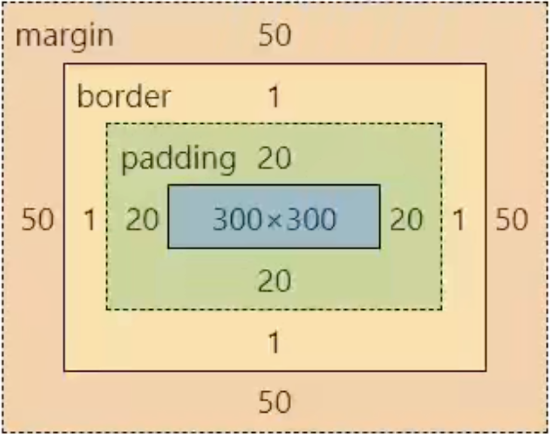
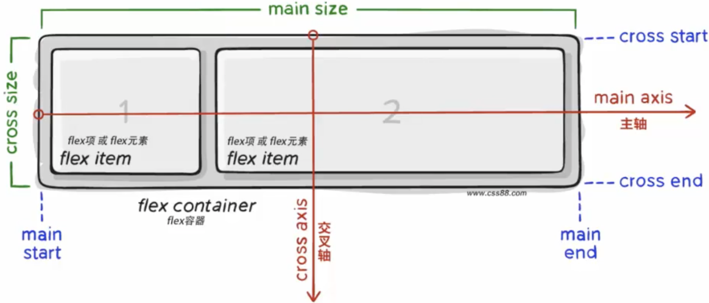
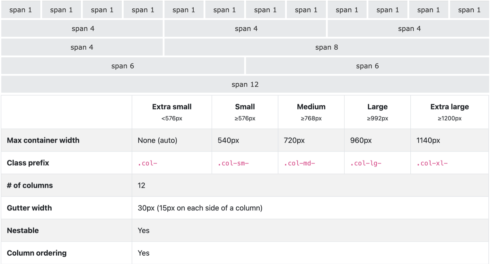

# Frontend

> Generated from the [frontend reading map](../../frontend/index.md). Edit the map and its linked source notes. Internal section links use Obsidian heading fragments; source notes remain standard Markdown.

## 1. 浏览器如何把 URL 变成第一帧？

案例背景：用户打开 `https://example.test/reports?sort=recent#summary`，需要看到最近报表；随后点击“最早优先”，期望列表更新。先沿初次导航走到可见页面，再从同一页跟进点击。

~~~mermaid
flowchart TD
    A[输入报表 URL] --> B[导航取得 HTML 响应]
    B --> C[逐步解析 HTML<br/>建立 DOM 并发现资源]
    C --> D[已有可显示内容<br/>当前渲染所需 CSS 就绪]
    C --> E[HTML 解析结束、模块图就绪<br/>样式不再阻塞脚本]
    D --> F[渲染机会：样式、布局、绘制<br/>栅格化与合成后显示首帧]
    E --> G[reports.js 模块求值<br/>注册筛选处理器]
    F --> H[画面可见且处理器已就绪]
    G --> H
    H --> I[点击最早优先<br/>更新 URL、选中态与行顺序]
    I --> J[后续渲染机会显示新顺序]
~~~

图的两条分支分别跟踪“画面可见”和“处理器可用”。解析期间，CSS、模块脚本、图片获取与后续 HTML 解析可以交叠推进；不必等所有资源都到齐才有首帧。模块图获取完成只表示依赖资源已就绪；普通模块还要等 HTML 解析结束，并满足脚本阻塞样式表状态，才开始求值。图片若晚到，可以填入预留空间而不必挪动已有内容。图是帮助跟踪这条报表路线的模型，不是每个引擎都必须遵循的逐步流水线。浏览器负责导航、资源协调与画面呈现，JavaScript engine（JavaScript 引擎，如 V8、JavaScriptCore 或 SpiderMonkey）负责执行脚本；各自的进程和线程边界属于实现选择。

### 先确定浏览器要打开什么

地址栏文本先被判定为搜索词还是 URL；这里已给出 URL，因此例子从跨文档导航开始。路径 `/reports` 和查询 `sort=recent` 会参与请求；片段 `#summary` 留在浏览器端，不会随 HTTP 请求发给服务器。匹配范围的 Service Worker（服务工作线程）或可用缓存可能直接提供响应；若走网络，缓存也可能需要验证。对本例的 HTTPS URL，协议、主机和端口共同确定 origin（源）；有匹配的活动连接时浏览器可以复用，需要新建连接且没有可用主机地址时才查询 Domain Name System（域名系统，DNS）。Transport Layer Security（传输层安全协议，TLS）可保护传输；HTTP/2 常运行在 TCP/TLS 上，HTTP/3 使用 QUIC。浏览器随后发送带 `/reports?sort=recent` 的请求并收到响应头和响应体，再将响应体按到达情况交给新 `Document` 的 HTML parser。协议协商、重定向、缓存与连接复用等细节见[HTTP、DNS 与连接建立](../../engineering-foundations/networking/http-protocols-and-websockets.md)。

`#summary` 指向当前文档里的位置。后续应用也能用 History API 改变当前 URL，而不获取该 URL 对应的新文档。浏览器后退时，浏览器可能直接恢复符合条件的既有页面状态（back/forward cache，前进/后退缓存）；这与从 HTTP 缓存重新使用响应不是一回事。见[每次 URL 变化都会加载新文档吗？](#2.%20%E6%AF%8F%E6%AC%A1%20URL%20%E5%8F%98%E5%8C%96%E9%83%BD%E4%BC%9A%E5%8A%A0%E8%BD%BD%E6%96%B0%E6%96%87%E6%A1%A3%E5%90%97%EF%BC%9F)和[HTTP、DNS 与连接建立](../../engineering-foundations/networking/http-protocols-and-websockets.md)。

### 响应到达时，解析和资源获取可以交叠

假设 `/reports` 返回如下 HTML。服务端已经把报表标题和初始行放进响应，浏览器可在客户端代码完成之前显示它们。

~~~html
<!doctype html>
<link rel="stylesheet" href="/reports.css">
<script type="module" src="/reports.js"></script>
<main>
  <h1 id="summary">Recent reports</h1>
  
  <div id="sort-controls">
    <button type="button" data-sort="recent" aria-pressed="true"><span>Most recent</span></button>
    <button type="button" data-sort="oldest" aria-pressed="false"><svg aria-hidden="true"></svg><span>Oldest first</span></button>
  </div>
  <ol id="reports"><li data-id="may">May report</li><li data-id="april">April report</li></ol>
</main>
~~~

浏览器不必等完整响应下载完才开始解析；随着标记到达，HTML parser 建立 DOM，并发现样式表、模块脚本和图片等资源。浏览器通常能并行获取独立资源，也可能用实现特有的预扫描提前发现资源。适用于当前媒体环境的外部样式表可能阻止首次显示；没有 `async` 或 `defer` 的解析器插入经典脚本会阻塞 HTML 解析。这里的普通模块脚本会并行获取，等解析完成、模块依赖图就绪且阻塞脚本的样式表条件满足后运行。具体脚本依赖关系见[脚本如何影响 HTML 解析与文档就绪？](#3.%20%E8%84%9A%E6%9C%AC%E5%A6%82%E4%BD%95%E5%BD%B1%E5%93%8D%20HTML%20%E8%A7%A3%E6%9E%90%E4%B8%8E%E6%96%87%E6%A1%A3%E5%B0%B1%E7%BB%AA%EF%BC%9F)。

DOM 表示文档节点，CSS 规则决定这些节点如何呈现。浏览器按需计算样式和布局：例如标题文字的换行取决于字体和可用宽度，图片的宽高属性则让图片数据到达前也能先分配画面空间。后到的字体仍可能改变文字宽度或换行。渲染引擎（如 Blink、WebKit、Gecko）据此准备绘制结果，再把内容转换为像素并组合成待显示画面；JavaScript 引擎（如 V8、JavaScriptCore、SpiderMonkey）负责执行脚本。Blink/Chromium 的 RenderingNG 是一种实现实例，不是所有浏览器的强制结构。

### 从首帧交接到筛选更新

首帧可能先于 `load` 事件和客户端代码可交互的时点出现。比如 HTML 已显示报表，但模块脚本尚未完成下载、运行或注册点击处理器。若报表由 React 服务端输出，hydration（客户端水合）还要在已有 DOM 上运行客户端代码并接入组件行为，见[Next.js 中的 hydration 与流式渲染](#%E6%9C%8D%E5%8A%A1%E7%AB%AF%E4%B8%8E%E5%AE%A2%E6%88%B7%E7%AB%AF%E7%BB%84%E4%BB%B6%E5%9C%A8%E5%93%AA%E6%9D%A1%E7%BA%BF%E4%BA%A4%E6%8E%A5)。若点击没有反馈，先确认处理器何时可用；若处理器已经注册，则查看事件是否被主线程上其他工作挡住。

当用户点击“最早优先”，`/reports.js` 的 DOM 事件处理器可以把 `sort=oldest` 写入 URL，设置按钮的 `aria-pressed` 状态，并改动列表节点。节点修改立即改变 DOM；样式、布局、绘制和之后的画面呈现则由浏览器在后续工作中按需完成。异步处理器与画面更新之间的关系见[浏览器 JavaScript 何时运行，画面何时更新？](#5.%20%E6%B5%8F%E8%A7%88%E5%99%A8%20JavaScript%20%E4%BD%95%E6%97%B6%E8%BF%90%E8%A1%8C%EF%BC%8C%E7%94%BB%E9%9D%A2%E4%BD%95%E6%97%B6%E6%9B%B4%E6%96%B0%EF%BC%9F)，点击如何到达处理器见[DOM 事件如何传播，何时适合事件委托？](#4.%20DOM%20%E4%BA%8B%E4%BB%B6%E5%A6%82%E4%BD%95%E4%BC%A0%E6%92%AD%EF%BC%8C%E4%BD%95%E6%97%B6%E9%80%82%E5%90%88%E4%BA%8B%E4%BB%B6%E5%A7%94%E6%89%98%EF%BC%9F)，更新后可能需要的布局和绘制见[为什么一次 DOM 改动会增加布局或绘制工作？](#11.%20%E4%B8%BA%E4%BB%80%E4%B9%88%E4%B8%80%E6%AC%A1%20DOM%20%E6%94%B9%E5%8A%A8%E4%BC%9A%E5%A2%9E%E5%8A%A0%E5%B8%83%E5%B1%80%E6%88%96%E7%BB%98%E5%88%B6%E5%B7%A5%E4%BD%9C%EF%BC%9F)。

| 现象 | 优先检查的阶段 |
|---|---|
| 首个 HTML 字节迟迟不到 | 重定向、缓存命中、连接建立、服务端响应和网络瀑布 |
| HTML 已到，主要内容仍迟 | 关键 CSS/脚本的阻塞关系、LCP 资源发现与渲染时机 |
| 页面可见，筛选点击迟迟没有反馈 | 点击前主线程工作、处理器运行时间、处理后的渲染工作 |
| 内容出现后位置跳动 | 图片或字体的尺寸和到达时机、后插入内容及布局偏移记录 |

先沿测得的依赖关系定位，再决定要改请求、脚本、布局还是绘制。相同的“首屏慢”现象可能来自服务器响应、资源发现或内容渲染，单独改 CSS 选择器无法同时解释这些原因。见[如何测量并诊断网页性能问题？](#12.%20%E5%A6%82%E4%BD%95%E6%B5%8B%E9%87%8F%E5%B9%B6%E8%AF%8A%E6%96%AD%E7%BD%91%E9%A1%B5%E6%80%A7%E8%83%BD%E9%97%AE%E9%A2%98%EF%BC%9F)。

> [!info]- 来源
> - URL 片段及导航后文档状态： [WHATWG HTML：导航与会话历史](https://html.spec.whatwg.org/multipage/nav-history-apis.html)，持续更新规范，导航、同文档导航与历史遍历章节；[WHATWG Fetch Standard](https://fetch.spec.whatwg.org/)，请求 URL 处理章节。核对日期：2026-11-06。
> - HTTPS origin、DNS 与本例网络协议： [WHATWG URL Standard：Origin](https://url.spec.whatwg.org/#origin)；[RFC 1034：DNS concepts and facilities](https://www.rfc-editor.org/rfc/rfc1034)、[RFC 1035：DNS implementation and specification](https://www.rfc-editor.org/rfc/rfc1035)；[RFC 8446：TLS 1.3](https://www.rfc-editor.org/rfc/rfc8446)；[RFC 9113：HTTP/2](https://www.rfc-editor.org/rfc/rfc9113)、[RFC 9000：QUIC](https://www.rfc-editor.org/rfc/rfc9000) 与 [RFC 9114：HTTP/3](https://www.rfc-editor.org/rfc/rfc9114)。核对日期：2026-11-06。
> - HTML 解析和浏览器渲染在 Chromium 中的一种实现： [Chromium RenderingNG architecture](https://developer.chrome.com/docs/chromium/renderingng-architecture)，架构概览。核对日期：2026-11-06。
> - 浏览器渲染引擎名称： [Blink](https://www.chromium.org/blink/)，Chromium rendering engine；[WebKit](https://webkit.org/)，WebKit browser engine；[Gecko](https://firefox-source-docs.mozilla.org/overview/gecko.html)，Firefox rendering engine。JavaScript 引擎名称： [V8](https://v8.dev/)、[JavaScriptCore](https://docs.webkit.org/Deep%20Dive/JSC/JavaScriptCore.html)、[SpiderMonkey](https://firefox-source-docs.mozilla.org/js/)。核对日期：2026-11-06。
## 2. 每次 URL 变化都会加载新文档吗？

案例背景：用户先打开 `https://example.test/reports?sort=recent#summary`，随后点“最早优先”并可能按浏览器后退。要让这三个时点显示正确的报表，先判断浏览器是在换文档、跳转片段，还是只更新当前文档的历史地址。

### 先解析 URL，再选导航操作

用 `URL` 解析地址，避免自己按 `?`、`&` 或 `#` 切字符串。`searchParams.get()` 读取一个值，`getAll()` 读取同名多值，`set()` 替换该名字的值，`append()` 则有意保留并追加一个值；对象序列化时会处理 URL 编码。查询参数来自地址栏或外部链接，必须按业务允许值校验，也不要把口令或访问令牌放进 URL。

| 需要的行为 | API / 行为 | 是否获取新文档 |
|---|---|---|
| 打开另一个地址并留下新历史项 | 点击 `<a>` 或 `location.assign(url)` | 通常换 `Document`；目标只是片段时可留在当前 `Document` |
| 打开地址并替换当前历史项 | `location.replace(url)` | 替换当前历史项；目标是否换 `Document` 仍取决于导航目标 |
| 当前文档新增一项路由状态 | `history.pushState(state, "", sameOriginUrl)` | 否 |
| 修改当前历史项的路由状态 | `history.replaceState(state, "", sameOriginUrl)` | 否 |

History API 的目标 URL 必须符合当前文档可改写 URL 的规则；对本例的 HTTPS 页面，可以改路径、查询和片段，但不能改协议、主机或端口。`pushState()` 和 `replaceState()` 都不会发起该地址的网络请求，也不会因为调用本身派发 `popstate` 或 `hashchange`。应用若要显示与新 URL 对应的内容，仍须自己同步界面；目标是别的服务器资源时，应正常导航或显式发出请求。

### 让筛选状态跟随地址栏与前进后退

报表页面初始地址是 `/reports?sort=recent#summary`。这次服务器返回的 HTML 已包含 `h1#summary`、两个筛选按钮以及 May、April 两行；普通模块脚本由首帧示例头部的 `<script type="module" src="/reports.js"></script>` 引用。用户点击“最早优先”后，模块将查询参数改成 `sort=oldest`，并把已在客户端的数据按日期升序排进列表。若数据由服务器提供，更新 URL 后还需按该状态请求新结果，并处理加载、错误和过期响应。

~~~html
<!-- /reports?sort=recent 的服务端 HTML 初始状态 -->
<h1 id="summary">Recent reports</h1>

<div id="sort-controls">
  <button type="button" data-sort="recent" aria-pressed="true"><span>Most recent</span></button>
  <button type="button" data-sort="oldest" aria-pressed="false"><svg aria-hidden="true"></svg><span>Oldest first</span></button>
</div>
<ol id="reports">
  <li data-id="may">May report</li>
  <li data-id="april">April report</li>
</ol>
~~~

以下是 `/reports.js` 中的代码，不是 HTML 里的内联脚本：

~~~javascript
const records = [
  { id: "may", date: "2026-05-01", label: "May report" },
  { id: "april", date: "2026-04-01", label: "April report" },
];
const list = document.querySelector("#reports");
const controls = document.querySelector("#sort-controls");

function sortFromUrl() {
  return new URL(location.href).searchParams.get("sort") === "oldest"
    ? "oldest"
    : "recent";
}

function renderReports(sort) {
  const rows = [...records].sort((a, b) =>
    sort === "oldest" ? a.date.localeCompare(b.date) : b.date.localeCompare(a.date)
  );
  for (const button of controls.querySelectorAll("button[data-sort]")) {
    button.setAttribute("aria-pressed", String(button.dataset.sort === sort));
  }
  list.replaceChildren(...rows.map(({ id, label }) => {
    const item = document.createElement("li");
    item.dataset.id = id;
    item.textContent = label;
    return item;
  }));
}

function chooseSort(sort) {
  if (sort !== "recent" && sort !== "oldest") return;
  if (sort === sortFromUrl()) return;
  const url = new URL(location.href);
  url.searchParams.set("sort", sort);
  history.pushState(null, "", url.href);
  renderReports(sort);
}

controls.addEventListener("click", (event) => {
  const target = event.target instanceof Element ? event.target : null;
  const button = target?.closest("button[data-sort]");
  if (!button || !controls.contains(button)) return;
  chooseSort(button.dataset.sort);
});
window.addEventListener("popstate", () => renderReports(sortFromUrl()));
renderReports(sortFromUrl());
~~~

`renderReports()` 先按 URL 状态选顺序，再同步两个按钮的 `aria-pressed`，最后用 `replaceChildren()` 写入行。初始服务器 HTML 已显示 May → April；用户点“最早优先”后，新地址是 `/reports?sort=oldest#summary`，按钮切成 pressed，行变为 April → May。若用户分享一条 `sort=oldest` 深链，`reports.js` 的初次运行会按 URL 修正列表；要让首批 HTML 本身就显示正确顺序，服务器也应按查询参数生成行和按钮状态。

`pushState()` 只记录 URL；点击处理器主动调用 `renderReports()`，本例也不把应用状态重复存进 `history.state`。其他应用若把额外恢复信息放在 `state` 参数里，可以在 `popstate` 的 `event.state` 读取；本例将 URL 当作排序状态的唯一来源。接着用户在这两条共享同一个 `Document` 的历史项之间后退或前进时，浏览器派发 `popstate`，同一个仍在的监听器从当前 `location` 读回排序并恢复按钮与列表。再后退离开这个文档时，当前监听器并不接管另一文档的恢复或重新加载；浏览器处理的是另一条历史项及其页面状态。

通过地址栏、链接或 `location` 改变片段会执行片段导航，可让浏览器滚到 `#summary` 并建立历史项；这是浏览器导航行为，不需要应用重画列表。脚本调用 History API 改成另一个片段则不会自动滚动，也不会因为调用本身派发 `hashchange`；遍历相应历史项时，`popstate` 可能与片段变化事件共同出现。客户端路由器可以复用这些历史项，但 URL 变化与视图绘制是两项不同工作。

浏览器首次收到 `.../reports?sort=recent#summary` 时，`#summary` 是浏览器用来定位的片段，服务器只处理路径与查询。筛选点击改成 `sort=oldest` 后，仍是同一个 `Document`：浏览器不重新解析 `/reports`，应用继续负责产生新列表节点。这个边界让地址可复制、可返回，同时不把 History API 误解成网络导航。

**延伸：** [DOM 事件如何传播，何时适合事件委托？](#4.%20DOM%20%E4%BA%8B%E4%BB%B6%E5%A6%82%E4%BD%95%E4%BC%A0%E6%92%AD%EF%BC%8C%E4%BD%95%E6%97%B6%E9%80%82%E5%90%88%E4%BA%8B%E4%BB%B6%E5%A7%94%E6%89%98%EF%BC%9F)解释点击处理器如何收到按钮事件；React 中 URL 与客户端导航如何映射到视图，见[React 路由如何把 URL 映射到视图？](#58.%20React%20%E8%B7%AF%E7%94%B1%E6%80%8E%E6%A0%B7%E6%8A%8A%E5%9C%B0%E5%9D%80%E6%98%A0%E5%B0%84%E5%88%B0%E7%95%8C%E9%9D%A2%E5%B9%B6%E5%8A%A0%E8%BD%BD%E6%95%B0%E6%8D%AE%EF%BC%9F)，组件状态更新见[React 如何把用户操作变成更新后的界面？](#6.%20React%E5%A6%82%E4%BD%95%E6%8A%8A%E4%B8%80%E6%AC%A1%E7%94%A8%E6%88%B7%E6%93%8D%E4%BD%9C%E5%8F%98%E6%88%90%E7%95%8C%E9%9D%A2%E6%9B%B4%E6%96%B0%EF%BC%9F)。

> [!info]- 来源
> - URL 查询参数的解析与序列化： [WHATWG URL Standard：URLSearchParams](https://url.spec.whatwg.org/#urlsearchparams-class)，持续更新规范，URLSearchParams 接口章节。核对日期：2026-11-06。
> - 片段导航、同文档导航、会话历史遍历、`pushState()`、`popstate` 与 `hashchange`： [WHATWG HTML：导航与会话历史](https://html.spec.whatwg.org/multipage/nav-history-apis.html)，持续更新规范，navigation、History interface 与事件章节。核对日期：2026-11-06。
## 3. 脚本如何影响 HTML 解析与文档就绪？

案例背景：报表服务器已返回标题、筛选按钮和初始行，浏览器还在解析 HTML，并同时获取 `/reports.css` 与 `/reports.js`。用户要尽快看到内容，之后点击按钮时脚本也必须已经注册处理器。下面按脚本下载、执行、文档就绪的先后关系判断哪些工作会挡住哪一步。

### 不同脚本属性怎样改变解析顺序？

表格说的是 HTML parser（HTML 解析器）插入的脚本；动态插入的脚本有不同默认调度，不能把它们混为一谈。

| 脚本形式 | 下载与解析的关系 | 运行时机与顺序 |
|---|---|---|
| 外部经典脚本，不带 `async` / `defer` | parser 遇到时开始获取并暂停继续解析 | 资源可运行后在 parser 继续前执行，保持文档顺序 |
| 外部经典脚本 `defer` | 与解析并行获取 | 解析完成后、`DOMContentLoaded` 前执行；多个 defer 脚本按文档顺序 |
| 外部经典脚本 `async` | 与解析并行获取 | 下载就绪后尽快执行；若解析还在进行，会暂时打断解析；不保证多个 async 脚本的顺序 |
| 普通模块脚本 | 模块及依赖图与解析并行获取 | 默认延后到解析完成后执行，遵循模块依赖关系 |
| `async` 模块脚本 | 模块及依赖图与解析并行获取 | 模块图就绪后尽快执行，不保证相对其他异步脚本的顺序 |
| 内联经典脚本，有无 `defer` | 没有外部文件要获取 | parser 到达该元素且没有待等的阻塞样式表时执行；没有 `src` 时 `defer` 不起延后作用 |

`defer` 适合依赖已解析文档、且需要保持外部经典脚本文档顺序的代码。`async` 适合执行不依赖解析结果或其他脚本的独立工作。模块脚本默认延后执行，给模块加 `async` 会改变这个选择。

### 为什么解析器有时必须停下来？

解析 HTML 就像按顺序读取标记并逐个建立节点。经典脚本能在节点还没建完时查询、修改文档，甚至用 `document.write()` 改变后续解析结果；浏览器不能一概把这种脚本当作与文档无关的文件而继续前进。因此，脚本获取可以和其他资源获取重叠，但脚本执行本身可能成为解析的依赖点。

样式表对脚本的影响不是浏览器先分析某段 JavaScript 是否调用了 `getComputedStyle()`。HTML 定义了一个脚本阻塞样式表状态：样式表元素由 parser 创建时已启用、参与样式规则、媒体条件匹配且尚未加载完成，才会进入该文档的阻塞集合。后续要执行的同步 parser 脚本或延后脚本，会按这个集合判断是否等待；即便 `/reports.js` 只给按钮注册事件，也可能先等 `/reports.css`。

适用于当前媒体环境的外部样式表通常会阻止首次绘制。不是“所有 CSS 必须全部下载后才能开始任何绘制”，而是当前渲染和脚本执行各自要满足规范定义的样式依赖。

沿用报表页的 HTML：

~~~html
<head>
  <link rel="stylesheet" href="/reports.css">
  <script type="module" src="/reports.js"></script>
</head>
<main>
  <h1 id="summary">Recent reports</h1>
  
  <div id="sort-controls">
    <button type="button" data-sort="recent" aria-pressed="true"><span>Most recent</span></button>
    <button type="button" data-sort="oldest" aria-pressed="false"><svg aria-hidden="true"></svg><span>Oldest first</span></button>
  </div>
  <ol id="reports"><li data-id="may">May report</li><li data-id="april">April report</li></ol>
</main>
~~~

这段沿用首帧章的完整报表结构：服务器先输出 May → April 的行，`#summary` 是片段目标；外部模块 `/reports.js` 在 parser 完成后运行。

| 此刻的资源状态 | parser 与首帧 | 筛选处理器与就绪事件 |
|---|---|---|
| HTML 主体和 `/reports.css` 已就绪，模块图仍在下载，图片还未到 | parser 已建出标题、按钮和两行；样式可用时浏览器可在渲染机会绘出首帧；图片宽高让空位先保留 | `reports.js` 尚未运行，按钮还没有处理器，`DOMContentLoaded` 尚未触发 |
| `/reports.css` 仍是当前 parser 创建的阻塞样式表，模块图已就绪 | parser 仍可继续解析普通模块脚本后的 HTML；若当前样式表阻止渲染，首帧会等到样式依赖解除 | 普通模块仍要等解析结束、模块图就绪且文档没有阻塞脚本的样式表；脚本之后才能注册处理器，随后才排入 `DOMContentLoaded` |

在表格第一行的状态下，本页可以先显示标题与预渲染行；用户如果过早点击，页面还可能没有 listener。待模块图与阻塞样式表条件满足，`/reports.js` 运行并注册处理器。若图片较晚到，预留的宽高减少它到达后挤动文字的机会。

### `DOMContentLoaded` 和 `load` 分别说明什么？

`DOMContentLoaded` 在文档解析完成、parser 的延后脚本队列处理流程之后触发；普通 `defer` 脚本和没有异步模块依赖、且模块本身没有顶层 `await` 的模块代码会在此流程同步运行，因此可在事件前注册处理器。若模块使用顶层 `await`、依赖异步模块，或只启动一个异步请求并把后续工作放进 Promise 回调，应用的后续初始化可以晚于 `DOMContentLoaded`；因此这个事件不代表所有异步初始化已完成。它不等图片或 `async` 脚本完成。因为延后脚本可能等待脚本阻塞样式表，所以样式表也可能间接推迟这个事件。

`load` 要等文档中所有仍会延迟该事件的资源；普通图片、样式表、脚本和子框架可能在其中，懒加载资源通常不必挡住它。具体资源是否延迟 load 由 HTML 的加载算法定义。两种事件都不是“首帧已出现”或“按钮已可用”的指标。

两种事件都不能回答“用户什么时候第一次看到主要内容”或“筛选按钮现在是否可用”。首帧可以早于 `load`，而报表内容也可能已显示、模块脚本还没注册筛选处理器。反过来，`DOMContentLoaded` 触发后，一次长脚本任务仍会让点击处理器排队等待。可见时点和就绪事件的区别见[浏览器如何把 URL 变成第一帧？](#1.%20%E6%B5%8F%E8%A7%88%E5%99%A8%E5%A6%82%E4%BD%95%E6%8A%8A%20URL%20%E5%8F%98%E6%88%90%E7%AC%AC%E4%B8%80%E5%B8%A7%EF%BC%9F)；用户侧的加载与交互数据见[如何测量并诊断网页性能问题？](#12.%20%E5%A6%82%E4%BD%95%E6%B5%8B%E9%87%8F%E5%B9%B6%E8%AF%8A%E6%96%AD%E7%BD%91%E9%A1%B5%E6%80%A7%E8%83%BD%E9%97%AE%E9%A2%98%EF%BC%9F)。

> [!info]- 来源
> - 解析器插入的经典脚本、`async`、`defer` 与模块调度： [WHATWG HTML：脚本元素](https://html.spec.whatwg.org/multipage/scripting.html#the-script-element)，持续更新规范，脚本准备与执行算法章节。核对日期：2026-11-06。
> - 阻塞脚本样式表的判定状态： [WHATWG HTML：样式与脚本交互](https://html.spec.whatwg.org/multipage/semantics.html#has-a-style-sheet-that-is-blocking-scripts)，持续更新规范，media 匹配、启用与加载状态条件。核对日期：2026-11-06。
> - 延后脚本、模块脚本到 `DOMContentLoaded` / `load` 的顺序： [WHATWG HTML：解析结束](https://html.spec.whatwg.org/multipage/parsing.html#the-end)与[HTML 中调用脚本](https://html.spec.whatwg.org/multipage/webappapis.html#calling-scripts)，持续更新规范，解析结束、延后脚本队列和模块求值步骤。核对日期：2026-11-06。
## 4. DOM 事件如何传播，何时适合事件委托？

案例背景：用户打开 `https://example.test/reports?sort=recent#summary` 后，页面显示 May、April 两行和“最早优先”按钮。点击按钮要把 `oldest` 这个筛选意图交给应用，由应用更新地址和列表。按钮里面还可能有图标或文字节点；事件委托必须从真实事件目标找到所属按钮，并确认它属于这个工具栏。

### 一次点击沿哪些节点传播？

浏览器为事件确定传播路径后，监听器可以沿路径经历三个阶段：捕获阶段从外层祖先走向目标；目标阶段运行目标上的监听器；若事件的 `bubbles` 为真，冒泡阶段再从目标向祖先返回。不是所有事件都会冒泡，所以委托前要确认事件类型的传播约定。

~~~javascript
const button = document.querySelector('#sort-controls button[data-sort="oldest"]');
const label = button.querySelector("span");

document.body.addEventListener("click", () => console.log("body bubble"));
document.body.addEventListener("click", () => console.log("body capture"), { capture: true });
label.addEventListener("click", () => console.log("label target"));
button.addEventListener("click", () => console.log("button bubble"));

// 点击 span：body capture → span target → button bubble → body bubble
~~~

`event.target` 是最初的事件目标；`event.currentTarget` 是当前正在运行监听器的对象。若按钮里还有 `<svg>` 或 `<span>`，`target` 可能是它们；处理器应先找到最近的筛选按钮。Shadow DOM（影子 DOM）边界外的监听器可能看到被重定向的 `target`；事件的 `bubbles` 与 `composed` 标记影响事件能否穿过相应边界。

### 什么时候用父级监听器处理子控件？

事件委托让一个父级监听器处理多个后代控件，包括稍后插入的控件，因此不用逐一注册监听器。它适合事件会冒泡、父级确实拥有这些控件、目标匹配规则清楚的场景；它不会消除每次事件分发或处理器本身的计算。

~~~html
<h1 id="summary">Recent reports</h1>
<div id="sort-controls">
  <button type="button" data-sort="recent" aria-pressed="true"><span>Most recent</span></button>
  <button type="button" data-sort="oldest" aria-pressed="false"><svg aria-hidden="true"></svg><span>Oldest first</span></button>
</div>
<ol id="reports"><li data-id="may">May report</li><li data-id="april">April report</li></ol>
~~~

~~~javascript
const controls = document.querySelector("#sort-controls");

controls.addEventListener("click", (event) => {
  const target = event.target instanceof Element ? event.target : null;
  const button = target?.closest("button[data-sort]");
  if (!button || !controls.contains(button)) return;

  const sortIntent = button.dataset.sort;
  console.log("Sort requested:", sortIntent); // 点击“最早优先”时得到 "oldest"
});
~~~

点击 `span` 或 `svg` 时，`closest()` 会从该后代向上找到带 `data-sort` 的按钮；`controls.contains(button)` 确认匹配结果没有越出工具栏。事件处理器交出的值是按钮声明的 `recent` 或 `oldest`；点击“最早优先”时输出 `oldest`。应用据此把查询参数写回 URL、切换按钮的 `aria-pressed`，并将列表行改成 April → May；这条状态转换见[每次 URL 变化都会加载新文档吗？](#2.%20%E6%AF%8F%E6%AC%A1%20URL%20%E5%8F%98%E5%8C%96%E9%83%BD%E4%BC%9A%E5%8A%A0%E8%BD%BD%E6%96%B0%E6%96%87%E6%A1%A3%E5%90%97%EF%BC%9F)。如果事件处理器要移除匹配元素再循环，先选择静态快照或合适的实时集合，避免移除节点改变下一次索引；见[如何选择 DOM 集合？](#54.%20%E4%BF%AE%E6%94%B9%20DOM%20%E6%97%B6%EF%BC%8CHTMLCollection%20%E5%92%8C%20NodeList%20%E4%BC%9A%E6%80%8E%E6%A0%B7%E5%8F%98%E5%8C%96%EF%BC%9F)。

### 默认动作与传播控制是两回事

按钮若位于表单中，点击可能触发表单提交；这是与事件传播分开的默认动作。`preventDefault()` 只在事件可取消且监听器不是 passive 时取消默认动作，它不会停止冒泡。`stopPropagation()` 阻止事件继续传到路径上后续对象；`stopImmediatePropagation()` 还会阻止当前对象上后续监听器运行。

如果滚动或触控监听器不需要取消浏览器默认滚动，设置 `{ passive: true }` 能表明这一点；passive 监听器调用 `preventDefault()` 无法取消默认动作。DOM 标准规定，未显式设置 `passive` 的 `touchstart`、`touchmove`、`wheel` 和 `mousewheel` 监听器，在 `Window`、`Document`、`documentElement` 或 `body` 上默认 passive 为 true；确实需要拦截时，应先按事件的 `cancelable` 状态判断，再显式设置 `{ passive: false }`。

### 移动端点击与手势策略

历史上的移动端 click 延迟有特定条件：部分浏览器曾等待判断一次触摸是否还会成为双击缩放手势。它不是今天所有浏览器、所有 viewport 或所有输入模式下的固定延迟。先设置符合设备宽度的 viewport；不要为了绕开历史延迟而禁止用户缩放。

~~~html
<meta name="viewport" content="width=device-width, initial-scale=1">
~~~

若某个控件不需要双击缩放，但仍应允许平移和双指缩放，可以对该控件使用 Pointer Events 的 `touch-action: manipulation`：

~~~css
#sort-controls button[data-sort] {
  touch-action: manipulation;
}
~~~

它让浏览器保留平移和连续缩放，同时不把双击缩放作为该元素上的手势。把规则限制在确实需要的控件，不要用 `touch-action: none` 全局封锁操作。原生 `<button>` 自带键盘激活；自制的 `role="button"` 还必须补足键盘行为。Chrome 的 viewport 诊断指出一个特定条件：初始视口未针对移动设备优化时，点击可能延后至多 300 毫秒；其他浏览器和输入设置会不同，不能把这个值当成所有移动端点击的固定时延。除非目标设备实测仍有兼容问题，不要同时在 touch-end 和 click 上触发同一动作，以免合成 click 与原生 click 重复执行。

### 把浏览器事件交给 React 时，交接什么？

若同一报表页由 React 管理，浏览器仍然派发 click；React 的 `onClick` handler 因这次点击触发，并把筛选意图 `oldest` 传给状态更新。事件处理器可从目标元素读取该值，也可由按钮各自的闭包传入。浏览器这一侧的输入是已发生的事件、当前 URL `sort=recent` 和当前 DOM；交给下一章的应用意图是“筛选变为 `oldest`”。React 章节从这个输入继续，讲 state 快照、组件重算和 commit 后需要的 DOM 变化。见[React 如何把用户操作变成更新后的界面？](#6.%20React%E5%A6%82%E4%BD%95%E6%8A%8A%E4%B8%80%E6%AC%A1%E7%94%A8%E6%88%B7%E6%93%8D%E4%BD%9C%E5%8F%98%E6%88%90%E7%95%8C%E9%9D%A2%E6%9B%B4%E6%96%B0%EF%BC%9F)。React 管理的节点应由 React state 描述；若另用 DOM API 直接改它们，下一次 React commit 可能覆盖这些修改。

React 的 JSX 事件名和事件对象保留常用的 DOM 事件概念，`onClick` 默认冒泡、`onClickCapture` 对应捕获。事件委托的具体根节点属于 React 实现细节：React 17 将委托根从 `document` 移到了 React root container；早期 React DOM 还会池化 SyntheticEvent，React 17 起移除了池化，所以当前 React DOM 不需要为异步读取事件调用 `persist()`。React Native 的事件行为另有边界。

**延伸：**[浏览器如何把 URL 变成第一帧？](#1.%20%E6%B5%8F%E8%A7%88%E5%99%A8%E5%A6%82%E4%BD%95%E6%8A%8A%20URL%20%E5%8F%98%E6%88%90%E7%AC%AC%E4%B8%80%E5%B8%A7%EF%BC%9F)交代该页面的首帧和筛选入口；[每次 URL 变化都会加载新文档吗？](#2.%20%E6%AF%8F%E6%AC%A1%20URL%20%E5%8F%98%E5%8C%96%E9%83%BD%E4%BC%9A%E5%8A%A0%E8%BD%BD%E6%96%B0%E6%96%87%E6%A1%A3%E5%90%97%EF%BC%9F)展示同一点击如何更新历史地址和列表；[浏览器 JavaScript 何时运行，画面何时更新？](#5.%20%E6%B5%8F%E8%A7%88%E5%99%A8%20JavaScript%20%E4%BD%95%E6%97%B6%E8%BF%90%E8%A1%8C%EF%BC%8C%E7%94%BB%E9%9D%A2%E4%BD%95%E6%97%B6%E6%9B%B4%E6%96%B0%EF%BC%9F)说明 click 处理器如何等待主线程并交接到渲染机会；[跨浏览上下文如何通信？](#51.%20%E5%90%8C%E4%B8%80%E6%8A%A5%E8%A1%A8%E5%9C%A8%E5%A4%9A%E4%B8%AA%E6%A0%87%E7%AD%BE%E9%A1%B5%E4%B8%AD%E6%80%8E%E6%A0%B7%E4%BA%A4%E6%8D%A2%E5%8F%98%E5%8C%96%EF%BC%9F)讲跨文档消息；[JavaScript 事件总线怎样处理重入？](#53.%20JavaScript%20%E4%BA%8B%E4%BB%B6%E6%80%BB%E7%BA%BF%E5%9C%A8%E7%9B%91%E5%90%AC%E5%99%A8%E4%B8%AD%E9%87%8D%E5%85%A5%E6%97%B6%E6%80%8E%E6%A0%B7%E4%BF%9D%E6%8C%81%E9%A1%BA%E5%BA%8F%EF%BC%9F)讨论应用层发布/订阅。

> [!info]- 来源
> - 捕获、目标、冒泡、事件目标、默认动作及取消： [WHATWG DOM：事件分发](https://dom.spec.whatwg.org/#concept-event-dispatch)，Living Standard，事件分发算法；[WHATWG DOM：Event 接口](https://dom.spec.whatwg.org/#interface-event)，事件标记与取消行为。核对日期：2026-11-06。
> - `touch-action` 的手势边界： [Pointer Events Level 3](https://www.w3.org/TR/pointerevents3/#the-touch-action-css-property)，W3C Recommendation，`manipulation` 值与直接操控行为章节。核对日期：2026-11-06。
> - passive 默认值与取消行为： [WHATWG DOM：事件监听器](https://dom.spec.whatwg.org/#dom-addeventlistener)，Living Standard，passive 监听器与阻止默认动作章节。核对日期：2026-11-06。
> - React 事件处理器与事件阶段： [React：Responding to Events](https://react.dev/learn/responding-to-events)；React 17 将委托根移到 root container：[React 17：Changes to Event Delegation](https://legacy.reactjs.org/blog/2020/08/10/react-v17-rc.html#changes-to-event-delegation)；React 17 移除事件池：[React 17：No Event Pooling](https://legacy.reactjs.org/blog/2020/08/10/react-v17-rc.html#no-event-pooling)。核对日期：2026-11-06。
> - 移动端 viewport 诊断的适用条件： [Chrome Performance Insights：Optimize viewport for mobile](https://developer.chrome.com/docs/performance/insights/viewport)，Chrome DevTools 指标说明。核对日期：2026-11-06。
## 5. 浏览器 JavaScript 何时运行，画面何时更新？

案例背景：报表页已经显示 `sort=recent` 的行，`/reports.js` 也已注册 click 处理器，用户点击“最早优先”。如果浏览器正忙，处理器什么时候能运行？处理器改完 URL 和 DOM 后，用户又要等到什么时候才能看到新顺序？沿一次点击走完这两个时间边界。

> [!info] 任务和微任务
> **task（任务）**是宿主安排的工作单元，例如用户输入、计时器回调或网络事件处理。一个 task 中的同步 JavaScript 不会被另一个普通 task 插入执行。**microtask（微任务）**用于当前工作结束后的短小延续，例如 Promise reaction（Promise 处理器）；微任务检查点会清空队列，包括在运行中新增的微任务。ECMAScript 定义 Promise 的语言行为，浏览器宿主定义它们怎样接入事件循环。

~~~mermaid
flowchart TD
    A[执行包含 click 的 task（任务）] --> B[同步处理器运行到返回]
    B --> C[完成 microtask（微任务）检查点]
    C -->|仍有微任务| C
    C --> D[事件循环选择下一项可运行任务]
    D --> E{选中的是渲染更新任务?}
    E -->|是| F[运行该次渲染更新的 requestAnimationFrame 回调]
    F --> G[按需执行样式、布局等渲染步骤]
    G --> C
    E -->|否| H[运行所选任务]
    H --> C
~~~

渲染机会会使用户代理把更新任务排入单独的 rendering task source（渲染任务源）；事件循环随后从可运行任务中选择下一项，选择策略不意味着每个 click 后同步检查一次渲染。图只表示一次交互后可能经过的顺序，不保证每轮都绘制；浏览器也会因刷新率、页面可见性和资源状况推迟或跳过画面更新。

图把这次 click 中 `/reports.js` 的业务处理器简化成一个同步段；真实事件分发还可能调用其他监听器，它们不在这条示例时序里。

### 微任务的先后顺序与让出的边界

~~~javascript
console.log("start");
setTimeout(() => console.log("timer task"), 0);
Promise.resolve().then(() => console.log("Promise reaction"));
queueMicrotask(() => console.log("queued microtask"));
console.log("end");
~~~

当前同步脚本先输出 `start`、`end`。脚本返回时排队的 Promise reaction 和 `queueMicrotask()` 回调按入队顺序在微任务检查点执行；计时器回调是后续 task，只有达到计时器允许执行的时点后才有资格运行。`setTimeout(fn, 0)` 不表示立刻切走，也不承诺下一个画面会先出现。若当前处理器很长，用户点击会等它完成才开始处理；若处理器不断追加微任务，检查点会持续排空队列，浏览器也就迟迟不能处理后续任务或渲染。

`new Promise(executor)` 中的 `executor` 在构造时同步运行；由 `.then()` 注册的 reaction 才排入微任务。上面的例子使用 `Promise.resolve().then()`，所以 `Promise reaction` 出现在同步输出之后。Promise 的语言行为见[异步 JavaScript](#39.%20How%20do%20callbacks,%20Promises,%20and%20async%20functions%20compose%20asynchronous%20work?%20/%20%E5%9B%9E%E8%B0%83%E3%80%81Promise%20%E4%B8%8E%20async%20%E5%87%BD%E6%95%B0%E5%A6%82%E4%BD%95%E7%BB%84%E5%90%88%E5%BC%82%E6%AD%A5%E4%BB%BB%E5%8A%A1%EF%BC%9F)。

在报表页的例子里，点击发生时可能正有脚本任务占用主线程，这会增加输入延迟。处理器开始后，`pushState()` 和节点修改是同步的；处理器结束后，微任务仍可能继续安排工作，浏览器再看是否有机会更新报表画面。`await Promise.resolve()` 或把工作切成一串微任务并不会主动让浏览器绘制。若计算确实太重，应把有界工作切到后续 task、Web Worker 或适合的框架调度策略；需要确认是哪段时间占用主线程时，沿 [INP 的交互阶段](#12.%20%E5%A6%82%E4%BD%95%E6%B5%8B%E9%87%8F%E5%B9%B6%E8%AF%8A%E6%96%AD%E7%BD%91%E9%A1%B5%E6%80%A7%E8%83%BD%E9%97%AE%E9%A2%98%EF%BC%9F)看录制结果。

### `requestAnimationFrame` 把写入对齐到渲染更新

若动画或视觉写入需要按渲染更新同步，使用 `requestAnimationFrame(callback)`。回调会在该次渲染更新的常规样式与布局步骤之前运行，参数提供可用于时间计算的高精度时间戳。调用率取决于可用的渲染机会和页面状态；刷新率、后台限速都会影响它，所以它不是固定的 60 Hz 计时器。把变换属性的写入放入 rAF 可以让写入时机与画面同步，但不会让计算免费，也不保证浏览器只做合成工作。DOM/样式写入后读取几何值仍可能触发同步布局，详见[为什么一次 DOM 改动会增加布局或绘制工作？](#11.%20%E4%B8%BA%E4%BB%80%E4%B9%88%E4%B8%80%E6%AC%A1%20DOM%20%E6%94%B9%E5%8A%A8%E4%BC%9A%E5%A2%9E%E5%8A%A0%E5%B8%83%E5%B1%80%E6%88%96%E7%BB%98%E5%88%B6%E5%B7%A5%E4%BD%9C%EF%BC%9F)。

### `requestIdleCallback` 只安排可推迟的小块工作

`requestIdleCallback(callback, { timeout })` 允许用户代理在空闲时段安排低优先级工作。`deadline.timeRemaining()` 是对剩余空闲时间的估计，不是硬性运行预算；每轮处理一个有界单元，剩余工作再排队。即使设置 `timeout`，回调被延迟到超时后也不应因此一次清空无界队列。该 API 并非所有浏览器都支持，需按目标环境检测；用 `setTimeout()` 代替时只能保证之后有一次计时器机会，不能保证当时空闲。

~~~javascript
function runIdleSlice(deadline) {
  if (!workQueue.length) return;
  if (deadline.didTimeout || deadline.timeRemaining() > 0) {
    processNext(workQueue.shift()); // 每次工作仍须有界
  }
  if (workQueue.length) requestIdleCallback(runIdleSlice, { timeout: 2000 });
}

requestIdleCallback(runIdleSlice, { timeout: 2000 });
~~~

React 等框架的 scheduler 是建立在宿主机制上的另一套排程策略，不是浏览器 HTML 规范中的 task source。使用分片调度也不能假定每两个代码块之间浏览器一定会绘制。

**延伸：** [脚本如何影响 HTML 解析与文档就绪？](#3.%20%E8%84%9A%E6%9C%AC%E5%A6%82%E4%BD%95%E5%BD%B1%E5%93%8D%20HTML%20%E8%A7%A3%E6%9E%90%E4%B8%8E%E6%96%87%E6%A1%A3%E5%B0%B1%E7%BB%AA%EF%BC%9F)说明解析阶段的脚本调度；[DOM 事件如何传播，何时适合事件委托？](#4.%20DOM%20%E4%BA%8B%E4%BB%B6%E5%A6%82%E4%BD%95%E4%BC%A0%E6%92%AD%EF%BC%8C%E4%BD%95%E6%97%B6%E9%80%82%E5%90%88%E4%BA%8B%E4%BB%B6%E5%A7%94%E6%89%98%EF%BC%9F)说明 click 处理器如何接收事件；[JavaScript 异步](#39.%20How%20do%20callbacks,%20Promises,%20and%20async%20functions%20compose%20asynchronous%20work?%20/%20%E5%9B%9E%E8%B0%83%E3%80%81Promise%20%E4%B8%8E%20async%20%E5%87%BD%E6%95%B0%E5%A6%82%E4%BD%95%E7%BB%84%E5%90%88%E5%BC%82%E6%AD%A5%E4%BB%BB%E5%8A%A1%EF%BC%9F)解释 Promise 本身的语言行为。Node 有不同的宿主调度边界，见[Node 运行时与调度](../../engineering-foundations/backend/node-event-loop-and-microtasks.md)。

> [!info]- 来源
> - 浏览器任务、微任务检查点、渲染机会和动画帧回调： [WHATWG HTML：Web 应用 API 与事件循环](https://html.spec.whatwg.org/multipage/webappapis.html#event-loops)，持续更新规范，事件循环、微任务与更新渲染章节。核对日期：2026-11-06。
> - 空闲回调和 `IdleDeadline`： [W3C `requestIdleCallback()`](https://www.w3.org/TR/requestidlecallback/)，Working Draft，2025-05-21，接口与处理算法章节；[Chrome `requestIdleCallback` guide](https://developer.chrome.com/blog/using-requestidlecallback)，使用建议。核对日期：2026-11-06。
> - Promise 构造器执行器的同步调用： [ECMAScript：Promise 构造器](https://tc39.es/ecma262/multipage/control-abstraction-objects.html#sec-promise-executor)，Living Standard，执行器调用算法。核对日期：2026-11-06。
## 6. React如何把一次用户操作变成界面更新？

**案例背景。** 浏览器主线已经把 `/reports?sort=recent#summary` 的点击交给 React 处理器。`#summary` 是浏览器定位片段，不会随 HTTP 请求发给服务端；服务端依据 `sort=recent` 返回 May、April。本章从 React 处理器继续：用户点击 **Oldest first**，排序状态请求变为 `oldest`，完整应用以 `pushState` 记录新筛选项，可见行在下一次提交时先变成 April、May；随后 Effect（副作用同步）请求对应服务端数据，只有仍有效的 Effect 响应才能确认新结果。按浏览器后退时，路由从 URL 恢复 `recent`，列表回到 May、April；这段 React 示例省略 URL/history 集成，细节见[筛选状态与前进后退](#%E8%AE%A9%E7%AD%9B%E9%80%89%E7%8A%B6%E6%80%81%E8%B7%9F%E9%9A%8F%E5%9C%B0%E5%9D%80%E6%A0%8F%E4%B8%8E%E5%89%8D%E8%BF%9B%E5%90%8E%E9%80%80)。React 负责从 state（状态）推导下一份界面描述，并提交 commit（提交）的 DOM（文档对象模型）变化；浏览器样式、布局和绘制接回[浏览器渲染主线](#1.%20%E6%B5%8F%E8%A7%88%E5%99%A8%E5%A6%82%E4%BD%95%E6%8A%8A%20URL%20%E5%8F%98%E6%88%90%E7%AC%AC%E4%B8%80%E5%B8%A7%EF%BC%9F)。

~~~mermaid
flowchart TD
    A[点击 Oldest first] --> B[处理器请求 sort=oldest]
    B --> C[下一次 render（渲染）读到 oldest]
    C --> D[按稳定 key（键）对应报表行]
    D --> E[提交必要 DOM 变化]
    E --> F[Effect 请求当前排序]
    F --> G{该 Effect 仍有效？}
    G -- 是（ignore=false） --> H[保存服务端结果并再次 render]
    G -- 否（已 cleanup） --> I[忽略过期响应]
    E --> J[浏览器后续处理样式与像素]
~~~

### 处理器读到的是本次界面的状态快照

state（状态）不在组件函数的局部变量里被原地改写。React 每次调用组件时给它一份当前快照；事件处理器也属于那次 render（渲染）。调用 setter（状态更新函数）会排入下一次状态更新，因此同一处理器里的 `sort` 仍然是 `recent`。

报表用 `periodStart` 保存 `YYYY-MM-DD` 排序值，`period` 只作为 May、April 这样的显示标签；不能按月份单词的字母顺序推断日期先后。

~~~tsx
import { useEffect, useState } from "react";

type SortOrder = "recent" | "oldest";
type Report = { id: string; period: string; periodStart: string; title: string };

declare function fetchReports(sort: SortOrder): Promise<Report[]>;

const initialReports: Report[] = [
  { id: "may", period: "May", periodStart: "2026-05-01", title: "May summary" },
  { id: "april", period: "April", periodStart: "2026-04-01", title: "April summary" }
];
// 路由把 URL 的 sort=recent 和这份服务端响应交给 ReportsPage。

function sortReports(reports: Report[], sort: SortOrder) {
  // 复制数组，避免对 state 持有的数组原地 sort。
  return [...reports].sort((a, b) => {
    const order = a.periodStart.localeCompare(b.periodStart);
    return sort === "recent" ? -order : order;
  });
}

function ReportsPage({
  initialSort,
  initialReports
}: {
  initialSort: SortOrder;
  initialReports: Report[];
}) {
  const [sort, setSort] = useState(initialSort);
  const [requestId, setRequestId] = useState(0);
  const [reports, setReports] = useState(initialReports);
  const [status, setStatus] = useState<"confirmed" | "pending" | "error">("confirmed");

  function chooseSort(nextSort: SortOrder) {
    if (nextSort === sort) return;
    setSort(nextSort);
    setRequestId(id => id + 1);
    setStatus("pending");
  }

  useEffect(() => {
    if (requestId === 0) return;

    let ignore = false;
    fetchReports(sort).then(
      nextReports => {
        if (!ignore) {
          setReports(nextReports);
          setStatus("confirmed");
        }
      },
      () => {
        if (!ignore) setStatus("error");
      }
    );

    return () => {
      ignore = true;
    };
  }, [sort, requestId]);

  const visibleReports = sortReports(reports, sort);

  return (
    <section>
      <button type="button" onClick={() => chooseSort("oldest")}>
        Oldest first
      </button>
      <p aria-live="polite">
        {status === "pending" ? "正在确认服务端结果" :
         status === "error" ? "确认失败；仍显示本地已有报表" :
         `当前排序：${sort}`}
      </p>
      <ul>
        {visibleReports.map(report => (
          <li key={report.id}>{report.period} — {report.title}</li>
        ))}
      </ul>
    </section>
  );
}

function ReportsRoute() {
  return <ReportsPage initialSort="recent" initialReports={initialReports} />;
}
~~~

这段代码把同一次操作拆成两个可见结果：`setSort("oldest")` 请求一次新 render，下一次提交就可见本地 April、May 顺序，不必等网络；Effect 的结果再替换数据并改变确认状态。完整应用应由路由把排序写入一条新历史项，并在 `popstate` 时把当前 URL 恢复到 React 状态；本例聚焦更新轮次，省略这层集成。不要用替换当前历史项的写法代替新筛选历史项，否则用户无法按 Back 返回 `recent`。手写 Effect 只演示提交后的同步和旧结果防护。

`requestId` 初始为 `0`，让首屏沿用服务器已经给出的 May、April，并跳过 `recent` 请求；它也作为 Effect 的依赖之一，但响应回调不会比较这个编号。旧请求失效的门槛是对应 Effect 已运行 cleanup：cleanup 把自己的 `ignore` 设为 `true`，后续 Promise 即使返回也不会写 state。这个清理不会取消网络请求；当完整路由、另一排序控件或浏览器后退让排序再次变化时，新一轮 Effect 会清理旧闭包并请求当前值。请求失败时，界面保留已有数据并把失败显示出来，而不是把本地排序误称为服务端已确认。

### 渲染、协调与提交是不同工作

render 阶段调用组件，得到当前状态对应的 JSX 元素描述。渲染应保持纯净，因为 React 可能重试或放弃尚未提交的工作；不要在组件函数里改 DOM、写 URL、发请求或直接调用 setter。若下一状态依赖前一状态，用 updater（更新函数）让排队更新逐个读取队列中的值：

~~~jsx
setCount(count + 1);
setCount(count + 1);
~~~

如果这两次 setter 在同一个处理器中运行，都会从当前 render 的 `count` 快照计算，所以只加一。若下一次更新要基于队列中刚排入的值，使用 updater：

~~~jsx
setCount(value => value + 1);
setCount(value => value + 1);
~~~

React 18 的 `createRoot` 把自动批处理扩展到 Promise、定时器和原生事件回调，因此这里一个 Promise 成功回调中的 `setReports` 与 `setStatus` 会作为同一批更新处理；旧 `ReactDOM.render` 根的自动批处理范围较窄。

reconciliation（协调）用树位置、元素类型和同级 key 将前后两次描述对应起来。上例的 `report.id` 是稳定身份；排序变动时，React 可以把既有行对应到新位置。若用数组索引作 key，插入或重排后行内输入状态可能跟着位置而不是报表走。key 只需在同级列表中唯一。

commit 阶段才把已完成结果写到宿主树。render 调用组件不等于每次都会改 DOM；若行顺序变化，React 只提交所需宿主改动。之后浏览器是否布局、绘制以及何时呈现到帧上，由浏览器渲染阶段决定，不与每个 setter 一一对应。

> [!example] JSX描述界面，不是HTML字符串
> JSX 是 JavaScript 中描述元素的语法。构建配置可将它转换为自动 JSX runtime 的 `react/jsx-runtime` 调用，也可使用经典的 `React.createElement` 形式；转换方式不会改变上面的 state、render 和 commit 关系。

### Effect在提交后同步外部系统

Effect 用于让已提交的组件与 React 之外的系统保持一致，例如订阅事件、连接服务或发送请求。依赖变化后的顺序是：先用旧值执行 cleanup，再用新值 setup；卸载时执行最后一次 cleanup。Effect 在 commit 后运行，但 React 不保证它总在浏览器 paint 之后运行；具体帧边界仍由[浏览器主线](#5.%20%E6%B5%8F%E8%A7%88%E5%99%A8%20JavaScript%20%E4%BD%95%E6%97%B6%E8%BF%90%E8%A1%8C%EF%BC%8C%E7%94%BB%E9%9D%A2%E4%BD%95%E6%97%B6%E6%9B%B4%E6%96%B0%EF%BC%9F)说明。没有外部系统要同步时，派生排序数组应直接在 render 里算，不要为了它再加一个 Effect 和 state。

开发环境在根组件开启 StrictMode（严格模式）时，React 可在首挂载额外执行一次 setup 与 cleanup 来暴露不完整的清理逻辑。此例首轮 Effect 因 `requestId === 0` 直接返回，不会因此发出重复请求；这项检查不代表生产中每个请求都会重复。手写 Effect 获取数据时要清理或忽略已经失效的响应；若要缓存、去重、刷新和更新服务端数据，接着读[React如何维护服务端数据与乐观更新？](#9.%20React%E7%95%8C%E9%9D%A2%E5%A6%82%E4%BD%95%E7%BB%B4%E6%8A%A4%E6%9C%8D%E5%8A%A1%E7%AB%AF%E6%95%B0%E6%8D%AE%E4%B8%8E%E4%B9%90%E8%A7%82%E6%9B%B4%E6%96%B0%E7%9A%84%E6%AD%A3%E7%A1%AE%E6%80%A7%EF%BC%9F)。

类组件的 `render` 同样要纯净；`getSnapshotBeforeUpdate` 在 DOM 变更前读取快照，`componentDidMount`、`componentDidUpdate` 和 `componentWillUnmount` 过去常承接外部同步与清理。函数组件 Effect 有自己的 setup/cleanup 生命周期，不能把每个类方法简单替换成同名 Hook。渲染失败的恢复由[React错误边界章节](#10.%20React%E9%94%99%E8%AF%AF%E8%BE%B9%E7%95%8C%E8%83%BD%E6%81%A2%E5%A4%8D%E5%93%AA%E4%BA%9B%E5%A4%B1%E8%B4%A5%EF%BC%9F)负责；路由和 SPA/MPA 的完整边界见[React路由如何把 URL 映射到视图？](#58.%20React%20%E8%B7%AF%E7%94%B1%E6%80%8E%E6%A0%B7%E6%8A%8A%E5%9C%B0%E5%9D%80%E6%98%A0%E5%B0%84%E5%88%B0%E7%95%8C%E9%9D%A2%E5%B9%B6%E5%8A%A0%E8%BD%BD%E6%95%B0%E6%8D%AE%EF%BC%9F)。

> [!info]- 来源与版本核验（React 19.3；2026-11-06）
> - 状态是快照、setter 请求下一次 render、updater 按队列应用：React 官方 [State as a Snapshot](https://react.dev/learn/state-as-a-snapshot)、[Queueing a Series of State Updates](https://react.dev/learn/queueing-a-series-of-state-updates)，核验日期 2026-11-06。
> - React 18 `createRoot` 将自动批处理扩展到 Promise、定时器和原生事件回调：[React 18 — Automatic Batching](https://react.dev/blog/2022/03/29/react-v18#new-feature-automatic-batching)，React 团队，2022-03-29。
> - render/commit 以及状态保留由类型、位置和 key 决定：[Render and Commit](https://react.dev/learn/render-and-commit)、[Preserving and Resetting State](https://react.dev/learn/preserving-and-resetting-state)，React 19.3 文档。
> - Effect 在 commit 后 setup、依赖改变时先 cleanup 再 setup、StrictMode 根边界的开发检查及过期 fetch 响应处理：[useEffect](https://react.dev/reference/react/useEffect)、[StrictMode](https://react.dev/reference/react/StrictMode#enabling-strict-mode-for-a-part-of-the-app)、[Synchronizing with Effects](https://react.dev/learn/synchronizing-with-effects)，React 19.3 文档。
> - 自动/经典 JSX runtime 的转换边界：[Introducing the New JSX Transform](https://react.dev/blog/2020/09/22/introducing-the-new-jsx-transform)，React 团队，2020-09-22。
> - URL 修改当前历史项的标准语义：[HTML Standard, History API](https://html.spec.whatwg.org/multipage/nav-history-apis.html)，核验日期 2026-11-06。
> - URI 片段只在客户端用于定位，不属于发给服务端的请求：[RFC 3986 §3.5](https://www.rfc-editor.org/rfc/rfc3986#section-3.5)，核验日期 2026-11-06。
## 7. 如何在React中组合组件与复用行为？

**案例背景。** 报表页的浏览器地址为 `/reports?sort=recent#summary`；服务端按 `sort=recent` 返回 May、April，`#summary` 只供浏览器定位。选择 **Oldest first** 后，排序状态变成 `oldest`，可见顺序应为 April、May。这个排序状态要同时驱动工具栏的选中状态和列表顺序，因此由包含二者的最近共同父组件持有；列表只拿已排序的报表数组，工具栏收到更新回调。沿 props（属性）、Context（上下文）、自定义 Hook（自定义钩子）、ref（引用）逐层选择能表达清楚所有权的边界，不把组件组合变成隐式的全局通信。

本章片段只展示组件之间的 state 归属，不实现 URL 与历史栈；完整应用用[浏览器主线的 `pushState` 与 `popstate` 路径](#%E8%AE%A9%E7%AD%9B%E9%80%89%E7%8A%B6%E6%80%81%E8%B7%9F%E9%9A%8F%E5%9C%B0%E5%9D%80%E6%A0%8F%E4%B8%8E%E5%89%8D%E8%BF%9B%E5%90%8E%E9%80%80)新增筛选历史并在后退时恢复排序。

### 把状态放在共同使用者之上的最近一层

排序按 ISO 日期字段 `periodStart` 进行，显示标签 `period` 不参与排序；最近共同父组件持有排序状态，并把它传给工具栏和列表。

~~~tsx
import { useState } from "react";

type SortOrder = "recent" | "oldest";
type Report = { id: string; period: string; periodStart: string; title: string };

function sortReports(reports: Report[], sort: SortOrder) {
  return [...reports].sort((a, b) => {
    const order = a.periodStart.localeCompare(b.periodStart);
    return sort === "recent" ? -order : order;
  });
}

function ReportsPage({ reports, initialSort }: { reports: Report[]; initialSort: SortOrder }) {
  const [sort, setSort] = useState(initialSort);
  const rows = sortReports(reports, sort);

  return (
    <main>
      <ReportToolbar sort={sort} onSortChange={setSort} />
      <ReportList reports={rows} />
    </main>
  );
}

function ReportToolbar({
  sort,
  onSortChange
}: {
  sort: SortOrder;
  onSortChange: (sort: SortOrder) => void;
}) {
  return (
    <div role="group" aria-label="报表排序">
      <button
        type="button"
        aria-pressed={sort === "recent"}
        onClick={() => onSortChange("recent")}
      >
        Most recent
      </button>
      <button
        type="button"
        aria-pressed={sort === "oldest"}
        onClick={() => onSortChange("oldest")}
      >
        Oldest first
      </button>
    </div>
  );
}

function ReportList({ reports }: { reports: Report[] }) {
  return (
    <ul>
      {reports.map(report => (
        <li key={report.id}>{report.period} — {report.title}</li>
      ))}
    </ul>
  );
}
~~~

数据沿 props（属性）向下传，用户意图用 callback prop（回调属性）向上交给状态所有者。这个结构让一次点击的去向可见。若两个组件不共享状态，把 state（状态）提到更高层只会扩大更新范围；若多个远距离组件确实要读取主题、地区设置等值，可以在共同子树上用 Context；跨多个功能共享且需要统一更新策略时，再考虑 store（共享状态容器）。

服务端拥有的报表记录仍属于服务端状态。把它们放进 Context 不会自动提供查询身份、缓存新鲜度、取消或变更协调；这些由[服务端状态章节](#9.%20React%E7%95%8C%E9%9D%A2%E5%A6%82%E4%BD%95%E7%BB%B4%E6%8A%A4%E6%9C%8D%E5%8A%A1%E7%AB%AF%E6%95%B0%E6%8D%AE%E4%B8%8E%E4%B9%90%E8%A7%82%E6%9B%B4%E6%96%B0%E7%9A%84%E6%AD%A3%E7%A1%AE%E6%80%A7%EF%BC%9F)讲解。

### 用自定义Hook复用状态行为

自定义 Hook 把同一种有状态行为封装起来，但每次调用默认有各自的 state。下面的 Hook 让多个组件共享“监听窗口大小”这一行为，而不会让它们共享同一份 `size`：

~~~jsx
import { useEffect, useState } from "react";

function useWindowSize() {
  const [size, setSize] = useState({ width: 0, height: 0 });

  useEffect(() => {
    function update() {
      setSize({ width: window.innerWidth, height: window.innerHeight });
    }

    window.addEventListener("resize", update);
    update();
    return () => window.removeEventListener("resize", update);
  }, []);

  return size;
}
~~~

每个 Hook（钩子）调用都注册自己的监听器；如果想共享一份外部 store，应明确连接同一 store。Effect（副作用同步）的 setup、cleanup 和过期请求处理见[更新轮次](#Effect%E5%9C%A8%E6%8F%90%E4%BA%A4%E5%90%8E%E5%90%8C%E6%AD%A5%E5%A4%96%E9%83%A8%E7%B3%BB%E7%BB%9F)。Hook 通常在组件或其他 Hook 顶层以固定顺序调用。React 的 `use` API 例外：可在条件和循环中读取 Promise 或 Context，但仍须处于组件或 Hook 中，且不能放进 `try/catch`。

React 19.2 增加的 `useEffectEvent` 用于 Effect 内部的事件式逻辑：它读取调用时最新提交的值，却不让这些值重新触发连接。它只可在本组件的 Effect 或其他 Effect Event 中调用，不应传给子组件、用作普通事件回调，或借此隐藏本来应该声明的依赖。

### ref用于窄范围的命令式能力

state 改变后要更新界面就用 state；ref 则持有不驱动界面的可变值，或访问已经提交的 DOM。下面父工具栏只能调用搜索框公开的 `focus()`，实际输入节点仍由子组件持有：

~~~jsx
import { useImperativeHandle, useRef } from "react";

function ReportSearchInput({ ref }) {
  const inputRef = useRef(null);
  useImperativeHandle(ref, () => ({
    focus() {
      inputRef.current?.focus();
    }
  }), []);
  return <input ref={inputRef} aria-label="搜索报表" />;
}

function ReportFocusControl() {
  const searchRef = useRef(null);
  return (
    <>
      <ReportSearchInput ref={searchRef} />
      <button type="button" onClick={() => searchRef.current?.focus()}>
        聚焦搜索
      </button>
    </>
  );
}
~~~

React 19 的函数组件可以把 `ref`（引用）当作 prop 接收；React 18 及更早版本的组件需要 `forwardRef` 转发。若父组件只需要 `focus()`，可用 `useImperativeHandle` 暴露这个有限动作，而不把内部节点和实现一起交出去。选 API 时保留子组件的资源所有权。

### 组合组件与旧式逻辑复用接口

children 组合可让调用方控制布局；render prop（渲染属性）把数据交给一个函数，由调用方选择渲染结构；higher-order component（高阶组件，HOC）则包装组件并返回新组件。自定义 Hook 往往适合复用 Hook 状态逻辑，但旧库的 render prop 或 HOC 也可能是明确、稳定的 API，不必只为“改成 Hook”而重写。

条件分支也属于组合的一部分：二选一用三元表达式，只在条件为真时渲染用逻辑 AND，能早退时用 `if`。由于 `0 && <List />` 的结果是数字 `0`，若空数组长度可能为零，应写成 `{items.length > 0 && <List />}`。

这些模式解决状态归属和行为复用。若一次交互的 React render 成本已经测出，再看[如何测量并减少不必要的React工作？](#13.%20%E5%A6%82%E4%BD%95%E6%B5%8B%E9%87%8F%E5%B9%B6%E5%87%8F%E5%B0%91%E4%B8%8D%E5%BF%85%E8%A6%81%E7%9A%84React%E5%B7%A5%E4%BD%9C%EF%BC%9F)；本章不把 memoization（记忆化）当作组件组合规则。

> [!info]- 来源与版本核验（React 19.3；2026-11-06）
> - props、共享 state 与 Context 的所有权：[Passing Props to a Component](https://react.dev/learn/passing-props-to-a-component)、[Sharing State Between Components](https://react.dev/learn/sharing-state-between-components)、[Passing Data Deeply with Context](https://react.dev/learn/passing-data-deeply-with-context)，React 19.3 文档。
> - 自定义 Hook 与 Hook 调用边界：[Reusing Logic with Custom Hooks](https://react.dev/learn/reusing-logic-with-custom-hooks)、[Rules of Hooks](https://react.dev/reference/rules/rules-of-hooks)、[`use`](https://react.dev/reference/react/use)，React 19.3 文档。
> - React 19.2 的 Effect Event 语义与限制：[useEffectEvent](https://react.dev/reference/react/useEffectEvent)，React 官方 API 参考；React 19.2 发布日期 2025-10-01，见[React Blog](https://react.dev/blog)。
> - ref、forwardRef 与受限命令式接口：[useRef](https://react.dev/reference/react/useRef)、[forwardRef](https://react.dev/reference/react/forwardRef)、[useImperativeHandle](https://react.dev/reference/react/useImperativeHandle)，React 19.3 文档。
> - toggle button 的 `aria-pressed` 状态：[WAI-ARIA APG — Button Pattern](https://www.w3.org/WAI/ARIA/apg/patterns/button/)，W3C WAI 官方模式，核验日期 2026-11-06。
## 8. 如何让报表筛选在昂贵更新时保持响应？

**案例背景。** 报表页当前 URL 为 `/reports?sort=recent#summary`，服务端给出 May、April；选择 **Oldest first** 后，`sort=oldest` 让行顺序变成 April、May。随后输入标题筛选时，输入值要即时显示；若结果视图渲染很重，可以让它稍后跟进。React 提供的是更新优先级和可中断的后台 render（渲染），不是把 JavaScript 移到另一个线程，也不是按固定时间延迟请求。状态快照在[React更新轮次](#6.%20React%E5%A6%82%E4%BD%95%E6%8A%8A%E4%B8%80%E6%AC%A1%E7%94%A8%E6%88%B7%E6%93%8D%E4%BD%9C%E5%8F%98%E6%88%90%E7%95%8C%E9%9D%A2%E6%9B%B4%E6%96%B0%EF%BC%9F)说明；服务端查询身份仍由[服务端状态章节](#9.%20React%E7%95%8C%E9%9D%A2%E5%A6%82%E4%BD%95%E7%BB%B4%E6%8A%A4%E6%9C%8D%E5%8A%A1%E7%AB%AF%E6%95%B0%E6%8D%AE%E4%B8%8E%E4%B9%90%E8%A7%82%E6%9B%B4%E6%96%B0%E7%9A%84%E6%AD%A3%E7%A1%AE%E6%80%A7%EF%BC%9F)负责。URL 与 Back 的同步采用[浏览器历史栈机制](#%E8%AE%A9%E7%AD%9B%E9%80%89%E7%8A%B6%E6%80%81%E8%B7%9F%E9%9A%8F%E5%9C%B0%E5%9D%80%E6%A0%8F%E4%B8%8E%E5%89%8D%E8%BF%9B%E5%90%8E%E9%80%80)，本章代码省略这层连接。

### 输入保持即时，结果视图可以延后

下面把标题筛选输入作为紧急更新，并把搜索词交给 `useDeferredValue`。昂贵过滤放进结果子组件；示例假设该子树的构建结果确实能在 props（属性）不变时跳过重渲染。仅启用 React Compiler（React 编译器）不保证它覆盖了这个子树，需检查实际编译结果；否则输入更新仍可能让结果子组件立即重算。边界的选择和检查见[React渲染优化章节](#13.%20%E5%A6%82%E4%BD%95%E6%B5%8B%E9%87%8F%E5%B9%B6%E5%87%8F%E5%B0%91%E4%B8%8D%E5%BF%85%E8%A6%81%E7%9A%84React%E5%B7%A5%E4%BD%9C%EF%BC%9F)。`isStale` 表示结果还对应上一个查询词，所以界面可以保留旧结果同时标出正在更新：

~~~jsx
import { useDeferredValue, useState } from "react";

function ReportFilter({ reports }) {
  const [query, setQuery] = useState("");
  const deferredQuery = useDeferredValue(query);
  const isStale = query !== deferredQuery;

  return (
    <section aria-busy={isStale}>
      <label>
        搜索报表
        <input value={query} onChange={event => setQuery(event.target.value)} />
      </label>
      {isStale && <p>结果仍对应上一个搜索词，正在更新。</p>}
      <ReportResults reports={reports} query={deferredQuery} />
    </section>
  );
}

function ReportResults({ reports, query }) {
  const visibleReports = reports.filter(report =>
    report.title.toLowerCase().includes(query.toLowerCase())
  );
  return <ul>{visibleReports.map(report => <li key={report.id}>{report.title}</li>)}</ul>;
}
~~~

输入从空字符串变为 `"apr"` 时，紧急更新先显示 `apr`；若 deferred 值仍为空，列表暂时保留 April、May，`isStale` 显示结果仍旧。随后当 deferred 值成为 `"apr"` 并提交时，列表只剩 April。`useDeferredValue` 不设定毫秒延迟，也不保证某个结果会跳过；React 可中断尚未提交的组件工作，但不能抢占已经开始运行的同步 `reports.filter(...)`。如果全量过滤本身是长任务，优先减少计算量、分块或放到 Web Worker（网页工作线程）；如果耗时来自大量行组件的渲染，延后子树更新才有帮助。它也不是 debounce（防抖），不承诺减少请求数；请求频率要由明确的产品策略或服务端查询层管理。

### 用Transition标记非紧急的界面切换

打开报表摘要或切换大视图通常不需要阻塞输入。`useTransition` 可把这类 Transition（过渡更新）标记为非紧急，并通过 `isPending` 暴露仍在准备的状态。它不能控制受控文本输入；如果 Transition render 执行一次同步 `reports.filter(...)`，React 也不能在这个函数运行中途抢占 JavaScript。

~~~jsx
import { Suspense, lazy, useState, useTransition } from "react";

const ReportSummary = lazy(() => import("./ReportSummary.js"));

function ReportWorkspace({ reports }) {
  const [view, setView] = useState("rows");
  const [isPending, startTransition] = useTransition();

  function openSummary() {
    startTransition(() => setView("summary"));
  }

  return (
    <main>
      <button type="button" onClick={openSummary}>查看摘要</button>
      {isPending && <span>正在准备摘要视图…</span>}
      <Suspense fallback={<p>正在加载摘要模块…</p>}>
        {view === "summary"
          ? <ReportSummary reports={reports} />
          : <ul>{reports.map(report => <li key={report.id}>{report.title}</li>)}</ul>}
      </Suspense>
    </main>
  );
}
~~~

Suspense（挂起边界）仅在子树通过受支持的方式暂停时显示最近边界的 fallback（备用界面）；上例由 `lazy` 加载摘要模块。点击前列表已显示；点击后视图状态在 Transition 中更新，若模块仍在加载，实际画面是查看摘要按钮、`isPending` 等待文案和旧的 April、May 列表。模块加载成功后才提交摘要。这个交互不会直接显示“正在加载摘要模块”的 fallback；若首次加载时边界里尚无已显示内容，或非 Transition 更新导致内容被隐藏，fallback 才承担等待画面。读缓存 Promise 的 `use`、服务端组件或明确支持 Suspense 的框架也可触发它。TanStack Query v5 的 `useSuspenseQuery` 是专门的挂起查询入口；普通 `useQuery` 的 pending 状态默认不会触发 Suspense，把普通 `fetch` 放在 `useEffect` 中也不会自动挂起。异步查询的错误和重试不能只靠 loading fallback 处理。

React 19 的 Transition 支持异步 Action（动作）。当前文档仍指出：跨 `await` 后的 state 更新若要继续保持 Transition 优先级，需要再包一层 `startTransition`；自定义异步动作若可能乱序完成，仍需显式管理结果顺序。React 19.3 下这些状态优先级规则不改变服务端数据的一致性契约。

如果长同步计算本身仍占住主线程，先检查算法和工作量；必要时移到 Web Worker（网页工作线程）。若成本来自屏幕上挂载了太多报表行，转到[长列表何时适合虚拟滚动？](#14.%20%E9%95%BF%E6%8A%A5%E8%A1%A8%E5%88%97%E8%A1%A8%E4%BD%95%E6%97%B6%E9%80%82%E5%90%88%E8%99%9A%E6%8B%9F%E6%BB%9A%E5%8A%A8%EF%BC%9F)。

> [!info]- 来源与版本核验（React 19.3；2026-11-06）
> - 延后值不等于 debounce，后台 render 可中断：[useDeferredValue](https://react.dev/reference/react/useDeferredValue)，React 19.3 文档。
> - Transition 的优先级、`isPending`、异步 Action 与 `await` 后再包 state 更新：[useTransition](https://react.dev/reference/react/useTransition)，React 19.3 文档；核验日期 2026-11-06。
> - 支持 Suspense 的触发条件、最近边界和 fallback：[Suspense](https://react.dev/reference/react/Suspense)、[lazy](https://react.dev/reference/react/lazy)、[`use`](https://react.dev/reference/react/use)，React 19.3 文档。
> - TanStack Query v5 专用挂起查询：[Suspense](https://tanstack.com/query/latest/docs/framework/react/guides/suspense)、[`useSuspenseQuery`](https://tanstack.com/query/latest/docs/framework/react/reference/useSuspenseQuery)，v5.90.3。
> - Compiler 是否覆盖指定组件的检查：[React Compiler Debugging](https://react.dev/learn/react-compiler/debugging)，React 19.3 文档。
> - React 文档当前版本及本章 API 适用版本：[Versions](https://react.dev/versions)，最新文档标为 19.3，核验日期 2026-11-06。
## 9. React界面如何维护服务端数据与乐观更新的正确性？

**案例背景。** 报表页初始地址是 `/reports?sort=recent#summary`。浏览器只把路径和查询参数 `/reports?sort=recent` 发给服务端；`#summary` 是客户端定位片段。服务端给出 May、April 两行。用户选择 **Oldest first** 后，URL 中的 `sort` 变为 `oldest`，可见顺序先变成 April、May，再由当前查询结果确认。完整应用用[浏览器主线的 `pushState` 与 `popstate` 路径](#%E8%AE%A9%E7%AD%9B%E9%80%89%E7%8A%B6%E6%80%81%E8%B7%9F%E9%9A%8F%E5%9C%B0%E5%9D%80%E6%A0%8F%E4%B8%8E%E5%89%8D%E8%BF%9B%E5%90%8E%E9%80%80)记录筛选历史并在 Back 时恢复 `recent`；本章的查询示例省略 URL/history 集成。排序偏好是界面/路由状态，报表记录由服务端拥有；query cache（查询缓存）只是客户端对服务端结果的副本。要避免把旧排序结果误当成新结果，查询身份必须包含影响返回数据的筛选条件。

### 排序值构成查询身份

以下示例使用 TanStack Query v5.90.3。`queryKey` 的排序项不同，代表两份不同的查询结果；`queryFn` 使用同一次 render 闭包中的 `sort` 发请求，这个值也构成 key。首次由路由加载的报表只作为 `initialSort` 对应查询的初始数据，不会被误塞进另一种排序的缓存项。

~~~tsx
import { useState } from "react";
import { useMutation, useQuery } from "@tanstack/react-query";

type SortOrder = "recent" | "oldest";
type Report = {
  id: string;
  period: string;
  periodStart: string;
  title: string;
  reviewed: boolean;
};

const reportKeys = {
  lists: () => ["reports", "list"] as const,
  list: (sort: SortOrder) => ["reports", "list", sort] as const
};

declare function fetchReports(sort: SortOrder, signal: AbortSignal): Promise<Report[]>;

function sortReports(reports: Report[], sort: SortOrder) {
  return [...reports].sort((a, b) => {
    const order = a.periodStart.localeCompare(b.periodStart);
    return sort === "recent" ? -order : order;
  });
}

function useReports(sort: SortOrder, initialSort: SortOrder, initialReports: Report[]) {
  return useQuery({
    queryKey: reportKeys.list(sort),
    queryFn: ({ signal }) => fetchReports(sort, signal),
    initialData: sort === initialSort ? initialReports : undefined,
    staleTime: 30_000
  });
}

function ReportsPage({
  initialSort,
  initialReports
}: {
  initialSort: SortOrder;
  initialReports: Report[];
}) {
  const [sort, setSort] = useState(initialSort);
  const query = useReports(sort, initialSort, initialReports);
  const visibleReports = query.data ?? sortReports(initialReports, sort);

  function chooseSort(next: SortOrder) {
    setSort(next);
  }

  return (
    <section aria-busy={query.isFetching}>
      <button type="button" onClick={() => chooseSort("oldest")}>
        Oldest first
      </button>
      {query.isPending && <p>列表已按 {sort} 本地排序，正在等待服务端确认…</p>}
      {query.isFetching && !query.isPending && <p>正在更新当前排序…</p>}
      {query.isError && (
        <div>
          <p role="alert">
            {query.data === undefined
              ? "服务端确认失败；仍显示本地已有报表。"
              : "更新失败；仍显示上次取得的结果。"}
          </p>
          <button type="button" onClick={() => query.refetch()}>
            重试服务端确认
          </button>
        </div>
      )}
      <ul>{visibleReports.map(report => <li key={report.id}>{report.period} — {report.title}</li>)}</ul>
    </section>
  );
}
~~~

切换到 `oldest` 后，查询 key 改变；若这个 key 还没有缓存，`visibleReports` 暂时用路由交来的 May、April 在本地按 `periodStart` 排成 April、May，并显示“正在等待服务端确认”。这只在同一份完整记录集合里改变排序时成立；若筛选条件改变成员集合或数据是分页子集，就不能把另一结果集重新排序来冒充当前结果。响应到达后，列表改用当前 query 的结果；首次请求失败时仍保留本地行和排序控件，提示错误并提供 `query.refetch()` 重试。旧 `recent` 请求若仍成功完成，也只能填充 `recent` 对应缓存，不会变成 `oldest` 的行；若 query function 消费取消信号，旧读取还可能被取消。若用户以前查询过 `oldest`，缓存中已有数据时可以先显示它，再根据新鲜度策略重新取数。若使用 `placeholderData` 保留旧排序行，界面也要标出它仍对应旧 key，不能把它说成已确认的新排序。代码中的 `setSort` 只演示排序状态如何切换查询 key；完整路由还要用 `pushState` 新增 `sort=oldest` 历史项，并在 `popstate` 时恢复 URL 对应的查询状态，不能把 `replaceState` 当成等价操作。

`staleTime: 30_000` 表示这份缓存 30 秒内按客户端策略视为 fresh；它不承诺服务端数据在这段时间不变，也不是数据库一致性保证。需要强制校准时，对受影响的 key 做失效。`#summary` 不会随 HTTP 请求发送，也不会决定服务端数据；只有客户端明确把片段值映射成请求参数时，那个映射后的参数才进入 query key。

### 变更先乐观显示，再与服务端协调

以下变更示例接在上面的查询流程之后：先切换到 `oldest`，等服务端成功返回，使 `reports/list/oldest` 缓存里已有真实报表行；再点击 April 行的 **Mark reviewed**。调用端用 `{ id: "april", reviewed: true, sort: "oldest" }` 调用这个 mutation。只有当前排序 key 已有已确认的 `query.data` 时才启用该操作；切换排序期间展示的本地临时行只用于保持列表，不提供可变更数据。此时 oldest 缓存先把 April 从未读改为已读；保存成功后用服务端响应替换它并失效相关列表，失败时回滚为未读。

~~~tsx
type MarkReviewed = {
  id: string;
  reviewed: boolean;
  sort: SortOrder;
};

declare function saveReviewed(id: string, reviewed: boolean): Promise<Report>;

function useMarkReviewed() {
  return useMutation({
    mutationFn: ({ id, reviewed }: MarkReviewed) => saveReviewed(id, reviewed),
    onMutate: async (change: MarkReviewed, context) => {
      const key = reportKeys.list(change.sort);
      await context.client.cancelQueries({ queryKey: key });
      const previous = context.client.getQueryData<Report[]>(key);
      context.client.setQueryData<Report[]>(key, rows =>
        rows?.map(row => row.id === change.id
          ? { ...row, reviewed: change.reviewed }
          : row)
      );
      return { key, previous };
    },
    onError: (_error, _change, snapshot, context) => {
      if (snapshot?.previous !== undefined) {
        context.client.setQueryData(snapshot.key, snapshot.previous);
      }
    },
    onSuccess: (saved, _change, snapshot, context) => {
      if (snapshot) {
        context.client.setQueryData<Report[]>(snapshot.key, rows =>
          rows?.map(row => row.id === saved.id ? saved : row)
        );
      }
    },
    onSettled: (_data, _error, _change, _snapshot, context) =>
      context.client.invalidateQueries({ queryKey: reportKeys.lists() })
  });
}
~~~

这里回滚的是整份当前列表快照，因此这个简化方案假设 `reports/list` 前缀下的所有排序视图共用一个变更入口：从 `onMutate` 到 `onSettled` 返回的失效 Promise 完成前，全局只有一个乐观变更。否则另一排序 key 上的 mutation 或失效重抓可能覆盖乐观值，整表回滚也可能抹掉另一笔已成功变更。调用端应使用列表级 `isPending` gate 禁用所有排序视图中的行操作，不能只按行或按当前排序 key 禁用；首次切换时的本地临时行以及当前 key 尚无 `query.data` 的视图也要禁用操作。如果存在其他触发入口，它们也必须共享提交级串行约束；单靠某个 hook 的 `isPending` 显示或禁用按钮不能阻止其他入口并发提交。若 mutation 失败，界面可检查 `isError`，并用同一组变量重试，例如再次提交上面的 April 参数。当前片段只展示 hook/cache 处理，没有渲染调用按钮。若同一报表还缓存为详情查询，更新也要覆盖或失效对应的详情 key，不能只改当前列表。服务端仍是权威来源；乐观更新只是让等待中的界面先表达用户意图。

查询函数收到的 `AbortSignal` 要传给 `fetch` 才能让客户端取消底层读取；取消与忽略旧响应是客户端行为，不能承诺服务端已经停止处理请求。若手写 Effect 而不用查询库，要用 cleanup 忽略过期结果，见[React更新轮次中的数据请求](#Effect%E5%9C%A8%E6%8F%90%E4%BA%A4%E5%90%8E%E5%90%8C%E6%AD%A5%E5%A4%96%E9%83%A8%E7%B3%BB%E7%BB%9F)。API JSON 仍须在边界运行时校验；TypeScript 类型本身不会验证网络数据，见[如何处理不可信 JSON？](#43.%20How%20should%20TypeScript%20handle%20untrusted%20JSON?%20/%20TypeScript%20%E5%BA%94%E5%A6%82%E4%BD%95%E5%A4%84%E7%90%86%E4%B8%8D%E5%8F%AF%E4%BF%A1%20JSON%EF%BC%9F)。

> [!info]- 来源与版本核验（TanStack Query v5.90.3；React 19.3；2026-11-06）
> - `queryKey` 标识查询，函数参数可从 QueryFunctionContext 读取 `signal`：[Query Keys](https://tanstack.com/query/latest/docs/framework/react/guides/query-keys)、[Query Functions](https://tanstack.com/query/latest/docs/framework/react/guides/query-functions)，TanStack Query v5.90.3，核验日期 2026-11-06。
> - query status、`refetch`、mutation callback 与返回 Promise 的等待语义：[useQuery](https://tanstack.com/query/latest/docs/framework/react/reference/useQuery)、[useMutation](https://tanstack.com/query/latest/docs/framework/react/reference/useMutation)、[Mutations](https://tanstack.com/query/latest/docs/framework/react/guides/mutations)，TanStack Query v5.90.3。
> - `staleTime`、失效和缓存策略：[Important Defaults](https://tanstack.com/query/latest/docs/framework/react/guides/important-defaults)、[Query Invalidation](https://tanstack.com/query/latest/docs/framework/react/guides/query-invalidation)、[`QueryClient.setQueryData`](https://tanstack.com/query/latest/docs/reference/QueryClient#queryclientsetquerydata)，TanStack Query v5.90.3。
> - 取消信号与乐观更新快照/回滚：[Query Cancellation](https://tanstack.com/query/latest/docs/framework/react/guides/query-cancellation)、[Optimistic Updates](https://tanstack.com/query/latest/docs/framework/react/guides/optimistic-updates)，TanStack Query v5.90.3。
> - React 手写 Effect 请求必须清理失效响应：[Synchronizing with Effects](https://react.dev/learn/synchronizing-with-effects)，React 19.3 文档，核验日期 2026-11-06。
> - HTTP 资源标识中的片段不随请求发送：[RFC 3986 §3.5](https://www.rfc-editor.org/rfc/rfc3986#section-3.5)，核验日期 2026-11-06。
## 10. React错误边界能恢复哪些失败？

**案例背景。** 报表页从 `/reports?sort=recent#summary` 显示服务端给出的 May、April；选择 **Oldest first** 后，`sort=oldest` 让列表顺序变为 April、May。排序写入历史并在 Back 时从 URL 恢复由[浏览器导航路径](#%E8%AE%A9%E7%AD%9B%E9%80%89%E7%8A%B6%E6%80%81%E8%B7%9F%E9%9A%8F%E5%9C%B0%E5%9D%80%E6%A0%8F%E4%B8%8E%E5%89%8D%E8%BF%9B%E5%90%8E%E9%80%80)负责。若这片列表的某个组件在 render（渲染）时抛错，Error Boundary（错误边界）可以替代列表显示备用内容，同时让排序工具栏等边界外界面继续工作。它也能接住 React 管理的子组件 Effect setup/cleanup 中同步抛出的错误；点击处理器和 Effect 启动的异步任务失败则各有自己的处理路径。

### 边界放在用户能理解的恢复位置

React 内置的错误边界仍由类组件实现；`fallback`（备用界面）应说明用户能做什么。`static getDerivedStateFromError` 决定下一次 render 是否显示 fallback；`componentDidCatch` 适合记录错误和组件栈。下面的边界包住报表区域；按钮重置边界并重新渲染子树，不会重试数据请求：

~~~jsx
import { Component } from "react";

class ReportBoundary extends Component {
  state = { failed: false };

  static getDerivedStateFromError() {
    return { failed: true };
  }

  componentDidCatch(error, info) {
    console.error(error, info.componentStack);
  }

  render() {
    if (this.state.failed) {
      return (
        <section>
          <p role="alert">报表区域无法显示。</p>
          <button type="button" onClick={() => this.setState({ failed: false })}>
            重新尝试显示
          </button>
        </section>
      );
    }
    return this.props.children;
  }
}

function ReportsShell({ reports }) {
  return (
    <>
      <div role="toolbar">报表排序工具栏（占位）</div>
      <ReportBoundary>
        <ReportsList reports={reports} />
      </ReportBoundary>
    </>
  );
}

function ReportsList({ reports }) {
  return <ul>{reports.map(report => <li key={report.id}>{report.title}</li>)}</ul>;
}
~~~

可临时把 `reports` 设为 `[null]` 检查边界：`ReportsList` 读取空行的属性时抛错，列表被备用界面替换，排序工具栏占位仍留在边界外。边界粒度决定错误后保留多少界面。这里 `reports.map` 在被边界包住的 `ReportsList` 组件中执行，所以行渲染出错会落到该边界；包住整页会让工具栏也消失，每个单元格都放边界又会产生许多细碎的恢复区。应按用户能独立理解和恢复的区域划分。重新渲染同一失败组件会再次触发边界；对于查询错误，通常应让数据层重试请求并把错误状态呈现在列表边缘。

在 `return <ReportsList />` 周围写普通 `try/catch` 捕获不到 `ReportsList` 后续的 render 错误：JSX 先创建元素描述，React 稍后才渲染其子树；用边界明确包住要隔离的区域。

### 错误边界与其他失败处理方式

React 会把子组件 render、构造函数、React 生命周期，以及 React 管理的子组件 Effect setup/cleanup 中同步抛出的错误交给最近的错误边界。React 19 的 Transition Action（过渡动作）里抛出的错误也会转交边界；`use` 读取的 Promise 若拒绝，同样会进入最近边界。边界自己 render 抛错时，只能交给更外层边界。

这些失败路径按同步调用还是异步任务区分：

| 失败发生位置 | 处理方式 |
|---|---|
| 普通点击处理器 | 在处理器里 try/catch，设置界面错误或上报 |
| 子组件 Effect setup/cleanup 同步抛错 | 由最近错误边界显示备用界面 |
| Effect 启动的 Promise 后续拒绝、定时器回调异步抛错 | 显式处理 rejection 或更新错误状态；不会自动交给错误边界 |
| `useEffect` 请求返回失败 | 在请求/查询状态显示失败和重试；异步请求失败不会自动变成 render error |
| Suspense 子树仍在加载 | 需要等待界面时由最近 `<Suspense>` fallback 承担；Transition 中可保留已显示内容 |
| 服务端渲染阶段 | 由框架或服务端渲染管线处理，不靠客户端边界 |

边界本身没有函数组件版本的内置等价 API，可复用类边界或使用已有边界库。错误边界显示“这一块无法工作”；Suspense（挂起边界）表示“这一块还没准备好”；查询错误则说明“这次数据读取失败”。[报表服务端状态章节](#9.%20React%E7%95%8C%E9%9D%A2%E5%A6%82%E4%BD%95%E7%BB%B4%E6%8A%A4%E6%9C%8D%E5%8A%A1%E7%AB%AF%E6%95%B0%E6%8D%AE%E4%B8%8E%E4%B9%90%E8%A7%82%E6%9B%B4%E6%96%B0%E7%9A%84%E6%AD%A3%E7%A1%AE%E6%80%A7%EF%BC%9F)负责请求缓存、错误重试和更新顺序。

> [!info]- 来源与版本核验（React 19.3；2026-11-06）
> - 类组件捕获范围、未捕获类别、`getDerivedStateFromError` 与 `componentDidCatch`：[Component — Catching Rendering Errors with an Error Boundary](https://react.dev/reference/react/Component#catching-rendering-errors-with-an-error-boundary)，React 19.3 文档。
> - Effect setup/cleanup 在 commit 阶段由 React 调用：[useEffect](https://react.dev/reference/react/useEffect)，React 19.3 文档。React 19.3.0 + jsdom 30.1.3 中同步子 Effect throw 由最近边界捕获；Promise 后续 rejection 与定时器回调仍需异步错误处理。
> - JSX 描述如何在后续 render 中成为已提交界面：[Render and Commit](https://react.dev/learn/render-and-commit)，React 19.3 文档。
> - Transition Action 中抛错交给边界：[useTransition — Displaying an error to users with an error boundary](https://react.dev/reference/react/useTransition#displaying-an-error-to-users-with-an-error-boundary)，React 19.3 文档。
> - 被拒绝 Promise 与最近错误边界：[use](https://react.dev/reference/react/use)，React 19.3 文档。
> - Suspense fallback 仅处理挂起中的内容：[Suspense](https://react.dev/reference/react/Suspense)，React 19.3 文档；核验日期 2026-11-06。
## 11. 为什么一次 DOM 改动会增加布局或绘制工作？

案例背景：用户打开 `https://example.test/reports?sort=recent#summary`，看到 May、April 两行报表；点击“最早优先”后，页面把 URL 中的 `sort` 改为 `oldest`，并把行顺序换成 April → May。`/reports.js` 的处理器同步改 DOM，但列表何时出现在屏幕上、浏览器为此需要多少工作，是接下来的问题。

~~~mermaid
flowchart TD
    CLICK[点击“最早优先”] --> DOM[同步改动 DOM：行顺序与 aria-pressed]
    DOM --> INVALID[相关样式或布局数据可能失效]
    INVALID --> STYLE[需要时重新计算样式]
    STYLE -->|几何或换行有变化| LAYOUT[需要时重新计算布局]
    STYLE -->|几何不变但像素变化| PAINT[更新受影响的绘制结果]
    LAYOUT --> PAINT
    PAINT --> RASTER[需要时栅格化]
    RASTER --> COMPOSITE[合成画面]
    COMPOSITE --> FRAME[有需要时在后续渲染机会呈现]
    DOM -->|若脚本此时读取几何| READ[脚本读取当前几何]
    READ --> CHECK{相关数据已经是最新？}
    CHECK -->|是| VALUE[返回几何值，脚本继续]
    CHECK -->|否| FLUSH[返回前同步刷新样式或布局]
    FLUSH --> VALUE
    STYLE -->|属性与实现路径都适合时| MAYBE[某些实现可跳过布局或绘制]
    MAYBE --> COMPOSITE
~~~

图里的阶段是帮助解释依赖的概念模型，不表示每次更新都必须走完全部步骤。浏览器可延后并合并工作，也可跳过没有失效的阶段；脚本中的几何读取若要求最新结果，则可能让原本可延后的刷新提前发生。DOM 改动会提供下一帧的呈现状态；后续网络请求或异步业务结果是否已完成，是另一条时间线，浏览器也不保证每个任务后都立刻呈现。渲染机会与这条时间边界见[浏览器 JavaScript 何时运行，画面何时更新？](#5.%20%E6%B5%8F%E8%A7%88%E5%99%A8%20JavaScript%20%E4%BD%95%E6%97%B6%E8%BF%90%E8%A1%8C%EF%BC%8C%E7%94%BB%E9%9D%A2%E4%BD%95%E6%97%B6%E6%9B%B4%E6%96%B0%EF%BC%9F)。

### 浏览器需要让哪些信息重新一致？

DOM 描述节点及其父子顺序，CSS 规则为这些节点提供样式。样式计算得到当前适用的 computed style（计算样式）；布局根据样式、内容和可用空间计算盒子的尺寸与位置；绘制把可见内容表示为绘制操作。后续实现可把绘制操作栅格化为像素内容，再合成各层并提交画面。简单说，列表换序先改了结构，浏览器必须保证它下一次显示时，结构、样式和几何彼此一致。

| 对这张报表做什么 | 下一次呈现通常要考虑什么 | 为什么不能仅凭操作名称断言成本 |
|---|---|---|
| 把两行从 May → April 调成 April → May | 更新列表有关的样式与几何，必要时重绘 | 具体失效范围取决于布局依赖和引擎优化 |
| 只把当前按钮文字颜色改为强调色 | 重算相关样式并更新可见像素 | 若尺寸、字体和换行不变，可能复用已有几何 |
| 改宽度、字体尺寸，或插入会占空间的内容 | 可能重新布局受影响的区域并更新绘制 | 几何变化会影响后续内容的位置，影响范围不一定只在一个节点内 |
| 改变适合合成处理的 `transform` 或 `opacity` | 有些情况下可以跳过布局或绘制 | 不保证只在合成阶段完成，也不保证提升图层或使用 GPU |
| DOM / 样式改动后读取几何 | 若返回值依赖的样式或布局已失效，读取前可能同步刷新 | 若数据仍是最新的，同一读取 API 不需要触发布局 |

`reflow`（重排）和 `repaint`（重绘）是常用说法，不是可以跨浏览器直接比较的性能分数。即使影响的是一个小节点，它的位置也可能牵动后续内容；反过来，大量节点若没有相关数据变化，也不必每次都重算。`transform` 和 `opacity` 常作为动画候选，是因为某些更新路径可以跳过布局或绘制；要确认目标页面是否走了这条路径，应检查实际录制，而不是只看 CSS 属性名。

### 为什么读几何会让脚本停下来？

浏览器可以把样式或布局标为待更新，先继续运行 JavaScript，等需要显示或读取当前结果时再计算。`offsetWidth`、`getBoundingClientRect()` 等几何 API 要返回调用时的尺寸或坐标；如果前面的 DOM / 样式写入已经使相关数据失效，浏览器就可能先刷新再返回。这里的停顿不是这个 API 每次都会“主动制造布局”，而是它要求拿到尚未更新的当前值。DOM 写入本身同步生效；同步刷新发生时，脚本会在几何值返回前付出这一段工作。

下面的示例从同一组已有元素开始：两个不受最小/最大宽度或变换约束的普通块级元素，边框盒宽度分别为 100px 和 160px；`box-sizing: border-box` 让 `style.width` 也指定边框盒宽度，因此两种代码都意图把宽度改为 110px 和 170px。示例使用数组而不是直接把 `querySelectorAll()` 返回的 `NodeList` 当作有 `.map()` 的数组：

~~~html
<div id="width-demo">
  <div class="item" style="width: 100px"></div>
  <div class="item" style="width: 160px"></div>
</div>
~~~

~~~css
#width-demo .item {
  box-sizing: border-box;
  padding: 4px;
  border: 1px solid;
}
~~~

~~~javascript
const items = Array.from(document.querySelectorAll("#width-demo .item"));
~~~

以下两段代码是从上述相同初始宽度分别运行的两种写法，不是先后连续执行。第一种在每次写入宽度后，又读取下一项当前宽度。若某次写入使后续读取依赖的几何数据失效，读取可能触发同步刷新，形成反复的读—写：

~~~javascript
for (const item of items) {
  item.style.width = (item.offsetWidth + 10) + "px";
}
~~~

若需求是按原始宽度统一增加 10 像素，可以先读取一组尺寸，再写回；按上述起始尺寸，写入结果同样是 110px 和 170px：

~~~javascript
const widths = items.map(item => item.offsetWidth);
items.forEach((item, index) => {
  item.style.width = (widths[index] + 10) + "px";
});
~~~

第二种顺序消除了显眼的交替读写，允许浏览器把后续更新合并处理；它不保证整段代码只发生一次布局，也不保证所有数据和页面上都更快。先确认页面确有强制刷新，再用性能录制定位写入与读取的位置。不同几何 API 返回的盒子与坐标系不同，按问题选择，见[哪个 DOM 几何 API 能回答哪种测量问题？](#24.%20%E5%93%AA%E4%BA%9B%E7%BD%91%E9%A1%B5%E5%87%A0%E4%BD%95%E6%8E%A5%E5%8F%A3%E8%83%BD%E6%B5%8B%E9%87%8F%E5%93%AA%E4%B8%80%E7%A7%8D%E7%9B%92%E5%AD%90%EF%BC%9F)。

### 引擎怎样实现这些步骤？

Web 平台规定 DOM、CSS 和几何 API 可观察到的结果，但不要求每个浏览器使用相同的内部阶段、进程或线程。以 Chromium 的 RenderingNG 为例，Blink 会计算样式、布局并生成绘制产物，后续可把绘制列表分块栅格化为 GPU 纹理 tile，再提交 compositor frame，由 Viz 聚合并绘制到屏幕；若某次变化不需要某些阶段，管线可以跳过它们。其他引擎的内部组件名称和调度方式可以不同，因此性能判断应围绕可见效果和录制数据，而不是把 Chromium 流程当作所有浏览器的硬性规范。

如果报表扩大到许多行，先分清瓶颈在网络传输、服务端查询、客户端数据计算，还是已挂载节点的样式与布局。虚拟滚动主要减少同时挂载的 DOM；它不会自动缩小已下载数据或消除对全量数据的计算。完整的窗口计算、可变行高、焦点和辅助技术边界在[长报表列表何时适合虚拟滚动？](#14.%20%E9%95%BF%E6%8A%A5%E8%A1%A8%E5%88%97%E8%A1%A8%E4%BD%95%E6%97%B6%E9%80%82%E5%90%88%E8%99%9A%E6%8B%9F%E6%BB%9A%E5%8A%A8%EF%BC%9F)展开；性能录制怎样区分主线程、布局和绘制成本，见[如何测量并诊断网页性能问题？](#12.%20%E5%A6%82%E4%BD%95%E6%B5%8B%E9%87%8F%E5%B9%B6%E8%AF%8A%E6%96%AD%E7%BD%91%E9%A1%B5%E6%80%A7%E8%83%BD%E9%97%AE%E9%A2%98%EF%BC%9F)。

> [!info]- 来源
> - 本章的概念阶段不是 Web 平台规定的完整固定流水线；渲染机会、更新渲染： [WHATWG HTML：事件循环与更新渲染](https://html.spec.whatwg.org/multipage/webappapis.html#update-the-rendering)，Living Standard，持续更新；核对日期：2026-11-06。
> - 盒子、布局与几何读取的可观察行为： [CSS Display](https://www.w3.org/TR/css-display-3/)，W3C Candidate Recommendation Draft，2026-06-05，display 类型与盒子生成；[CSS Sizing](https://www.w3.org/TR/css-sizing-3/#box-sizing)，box-sizing 的宽度计算；[CSSOM View](https://drafts.csswg.org/cssom-view/)，CSSWG Editor's Draft，`offsetWidth` 与 `getBoundingClientRect()`；核对日期：2026-11-06。
> - DOM / 样式失效后读取几何可能触发同步布局，以及读写交错的风险： [Chrome Performance Insights：Forced reflow](https://developer.chrome.com/docs/performance/insights/forced-reflow)，Chrome DevTools 文档，2025-10-08 更新；该诊断解释 Chrome 实现。
> - 作为一个实现案例的样式、布局、绘制、tile 栅格化、Viz 合成与可跳过阶段： [Chromium RenderingNG architecture](https://developer.chrome.com/docs/chromium/renderingng-architecture)，[RenderingNG 数据结构：tiles 与 Viz](https://developer.chrome.com/docs/chromium/renderingng-data-structures)，Chromium 架构说明；核对日期：2026-11-06。
## 12. 如何测量并诊断网页性能问题？

案例背景：用户打开 `https://example.test/reports?sort=recent#summary`，等报表首屏出现，再点击“最早优先”把 May → April 排成 April → May。有人反馈“页面开得慢”，有人反馈“点击没反应”；这两种描述可能落在不同阶段，修复前要先把用户感受到的时间与浏览器实际工作对应起来。

### 三项核心指标分别回答什么？

Core Web Vitals（核心网页指标）目前包含三项稳定指标，分别覆盖主要内容加载、交互响应和视觉稳定性。表里的“良好”阈值是现场数据的分档标准，不是单次访问的服务保证。

| 指标 | 它回答的问题 | 良好阈值 |
|---|---|---:|
| Largest Contentful Paint（最大内容绘制，LCP） | 视口中最大的合格图片、文字块或视频何时绘制，通常用来观察主要内容是否及时出现 | ≤ 2.5 秒 |
| Interaction to Next Paint（交互到下一次绘制，INP） | 用户点击、触屏或键盘交互后，浏览器何时能呈现下一帧；有时没有新帧要绘制，也不保证业务结果已出现；每次访问通常取最慢交互，交互很多时每 50 次排除一个最慢值 | ≤ 200 毫秒 |
| Cumulative Layout Shift（累积布局偏移，CLS） | 页面生命周期中最大一组连续的意外布局偏移有多大 | ≤ 0.1 |

评估一个页面或站点时，要看真实访问样本在移动端、桌面端分别计算的第 75 百分位（p75）：至少 75% 的访问达到良好阈值，才会被划入该指标的良好档。它是现场人群分布的摘要，不能说明每次访问都一样快。CLS 也不是把整次访问的所有偏移直接相加；它取一组相邻偏移组成的 session window（会话窗口）中的最大分数，窗口内相邻偏移间隔少于 1 秒，且窗口最长为 5 秒。阈值与口径截至 2026-11-06 核对；发布说明或测量产品改变时，应重新核实。

INP 不是“事件处理器运行了多久”。一个逻辑交互可能产生 `pointerdown`、`pointerup`、`click` 等多个 Event Timing 条目；浏览器按关联条目汇总交互延迟，再定位三段时间。输入延迟结束于相关回调开始，不是处理器自身的耗时：

| 阶段 | 起止点 | 报表点击中的可能原因 |
|---|---|---|
| input delay（输入延迟） | 用户开始点击，到该交互的第一个事件回调开始 | 更早运行的长任务、脚本执行或其他主线程工作 |
| processing duration（处理时长） | 该交互相关事件回调执行期间 | 点击处理器排序数据、React 计算更新或其他监听器工作 |
| presentation delay（呈现延迟） | 事件回调结束，到浏览器下一次可以呈现帧时（有时没有新帧要绘制） | 样式、布局、绘制等渲染工作，或下一帧前的其他主线程任务；指标不保证业务结果已在这帧出现 |

例如，一次假设录制从用户输入 0 ms 开始，回调在 90 ms 开始，105 ms 调用几何 API 并因同步布局等待 85 ms，回调在 195 ms 返回，下一帧在 230 ms 呈现。对应三段是 90 / 105 / 35 ms；85 ms 的同步布局属于处理时长，因为它发生在回调内。若同一读取发生在回调返回之后、下一帧呈现之前，它才可能落在呈现延迟。这些数字用于演示归类，不是报表的实测数据。

所以处理器很短也可能有高 INP：点击前主线程忙会增加输入延迟；DOM 修改后的布局与绘制会增加呈现延迟。反过来，INP 衡量到这次呈现机会为止，并不计量之后才完成的网络请求或所有异步业务效果；下一帧也可能尚未显示业务结果。复杂操作可先给出加载状态等可见反馈，结果到达后再更新内容。浏览器点击、处理器、微任务与渲染机会的边界见[浏览器 JavaScript 何时运行，画面何时更新？](#5.%20%E6%B5%8F%E8%A7%88%E5%99%A8%20JavaScript%20%E4%BD%95%E6%97%B6%E8%BF%90%E8%A1%8C%EF%BC%8C%E7%94%BB%E9%9D%A2%E4%BD%95%E6%97%B6%E6%9B%B4%E6%96%B0%EF%BC%9F)。

### 现场数据与实验室录制怎样配合？

field data（现场数据）来自实际用户访问，包含设备、网络、地理位置、缓存状态和用户行为的差异，适合判断用户整体体验及指标分布。lab data（实验室数据）在较受控的设备、网络和位置中运行，适合重现路径、比较改动并检查原因；一次 Lighthouse 加载录制并没有真实交互，不能直接给出该次访问的 INP。Total Blocking Time（总阻塞时间，TBT）可以提示页面加载期间主线程被长任务占用的风险，但它是实验室诊断指标，不等同于 INP，也无法代表用户何时点击。

用同一个 URL 和动作做前后比较，并记录浏览器、设备、网络模拟、缓存是否冷启动以及数据来自现场还是实验室。现场指标看相同设备分组与百分位；排查点击时，用 Chrome DevTools（Chrome 开发者工具）的 Performance 面板交互轨道录制一次真实点击，观察输入延迟、处理时长、呈现延迟以及对应的主线程任务。排查加载时单独录制导航；Network 面板检查关键请求的发起时点、传输和响应时间。一次实验室运行解释某个复现条件，不替代多用户的现场分布。

### 怎样从用户症状找到主要成本？

| 观察到的症状 | 先看什么 | 可能的下一步 |
|---|---|---|
| `/reports` 的主要内容迟迟没有出现 | 实际 LCP 元素、服务器首字节、重定向、关键资源何时被发现与完成、渲染延迟 | 若资源发现晚，调整 HTML 中可发现性或优先级；若响应晚，追网络或服务端；若图片是 LCP，避免对它延迟加载 |
| 点“最早优先”后，按下去很久才开始处理 | 交互的输入延迟，点击到达前的主线程任务 | 查长任务、脚本解析执行或其他占用；有界的非关键计算可切到后续任务或 Worker |
| 处理器开始后，列表迟迟没变化 | 交互的处理时长、事件处理器和框架提交工作 | 定位数据排序、组件计算或回调；只拆分确实阻塞主线程的工作 |
| 处理器很快结束，但下一帧仍晚 | 呈现延迟、事件回调结束后的样式/布局/绘制轨迹 | 检查 DOM 规模和昂贵样式；见[为什么一次 DOM 改动会增加布局或绘制工作？](#11.%20%E4%B8%BA%E4%BB%80%E4%B9%88%E4%B8%80%E6%AC%A1%20DOM%20%E6%94%B9%E5%8A%A8%E4%BC%9A%E5%A2%9E%E5%8A%A0%E5%B8%83%E5%B1%80%E6%88%96%E7%BB%98%E5%88%B6%E5%B7%A5%E4%BD%9C%EF%BC%9F) |
| React 处理时长长 | 浏览器 Performance 录制与组件 render/commit 记录 | 用 [React Profiler](#13.%20%E5%A6%82%E4%BD%95%E6%B5%8B%E9%87%8F%E5%B9%B6%E5%87%8F%E5%B0%91%E4%B8%8D%E5%BF%85%E8%A6%81%E7%9A%84React%E5%B7%A5%E4%BD%9C%EF%BC%9F) 找出组件工作，再回到浏览器轨迹查看提交后的样式、布局和绘制 |
| 路由主脚本传输或解析时间长 | Network 请求体积、脚本解析与执行时间、生产构建的 chunk | 检查路由代码是否实际拆分并延后加载；构建产物边界见[构建工具](#49.%20How%20do%20build%20tools%20transform%20modules%20and%20validate%20production%20output?%20/%20%E6%9E%84%E5%BB%BA%E5%B7%A5%E5%85%B7%E5%A6%82%E4%BD%95%E8%BD%AC%E6%8D%A2%E6%A8%A1%E5%9D%97%E5%B9%B6%E9%AA%8C%E8%AF%81%E7%94%9F%E4%BA%A7%E4%BA%A7%E7%89%A9%EF%BC%9F) |
| 图片出现时文字或按钮向下跳 | CLS 事件、缺少尺寸的图片/嵌入内容、字体替换或异步插入 | 提前保留内容空间并复现相同网络条件 |
| 首屏按钮显示了但点击无反馈 | 脚本是否已完成初始化，或处理器是否被主线程工作挡住 | 分清“已经看见”与“事件可处理”；HTML 脚本调度边界见[脚本如何影响 HTML 解析与文档就绪？](#3.%20%E8%84%9A%E6%9C%AC%E5%A6%82%E4%BD%95%E5%BD%B1%E5%93%8D%20HTML%20%E8%A7%A3%E6%9E%90%E4%B8%8E%E6%96%87%E6%A1%A3%E5%B0%B1%E7%BB%AA%EF%BC%9F) |

若 click handler 在返回前调用 `offsetWidth` 或 `getBoundingClientRect()`，并因此同步触发布局，这段成本在 INP 中计入处理时长；若几何读取或渲染工作发生在事件回调结束后、下一帧出现前，则计入呈现延迟。录制中出现强制刷新时，再检查具体调用顺序；不要因为看到布局或绘制就先把它们视为缺陷。修复后在同一 URL、设备、数据和动作下复测，再用相同设备分组观察现场样本。DOM 变更引发的工作边界见[为什么一次 DOM 改动会增加布局或绘制工作？](#11.%20%E4%B8%BA%E4%BB%80%E4%B9%88%E4%B8%80%E6%AC%A1%20DOM%20%E6%94%B9%E5%8A%A8%E4%BC%9A%E5%A2%9E%E5%8A%A0%E5%B8%83%E5%B1%80%E6%88%96%E7%BB%98%E5%88%B6%E5%B7%A5%E4%BD%9C%EF%BC%9F)。

### 优化首屏时，先处理实际 LCP 路径

打开 Performance 或 Lighthouse 录制后，先确定本次视口中的实际 LCP 元素，再看它的资源从哪里发现、何时开始请求、何时响应、何时绘制。不同设备视口、URL 参数和缓存可能让同一路由的 LCP 元素不同，因此不要只按本机一次录制假定全体用户看见同一内容。若 LCP 是图片，不要对它使用延迟加载；为图片或嵌入内容声明尺寸可以提前留出空间，减少后续内容位移。

只有录制显示某个非关键图片或脚本与关键路径竞争时，才考虑延后它。若阻塞样式表确实拖慢 LCP，可以比较内联首屏必需样式是否有收益；代价是 HTML 变大，而且首屏样式不能像独立样式表那样单独复用缓存。服务端渲染或静态输出可能让内容更早进入 HTML，但不会自动保证 LCP 或 INP 良好。HTTP 新鲜度、缓存验证与网络请求时序见[HTTP 协议与缓存](../../engineering-foundations/networking/http-protocols-and-websockets.md)；图片加载策略见[如何延迟加载图片而不损害 LCP 或布局稳定性？](#25.%20%E5%9B%BE%E7%89%87%E4%B8%8E%E5%AA%92%E4%BD%93%E8%B5%84%E6%BA%90%E6%80%8E%E6%A0%B7%E5%8A%A0%E8%BD%BD%E5%B9%B6%E4%BF%9D%E6%8C%81%E9%A1%B5%E9%9D%A2%E7%A8%B3%E5%AE%9A%EF%BC%9F)。

### 大列表要先分辨数据成本与 DOM 成本

如果报表数据量很大，不要仅凭条目数决定方案：先分别看网络传输了多少、查询/筛选和转换计算了多少、同时挂载了多少节点，以及交互中的布局和绘制花了多少时间。客户端不需要全量结果时，分页、增量加载、服务端过滤或返回汇总值可减少传输与数据处理；若用户需要大量数据但录制确认瓶颈是大量已挂载行，虚拟滚动可减少可见窗口之外的 DOM 工作。虚拟滚动不自动减少完整数据集的下载、内存或 `O(n)` 计算；它的计算、测量、焦点、键盘和辅助技术边界集中在[长报表列表何时适合虚拟滚动？](#14.%20%E9%95%BF%E6%8A%A5%E8%A1%A8%E5%88%97%E8%A1%A8%E4%BD%95%E6%97%B6%E9%80%82%E5%90%88%E8%99%9A%E6%8B%9F%E6%BB%9A%E5%8A%A8%EF%BC%9F)。

### 这些加载事件各自说明什么？

| 时间点 | 可以回答的问题 | 不能据此推出什么 |
|---|---|---|
| First Contentful Paint（首次内容绘制，FCP） | 第一次文本、图片等内容何时出现在页面 | 主要内容是否已就绪，或应用按钮是否可用 |
| Time to First Byte（首字节时间，TTFB） | 从导航开始到收到首个响应字节的时长 | 响应体解析和主要内容绘制是否已经完成 |
| `DOMContentLoaded`（DCL） | HTML 解析结束，解析完成后的延后脚本处理流程到达该步后，事件何时触发 | 图片加载完成、应用所有异步初始化结束或页面达到可交互状态 |
| `load` | 会延迟该事件的文档依赖资源何时完成加载 | 用户何时第一次看到内容或点击何时有反馈 |

DCL 在解析完成后的延后脚本队列执行流程之后触发；普通、无顶层 `await` 的模块会先同步执行，因此可以在事件前注册处理器。若模块在顶层 `await` 暂停、依赖异步模块，或只启动 `fetch()` / Promise 工作，后续续体不因 DCL 而一概完成。样式表也可能通过等待延后脚本而间接推迟 DCL。详细脚本与就绪条件见[脚本如何影响 HTML 解析与文档就绪？](#3.%20%E8%84%9A%E6%9C%AC%E5%A6%82%E4%BD%95%E5%BD%B1%E5%93%8D%20HTML%20%E8%A7%A3%E6%9E%90%E4%B8%8E%E6%96%87%E6%A1%A3%E5%B0%B1%E7%BB%AA%EF%BC%9F)。首屏与加载里程碑并非同一个指标；First Input Delay（首次输入延迟，FID）已由 INP 取代，不属于当前核心网页指标；FCP、TTFB 和 TBT 仍可用于诊断。

> [!info]- 来源
> - 核心网页指标当前集合、良好阈值及按移动端 / 桌面端 p75 评估： [web.dev：Web Vitals](https://web.dev/articles/vitals)，当前指标说明，2024-10-31 更新；[阈值定义方法](https://web.dev/articles/defining-core-web-vitals-thresholds)，表格与百分位说明，2025-05-07 更新。核对日期：2026-11-06。
> - LCP 候选元素、时间范围及阈值： [web.dev：Largest Contentful Paint](https://web.dev/articles/lcp)，LCP 定义与合格元素，2025-09-04 更新；避免延迟加载 LCP 图片与首屏资源优先级： [优化 LCP](https://web.dev/articles/optimize-lcp)，资源发现和加载延迟章节。核对日期：2026-11-06。
> - INP 汇总范围、离群值处理、良好阈值及输入延迟/处理时长/呈现延迟： [web.dev：Interaction to Next Paint](https://web.dev/articles/inp)，定义与交互阶段，2025-09-02 更新。核对日期：2026-11-06。
> - CLS 的布局偏移、会话窗口与 p75 阈值： [web.dev：Cumulative Layout Shift](https://web.dev/articles/cls)，CLS 定义与阈值。核对日期：2026-11-06。
> - 实验室与现场数据的差异、Lighthouse 加载录制与真实交互的边界、TBT 的诊断用途： [web.dev：Why lab and field data can be different](https://web.dev/articles/lab-and-field-data-differences)，实验室/现场及 INP 小节。核对日期：2026-11-06。
> - 录制加载和运行时交互、Performance 交互轨道及各阶段提示： [Chrome DevTools：Performance features reference](https://developer.chrome.com/docs/devtools/performance/reference)，录制与 Interactions track；请求瀑布、响应头和请求时序： [Chrome DevTools：Network panel](https://developer.chrome.com/docs/devtools/network/overview/)，Requests 与 Timing 章节。核对日期：2026-11-06。
> - FCP、导航首字节、DCL 与 `load` 的计时边界： [W3C Paint Timing](https://www.w3.org/TR/2025/WD-paint-timing-20250517/)，Working Draft，2025-05-17，FCP 定义；[W3C Navigation Timing Level 2](https://www.w3.org/TR/navigation-timing-2/)，Working Draft，2026-11-02，`responseStart`、`domContentLoadedEventStart` 与 `loadEventStart`；[web.dev：Time to First Byte](https://web.dev/articles/ttfb)，导航开始到收到首个响应字节的定义，2025-11-18 更新；[WHATWG HTML：解析结束](https://html.spec.whatwg.org/multipage/parsing.html#the-end)，DCL 与加载事件算法。核对日期：2026-11-06。
> - 交互关联条目与 INP 时间分段： [W3C Event Timing](https://www.w3.org/TR/event-timing/)，Working Draft，2026-10-13，Event Timing 条目与 interaction id；[web.dev：Interaction to Next Paint](https://web.dev/articles/inp)，交互阶段。核对日期：2026-11-06。
> - FID 停止作为核心网页指标并由 INP 取代： [web.dev：First Input Delay](https://web.dev/articles/fid)，弃用说明，2024-09-09。核对日期：2026-11-06。
## 13. 如何测量并减少不必要的React工作？

**案例背景。** 报表页当前 URL 为 `/reports?sort=recent#summary`，服务端给 May、April 两行；选择 **Oldest first** 后，`sort=oldest` 让可见顺序变成 April、May。打开说明面板不改变报表数据；若这个按钮仍让大量行再次执行组件函数，可能有可优化的 React 工作；若主要时间发生在提交后的布局和绘制，memoization（记忆化）不会修复浏览器瓶颈。排序的 URL 与 Back 恢复由[浏览器历史栈机制](#%E8%AE%A9%E7%AD%9B%E9%80%89%E7%8A%B6%E6%80%81%E8%B7%9F%E9%9A%8F%E5%9C%B0%E5%9D%80%E6%A0%8F%E4%B8%8E%E5%89%8D%E8%BF%9B%E5%90%8E%E9%80%80)负责，本章代码聚焦面板更新与 React 成本测量。

~~~mermaid
flowchart TD
    A[重放实际交互] --> B{时间花在哪里？}
    B --> C[组件计算或列表变换]
    B --> D[提交DOM变化]
    B --> E[浏览器布局与绘制]
    C --> F[缩小状态影响范围或测量后缓存]
    D --> G[检查改变的节点和列表规模]
    E --> H[回到浏览器性能与CSS测量]
    F --> I[用同一交互复测]
    G --> I
    H --> I
~~~

### 先分清render和DOM变化

React 的 render（渲染）是组件计算下一份元素描述；render 可能没有产生任何 DOM 改动，但仍消耗 JavaScript 时间。React commit 才应用必要宿主变化；浏览器之后可能布局、绘制或合成。React DevTools Profiler（React 开发者工具性能面板）适合观察一次交互中哪些组件参与提交、render 耗时怎样变化；React 的 `<Profiler>` API 则可在指定子树中程序化记录这些时长。浏览器 Performance 面板用于看主线程脚本、样式、布局和绘制。围绕同一交互、同一数据和目标设备记录基线，再比较修改后的结果。

例如，若打开说明面板时 Profiler 显示每个 `ReportRow` 都计算了一遍，但行 props 和结果都未变，可以检查状态范围和组件边界；若 React 时间很短而布局成本明显，继续看[浏览器渲染测量](#12.%20%E5%A6%82%E4%BD%95%E6%B5%8B%E9%87%8F%E5%B9%B6%E8%AF%8A%E6%96%AD%E7%BD%91%E9%A1%B5%E6%80%A7%E8%83%BD%E9%97%AE%E9%A2%98%EF%BC%9F)或[长列表](#14.%20%E9%95%BF%E6%8A%A5%E8%A1%A8%E5%88%97%E8%A1%A8%E4%BD%95%E6%97%B6%E9%80%82%E5%90%88%E8%99%9A%E6%8B%9F%E6%BB%9A%E5%8A%A8%EF%BC%9F)。单看 render 次数或控制台日志不能证明用户感知性能已经变好。

### React Compiler改变手工memo的默认做法

React Compiler（React 编译器）v1.0 已稳定，React 官方当前文档为 React 19.3。Compiler 是可选的构建期优化，启用后通常会自动缓存组件和 Hook 中可安全复用的工作，新代码一般不必先手写一层 `memo`、`useMemo`、`useCallback`。它是否覆盖某个文件取决于项目构建配置和可编译代码；不会把任意普通工具函数变成跨组件共享缓存。

未启用 Compiler 或需要明确边界时，这些 API 才由工程师手工使用：`memo` 可在 props 按 `Object.is` 比较相同的情况下跳过子组件更新；`useMemo` 缓存一次 render 中的计算值；`useCallback` 缓存函数引用。组件自身 state、所读 Context 等更新仍能触发 render。不要把缓存用于正确性、资源生命周期或语义身份；React 可在文档列出的情况下丢弃 `useMemo` 缓存。

下面只用本地 `reviewed` 状态演示对象身份如何影响更新；真实服务端保存采用[查询与乐观更新章节](#9.%20React%E7%95%8C%E9%9D%A2%E5%A6%82%E4%BD%95%E7%BB%B4%E6%8A%A4%E6%9C%8D%E5%8A%A1%E7%AB%AF%E6%95%B0%E6%8D%AE%E4%B8%8E%E4%B9%90%E8%A7%82%E6%9B%B4%E6%96%B0%E7%9A%84%E6%AD%A3%E7%A1%AE%E6%80%A7%EF%BC%9F)的写入流程。

~~~jsx
import { memo, useCallback, useMemo, useState } from "react";

function ReportBoard({ initialReports }) {
  const [reports, setReports] = useState(initialReports);
  const [query, setQuery] = useState("");
  const [helpOpen, setHelpOpen] = useState(false);

  const visible = useMemo(
    () => reports.filter(report => report.title.includes(query)),
    [reports, query]
  );
  const toggleReviewed = useCallback(id => {
    setReports(current => current.map(report =>
      report.id === id ? { ...report, reviewed: !report.reviewed } : report
    ));
  }, []);

  return (
    <>
      <input value={query} onChange={event => setQuery(event.target.value)} />
      <button type="button" onClick={() => setHelpOpen(open => !open)}>
        {helpOpen ? "隐藏说明" : "显示说明"}
      </button>
      {helpOpen && <p>说明面板</p>}
      <ul>
        {visible.map(report => (
          <ReportRow key={report.id} report={report} onToggle={toggleReviewed} />
        ))}
      </ul>
    </>
  );
}

const ReportRow = memo(function ReportRow({ report, onToggle }) {
  return (
    <li>
      {report.title}
      <button type="button" onClick={() => onToggle(report.id)}>
        {report.reviewed ? "已读" : "标为已读"}
      </button>
    </li>
  );
});
~~~

这里假设 `reports` 以不可变方式更新，只创建发生变化的那一行对象。切换 `helpOpen` 时，`reports` 与 `query` 没变，`visible` 可复用；既有行对象和 `toggleReviewed` 引用也相同，于是未启用 Compiler 时 `memo` 可以跳过这些行。输入变动时过滤仍要重新计算；如果那次工作本身才是瓶颈，缓存身份不会减少算法扫描数据的成本。

### 用结果决定优化是否值得保留

为同一交互记录组件耗时、commit 数量、脚本和浏览器布局成本。检查 Compiler 的编译覆盖后，再比较它自动优化与手工 memoization 的收益；若手工缓存增加依赖复杂度却没有缩短交互，就删掉这层复杂度。稳定 key 用来保留行身份，不是性能 API；组件状态的范围则优先按所有权整理，见[如何组合组件与复用行为？](#7.%20%E5%A6%82%E4%BD%95%E5%9C%A8React%E4%B8%AD%E7%BB%84%E5%90%88%E7%BB%84%E4%BB%B6%E4%B8%8E%E5%A4%8D%E7%94%A8%E8%A1%8C%E4%B8%BA%EF%BC%9F)。

用 CSS 隐藏已挂载面板时，它仍留在 React 树中，state 和 Effect 继续存在；条件移除会卸载组件并执行 cleanup，再显示时会创建新实例。二者应按生命周期和交互需求选择。Fragment 可免去多余 DOM 包装节点，但这本身不构成可测的性能结论。

> [!info]- 来源与版本核验（React 19.3；Compiler v1.0；2026-11-06）
> - React 文档当前版本及 Compiler 稳定状态：[Versions](https://react.dev/versions)、[React Compiler Introduction](https://react.dev/learn/react-compiler/introduction)，核验日期 2026-11-06；Compiler v1.0 于 2025-10-07 发布。
> - 编译器的自动缓存范围、建议先 profile、以及手工 memoization 的当前角色：[React Compiler Introduction](https://react.dev/learn/react-compiler/introduction)，React 19.3 文档。
> - `memo` 的比较、state/Context 更新和 Compiler 行为：[memo](https://react.dev/reference/react/memo)；计算值与函数引用：[useMemo](https://react.dev/reference/react/useMemo)、[useCallback](https://react.dev/reference/react/useCallback)，React 19.3 文档。
> - React DevTools 的 Profiler 面板：[React Developer Tools](https://react.dev/learn/react-developer-tools)，React 19.3 文档；指定子树的程序化性能分析：[Profiler](https://react.dev/reference/react/Profiler)，React 19.3 文档。浏览器阶段见[Performance Metrics and Analysis](#12.%20%E5%A6%82%E4%BD%95%E6%B5%8B%E9%87%8F%E5%B9%B6%E8%AF%8A%E6%96%AD%E7%BD%91%E9%A1%B5%E6%80%A7%E8%83%BD%E9%97%AE%E9%A2%98%EF%BC%9F)。
## 14. 长报表列表何时适合虚拟滚动？

**案例背景。** 报表页从 `/reports?sort=recent#summary` 加载 May、April 两行；选择 **Oldest first** 后，`sort=oldest` 让可见顺序变成 April、May。这个小列表不需要 virtual scrolling（虚拟滚动）。当数据增长时，新的问题是：报表历史增长到十万条时，用户要看什么、客户端要拿多少数据、DOM 需要同时挂载多少行？网络量、计算量和已渲染节点是不同成本，先识别主因再选机制。

100,000 条本身不是虚拟化阈值：接收和转换这些记录在部分设备上可能可行，逐行为整个列表创建 DOM 仍可能让内存、样式与布局成本变高。行复杂度、设备、数据形状和交互共同决定该选什么，要分别测量请求、脚本、渲染和内存。

~~~mermaid
flowchart TD
    A[先确认用户要完成的任务] --> B{需要什么结果？}
    B -- 只要计数或汇总 --> C[服务端聚合]
    B -- 搜索排序一批记录 --> D[服务端过滤排序并分页]
    B -- 连续浏览且DOM是瓶颈 --> E[虚拟化当前浏览窗口]
    B -- 客户端转换计算太久 --> F[优化算法或分块/Web Worker]
    D --> G[测量传输、脚本和DOM成本]
    E --> G
    F --> G
~~~

### 十万条报表先决定哪些数据需要传输

假设报表库有 100,000 条记录。用户若只看计数或按月趋势，服务端可返回聚合值；若需搜索和按日期排序，接口可按过滤条件、稳定排序和页码/游标返回一页数据。游标要与排序规则一致；用相同时间戳加稳定 ID 作次级排序，避免新增记录时分页边界任意漂移。

分页或增量加载减少一次传输的数据量，但用户要等待后续页、看到加载/错误/结束状态。只在浏览器已经持有完整数据时做本地虚拟化，并不会减少网络传输或 JS 对象内存。若本地筛选计算才是主线程瓶颈，虚拟化也不会让全量筛选变便宜；应减少服务端返回量、改算法，或在适合时分块/放到 Web Worker（网页工作线程）。用户只需汇总时，传回汇总通常更直接。

| 主要瓶颈 | 对应处理方向 | 需要接受的代价 |
|---|---|---|
| 网络传了用户暂时用不到的记录 | 服务端过滤、排序、分页或增量请求 | 处理页状态、排序一致性和重复/遗漏边界 |
| 本地对全部记录做昂贵转换 | 服务端预计算、改算法、分块或 Web Worker（网页工作线程） | 分块会延迟完整结果；Worker 有序列化和通信成本 |
| 大量挂载节点拖慢渲染/布局 | 性能测量确认后虚拟化可见窗口 | 测量、滚动位置、焦点和辅助技术都更复杂 |
| 用户只想看总数/趋势 | 服务端聚合 | 不能交互浏览未返回的明细 |

### 固定行高怎样算出挂载窗口

先用固定高度推演。假设每行 40px，窗口高 480px，上下各多渲染 4 行（overscan，预渲染缓冲区）。用户滚到 `scrollTop = 4000px`：屏幕可见第 100 到第 111 行（从 0 编号）；上下加 overscan 后挂载 `[96, 116)` 共 20 行，而不是 100,000 行。滚动容器仍需呈现全列表约 4,000,000px 的总高度，窗口只偏移到第 96 行的位置。

~~~js
function getWindow(totalRows, scrollTop, viewportHeight, rowHeight, overscan = 4) {
  const firstVisible = Math.floor(scrollTop / rowHeight);
  const start = Math.max(0, firstVisible - overscan);
  const end = Math.min(
    totalRows,
    Math.ceil((scrollTop + viewportHeight) / rowHeight) + overscan
  );
  return {
    start,
    end,
    offsetY: start * rowHeight,
    totalHeight: totalRows * rowHeight
  };
}

const range = getWindow(100_000, 4_000, 480, 40);
// { start: 96, end: 116, offsetY: 3840, totalHeight: 4000000 }
// 已载入的报表数据只取窗口内的子数组：items.slice(range.start, range.end)
~~~

渲染时只把窗口内的报表行放在 `offsetY` 对应的位置，以 `totalHeight` 保留滚动范围；滚动容器的 `scrollTop` 和视口高度须从真实容器测量，并在滚动或尺寸变化时更新。行 key 要使用报表 ID，不能随窗口索引改变。窗口外的行一旦卸载，key 不会替它保存组件本地状态；需要保留的行状态应放在外部并按 ID 关联。若离页后还要回到原处，保存可见行 ID 与行内相对偏移，返回时再定位。

固定高度公式不适用于可换行标题、展开摘要或异步载入内容的行。此时先估计高度，再测量已挂载行的真实高度，并更新后续行的位置；若视口上方行变高/变矮，要修正滚动偏移以保住当前阅读锚点。已维护的虚拟器通常提供尺寸测量和锚点策略，但其 API 应按项目安装版本核对。

### 让被卸载的行仍能被键盘和辅助技术使用

虚拟化会卸载窗口外的节点。若焦点正落在一行按钮上，而该行随后被回收，焦点不能静默丢失；交互式列表要跟踪活动报表 ID，设计上下移动、跳转和焦点恢复，并确保当前活动项仍在 DOM 中。普通数据表若要支持浏览、打印和辅助技术，分页的原生 `<table>` 往往更易理解。只有确实采用列表框或网格等复合控件模式时，才实现该模式要求的键盘交互和焦点模型。

当 DOM 只包含集合的一部分时，WAI-ARIA 对支持的 listitem/treeitem 角色提供 `aria-posinset` 与 `aria-setsize`；表格、grid 或 treegrid 则有 `aria-rowindex` 与 `aria-rowcount`。这些数值必须对应真实位置和总数，不能用 ARIA 属性弥补错误角色或不完整键盘行为。用目标浏览器和屏幕阅读器验证滚动、读序、焦点、加载与空结果。

先以真实报表交互在[性能指标与诊断](#12.%20%E5%A6%82%E4%BD%95%E6%B5%8B%E9%87%8F%E5%B9%B6%E8%AF%8A%E6%96%AD%E7%BD%91%E9%A1%B5%E6%80%A7%E8%83%BD%E9%97%AE%E9%A2%98%EF%BC%9F)里区分请求、脚本、DOM、布局和内存成本。React 组件本身的 render 成本见[React渲染优化](#13.%20%E5%A6%82%E4%BD%95%E6%B5%8B%E9%87%8F%E5%B9%B6%E5%87%8F%E5%B0%91%E4%B8%8D%E5%BF%85%E8%A6%81%E7%9A%84React%E5%B7%A5%E4%BD%9C%EF%BC%9F)。

> [!info]- 来源与版本核验（2026-11-06）
> - 虚拟列表的实际测量、可变行高与滚动锚点：[TanStack Virtual — Virtualizer API](https://tanstack.com/virtual/latest/docs/api/virtualizer)，官方当前文档，核验日期 2026-11-06。
> - 只呈现部分集合时的位置与总量属性、以及表格/网格行位置：[WAI-ARIA 1.2](https://www.w3.org/TR/wai-aria-1.2/)，W3C Recommendation，2023-06-06。
> - 动态加载 listbox 项的键盘模式和 `aria-posinset`/`aria-setsize`：[WAI-ARIA APG — Listbox Pattern](https://www.w3.org/WAI/ARIA/apg/patterns/listbox/)，W3C WAI 官方模式，核验日期 2026-11-06。
## 15. 语义化 HTML 表单如何支持键盘与辅助技术用户？

从一次只读报表筛选开始：读者选择月份、地区和状态，提交后查看结果。用 HTML 元素表达控件的用途和关系，再用 CSS 布局；样式改变位置和外观，不会替代控件语义、键盘行为或文档顺序。

### 先建立有语言和视口的文档

页面骨架提供浏览器解释和辅助技术导航所需的信息。<code>&lt;!doctype html&gt;</code> 选择标准模式；根元素的 <code>lang</code> 声明主要语言；<code>title</code> 命名浏览器标签页；<code>meta viewport</code> 让窄屏的布局视口与设备宽度相符。文件也应实际使用 UTF-8 编码，字符集声明不会把错误编码的字节转换成正确内容。视口声明本身不会让固定宽度布局变得响应式。

~~~html
<!doctype html>
<html lang="zh-CN">
<head>
  <meta charset="utf-8">
  <meta name="viewport" content="width=device-width, initial-scale=1">
  <meta name="description" content="按月份、地区和订单状态查看月度订单。">
  <link rel="icon" href="/favicon.ico">
  <title>月度订单报表</title>
</head>
<body>
  <main>
    <h1>月度订单报表</h1>
    <!-- 报表筛选表单与结果表格 -->
  </main>
</body>
</html>
~~~

让标题层级表达页面结构，用 <code>main</code>、<code>nav</code> 等 landmark 标记主要区域。<code>div</code> 和 <code>span</code> 适合没有更具体语义的布局容器；不要按默认字号或默认块级显示来选择元素，因为 CSS 可以改变显示方式，不能因此改变元素语义。<code>id</code> 在一份文档中应唯一，可用于 label 关联和片段导航；<code>class</code> 则可把多个元素归为同一组样式。HTML 内容模型仍决定元素能否嵌套，例如段落只接受 phrasing content；给 <code>div</code> 设成 inline 样式也不会让它变成段落可接受的语义内容。

<code>meta name="description"</code> 可提供页面摘要，但搜索引擎可能改从正文生成摘要；<code>link rel="icon"</code> 提供浏览器和搜索结果可用的站点图标。<code>meta name="keywords"</code> 不是 Google Search 的排名信号，不应为了 SEO 把关键词堆在 head 里。

### 让控件名称、提交值和动作明确

每个输入字段都要有可见且程序化关联的 <code>label</code>（标签）；按钮可由自己的文字命名。下面的表单用 <code>GET</code> 表达只读筛选，并把字段名和值放进 URL；只有在筛选结果可以安全地由 URL 表达时才适用。缺少 <code>name</code> 的字段不会进入提交数据；未选中的复选框（checkbox）或单选框（radio）也不会提交。<code>placeholder</code> 只是输入提示，不能替代标签。

~~~html
<form action="/reports" method="get">
  <label for="month">月份</label>
  <input id="month" name="month" type="month" value="2026-10">

  <label for="region">地区</label>
  <select id="region" name="region">
    <option value="">全部地区</option>
    <option value="north">北区</option>
    <option value="south">南区</option>
  </select>

  <fieldset>
    <legend>订单状态（可多选）</legend>
    <label><input type="checkbox" name="status" value="open"> 处理中</label>
    <label><input type="checkbox" name="status" value="closed"> 已完成</label>
  </fieldset>

  <button type="submit">筛选报表</button>
</form>
~~~

下方结果表示月份“2026-10”、全部地区且不限制状态，对应查询 `/reports?month=2026-10&region=`。地区的空值仍会提交为 `region=`；不勾任何状态时则没有 `status` 键。月份“2026-10”、地区“北区”并勾选两种状态时，浏览器按表单字段顺序构造另一条查询；同名复选框产生重复键。

~~~text
/reports?month=2026-10&region=
/reports?month=2026-10&region=north&status=open&status=closed
/reports?month=2026-10&region=&status=open    （全部地区、只选处理中）
/reports?month=2026-10&region=north           （未选状态）
~~~

<code>input</code> 的类型决定控件语义、输入方式和可用的原生约束。<code>type="password"</code> 只遮住屏幕显示，不会加密传输或替代安全存储；文件选择器的 <code>accept</code> 只提示可选类型，服务端仍须校验收到的文件。<code>checked</code> 和 <code>selected</code> 标记初始选择；用户操作后的当前状态才决定提交数据。<code>select multiple</code> 也能让一个字段提交多组选项值，序列化结果会出现重复键。单选组用相同 <code>name</code> 保证只能选一个值；复选框允许同名字段提交多个已选值。若地区变化会改变下一级门店选项，更新选项时也要清除不再有效的旧门店值，并在选项不可用时明确告知用户；这属于交互状态管理，单靠 CSS 不会级联更新数据。

使用 <code>fieldset</code> 和 <code>legend</code> 把共享问题的一组控件归在一起。表单内的 <code>button</code> 默认可能提交表单，因此给按钮显式写 <code>type</code>：<code>submit</code> 提交，<code>reset</code> 恢复默认值，<code>button</code> 用作其他动作。页面导航用有真实 <code>href</code> 的链接；重置、筛选等动作使用按钮，<code>href="#"</code> 不是中性的占位符。

### 让报表结果保持数据表语义

当列和行本身有意义时，用表格标记数据，不要用 Grid 伪造表格语义。用 <code>caption</code> 说明表格内容，用 <code>th scope="col"</code> 标记列标题；行标题则按数据关系使用 <code>scope="row"</code>。无序条目用 <code>ul</code>，有序步骤用 <code>ol</code>，术语与解释用 <code>dl</code>/<code>dt</code>/<code>dd</code>；不应用连续空格或非断行空格排版。

~~~html
<table>
  <caption>2026 年 10 月订单结果</caption>
  <thead>
    <tr>
      <th scope="col">订单号</th>
      <th scope="col">地区</th>
      <th scope="col">状态</th>
    </tr>
  </thead>
  <tbody>
    <tr><th scope="row">A-1042</th><td>北区</td><td>处理中</td></tr>
    <tr><th scope="row">A-1043</th><td>南区</td><td>已完成</td></tr>
  </tbody>
</table>
~~~

表格中的 <code>rowspan</code> 或 <code>colspan</code> 会占据后续单元格位置；例如三列表中，上行一个 <code>rowspan="2"</code> 已占下行第一列，下行只再写两个单元格。窄屏宽表可以放入局部横向滚动容器，避免页面整体横向溢出，详见[固定与流动内容的布局选择](#20.%20%E5%9B%BA%E5%AE%9A%E4%B8%8E%E6%B5%81%E5%8A%A8%E5%86%85%E5%AE%B9%E9%80%82%E5%90%88%E5%93%AA%E7%A7%8D%20CSS%20%E5%B8%83%E5%B1%80%EF%BC%9F)。

### 键盘、焦点与校验错误

原生控件提供用户熟悉的键盘操作和约束验证。标签、说明和错误文案要靠真实关系连接，而不是只靠颜色、图标或位置表达状态。Tab 顺序跟随有意义的文档顺序；<code>:focus-visible</code> 或 <code>:focus</code> 样式应保留可辨认的焦点轮廓，不要为了视觉整齐移除它。

这是报表页内另一个保存通知设置的表单，与上面的 GET 筛选表单分开。浏览器原生约束可以阻止空邮箱提交并触发 `invalid` 事件，但不会替作者改写隐藏的错误段落或设置 `aria-invalid`。若应用接管反馈，可在该字段的 `invalid` 事件处理中写入错误文本、移除 `hidden` 并设 `aria-invalid="true"`；输入改正后清除错误状态。以下表格演算的正是应用处理后的状态。

~~~html
<form action="/notification-settings" method="post">
  <label for="email">通知邮箱</label>
  <input id="email" name="email" type="email" required
         aria-describedby="email-help email-error">
  <p id="email-help">用于接收筛选完成通知。</p>
  <p id="email-error" hidden></p>
  <button type="submit">保存通知设置</button>
</form>
~~~

应用必须把错误写成文本、用 <code>aria-describedby</code> 关联字段、用 <code>aria-invalid</code> 标记无效状态。原生验证阻止提交时，浏览器通常会把焦点放到无效字段；若应用接管了提交流程，则由应用负责将焦点移至第一个错误字段。辅助属性只补充语义，不会创建键盘行为或验证规则；服务端仍需检查收到的数据。

| 时刻 | 字段值 | 可见状态 | 焦点 |
| --- | --- | --- | --- |
| 初始 | 空 | 帮助说明显示，错误段落带 `hidden`，没有 `aria-invalid` | 由用户决定 |
| 提交空值，应用处理 `invalid` | 空 | 应用写入错误、移除 `hidden`、设置 `aria-invalid="true"` | 浏览器聚焦邮箱字段 |
| 修正后 | team@example.com | 输入处理清除错误、恢复 `hidden` 并移除 `aria-invalid` | 留在字段或由用户继续移动 |

默认阅读和键盘顺序跟随 HTML 源码顺序。Flex <code>order</code> 和 Grid 放置只改变视觉布局，不会同步重排键盘与非视觉阅读顺序；不要用它们修补错误的源顺序。

> [!info] HTML 字符引用与用户输入
> HTML 源码中的 <code>&amp;lt;</code> 和 <code>&amp;amp;</code> 分别表示文本 <code>&lt;</code> 和 <code>&amp;</code>；<code>&amp;nbsp;</code> 表示不换行空格，不应拿它代替 CSS 间距。字符引用在 HTML 解析时解码。它不是动态字符串安全插入的替代方案；把用户输入作为文本显示时，应使用 DOM 的文本接口，而非把拼接后的字符串当作标记解析。

> [!info]- 来源
> - 文档骨架、语言和语义：WHATWG HTML Living Standard，§3 文档结构与语义、§4.3 元数据；该规范 2026-11-05 更新：[HTML Standard](https://html.spec.whatwg.org/multipage/).
> - 表单标签、表单控件、按钮、验证与提交：WHATWG HTML Living Standard，§4.10；同上。
> - 表单标签与错误通知：W3C WAI Forms Tutorial，[Labeling Controls](https://www.w3.org/WAI/tutorials/forms/labels/) 和 [User Notification](https://www.w3.org/WAI/tutorials/forms/notifications/)，检查于 2026-11-06。
> - 数据表结构：WHATWG HTML Living Standard，§4.9 Tabular data；同上。
> - 字符引用：WHATWG HTML Living Standard，§13.5 Named character references；该部分 2026-10-07 更新：[HTML Standard: named character references](https://html.spec.whatwg.org/multipage/named-characters.html).
> - 焦点可见性与键盘：W3C WCAG 2.2，Recommendation（2024-12-12），Success Criteria 2.4.7 Focus Visible、2.4.11 Focus Not Obscured；[WCAG 2.2](https://www.w3.org/TR/WCAG22/)，检查于 2026-11-06。<code>:focus-visible</code> 的具体样式由页面设计决定。
> - 搜索摘要、标题链接、站点图标与不支持的 meta keywords：Google Search Central，[Snippets](https://developers.google.com/search/docs/appearance/snippet)、[Title links](https://developers.google.com/search/docs/appearance/title-link)、[Favicon](https://developers.google.com/search/docs/appearance/favicon-in-search) 和 [supported meta tags](https://developers.google.com/search/docs/crawling-indexing/special-tags)，检查于 2026-11-06。搜索结果呈现由搜索引擎决定。
## 16. CSS 级联如何决定最终生效的声明？

当报表中同一状态文字被多个 CSS 规则赋值时，浏览器不会简单地选“选择器最长”或“最后写的规则”。它先筛掉不适用的声明，再按来源与重要性、封装上下文、元素附加样式、级联层、选择器优先级及顺序比较。级联选出声明后，若该值使用 CSS-wide keyword（全局关键字），还要继续按对应规则解析；没有声明时，继承属性通常取父元素的计算值，非继承属性通常取初始值。

### 先确认选择器匹配到谁

报表中表头行不属于数据行；数据 A、数据 B 在所有行里分别位于第 2、第 3 个位置，在 `.data-row` 里则分别是第 1、第 2 个。

~~~css
tbody > tr:nth-child(even) { background: #f4f7fb; }
tbody > tr:nth-child(even of .data-row) { font-weight: 600; }
~~~

~~~html
<tbody>
  <tr class="heading"><th>本月订单</th></tr>
  <tr class="data-row"><td>数据 A</td></tr>
  <tr class="data-row"><td>数据 B</td></tr>
</tbody>
~~~

第一条 `:nth-child(even)` 按所有元素兄弟计数；此例的兄弟全是 `tr`，所以匹配数据 A。第二条先只取 `.data-row`，再从该集合计数，匹配数据 B。选择器先决定声明适用于谁，之后才有级联胜负。

<code>:first-child</code>、<code>:last-child</code>、<code>:nth-child()</code> 和 <code>:nth-last-child()</code> 依据兄弟位置匹配；对应的 <code>-of-type</code> 形式只依据相同标签名计数。选择器先决定声明是否适用于元素，之后才有级联胜负。

设置了可生成的 <code>content</code> 值时，<code>::before</code> 和 <code>::after</code> 会生成附属于元素的盒子，不会新增 DOM 节点。适合放装饰性图标或清除浮动的辅助样式，不要把唯一的文字说明、交互控件或重要状态只放进生成内容。<code>:not()</code>、<code>:is()</code>、<code>:has()</code> 的 specificity 取最具体参数的 specificity；<code>:where()</code> 本身及其参数贡献零。

### 按级联步骤找到胜出声明

以普通页面作者样式为例，按下面顺序比较；前一步已分出高下时，后面的步骤不再参与：

1. **来源与重要性。** 从高到低为过渡中的声明、用户代理 <code>!important</code>、用户 <code>!important</code>、作者 <code>!important</code>、动画声明、作者普通声明、用户普通声明、用户代理普通声明。不要把 <code>!important</code> 当作日常覆盖手段：它会改变这套优先次序，也让后续维护更难。
2. **封装上下文。** 规则跨越 Shadow DOM 等边界时，普通声明中外层上下文优先于内层；重要声明优先方向相反。
3. **元素附加样式。** 同一重要性下，写在元素 <code>style</code> 属性中的声明优先于由样式规则匹配到的声明。
4. **级联层。** 对普通声明，较晚声明的层优先，未分层的普通声明高于显式层；对重要声明，层顺序反转。
5. **specificity（选择器优先级）。** 只在前面步骤持平时比较。
6. **作用域接近度与源码顺序。** 使用 <code>@scope</code> 时，作用域根更近的规则在 specificity 相同后优先；最后才由源码出现顺序打破平局。

下面两条规则都在作者普通样式中。<code>#status</code> 的 specificity <code>(1, 0, 0)</code> 高于三个类 <code>(0, 3, 0)</code>，所以即使后者写在后面，前者仍胜出：

~~~html
<p id="status" class="report status warning">待处理</p>
~~~

~~~css
#status { color: #8a3b00; }
.report.status.warning { color: #b00020; }
~~~

specificity 按 <code>(ID, 类/属性/伪类, 元素/伪元素)</code> 从左向右比较。ID 列先比较；类的数量再多也不能抵消更高的 ID 列。通配符 <code>*</code> 和组合符 <code>&gt;</code>、<code>+</code>、<code>~</code> 不增加 specificity。

### 用层次组织样式来源

级联层让项目按 reset、第三方组件、业务组件和工具类组织冲突；先声明层顺序，再在各层中使用适度的选择器权重。

~~~css
@layer reset, vendor, components, utilities;

@layer components {
  .status { color: #8a3b00; }
}

@layer utilities {
  .text-muted { color: #555; }
}
~~~

普通声明中，后声明的显式层优先于前面的层，未分层样式优先于所有显式层。重要声明中的层顺序相反。层只解决同一来源和上下文中的层级关系；不能用层顺序覆盖更高优先级来源中的规则。若 ID 规则与工具类规则处于不同层，先比较层级，选择器优先级只在更早步骤持平后才比较。

### 级联之后，属性怎样继承？

> [!info] 三个常见 CSS-wide keyword
> `inherit` 明确要求取父元素计算值，即使该属性通常不继承；`initial` 取属性规范定义的初始值；`unset` 按属性本身是否继承来选择，继承属性等同 `inherit`，非继承属性等同 `initial`。

浏览器先得到元素自身的胜出声明；若没有声明，继承属性通常从父元素取计算值，非继承属性取初始值。父元素选择器的 specificity 不会“传给”子元素。

~~~html
<article id="report">
  <span class="status">处理中</span>
</article>
~~~

~~~css
#report { color: #222; font-family: system-ui, sans-serif; margin: 2rem; }
.status { color: #8a3b00; }
~~~

<code>span</code> 自己的 <code>color</code> 声明胜出，并继承父级字体；父级 <code>margin</code> 不会继承。<code>color</code>、<code>font-family</code>、<code>line-height</code>（行高）通常会继承；<code>width</code>、<code>padding</code>、<code>margin</code>、<code>display</code> 和 <code>position</code> 默认不会继承，具体仍以属性定义为准。父链接产生的下划线也可能沿后代文本绘制；对子 <code>em</code> 设置 <code>text-decoration: none</code> 不会抹掉由链接建立的装饰，应修改建立装饰的元素规则。

### 文本元素怎样表达不同含义？

文档标题用 <code>h1</code>–<code>h6</code> 建立层级，段落用 <code>p</code> 表达完整文字；只有换行本身有意义时才用 <code>br</code>，<code>hr</code> 表示段落级内容的主题转换。<code>strong</code> 表示重要性，<code>b</code> 只是引起注意；<code>em</code> 表示语气重读，<code>i</code> 表示另一种语调或技术词。<code>del</code>/<code>ins</code> 标记删除和插入的内容，<code>s</code> 表示内容已不准确，<code>u</code> 标记非文本注记。CSS 可以改变这些元素的外观，不能替换它们表达的文档语义。

### 报表文字和背景样式怎样组合？

<code>font-family</code>（字体族）按书写顺序尝试字体，末尾应给出 <code>sans-serif</code>、<code>serif</code> 等通用族作为回退。<code>text-align</code>（文本对齐）对齐块内行文字，<code>text-indent</code>（首行缩进）设置段落首行的缩进；它们不会替代文本语义。只想调整已有字体的一个方面时，使用对应长属性，例如 <code>font-weight</code>（字重），不要顺手覆盖其他设置。

> [!info] 字体简写会重置未写出的相关属性
> <code>font</code>（字体简写）可在一条声明中设置样式、字重、字号、行高和字体族等。它也会把未显式给值的相关字体长属性重置为初始值；例如新声明可能把之前的斜体恢复为 <code>normal</code>。需要保留其他字体设置时，改用目标长属性。

~~~css
.report-title {
  font: 600 1.25rem/1.3 system-ui, sans-serif;
}

.report-summary {
  font-size: 1rem;
  line-height: 1.5;
  text-indent: 1em;
}

.report-total {
  text-align: end;
  font-weight: 700;
}
~~~

> [!example] 无单位行高与长度行高的继承
> 父元素字号为 `20px` 时，`line-height: 1.5` 作为数字继承；`12px` 子元素据此得到 `12 × 1.5 = 18px` 行高。若父元素写 `line-height: 30px`，子元素继承的是 `30px` 长度，字号即使降到 `12px`，行高仍是 `30px`。

<code>background-image</code>（背景图像）既可用 <code>url()</code> 指向图片，也可用 <code>linear-gradient()</code>（线性渐变）生成渐变；两者都是图像层，绘制在 <code>background-color</code>（背景色）上方。背景色能在图片透明处露出，也能为图片加载失败提供底色。报表中的状态文字仍应直接保留在内容里，不能只靠背景颜色或渐变表达状态。

background-size（背景尺寸）用 <code>cover</code> 等比缩放并覆盖整个背景区，因此可能裁掉图片边缘；<code>contain</code> 等比缩放以完整放入背景区，因此可能留下空白。简写中的斜线分隔位置和尺寸；同时，未写出的背景子属性会重置为初始值：

~~~css
.report-cover {
  background: center / cover no-repeat url("/assets/report-cover.jpg");
}
~~~

如果只想调整某一个背景属性，使用对应长属性，避免简写顺带重置其他图层设置。

~~~css
.report-status {
  color: #704000;
  background-color: #fff3d6;
  background-image: linear-gradient(180deg, rgb(255 255 255 / 35%), transparent);
}
~~~

属性选择器例如 <code>[data-state="warning"]</code> 可把显式状态映射到样式；扁平、可维护的类选择器通常比层层增加 specificity 更容易覆盖。CSS-in-JS 生成类名也仍参与浏览器级联。

内联关键 CSS 有时能让首屏关键样式不等待外部样式表，但会增加 HTML 字节并可能与后续 CSS 重复；是否值得应看实际载入路径和测量结果，而不是把它理解成选择器加速技巧，参见[网页性能测量与诊断](#12.%20%E5%A6%82%E4%BD%95%E6%B5%8B%E9%87%8F%E5%B9%B6%E8%AF%8A%E6%96%AD%E7%BD%91%E9%A1%B5%E6%80%A7%E8%83%BD%E9%97%AE%E9%A2%98%EF%BC%9F)。

> [!info]- 来源
> - 标题、段落、换行、主题分隔、强调与修订文本的 HTML 语义：WHATWG HTML Living Standard（2026-11-05 更新），[Sections](https://html.spec.whatwg.org/multipage/sections.html)、[Grouping content](https://html.spec.whatwg.org/multipage/grouping-content.html)、[Text-level semantics](https://html.spec.whatwg.org/multipage/text-level-semantics.html)，检查于 2026-11-06。
> - 过滤、级联来源、元素附加样式、层顺序及 specificity 之前的比较：W3C CSS Cascading and Inheritance Level 5，§5–6，Candidate Recommendation Snapshot（2022-01-13，最新正式发布快照）：[CSS Cascade Level 5](https://www.w3.org/TR/css-cascade-5/)，检查于 2026-11-06。
> - <code>@scope</code> 的作用域接近度：W3C CSS Cascading and Inheritance Level 6，§2，Working Draft（2024-09-06；仍是差异草案，基础级联以 Level 5 为参考）：[CSS Cascade Level 6](https://www.w3.org/TR/css-cascade-6/)，检查于 2026-11-06。
> - specificity 与结构伪类：W3C Selectors Level 4，§13.3–13.4、§15，Working Draft（2026-01-22）：[Selectors Level 4](https://www.w3.org/TR/selectors-4/)，检查于 2026-11-06。
> - 生成伪元素：W3C CSS Pseudo-Elements Level 4，§4，Working Draft（2025-06-27）：[CSS Pseudo-Elements](https://www.w3.org/TR/css-pseudo-4/#generated-content)，检查于 2026-11-06。
> - 文本装饰传播：W3C CSS Text Decoration Level 3，§2，Candidate Recommendation Draft（2022-05-05）：[CSS Text Decoration](https://www.w3.org/TR/css-text-decor-3/#line-decoration)，检查于 2026-11-06。
> - 字体属性、字体族回退和简写重置规则：W3C CSS Fonts Level 4，§2，Working Draft（2026-11-04）：[CSS Fonts](https://www.w3.org/TR/css-fonts-4/)，检查于 2026-11-06。
> - 无单位与长度 `line-height` 的计算和继承：W3C CSS Inline Layout Level 3，§5.1，Working Draft（2024-12-18）：[CSS Inline Layout](https://www.w3.org/TR/css-inline-3/)，检查于 2026-11-06。
> - 背景层、背景色、图像与简写：W3C CSS Backgrounds and Borders Level 3，§2.1–2.10、§3.9，Candidate Recommendation Draft（2024-03-11）：[CSS Backgrounds and Borders](https://www.w3.org/TR/css-backgrounds-3/)，检查于 2026-11-06。
> - 状态不只用颜色表达：W3C Web Content Accessibility Guidelines 2.2，Success Criterion 1.4.1，Recommendation（2024-12-12）：[Use of Color](https://www.w3.org/TR/WCAG22/#use-of-color)，检查于 2026-11-06。
## 17. CSS 如何计算元素盒子的尺寸？

先确定声明尺寸量到哪里，再把 padding、border 和 margin 加进布局预算。CSS 盒子从内到外依次是 content、padding、border、margin；<code>box-sizing</code> 决定声明宽高包含哪些边缘，但 margin 总是在声明尺寸之外。



### 用报表筛选面板演算宽度

假设筛选面板希望占父容器 <code>360px</code>，左右各留 <code>16px</code> 内边距，边框各 <code>1px</code>。默认 <code>content-box</code> 下，<code>width: 360px</code> 量的是内容区，所以实际外框为：

> [!example] 内容盒演算
> <code>360 + 16 × 2 + 1 × 2 = 394px</code>。父区只有 <code>360px</code> 时，面板会多出 <code>34px</code>，可能推动邻列或形成溢出。

设为 <code>box-sizing: border-box</code> 后，声明的 <code>360px</code> 包含内容、padding 和 border；内容区剩余：

> [!example] 边框盒演算
> <code>360 - 16 × 2 - 1 × 2 = 326px</code>。外框正好是 <code>360px</code>；margin 仍额外占用父区空间。

| 声明宽度 | <code>content-box</code> | <code>border-box</code> |
| --- | --- | --- |
| 内容区 | 等于声明宽度 | <code>max(0, 声明宽度 - padding - border)</code>；结果最小为 <code>0</code> |
| 内边距和边框 | 加在内容区外 | 包含在声明宽度内 |
| 外边距 | 始终在盒子外 | 始终在盒子外 |

若左右 padding 与边框合计 <code>34px</code>，但 <code>border-box</code> 声明宽度只有 <code>20px</code>，内容宽度下限为 <code>0px</code>，外框仍要长到 <code>34px</code>，不会出现负内容宽度。

常见重置把页面元素和伪元素统一按边框盒计算，让列宽加法更容易预测：

~~~css
*, *::before, *::after {
  box-sizing: border-box;
}
~~~

该属性也会影响 sizing properties（如 flex-basis）对固定尺寸的解释。<code>padding</code> 和 <code>margin</code> 的一至四值简写按上、右、下、左分配：一值设四边；两值为上下、左右；三值为上、左右、下；四值依顺时针排列。

### 边框几何可以画小三角

宽高为零的盒子仍可通过边框显示形状。给四条边都设 <code>10px solid transparent</code>，再给左边着色，会显示向右的三角；改给下边着色则指向上方。它适合固定的小箭头。若形状要随盒子尺寸独立缩放，可使用 <code>clip-path</code>：

~~~css
.caret {
  display: inline-block;
  width: 1rem;
  aspect-ratio: 1;
  background: currentColor;
  clip-path: polygon(50% 0, 100% 100%, 0 100%);
}
~~~

装饰性箭头可以对辅助技术隐藏；若箭头表达开合状态或方向，还要通过控件文字或其他语义暴露该信息。

要看 float 和块之间的流式边界，请继续读[块格式化上下文如何约束浮动和外边距](#18.%20%E5%9D%97%E6%A0%BC%E5%BC%8F%E5%8C%96%E4%B8%8A%E4%B8%8B%E6%96%87%E5%A6%82%E4%BD%95%E7%BA%A6%E6%9D%9F%E6%B5%AE%E5%8A%A8%E5%92%8C%E5%A4%96%E8%BE%B9%E8%B7%9D%EF%BC%9F)。居中和浮层位置则分别见[Flex/Grid 对齐](#20.%20%E5%9B%BA%E5%AE%9A%E4%B8%8E%E6%B5%81%E5%8A%A8%E5%86%85%E5%AE%B9%E9%80%82%E5%90%88%E5%93%AA%E7%A7%8D%20CSS%20%E5%B8%83%E5%B1%80%EF%BC%9F)与[定位和堆叠](#21.%20%E5%AE%9A%E4%BD%8D%E5%A6%82%E4%BD%95%E7%A1%AE%E5%AE%9A%E5%85%83%E7%B4%A0%E4%BD%8D%E7%BD%AE%E4%B8%8E%E5%89%8D%E5%90%8E%E9%A1%BA%E5%BA%8F%EF%BC%9F)。

CSS 声明的盒尺寸和脚本读取到的几何值是不同问题：例如 <code>offsetWidth</code> 包含边框、通常还包含占位滚动条，但不含 margin，且忽略变换；各 API 的测量边界见 [DOM 几何 API](#24.%20%E5%93%AA%E4%BA%9B%E7%BD%91%E9%A1%B5%E5%87%A0%E4%BD%95%E6%8E%A5%E5%8F%A3%E8%83%BD%E6%B5%8B%E9%87%8F%E5%93%AA%E4%B8%80%E7%A7%8D%E7%9B%92%E5%AD%90%EF%BC%9F)。

> [!info]- 来源
> - <code>box-sizing</code> 以及 content-box / border-box 边缘：W3C CSS Box Sizing Module Level 3，§3.3，Working Draft（2026-09-04）：[CSS Sizing Level 3](https://www.w3.org/TR/css-sizing-3/#box-sizing)，检查于 2026-11-06。该模块为工作草案；这里的常见盒边缘规则也与 CSS 2.1/2.2 兼容。
> - <code>clip-path</code>：W3C CSS Masking Level 1，§6：[CSS Masking](https://www.w3.org/TR/css-masking-1/#the-clip-path)，检查于 2026-11-06。
> - <code>offsetWidth</code> 的边框盒测量：W3C CSSOM View，§7：[CSSOM View](https://www.w3.org/TR/cssom-view-1/#dom-htmlelement-offsetwidth)，检查于 2026-11-06。
## 18. 块格式化上下文如何约束浮动和外边距？

block formatting context（BFC，块格式化上下文）是流式布局的一道边界。建立 BFC 的块会包含内部浮动，外部浮动不会侵入它的内容，子元素 margin 也不会穿过边界折叠。BFC 不等于 stacking context（堆叠上下文）、定位包含块或所有方向上的布局隔离；若只需要隔开普通流中的浮动和外边距，可用 <code>display: flow-root</code>。

> [!info] BFC 的边界效果
> BFC 主要约束块流、浮动与外边距。它本身不决定绘制层级，也不会为任意后代提供绝对定位的包含块；需要层叠或定位时应分别看 stacking context 与 containing block。

### 为什么报表卡片里浮动徽标会撑不开父级？

浮动盒离开普通流；即使容器里还有普通流段落，若段落本身只有一行高、旁边的浮动徽标更高，父级自动高度仍只由段落高度决定，背景会在徽标底部之前结束。让容器建立 BFC 后，其自动高度也会包住内部浮动：

~~~html
<div class="summary">
  <span class="badge">异常</span>
  <p>共 12 条记录需要复核。</p>
</div>
~~~

~~~css
.badge { float: left; inline-size: 3rem; block-size: 3rem; }
.summary { display: flow-root; background: #f3f6fa; }
.summary p { margin: 0; line-height: 20px; }
~~~

> [!example] 前后状态
> 根字号为 <code>16px</code> 时，徽标的 <code>3rem</code> 高为 <code>48px</code>；段落 margin 为 <code>0</code>、单行高度为 <code>20px</code>。没有 <code>flow-root</code> 时，`.summary` 内容盒高 <code>20px</code>，徽标超出背景；加上后内容盒高为 <code>48px</code>，背景包住徽标。

同一格式化上下文外的浮动也不能侵入 BFC 的内容区域；建立 BFC 的整个盒子仍可能被浮动挤窄，或在空间不足时移到浮动下方。普通块级容器若没有建立 BFC，浮动影响可能延伸到下一个清除或格式化边界。

### 相邻 margin 为什么不是简单相加？

同一 BFC 中相邻、处于普通流的块级兄弟元素，它们的正向垂直 margin 会折叠为较大的值。例如一行状态卡片下 margin 为 <code>24px</code>，下一张卡片上 margin 为 <code>16px</code>，最终间隔是 <code>24px</code> 而不是 <code>40px</code>。若一正一负，结果是最大正值加最负的负值：<code>24px + (-16px) = 8px</code>；缺少一侧时按 <code>0</code> 参与计算。

~~~css
.report-card { margin-block: 24px; }
.report-card + .report-card { margin-block-start: 16px; }
/* 同一块格式化上下文中的相邻外边距合并后，间隔为 24px。 */
~~~

父级和第一个普通流块子元素的上 margin 也可能向外折叠，条件包括两者之间没有 border、padding、行内内容、clearance 或新格式化上下文。给父级加边框、内边距或建立 BFC，会把这条折叠路径分开。BFC 边界不取消容器自己的 margin 与其父级上下文的折叠规则。

### 如何创建 BFC，什么副作用值得注意？

- <code>display: flow-root</code> 明确建立 BFC，不裁切内容，也不建立滚动区域。
- 块容器设置 <code>overflow: hidden</code>、<code>auto</code> 或 <code>scroll</code> 会建立 BFC；同时可能裁切内容或成为滚动容器。若不希望这些副作用，不要只为了清浮动而选 <code>overflow: hidden</code>。
- <code>overflow: clip</code> 会裁切溢出，但不建立 BFC；与另一轴的可滚动 overflow 值组合时，计算值可能落到 <code>hidden</code>。
- 浮动、绝对定位、inline-block、table cell 等盒会为其内部内容建立独立格式化上下文。
- Flex 和 Grid 容器建立各自的格式化上下文，不是 BFC；它们的项目不按普通块流参与外边距折叠，也不受普通 float 侵入规则控制。

旧项目若必须兼容不能使用 <code>flow-root</code> 的环境，可用清除伪元素方案；新代码优先选直接表达意图的属性：

~~~css
.legacy-parent::after {
  content: "";
  display: table;
  clear: both;
}
~~~

> [!info]- 来源
> - 格式化上下文、<code>flow-root</code>、float containment、margin collapse 和 Flex/Grid 的格式化边界：W3C CSS Display Module Level 3，§2.2，Candidate Recommendation Draft（2026-06-05）：[CSS Display Level 3](https://www.w3.org/TR/css-display-3/)，检查于 2026-11-06。
> - BFC、float 和 margin 折叠的传统定义：W3C CSS 2.2，§8.3.1、§9.4.1、§9.5，First Public Working Draft（2016-04-12）：[CSS 2.2, margin collapsing](https://www.w3.org/TR/CSS22/box.html#collapsing-margins) 与 [BFC / floats](https://www.w3.org/TR/CSS22/visuren.html#block-formatting)，检查于 2026-11-06。该文档是工作草案；格式化上下文的现代模型另见上项 CSS Display Level 3。
> - <code>overflow</code> 的滚动与裁切行为：W3C CSS Overflow Module Level 3，§3：[CSS Overflow Level 3](https://www.w3.org/TR/css-overflow-3/)，检查于 2026-11-06。
## 19. 哪些 CSS 单位与响应式布局规则适合当前空间？

单位先问“相对于什么”，断点再问“谁的尺寸或状态改变时需要重排”。报表页面通常用内容容器宽度和内在轨道适配列；媒体查询响应视口或用户偏好；容器查询让放在侧栏、主栏等不同区域的卡片按自身可用宽度调整。

### 常见尺寸单位各自参照什么？

| 单位 | 参照 | 常见用途 | 需要记住的边界 |
| --- | --- | --- | --- |
| <code>px</code> | CSS reference pixel | 边框、精确间距 | 不保证等于一个物理设备像素 |
| <code>%</code> | 属性定义的参照盒 | 流动宽度、偏移 | 每个属性的百分比基准需分别确认 |
| <code>em</code> | 通常是元素计算后的字号；用于 <code>font-size</code> 时参照继承字号 | 随文字缩放的局部间距 | 嵌套字号会复合 |
| <code>rem</code> | 普通声明和容器查询中取根元素计算字号；媒体查询中取初始字号 | 跨组件的一致文字相对尺寸 | 固定根字号会影响用户文字偏好；媒体断点按另一基准解析 |
| <code>vw</code> / <code>vh</code> | large viewport 的宽、高，即动态地址栏或工具栏收起时的视口 | 视口区域 | 视口不是普通内容盒；可能大于浏览器界面展开时的可见区 |
| <code>svh</code> / <code>lvh</code> / <code>dvh</code> | 小、大、动态视口高度 | 移动端全高界面 | 需选择是否随浏览器工具栏伸缩 |
| <code>vmin</code> / <code>vmax</code> | 视口短边 / 长边 | 随方向变化的形状 | 不表示内容容器宽度 |

例如根字号为浏览器默认的 <code>16px</code> 时，<code>1.5rem = 24px</code>；若显式把根字号设为 <code>20px</code>，则 <code>5rem = 100px</code>。<code>em</code> 在嵌套字号上可能逐层相乘；<code>rem</code> 统一参照根字号。固定根字号可能覆盖用户对基础文字大小的偏好，因此除非产品有明确缩放策略，通常保留浏览器根字号。CSS <code>1px</code> 是参考像素：缩放、设备像素比和栅格对齐都会影响最终绘制到多少个设备像素。

<code>100vw</code> 按视口宽度计算，在传统占位滚动条环境下可能比内容区宽，从而出现横向溢出。若目标是填满内容区，通常让块容器 <code>width: 100%</code> 或保持 <code>width: auto</code>，再由父级布局分配可用空间；若元素同时有 padding 或 border，使用 <code>box-sizing: border-box</code> 避免内容宽度之外再加边缘。

### 断点由视口还是组件决定？

| 需要响应的变化 | 起点 | 报表中的例子 |
| --- | --- | --- |
| 整个页面可用宽度或方向变化 | <code>@media</code> | 小视口将侧栏移到筛选表单上方 |
| 卡片自身分配宽度变化 | <code>@container</code> | 同一查询卡片在主栏横排，在窄侧栏竖排 |
| 重复卡片依内容自动换列 | Grid 内在轨道 | 可放几列就排几列，不硬编码设备名 |

桌面断点应服务于内容，不是按“手机/平板/桌面”名称机械设置。报表外框的侧栏与主栏在 <code>48rem</code> 及以下改为单列：

~~~css
.report-layout {
  display: grid;
  grid-template-columns: 14rem minmax(0, 1fr);
  gap: 1rem;
}

@media (max-width: 48rem) {
  .report-layout { grid-template-columns: minmax(0, 1fr); }
}
~~~

在媒体查询中，`rem` 按浏览器默认字号或用户字号偏好确定的初始值解析。按默认 `16px` 计算，`48rem = 768px`，`max-width` 包含等号；即使页面写了 `html { font-size: 20px; }`，这个视口断点仍为 `768px`，不是 `960px`。

若筛选栏按面板自身宽度重排，先建立 inline-size query container，再由容器宽度决定样式。为单独观察轨道，这里只取月份、地区和提交按钮三个项目；每个 label 包含自己的控件，使它们作为一组参与 Grid 布局，状态复选框不在这个精简例中：

~~~html
<section class="report-panel">
  <form class="report-filter" action="/reports" method="get">
    <label>月份 <input name="month" type="month" value="2026-10"></label>
    <label>地区
      <select name="region">
        <option value="">全部地区</option>
        <option value="north">北区</option>
      </select>
    </label>
    <button type="submit">筛选报表</button>
  </form>
</section>
~~~

~~~css
.report-panel { container-type: inline-size; }
.report-filter {
  display: grid;
  grid-template-columns: 1fr;
}

@container (inline-size > 30rem) {
  .report-panel > .report-filter {
    display: grid;
    grid-template-columns: 1fr 1fr auto;
    align-items: end;
  }
}
~~~

规则选中 `.report-filter`；它沿祖先查找合格查询容器，由 `.report-panel` 提供尺寸。按根字号 `16px`，面板内容盒宽 `480px` 时仍用基础单列样式，`481px` 才改为三列；普通声明和容器查询里的 `rem` 使用根元素计算字号。若根字号改为 `20px`，这个容器阈值成为 `600px`。建立尺寸查询容器也会改变其尺寸计算约束，使用前应确认组件的布局用途。

### 用内容和实际宽度决定响应规则

以前端设计稿为 <code>1000px</code> 画布为例，某个图标宽 <code>200px</code> 对应 <code>200 / (1000 / 100) = 20vw</code>。这只是在该设计宽度下的换算；若图标在窄屏仍需保持可读尺寸，<code>20vw</code> 会继续缩小，通常应该用有上下限的 <code>clamp()</code>，或让布局在内容放不下时重排。

~~~css
.report-title { font-size: clamp(1.25rem, 2vw + 0.75rem, 2rem); }
~~~

根字号为 `16px` 时，这个式子分别在视口宽 `400px`、`600px`、`1200px` 得到 `20px`、`24px`、`32px`：两端值触及 `clamp()` 的下限和上限，中间值按视口连续变化。

不需要连续缩放时，用媒体查询表达台阶变化；需要适配组件大小时，用容器查询；内容自身适合决定列数时，可让 Grid 的最小轨道和最大轨道参与计算。相关固定轨道和内在最小尺寸见[Flexbox 与 Grid 布局](#20.%20%E5%9B%BA%E5%AE%9A%E4%B8%8E%E6%B5%81%E5%8A%A8%E5%86%85%E5%AE%B9%E9%80%82%E5%90%88%E5%93%AA%E7%A7%8D%20CSS%20%E5%B8%83%E5%B1%80%EF%BC%9F)。

### 受限文本与行数裁切

单行省略号要同时满足：盒子有确定的可用宽度、文字不换行、溢出被裁切。<code>text-overflow</code> 只请求省略符号，不会替你限制宽度或隐藏溢出。Flex/Grid 直接子项目有自动最小尺寸；当裁切放在内层文字上时，外层项目可能需要 <code>min-inline-size: 0</code> 才会缩到轨道宽度。

~~~css
.toolbar { display: flex; }
.toolbar > .report-name {
  flex: 1 1 0;
  white-space: nowrap;
  overflow: hidden;
  text-overflow: ellipsis;
}
~~~

这里的 `overflow: hidden` 写在直接 Flex 项目上，会让自动主轴最小尺寸为零，因此无需再写 `min-inline-size: 0`。若把裁切改到项目内部的子元素，就在直接项目上设置该最小尺寸，允许它缩小后再由内层文字显示省略号。

多行摘要可用目标浏览器支持的行数裁切形式；若使用兼容语法，目标浏览器仍需验证：

~~~css
.report-summary {
  display: -webkit-box;
  -webkit-box-orient: vertical;
  -webkit-line-clamp: 3;
  overflow: hidden;
}
~~~

裁切改变可见部分，不会删除文本值。关键信息应提供阅读或复制完整内容的办法；不要把省略号当作唯一披露方式。

### 细边框何时等于一个设备像素？

<code>1px</code> 是一个 CSS 像素，效果不必是一条物理设备像素宽的线。有效缩放约为 <code>2×</code> 时，<code>0.5 CSS px</code> 名义上接近一个设备像素，但最终栅格化还受对齐与缩放影响。分数线和阴影是视觉技巧，应在目标设备检查。

~~~css
.hairline {
  box-shadow: 0 0 0 0.5px #d9d9d9;
}
~~~

> [!info]- 来源
> - CSS reference pixel、字体相对单位和视口相对单位：W3C CSS Values and Units Level 4，§6，Working Draft（2024-03-12）：[CSS Values and Units](https://www.w3.org/TR/css-values-4/)，检查于 2026-11-06。
> - 媒体查询中 <code>rem</code> 的初始字号基准：W3C Media Queries Level 5，§1.3，Working Draft（2026-02-19）：[Media Queries Level 5](https://www.w3.org/TR/mediaqueries-5/#units)，检查于 2026-11-06。
> - 容器查询与 <code>@container</code>：W3C CSS Conditional Rules Level 5，§5，Working Draft（2025-10-30）：[CSS Conditional Level 5](https://www.w3.org/TR/css-conditional-5/#container-queries)，检查于 2026-11-06。
> - Flex/Grid 自动最小尺寸与轨道宽度：W3C CSS Flexible Box Layout Level 1，§4.5，Candidate Recommendation Draft（2025-10-14）；CSS Grid Layout Level 2，§12，Candidate Recommendation Draft（2025-03-26）：[Flexbox](https://www.w3.org/TR/css-flexbox-1/) · [Grid](https://www.w3.org/TR/css-grid-2/)，检查于 2026-11-06。
> - <code>text-overflow</code>：W3C CSS Overflow Level 3，§5.1，Working Draft（2025-10-07）；<code>line-clamp</code>：Level 4，§5.1，Working Draft（2023-03-21）。两者仍处于草案阶段，兼容实现需按目标环境确认：[CSS Overflow Level 3](https://www.w3.org/TR/css-overflow-3/) · [CSS Overflow Level 4](https://www.w3.org/TR/css-overflow-4/)，检查于 2026-11-06。
## 20. 固定与流动内容适合哪种 CSS 布局？

报表外框常同时有固定侧栏和可伸缩主栏；筛选栏则沿一个方向排列控件；卡片列表要在窄宽度下自动换列。上一章的 `<main>` 承载筛选表单和结果表；本章用它作为主栏。选择 Flexbox 或 Grid 时先描述这些关系：Flexbox 解决一条主轴上的分配和对齐，Grid 显式建立行列轨道。默认情况下，这些布局属性只改变视觉位置，不改变 HTML 的源顺序。



### 固定侧栏与流动结果区

设整个报表外框的内容宽度为 <code>1120px</code>，左侧导航固定为 <code>14rem = 224px</code>，中间留 <code>1rem = 16px</code>（按根字号 <code>16px</code> 计算）。Grid 主栏剩余宽度为：

> [!example] 轨道宽度演算
> <code>1120 - 224 - 16 = 880px</code>。为了演算自动最小轨道，假设主栏中有一个合成的不可断长内容，其 min-content 宽度为 <code>920px</code>。使用 <code>1fr</code> 时自动最小轨道可按这 <code>920px</code> 撑开，整行达到 <code>224 + 16 + 920 = 1160px</code>，比外框多 <code>40px</code>；改成 <code>minmax(0, 1fr)</code> 后主栏收缩到 <code>880px</code>，长内容本身仍需裁切、换行或滚动。

~~~html
<div class="report-layout">
  <nav aria-label="报表导航">...</nav>
  <main>
    <h1>月度订单</h1>
    <p class="report-url"><span class="synthetic-token">合成的 920px 不可断内容</span></p>
  </main>
</div>
~~~

~~~css
.report-layout {
  display: grid;
  grid-template-columns: 14rem minmax(0, 1fr);
  gap: 16px;
}
.report-url {
  display: block;
  overflow: hidden;
  white-space: nowrap;
}
.synthetic-token { display: inline-block; width: 920px; }
~~~

<code>minmax(0, 1fr)</code> 让 Grid 轨道本身可收缩，因此这里不需要再给直接 Grid 项目加 <code>min-width: 0</code>。这里第一个不可断的行内盒只会被裁切，合成内容用来展示轨道尺寸变化；真实长标题的省略号见下一节。若要把合成盒换成真实长 URL 并显示全文，应移除 <code>.synthetic-token</code> 的 <code>920px</code> 固定宽度，并从 <code>.report-url</code> 去掉 <code>white-space: nowrap</code> 和裁切，再为链接设置 <code>overflow-wrap: anywhere</code>。若结果是宽数据表，把真实 <code>table</code> 保留在带名称且可由键盘到达的局部横向滚动容器内。

同样的固定/弹性关系也可以用 Flex 表达：

~~~css
.report-layout { display: flex; gap: 1rem; }
.report-layout > nav { flex: 0 0 14rem; }
.report-layout > main { flex: 1 1 0; min-width: 0; }
~~~

选择 Grid 通常更容易说清多个列轨道；只需按主轴分配空间时，Flex 更直接。若导航只是单独一行控件，Flex 更合适；若侧栏、主栏、页头和页脚需要同时安排行与列，Grid 更容易表达二维关系。

### Flexbox 一次处理一个主轴

<code>display: flex</code> 或 <code>inline-flex</code> 让直接子元素成为 Flex 项目；<code>flex-direction</code> 决定主轴方向，交叉轴与其垂直。<code>align-content</code> 用于设置了 <code>flex-wrap: wrap</code> 的容器，并在交叉轴存在剩余空间时分配 flex line；即使最终只有一条 line，也可能移动它。<code>nowrap</code> 容器的单行项目由 <code>align-items</code> / <code>align-self</code> 对齐。

> [!example] 一条 flex line 也能被 align-content 移动
> 容器高 <code>100px</code>、单行项目高 <code>20px</code> 且 <code>align-content: end</code> 时，<code>flex-wrap: wrap</code> 的单行会移到 <code>y=80px</code>；将容器改成 <code>nowrap</code>，项目仍从 <code>y=0</code> 开始。

| 属性 | 负责什么 |
| --- | --- |
| <code>flex-direction</code>、<code>flex-wrap</code> | 主轴方向、是否换行 |
| <code>justify-content</code> | 主轴上的分布与对齐 |
| <code>align-items</code>、<code>align-self</code> | 交叉轴上的项目对齐 |
| <code>align-content</code> | 开启换行时 flex line 的交叉轴分布；单条 line 也可能移动 |
| <code>gap</code> | 项目之间的间距 |
| <code>flex-grow</code>、<code>flex-shrink</code>、<code>flex-basis</code> | 可增长因子、可收缩因子、起始尺寸 |
| <code>order</code> | 仅改变视觉顺序，不改变文档与键盘顺序 |

为精确表示从零基准分配剩余空间，示例显式写 <code>flex: 1 1 0</code>。规范把单数值简写 <code>flex: 1</code> 定义为 <code>1 1 0</code>；常见浏览器的计算样式可能序列化为 <code>0%</code>，在主轴尺寸不确定时，百分比基准可能按内容解析。<code>flex: auto</code> 等于 <code>1 1 auto</code>，以明确的主轴 <code>width</code>/<code>height</code> 为基准，若其值为 <code>auto</code> 则以内容为基准；<code>flex: none</code> 等于 <code>0 0 auto</code>。项目的自动最小尺寸还可能影响最终大小，需结合内容溢出规则判断。

### 用 Flex 排列一行报表导航，并收缩长标题

一排导航、操作按钮和当前报表名只有一条主轴，适合 Flex。若长标题需要让按钮留在原位，允许标题项目收缩，并明确单行裁切规则；内容仍可从真实标题或链接访问。

~~~html
<nav class="report-toolbar" aria-label="报表导航">
  <a href="/reports">全部报表</a>
  <a href="/reports/monthly">月度报表</a>
  <span class="current-report">2026 年 10 月跨地区订单处理与复核情况汇总</span>
  <button type="button">导出</button>
</nav>
~~~

~~~css
.report-toolbar { display: flex; align-items: center; gap: 16px; }
.current-report {
  flex: 1 1 0;
  overflow: hidden;
  white-space: nowrap;
  text-overflow: ellipsis;
}
~~~

两个链接约占 <code>64px</code> 各，导出按钮约 <code>43px</code>，三处 gap 共 <code>48px</code>。在 <code>360px</code> 工具栏里标题可用约 <code>360 - (64 + 64 + 43) - 48 = 141px</code>；自然宽度约 <code>322px</code> 的标题因此显示省略号。换到 <code>1120px</code> 时标题盒约 <code>901px</code>，文本完整显示。具体文字宽度会随字体变化。因为 <code>overflow: hidden</code> 在直接 Flex 项上，自动最小主尺寸已经为零，这里不需要再加 <code>min-width: 0</code>。若标题本身是导航目标，应使用真实链接并保留完整可访问名称，而不是仅呈现截断后的伪文字。

### Grid 同时定义行与列

<code>display: grid</code> 或 <code>inline-grid</code> 建立显式或隐式行列轨道。固定宽度适合不变的导航，<code>fr</code> 将可用剩余空间按因子分配；<code>minmax(min, max)</code> 给轨道范围。内容关键时，<code>min-content</code>、<code>max-content</code>、<code>auto</code> 和 <code>fit-content()</code> 可参与轨道尺寸计算。

~~~css
.cards {
  display: grid;
  grid-template-columns: repeat(auto-fit, minmax(min(100%, 15rem), 1fr));
  gap: 1rem;
}
~~~

每列至少尽量宽 <code>15rem</code>，容器窄于此值时最小项由 <code>min(100%, 15rem)</code> 缩到容器宽度；<code>auto-fit</code> 按可用空间重复轨道，并会折叠没有内容的轨道。沿用上面的 <code>880px</code> 主栏，根字号 <code>16px</code> 时每卡片的设计下限是 <code>15rem = 240px</code>：三列需 <code>3×240 + 2×16 = 752px</code>，四列需 <code>4×240 + 3×16 = 1008px</code>，因此有至少三张卡片时排三列，各约 <code>(880 - 2×16) ÷ 3 = 282.7px</code>。若只有两张卡片，空轨道折叠，两列各约 <code>(880 - 16) ÷ 2 = 432px</code>；容器缩到 <code>220px</code> 时单列下限缩到 <code>100%</code>，宽度为 <code>220px</code>。固定下限应来自卡片内容要求，再决定文字换行、裁切还是局部滚动。

### 居中未知尺寸的内容

如果内容应留在正常流中，用父容器负责二维或单轴对齐。容器必须有多余空间，否则居中没有可分配的空白：

~~~css
.center-grid {
  display: grid;
  place-items: center;
}

.center-flex {
  display: flex;
  justify-content: center;
  align-items: center;
}
~~~

<code>place-items: center</code> 将 Grid 项目在格内水平和垂直对齐；Flex 版分别沿主轴和交叉轴对齐。需要覆盖整个区域时，让容器本身拿到预期高度，例如由布局轨道或父级分配，而不是给子项写固定尺寸。

居中浮层会离开普通流，需要先确定它的包含块，再用定位和 transform 让未知尺寸自身回移；规则见[CSS 定位与堆叠](#21.%20%E5%AE%9A%E4%BD%8D%E5%A6%82%E4%BD%95%E7%A1%AE%E5%AE%9A%E5%85%83%E7%B4%A0%E4%BD%8D%E7%BD%AE%E4%B8%8E%E5%89%8D%E5%90%8E%E9%A1%BA%E5%BA%8F%EF%BC%9F)。本节讨论正常流居中，浮层的位置由定位机制决定。

### 看懂旧布局，不把它当新布局首选

- **Float** 让文字环绕浮动盒，需处理包含浮动与 margin 交互，见[BFC 如何约束浮动和外边距](#18.%20%E5%9D%97%E6%A0%BC%E5%BC%8F%E5%8C%96%E4%B8%8A%E4%B8%8B%E6%96%87%E5%A6%82%E4%BD%95%E7%BA%A6%E6%9D%9F%E6%B5%AE%E5%8A%A8%E5%92%8C%E5%A4%96%E8%BE%B9%E8%B7%9D%EF%BC%9F)。
- **表格布局**可用于维护旧项目；<code>display: table-cell</code> 不会创建 HTML 表格的标题、行列等语义。
- **Inline-block** 项目会保留源码空白形成的间隙，可能需要处理基线对齐。
- **绝对定位**能把按钮锚定到卡片角落，但脱离普通流，不会参与父级尺寸计算。
- **Bootstrap Grid** 是框架约定，不等同于 CSS Grid；Bootstrap 3.4.1 和 4.6 的官方文档都标记版本已结束支持，只作为维护旧项目的版本参考。新项目先确认实际采用的版本，按其官方文档选择类名和断点。

宽订单表保留 HTML 表格结构；若它比结果区宽，把表格放入有名称且可由键盘到达的局部横向滚动区域，不要拆掉行列标题关系。

> [!info]- Bootstrap 3.4.1 的旧网格示例
> 归档示例使用 Bootstrap 3.4.1 的十二列系统：<code>.container</code> / <code>.container-fluid</code>、<code>.row</code>、<code>.col-xs-*</code> / <code>.col-sm-*</code> / <code>.col-md-*</code> / <code>.col-lg-*</code>。其中断点是 <code>&lt;768px</code>、<code>≥768px</code>、<code>≥992px</code>、<code>≥1200px</code>。归档附图来自 Bootstrap 4 的 <code>.col-</code>、<code>.col-xl-*</code> 版本，不能用它推断 Bootstrap 3 的类名和断点。Bootstrap 3 插件 JavaScript 需要先加载 jQuery，纯 CSS 网格不需要；新项目不要把这套旧类名当原生 Grid。
>
> 
>
> 来源：Bootstrap 3.4 CSS 文档，[Grid system](https://getbootstrap.com/docs/3.4/css/#grid) 与 [JavaScript 插件依赖](https://getbootstrap.com/docs/3.4/javascript/)，版本 3.4.1；归档图示为 Bootstrap 4.6 旧文档截取，[Bootstrap 4 Grid](https://getbootstrap.com/docs/4.6/layout/grid/)。两版文档均标记结束支持，检查于 2026-11-06。

在未使用显式阅读顺序控制时，HTML 源码顺序决定默认阅读和键盘操作顺序。Flex <code>order</code>、<code>row-reverse</code> 和 Grid 指定区域只改变视觉位置；不要用它们修补错误的源顺序。

> [!info]- 来源
> - Flex line、项目自动最小尺寸、<code>flex</code> 简写和 <code>align-content</code>：W3C CSS Flexible Box Layout Level 1，§4.5、§6、§7.1、§8.4，Candidate Recommendation Draft（2025-10-14）：[CSS Flexbox Level 1](https://www.w3.org/TR/css-flexbox-1/)，检查于 2026-11-06。
> - Grid 轨道与自动最小轨道尺寸：W3C CSS Grid Layout Level 2，§6.6、§12，Candidate Recommendation Draft（2025-03-26）：[CSS Grid Level 2](https://www.w3.org/TR/css-grid-2/#min-size-auto)，检查于 2026-11-06。
> - Flex 项目自动最小尺寸与 overflow 值的关系：W3C CSS Overflow Level 3，§3.1，Working Draft（2025-10-07）：[CSS Overflow Level 3](https://www.w3.org/TR/css-overflow-3/#overflow-properties)，检查于 2026-11-06。
> - Grid/Flex 视觉顺序与格式化模型：W3C CSS Display Module Level 3，§2（Candidate Recommendation Draft，2026-06-05）：[CSS Display Level 3](https://www.w3.org/TR/css-display-3/)，检查于 2026-11-06。
## 21. 定位如何确定元素位置与前后顺序？

报表卡片里的状态徽标要贴住卡片右上角，弹窗要位于视口中央，固定工具条则要在滚动时留在可视区域。定位先回答盒子相对哪个参照物放置、是否保留原来的流位置；stacking context（堆叠上下文）再决定一组盒子如何绘制到前后层。

> [!info] 本页所说的几个边界
> normal flow（普通流）是文档中块级、行内和流式布局的排版过程。containing block（包含块）为定位尺寸和偏移提供参照。inset properties（偏移属性）包括逻辑方向的 `inset-block-start`、`inset-inline-end`，也包括物理方向的 `top`、`right`、`bottom`、`left`。

### position（定位方式）值分别保留什么？

| `position` | 普通流中的位置 | 偏移参照 | 常见滚动表现 |
| --- | --- | --- | --- |
| `static`（静态） | 保留 | 普通流；`top` 等偏移不生效 | 随文档移动 |
| `relative`（相对定位） | 保留原位置 | 元素自身原来的流位置 | 随文档移动；可为绝对定位后代建立包含块 |
| `absolute`（绝对定位） | 不占原流位置 | 最近建立绝对定位包含块的祖先；若不存在则用初始包含块 | 随该包含块移动 |
| `fixed`（固定定位） | 不占原流位置 | 最近建立固定定位包含块的祖先；通常是视口 | 相对该包含块固定 |
| `sticky`（粘性定位） | 保留原位置 | 最近滚动容器的滚动视口，并受自身包含块约束 | 到达指定 inset 后贴住滚动视口边缘 |

`absolute` 的常见参照是最近的非 `static` 定位祖先的 padding box（内边距盒）。transform（变换）、perspective（透视）、filter（滤镜）和 will-change（即将变化提示）的部分值也可能建立包含块。`contain: layout` 与 `contain: paint` 都会为绝对和固定定位后代建立包含块；它们同时建立堆叠上下文，`paint` 还会裁切内容。不要只看属性名称，应检查建立了哪种包含块以及随之产生的裁切和层叠效果。

### 把徽标放到卡片右上角

以下卡片没有 padding 或 border，因此默认 `content-box` 与其 padding box 都是 `320 × 180px`；徽标为 `32 × 24px`，距上、右边缘各 `8px`：

~~~css
.report-card {
  position: relative;
  width: 320px;
  height: 180px;
}

.report-card__badge {
  position: absolute;
  top: 8px;
  right: 8px;
  width: 32px;
  height: 24px;
}
~~~

> [!example] 用包含块演算坐标
> 卡片 padding box 左上角为 `(0, 0)`。徽标左坐标为 `320 − 8 − 32 = 280px`，上坐标为 `8px`，所以其左上角是 `(280, 8)`。徽标脱离普通流，卡片中的标题仍按自己的流位置排版。

~~~text
卡片 padding box：320 × 180
┌────────────────────────────────────────┐
│                                  ┌─────┐│  top = 8
│                                  │徽标 ││  right = 8
│                                  └─────┘│
└────────────────────────────────────────┘
                          x = 280
~~~

### 让未知尺寸的弹窗居中

遮罩层可覆盖视口并用 Grid（网格布局）对齐弹窗。视口为 `1120 × 700px`，弹窗为 `320 × 160px` 时，视口中心是 `(560, 350)`；弹窗左上角因此是 `(560 − 160, 350 − 80) = (400, 270)`。

~~~css
.dialog-backdrop {
  position: fixed;
  inset: 0;
  display: grid;
  place-items: center;
}

.dialog {
  width: 320px;
  height: 160px;
}
~~~

> [!example] 同一中心点用偏移表示
> 若弹窗必须以 `position: absolute` 定位，可以令左上角在包含块的 `50% 50%`，再用 `translate(-50%, -50%)` 把自身宽高的一半移回去。使用 `fixed` 时，应检查祖先有没有建立固定定位包含块的属性；这时参照物可能不再是视口。

### sticky 为什么没有贴住？

`sticky` 需要在要粘住的轴上设置非 `auto` inset，例如 `top: 0`。它相对最近的滚动视口移动，并且不能超出其包含块。祖先的 `overflow` 可能建立滚动容器，即使那个祖先当前没有明显滚动条；因此应沿祖先链确认实际滚动容器及可用空间。

### z-index 为什么仍然在下面？

`z-index` 在当前堆叠上下文内排序。子元素不能只靠更大的数值跳出祖先堆叠上下文与外部兄弟直接比较：

~~~css
.shell  { position: relative; z-index: 1; }
.dialog { position: absolute; z-index: 9999; }
.other  { position: relative; z-index: 2; }
~~~

`.dialog` 仍属于 `.shell` 这一绘制组；`.other` 的组排在 `.shell` 上面时，里面的 `9999` 不会改变两组之间的顺序。应调整实际参与比较的祖先层级，或把弹窗放入能与目标组同层比较的结构。

| 观察到的问题 | 先检查 |
| --- | --- |
| 兄弟节点被推开或覆盖 | 普通流位置、绝对定位包含块 |
| 高 `z-index` 元素仍被遮住 | 最近共同堆叠上下文及其层级 |
| 浮动没有计入父元素高度 | [BFC 与流式布局边界](#18.%20%E5%9D%97%E6%A0%BC%E5%BC%8F%E5%8C%96%E4%B8%8A%E4%B8%8B%E6%96%87%E5%A6%82%E4%BD%95%E7%BA%A6%E6%9D%9F%E6%B5%AE%E5%8A%A8%E5%92%8C%E5%A4%96%E8%BE%B9%E8%B7%9D%EF%BC%9F) |

> [!info] 常见堆叠上下文创建条件
> 定位元素配合非 `auto` 的 `z-index`、`fixed`、`sticky`、小于 `1` 的 `opacity`、transform、filter、`isolation: isolate` 及部分 containment / `will-change` 值都可能创建堆叠上下文。一个属性是否同时建立包含块要分别看规范规则。

> [!info]- 来源
> - 定位、包含块、sticky 滚动视口和堆叠：W3C CSS Positioned Layout Level 3，Working Draft（2025-10-07），[CSS Positioned Layout](https://www.w3.org/TR/css-position-3/)，检查于 2026-11-06。
> - 变换建立堆叠上下文和后代包含块：W3C CSS Transforms Level 1，Candidate Recommendation（2019-02-14），[CSS Transforms](https://www.w3.org/TR/css-transforms-1/)，检查于 2026-11-06。
> - `filter` 建立后代定位包含块和堆叠上下文：W3C Filter Effects Level 1，Working Draft（2018-12-18），[Filter Effects](https://www.w3.org/TR/filter-effects-1/)，检查于 2026-11-06。
> - `will-change` 提示与潜在布局影响：W3C CSS Will Change Level 1，Candidate Recommendation Draft（2022-05-05），[CSS Will Change](https://www.w3.org/TR/css-will-change-1/)，检查于 2026-11-06。
> - 布局与绘制包含建立定位包含块、堆叠上下文和裁切：W3C CSS Containment Level 2，Working Draft（2022-09-17），[Layout containment](https://www.w3.org/TR/css-contain-2/#layout-containment) 与 [Paint containment](https://www.w3.org/TR/css-contain-2/#paint-containment)，检查于 2026-11-06。
> - 相关布局边界另见[BFC 与流式布局边界](#18.%20%E5%9D%97%E6%A0%BC%E5%BC%8F%E5%8C%96%E4%B8%8A%E4%B8%8B%E6%96%87%E5%A6%82%E4%BD%95%E7%BA%A6%E6%9D%9F%E6%B5%AE%E5%8A%A8%E5%92%8C%E5%A4%96%E8%BE%B9%E8%B7%9D%EF%BC%9F)；隐藏状态见[隐藏与可访问性](#22.%20%E9%9A%90%E8%97%8F%E7%8A%B6%E6%80%81%E4%BC%9A%E6%80%8E%E6%A0%B7%E5%BD%B1%E5%93%8D%E7%84%A6%E7%82%B9%E4%B8%8E%E5%8F%AF%E8%AE%BF%E9%97%AE%E6%80%A7%EF%BC%9F)，运动见[CSS 过渡与动画](#23.%20%E4%BD%95%E6%97%B6%E4%BD%BF%E7%94%A8%E8%BF%87%E6%B8%A1%EF%BC%8C%E4%BD%95%E6%97%B6%E4%BD%BF%E7%94%A8%E5%85%B3%E9%94%AE%E5%B8%A7%E5%8A%A8%E7%94%BB%EF%BC%9F)，布局绘制路径见[渲染流水线与强制布局](#11.%20%E4%B8%BA%E4%BB%80%E4%B9%88%E4%B8%80%E6%AC%A1%20DOM%20%E6%94%B9%E5%8A%A8%E4%BC%9A%E5%A2%9E%E5%8A%A0%E5%B8%83%E5%B1%80%E6%88%96%E7%BB%98%E5%88%B6%E5%B7%A5%E4%BD%9C%EF%BC%9F)。
## 22. 隐藏状态会怎样影响焦点与可访问性？

报表详情面板关闭时，用户不应看见它、Tab 不应进入里面，屏幕阅读器也不应继续把它当作当前可用内容。淡出只影响绘制；隐藏策略还要同时处理布局、指针、键盘焦点和 accessibility tree（无障碍树）。

### 几种隐藏方式留下什么？

| 状态 | 布局空间 | 指针命中 | 键盘焦点 | 无障碍树 |
| --- | --- | --- | --- | --- |
| `display: none`（不生成显示盒）或普通 HTML `hidden`（未被作者样式覆盖） | 移除 | 不绘制、不命中 | 隐藏期间不能聚焦 | 通常不暴露 |
| `visibility: hidden`（不可见） | 保留 | hidden 后代不命中；显式设为 `visible` 的后代可命中 | hidden 后代通常不能聚焦；visible 后代可以 | hidden 后代通常不暴露；visible 后代可能暴露 |
| `opacity: 0`（不透明度为零） | 保留 | 仍可能命中 | 仍可能聚焦 | 通常仍暴露 |
| `inert`（惰性子树） | 样式决定 | 子树不接收交互 | 子树不可聚焦 | 辅助技术通常忽略该子树；视觉仍由 CSS 决定 |
| `aria-hidden="true"`（辅助技术隐藏状态） | 样式决定 | 样式决定 | 不会自行禁用焦点 | 从辅助技术呈现中隐藏子树 |

`visibility:hidden` 只对仍保持隐藏值的盒子隐藏绘制和交互；后代显式设为 `visibility:visible` 后会重新绘制、参与指针命中，也可以接收焦点。父级 `visibility:hidden` 不等同于禁用整棵子树的 `inert`。

> [!info] HTML `hidden` 的两种状态
> 表中普通 `hidden` 指默认隐藏状态；如果作者规则把该元素的 `display` 改成可生成盒子的值，CSS 可以覆盖这项隐藏样式。`hidden="until-found"` 是另一种状态：内容仍隐藏，但保留布局盒，并可由页内查找或片段导航揭示；不要把它当作 `display:none` 的同义写法。

`opacity` 不继承；浏览器把元素及其后代作为透明绘制组处理，因此子元素设为 `opacity: 1` 也无法穿透父元素的 `opacity: 0`。pointer-events（指针命中行为）只影响指针，`pointer-events: none` 不会关闭键盘焦点或无障碍呈现。

> [!info] inert 与 aria-hidden 的责任不同
> HTML `inert` 属性让整个子树暂时退出常规用户交互和顺序焦点导航，也让辅助技术忽略它。`aria-hidden` 只改变无障碍树，不负责取消焦点；不要把它放在仍有可聚焦后代的区域上。

### 关闭面板时先处理焦点

打开时移除 `hidden` 和 `inert` 并更新触发按钮的 `aria-expanded`；关闭时若焦点还在面板内，先把焦点移回触发按钮，再同步设置 `inert`、`hidden` 和折叠状态。CSS transition 负责进入与退出的视觉淡变，交互状态不等动画事件；关闭期间重新打开时，只要重新设为打开状态，当前过渡就会反向到新目标。

~~~html
<button type="button" aria-controls="report-details" aria-expanded="false">
  查看详情
</button>
<section id="report-details" hidden inert>
  <h2>筛选结果详情</h2>
  <button type="button" data-close>关闭详情</button>
</section>
~~~

~~~css
#report-details {
  display: none;
  opacity: 0;
  transition: opacity 180ms ease, display 180ms allow-discrete;
}

#report-details:not([hidden]) {
  display: block;
  opacity: 1;
}

@starting-style {
  #report-details:not([hidden]) { opacity: 0; }
}

@media (prefers-reduced-motion: reduce) {
  #report-details { transition-duration: 0s; }
}
~~~

~~~javascript
const trigger = document.querySelector('[aria-controls="report-details"]');
const panel = document.querySelector("#report-details");
const closeButton = panel.querySelector("[data-close]");

function setDetailsOpen(open) {
  if (!open && panel.contains(document.activeElement)) trigger.focus();
  panel.inert = !open;
  panel.hidden = !open;
  trigger.setAttribute("aria-expanded", String(open));
}

trigger.addEventListener("click", () => setDetailsOpen(panel.hidden));
closeButton.addEventListener("click", () => setDetailsOpen(false));
~~~

这里的示例不等待 `transitionend` 才切换焦点、`inert` 或 `hidden`；所以减少动态效果时即时关闭也能完成，关闭过渡中重新打开也不会留下待执行的延时隐藏操作。

### display 也能参与离散过渡

`display` 不像 `opacity` 那样逐帧插值。CSS Transitions Level 2 允许在实现支持时用 `transition-behavior: allow-discrete` 参与离散切换，并用 `@starting-style` 定义新显示内容的起始样式。按 CSS Display Level 4 §2.9，从 `none` 进入其他显示值时，元素在过渡开始就生成显示盒；从其他值退出到 `none` 时，元素直到过渡结束才移出显示盒，所以可与透明度淡变配合。忽略过渡和动画这两个级联来源后，元素的 `display` 值若仍为 `none`，它就处于惰性状态；上面的例子在状态切换时也显式同步设置 `inert`，不等待淡变结束。

> [!info]- 来源
> - 显示盒生成和 <code>display</code>：W3C CSS Display Level 3，Candidate Recommendation Draft（2026-06-05），[CSS Display](https://www.w3.org/TR/css-display-3/)，检查于 2026-11-06。
> - <code>display</code> 离散过渡中生成/移除显示盒的时点与 inert 行为：W3C CSS Display Level 4，§2.9，Working Draft（2025-11-06），[Animating and Interpolating display](https://www.w3.org/TR/css-display-4/#display-animation)，检查于 2026-11-06。
> - `visibility` 的后代覆盖：W3C CSS Display Level 3，§4，Candidate Recommendation Draft（2026-06-05），[visibility](https://www.w3.org/TR/css-display-3/#visibility)，检查于 2026-11-06。
> - `opacity` 的非继承性、整组透明绘制和命中测试：W3C CSS Color Level 4，Candidate Recommendation Draft（2026-11-03），[CSS Color](https://www.w3.org/TR/css-color-4/)，检查于 2026-11-06。
> - `pointer-events` 对指针命中与顺序焦点导航的边界：W3C CSS Basic User Interface Level 4，Working Draft（2026-01-20），[CSS Basic User Interface](https://www.w3.org/TR/css-ui-4/)，检查于 2026-11-06。
> - `inert` 子树与交互：WHATWG HTML Living Standard（2026-11-05 更新），[Inert subtrees](https://html.spec.whatwg.org/multipage/interaction.html#inert-subtrees)，检查于 2026-11-06。
> - 普通 `hidden` 与 `until-found` 状态：WHATWG HTML Living Standard（2026-11-05 更新），[The `hidden` attribute](https://html.spec.whatwg.org/multipage/interaction.html#the-hidden-attribute)，检查于 2026-11-06。
> - `aria-hidden` 和 `aria-expanded` 状态：W3C WAI-ARIA 1.2，Recommendation（2023-06-06），[WAI-ARIA](https://www.w3.org/TR/wai-aria-1.2/)，检查于 2026-11-06。
> - 离散显示过渡：W3C CSS Transitions Level 2，Working Draft（2026-02-04），[transition-behavior](https://www.w3.org/TR/css-transitions-2/#transition-behavior-property)，检查于 2026-11-06。
> - 减少动态效果：W3C Media Queries Level 5，Working Draft（2026-02-19），[prefers-reduced-motion](https://www.w3.org/TR/mediaqueries-5/#prefers-reduced-motion)，检查于 2026-11-06。
> - 键盘操作和焦点管理：W3C WAI [ARIA APG Keyboard Interface](https://www.w3.org/WAI/ARIA/apg/practices/keyboard-interface/)，检查于 2026-11-06。
## 23. 何时使用过渡，何时使用关键帧动画？

报表筛选按钮改变颜色、卡片从正面翻到背面，都是两个状态间的视觉过渡；先越过目标再回落的过冲效果需要指定中间状态，重复移动图片条带还需要控制循环。transition（过渡）在样式变化后插值；keyframe animation（关键帧动画）通过 `@keyframes` 定义时间点上的样式。

> [!info] 先按状态模型选机制
> 一个起点到一个终点，且由 hover、焦点或 class 状态变化触发，通常用 transition。需要多个中间步骤、自动开始、循环、反向或暂停时，用 keyframes。两种方式都要评估对阅读和操作的影响。

### 状态变化用 transition

~~~css
.filter-button {
  background-color: #17324d;
  transition: background-color 180ms ease-out;
}

.filter-button:hover,
.filter-button:focus-visible {
  background-color: #24547d;
}
~~~

| 属性 | 作用 |
| --- | --- |
| `transition-property` | 指定参与过渡的属性，如 `opacity`、`transform` |
| `transition-duration` | 插值持续时间 |
| `transition-timing-function` | 速度曲线，如 `ease-out`、`cubic-bezier(...)` |
| `transition-delay` | 开始前等待的时间 |

多个属性使用不同时间时，按逗号位置一一对应：

~~~css
.result-card {
  transition-property: transform, opacity;
  transition-duration: 300ms, 200ms;
  transition-timing-function: ease-out, linear;
  transition-delay: 0ms, 100ms;
}
~~~

把过渡声明放在基础状态上，进入和离开状态都会应用。只把声明写在 `:hover` 规则中，离开 hover 时基础状态没有过渡声明，返回过程可能直接跳变。

### 多个时间点用 @keyframes

~~~css
@keyframes panel-enter {
  0%   { transform: translateY(8px); opacity: 0; }
  55%  { transform: translateY(-2px); opacity: 1; }
  100% { transform: translateY(0); opacity: 1; }
}

.report-panel {
  animation: panel-enter 240ms ease-out both;
}
~~~

55% 时面板先越过终点 `2px`，最后再回到原位；这个中间关键帧表现轻微过冲。

| 属性 | 作用 |
| --- | --- |
| `animation-name` | 选择 `@keyframes` 规则 |
| `animation-duration` | 一轮持续时间 |
| `animation-timing-function` | 一轮或关键帧段的速度曲线 |
| `animation-delay` | 第一轮开始前等待时间 |
| `animation-iteration-count` | 轮数或 `infinite` |
| `animation-direction` | 正向、反向或交替播放 |
| `animation-fill-mode` | 活跃播放前后是否应用关键帧样式 |
| `animation-play-state` | `running` 或 `paused` |

### 用两面翻牌理解 3D transform

transform（变换）可平移、旋转或缩放绘制盒子。原归档例子只有正面与背面两块，因此是两面翻牌示意，不是六面立方体。下面用类名控制角度，实际交互卡片还需单独提供按钮状态、焦点行为和内容语义；纯 CSS 的背面隐藏只影响绘制，不能代替内容可访问性处理。

~~~html
<div class="flip-demo" aria-hidden="true">
  <div class="flip-demo__inner">
    <div class="flip-demo__face flip-demo__front">正面</div>
    <div class="flip-demo__face flip-demo__back">背面</div>
  </div>
</div>
~~~

~~~css
.flip-demo {
  width: 200px;
  height: 120px;
  perspective: 800px;
}

.flip-demo__inner {
  position: relative;
  width: 100%;
  height: 100%;
  transform-style: preserve-3d;
  transition: transform 600ms ease;
}

.flip-demo.is-flipped .flip-demo__inner { transform: rotateY(180deg); }

.flip-demo__face {
  position: absolute;
  inset: 0;
  display: grid;
  place-items: center;
  backface-visibility: hidden;
  color: white;
}

.flip-demo__front { background: #24547d; }
.flip-demo__back { background: #8c3d16; transform: rotateY(180deg); }
~~~

未加 `.is-flipped` 时，蓝色“正面”朝向读者；加入该类后，内层转过 `180deg`，正面背向读者，橙色“背面”转到前方。示例整体 `aria-hidden="true"`，文字只用于演示，不承载页面内容。

`translate`（平移）移动，`rotate`（旋转）改变朝向，`scale`（缩放）改变绘制尺寸。`transform-origin`（变换原点）默认在盒子中心；旋转或缩放时改变它，会改变视觉效果所绕的参照点。多种变换函数组合时顺序会影响结果，交换平移和旋转的顺序可能得到不同位置。`transform` 不重新安排周围普通流项目，但可能扩展可滚动溢出区域，并为后代建立 containing block（包含块）与 stacking context（堆叠上下文）。

### 无限滚动图片条带怎样无缝循环？

以下例子沿用归档中的“双组三图”结构，用作纯装饰的 CSS 理想尺寸演算。视窗宽 `320px`，原图组三张、复制组三张，共六项；整条轨道宽度是视窗的 `600%`，移动 `50%` 对应其中一组三张的理论宽度。

~~~html
<div class="strip-window" aria-hidden="true">
  <div class="strip-track">
    
    
    
    
    
    
  </div>
</div>
~~~

~~~css
.strip-window { width: 320px; overflow: hidden; }

.strip-track {
  display: flex;
  width: 600%;
  animation: strip-loop 18s linear infinite;
}

.strip-track img {
  flex: 0 0 calc(100% / 6);
  width: 100%;
  height: auto;
}

@keyframes strip-loop {
  to { transform: translateX(-50%); }
}
~~~

> [!example] 循环距离
> 轨道宽 `6 × 320 = 1920px`；两个等宽图组各占 `960px`。`translateX(-50%)` 移动 `1920 × 0.5 = 960px = 3 × 320px`，在理想尺寸下，下一组占据原组的位置。实际 Flex 项可能因子像素尺寸取整出现极小接缝；要验证特定图片、浏览器和显示设备的结果，不把这组算式当作像素级无缝保证。素材宽高比不同不影响横向组宽；若卡片宽度或组数变化，需同步调整轨道和每项比例。

这个循环没有控制按钮、键盘浏览、暂停机制或轮播语义，所以不能充当内容轮播。正式轮播应提供前后切换和停止/开始控制；自动播放在焦点进入轮播后停止，直到用户通过控制器显式重启；指针悬停时也停止。还要处理 prefers-reduced-motion（减少动态效果偏好）。若动画只是装饰，也要确保它不承载唯一信息。

### 动画性能与减少动态效果

样式变化可能触发样式计算、布局、绘制、栅格化和合成。`transform` 与 `opacity` 在某些场景可以避免重复布局，但不能保证只走合成器或 GPU 路径。应观察具体页面的渲染轨迹；[渲染流水线与强制布局](#11.%20%E4%B8%BA%E4%BB%80%E4%B9%88%E4%B8%80%E6%AC%A1%20DOM%20%E6%94%B9%E5%8A%A8%E4%BC%9A%E5%A2%9E%E5%8A%A0%E5%B8%83%E5%B1%80%E6%88%96%E7%BB%98%E5%88%B6%E5%B7%A5%E4%BD%9C%EF%BC%9F)说明写入和几何读取如何影响布局工作。

will-change（即将变化提示）是提前告知可能变化的提示，不是强制创建 GPU 图层的开关；部分提示还会创建堆叠上下文或包含块并占用内存。只在测量确认有收益时对小范围、短时间使用，结束后移除。`translateZ(0)` 也不是通用加速开关。

~~~css
@media (prefers-reduced-motion: reduce) {
  .report-panel,
  .result-card {
    animation-duration: 0.01ms;
    animation-iteration-count: 1;
    transition-duration: 0.01ms;
  }

  .flip-demo__inner { transition: none; }
  .strip-track { animation: none; }
}
~~~

减少动态效果时仍保留必要的状态反馈，并避免内容因动画停止而不可见。

> [!info]- 来源
> - 属性过渡与离散属性状态：W3C CSS Transitions Level 2，Working Draft（2026-02-04），[CSS Transitions](https://www.w3.org/TR/css-transitions-2/)，检查于 2026-11-06。
> - 关键帧动画：W3C CSS Animations Level 1，Working Draft（2023-03-02），[CSS Animations](https://www.w3.org/TR/css-animations-1/)，检查于 2026-11-06。
> - 变换、绘制溢出、包含块和堆叠上下文：W3C CSS Transforms Level 1，Candidate Recommendation（2019-02-14），[CSS Transforms](https://www.w3.org/TR/css-transforms-1/)，检查于 2026-11-06。
> - 三维变换、透视、保留 3D 与两面翻牌：W3C CSS Transforms Level 2，Working Draft（2021-11-09），[backface-visibility](https://www.w3.org/TR/css-transforms-2/#backface-visibility)，检查于 2026-11-06。
> - `will-change` 提示：W3C CSS Will Change Level 1，Candidate Recommendation Draft（2022-05-05），[CSS Will Change](https://www.w3.org/TR/css-will-change-1/)，检查于 2026-11-06。
> - 减少动态效果偏好：W3C Media Queries Level 5，Working Draft（2026-02-19），[prefers-reduced-motion](https://www.w3.org/TR/mediaqueries-5/#prefers-reduced-motion)，检查于 2026-11-06。
> - 轮播控制和自动播放行为：W3C WAI [ARIA APG Carousel Pattern](https://www.w3.org/WAI/ARIA/apg/patterns/carousel/)，检查于 2026-11-06。
## 24. 哪些网页几何接口能测量哪一种盒子？

Document Object Model（文档对象模型，DOM）提供多组几何 API，它们测量的盒子和坐标系不同。读布局偏移尺寸（`offset*`）或内客户区尺寸（`client*`），读滚动范围与偏移（`scroll*`），读包含 CSS transform（变换）后的视口矩形则用 `getBoundingClientRect()`（获取包围矩形）。一次几何读取可能迫使浏览器先完成尚未更新的样式或布局，但值已是最新时不一定产生新布局。

```text
┌────────────────────────── margin ──────────────────────────┐
│ ┌────────────────────── border ─────────────────────────┐ │
│ │ ┌────────────────── padding ───────────────────────┐  │ │
│ │ │ ┌────────────── content ──────────────────────┐  │  │ │
│ │ │ └────────────────────────────────────────────┘  │  │ │
│ │ └─────────────────────────────────────────────────┘  │ │
│ └──────────────────────────────────────────────────────┘ │
└──────────────────────────────────────────────────────────┘
```

### 先按测量目标选择属性

| API | 返回内容 | 不包含或需留意 |
| --- | --- | --- |
| `offsetWidth` / `offsetHeight` | 整数布局尺寸，含 padding、border 和占空间的滚动条 | 不含 margin；不反映 CSS transform |
| `clientWidth` / `clientHeight` | padding 区域尺寸 | 不含 border 和占空间的滚动条 |
| `scrollWidth` / `scrollHeight` | 滚动区域尺寸，包含溢出的内容 | 不含 border；不是“用户一定能滚动”的保证 |
| `scrollLeft` / `scrollTop` | 当前滚动偏移 | 可写；某些布局中数值可为小数或超出熟悉范围 |
| `offsetLeft` / `offsetTop` | 相对 `offsetParent`（偏移父元素）的边缘位置 | 它不一定是直接父元素或最近定位祖先 |
| `getBoundingClientRect()` | 相对视口、包含 transform 后的边框矩形联合范围 | 不含 margin；返回读取时的快照 |

这些数字使用 CSS 像素，不是设备物理像素。占空间的滚动条会改变布局测量，覆盖式滚动条则可能不占空间；这取决于平台及浏览器设置。

### 用固定数字对照布局尺寸

假设一个内容盒宽 `320px`，左右 padding 各 `16px`，左右 border 各 `1px`，没有占空间的滚动条：

~~~css
.content-box {
  box-sizing: content-box;
  width: 320px;
  padding-inline: 16px;
  border: 1px solid;
}
~~~

> [!example] 内容盒尺寸的计算
> `offsetWidth = 320 + 16×2 + 1×2 = 354px`；`clientWidth = 320 + 16×2 = 352px`。前者含边框，后者含 padding 但不含边框。

把声明宽度改为 `box-sizing: border-box; width: 320px`，则内容宽度为 `320 − 16×2 − 1×2 = 286px`；在同样无滚动条的条件下，`clientWidth = 318px`、`offsetWidth = 320px`。

### 读滚动区域与当前偏移

`scrollHeight` / `scrollWidth` 表示滚动区域尺寸。溢出内容可能使它大于可见的 `clientHeight` / `clientWidth`：

~~~javascript
const hasVerticalOverflow = element.scrollHeight > element.clientHeight;
const currentY = element.scrollTop;
element.scrollTop = 0; // 回到顶部
~~~

`scrollTop` 和 `scrollLeft` 可写。反向书写方向、弹性滚动及缩放等情形会使数值不符合“非负整数”的简单假设。

在 standards mode（标准模式）下，根元素 `document.documentElement.scrollHeight` 特别返回视口滚动区域高度与视口高度的较大值；`clientHeight` 则是扣除占空间滚动条后的视口高度。对普通元素，`scrollHeight` 返回其自身滚动区域高度。

### offset 相对哪个父元素？

`offsetParent`（偏移父元素）由同名属性给出。`offsetTop` / `offsetLeft` 描述元素边框边缘相对该父元素 padding 边缘的位置；表格结构、固定定位、包含块和 Shadow DOM（影子 DOM）边界等都会影响返回的父元素。它不固定等同于最近的 `position` 祖先。

### 读变换后的视口矩形

`getBoundingClientRect()` 返回元素非空 client rect（客户端矩形）的最小包围矩形，坐标原点在当前视口左上角，尺寸受 transform 影响。行内内容跨多行时可能有多个 client rect，方法返回它们的联合矩形；结果是本次读取时的 DOMRect（DOM 矩形）快照。

~~~javascript
const rect = element.getBoundingClientRect();
// rect.top / bottom：相对视口顶部的上下边缘
// rect.left / right：相对视口左侧的左右边缘
// rect.width / height：变换后边框盒联合范围，单位为 CSS px
~~~

~~~text
视口左上角 (0, 0)
┌──────────────────────────────────────────────┐
│          ┌────── rect.left ──────┐            │
│          │ 元素 transform 后的外接矩形 │            │
│          └────────────────────────┘            │
└──────────────────────────────────────────────┘
~~~

以矩形判断是否与视口相交，只能说明几何区域有正面积交叠，无法判断元素是否被其他内容遮挡、是否透明或辅助技术是否可见。`getBoundingClientRect()` 对退化的零宽或零高元素也可能返回矩形，因此必须单独检查宽高。下面假设文档处于 standards mode；根元素的 `clientWidth`/`clientHeight` 表示扣除占空间滚动条后的视口尺寸。

~~~javascript
function overlapsViewport(element) {
  const rect = element.getBoundingClientRect();
  const root = document.documentElement;
  return rect.width > 0 && rect.height > 0 &&
    rect.bottom > 0 && rect.top < root.clientHeight &&
    rect.right > 0 && rect.left < root.clientWidth;
}
~~~

### 把写入和读取分批

偶尔读取一次几何属性时，选与问题相符的盒子和坐标系。滚动阈值通知或图片延迟加载优先使用 IntersectionObserver（相交观察器）[图片加载中的观察器示例](#25.%20%E5%9B%BE%E7%89%87%E4%B8%8E%E5%AA%92%E4%BD%93%E8%B5%84%E6%BA%90%E6%80%8E%E6%A0%B7%E5%8A%A0%E8%BD%BD%E5%B9%B6%E4%BF%9D%E6%8C%81%E9%A1%B5%E9%9D%A2%E7%A8%B3%E5%AE%9A%EF%BC%9F)，而不是反复轮询矩形；观察器会异步报告相交状态，但不承诺完全不触发布局工作。

若先改样式再马上读几何值，浏览器可能同步完成待处理的样式或布局；循环交替执行写入和读取会重复付出这类成本。有关批量读取、批量写入的路径见[渲染流水线与强制布局](#11.%20%E4%B8%BA%E4%BB%80%E4%B9%88%E4%B8%80%E6%AC%A1%20DOM%20%E6%94%B9%E5%8A%A8%E4%BC%9A%E5%A2%9E%E5%8A%A0%E5%B8%83%E5%B1%80%E6%88%96%E7%BB%98%E5%88%B6%E5%B7%A5%E4%BD%9C%EF%BC%9F)。

> [!info]- 来源
> - 元素布局尺寸、滚动 API、视口矩形：W3C CSSOM View，Working Draft（2025-09-16），[CSSOM View](https://www.w3.org/TR/cssom-view-1/)，检查于 2026-11-06。其中 [Element.scrollHeight](https://www.w3.org/TR/cssom-view-1/#dom-element-scrollheight) 说明根元素和普通元素的滚动高度规则。
> - 异步相交通知：W3C [Intersection Observer](https://www.w3.org/TR/intersection-observer/)，Working Draft（2023-10-18），检查于 2026-11-06。
## 25. 图片与媒体资源怎样加载并保持页面稳定？

同一张图片可能是装饰、信息本身，也可能是链接或按钮的操作入口；资源何时请求则关系到首屏内容和网络开销。先按内容决定 HTML 语义与替代文本，再选择尺寸、候选资源和加载时机。

> [!info] 替代文本由用途决定
> alternative text（替代文本）通过 `alt` 提供。纯装饰图使用 `alt=""`；信息图用简洁文字传达页面所需信息；图片是链接或按钮唯一内容时，写出该控件的目的。`title` 不能代替替代文本或表单标签。

### 先按内容选择图像与媒体元素

图像内容用 ``，到另一位置的导航用 `<a href>`，可播放音频和视频分别用 `<audio>`、`<video>`。先决定资源在文档中的语义与替代文本，再选择 URL、尺寸和加载时机。

### 资源地址相对哪个基准？

| 写法 | 示例 | 解析位置 |
| --- | --- | --- |
| 带 scheme 的 URL（统一资源定位符，网址） | `https://example.com/a.png` | 使用 URL 自身的方案和地址；`mailto:team@example.com` 有 scheme（方案）但没有主机 |
| 根相对路径 | `/assets/chart.png` | 从文档基准 URL 的 origin（源）根目录解析；`<base>` 可能改变 origin |
| 文档相对路径 | `../assets/chart.png` | 默认相对当前文档 URL；`<base>` 可改变文档基准 URL |

`src` 指向要载入的图像资源；`href` 为链接提供导航目标。根相对 URL 不是永远相对页面原站：若 `<base href="https://cdn.example.net/reports/q4/">` 改变了文档基准，`/assets/chart.png` 会解析为 `https://cdn.example.net/assets/chart.png`，`../assets/chart.png` 则解析为 `https://cdn.example.net/reports/assets/chart.png`。Unix 风格的文件系统路径 `/project/site/image.png` 不是网络地址。用 `<a>` 导航，用 `<button>` 执行动作；`href="#"` 会改变片段位置并可能影响历史记录，不是无操作占位符。`target="_blank"` 请求新的浏览上下文，适合确需另开页面的导航；给出明确的链接文字，显式写 `rel="noopener"` 也能表明不向新页面暴露 opener。

### 原生延迟加载适合什么图片？

普通首屏之外的内容图片可以使用 HTML `loading="lazy"`。浏览器决定具体的延迟阈值；元素仍需真实的 `src` 或 `srcset`，单写 `data-src` 不会开始图片请求。

~~~html

~~~

`width` 和 `height` 提供图像固有比例。`640 × 360` 的比例为 `16:9`；若 CSS 将图片显示为 `320px` 宽，预留高度约 `320 × 9 ÷ 16 = 180px`，图片数据到达前浏览器就有尺寸可用于布局。也可用 CSS `aspect-ratio: 16 / 9` 表达容器比例。

对首屏可见、可能成为 Largest Contentful Paint（最大内容绘制，LCP）的主图不要盲目设置 lazy；延迟发现或请求会推迟它的呈现。

### 响应式候选文件怎样被选中？

`srcset` 中的 `640w`、`1280w` 描述候选图像文件的固有像素宽度；`sizes` 描述当前布局给图像留下的 CSS 像素宽度。下面的样式让图像在视口窄于 `640px` 时占满视口，宽屏上限为 `640px`，因此 `sizes` 与实际展示宽度相符：

~~~html

~~~

~~~css
.report-responsive {
  display: block;
  width: min(100vw, 640px);
  height: auto;
}
~~~

把布局宽度乘以设备像素比（DPR）可得到一个候选密度目标：`320px × DPR 2 = 640`，通常由 `640w` 资源满足；`640px × DPR 2 = 1280`，通常由 `1280w` 资源满足。浏览器结合可用候选、设备像素比和用户代理策略选文件；`sizes` 要反映页面实际留给图片的宽度。

若窄屏需要不同裁切而不是同一画面的高低分辨率版本，使用 `<picture>` 的 `<source media>` 切换图像，再由 `` 提供后备资源、尺寸和 `alt`。下面两个裁切都保持 `16:9`；若不同裁切有不同宽高比，也要按断点调整展示盒比例：

~~~html
<picture>
  <source media="(max-width: 640px)" srcset="/assets/report-narrow-crop.webp">
  
</picture>
~~~

### 何时用 IntersectionObserver（相交观察器）？

IntersectionObserver（相交观察器）适合自定义滚动根、预加载边距、阈值，或目标进入范围时除了加载图片还要执行其他工作。普通图片优先让浏览器通过原生属性自行安排。

~~~html

~~~

~~~javascript
const observer = new IntersectionObserver((entries) => {
  for (const entry of entries) {
    if (!entry.isIntersecting) continue;

    const image = entry.target;
    image.src = image.dataset.src;
    image.removeAttribute("data-src");
    observer.unobserve(image);
  }
}, { rootMargin: "200px" });

document.querySelectorAll("img[data-src]").forEach((image) => observer.observe(image));
// 组件卸载且拥有该观察器时，调用 observer.disconnect()。
~~~

正的 `rootMargin` 会在图片进入可视根之前启动加载。`threshold: 0` 下边缘相接也可能报告 `isIntersecting: true`，即使交集矩形面积为零；相交状态不是“至少一像素可见”或“未被遮挡”的证明。通知异步交付，但不保证回调在主线程之外执行。

### 音频、视频和链接要保留什么语义？

`<audio>` 与 `<video>` 用于可播放媒体；提供 `controls`，让用户能启动、暂停和调整播放。媒体格式和编解码器支持因浏览器与平台而异，可按目标环境提供多个 `<source>`。`preload` 是加载偏好提示，实际请求仍由用户代理策略决定；`autoplay` 也是播放请求，可能受自动播放策略限制。

~~~html
<audio controls preload="metadata">
  <source src="/media/summary.ogg" type="audio/ogg">
  <source src="/media/summary.mp3" type="audio/mpeg">
</audio>

<video controls preload="metadata" width="640" height="360"
       poster="/media/preview.jpg">
  <source src="/media/demo.webm" type="video/webm">
  <source src="/media/demo.mp4" type="video/mp4">
  <track kind="captions" src="/media/demo.zh.vtt" srclang="zh" label="中文字幕">
</video>
~~~

给视频标出宽高或比例，降低播放器加入布局时的跳动；字幕通过 `<track>` 提供。音频与视频用 controls 表达播放交互，不要把视觉样式当成媒体控件语义。

对旧浏览器缺少 IntersectionObserver 的页面，才考虑滚动和 resize 几何检查作为回退；该方式应节流：挂载时先检查一次，在 scroll/resize 时合并检查；组件卸载时移除监听器并取消尚未执行的定时检查，避免保留 DOM 引用。矩形判断复用[DOM 几何 API](#24.%20%E5%93%AA%E4%BA%9B%E7%BD%91%E9%A1%B5%E5%87%A0%E4%BD%95%E6%8E%A5%E5%8F%A3%E8%83%BD%E6%B5%8B%E9%87%8F%E5%93%AA%E4%B8%80%E7%A7%8D%E7%9B%92%E5%AD%90%EF%BC%9F)中矩形的实际测量边界。性能比较应看真实路由和设备数据，见[浏览器性能测量](#12.%20%E5%A6%82%E4%BD%95%E6%B5%8B%E9%87%8F%E5%B9%B6%E8%AF%8A%E6%96%AD%E7%BD%91%E9%A1%B5%E6%80%A7%E8%83%BD%E9%97%AE%E9%A2%98%EF%BC%9F)与[浏览器如何把 URL 绘制成像素](#1.%20%E6%B5%8F%E8%A7%88%E5%99%A8%E5%A6%82%E4%BD%95%E6%8A%8A%20URL%20%E5%8F%98%E6%88%90%E7%AC%AC%E4%B8%80%E5%B8%A7%EF%BC%9F)。

> [!info]- 来源
> - 文档基准 URL、相对 URL 解析与链接：WHATWG HTML Living Standard（2026-11-05 更新），[Document base URLs](https://html.spec.whatwg.org/multipage/urls-and-fetching.html#document-base-urls)、[Links](https://html.spec.whatwg.org/multipage/links.html#link-type-noopener)；URL Standard，[Basic URL parser](https://url.spec.whatwg.org/#concept-basic-url-parser)。
> - `picture`、`source`、`img`、音视频元素：同一 WHATWG HTML Living Standard，[Embedded content](https://html.spec.whatwg.org/multipage/embedded-content.html) 与 [Media elements](https://html.spec.whatwg.org/multipage/media.html)，检查于 2026-11-06。
> - `loading` 与图片资源加载：WHATWG HTML Living Standard，[Lazy loading attributes](https://html.spec.whatwg.org/multipage/urls-and-fetching.html#lazy-loading-attributes)，检查于 2026-11-06。
> - 图片信息、装饰图片和功能图片的 `alt`：W3C WAI [Images Tutorial](https://www.w3.org/WAI/tutorials/images/)，检查于 2026-11-06。
> - 图片作为 LCP 内容与加载优先级：Google Chrome for Developers，[Optimize Largest Contentful Paint](https://web.dev/articles/optimize-lcp#optimize_when_the_lcp_element_is_an_image)，最后更新 2025-03-31，检查于 2026-11-06。
> - 相交矩形、边缘相接和 `rootMargin`：W3C [Intersection Observer](https://www.w3.org/TR/intersection-observer/)，Working Draft，2023-10-18。
> - 视口矩形 API：W3C [CSSOM View](https://www.w3.org/TR/cssom-view-1/)，Working Draft，2025-09-16。
## 26. 怎样为报表图标选择资源形式？

报表工具栏的图标可以内嵌 SVG（可缩放矢量图形）、使用可缓存的外部 SVG/图片、从雪碧图中裁取，或沿用图标字体。选择时要看图标颜色能否随状态改变、是否跨页面复用、下载与缓存边界，以及控件怎样获得可访问名称。

### SVG 怎样兼顾颜色、复用与替代文本？

同页面中的行内 SVG 是文档的一部分，可以用 CSS 设置颜色；让形状使用 `currentColor`（当前文字颜色），就能跟随按钮的 `color`（文字颜色）。按钮已有可见文字时，图标只是装饰：

~~~html
<button type="button" class="report-action">
  <svg class="report-action__icon" viewBox="0 0 16 16" aria-hidden="true">
    <path d="M7 2h2v5h5v2H9v5H7V9H2V7h5z" fill="currentColor" />
  </svg>
  <span>添加筛选条件</span>
</button>
~~~

~~~css
.report-action { color: #24547d; }
.report-action__icon { width: 1em; height: 1em; }
~~~

如果图标内容固定、在多个页面复用，可把 SVG 作为独立资源交给 ``，从而按 URL 单独缓存。宿主页面的 CSS 不能直接选择外部 SVG 文档中的路径，SVG 里的 `currentColor` 也不会继承按钮颜色；信息图像应在 `` 写替代文本，按钮内已有可见名称时用 `alt=""`：

~~~html
<button type="button">
  
  <span>添加筛选条件</span>
</button>
~~~

行内 SVG 便于按主题换色，但标记会随 HTML 一同传输；外部 SVG 可独立缓存和复用，缓存策略允许时多个页面可重用同一 URL、减少重复传输，却不适合直接由宿主页面逐路径改色。控件名称应来自控件内的可见文字、图片的替代文本，或显式关联的可访问名称；孤立的相邻文字不会自动成为控件名称。

### CSS Sprite 怎样裁出图集中的一格？

CSS Sprite（雪碧图）把多个小图排进同一张 sprite sheet（精灵图集），再用固定尺寸的盒子和 `background-position`（背景图像定位）露出目标区域。假设图集是 `64 × 32px`，每格 `16 × 16px`，共有 4 列、2 行：

```text
x →    0      16      32      48
y   ┌──────┬──────┬──────┬──────┐
0   │  1   │  2   │  3   │  4   │
    ├──────┼──────┼──────┼──────┤
16  │  5   │  6   │ [7]  │  8   │
    └──────┴──────┴──────┴──────┘
```

> [!example] 第二行第三列的坐标
> 以左上角为原点，该格左上角在 `(32, 16)`；背景向左、向上移动对应距离后，它落在 `16 × 16px` 的视窗内，所以两个定位偏移写成 `-32px -16px`。

~~~css
.icon-edit {
  display: inline-block;
  width: 16px;
  height: 16px;
  background-image: url("/assets/report-icons.png");
  background-repeat: no-repeat;
  background-position: -32px -16px;
}
~~~

图集变化时，每个图标坐标都可能要更新；改动一个格子也会改变整张图集资源，页面需要获取更新后的整份图像。若用内容哈希命名，文件 URL 也随之变化。图标多时可由资源构建步骤生成坐标，避免人工维护数字。背景图本身不提供有意义的替代文本；功能图标要由按钮或链接的可访问名称表达。

若图片本身承载信息，使用 `` 提供替代文本，并按[图片资源加载规则](#25.%20%E5%9B%BE%E7%89%87%E4%B8%8E%E5%AA%92%E4%BD%93%E8%B5%84%E6%BA%90%E6%80%8E%E6%A0%B7%E5%8A%A0%E8%BD%BD%E5%B9%B6%E4%BF%9D%E6%8C%81%E9%A1%B5%E9%9D%A2%E7%A8%B3%E5%AE%9A%EF%BC%9F)处理宽高、候选资源和加载时机。

### Sprite 是否一定比独立图片快？

合并能减少一些独立资源请求，但并不自动减少总传输量：页面可能为一个图标下载整张图集。HTTP/2 可在一个连接上多路复用多个流，图片请求数也不等于每张图都新建连接。比较时按实际页面测总字节、压缩、缓存复用和更新频率；图标经常独立变化或只在少数页面出现时，分开缓存可能更合适。

### 图标字体怎样保留可访问名称？

icon font（图标字体）把图案映射到字体字形，因此可按文字方式用 CSS 控制颜色和尺寸。每个私用区码点只对配套字体文件有意义；字体载入失败时，外形可能缺失或变成替代符号。把图标保持为装饰，让按钮或链接文字承担功能名称：

~~~css
@font-face {
  font-family: "report-icons";
  src: url("/assets/report-icons.woff2") format("woff2");
}

.icon {
  font-family: "report-icons";
  font-size: 1.25rem;
  line-height: 1;
}
~~~

~~~html
<button type="button">
  <span class="icon" aria-hidden="true">&#xe900;</span>
  <span>编辑报表</span>
</button>
~~~

`aria-hidden="true"` 把纯装饰字形从辅助技术呈现中隐藏，按钮的可见文字仍提供名称。若设计确实是无文字图标按钮，应给按钮本身设置合适名称，例如 `aria-label="编辑报表"`；不要让私用区字符成为唯一可理解的名称。

### 旧横幅图展示的是静态选中项

雪碧图从同一张资源里裁出装饰性小图；横幅则按状态显示完整图片，图片角色不同会影响替代文本和加载时机。下面保留归档横幅图与 `.current` 片段，展示静态选中项。图片原件保持不变：


旧例用 `.current` 显示选中的一项，是静态横幅切换状态的 CSS 片段：

~~~html
<ul class="report-banner">
  <li class="current">
    <a href="/reports/monthly"></a>
  </li>
  <li>
    <a href="/reports/quarterly"></a>
  </li>
</ul>
~~~

~~~css
.report-banner {
  position: relative;
  overflow: hidden;
  aspect-ratio: 16 / 5;
  margin: 0;
  padding: 0;
  list-style: none;
}
.report-banner li { position: absolute; inset: 0; display: none; }
.report-banner li.current { display: block; }
.report-banner img { display: block; width: 100%; height: 100%; object-fit: cover; }
~~~

这段代码只决定哪项显示；它没有自动轮换、前后按钮、键盘模式或暂停控制，因此不构成完整轮播。真正的自动轮播需提供操作控制并照顾焦点、悬停和减少动态效果；连续移动图片的装饰演算见[CSS 过渡与动画](#23.%20%E4%BD%95%E6%97%B6%E4%BD%BF%E7%94%A8%E8%BF%87%E6%B8%A1%EF%BC%8C%E4%BD%95%E6%97%B6%E4%BD%BF%E7%94%A8%E5%85%B3%E9%94%AE%E5%B8%A7%E5%8A%A8%E7%94%BB%EF%BC%9F)。

> [!info]- 来源
> - 背景图像坐标：W3C CSS Backgrounds and Borders Level 3，Candidate Recommendation Draft（2024-03-11），[background-position](https://www.w3.org/TR/css-backgrounds-3/#the-background-position)，检查于 2026-11-06。
> - 多路复用：IETF RFC 9113，HTTP/2，Standards Track（2022-06），[Streams and multiplexing](https://www.rfc-editor.org/rfc/rfc9113.html#name-streams-and-multiplexing)，检查于 2026-11-06。
> - HTTP 缓存语义：IETF RFC 9111，HTTP Caching，Standards Track（2022-06），[HTTP Caching](https://www.rfc-editor.org/rfc/rfc9111.html)，检查于 2026-11-06。
> - 可下载字体及 <code>@font-face</code>：W3C CSS Fonts Level 4，Working Draft（2026-11-04），[CSS Fonts Level 4](https://www.w3.org/TR/css-fonts-4/)，检查于 2026-11-06。
> - 隐藏装饰字形并保留控件名称：W3C WAI-ARIA 1.2，Recommendation（2023-06-06），[`aria-hidden`](https://www.w3.org/TR/wai-aria-1.2/#aria-hidden)，及 WAI [Images Tutorial](https://www.w3.org/WAI/tutorials/images/)，检查于 2026-11-06。
> - SVG 文档、形状与呈现：W3C SVG 2，Candidate Recommendation Snapshot（2026-10-06），[SVG 2](https://www.w3.org/TR/SVG2/)，检查于 2026-11-06；该快照预计不早于 2026-12-01 进入 Recommendation 阶段。
> - `currentColor` 值：W3C CSS Color Level 4，Candidate Recommendation Draft（2026-11-03），[currentcolor](https://www.w3.org/TR/css-color-4/#valdef-color-currentcolor)，检查于 2026-11-06。
> - `` 的替代文本和图标规则：WHATWG HTML Living Standard（2026-11-05 更新），[Images](https://html.spec.whatwg.org/multipage/images.html#the-img-element)，检查于 2026-11-06；外部 SVG 作为图像资源时的处理见 [SVG 2: embedded content](https://www.w3.org/TR/SVG2/embedded.html)。
> - 自动轮播控制：W3C WAI [ARIA APG Carousel Pattern](https://www.w3.org/WAI/ARIA/apg/patterns/carousel/)，检查于 2026-11-06。
## 27. JavaScript 值如何转换、比较，并成为属性键？

报表结果里，金额 0、缺失的数组位置、两个字段相同的记录，看起来都像“没有数据”或“同一条记录”；JavaScript 会按不同规则处理它们。本章从一次结果导入开始，先分清值与对象身份，再说明比较和属性键转换。后续章节沿用这组输入：

~~~javascript
const owner = { id: "u-17", name: "Ada" };
const first = { reportId: "r-104", amount: 0, owner };
const retry = {
  reportId: "r-104",
  amount: 120,
  owner: { id: "u-17", name: "Ada" },
};
const rows = [first, , retry]; // 第二个位置是空位；第三项是重试记录
~~~

业务字段 reportId 相同，表示两条输入记录描述同一业务实体；first 与 retry 仍是两个对象。它们的 owner 字段也指向内容相同、身份不同的对象。

### 值的类型决定哪些转换有意义

JavaScript 有七种 primitive types（原始值类型）：`undefined`（未定义值）、`null`（空值）、`Boolean`（布尔值）、`Number`（数值）、`BigInt`（大整数）、`String`（字符串）和 `Symbol`（符号）。`Symbol()` 每次调用都会产生新值；`Symbol.for(key)` 则会从全局注册表取回同一注册符号。其他值都是 `object`（对象），函数也属于对象。对象赋值复制的是对象引用值，两个变量可以指向同一个对象；这是一条语言行为规则，不意味着对象一定物理存放在某个特定内存区域。

| 类型 | 本章会用到的行为 |
|---|---|
| `undefined` | 缺少属性或越界读取的常见结果；也可显式存入属性 |
| `null` | 显式表示“当前没有对象”；历史兼容使 `typeof null` 返回 `"object"` |
| `Boolean` | 只有 `false` 为假值 |
| `Number` | `binary64`（二进制 64 位浮点）数值；包含 `NaN`、正负无穷和带符号的零 |
| `BigInt` | 任意精度整数；不能直接与 `Number` 混做算术 |
| `String` | 不可变的 UTF-16 `code unit` 序列 |
| `Symbol` | 唯一的原始值，可作为属性键 |

值的运行时存储位置和布局由引擎决定；reference type（引用类型）可用来简称对象按身份传递的语义，但不能据此推断栈、堆或指针布局。

### 真值转换不是数值转换

`0` 是假值，但空数组和空对象是真值；非空字符串 `"false"` 也是真值。`Number` 转换遵循另一套规则，因此输入含义重要时应显式转换。

对普通值，`Boolean(value)` 与 `!!value` 都执行真值转换。

~~~javascript
Boolean("false");  // true
Boolean([]);       // true
Boolean({});       // true

Number("");        // 0
Number(null);      // 0
Number(undefined); // NaN

Number.isNaN(NaN);  // true
Number.isNaN("x");  // false：不做隐式转换
~~~

浏览器里的历史对象 `document.all` 是例外：它带有标准附录定义的特殊行为，`Boolean(document.all)` 为 `false`，`typeof document.all` 为 `"undefined"`，且 `document.all == null` 为 `true`。这不是普通对象的真值规则，业务代码不应依赖它。

逻辑运算也不会自动把结果变成 `Boolean`。逻辑与 `&&` 返回某个操作数，因此 React 条件渲染中，`0 && <ItemList />` 的结果是 `0`，可能直接显示数字零；条件需要表达“条数大于零”时就写出比较条件。

~~~jsx
0 && <ItemList />; // 结果为 0

function ReportPanel({ validCount, rows }) {
  return validCount > 0 ? <ItemList items={rows} /> : null;
}
~~~

### 比较运算回答的是不同问题

strict equality（严格相等，`===`）不做跨类型强制转换；loose equality（宽松相等，`==`）遵循多条转换规则，包括 `null == undefined` 这一特殊情况。除非特意使用转换规则，通常优先用 `===`。对一般输入，`value == null` 是一种有意同时判断 `null` 与 `undefined` 的写法。

对象比较关注的是 identity（身份）：两个对象字段相同，也不会因此变成同一对象。

~~~javascript
first.reportId === retry.reportId; // true：业务字段相等
first === retry;                    // false：对象身份不同
first.owner === retry.owner;        // false：嵌套对象身份不同

5 == "5";              // true
5 === "5";             // false
null == undefined;     // true
~~~

几个常见比较规则的差别集中在 NaN、有符号零和对象上：

| 操作 | NaN 与自身 | +0 与 -0 | 对象 |
|---|---|---|---|
| === | 不相等 | 相等 | 按身份 |
| `Object.is`（SameValue，同值） | 相等 | 不同 | 按身份 |
| `Map`（映射） / `Set`（集合，SameValueZero，同值零） | 相等 | 相等 | 按身份 |

~~~javascript
NaN === NaN;                    // false
Object.is(NaN, NaN);            // true
Object.is(+0, -0);              // false
new Set([NaN, NaN, -0, +0]).size; // 2
~~~

`Map` 和 `Set` 使用 SameValueZero（同值零），所以它们既能识别重复 `NaN`，也会把 `+0` 和 `-0` 视为同一个键或成员。集合章节把这个规则用于报表索引和去重，见[何时使用 Map、Set 或普通对象？](#28.%20%E4%BD%95%E6%97%B6%E4%BD%BF%E7%94%A8%20Map%E3%80%81Set%20%E6%88%96%E6%99%AE%E9%80%9A%E5%AF%B9%E8%B1%A1%EF%BC%9F)。

`Number` 采用 IEEE 754 `binary64`（二进制 64 位浮点）；`0.1` 和 `0.2` 这样的十进制小数通常没有精确的有限二进制表示。比较结果是否可接受需要由金额精度、容差和舍入规则共同决定，不能把某个固定 `epsilon`（误差容限）当作所有领域的通用答案。

~~~javascript
0.1 + 0.2 === 0.3; // false
Math.abs((0.1 + 0.2) - 0.3) < 1e-12; // 对这个量级的例子成立
~~~

金额可在币种规则允许时用最小单位整数表示，或使用明确舍入规则的十进制运算。

### 变量保存对象身份，不会自动复制对象

把对象赋给新变量后，两个绑定仍指向同一个对象。属性赋值会先求出并记录左侧的基对象，再求右侧；右侧即使重新绑定变量，也不会改变已记录的基对象。

~~~javascript
let a = { n: 1 };
const b = a;
a.x = a = { n: 2 };

a.x; // undefined
b.x; // { n: 2 }：写入落在先前记录的旧对象上
~~~

函数实参按值传递：形参拿到实参值的副本。实参若是原始值，修改形参不改调用方的绑定；若是对象，副本仍指向同一对象，所以属性变更可见，但重新给形参赋另一个对象不会重绑调用方变量。

~~~javascript
function update(count, profile) {
  count += 1;
  profile.name = "Grace";
  profile = { name: "Replacement" };
}

let count = 1;
const profile = { name: "Ada" };
update(count, profile);
count;        // 1
profile.name; // "Grace"
~~~

这也解释了浅拷贝为何会共享嵌套对象：新数组或新记录只复制了里面的对象引用。数组变异、复制和空位规则见[数组操作怎样处理空位与复制？](#29.%20JavaScript%20%E6%95%B0%E7%BB%84%E6%93%8D%E4%BD%9C%E5%A6%82%E4%BD%95%E5%A4%84%E7%90%86%E7%A9%BA%E4%BD%8D%E3%80%81%E4%BF%AE%E6%94%B9%E4%B8%8E%E5%A4%8D%E5%88%B6%EF%BC%9F)；需要隔离整张对象图时见[如何安全地深拷贝 JavaScript 值？](#30.%20%E5%A6%82%E4%BD%95%E5%AE%89%E5%85%A8%E5%9C%B0%E6%B7%B1%E6%8B%B7%E8%B4%9D%20JavaScript%20%E5%80%BC%EF%BC%9F)。

### 类型检查能回答什么，不能证明什么

- `typeof` 适合检查原始值和函数，但 `typeof null` 的历史结果是 "object"。
- `Array.isArray` 检查数组，也能识别来自另一个 realm（执行环境）的数组。
- `instanceof` 通常检查构造函数的 `prototype` 是否出现在对象原型链上。不同 realm 的构造函数拥有不同 prototype，因此本地 Array 检查另一个窗口创建的数组可能为 false；`Symbol.hasInstance` 还可以定制检查。
- `Object.prototype.toString.call(value)` 给出内建标签，但 `Symbol.toStringTag` 可以改变显示结果，标签不是类型证明。

~~~javascript
typeof null; // "object"
Array.isArray([]); // true

const misleading = { [Symbol.toStringTag]: "Array" };
Object.prototype.toString.call(misleading); // "[object Array]"，但它不是数组
~~~

应检查程序真正需要的形状或行为，而不是只依赖通用标签。

### 普通对象属性键会先转换

普通对象的属性键只能是字符串或 `Symbol`。方括号里传入其他值时，JavaScript 会执行 `ToPropertyKey`（转成属性键）；对象可以通过 `Symbol.toPrimitive` 等钩子影响转换结果，因此不能简单概括为“总是调用 `toString`”。

~~~javascript
const dictionary = {};
dictionary[123] = "number key";
dictionary["123"]; // "number key"

const accountKey = {
  [Symbol.toPrimitive]: () => "account",
};
dictionary[accountKey] = "Ada";
dictionary.account; // "Ada"

dictionary[first] = "first object";
dictionary[retry]; // "first object"：两个对象默认都转成 "[object Object]"
~~~

如果键需要保持对象身份、数字与字符串必须区分，或需要任意类型的键，使用 `Map`。若普通对象确实是字典，可用 `Object.create(null)` 去掉继承原型行为，并用 `Object.hasOwn` 检查自有属性。键值集合的选择见[何时使用 Map、Set 或普通对象？](#28.%20%E4%BD%95%E6%97%B6%E4%BD%BF%E7%94%A8%20Map%E3%80%81Set%20%E6%88%96%E6%99%AE%E9%80%9A%E5%AF%B9%E8%B1%A1%EF%BC%9F)。

### 枚举与复制属性时，先看 API 选中了什么

`Object.keys`、`Object.values` 和 `Object.entries` 读取对象的自有、可枚举、字符串键属性；`Symbol` 键不在结果中。普通对象的数组索引键先按数值升序排列，其他字符串键按创建顺序排列；`Proxy` 和特殊对象可能有不同的键顺序。`for...in` 还会遍历可枚举的继承字符串键，因此对象数据和数组索引应选不同的遍历方式。

~~~javascript
const record = { name: "Ada", age: 36 };
Object.keys(record);   // ["name", "age"]
Object.values(record); // ["Ada", 36]
Object.entries(record); // [["name", "Ada"], ["age", 36]]

const keyOrder = {};
keyOrder["4294967296"] = "large integer, not an array index";
keyOrder["4294967295"] = "one past the maximum array index";
keyOrder["2"] = "array index";
Object.keys(keyOrder);
// ["2", "4294967296", "4294967295"]

for (const [key, value] of Object.entries(record)) {
  console.log(key, value);
}
~~~

`Object.assign(target, ...sources)` 把来源对象的自有可枚举字符串键和 `Symbol` 键浅复制到已有 target，修改并返回 target，后面的来源覆盖前面的属性。读取来源可能触发 getter，写入 target 可能触发 setter。对象展开也浅复制，但会在新对象上创建数据属性，不会写入传入的已有 target。

~~~javascript
const target = { a: 1, b: 2 };
Object.assign(target, { b: 3, c: 4 });
// target 是 { a: 1, b: 3, c: 4 }

const defaults = { retries: 2 };
const overrides = { retries: 4 };
const merged = { ...defaults, ...overrides };
// merged 是新对象；retries 为 4，defaults 不变
~~~

这些方法适合检查或组装属性记录，不会深拷贝嵌套对象。数组的复制、迭代输入与空位结果见[数组操作怎样处理空位与复制？](#29.%20JavaScript%20%E6%95%B0%E7%BB%84%E6%93%8D%E4%BD%9C%E5%A6%82%E4%BD%95%E5%A4%84%E7%90%86%E7%A9%BA%E4%BD%8D%E3%80%81%E4%BF%AE%E6%94%B9%E4%B8%8E%E5%A4%8D%E5%88%B6%EF%BC%9F)；复杂对象图的隔离见[如何安全地深拷贝 JavaScript 值？](#30.%20%E5%A6%82%E4%BD%95%E5%AE%89%E5%85%A8%E5%9C%B0%E6%B7%B1%E6%8B%B7%E8%B4%9D%20JavaScript%20%E5%80%BC%EF%BC%9F)。

### 缺失属性默认值与解构

读取嵌套字段时，optional chaining（可选链）运算符 `?.` 只在紧邻值为 `null` 或 `undefined` 时停止，不把 `0`、`false` 或空字符串当成缺失。根变量本身若未声明，使用 `?.` 仍会抛 `ReferenceError`；用括号结束一段链后，括号外的普通属性读取也不再受短路保护。

~~~javascript
const report = { profile: null, rows };
report.profile?.name; // undefined
report.rows[0]?.amount; // 0：合法的零值
report.rows[1]?.amount; // undefined：读取空位

const count = 0;
count?.toFixed(0); // "0"：零既非 null 也非 undefined

const key = "value";
({ value: 1 })?.[key]; // 1
const maybeCall = undefined;
maybeCall?.(); // undefined

const user = null;
user?.profile?.name; // undefined
// (user?.profile).name; // TypeError：括号结束了短路链
// undeclaredUser?.name; // ReferenceError：根标识符不存在
~~~

若只有缺省值应触发回退，使用 nullish coalescing（空值合并）运算符 `??`；`||` 会把所有假值都替换。它们在此沿用同一个报表值，因此金额 `0` 仍保留，而空位读取产生的 `undefined` 会触发默认值。`??` 与 `||` 或 `&&` 不能不加括号混用。

~~~javascript
report.rows[0].amount ?? 100; // 0
report.rows[0].amount || 100; // 100
report.rows[1]?.amount ?? 100; // 100
~~~

destructuring（解构）把属性或可迭代值绑定到局部变量。默认初始化仅在读到 `undefined` 时运行，所以不会覆盖合法零值、`false`、空字符串或 `null`。对象剩余项收集来源对象余下的自有可枚举属性，但只复制一层；数组解构按迭代器取值，空位读成 `undefined`，而省略绑定仍会向前消费一个值。

~~~javascript
const { amount: firstAmount = 100, owner: firstOwner, ...rowFields } = first;
// firstAmount 是 0；firstOwner 仍是 first.owner；rowFields 只创建浅层新对象

const { profile = { name: "Guest" } } = report;
profile; // null：默认值只处理 undefined

const [firstRow, , ...tail] = rows;
firstRow === first; // true
tail[0] === retry; // true：rest 收集剩余项，形成新数组
1 in rows; // false：被省略的项对应空位
~~~

数组解构和数组展开同样消费迭代器，空位的其他读取结果见[数组空位如何改变遍历结果？](#%E7%A9%BA%E4%BD%8D%E6%80%8E%E6%A0%B7%E6%94%B9%E5%8F%98%E9%81%8D%E5%8E%86%E7%BB%93%E6%9E%9C)；同一个属性是否缺失或显式为 `undefined`，也不能只靠读取结果区分。

### 模板标签收到值，但不会自动净化它

模板字面量（template literal）会把表达式插入文本。tagged template（带标签模板）调用函数时，会把固定文本片段和各个表达式值分开传入；标签函数可以做格式化或领域处理，但插入用户输入不会因此自动安全。

~~~javascript
function capture(strings, ...values) {
  return { strings: [...strings], values };
}

const untrusted = "<b>user text</b>";
capture`label: ${untrusted}`;
// strings 是 ["label: ", ""]；values 是 ["<b>user text</b>"]
~~~

标签函数需要按实际输出上下文选择转义或净化规则，不能把“使用了 tagged template”当作安全保证。报表文本进入 DOM 时的上下文边界见[报表标题进入 DOM 时如何避免 XSS？](../../engineering-foundations/security/web-browser-security-boundaries.md)。

> [!info]- 来源
> - 值类型、原始值与对象行为：[ECMAScript 2026 §6.1–6.2](https://tc39.es/ecma262/2026/multipage/ecmascript-data-types-and-values.html)。
> - 严格相等、SameValue、SameValueZero 和 ToPropertyKey：[ECMAScript 2026 §7.2.9–7.2.14、§7.1.19](https://tc39.es/ecma262/2026/multipage/abstract-operations.html)。
> - `document.all` 的历史例外：[ECMAScript 2026 Annex B IsHTMLDDA internal slot](https://tc39.es/ecma262/2026/multipage/additional-ecmascript-features-for-web-browsers.html#sec-IsHTMLDDA-internal-slot)。
> - `instanceof` 与 `Object.prototype.toString` 的检查行为：[ECMAScript 2026 §13.10.2 InstanceofOperator](https://tc39.es/ecma262/2026/multipage/ecmascript-language-expressions.html#sec-instanceofoperator)、[§20.1.3.6 Object.prototype.toString](https://tc39.es/ecma262/2026/multipage/fundamental-objects.html#sec-object.prototype.tostring)。
> - Object.keys / values / entries 与 Object.assign 的属性范围：[ECMAScript 2026 §20.1.2](https://tc39.es/ecma262/2026/multipage/fundamental-objects.html)；普通对象的键顺序：[§10.1.11.1 OrdinaryOwnPropertyKeys](https://tc39.es/ecma262/2026/multipage/ordinary-and-exotic-objects-behaviours.html#sec-ordinaryownpropertykeys)。
> - 可选链与空值合并的短路条件、运算优先级：[ECMAScript 2026 §13.3.9 Optional Chains](https://tc39.es/ecma262/2026/multipage/ecmascript-language-expressions.html#sec-optional-chains) 与 [§13.13 Binary Logical Operators](https://tc39.es/ecma262/2026/multipage/ecmascript-language-expressions.html#sec-binary-logical-operators)。
> - 对象与数组解构默认值、剩余项和迭代读取：[ECMAScript 2026 §14.3.3 Destructuring Binding Patterns](https://tc39.es/ecma262/2026/multipage/ecmascript-language-statements-and-declarations.html#sec-destructuring-binding-patterns)；数组迭代器：[§23.1.3.38](https://tc39.es/ecma262/2026/multipage/indexed-collections.html#sec-array.prototype.values)。
> - 带标签模板调用参数的组成：[ECMAScript 2026 §13.3.11 Tagged Templates](https://tc39.es/ecma262/2026/multipage/ecmascript-language-expressions.html#sec-tagged-templates)。
> - React 条件渲染中 0 会作为结果呈现：[React 文档 Conditional Rendering](https://react.dev/learn/conditional-rendering)，访问于 2026-11-06。
> - 本章代码核对：Node.js v26.11.1 / V8 14.6.202.34-node.37，2026-11-06。
## 28. 何时使用 Map、Set 或普通对象？

报表导入有一列是业务记录，有些记录可能重试；程序既要用 `Map`（映射）按 `reportId` 找最新值，也要为某个对象实例保存临时状态。选择数据结构前，先确定“相同”指什么、键需要什么类型，以及数据是否要按插入顺序遍历。对象字段与身份的比较规则见[JavaScript 值如何转换、比较，并成为属性键？](#27.%20JavaScript%20%E5%80%BC%E5%A6%82%E4%BD%95%E8%BD%AC%E6%8D%A2%E3%80%81%E6%AF%94%E8%BE%83%EF%BC%8C%E5%B9%B6%E6%88%90%E4%B8%BA%E5%B1%9E%E6%80%A7%E9%94%AE%EF%BC%9F)。

用一次导入中的两条记录说明这些选择：

~~~javascript
const owner = { id: "u-17", name: "Ada" };
const first = { reportId: "r-104", amount: 0, owner };
const retry = {
  reportId: "r-104",
  amount: 120,
  owner: { id: "u-17", name: "Ada" },
};
~~~

两条记录的 `reportId` 和 `owner` 字段内容相同，但记录对象和 `owner` 对象的身份都不同。

### 先按数据形状选择

| 结构 | 适合的数据 | 键、成员与顺序 |
|---|---|---|
| `Map`（映射） | 任意键值对、对象身份键、需要直接遍历或 `size` | 键可以是任意值；按首次插入顺序遍历 |
| `Set`（集合） | 唯一成员或反复进行成员查询 | 按插入顺序保存；成员按相等规则去重 |
| `Array`（数组） | 有位置、重复项或要按索引访问的数据 | 每个位置独立，即使值相同也可重复 |
| 普通对象 | 固定字段的记录，或确实需要字符串 / `Symbol` 属性键的字典 | 其他键会先转成字符串或 `Symbol`；普通原型行为仍然存在 |

### Map 的键按值或身份匹配

`Map` 键可以是任意值。相同对象身份能查到原条目；字段完全相同但分别创建的两个对象是不同键。数字 `7` 和字符串 `"7"` 也不同。更新已有键只替换值，不移动其遍历位置；删除后重新插入才会移到末尾。

~~~javascript
const byId = new Map();
byId.set(7, { name: "Ada" });
byId.set("7", { name: "Grace" });

byId.get(7); // { name: "Ada" }
byId.has(8); // false
byId.size; // 2

const firstKey = { id: "r-104" };
const copiedKey = { id: "r-104" };
const byObject = new Map([[firstKey, "selected"], ["next", "another"]]);

byObject.get(copiedKey); // undefined：字段相同，身份不同
byObject.set(firstKey, "reviewed");
[...byObject.keys()]; // [firstKey, "next"]：更新不移动位置
byObject.delete(firstKey);
byObject.set(firstKey, "reselected"); // 删除后再插入，位于末尾
[...byObject.keys()]; // ["next", firstKey]
~~~

`Map` 使用 `SameValueZero`（同值零）：`NaN` 与 `NaN` 匹配，`+0` 与 `-0` 视为同一个键；对象则按身份匹配。常用操作是 `set`、`get`、`has`、`delete`、`clear` 和 `size`。`keys()`、`values()`、`entries()` 返回迭代器；默认迭代器产出 `[key, value]`；`forEach` 的参数顺序为 `(value, key, map)`。

`get(key)` 返回 `undefined` 既可能表示没有该键，也可能表示键存在且保存了 `undefined`；需要区分这两种状态时，再用 `has(key)`。

默认 `Map` 迭代器会产出键值对，因此可直接解构遍历：

~~~javascript
const byName = new Map([["ada", { name: "Ada" }], ["grace", { name: "Grace" }]]);
for (const [id, person] of byName) {
  console.log(id, person.name);
}
~~~

例如，两个输入对象可以描述同一个 `reportId`，但其对象身份仍不同。按业务 id 索引要把字段作为键；若要区分具体对象实例，则直接以对象作键：

~~~javascript
const rowById = new Map();
rowById.set(first.reportId, first);
rowById.set(retry.reportId, retry);

rowById.get("r-104") === retry; // true：后一次写入替换值
rowById.size; // 1

const metadataByRow = new Map([[first, { selected: true }]]);
metadataByRow.has(retry); // false：重试记录是另一个对象
~~~

### Set 按相等规则保留唯一值

`Set`（集合）保存唯一成员并按插入顺序遍历。删除后再次添加可以移动顺序。它也使用 `SameValueZero`（同值零），因此 `NaN` 只保留一次、有符号零合并，而两个对象即使字段相同仍是两个成员。

~~~javascript
const tags = new Set(["js", "runtime", "js"]);
tags.add("language");
tags.has("js"); // true
[...tags]; // ["js", "runtime", "language"]

const selectedRows = new Set([first, retry]);
selectedRows.size; // 2：对象身份不同
~~~

常用操作是 `add`、`has`、`delete`、`clear` 和 `size`。`keys()` 与 `values()` 产出相同成员；`entries()` 为 `Map` 兼容性产出 `[value, value]`；`forEach` 的参数为 `(value, value, set)`。

ECMAScript 2025 标准化 `Set` 的 `union`、`intersection`、`difference`、`symmetricDifference`、`isSubsetOf`、`isSupersetOf` 和 `isDisjointFrom`。参数可以是类 Set 对象：至少提供 `size`、`has()` 和 `keys()`；例如 `Map` 可按键参与这些运算。调用方法的接收者仍必须是 `Set`。面向旧运行时仍需检查支持。

~~~javascript
const enabled = new Set(["search", "export"]);
const available = new Set(["search", "export", "admin"]);

[...enabled.intersection(available)]; // ["search", "export"]
enabled.isSubsetOf(available); // true
~~~

### 普通对象仍适合固定字段与字典

记录 `{ reportId, amount, owner }` 的属性有固定名称时，用普通对象表达最清楚。若把对象当作任意键字典，必须记住属性键转换：对象键一般转成字符串，数字 `123` 和字符串 `"123"` 会撞到同一个属性；`Object.create(null)` 仅去掉继承原型，不会改变键转换。

~~~javascript
const dictionary = Object.create(null);
dictionary[123] = "number";
dictionary["123"]; // "number"

const record = { reportId: "r-104", amount: 0 };
Object.hasOwn(record, "amount"); // true
Object.hasOwn(record, "toString"); // false
~~~

`Object.hasOwn` 可区分自有和继承属性，也不会因对象覆盖了 `hasOwnProperty` 而失效。需要精确说明哪些属性可枚举、如何复制，请看[JavaScript 值如何转换、比较，并成为属性键？](#%E6%9E%9A%E4%B8%BE%E4%B8%8E%E5%A4%8D%E5%88%B6%E5%B1%9E%E6%80%A7%E6%97%B6%EF%BC%8C%E5%85%88%E7%9C%8B%20API%20%E9%80%89%E4%B8%AD%E4%BA%86%E4%BB%80%E4%B9%88)。

### 成本和生命周期也属于选择条件

规范要求 `Map`、`Set` 和弱集合的平均访问时间相对集合大小为次线性，但不规定具体哈希表或常数时间实现。总体成本还取决于外围算法：如果过滤 n 个数组项时每次都新建同一张查找表，建表成本会被重复支付。需要比较数组去重、批量移除和排序的结果时，见[数组操作怎样处理空位与复制？](#29.%20JavaScript%20%E6%95%B0%E7%BB%84%E6%93%8D%E4%BD%9C%E5%A6%82%E4%BD%95%E5%A4%84%E7%90%86%E7%A9%BA%E4%BD%8D%E3%80%81%E4%BF%AE%E6%94%B9%E4%B8%8E%E5%A4%8D%E5%88%B6%EF%BC%9F)。

普通 `Map` 强持有键和值，`Set` 强持有成员，直到删除条目或集合自身不再可达。对象实例的元数据若不应延长键对象寿命，可考虑 `WeakMap`（弱映射）；它不提供遍历、`size` 或确定的清理时间，详见[弱集合与弱引用能保证什么？](#37.%20%E5%BC%B1%E9%9B%86%E5%90%88%E4%B8%8E%E5%BC%B1%E5%BC%95%E7%94%A8%E8%83%BD%E4%BF%9D%E8%AF%81%E4%BB%80%E4%B9%88%EF%BC%9F)。

> [!info]- 来源
> - Map / Set 的插入顺序、SameValueZero 和集合运算：[ECMAScript 2026 §24.1–24.2](https://tc39.es/ecma262/2026/multipage/keyed-collections.html)。
> - Map / Set 平均访问时间的规范下限：[ECMAScript 2026 §24.1–24.2 implementation requirements](https://tc39.es/ecma262/2026/multipage/keyed-collections.html)；类 Set 参数的读取方式：[GetSetRecord](https://tc39.es/ecma262/2026/multipage/keyed-collections.html#sec-getsetrecord)。
> - SameValueZero 的定义：[ECMAScript 2026 §7.2.10](https://tc39.es/ecma262/2026/multipage/abstract-operations.html#sec-samevaluezero)。
> - 本章代码核对：Node.js v26.11.1 / V8 14.6.202.34-node.37，2026-11-06。
## 29. JavaScript 数组操作如何处理空位、修改与复制？

报表结果既可能包含同一业务记录的重复输入，也可能因上游筛选留下稀疏位置。数组操作的结果取决于它读取的是值还是存在的索引、是否修改原数组，以及复制时是否只复制一层。本章复用同一组输入；第二个位置是刻意保留的空位，第三个位置是重复业务 `id` 的更新记录：

~~~javascript
const owner = { id: "u-17", name: "Ada" };
const first = { reportId: "r-104", amount: 0, owner };
const retry = {
  reportId: "r-104",
  amount: 120,
  owner: { id: "u-17", name: "Ada" },
};
const rows = [first, , retry];
~~~

普通业务结果通常应使用稠密数组；这个空位用于辨别 JavaScript 操作的迭代契约。空位、显式 `undefined` 和数组迭代器返回的 `undefined` 不是同一个结构状态。

### 去重前先选“相同”的定义

对于原始值，`Set`（集合）按 `SameValueZero`（同值零）保留首次出现顺序。`NaN` 会和 `NaN` 合并，`+0` 与 `-0` 合并；对象按身份去重，字段相同但引用不同的对象仍会保留。相等规则和 `Map`（映射）/ `Set` 的键行为见[何时使用 Map、Set 或普通对象？](#28.%20%E4%BD%95%E6%97%B6%E4%BD%BF%E7%94%A8%20Map%E3%80%81Set%20%E6%88%96%E6%99%AE%E9%80%9A%E5%AF%B9%E8%B1%A1%EF%BC%9F)。

~~~javascript
[...new Set([1, 1, NaN, NaN, -0, +0])]; // [1, NaN, 0]
[...new Set([{ id: 1 }, { id: 1 }])].length; // 2：对象身份不同
~~~

用 `indexOf` 过滤也能保留首次值，但 `indexOf` 使用严格相等，找不到 `NaN`；于是每个 `NaN` 都会因 `indexOf(NaN)` 返回 `-1` 而被过滤掉。`filter` 自身会跳过没有属性的位置。

~~~javascript
const values = [NaN, NaN, 1, 1];
values.filter((value, index) => values.indexOf(value) === index); // [1]
[...new Set(values)]; // [NaN, 1]
~~~

记录若按业务字段判重，用 `Map` 把字段映射到最新对象。重复 `reportId` 的后一个对象替换值，而 `Map` 键的遍历位置仍取首次插入时的位置：

~~~javascript
function uniqueByReportId(items) {
  const byId = new Map();
  items.forEach(item => byId.set(item.reportId, item));
  return [...byId.values()];
}

uniqueByReportId(rows); // [retry]
~~~

这里使用 `forEach`，空位不会被当成一条记录；若输入可能包含显式 `undefined`，仍需在业务边界另行校验。重复项按 `reportId` 保留最后版本，是一个业务策略，不是 `Map` 自动推断出来的“对象相等”。

如果结果允许改变顺序，也可先排序副本，再对相邻项按同一业务等价关系去重。这个策略是“保留排序后每组首项”，不同于上面的 Map “保留最后一次写入”：当前输入的排序比较相等，稳定排序保留原顺序，所以结果会保留 `first`（金额 `0`），Map 结果则保留 `retry`（金额 `120`）。比较器必须把所有相等项排在一起；`same` 必须和 `compare` 表达同一组等价类。函数先用 `filter` 跳过空位；它假设每个现存元素都是记录，不含显式 `undefined`，外部输入不满足时应先校验。

~~~typescript
function uniqueSorted<T>(
  items: T[],
  compare: (left: T, right: T) => number,
  same: (left: T, right: T) => boolean,
): T[] {
  const result: T[] = [];
  const presentItems = items.filter(() => true); // 跳过空位，保留现存值
  for (const item of [...presentItems].sort(compare)) {
    if (result.length === 0 || !same(result[result.length - 1], item)) {
      result.push(item);
    }
  }
  return result;
}

uniqueSorted(
  rows,
  (left, right) => left.reportId === right.reportId ? 0
    : left.reportId < right.reportId ? -1 : 1,
  (left, right) => left.reportId === right.reportId,
).map(item => item.amount); // [0]：排序策略保留组内首项
uniqueByReportId(rows).map(item => item.amount); // [120]：Map 策略保留最后一次写入
~~~

这个方法会改变排序顺序，但不会修改输入数组；当“保留首次顺序”重要时，不要用排序去重替代 Set 或 Map。

### 删除匹配项时，选择副本还是原地修改

若原数组还要给其他调用方使用，用 `filter` 返回新数组。下面两个写法分别展示直接检查排除列表，和排除列表较大时先建一次 `Set`；`includes` 与 `Set.has` 都按 `SameValueZero` 判断值，比较对象时按身份。这里的副本/原地差异按稠密数组说明；稀疏数组会产生另一种结果。

~~~javascript
const removeWithFilter = (items, ...excluded) =>
  items.filter(item => !excluded.includes(item));

const removeWithSet = (items, ...excluded) => {
  const removed = new Set(excluded);
  return items.filter(item => !removed.has(item));
};

removeWithFilter([1, 2, 1, 3], 1); // [2, 3]
removeWithSet([NaN, 1, NaN], NaN); // [1]
~~~

第一种在长度为 n 的输入和 m 个排除值下会做至多 n×m 次成员比较；第二种建立一次 Set，再逐项查询。规范只要求 Set 的平均访问时间相对集合大小为次线性，不保证所有引擎的精确常数或具体实现。若移除对象记录的业务 id，应先从记录读取 id，而不是把一个“字段相同”的新对象当成同一对象。

若调用方明确要求原地修改，可用 `splice`；删除后索引上的后续元素会左移，因此命中时不应递增索引。

~~~javascript
function removeInPlace(items, ...excluded) {
  let index = 0;
  while (index < items.length) {
    if (excluded.includes(items[index])) items.splice(index, 1);
    else index += 1;
  }
  return items;
}

const mutable = [1, 2, 1, 3];
removeInPlace(mutable, 1); // mutable 变为 [2, 3]

const sparseForRemoval = [, 1];
const filteredRemoval = sparseForRemoval.filter(value => value !== 1);
const splicedRemoval = sparseForRemoval.slice();
removeInPlace(splicedRemoval, 1);
filteredRemoval; // []：filter 跳过空位
splicedRemoval.length; // 1：splice 删除 1 后保留了原空位
0 in splicedRemoval; // false
~~~

连续多次 splice 可能让整体移动成本接近平方级；大批删除通常先构造结果或采用一次线性压缩实现。原地循环读取空位会得到 `undefined`，若排除列表含 `undefined`，该空位也会被当作命中项删除；filter 则不会为它调用回调。

### 空位怎样改变遍历结果

空位表示该索引没有自有属性；它不同于存在一个值为 `undefined` 的属性。多数数组回调方法用 `HasProperty`（属性存在性检查）检查索引，因此普通稀疏数组的空位会被跳过；若原型链上存在同索引属性，该属性也可能被访问。`find` 系列（查找方法）则读取每个索引；原型链没有同索引属性时，空位会以 `undefined` 传给回调。

下表按没有继承索引属性的普通数组描述空位结果。

| 操作 | 输入有空位时的行为 | 是否改动原数组 |
|---|---|---|
| `map` | 跳过空位，并在对应结果位置保留空位 | 否 |
| `filter` | 跳过空位，结果只包含通过的现存值 | 否 |
| `forEach`、`some`、`every`、`reduce` | 普通空位不调用回调；`reduce` 无初始值且没有现存项时抛错 | 否 |
| `find`、`findIndex`、`findLast`、`findLastIndex` | 按索引读取；回调会收到 `undefined` | 否 |
| `for...of`、数组展开 | 消费数组迭代器；无继承索引属性时，空位读成 `undefined` | 否 |
| `flat` | 被展平层级中不存在的索引不写入结果 | 否 |
| `sort`、`reverse`、`splice` | 操作原接收数组；稀疏结构可能改变 | 是 |
| `toSorted`、`toReversed`、`toSpliced` | 生成副本；读取空位时会在结果中写入 `undefined` | 否 |

~~~javascript
const sparse = [, "x"];

0 in sparse; // false
sparse[0]; // undefined
sparse.map(value => value); // [ <1 empty item>, "x" ]
sparse.filter(() => true); // ["x"]
const visited = [];
sparse.find((value, index) => {
  visited.push(index);
  return value === undefined;
});
visited; // [0]：find 回调确实访问了空位
[...sparse]; // [undefined, "x"]
Object.keys(sparse); // ["1"]
~~~

数组回调中的索引存在性检查也会看到原型链上的属性，因此某个“空位”若继承到同索引值，就会被 `map` 等方法访问。`for...in` 枚举可枚举的字符串属性名，可能包含自定义或继承属性；`for...of` 消费数组迭代器，读出位置上的值，通常更适合数组数据。

~~~javascript
const inheritedPrototype = Object.create(Array.prototype);
inheritedPrototype[0] = "from prototype";
const holeWithInheritedIndex = new Array(1);
Object.setPrototypeOf(holeWithInheritedIndex, inheritedPrototype);
holeWithInheritedIndex.map(value => value); // ["from prototype"]

const enumerableArray = [10, 20];
enumerableArray.note = "custom property";
const extraProperties = Object.create(Array.prototype);
extraProperties.label = "inherited property";
Object.setPrototypeOf(enumerableArray, extraProperties);

const keys = [];
for (const key in enumerableArray) keys.push(key);
keys; // ["0", "1", "note", "label"]

const values = [];
for (const value of enumerableArray) values.push(value);
values; // [10, 20]
~~~

`some` 和 `every` 在答案确定后会提前停止，也会跳过普通空位；空数组上 `some` 为 `false`，`every` 为 `true`。若需要判断“所有项都满足”但不接受空输入，需另行处理空数组。

~~~javascript
[].some(() => true); // false
[].every(() => false); // true
new Array(2).some(() => true); // false：空位不会调用回调
new Array(2).every(() => false); // true：所有空位都被跳过
~~~

`map` 和 `filter` 的回调都接收 `value`、`index`、`array`。把 `parseInt` 直接作为 `map` 回调会让索引被当作 `radix`；显式传入基数才能得到预期值。

~~~javascript
["1", "2", "3"].map(parseInt); // [1, NaN, NaN]
["1", "2", "3"].map(text => parseInt(text, 10)); // [1, 2, 3]
["1", "2", "3"].map(Number); // [1, 2, 3]
~~~

### 从迭代器或类数组输入创建数组

`Array.from` 可以消费可迭代对象，也可以按 `length` 和索引读取类数组对象；可选映射函数能在创建时转换元素。空位在读取时成为 `undefined`，因此结果是稠密数组。数组展开也消费迭代器并产生同样的空位值，但不能像 `Array.from` 一样处理只有 `length` 和索引的类数组对象。

~~~javascript
Array.from(rows); // [first, undefined, retry]
Array.from(new Set(["paid", "review", "paid"])); // ["paid", "review"]
Array.from({ 0: "r-104", 1: "r-105", length: 2 }); // ["r-104", "r-105"]
Array.from({ length: 3 }, (_, index) => index * 2); // [0, 2, 4]

Array(3);    // 长度为 3 的稀疏数组
Array.of(3); // [3]：参数本身作为元素
Array.of(1, 2, 3); // [1, 2, 3]
~~~

类数组读取、可迭代对象和 `Array.from` 的差异也会出现在[HTMLCollection 与 NodeList 如何处理实时集合？](#54.%20%E4%BF%AE%E6%94%B9%20DOM%20%E6%97%B6%EF%BC%8CHTMLCollection%20%E5%92%8C%20NodeList%20%E4%BC%9A%E6%80%8E%E6%A0%B7%E5%8F%98%E5%8C%96%EF%BC%9F)的 DOM 集合快照中；迭代协议本身见[迭代器与生成器如何按需产出值？](#41.%20How%20do%20iterators%20and%20generators%20produce%20values%20on%20demand?%20/%20%E8%BF%AD%E4%BB%A3%E5%99%A8%E4%B8%8E%E7%94%9F%E6%88%90%E5%99%A8%E5%A6%82%E4%BD%95%E6%8C%89%E9%9C%80%E4%BA%A7%E5%87%BA%E5%80%BC%EF%BC%9F)。文本要按 Unicode 码点遍历时，`Array.from(string)` 也会消费字符串迭代器；用户感知字符可能由多个码点组成，还需另做分段，详见[文本算法应按什么单位计数和比较？](../../engineering-foundations/algorithms/text-units-and-algorithms.md)。

### 复制数组只复制一层

数组展开和 `slice` 会创建新数组，但元素值仍是原来的对象引用；修改复制数组内的嵌套记录，原数组仍能观察到这次属性变更。数组的空位行为还取决于复制方式：`slice` 和 `concat` 可保留空位，展开与 `Array.from` 通过迭代会把它们变为 `undefined`。

~~~javascript
const original = [{ score: 1 }];
const copy = [...original];
copy[0].score = 2;
original[0].score; // 2：嵌套对象共享

const holeCopy = sparse.slice();
0 in holeCopy; // false：slice 保留空位

const spreadCopy = [...sparse];
0 in spreadCopy; // true：展开生成了显式 undefined
~~~

对象展开与数组展开不是同一协议。数组展开消费迭代器；`Object.assign` 和对象展开读取自有可枚举属性。两者都只是浅复制，且对 `getter`、`setter` 的影响不同；见[JavaScript 值如何转换、比较，并成为属性键？](#27.%20JavaScript%20%E5%80%BC%E5%A6%82%E4%BD%95%E8%BD%AC%E6%8D%A2%E3%80%81%E6%AF%94%E8%BE%83%EF%BC%8C%E5%B9%B6%E6%88%90%E4%B8%BA%E5%B1%9E%E6%80%A7%E9%94%AE%EF%BC%9F)。

`concat` 返回浅层新数组，还会检查 `Symbol.isConcatSpreadable`，所以数组展开与 `concat` 不总是等价：展开要求输入可迭代；`concat` 则可展开带有长度和索引的类数组对象。

~~~javascript
const concatOnly = {
  0: "x",
  length: 1,
  [Symbol.isConcatSpreadable]: true,
};
[1].concat(concatOnly); // [1, "x"]
// [...concatOnly]; // TypeError：该对象没有迭代器
~~~

### 数组排序如何比较并处理原数组

`sort` 原地排序，默认按字符串形式比较；排序规范要求稳定，因此比较结果相等的元素仍保持原有相对顺序。ES2019 将稳定性要求纳入标准。`toSorted` 使用同类排序规则但返回副本；如要按数字升序，需传入比较函数。

~~~javascript
[1, 11, 2].sort(); // [1, 11, 2]：默认按字符串比较
[1, 11, 2].toSorted((left, right) => left - right); // [1, 2, 11]：原数组不变
~~~

### flat、递归与逐层 concat 的空位结果

`flat(depth)` 返回展平副本，默认只展平一层；`flat(Infinity)` 展开所有非循环嵌套数组层级。它会跳过被访问层级中的空位，不会递归展平 `Set` 之类的非数组可迭代对象。

~~~javascript
const sparseNested = [, [, 1]];
[].concat(...sparseNested); // [undefined, <1 empty item>, 1]
sparseNested.flat(Infinity); // [1]
~~~

旧式逐层 concat 的差别来自两步：外层展开消费迭代器，把外层空位变成 undefined；concat 随后浅复制嵌套数组时仍保留其中空位。它还可能反复复制宽数组，或超过引擎的实参数量限制。

递归循环可清楚展示层级规则，但极深输入可能耗尽调用栈；这里按每个数值索引读取，因此空位变成 undefined，与 flat 不同。

~~~javascript
function flattenNested(items) {
  const result = [];
  function append(list) {
    for (let index = 0; index < list.length; index += 1) {
      const value = list[index];
      if (Array.isArray(value)) append(value);
      else result.push(value);
    }
  }
  append(items);
  return result;
}

flattenNested([1, [2, [3]], 4]); // [1, 2, 3, 4]
[1, [2, [3]], 4].flat(Infinity); // [1, 2, 3, 4]
~~~

迭代式 `[].concat(...items)` 每轮展平一层，可能命中参数数量限制、重复复制大数组，且空位行为与 `flat` 不同。如果输入没有嵌套数组，它还会直接返回原输入，而非副本。

~~~javascript
function flattenByLevels(items) {
  while (items.some(Array.isArray)) items = [].concat(...items);
  return items;
}
~~~

需要复杂嵌套展平时，先确认期望的层数、空位语义和是否要保留输入身份；这些都是接口行为，不只是性能选择。

### 大数组求最大值时避免展开成大量实参

`Math.max(...values)` 和 `Math.max.apply(null, values)` 都会把每个值变成一个函数实参。很大的输入可能超过引擎允许的参数数量，具体阈值由实现决定。循环每次只传固定数量参数，也能明示空数组和非法数值的策略。

~~~javascript
function maxOfNumbers(values) {
  let max = -Infinity;
  for (const value of values) {
    max = Math.max(max, value);
  }
  return max;
}

maxOfNumbers([]); // -Infinity
maxOfNumbers([7, NaN]); // NaN
maxOfNumbers([, 7]); // NaN：数组迭代器把空位读成 undefined
~~~

如果业务把空位视为不存在，应使用会跳过空位的遍历并明确空输入结果；Number 无效值如何处理也应由调用方决定。

> [!info]- 来源
> - 数组方法对缺失索引的读取、HasProperty、回调参数、concat、flat、展开复制与排序：[ECMAScript 2026 §23.1.3 Indexed Collections](https://tc39.es/ecma262/2026/multipage/indexed-collections.html)。
> - `concat` 与 `Symbol.isConcatSpreadable` 的展开规则：[ECMAScript 2026 §23.1.3.2 Array.prototype.concat](https://tc39.es/ecma262/2026/multipage/indexed-collections.html#sec-array.prototype.concat)；稳定排序：[ECMAScript 2019 §22.1.3.27 Array.prototype.sort](https://tc39.es/ecma262/2019/#sec-array.prototype.sort)。
> - `for...in` 与 `for...of` 的枚举和迭代规则：[ECMAScript 2026 §14.7.5](https://tc39.es/ecma262/2026/multipage/ecmascript-language-statements-and-declarations.html#sec-for-in-and-for-of-statements)；数组迭代器的索引读取：[§23.1.3.38](https://tc39.es/ecma262/2026/multipage/indexed-collections.html#sec-array.prototype.values)。
> - Set 去重、SameValueZero 与平均访问时间：[ECMAScript 2026 §24.1–24.2 Keyed Collections](https://tc39.es/ecma262/2026/multipage/keyed-collections.html)；[§7.2.10 SameValueZero](https://tc39.es/ecma262/2026/multipage/abstract-operations.html#sec-samevaluezero)。
> - Math.max 和实参处理：[ECMAScript 2026 §21.3.2.24](https://tc39.es/ecma262/2026/multipage/numbers-and-dates.html#sec-math.max)。
> - 本章代码核对：Node.js v26.11.1 / V8 14.6.202.34-node.37，2026-11-06。
## 30. 如何安全地深拷贝 JavaScript 值？

报表要保存一份可独立编辑的快照时，浅复制只会新建外层数组或对象，嵌套 `owner` 仍可能与当前界面共享。所谓“深拷贝”没有脱离数据模型的通用实现：先确认输入类型、循环引用、共享子对象、原型行为和所有权边界，再选择 `JSON`、`structuredClone`（结构化克隆）或范围受限的手写复制器。

### JSON 往返只适合 JSON 形状的数据

`JSON.parse(JSON.stringify(value))` 不是通用拷贝：

- `Date` 会变成字符串，`Map` 和 `Set` 通常变成空对象。
- 对象中值为 `undefined`、函数或 `Symbol` 的字符串键属性会被省略；`Symbol` 键属性也不参与 JSON 序列化。数组空位及这些不支持的值会变成 `null`。
- BigInt 和循环引用会使序列化抛错。
- 不会保留对象身份或原型、属性描述符等结构。

~~~javascript
JSON.stringify([, undefined, NaN]); // "[null,null,null]"
~~~

如果数据契约本来就是 JSON 值，序列化可能足够；否则应选能表达实际对象图的复制策略。

### structuredClone 复制对象图并保留图内关系

structured clone（结构化克隆）算法由 `structuredClone(value)` 调用，返回新对象图。它支持多种标准内建类型，也能处理循环引用和多处指向同一个子对象的关系。复制后的节点与输入节点身份不同，但克隆结果内部原先共享的引用仍共享。

这里特意换成两条本来就共享同一个 `owner` 的记录，用来观察克隆保留图内共享关系；这与前章字段相似但身份不同的 `first` / `retry` 是不同输入。

~~~javascript
const sharedOwner = { id: "u-17", name: "Ada" };
const report = {
  rows: [
    { reportId: "r-104", amount: 0, owner: sharedOwner },
    { reportId: "r-105", amount: 120, owner: sharedOwner },
  ],
  focusedOwner: sharedOwner,
};
report.self = report;

const snapshot = structuredClone(report);
snapshot !== report; // true
snapshot.self === snapshot; // true：循环关系保留
snapshot.rows[0].owner === snapshot.rows[1].owner; // true：共享子对象关系保留
snapshot.focusedOwner === snapshot.rows[0].owner; // true
snapshot.rows[0].owner !== sharedOwner; // true：与原对象图分离
~~~

标准没有承诺所有对象都可克隆，也不保留任意类行为。函数、`WeakMap`（弱映射）、`Symbol` 值和普通 DOM `Node` 没有相应的序列化步骤，会抛 `DataCloneError`；普通类实例则按普通对象数据克隆，原型和方法不会随对象图复制。若属性值依赖 `getter`，序列化会读取值，访问器本身不会作为访问器复制。其他平台对象也要检查该类型是否定义了序列化步骤。

~~~javascript
class ReportRow {
  constructor() {
    this.reportId = "r-104";
  }
  label() {
    return this.reportId;
  }
}

const classCopy = structuredClone(new ReportRow());
Object.getPrototypeOf(classCopy) === Object.prototype; // true
classCopy.label; // undefined：实例方法没有复制

function cloneErrorName(value) {
  try {
    structuredClone(value);
    return "cloned";
  } catch (error) {
    return error.name;
  }
}

cloneErrorName(() => {}); // "DataCloneError"
cloneErrorName(new WeakMap()); // "DataCloneError"
cloneErrorName(Symbol("value")); // "DataCloneError"
~~~

`structuredClone` 的 `transfer`（转移）选项会转移可转移对象的底层资源，而不是复制一份；被转移的原输入将不再可用。`ArrayBuffer` 是常见示例：

~~~javascript
const buffer = new ArrayBuffer(8);
const transferred = structuredClone({ buffer }, { transfer: [buffer] });

transferred.buffer.byteLength; // 8
buffer.byteLength; // 0：原 buffer 已分离
~~~

只有所有权确实要交给另一端时才转移；否则普通 `structuredClone` 会保留输入并创建复制品。

新建包装对象不总表示底层数据独立。环境允许 `SharedArrayBuffer`（共享数组缓冲区）时，结构化克隆会产生新包装对象，但它们仍指向同一块共享字节；要获得独立快照，应显式复制数据。

~~~javascript
const sharedBuffer = new SharedArrayBuffer(1);
const sharedCopy = structuredClone(sharedBuffer);
const sourceByte = new Uint8Array(sharedBuffer);
const copiedByte = new Uint8Array(sharedCopy);

sharedCopy !== sharedBuffer; // true：包装对象不同
sourceByte[0] = 42;
copiedByte[0]; // 42：底层字节仍共享
~~~

### 何时 JSON 与 structuredClone 都不符合契约

若应用类型有限且需要定制属性语义，可实现范围受限的复制器。下面的实现支持同 `realm`（执行环境）的基础 `Date`、`RegExp`、`Map`、`Set`、数组，以及原型为当前 realm `Object.prototype` 或 `null` 的普通对象；它只递归自有、可枚举的字符串键。数组上的自有可枚举字符串扩展属性也会复制；`Date`、`RegExp`、`Map`、`Set` 上的扩展属性会被忽略。不要输入这些内建类型的自定义子类：`instanceof` 分支会将其降为对应基础类型，丢失子类原型和方法。`RegExp.lastIndex` 在此实现中按原值赋给副本，因此输入契约限定它为普通数字位置，不能带一个需独立复制的对象值。

`seen` 用 `WeakMap`（弱映射）在递归子项之前记录当前对象与副本的映射：再次遇到同一节点时直接返回已登记的副本，因此能保留循环回指和图内共享身份。输入契约还需说明其他边界：函数和 `Symbol` 值原样返回，不会隔离；`Symbol` 键和非枚举属性被忽略；访问器属性会通过读取 `value[key]` 执行 getter，结果被写成普通数据属性，原描述符不会保留。

> [!example]- 一个有限范围的递归复制器实现
>
> ~~~javascript
> function deepCopy(value, seen = new WeakMap()) {
>   if (value === null || typeof value !== "object") return value;
>   if (seen.has(value)) return seen.get(value);
>
>   let copy;
>   if (value instanceof Date) {
>     copy = new Date(value.getTime());
>   } else if (value instanceof RegExp) {
>     copy = new RegExp(value.source, value.flags);
>     copy.lastIndex = value.lastIndex;
>   } else if (value instanceof Map) {
>     copy = new Map();
>     seen.set(value, copy);
>     for (const [key, item] of value) {
>       copy.set(deepCopy(key, seen), deepCopy(item, seen));
>     }
>     return copy;
>   } else if (value instanceof Set) {
>     copy = new Set();
>     seen.set(value, copy);
>     for (const item of value) copy.add(deepCopy(item, seen));
>     return copy;
>   } else if (Array.isArray(value)) {
>     copy = new Array(value.length);
>   } else {
>     const prototype = Object.getPrototypeOf(value);
>     if (prototype !== Object.prototype && prototype !== null) {
>       throw new TypeError("Unsupported object type");
>     }
>     copy = Object.create(prototype);
>   }
>
>   seen.set(value, copy);
>   if (value instanceof Date || value instanceof RegExp) return copy;
>
>   for (const key of Object.keys(value)) {
>     Object.defineProperty(copy, key, {
>       value: deepCopy(value[key], seen),
>       enumerable: true,
>       writable: true,
>       configurable: true,
>     });
>   }
>   return copy;
> }
> ~~~

~~~javascript
const trailingHoles = deepCopy([1, , ,]);
trailingHoles.length === 3; // true
0 in trailingHoles; // true
1 in trailingHoles; // false
2 in trailingHoles; // false

const emptySparse = deepCopy(new Array(3));
emptySparse.length === 3; // true
Object.keys(emptySparse); // []

const extendedArray = Object.assign([, 1], { note: "extra" });
deepCopy(extendedArray).note; // "extra"
~~~

这个实现不是通用库的替代品。只要输入可能带 getter、副作用、跨 realm 内建值、特殊宿主对象或未知原型，就应缩小输入契约或采用已定义这些类型行为的标准机制，而不是静默地产生错误的“副本”。

> [!info]- 来源
> - `structuredClone` 的深拷贝、可转移对象及转移后原值不可用：[WHATWG HTML Living Standard §2.7.11 Structured cloning API](https://html.spec.whatwg.org/multipage/structured-data.html#structured-cloning-api)，更新时间 2026-11-05。
> - 可序列化平台对象的约束、循环和重复引用：[WHATWG HTML Living Standard §2.7.1](https://html.spec.whatwg.org/multipage/structured-data.html#serializable-objects) 与 [§2.7.4 StructuredSerializeInternal](https://html.spec.whatwg.org/multipage/structured-data.html#structuredserializeinternal)；DOM `Node` 的接口定义：[DOM Standard §4.4](https://dom.spec.whatwg.org/#interface-node)。
> - 对象属性读取（包括 getter 执行）及反序列化：[WHATWG HTML Living Standard §2.7.4](https://html.spec.whatwg.org/multipage/structured-data.html#structuredserializeinternal) 与 [§2.7.7 StructuredDeserialize](https://html.spec.whatwg.org/multipage/structured-data.html#structureddeserialize)。
> - `Date.prototype.getTime()` 的时间值读取：[ECMAScript 2026 §21.4.4.23](https://tc39.es/ecma262/2026/multipage/numbers-and-dates.html#sec-date.prototype.gettime)。
> - 本章代码核对：Node.js v26.11.1 / V8 14.6.202.34-node.37，2026-11-06。
## 31. JavaScript 作用域与闭包如何保留状态？

标识符查找从当前 lexical environment（词法环境）开始，沿函数定义处的环境向外进行；调用者的局部变量不会插入这条链。closure（闭包）让函数在外层调用结束后仍可读取自己使用的 name binding（名称绑定）及其当前值。先看名称查找路径，再追踪闭包状态如何与调用时的 this 分开。

### 名称查找沿函数的定义位置进行

函数不会查找调用者的局部变量。它先查自己的词法环境，再查定义位置外层的环境。调用者仍可传入参数和 `this`，但不会因此成为被调用函数的词法外层作用域。

~~~javascript
const label = "global";

function outer() {
  const label = "outer";
  function inner() {
    const detail = "inner";
    return [label, detail];
  }
  return inner;
}

function callFromElsewhere() {
  const label = "caller";
  return outer()();
}

callFromElsewhere(); // ["outer", "inner"]
~~~

`inner` 先找到自己的 `detail`，再找到 `outer` 的 `label`；调用者的 `label` 不在这条查找链上。规范用 execution context（执行上下文）和 environment record（环境记录）描述这套行为，引擎不必创建名称和结构完全相同的对象。

### 声明方式决定绑定范围与初始化时机

`var` 是 function-scoped（函数作用域）。函数环境准备时，其绑定会初始化为 `undefined`；赋值表达式仍在声明出现的位置执行。`if` 等代码块不会为 `var` 创建独立绑定。

~~~javascript
function readBeforeAssignment() {
  console.log(status); // undefined
  if (true) {
    var status = "ready";
  }
  return status; // "ready"
}
~~~

`let` 和 `const` 是 block-scoped（块级作用域）。代码块环境创建时，绑定已经建立，但声明初始化前不可访问；这段时间称为 temporal dead zone（暂时性死区）。普通 `const` 声明必须带初始化式并禁止重新绑定；`for...in` 和 `for...of` 头部的 `const` 则由每轮取出的值初始化。`const` 不会冻结对象。
同一词法作用域中，`var` 名称可以重复声明；重复声明同名 `let` 或 `const` 会产生语法错误。`let` 可以不写初始化值，此时初始化为 `undefined`。

~~~javascript
{
  // console.log(count); // ReferenceError：仍处于暂时性死区
  let count = 1;
}

const options = { theme: "light" };
options.theme = "dark"; // 允许：对象仍可修改
// options = {};        // TypeError：const 绑定不能重新赋值
~~~

绑定本身不会重新赋值时用 `const`，会重新赋值时用 `let`；维护依赖函数作用域的旧代码时才需要 `var`。经典浏览器脚本与 ES 模块、Node.js 模块有不同的顶层环境：经典脚本的顶层 `var` 可以成为全局对象属性，顶层 `let`、`const` 则是全局词法绑定。跨宿主访问当前 Realm（执行域）的全局 `this` 值可用 `globalThis`。浏览器主线程提供 `window` 接口；worker 有自己的 `WorkerGlobalScope`，Node.js 模块也有自己的模块环境。不要把经典脚本规则套用到模块。

~~~html
<script>
  var scriptValue = "global object property";
  let scriptBinding = "global lexical binding";

  window.scriptValue; // "global object property"
  window.scriptBinding; // undefined
</script>
~~~

### 闭包保留绑定，而不是冻结快照

每次调用工厂函数都会创建自己的绑定。工厂返回后，返回函数仍可让这些绑定保持可达；之后读取时看到的是同一绑定上最新的值。

~~~javascript
function makeCounter(start) {
  let value = start;
  return () => value++;
}

const first = makeCounter(10);
const second = makeCounter(-2);
[first(), first(), first()];   // [10, 11, 12]
[second(), second(), second()]; // [-2, -1, 0]
~~~

同一次调用返回的多个闭包可以共享一个绑定。计数器对象中的 `increment`、`decrement` 和 `reset` 可以共同访问一个 `current` 值；`reset` 将同一绑定恢复到初始输入，而不是创建新计数器。

~~~javascript
function createCounter(init) {
  let current = init;
  return {
    increment() { return ++current; },
    decrement() { return --current; },
    reset() { return current = init; },
  };
}

const counter = createCounter(5);
[counter.increment(), counter.reset(), counter.decrement()]; // [6, 5, 4]
~~~

### 报表处理器把闭包状态与调用时接收者结合起来

案例背景：报表服务创建处理器时捕获 `tag` 和 `calls`；每次调用都会更新同一个 `calls` 绑定。`this` 是另一种输入，由调用形式提供；[函数 this 与绑定](#33.%20JavaScript%20%E5%87%BD%E6%95%B0%E7%9A%84%20this%20%E5%80%BC%E7%94%B1%E4%BB%80%E4%B9%88%E5%86%B3%E5%AE%9A%EF%BC%9F) 继续说明它如何随方法调用和 `bind` 传递。

~~~javascript
function makeReportHandler(tag) {
  let calls = 0;
  return function onReport(report) {
    "use strict";
    calls += 1;
    return this.format(report, tag, calls);
  };
}

const service = {
  prefix: "Sales",
  format(report, tag, sequence) {
    return `${this.prefix}/${tag}: ${report.title} #${sequence}`;
  },
  onReport: makeReportHandler("daily"),
};

service.onReport({ title: "Q4" }); // "Sales/daily: Q4 #1"
service.onReport({ title: "Q4" }); // "Sales/daily: Q4 #2"
~~~

`tag` 和 `calls` 是词法状态；`this.prefix`、`this.format` 则通过调用时的接收者解析。处理器闭包保存前者，但它的 `this` 并未固定为某个 `service` 对象。

### 循环回调需要符合预期数量的绑定

`var` 循环复用一个函数作用域绑定，延后执行的回调都会读到最终值。`let` 循环每轮创建一个绑定，各回调就能读到各自迭代时的值。

~~~javascript
const fromVar = [];
for (var i = 0; i < 3; i++) fromVar.push(() => i);

const fromLet = [];
for (let j = 0; j < 3; j++) fromLet.push(() => j);

fromVar.map(fn => fn()); // [3, 3, 3]
fromLet.map(fn => fn()); // [0, 1, 2]
~~~

旧式 `var` 代码可用 Immediately Invoked Function Expression（IIFE，立即调用函数表达式）为每轮创建参数绑定；`let` 可以直接表达这种意图。

~~~javascript
const callbacks = [];
for (var index = 0; index < 3; index++) {
  (function (capturedIndex) {
    callbacks.push(() => capturedIndex);
  })(index);
}
callbacks.map(fn => fn()); // [0, 1, 2]
~~~

### 工厂函数专门化行为，回调保留捕获值

闭包也可以保留工厂参数，返回专门化后的函数。

~~~javascript
function add(x) {
  return function (y) {
    return x + y;
  };
}

const addFive = add(5);
addFive(3); // 8
~~~

~~~javascript
function attachLogger(elementId, label) {
  document.getElementById(elementId).addEventListener("click", () => {
    console.log("Clicked: " + label);
  });
}

const loggerButton = document.createElement("button");
loggerButton.id = "btn1";
document.body.append(loggerButton);
attachLogger("btn1", "primary");
~~~

延后调度的回调可以在多帧之间保留动画参数和计时状态。此例要求 `duration` 为正；每帧都会通过同一个闭包读取 `start`、`element`、`from` 和 `to`。

~~~javascript
function animate(element, from, to, duration) {
  const start = performance.now();

  function update() {
    const elapsed = performance.now() - start;
    const progress = Math.min(elapsed / duration, 1);
    const value = from + (to - from) * progress;
    element.style.left = value + "px";

    if (progress < 1) requestAnimationFrame(update);
  }

  requestAnimationFrame(update);
}

const animatedElement = document.createElement("div");
animatedElement.textContent = "报表已更新";
animatedElement.style.position = "relative";
document.body.append(animatedElement);
animate(animatedElement, 0, 100, 1000); // 约一秒内从 0px 移到 100px
~~~

`style.left` 对普通静态定位元素不起偏移作用。本例使用 `position: relative`，改变盒子的绘制位置，同时保留它原本在正常流中占据的位置。


### 闭包生命周期取决于可达性

外层调用返回后，返回函数仍能观察捕获的绑定。这是行为保证，不表示引擎会把所有局部变量永久存入环境对象。长期存在的事件监听器可能通过闭包让数据保持可达；生命周期结束时应移除监听器和其他引用。循环引用本身不足以造成泄漏，关键在于活动程序状态是否仍能到达这些数据。

**相关机制：** [对象与原型](#32.%20JavaScript%20%E5%AF%B9%E8%B1%A1%E5%A6%82%E4%BD%95%E6%9F%A5%E6%89%BE%E5%B1%9E%E6%80%A7%E5%B9%B6%E7%BB%84%E7%BB%87%E6%88%90%E5%91%98%EF%BC%9F) 将同一报表处理器放入构造出的 service 实例，并说明它如何从原型取得 `format`。


> [!info]- 来源
> - var、let、const 的作用域和初始化时机：[ECMAScript 2026 Let and Const Declarations](https://tc39.es/ecma262/2026/multipage/ecmascript-language-statements-and-declarations.html#sec-let-and-const-declarations)（§14.3.1）；执行上下文与词法环境：[Execution Contexts](https://tc39.es/ecma262/2026/multipage/executable-code-and-execution-contexts.html#sec-execution-contexts)（§9.4）。
> - 闭包对词法环境的引用：[ECMAScript Function Objects](https://tc39.es/ecma262/2026/multipage/ordinary-and-exotic-objects-behaviours.html#sec-ecmascript-function-objects)（§10.2）。
> - 全局 `this` 值与脚本、模块、worker 环境：[ECMAScript globalThis](https://tc39.es/ecma262/2026/multipage/global-object.html#sec-globalthis)、[WHATWG HTML script element](https://html.spec.whatwg.org/multipage/scripting.html#the-script-element)、[WHATWG HTML worker global scope](https://html.spec.whatwg.org/multipage/workers.html#the-global-scope)、[Node.js CommonJS modules](https://nodejs.org/api/modules.html) 和 [Node.js ECMAScript modules](https://nodejs.org/api/esm.html)；浏览器事件回调：[WHATWG DOM addEventListener](https://dom.spec.whatwg.org/#dom-eventtarget-addeventlistener)；逐帧回调：[WHATWG HTML requestAnimationFrame](https://html.spec.whatwg.org/multipage/imagebitmap-and-animations.html#dom-animationframeprovider-requestanimationframe)；计时 API：[W3C High Resolution Time performance.now](https://www.w3.org/TR/hr-time-3/#dom-performance-now)。
## 32. JavaScript 对象如何查找属性并组织成员？

普通对象读取属性时，own property（自有属性）先于继承属性；若没有找到，语言会沿 `[[Prototype]]` 链继续查找。构造函数的 prototype 属性用于建立实例原型，函数对象自身的原型链则是另一条关系。property descriptor（属性描述符）说明属性保存一个值，还是在读取或写入时执行 getter/setter。

### 属性查找沿原型链进行

读取 `object.key` 时先检查自有属性。若没有匹配项，普通对象会沿原型链继续查找，直到找到属性或到达 `null`。`Object.hasOwn` 只检查自有属性；`in` 还会检查继承属性。

~~~javascript
const base = { kind: "report" };
const record = Object.create(base);
record.title = "Q4";

Object.hasOwn(record, "title"); // true
Object.hasOwn(record, "kind");  // false
"kind" in record;               // true
Object.getPrototypeOf(record) === base; // true
~~~

内部 `[[Prototype]]` 链接不是名为 `prototype` 的属性。许多可构造函数有自有的 `prototype` 属性，`new` 会用它作为实例的默认原型。函数对象自身则通过另一个内部链接继承，通常指向 `Function.prototype`。箭头函数和简洁方法不能用 `new` 调用，也没有自有 `prototype` 属性。需要检查原型时优先使用 `Object.getPrototypeOf`，而不是旧式 `__proto__` 访问器。

### 报表服务把实例状态与共享行为分开

案例背景：每个 `service` 都有独立的 `prefix` 和处理器。原型上只有一个共享的 `format` 方法。调用 `service.onReport` 会把 `service` 作为 `this`；处理器仍持有工厂创建的 `tag` 和 `calls` 绑定。

~~~javascript
function makeReportHandler(tag) {
  let calls = 0;
  return function onReport(report) {
    "use strict";
    calls += 1;
    return this.format(report, tag, calls);
  };
}

function ReportService(prefix) {
  this.prefix = prefix;                         // 自有数据属性
  this.onReport = makeReportHandler("daily"); // 自有函数属性，带有闭包状态
}

ReportService.prototype.format = function (report, tag, sequence) {
  return this.prefix + "/" + tag + ": " + report.title + " #" + sequence;
};

const service = new ReportService("Sales");
service.onReport({ title: "Q4" }); // "Sales/daily: Q4 #1"
service.onReport({ title: "Q4" }); // "Sales/daily: Q4 #2"
Object.hasOwn(service, "format"); // false；查找会沿原型找到 ReportService.prototype.format
Object.getPrototypeOf(service) === ReportService.prototype; // true
~~~

`service.prefix` 和 `service.onReport` 是自有属性，`service.format` 则从共享原型查找。这里 `ReportService` 函数的自有 `prototype` 对象成为实例的原型；它与函数对象自身的原型链不是同一概念。

`class` 语法同样将成员放在不同位置：实例字段创建自有属性，普通方法与访问器放在 class 原型上，静态成员属于 class 构造函数。

~~~javascript
class User {
  label = "member";                         // 实例自有字段
  get displayLabel() { return this.label; } // 原型上的访问器
  greet() { return "Hi"; }                  // 原型上的共享方法
  static category = "account";              // 构造函数上的属性
}

const user = new User();
Object.hasOwn(user, "label"); // true
Object.hasOwn(user, "greet"); // false
Object.hasOwn(Object.getPrototypeOf(user), "displayLabel"); // true
Object.hasOwn(User, "category"); // true
~~~

### 属性描述符决定读写是否执行代码

属性描述符分为保存值和可写标记的数据描述符，以及包含 getter/setter 的访问器描述符。两类描述符都有 `enumerable` 与 `configurable` 标记。使用 `Object.defineProperty` 新建属性时，未提供的标记默认为 `false`。更新同类型描述符时，未提供的字段保留原值；只有可配置属性才能在数据描述符与访问器描述符之间切换；切换时，旧类型专有字段会移除，新类型专有字段按默认值创建，但未提供的 `enumerable` 与 `configurable` 等共同字段仍保留。对象字面量中的普通数据属性默认可写、可枚举且可配置。

| 字段 | 作用 |
|---|---|
| `value`、`writable` | 存储值，以及赋值能否修改它 |
| `get`、`set` | 读取或写入时调用的函数 |
| `enumerable` | `Object.keys` 等只列出自有、可枚举的字符串键；`for...in` 还会沿原型链遍历可枚举字符串键 |
| `configurable` | 通常能否删除或重新配置 |

~~~javascript
const profile = { _name: "John" };
Object.defineProperty(profile, "name", {
  get() { return this._name; },
  set(value) { this._name = value; },
  enumerable: true,
  configurable: true,
});

profile.name;        // "John"；读取时调用 getter
profile.name = "Jo"; // 调用 setter
profile._name;       // "Jo"
~~~

更新描述符时，只有提供的字段会改变；从数据描述符切换为访问器描述符，或反向切换时，专属于旧类型的字段会消失。

~~~javascript
const descriptorDemo = {};
Object.defineProperty(descriptorDemo, "item", {
  value: 1, writable: true, enumerable: true, configurable: true,
});

Object.defineProperty(descriptorDemo, "item", { value: 2 });
const sameType = Object.getOwnPropertyDescriptor(descriptorDemo, "item");
[sameType.value, sameType.writable, sameType.enumerable, sameType.configurable];
// [2, true, true, true]

Object.defineProperty(descriptorDemo, "item", { get() { return 3; } });
const switchedToAccessor = Object.getOwnPropertyDescriptor(descriptorDemo, "item");
[descriptorDemo.item, typeof switchedToAccessor.get, switchedToAccessor.set,
  switchedToAccessor.enumerable, switchedToAccessor.configurable];
// [3, "function", undefined, true, true]

Object.defineProperty(descriptorDemo, "item", { value: 4 });
const switchedToData = Object.getOwnPropertyDescriptor(descriptorDemo, "item");
[switchedToData.value, switchedToData.writable,
  switchedToData.enumerable, switchedToData.configurable];
// [4, false, true, true]

Object.defineProperty(descriptorDemo, "fresh", { value: 1 });
const fresh = Object.getOwnPropertyDescriptor(descriptorDemo, "fresh");
[fresh.writable, fresh.enumerable, fresh.configurable]; // [false, false, false]
~~~

getter 是会执行的代码：读取属性可能产生副作用、抛错或继续读取其他属性。若 getter 是继承来的，读取时的接收者会成为它的 `this`；当读取经过 Proxy 时，这点很重要。setter 可以校验或规范写入。严格代码向不可写属性或只有 getter 的访问器赋值会抛出 `TypeError`；非严格代码中写入可能静默失败。

实例上的自有属性会先于同名原型方法找到。构造函数上的静态属性不属于实例的查找链。

~~~javascript
function Example() {
  Example.value = function () { return 1; };
  this.value = function () { return 2; };
}
Example.prototype.value = function () { return 3; };
Example.value = function () { return 4; };

Example.value(); // 4
const instance = new Example();
instance.value(); // 2：自有属性遮蔽原型方法
Example.value(); // 1：构造函数体替换了静态属性
~~~

`Object.create(null)` 会创建一个没有原型、也不会继承 `toString` 的字典对象。

~~~javascript
const dictionary = Object.create(null);
dictionary.toString; // undefined
~~~

V8 的隐藏对象形状及转换可以优化属性访问，但这是实现选择，不是 ECMAScript 保证；只有性能分析确认存在瓶颈时才应调整属性布局。

**相关机制：** [函数 `this` 与绑定](#33.%20JavaScript%20%E5%87%BD%E6%95%B0%E7%9A%84%20this%20%E5%80%BC%E7%94%B1%E4%BB%80%E4%B9%88%E5%86%B3%E5%AE%9A%EF%BC%9F) 说明方法调用如何提供接收者；[使用 `new` 构造对象](#34.%20JavaScript%20%E7%9A%84%20new%20%E5%A6%82%E4%BD%95%E6%9E%84%E9%80%A0%E5%AF%B9%E8%B1%A1%EF%BC%9F) 跟进实例原型的选择；[Proxy 代理对象](#35.%20JavaScript%20%E7%9A%84%20Proxy%20%E5%A6%82%E4%BD%95%E6%8B%A6%E6%88%AA%E5%AF%B9%E8%B1%A1%E6%93%8D%E4%BD%9C%EF%BC%9F) 解释被拦截的读取、getter 与写入。


> [!info]- 来源
> - 自有属性、原型查找与访问器 `receiver`：[ECMAScript OrdinaryGet](https://tc39.es/ecma262/2026/multipage/ordinary-and-exotic-objects-behaviours.html#sec-ordinaryget)（§10.1.8.1）。
> - 描述符定义和默认属性标记：[ECMAScript Object.defineProperty](https://tc39.es/ecma262/2026/multipage/fundamental-objects.html#sec-object.defineproperty)（§20.1.2.4）。
> - `Object.prototype.__proto__` 是规范标记为 Normative Optional（规范可选）和 Legacy（遗留）的特性：[ECMAScript 2026 Object.prototype.__proto__](https://tc39.es/ecma262/2026/multipage/fundamental-objects.html#sec-object.prototype.__proto__)（§20.1.3.8）。
> - V8 的隐藏对象形状与属性访问优化：[V8 Fast Properties](https://v8.dev/blog/fast-properties)。
## 33. JavaScript 函数的 `this` 值由什么决定？

调用 ordinary function（普通函数）时，调用形式提供 receiver（接收者），而被调用函数自身的严格性决定是否转换它：strict function（严格函数）的普通裸调用收到 `undefined`，sloppy function（非严格函数）会把它换成全局对象。方法调用使用点号前的对象，`call` 和 `apply` 可以立即指定接收者，`bind` 会创建保存接收者的新函数。arrow function（箭头函数）没有自己的 `this` 绑定，而是读取定义位置的外层值。

### 严格模式会改变部分调用行为

Strict mode（严格模式）会把部分历史代码中的错误转为异常，并改变普通函数调用收到 `this` 的方式。严格函数的普通裸调用中 `this` 为 `undefined`；非严格函数会把 `null` 或 `undefined` 替换为全局对象，并将原始值接收者装箱，即使调用它的代码本身是严格代码。ES 模块和 class 函数体自动采用严格模式。严格模式不是安全沙箱，也不会让 `eval` 变安全。

~~~javascript
function strictPlainCall() {
  "use strict";
  return this;
}

strictPlainCall(); // undefined

function writeUndeclaredName() {
  "use strict";
  undeclaredName = 1;
}

try {
  writeUndeclaredName();
} catch (error) {
  error.name; // "ReferenceError"
}
~~~

`"use strict"` 指令可以写在经典脚本或函数体开头。严格代码中给未声明名称赋值会抛出 `ReferenceError`；给不可写属性赋值会抛出 `TypeError`，而不是静默忽略。其他差异包括禁止 `with`、旧式八进制字面量和严格函数中的重复形参。

### 调用形式为报表处理器提供接收者

案例背景：本章在本地建立一份新的报表服务和新的处理器，避免依赖前一页的调用状态。处理器先递增闭包计数，再通过调用时的 `this` 查找 `format`：

~~~javascript
function makeReportHandler(tag) {
  let calls = 0;
  return function onReport(report) {
    "use strict";
    calls += 1;
    return this.format(report, tag, calls);
  };
}

const service = {
  prefix: "Sales",
  format(report, tag, sequence) {
    return this.prefix + "/" + tag + ": " + report.title + " #" + sequence;
  },
  onReport: makeReportHandler("daily"),
};

service.onReport({ title: "Q4" }); // "Sales/daily: Q4 #1"

const detached = service.onReport;
let detachedError;
try {
  detached({ title: "Q4" });
} catch (error) {
  detachedError = error.name;
}
detachedError; // "TypeError"

service.onReport({ title: "Q4" }); // "Sales/daily: Q4 #3"
~~~

`service.onReport` 作为方法调用时，`service` 是接收者。赋给 `detached` 后，函数值不再带有点号前的对象，严格模式下 `this` 为 `undefined`。失败调用仍先执行 `calls += 1`，所以闭包计数已经从 1 变为 2；下一次成功调用返回 `#3`。词法状态与调用接收者分别由闭包和调用形式决定。

### `call`、`apply` 与 `bind` 的调用时机不同

`call` 立即调用并接收分开的实参；`apply` 立即调用并接收类数组实参列表；`bind` 返回一个供以后调用的新函数。

~~~javascript
function describe(prefix, report) {
  "use strict";
  return this.prefix + ": " + prefix + " " + report.title;
}

const report = { title: "Q4" };
describe.call(service, "Ready", report);          // "Sales: Ready Q4"
describe.apply(service, ["Ready", report]);       // "Sales: Ready Q4"
const boundDescribe = describe.bind(service, "Ready");
boundDescribe(report);                            // "Sales: Ready Q4"
~~~

`call`、`apply` 会把指定的 `thisArg` 传给函数调用；接收者是否转换取决于函数自身是否严格。`bind` 把接收者和前置参数保存在绑定函数中。绑定函数通过 `new` 调用时会忽略已保存的接收者，但仍使用前置参数。只拼接实参与 `apply` 的普通包装函数不会自动具备原生绑定函数的构造行为或 `name`、`length` 等元数据。

### 箭头函数与宿主回调遵循不同规则

箭头函数没有自己的 `this` 绑定、`arguments` 对象或 `prototype` 属性，也不能用 `new` 构造。它的 `this` 来自外层词法环境；`call`、`apply`、`bind` 都不能替换它。希望接收对象成为 `this` 时使用普通方法；确实需要词法捕获时使用箭头函数。

~~~javascript
const panel = {
  title: "Q4",
  read() { return this.title; },
  readArrow: () => this.title, // 读取外层 this；panel 不会成为接收者
};

panel.read(); // "Q4"
panel.readArrow(); // 结果取决于外层 this；panel 不会提供它
~~~

宿主调用回调时也能指定接收者。DOM 事件监听器算法会让普通监听器的 `this` 指向 `event.currentTarget`；箭头函数仍使用外层 `this`，因此应从事件对象显式读取目标。

~~~javascript
const button = document.createElement("button");
document.body.append(button);

button.addEventListener("click", function (event) {
  this === event.currentTarget; // true
});
button.addEventListener("click", event => {
  event.currentTarget === button; // true
});
~~~

### 临时属性调用辅助函数只覆盖有限契约

临时 Symbol 属性可用来演示 `object.method()` 为何会把对象作为 `this`。它无法复现内置方法对原始值、不可扩展接收者、代理、所有访问器或所有异常路径的处理。向 `Function.prototype` 添加自定义方法还会修改共享内置对象，因此这只是练习，不是应用代码。

~~~javascript
function callWithObjectReceiver(fn, receiver, ...args) {
  if (receiver === null ||
      (typeof receiver !== "object" && typeof receiver !== "function")) {
    throw new TypeError("This exercise requires an object receiver");
  }
  const key = Symbol("temporary call");
  Object.defineProperty(receiver, key, { value: fn, configurable: true });
  try {
    return receiver[key](...args);
  } finally {
    delete receiver[key];
  }
}
~~~

即使被调用函数抛错，`finally` 仍会清理临时键。归档中的 `myApply` 练习用 `Array.prototype.slice.call` 转换类数组，把 `null`、`undefined` 当成空列表，再委托给范围受限的 `myCall`；因此对没有实参的 `arguments` 调用会得到 `0`。

<details>
<summary>归档练习：范围受限的 myCall 与 myApply</summary>

这个练习用临时 Symbol 属性制造方法调用语法，只接受对象或函数接收者。apply 版本把 nullish 实参列表当作空列表，并复制其他类数组输入；它不模拟原始值接收者转换，也不覆盖所有 Proxy 和异质对象行为。

~~~javascript
Function.prototype.myCall = function (context, ...args) {
  if (context === null ||
      (typeof context !== "object" && typeof context !== "function")) {
    throw new TypeError("This exercise requires an object receiver");
  }
  const key = Symbol("temporary call");
  Object.defineProperty(context, key, { value: this, configurable: true });
  try {
    return context[key](...args);
  } finally {
    delete context[key];
  }
};

Function.prototype.myApply = function (context, args) {
  const list = args == null ? [] : Array.prototype.slice.call(args);
  return this.myCall(context, ...list);
};

const receiver = { base: 10 };
function sum(a, b) { return this.base + a + b; }

sum.myCall(receiver, 1, 2); // 13
(function () { return arguments.length; }).myApply(receiver, []); // 0
~~~

唯一 Symbol 可避免与字符串键冲突；即使目标抛错，`finally` 也会清理临时属性。修改 `Function.prototype` 只用于练习，应用代码应使用内置方法。

</details>


**相关机制：** [JavaScript 对象如何查找属性？](#32.%20JavaScript%20%E5%AF%B9%E8%B1%A1%E5%A6%82%E4%BD%95%E6%9F%A5%E6%89%BE%E5%B1%9E%E6%80%A7%E5%B9%B6%E7%BB%84%E7%BB%87%E6%88%90%E5%91%98%EF%BC%9F) 解释属性查找和 getter；[使用 `new` 构造对象](#34.%20JavaScript%20%E7%9A%84%20new%20%E5%A6%82%E4%BD%95%E6%9E%84%E9%80%A0%E5%AF%B9%E8%B1%A1%EF%BC%9F) 说明绑定函数构造时为何忽略已绑定的 `this`。


> [!info]- 来源
> - 严格模式和普通调用的 this 绑定：[ECMAScript 2026 Strict Mode Code](https://tc39.es/ecma262/2026/multipage/ecmascript-language-source-code.html#sec-strict-mode-code)、[Function Calls](https://tc39.es/ecma262/2026/multipage/ecmascript-language-expressions.html#sec-function-calls) 和 [OrdinaryCallBindThis](https://tc39.es/ecma262/2026/multipage/ordinary-and-exotic-objects-behaviours.html#sec-ordinarycallbindthis)（§10.2.1.2）。
> - 显式接收者与绑定函数：[ECMAScript Function.prototype.call](https://tc39.es/ecma262/2026/multipage/fundamental-objects.html#sec-function.prototype.call)、[Function.prototype.apply](https://tc39.es/ecma262/2026/multipage/fundamental-objects.html#sec-function.prototype.apply) 和 [Function.prototype.bind](https://tc39.es/ecma262/2026/multipage/fundamental-objects.html#sec-function.prototype.bind)；箭头函数：[Arrow Function Definitions](https://tc39.es/ecma262/2026/multipage/ecmascript-language-functions-and-classes.html#sec-arrow-function-definitions)。
> - DOM 普通事件监听器的接收者：[WHATWG DOM Event Listener Invocation](https://dom.spec.whatwg.org/#concept-event-listener-invoke)。
## 34. JavaScript 的 `new` 如何构造对象？

执行 `new` 时，JavaScript 先要求目标可构造，再调用目标的 `[[Construct]]` 内部方法。下面流程图只概括普通基类构造器：它创建 receiver（接收者）并运行函数体，通常依据 `newTarget.prototype` 选择新接收者的原型；显式返回对象或函数可以替换它，返回原始值则保留新接收者。派生 `class` 构造器有额外规则，后文单独说明。

~~~mermaid
flowchart TD
  A["确认目标可构造"] --> B["按 new.target 选择原型"]
  B --> C["创建并初始化接收者"]
  C --> D["运行构造函数体"]
  D --> E{"是否返回对象或函数？"}
  E -- "是" --> F["采用显式返回值"]
  E -- "否：原始值或 undefined" --> G["采用新建的接收者"]
~~~

派生 `class` 构造器可以不调用 `super()` 而直接返回对象；显式返回除 `undefined` 外的原始值会抛出 `TypeError`。

### 报表服务使用构造出的接收者

案例背景：下面在本页定义新的构造器、实例字段和原型方法。新实例的 `prefix` 与 `onReport` 是自有属性；`format` 在原型上共享，处理器则捕获独立的 `tag` 和 `calls`：

~~~javascript
function makeReportHandler(tag) {
  let calls = 0;
  return function onReport(report) {
    "use strict";
    calls += 1;
    return this.format(report, tag, calls);
  };
}

function ReportService(prefix) {
  this.prefix = prefix;
  this.onReport = makeReportHandler("daily");
}

ReportService.prototype.format = function (report, tag, sequence) {
  return this.prefix + "/" + tag + ": " + report.title + " #" + sequence;
};

const service = new ReportService("Sales");
Object.getPrototypeOf(service) === ReportService.prototype; // true
service.prefix; // "Sales"
service.onReport({ title: "Q4" }); // "Sales/daily: Q4 #1"
~~~

`new ReportService("Sales")` 会依据 `ReportService.prototype` 建立接收者，再以该接收者执行构造器。处理器由本页新建，因此第一次成功调用的计数从 1 开始；原型方法从实例接收者读取 `prefix`。

### 构造器返回值可能替换接收者

返回原始值不会替换实例，返回对象或函数则会替换。此规则适用于普通构造器；`class` 对派生构造器的返回值另有约束。

~~~javascript
function ReturnsPrimitive() {
  this.created = true;
  return 1;
}
new ReturnsPrimitive().created; // true

function ReturnsObject() {
  this.ignored = true;
  return { replacement: true };
}
new ReturnsObject(); // { replacement: true }

function ReturnsFunction() {
  return function replacement() {};
}
typeof new ReturnsFunction(); // "function"

class FactoryReport extends ReportService {
  constructor(prefix) {
    return new ReportService(prefix); // 可直接返回对象，不必调用 super()
  }
}
new FactoryReport("North").prefix; // "North"

class InvalidDerivedReport extends ReportService {
  constructor() {
    return 1; // 派生构造器不能返回非 undefined 原始值
  }
}
try {
  new InvalidDerivedReport();
} catch (error) {
  error.name; // "TypeError"
}

function Parent() {}
function Child() {}
Child.prototype = Parent; // 函数本身也是对象，可用作原型
Object.getPrototypeOf(new Child()) === Parent; // true
~~~

### `new.target` 标识本次构造目标

普通调用中 `new.target` 为 `undefined`；构造调用中它标识本次 `new` 的目标。派生 class 的基类构造器会看到派生构造器作为 `new.target`。派生 class 必须先调用 `super()` 才能访问 `this`，因为基类构造过程负责建立接收者。

~~~javascript
class RegionalReportService extends ReportService {
  constructor(prefix) {
    super(prefix);
    this.createdBy = new.target;
  }
}

const regional = new RegionalReportService("Sales");
regional.createdBy === RegionalReportService; // true
Object.getPrototypeOf(regional) === RegionalReportService.prototype; // true
regional.onReport({ title: "Q4" }); // "Sales/daily: Q4 #1"
~~~

`class` 构造器不能脱离 `new` 调用；箭头函数和简洁方法完全不可构造。若目标函数可构造，绑定函数也可构造；构造时忽略绑定的 `this`，但保留绑定的前置参数。

### 简化的 `new` 模型有有限输入范围

下面的教学模型只覆盖当前 `Realm`（执行域）的普通构造函数。它不实现 class、绑定函数、内置构造器、Proxy 的 `construct` trap、跨 realm 回退或全部 `new.target` 规则。标准构造在无效 `newTarget.prototype` 时会回退到该 `newTarget` 所属 realm 的内建原型；此模型限定在当前 realm，因而使用当前的 `Object.prototype`。应用代码应使用 `new`、class 语法或 `Reflect.construct`。

~~~javascript
function emulateNew(fn, ...args) {
  const candidate = fn.prototype;
  const prototype =
    candidate !== null &&
    (typeof candidate === "object" || typeof candidate === "function")
      ? candidate
      : Object.prototype;
  const instance = Object.create(prototype);
  const result = fn.apply(instance, args);
  const isObject =
    result !== null &&
    (typeof result === "object" || typeof result === "function");
  return isObject ? result : instance;
}
~~~

该模型接受函数类型的 prototype，因为函数是对象；它也保留原始值与对象返回值的区别，但 `fn.apply` 无法调用 class 构造器。

**相关机制：** [Proxy 代理对象](#35.%20JavaScript%20%E7%9A%84%20Proxy%20%E5%A6%82%E4%BD%95%E6%8B%A6%E6%88%AA%E5%AF%B9%E8%B1%A1%E6%93%8D%E4%BD%9C%EF%BC%9F) 说明目标可构造时代理如何保留这项能力，以及 `construct` trap 的返回值边界。


> [!info]- 来源
> - new 表达式转入目标的 `[[Construct]]`：[ECMAScript 2026 EvaluateNew](https://tc39.es/ecma262/2026/multipage/ecmascript-language-expressions.html#sec-evaluatenew)（§13.3.5.1.1）。
> - 普通函数的构造流程和返回值：[ECMAScript Function Objects Construct](https://tc39.es/ecma262/2026/multipage/ordinary-and-exotic-objects-behaviours.html#sec-ecmascript-function-objects-construct-argumentslist-newtarget)（§10.2.2）；原型及 realm 回退：[GetPrototypeFromConstructor](https://tc39.es/ecma262/2026/multipage/ordinary-and-exotic-objects-behaviours.html#sec-getprototypefromconstructor)（§10.1.14）。
> - class 和派生构造器：[ECMAScript Class Definitions](https://tc39.es/ecma262/2026/multipage/ecmascript-language-functions-and-classes.html#sec-class-definitions)（§15.7）。
## 35. JavaScript 的 `Proxy` 如何拦截对象操作？

Proxy（代理对象）把 target（目标对象）与 handler（处理器）配对。经代理执行读取、赋值等操作时，对应 trap（拦截方法）可以观察或改变操作；未定义 trap 时默认按目标对象执行。Reflect（反射 API）转发操作并保留 receiver 语义，但 trap 仍须遵守固定属性的不变量。

### 报表处理器只观察经过代理的操作

案例背景：本页新建一个构造器、实例和处理器。先用直接读取 `target[property]` 的代理观察继承 getter，再用 `Reflect.get` 显示 receiver（接收者）为何会改变 getter 内部读取是否经过代理；最后追踪方法调用的日志来源：

~~~javascript
function makeReportHandler(tag) {
  let calls = 0;
  return function onReport(report) {
    "use strict";
    calls += 1;
    return this.format(report, tag, calls);
  };
}

function ReportService(prefix) {
  this.prefix = prefix;
  this.onReport = makeReportHandler("daily");
}

ReportService.prototype.format = function (report, tag, sequence) {
  return this.prefix + "/" + tag + ": " + report.title + " #" + sequence;
};

Object.defineProperty(ReportService.prototype, "label", {
  configurable: true,
  get() {
    return this.prefix + " reports";
  },
});

const service = new ReportService("Sales");
const direct = new Proxy(service, {
  get(target, property) {
    console.log("direct get", String(property));
    return target[property];
  },
});

const observed = new Proxy(service, {
  get(target, property, receiver) {
    console.log("get", String(property));
    return Reflect.get(target, property, receiver);
  },
  set(target, property, value, receiver) {
    console.log("set", String(property));
    if (property === "prefix" && typeof value !== "string") {
      throw new TypeError("prefix must be a string");
    }
    return Reflect.set(target, property, value, receiver);
  },
});

direct.label;
// 记录 direct get label；返回 "Sales reports"，getter 的 this 是 target

observed.label;
// 记录 get label、get prefix；getter 的 this 是 observed

observed.onReport({ title: "Q4" });
// 记录 get onReport、get format、get prefix
// 返回 "Sales/daily: Q4 #1"

observed.prefix = "Ops"; // 记录 set prefix
observed.onReport({ title: "Q4" }); // "Ops/daily: Q4 #2"
~~~

直接代理的 `direct.label` 只触发 `direct get label`：求值 `target[property]` 时，继承 getter 的 `this` 是原始 target，所以 getter 读取 `this.prefix` 不再经过代理。`Reflect.get(target, property, receiver)` 显式把代理作为 getter 的接收者，因此 `observed.label` 还会触发 `get prefix`。

方法日志则来自另一个机制。`observed.onReport(...)` 是方法调用，返回的处理器以 `observed` 为 `this`；它读取 `this.format` 时触发 `get format`，`format` 再读取 `this.prefix` 时触发 `get prefix`。即使 trap 用直接的 `target[property]` 返回这个方法，调用表达式仍会把 `observed` 作为 `this`。若代码保留原始 `service` 引用，就能绕过代理。代理也有独立身份：`observed !== service`。Proxy 是 JavaScript 运行时对象特性，不是 TypeScript 类型特性。

### trap 必须保留属性操作的可观察语义

getter 会在读取时执行代码，不是被动存储的值。若 trap 直接求值 `target[property]`，继承的 getter 会以 `target` 为 `this`。使用 `Reflect.get(target, property, receiver)` 转发会保留 `receiver`，因此 getter 对其他属性的读取也能经过代理观察。`Reflect.set` 同样接收 `receiver`，并返回布尔值。

若 `set` trap 返回 `false`，非严格赋值可能静默失败，严格赋值会抛出 `TypeError`。返回 `true` 也不能让 trap 违背 `target` 的某些固定属性。

~~~javascript
const rejected = new Proxy({ prefix: "Sales" }, {
  set() { return false; },
});

Reflect.set(rejected, "prefix", "Ops"); // false
rejected.prefix; // "Sales"
(function () {
  "use strict";
  rejected.prefix = "Ops"; // TypeError：set trap 报告写入失败
})();
~~~

Proxy invariant（代理不变量）禁止 trap 对不可配置的 `target` 属性报告矛盾结果。例如，`get` trap 不能为不可配置且不可写的自有数据属性返回其他值；对应的不可配置访问器若没有 getter，则必须返回 `undefined`。`set` trap 不能谎报对固定不可写属性的修改成功，也不能谎报对不可配置且没有 setter 的访问器写入成功。违反约束会抛出 `TypeError`。

~~~javascript
const fixed = Object.freeze({ id: 7 });
const inconsistent = new Proxy(fixed, {
  get(target, property, receiver) {
    if (property === "id") return 8;
    return Reflect.get(target, property, receiver);
  },
});

inconsistent.id; // TypeError：不能用 8 代替固定值 7
~~~

一个高层操作可能触发多个 trap。例如 `array.push(value)` 会写入数组索引，并更新 `length`。校验或记录写入时，应覆盖需要观察的每个操作。

归档中的校验示例用数字属性演示读写：读取和写入都会被记录，无效写入则在转发前抛错。因此 Proxy 会改变可观察行为，不是透明的性能优化。

~~~javascript
const product = new Proxy({ price: 10 }, {
  get(target, property, receiver) {
    console.log("read", String(property));
    return Reflect.get(target, property, receiver);
  },
  set(target, property, value, receiver) {
    console.log("write", String(property));
    if (property === "price" && (!Number.isFinite(value) || value < 0)) {
      throw new RangeError("price must be a non-negative finite number");
    }
    return Reflect.set(target, property, value, receiver);
  },
});

product.price = 12; // 记录 write price 并更新目标对象
product.price;      // 12；触发 get trap
// product.price = -1; // 在转发写入前抛出 RangeError
~~~


### 可调用和可构造 target 保留相应能力

Proxy 的 `target` 必须是对象。若 `target` 可调用或可构造，代理也具有相应能力；`construct` trap 必须返回对象。`Reflect.construct` 会连同参数一起转发 `newTarget`。

~~~javascript
function ReportFactory(prefix) {
  this.prefix = prefix;
}

const tracedFactory = new Proxy(ReportFactory, {
  construct(target, args, newTarget) {
    console.log("construct", args[0]);
    return Reflect.construct(target, args, newTarget);
  },
});

const created = new tracedFactory("Finance"); // 记录 construct Finance
created instanceof ReportFactory; // true
~~~

Vue 2 用访问器实现响应式属性，Vue 3 则对响应式对象使用 Proxy；这是框架选择的例子，不代表所有应用都必须采用其中一种。

已知属性有稳定读写契约时使用访问器；需要拦截对象上的操作时再用 Proxy，例如校验之后新增的键或记录一组属性访问。Proxy 无法观察通过另行保留的 `target` 引用执行的操作。

**相关机制：** [对象与原型](#32.%20JavaScript%20%E5%AF%B9%E8%B1%A1%E5%A6%82%E4%BD%95%E6%9F%A5%E6%89%BE%E5%B1%9E%E6%80%A7%E5%B9%B6%E7%BB%84%E7%BB%87%E6%88%90%E5%91%98%EF%BC%9F) 解释属性描述符和 getter；[使用 `new` 构造对象](#34.%20JavaScript%20%E7%9A%84%20new%20%E5%A6%82%E4%BD%95%E6%9E%84%E9%80%A0%E5%AF%B9%E8%B1%A1%EF%BC%9F) 说明代理构造和 `construct` 的边界。


> [!info]- 来源
> - Proxy 的 target/handler 分发、get/set 和 construct：[ECMAScript 2026 Proxy Object Internal Methods](https://tc39.es/ecma262/2026/multipage/ordinary-and-exotic-objects-behaviours.html#sec-proxy-object-internal-methods-and-internal-slots)（§10.5）。
> - Proxy trap 必须遵守的对象内部方法不变量：[ECMAScript Invariants of the Essential Internal Methods](https://tc39.es/ecma262/2026/multipage/ecmascript-data-types-and-values.html#sec-invariants-of-the-essential-internal-methods)（§6.1.7.3）。
> - getter 的 receiver 语义：[ECMAScript OrdinaryGet](https://tc39.es/ecma262/2026/multipage/ordinary-and-exotic-objects-behaviours.html#sec-ordinaryget)（§10.1.8.1）；对应转发 API：[ECMAScript Reflect](https://tc39.es/ecma262/2026/multipage/reflection.html)（§28）。
> - Vue 2 与 Vue 3 响应式机制的实现选择：[Vue Reactivity in Depth](https://vuejs.org/guide/extras/reactivity-in-depth.html)。
## 36. 函数变换如何改变调用过程？

函数可以返回新函数，也可以由包装器改变一次调用的处理流程。本章沿调用过程看 rest parameter（剩余参数）、currying（柯里化）与 partial application（部分应用）、composition（组合）、decorator（装饰器）和 memoization（记忆化）：参数何时齐备、this 如何传递、返回值与异常如何处理；涉及缓存时再定义键策略。

### 返回函数可以捕获状态，也可以不捕获

rest parameter（剩余参数）会把所有实际传入的实参收集到数组中。显式传入 `undefined` 仍计为一个实参。返回函数只有在后续调用需要读取外层绑定时，才需要 closure（闭包）状态。

~~~javascript
function argumentsLength(...args) {
  return args.length;
}

argumentsLength();            // 0
argumentsLength(undefined);   // 1
argumentsLength({}, null, 3); // 3

function createHelloWorld() {
  return (..._args) => "Hello World";
}

const hello = createHelloWorld();
hello({}, null, 42); // "Hello World"；无需捕获状态
~~~

### 柯里化把实参分到多次调用中提供

currying（柯里化）把多参数函数变为一系列调用。partial application（部分应用）先提供一部分实参，再返回等待其余实参的函数。简单位置参数函数可用 `fn.length` 作为 arity（元数）约定，但它不代表通用参数契约：默认参数会截断报告长度，rest parameter 不计入长度。占位符和可变参数函数需要另定规则。

~~~javascript
function curry(fn) {
  "use strict";
  return function curried(...args) {
    if (args.length >= fn.length) return fn.apply(this, args);
    return function (...next) {
      return curried.apply(this, args.concat(next));
    };
  };
}

const sum = (a, b, c) => a + b + c;
const curriedSum = curry(sum);

curriedSum(1)(2)(3); // 6
curriedSum(1, 2)(3); // 6
curriedSum(1, 2, 3); // 6

function describeParts(prefix, period) {
  return this.name + ":" + prefix + "/" + period;
}

const partial = curry(describeParts).call({ name: "first" }, "daily");
partial.call({ name: "final" }, "Q4"); // "final:daily/Q4"
~~~

这个实现会转发补足参数那次调用的接收者，不会保存第一次部分调用的接收者。达到声明元数时，它也会保留多余实参。这些都属于该辅助函数的契约。

### 组合把上一步输出接到下一步输入

function composition（函数组合）从右向左执行：`compose([f, g, h])(x)` 计算 `f(g(h(x)))`。函数列表为空时返回 identity function（恒等函数），也就是原样返回输入。

~~~javascript
function compose(functions) {
  return function (value) {
    for (let i = functions.length - 1; i >= 0; i--) {
      const step = functions[i];
      value = step(value);
    }
    return value;
  };
}

const transform = compose([
  value => value + 1,
  value => value * value,
  value => 2 + value,
]);

transform(4); // 37: 4 -> 6 -> 36 -> 37
compose([])(42); // 42
~~~

对 `n` 个单输入函数，每次组合调用执行 `n` 次，循环仅使用常量额外空间。若操作不可交换或带副作用，执行顺序就很重要。

循环先把步骤函数取到局部变量，再裸调用，避免把 `functions` 数组意外作为接收者。裸调用提供 `undefined` 接收者；被调用函数若为非严格函数，仍会按自身规则将其转换为全局对象。

### 包装器转发一次调用并附加一种策略

wrapper（包装器）是调用原函数并附加策略的新函数。计时 decorator（装饰器）应转发 `this` 和全部实参、返回原函数结果，并在原函数抛错时仍报告耗时。`finally` 会处理正常返回和异常完成两种情况。

~~~javascript
function withTiming(fn) {
  "use strict";
  return function (...args) {
    const started = performance.now();
    try {
      return fn.apply(this, args);
    } finally {
      console.log((fn.name || "operation") + ": " +
        (performance.now() - started) + " ms");
    }
  };
}
~~~

包装器本身是严格函数，因此裸调用时收到的 `undefined` 会原样传给 `fn.apply`；被包装函数仍按自己的严格性决定如何处理它。若包装器在非严格模式下运行，裸调用时 `this` 会先变成全局对象，`apply` 就无法保留原调用的接收者语义。这个计时包装器只测同步执行时间。若 `fn` 返回 Promise，`finally` 会在 Promise 对象返回后立即运行，不会计入异步操作完成前的时间；测异步完成耗时需要按 Promise 生命周期另行包装。

函数装饰器模式指用包装器增加调用策略；它与 JavaScript 或 TypeScript 的 decorator syntax（装饰器语法）不同，后者按各自约定修饰 class 元素。

单次调用包装器保存一个布尔绑定。应在调用目标函数前置位，因此第一次调用即使抛错也会消耗机会。后续调用返回 `undefined`；第一次的结果或异常原样传递。

~~~javascript
function once(fn) {
  "use strict";
  let called = false;
  return function (...args) {
    if (called) return undefined;
    called = true;
    return fn.apply(this, args);
  };
}

let calls = 0;
const onlyOnce = once(function (a, b, c) {
  calls += 1;
  return a + b + c;
});

onlyOnce(1, 2, 3); // 6
onlyOnce(2, 3, 6); // undefined
calls;             // 1
~~~

若首次调用抛错，标志已经置位，因此下次不会重试目标函数。这种策略不同于“只允许一次成功调用”；包装可能失败的操作时应明确选择。

~~~javascript
let attempts = 0;
const failOnce = once(function () {
  attempts += 1;
  throw new Error("failed");
});

try { failOnce(); } catch (error) { error.message; } // "failed"
failOnce(); // undefined
attempts;   // 1
~~~


TypeScript 的显式 `this` 参数只向类型检查器描述接收者，不会增加运行时实参。

### 记忆化在调用前增加缓存键策略

memoization（记忆化）会缓存结果。判断是否命中要检查键是否存在，而不是缓存值是否为真：`0`、`false`、`undefined` 都可能是有效结果。

`LeetCode 2623` 只接受有限整数实参：`sum(a, b)` 中 `0 ≤ a, b ≤ 10^5`，`fib(n)` 和 `factorial(n)` 中 `1 ≤ n ≤ 10`。因此该题可将有序整数实参元组序列化为键；这不是任意 JavaScript number 元组的通用编码。`Map.has` 可以区分键不存在和缓存值为 `undefined`。

~~~javascript
function memoizeNumeric(fn) {
  "use strict";
  const cache = new Map();
  return function (...args) {
    const key = JSON.stringify(args);
    if (cache.has(key)) return cache.get(key);
    const result = fn.apply(this, args);
    cache.set(key, result);
    return result;
  };
}

let evaluations = 0;
const add = memoizeNumeric(function (a, b) {
  evaluations += 1;
  return a + b;
});

[add(2, 2), add(2, 2), add(1, 2), evaluations];
// [4, 4, 3, 2]
~~~

序列化元组保留实参顺序，因此 `[2, 3]` 和 `[3, 2]` 是不同键，即使函数返回相同结果。超出该题的输入契约后会发生碰撞：`[NaN]` 与 `[Infinity]` 都会序列化为 `"[null]"`，`[-0]` 会序列化为 `"[0]"`；`[undefined]` 与 `[null]` 也都会序列化为 `"[null]"`。对象身份会丢失；依赖接收者的函数没有把 `this` 放入键；循环输入会在序列化时抛错。通用记忆化必须先定义实参、接收者身份、可变输入和失败结果的处理方式，再决定缓存结构。

只包装 `fib` 外层调用，不会缓存原始 `fib` 函数内部直接发起的递归调用。要缓存每个子问题，递归调用也必须经过记忆化函数或共享内部缓存。

**相关机制：** [函数 `this` 与绑定](#33.%20JavaScript%20%E5%87%BD%E6%95%B0%E7%9A%84%20this%20%E5%80%BC%E7%94%B1%E4%BB%80%E4%B9%88%E5%86%B3%E5%AE%9A%EF%BC%9F) 解释包装器为什么用 `apply` 保留接收者；[作用域与闭包](#31.%20JavaScript%20%E4%BD%9C%E7%94%A8%E5%9F%9F%E4%B8%8E%E9%97%AD%E5%8C%85%E5%A6%82%E4%BD%95%E4%BF%9D%E7%95%99%E7%8A%B6%E6%80%81%EF%BC%9F) 解释 `once` 和记忆化保留的状态；[Map 与 Set](#28.%20%E4%BD%95%E6%97%B6%E4%BD%BF%E7%94%A8%20Map%E3%80%81Set%20%E6%88%96%E6%99%AE%E9%80%9A%E5%AF%B9%E8%B1%A1%EF%BC%9F) 说明缓存键相等性和存在性；[TypeScript 装饰器](#46.%20Which%20TypeScript%20decorator%20mode%20does%20a%20project%20use?%20/%20%E9%A1%B9%E7%9B%AE%E4%BD%BF%E7%94%A8%E5%93%AA%E7%A7%8D%20TypeScript%20%E8%A3%85%E9%A5%B0%E5%99%A8%E6%A8%A1%E5%BC%8F%EF%BC%9F) 讲解装饰器语法。


> [!info]- 来源
> - 函数闭包和 length 属性：[ECMAScript Function Objects](https://tc39.es/ecma262/2026/multipage/ordinary-and-exotic-objects-behaviours.html#sec-ecmascript-function-objects)（§10.2）、[Function length](https://tc39.es/ecma262/2026/multipage/fundamental-objects.html#sec-function-instances-length)（§20.2.4.1）。
> - 包装器转发接收者及参数：[ECMAScript Function.prototype.apply](https://tc39.es/ecma262/2026/multipage/fundamental-objects.html#sec-function.prototype.apply)；缓存键示例中的存在检查和序列化：[Map.prototype.has](https://tc39.es/ecma262/2026/multipage/keyed-collections.html#sec-map.prototype.has)（§24.1.3.9）、[JSON.stringify](https://tc39.es/ecma262/2026/multipage/structured-data.html#sec-json.stringify)（§25.5.4）。
> - 计时示例的 API：[W3C High Resolution Time performance.now](https://www.w3.org/TR/hr-time-3/#dom-performance-now)；TypeScript 显式 this 参数：[TypeScript Functions](https://www.typescriptlang.org/docs/handbook/2/functions.html#declaring-this-in-a-function)。
> - 特定题目输入契约和作者解法仍保留在 [Memoize](../../archive/front-end/0-1_Learning_Notes/Typescript/leetcode30days/FunctionTransformations/2623.%20Memoize.md)、[Function Composition](../../archive/front-end/0-1_Learning_Notes/Typescript/leetcode30days/FunctionTransformations/2629.%20Function%20Composition.md)、[Allow One Function Call](../../archive/front-end/0-1_Learning_Notes/Typescript/leetcode30days/FunctionTransformations/2666.%20Allow%20One%20Function%20Call.md) 和 [Return Length of Arguments Passed](../../archive/front-end/0-1_Learning_Notes/Typescript/leetcode30days/FunctionTransformations/2703.%20Return%20Length%20of%20Arguments%20Passed.md)。
## 37. 弱集合与弱引用能保证什么？

报表页面关闭后，某个记录对象只应由仍在使用它的界面持有。`WeakMap`（弱映射）可以把元数据关联到对象，而不单独延长键的生命周期；`WeakRef`（弱引用）和 `FinalizationRegistry`（最终化注册表）也不能提供及时、必达的清理保证。本章先界定“弱持有”，再说明它适合与不适合承担的责任。常规 `Map`（映射）的强引用与身份键见[何时使用 Map、Set 或普通对象？](#28.%20%E4%BD%95%E6%97%B6%E4%BD%BF%E7%94%A8%20Map%E3%80%81Set%20%E6%88%96%E6%99%AE%E9%80%9A%E5%AF%B9%E8%B1%A1%EF%BC%9F)。

本章的对象身份示例是两条同业务 id 的输入：

~~~javascript
const first = { reportId: "r-104", amount: 0 };
const retry = { reportId: "r-104", amount: 120 };
~~~

### WeakMap 关联数据，但不拥有键

`WeakMap`（弱映射）把可弱持有的键与值关联起来。只要键仍从程序其他强引用路径可达，就能读取对应值；当键不再存活时，条目本身不会保住它。`WeakMap` 不提供 `size`、键枚举或 `forEach`，因为这些接口会让程序观察到不确定的回收时点。

对象是最常见的键。ECMAScript 2023 起，非注册 `Symbol`（符号）也可作为弱键；`Symbol.for` 创建的注册 `Symbol` 不能弱持有。

~~~javascript
const rowMetadata = new WeakMap();

rowMetadata.set(first, { selected: true, row: first });
rowMetadata.get(first); // { selected: true, row: first }
rowMetadata.has(retry); // false：键是另一个对象身份

const privateKey = Symbol("row metadata");
rowMetadata.set(privateKey, { source: "non-registered symbol" });

const sharedKey = Symbol.for("shared");
rowMetadata.has(sharedKey); // false
// rowMetadata.set(sharedKey, {}); // TypeError
~~~

`WeakMap` 条目只在键对象仍存活时提供关联值；即使值反向引用键，这条弱键关联也不会单独保住键。上例的 `rowMetadata` 若还有另一个强引用路径指向 `first`，键和其值仍可读；若其他路径都断开，条目本身不会使两者继续存活。不要把这条规则误解为“只要用 `WeakMap`，相关对象就一定能回收”。

适合 `WeakMap` 的情况是给其他代码所有的节点或类实例保存私有元数据；对象生命周期由外部所有者决定，元数据不需要独立枚举。若需要列出、计数或明确删除所有缓存项，普通 `Map` 加显式清理更合适。

### WeakSet 只跟踪可弱持有的成员

`WeakSet`（弱集合）按身份弱跟踪对象或非注册 `Symbol`，提供 `add`、`has`、`delete`，但没有遍历和 `size`。它适合标记由其他部分拥有的对象是否已经处理过：

~~~javascript
const processedRows = new WeakSet();

function processOnce(row) {
  if (processedRows.has(row)) return;
  processedRows.add(row);
  // 对这个对象身份执行一次处理
}

processOnce(first);
processedRows.has(first); // true
processedRows.has(retry); // false
~~~

这里按对象身份区分记录，不按 `reportId` 或字段内容去重。需要按业务 id 去重时应使用普通 `Map` 或 `Set`，并选择明确的键。

### WeakRef 和 FinalizationRegistry 不提供释放时限

`WeakRef`（弱引用）的目标可以是对象或非注册 `Symbol`（符号）。`deref()` 在目标仍可用时返回该目标，否则返回 `undefined`。成功取到目标后，规范要求该目标在当前 ECMAScript 代码执行完成前不被回收，因此同一次执行内可先检查再使用；之后是否仍存活不受保证。

~~~javascript
const weakRow = new WeakRef(first);
const row = weakRow.deref();

if (row !== undefined) {
  rowMetadata.set(row, { selected: true });
}

const weakSymbolTarget = Symbol("weak reference target");
new WeakRef(weakSymbolTarget).deref() === weakSymbolTarget; // true：非注册 Symbol 也可作为目标
~~~

`FinalizationRegistry`（最终化注册表）可在目标不可达后请求运行清理回调，但对象何时回收、回调何时运行都没有保证；回调可能延迟很久，程序退出前也可能永不运行。只要注册仍有效，注册表就强持有 `heldValue`；调用 `unregister(token)` 可以提前移除对应注册。目标本身不能直接作为 `heldValue`（会抛 `TypeError`）；若 `heldValue` 间接引用目标，这条强路径会使目标继续存活，回调也就无法因它不可达而运行。

~~~javascript
const registry = new FinalizationRegistry(label => {
  console.log("eventual cleanup hint:", label);
});

let temporaryRow = { reportId: "temporary" };
const unregisterToken = {};
registry.register(temporaryRow, "temporary row", unregisterToken);
// registry.register(temporaryRow, temporaryRow); // TypeError
// registry.register(temporaryRow, { row: temporaryRow }); // 注册合法，但 heldValue 会保住目标
temporaryRow = null;
registry.unregister(unregisterToken); // 可显式取消这条注册
~~~

因此，这些 API 适合不影响正确性的缓存提示、附加元数据或机会式清理；不适合释放文件、网络连接、锁、计费记录、UI 状态或任何要求及时发生的动作。需要确定结束时间时，由明确的所有者调用 `dispose`、`removeEventListener`、`clearInterval` 或对应的清理函数。

对象仍被保留时，应找出强引用链，而不是等待最终化。堆保留路径的诊断见[对象为什么在不再有用后仍留在内存中？](#38.%20JavaScript%20%E5%AF%B9%E8%B1%A1%E4%B8%BA%E4%BD%95%E4%BC%9A%E5%9C%A8%E4%B8%8D%E5%86%8D%E6%9C%89%E7%94%A8%E5%90%8E%E4%BB%8D%E7%95%99%E5%9C%A8%E5%86%85%E5%AD%98%E4%B8%AD%EF%BC%9F)。

> [!info]- 来源
> - WeakMap / WeakSet 的键资格、弱键值关系和不可枚举约束：[ECMAScript 2026 §24.3–24.4](https://tc39.es/ecma262/2026/multipage/keyed-collections.html)。
> - WeakRef 目标和构造：[ECMAScript 2026 §26.1.1.1](https://tc39.es/ecma262/2026/multipage/managing-memory.html#sec-weak-ref-target)；`deref()` 保活当前代码执行：[§26.1.3.2](https://tc39.es/ecma262/2026/multipage/managing-memory.html#sec-weak-ref.prototype.deref)。
> - FinalizationRegistry 注册目标、heldValue 和取消注册：[ECMAScript 2026 `FinalizationRegistry.prototype.register`](https://tc39.es/ecma262/2026/multipage/managing-memory.html#sec-finalization-registry.prototype.register)；对象与注册表清理模型：[§26.2](https://tc39.es/ecma262/2026/multipage/managing-memory.html#sec-finalization-registry-objects)、[§9.9](https://tc39.es/ecma262/2026/multipage/executable-code-and-execution-contexts.html#sec-weakref-processing-model)。
> - 运行时实际核对：Node.js v26.11.1 / V8 14.6.202.34-node.37，2026-11-06；核对目标构造、键资格和同步 `deref()` 行为，不以一次运行推断最终化时序。
## 38. JavaScript 对象为何会在不再有用后仍留在内存中？

用户关闭报表后，如果旧结果还被全局事件处理器、计时器闭包或缓存引用，垃圾回收器仍能从程序根沿引用链找到它们。判断“业务上已过期”并不能让对象自动回收；需要断开不再需要的强引用。本章从报表监听器的保留路径解释原因，再给出诊断步骤。弱引用的语言保证见[弱集合与弱引用能保证什么？](#37.%20%E5%BC%B1%E9%9B%86%E5%90%88%E4%B8%8E%E5%BC%B1%E5%BC%95%E7%94%A8%E8%83%BD%E4%BF%9D%E8%AF%81%E4%BB%80%E4%B9%88%EF%BC%9F)。

### 可达性是保留问题，不是对象之间是否成环

JavaScript 语言不规定某一种垃圾回收算法，也不承诺某个不可达对象何时被回收。以追踪式回收器为例，它从全局对象、活动执行状态等运行时根出发，沿强引用标记对象；循环引用本身不妨碍回收，仍可从根到达的对象则需要保留。V8 的 Orinoco 是一个具体实现，使用分代、并行、增量和并发工作；这些实现细节会变化，不构成 JavaScript 语言保证。这个模型帮助理解保留路径，但具体算法与时机由引擎决定。

下面的打开函数在报表打开期间创建 `rows`。若关闭报表时漏掉监听器清理，`window` 仍持有处理器，处理器闭包又持有 `rows` 和嵌套记录：

~~~javascript
function openReport(target) {
  const owner = { id: "u-17", name: "Ada" };
  const first = { reportId: "r-104", amount: 0, owner };
  const rows = [first];

  function render(currentRows) {
    console.log(currentRows.map(row => `${row.reportId}:${row.owner.name}`).join(", "));
  }

  function onResize() {
    render(rows);
  }

  target.addEventListener("resize", onResize);
  return () => target.removeEventListener("resize", onResize);
}

let releaseReport = openReport(window);
// 关闭报表时既移除监听器，也放弃持有清理闭包：
releaseReport();
releaseReport = null;
~~~

~~~mermaid
flowchart LR
  Window[window 根] --> Listener[resize 监听器]
  Listener --> Resize[onResize 闭包]
  Runtime[执行环境根] --> Handle[releaseReport 绑定]
  Handle --> Cleanup[清理闭包]
  Cleanup --> Resize
  Resize --> Rows[rows 数组]
  Rows --> Row[报表记录对象]
  Row --> Owner[嵌套 owner 对象]
~~~

图中记录已经不在当前界面，却仍沿 `window` → Listener → `onResize` → rows → Row 可达；`releaseReport` 绑定还经清理闭包指向同一个 `onResize`。调用清理函数只移除 `window` 的监听器路径，随后还要放弃持有清理闭包的绑定；其他引用仍需由各自所有者解除。

常见保留路径还包括：

- timeout、interval、订阅或未结束任务仍持有回调；回调闭包保留旧报表。
- 应用级 Map 缓存未删除条目，强持有键及关联值。
- 脱离 DOM 树且仍能从根到达的节点仍会被保留；仅有节点和自身监听器之间的引用环不足以证明泄漏。
- 调试器控制台、断点或堆分析工具暂时保留对象。

这些只是检查线索，必须沿实际对象的保留链确认，不能只凭“用了闭包”或“数组很大”就认定泄漏。

### 用重复操作和堆快照定位所有者

在浏览器中固定一组操作，例如打开报表、切换筛选、关闭报表，再重复数次。分别记录操作前后的 heap snapshot（堆快照），用比较视图查找反复留下的对象，再检查选中对象的 retainers（保留者）和到根的路径。

若路径来自 `window` 上的监听器，应由注册监听器的报表生命周期调用 `removeEventListener`；若来自应用缓存，则由缓存所有者删除条目；若来自定时器，创建它的生命周期应在关闭时调用 `clearInterval` 或 `clearTimeout`。清理点要与资源的真实所有权一致，而不是把 `FinalizationRegistry`（最终化注册表）当成释放按钮。

Chrome DevTools 堆快照可以显示对象到根的保留者，比较视图可检查打开再关闭是否持续留下对象。Node.js 也能生成 V8 堆快照检查服务端对象；两种工具呈现的细节是运行时诊断能力，不是 ECMAScript 语义。

> [!info]- 来源
> - 追踪式回收、根集合和不可达对象的实现示例：[V8 “Trash talk: the Orinoco garbage collector”](https://v8.dev/blog/trash-talk)，2018-08-14；这是当时的 V8 实现说明，不代表当前所有引擎。
> - `WeakRef` 与 `FinalizationRegistry` 不保证回收和清理时机：[ECMAScript 2026 §9.9 Processing Model](https://tc39.es/ecma262/2026/multipage/executable-code-and-execution-contexts.html#sec-weakref-processing-model)。
> - 比较堆快照、检查保留者和脱离 DOM 节点：[Chrome DevTools 官方指南 “Record heap snapshots”](https://developer.chrome.com/docs/devtools/memory-problems/heap-snapshots)，访问于 2026-11-06。
## 39. How do callbacks, Promises, and async functions compose asynchronous work? / 回调、Promise 与 async 函数如何组合异步任务？

**Core answer / 核心回答：** A callback gives an API a function to call later. A Promise represents one future fulfillment or rejection and composes with then and catch. An async function returns a Promise, while await writes the same control flow in sequential syntax. Promise combinators coordinate already-started work; they do not cancel it. / 回调把函数交给 API 供其稍后调用。Promise 表示未来的一次成功或拒绝，并可通过 then 和 catch 组合。async 函数返回 Promise，await 用顺序语法表达同一控制流。Promise 组合方法协调已经启动的任务，但不会取消它们。


### How callbacks express deferred work / 回调如何表达延后执行

A callback passes a function to an API to be called later. Dependent callback nesting can make control flow and error paths hard to follow; callbacks still fit event handlers and many host APIs. / 回调把函数交给 API，供其稍后调用。若任务相互依赖，层层嵌套会让控制流和错误路径难以跟踪；事件处理器和许多宿主 API 仍适合用回调。

~~~javascript
readUser(userId, (error, user) => {
  if (error) return handle(error);
  readOrders(user.id, (error, orders) => {
    if (error) return handle(error);
    renderOrders(orders);
  });
});
~~~

Promises were standardized in ES2015, async functions and await in ES2017, and async iteration in ES2018. Asynchronous APIs allow a program to continue while work is pending; that does not by itself imply parallel JavaScript computation. / Promise 于 ES2015 标准化，async 函数与 await 于 ES2017 标准化，异步迭代于 ES2018 标准化。异步 API 让程序在等待任务时继续推进，但这本身不表示 JavaScript 计算并行执行。

### What a Promise state means / Promise 状态表示什么

A Promise begins pending and settles once, either fulfilled with a value or rejected with a reason. It cannot change state after settlement. The executor passed to new Promise runs immediately; registered reactions run later as Promise jobs. / Promise 初始处于 pending 状态，之后只会成功完成并带有值，或拒绝并带有原因；完成后状态不可改变。传给 new Promise 的 executor 立即运行；注册的处理器稍后作为 Promise job 运行。

~~~mermaid
stateDiagram-v2
  [*] --> pending
  pending --> fulfilled
  pending --> rejected
  fulfilled --> [*]
  rejected --> [*]
~~~

then returns a new Promise, so a returned value fulfills the next link, a thrown error rejects it, and a returned Promise is adopted. catch handles a rejection; returning normally recovers with its value, while throwing propagates a rejection. / then 会返回一个新 Promise：返回值让下一环节成功完成，抛错会使其拒绝，返回 Promise 时后续会采用其最终状态。catch 处理拒绝；正常返回即以返回值恢复，抛错则继续传播拒绝。

finally normally passes through the original fulfillment value or rejection reason. If its callback throws or returns a rejected Promise, the new chain rejects with that failure. / finally 通常保留原成功值或拒绝原因。若回调抛错或返回拒绝的 Promise，新链会以该错误拒绝。

~~~javascript
const result = getUser(userId)
  .then(user => getOrders(user.id))
  .then(renderOrders)
  .catch(handleError);
~~~

An async function always returns a Promise. Code before its first suspension point runs synchronously. await suspends the async function until its operand settles, then resumes with the value or throws the rejection into the surrounding control flow. / async 函数始终返回 Promise。第一个暂停点之前的代码同步运行。await 会暂停该函数，直到操作数完成，再以成功值继续，或把拒绝原因抛入当前控制流。

~~~javascript
async function loadOrders(userId) {
  try {
    const user = await getUser(userId);
    return await getOrders(user.id);
  } catch (error) {
    handleError(error);
    throw error; // returned Promise remains rejected
  }
}
~~~

For deciding where to recover or propagate a rejection, see [Error Handling / 错误处理](#42.%20Where%20should%20a%20JavaScript%20error%20be%20recovered%20or%20reported?%20/%20JavaScript%20%E9%94%99%E8%AF%AF%E5%BA%94%E5%9C%A8%E5%93%AA%E4%B8%80%E5%B1%82%E6%81%A2%E5%A4%8D%E6%88%96%E4%B8%8A%E6%8A%A5%EF%BC%9F).

### Which Promise combinator fits? / 应选择哪个 Promise 组合方法？

| Method / 方法 | Returned Promise fulfills when / 成功条件 | Returned Promise rejects when / 拒绝条件 |
|---|---|---|
| Promise.all | Every input fulfills; result values keep input order / 全部成功；结果按输入顺序排列 | An input rejects / 任一输入拒绝 |
| Promise.allSettled | All inputs settle; each outcome is returned / 全部结束并返回各项结果 | Not because an input rejects / 不会因某项输入拒绝 |
| Promise.any | First input fulfills / 首项成功 | All inputs reject with AggregateError / 全部拒绝并产生 AggregateError |
| Promise.race | First settlement is fulfillment / 首项完成为成功 | First settlement is rejection / 首项完成为拒绝 |

These methods coordinate inputs; they do not cancel losing operations. Passing promises usually means their underlying work has already started. If an API supports cancellation and abandoned work should stop, use its explicit mechanism, such as AbortController with Fetch. / 这些方法用于协调输入，不会取消未获胜的操作。传入 Promise 时，其底层任务通常已经启动。若 API 支持取消且不再需要的工作应停止，使用其显式机制，例如 Fetch 配合 AbortController。

The methods were added across editions: Promise.all and Promise.race in ES2015, Promise.allSettled in ES2020, and Promise.any in ES2021. Their normative completion behavior is in the [ECMAScript Promise combinator algorithms](https://tc39.es/ecma262/2025/multipage/control-abstraction-objects.html#sec-promise-combinator-objects). Promise.race installs both fulfillment and rejection reactions for each input in [PerformPromiseRace](https://tc39.es/ecma262/2025/multipage/control-abstraction-objects.html#sec-performpromiserace).

### When should operations be awaited sequentially or concurrently? / 何时顺序等待，何时并发推进？

Await sequentially when a later operation depends on the earlier result. Start independent operations before awaiting either, then coordinate them with Promise.all when all results are required. This is concurrency, not necessarily parallel JavaScript CPU work: a host may overlap I/O while a JavaScript agent still runs one job at a time. / 后续操作依赖前项结果时顺序 await。操作彼此独立时，应先启动它们，再用 Promise.all 等待所需结果。这是并发，不一定是 JavaScript CPU 计算并行：宿主可重叠处理 I/O，而 JavaScript agent 仍一次执行一个 job。

~~~javascript
// Dependent: the second operation needs the first result.
const user = await fetchUser(id);
const orders = await fetchOrders(user.id);

// Independent: start both before awaiting either.
const [users, posts] = await Promise.all([
  fetchUsers(),
  fetchPosts()
]);
~~~

for await...of consumes async iterables in order and can also adapt a synchronous iterable of Promises, awaiting each value before continuing. For independent operations, Promise.all is usually clearer. The protocol and sequential-consumption details belong to [Iterators and Generators / 迭代器与生成器](#41.%20How%20do%20iterators%20and%20generators%20produce%20values%20on%20demand?%20/%20%E8%BF%AD%E4%BB%A3%E5%99%A8%E4%B8%8E%E7%94%9F%E6%88%90%E5%99%A8%E5%A6%82%E4%BD%95%E6%8C%89%E9%9C%80%E4%BA%A7%E5%87%BA%E5%80%BC%EF%BC%9F).

### How Promise-job order is observed / 如何观察 Promise job 顺序

Promise reactions are queued as jobs. When one handler queues a later reaction, already-queued jobs run first. The host determines checkpoints, so keep browser task/rendering rules and Node scheduling rules in [Event Loop and Host Scheduling / 事件循环与宿主调度](#5.%20%E6%B5%8F%E8%A7%88%E5%99%A8%20JavaScript%20%E4%BD%95%E6%97%B6%E8%BF%90%E8%A1%8C%EF%BC%8C%E7%94%BB%E9%9D%A2%E4%BD%95%E6%97%B6%E6%9B%B4%E6%96%B0%EF%BC%9F), not in this language-level note. / Promise 处理器会排入 job 队列。某个处理器新增后续处理器时，已排队的 job 先运行。检查点由宿主决定；浏览器任务/渲染规则和 Node 调度规则见[事件循环与宿主调度](#5.%20%E6%B5%8F%E8%A7%88%E5%99%A8%20JavaScript%20%E4%BD%95%E6%97%B6%E8%BF%90%E8%A1%8C%EF%BC%8C%E7%94%BB%E9%9D%A2%E4%BD%95%E6%97%B6%E6%9B%B4%E6%96%B0%EF%BC%9F)，不在此处混作语言保证。

~~~javascript
Promise.resolve().then(() => console.log(0)).then(() => console.log(1));
Promise.resolve().then(() => console.log(2)).then(() => console.log(3));
// 0, 2, 1, 3
~~~

Returning a Promise from a handler makes the next Promise adopt its eventual state. The following observed order is scoped to the tested context, not a portable count of “ticks.” / 处理器返回 Promise 时，后续 Promise 会采用它最终的状态。下例顺序限定于实际测试的上下文，不应转述为跨环境通用的“tick 数”。

~~~javascript
Promise.resolve().then(() => {
  console.log(0);
  return Promise.resolve(4);
}).then(value => console.log(value));

Promise.resolve().then(() => console.log(1))
  .then(() => console.log(2))
  .then(() => console.log(3));
// Node.js v26.11.1, CommonJS: 0, 1, 2, 3, 4
~~~

See [ECMAScript Promise jobs](https://tc39.es/ecma262/2025/multipage/control-abstraction-objects.html#sec-promise-objects) and the [browser event-loop standard](https://html.spec.whatwg.org/multipage/webappapis.html#event-loops). Node queue ordering and CJS/ESM context are explained separately in the runtime note. The focused [Currying and Partial Application / 柯里化与部分应用](#36.%20%E5%87%BD%E6%95%B0%E5%8F%98%E6%8D%A2%E5%A6%82%E4%BD%95%E6%94%B9%E5%8F%98%E8%B0%83%E7%94%A8%E8%BF%87%E7%A8%8B%EF%BC%9F) and [Chainable Task Queue / 链式任务队列](#40.%20How%20can%20a%20chainable%20API%20queue%20delayed%20tasks?%20/%20%E9%93%BE%E5%BC%8F%20API%20%E5%A6%82%E4%BD%95%E6%8E%92%E9%98%9F%E6%89%A7%E8%A1%8C%E5%BB%B6%E5%90%8E%E4%BB%BB%E5%8A%A1%EF%BC%9F) articles preserve two code exercises from the original collection.
## 40. How can a chainable API queue delayed tasks? / 链式 API 如何排队执行延后任务？

**Core answer / 核心回答：** A chainable task API can append closures to a queue and return the same builder object. Deferring the first step allows the synchronous chain to finish building before the queue starts. Each task advances the queue only after its own work completes. / 链式任务 API 可把闭包追加到队列并返回同一 builder 对象。延后首步执行可先让同步调用链构建完成；每个任务只在自身工作结束后推进队列。

~~~javascript
class LazyMan {
  constructor(name) {
    this.name = name;
    this.tasks = [];
    setTimeout(() => this.next(), 0);
  }

  eat(food) {
    this.tasks.push(() => {
      console.log("eat " + food);
      this.next();
    });
    return this;
  }

  sleep(ms) {
    this.tasks.push(() => {
      setTimeout(() => {
        console.log("wake up after " + ms + "ms");
        this.next();
      }, ms);
    });
    return this;
  }

  next() {
    const task = this.tasks.shift();
    if (task) task();
  }
}

new LazyMan("Ada").eat("fruit").sleep(10).eat("bread");
// eat fruit → wake up after 10ms → eat bread
~~~

The time unit is milliseconds. This is a teaching example, not a production queue: it does not define failure handling, cancellation, or behavior when a task never completes. / 时间单位为毫秒。这是教学示例，不是生产队列；它没有定义错误处理、取消方式或任务永不完成时的行为。

For standard Promise composition, rejection propagation, and concurrency, see [Asynchronous JavaScript / 异步 JavaScript](#39.%20How%20do%20callbacks,%20Promises,%20and%20async%20functions%20compose%20asynchronous%20work?%20/%20%E5%9B%9E%E8%B0%83%E3%80%81Promise%20%E4%B8%8E%20async%20%E5%87%BD%E6%95%B0%E5%A6%82%E4%BD%95%E7%BB%84%E5%90%88%E5%BC%82%E6%AD%A5%E4%BB%BB%E5%8A%A1%EF%BC%9F). Timer callback scheduling is host behavior; see [Event Loop and Host Scheduling / 事件循环与宿主调度](#5.%20%E6%B5%8F%E8%A7%88%E5%99%A8%20JavaScript%20%E4%BD%95%E6%97%B6%E8%BF%90%E8%A1%8C%EF%BC%8C%E7%94%BB%E9%9D%A2%E4%BD%95%E6%97%B6%E6%9B%B4%E6%96%B0%EF%BC%9F).
## 41. How do iterators and generators produce values on demand? / 迭代器与生成器如何按需产出值？

**Core answer / 核心回答：** An iterable provides an iterator through Symbol.iterator; each iterator next() call returns an object whose done value tells the consumer whether to stop. A generator implements this protocol by pausing at yield. Async iterables provide next results asynchronously and are consumed in order with for await...of. / 可迭代对象通过 Symbol.iterator 提供迭代器；每次调用 next() 返回带 done 值的对象，用于告知消费者是否停止。生成器在 yield 处暂停，以此实现该协议。异步可迭代对象异步提供 next 结果，并由 for await...of 按序消费。

### How iterable and iterator protocols work / 可迭代与迭代器协议如何工作

The iterable protocol exposes Symbol.iterator, which returns an iterator. The iterator’s next() method returns an object. The consumer converts its done property to Boolean; if done is missing, it acts as false. value supplies the current item and can be absent on completion. An object is not iterable just because it has numeric keys or a length. / 可迭代协议通过 Symbol.iterator 返回迭代器。迭代器的 next() 返回对象。消费者把 done 转为布尔值；若缺少 done，按 false 处理。value 提供当前项，完成时可以省略。有数字键或 length 的对象不会自动变成可迭代对象。

The protocol is defined by the [ECMAScript iteration interfaces](https://tc39.es/ecma262/2025/multipage/control-abstraction-objects.html#sec-iteration). / 协议定义见 [ECMAScript 迭代接口](https://tc39.es/ecma262/2025/multipage/control-abstraction-objects.html#sec-iteration)。

Arrays, strings, Maps, Sets, typed arrays, and arguments objects are language-provided iterables. A DOM `NodeList` also supports iteration. Its source API determines whether membership is live or static, which matters if you mutate the DOM while iterating. [DOM collection semantics](#54.%20%E4%BF%AE%E6%94%B9%20DOM%20%E6%97%B6%EF%BC%8CHTMLCollection%20%E5%92%8C%20NodeList%20%E4%BC%9A%E6%80%8E%E6%A0%B7%E5%8F%98%E5%8C%96%EF%BC%9F) Plain objects are not iterable by default. / 数组、字符串、Map、Set、类型化数组和 arguments 对象由语言提供迭代能力。现代浏览器 DOM 实现中的 NodeList 也可迭代，但它是宿主 API，不是 JavaScript 语言集合。普通对象默认不可迭代。

~~~javascript
const values = [10, 20];
const iterator = values[Symbol.iterator]();

iterator.next(); // { value: 10, done: false }
iterator.next(); // { value: 20, done: false }
iterator.next(); // { value: undefined, done: true }

for (const [key, value] of new Map([["x", 1], ["y", 2]])) {
  console.log(key, value);
}
~~~

~~~mermaid
flowchart LR
  A["Iterable: Symbol.iterator()"] --> B["Iterator: next()"]
  B --> C{"Boolean(result.done)"}
  C -- "false" --> D["Use result.value"]
  D --> B
  C -- "true" --> E["Stop"]
~~~

An iterable can return a fresh iterator each time, but the protocol does not require that. Iterator objects and generators often return themselves and are one-shot. / 可迭代对象可以每次都返回新迭代器，但协议不要求如此。迭代器对象和生成器通常返回自身，因此只能消费一次。

~~~javascript
const range = {
  start: 1,
  end: 3,
  [Symbol.iterator]() {
    let current = this.start;
    const end = this.end;
    return {
      next() {
        if (current <= end) return { value: current++, done: false };
        return { value: undefined, done: true };
      }
    };
  }
};
[...range]; // [1, 2, 3]

const oneShot = (function* values() { yield 1; })();
oneShot[Symbol.iterator]() === oneShot; // true
~~~

### How early exit closes an iterator / 提前退出如何关闭迭代器

An iterator may expose return() as a cleanup hook. for...of closes the iterator when break or an abrupt completion such as an exception exits the loop. / 迭代器可提供 return() 清理钩子。break 或异常等 abrupt completion 离开 for...of 时，循环会关闭迭代器。

~~~javascript
const source = {
  [Symbol.iterator]() {
    let value = 0;
    return {
      next() {
        return { value: value++, done: false };
      },
      return() {
        console.log("release iterator resource");
        return { done: true };
      }
    };
  }
};

for (const value of source) {
  if (value === 2) break; // calls return() before leaving
}
~~~

The specification’s [IteratorClose](https://tc39.es/ecma262/2025/multipage/control-abstraction-objects.html#sec-iteratorclose) algorithm defines this cleanup behavior. It also defines how the consumer interprets iterator results in [IteratorComplete](https://tc39.es/ecma262/2025/multipage/control-abstraction-objects.html#sec-iteratorcomplete).

### What yield and next(value) exchange / yield 与 next(value) 交换什么

A generator function returns an object that is both iterable and an iterator. yield pauses execution and produces a value; the next() call resumes it. The first next(value) argument is ignored because execution has not paused at a yield yet. Later arguments become the result of the suspended yield expression. / 生成器函数返回同时是可迭代对象和迭代器的对象。yield 暂停执行并产出值；调用 next() 时恢复。第一次 next(value) 的参数会被忽略，因为函数尚未暂停在 yield；之后传入的值会成为暂停处 yield 表达式的结果。

~~~javascript
function* conversation() {
  const name = yield "What is your name?";
  const hobby = yield "Hello, " + name + "! What do you enjoy?";
  return name + " likes " + hobby;
}

const chat = conversation();
chat.next();          // { value: "What is your name?", done: false }
chat.next("Ada");     // { value: "Hello, Ada! What do you enjoy?", done: false }
chat.next("coding");  // { value: "Ada likes coding", done: true }
~~~

yield* delegates iteration to another iterable or generator and receives its completion result. It can compose recursive traversals. / yield* 把迭代委托给另一个可迭代对象或生成器，并接收其完成结果，可用于组合递归遍历。

~~~javascript
function* flatten(items) {
  for (const item of items) {
    if (Array.isArray(item)) yield* flatten(item);
    else yield item;
  }
}
[...flatten([1, [2, [3, 4]], 5])]; // [1, 2, 3, 4, 5]

function* child() {
  yield "item";
  return 42;
}
function* parent() {
  const completion = yield* child();
  return completion;
}
const delegated = parent();
delegated.next(); // { value: "item", done: false }
delegated.next(); // { value: 42, done: true }
~~~

### Why generators are useful for lazy sequences / 生成器为何适合惰性序列

Generators compute on demand, so the consumer controls how many values to request. This can represent large or infinite sequences without storing every value in an array. / 生成器按需计算，由消费者决定请求多少项，因此可表示大型或无限序列，而不必预存所有值。

~~~javascript
function* fibonacci() {
  let a = 0, b = 1;
  while (true) {
    yield a;
    [a, b] = [b, a + b];
  }
}
const fib = fibonacci();
fib.next().value; // 0
fib.next().value; // 1
fib.next().value; // 1
fib.next().value; // 2

function* ids(prefix = "id") {
  let next = 0;
  while (true) yield prefix + "_" + next++;
}
const userIds = ids("user");
userIds.next().value; // "user_0"
userIds.next().value; // "user_1"
~~~

Before async/await, libraries such as co used a runner to yield Promises from generators and resume with their results. This is a historical pattern; async functions standardize another syntax and runtime protocol, rather than exposing a generator implementation. / async/await 出现以前，co 等库通过 runner 让生成器 yield Promise，再根据结果恢复执行。这是历史模式；async 函数标准化的是另一种语法与运行时协议，并非直接暴露生成器实现。

### How async iteration differs / 异步迭代有何不同

An async iterable (standardized in ES2018) supplies Symbol.asyncIterator. Each next() call makes its iterator result available asynchronously; for await...of waits for each result in sequence. This suits streams whose next value becomes available over time. A synchronous array of independent Promises is usually clearer with Promise.all. / 异步可迭代对象（ES2018 标准化）通过 Symbol.asyncIterator 提供迭代器，每次 next() 异步提供迭代结果；for await...of 按顺序等待各项，适合后续值逐渐到达的流。同步数组中相互独立的 Promise 通常用 Promise.all 更清晰。

`for await...of` can also consume a synchronous iterable of Promises, awaiting each yielded value before requesting the next one. If the Promises have already started, this preserves input order rather than yielding whichever finishes first. / `for await...of` 也能消费由 Promise 组成的同步可迭代对象；每项完成后才继续请求下一项。即使 Promise 已经启动，结果仍按输入顺序处理，而非按最快完成顺序产出。

~~~javascript
async function collectInOrder(tasks) {
  const values = [];
  for await (const value of tasks) values.push(value);
  return values;
}

collectInOrder([Promise.resolve("first"), Promise.resolve("second")])
  .then(values => console.log(values)); // ["first", "second"]
~~~

See [Asynchronous JavaScript / 异步 JavaScript](#39.%20How%20do%20callbacks,%20Promises,%20and%20async%20functions%20compose%20asynchronous%20work?%20/%20%E5%9B%9E%E8%B0%83%E3%80%81Promise%20%E4%B8%8E%20async%20%E5%87%BD%E6%95%B0%E5%A6%82%E4%BD%95%E7%BB%84%E5%90%88%E5%BC%82%E6%AD%A5%E4%BB%BB%E5%8A%A1%EF%BC%9F) for Promise aggregation and host scheduling. Browser and Node event-loop details remain in [Event Loop and Host Scheduling / 事件循环与宿主调度](#5.%20%E6%B5%8F%E8%A7%88%E5%99%A8%20JavaScript%20%E4%BD%95%E6%97%B6%E8%BF%90%E8%A1%8C%EF%BC%8C%E7%94%BB%E9%9D%A2%E4%BD%95%E6%97%B6%E6%9B%B4%E6%96%B0%EF%BC%9F).
## 42. Where should a JavaScript error be recovered or reported? / JavaScript 错误应在哪一层恢复或上报？

**Core answer / 核心回答：** Handle a failure at the layer with enough context to recover, add information, or report it. If the current layer cannot decide what recovery means, propagate the error. A catch that only logs and returns can silently turn failure into success; browser-global and React handlers cover specific last-resort scopes. / 应在拥有足够上下文进行恢复、补充信息或上报的层级处理错误。当前层无法决定如何恢复时，应继续传播。只记录日志后正常返回的 catch 会悄悄把失败转成成功；浏览器全局处理器和 React 边界只覆盖特定的兜底范围。

### What try/catch/finally cover / try/catch/finally 能处理什么

try/catch handles an exception thrown while protected code runs. finally runs when control leaves the block, including return or throw, unless finally itself overrides the completion. Avoid returning or throwing from finally because it replaces an earlier result or error. / try/catch 处理受保护代码执行期间抛出的异常。控制流离开代码块时 finally 会运行，包括 return 或 throw；但 finally 自己可以覆盖原结果。不要在 finally 中 return 或 throw，以免替换之前的结果或错误。

~~~javascript
try {
  riskyOperation();
} catch (error) {
  throw error; // keep propagating the same error
} finally {
  releaseResource();
}
~~~

Use finally for cleanup required on either outcome. To add context while propagating, preserve the original with Error options cause (standardized in ES2022): new Error("Request failed", { cause: error }). / finally 适合放置成功、失败都必须执行的清理。若需补充上下文并继续传播，可通过 Error options 的 cause 保留原始错误（ES2022 标准化）：new Error("Request failed", { cause: error })。

### When to define a custom Error / 何时定义自定义 Error

Extend Error when callers need a stable category or structured context. Modern JavaScript engines support built-in Error subclassing directly; Object.setPrototypeOf workarounds are for particular legacy transpilation targets. instanceof depends on realm and constructor identity, so stable codes or fields may be more reliable when errors cross package or realm boundaries. / 调用方需要稳定错误类别或结构化上下文时可继承 Error。现代 JavaScript 引擎支持直接继承内置 Error；Object.setPrototypeOf 补丁只适用于特定旧转译目标。instanceof 依赖 realm 和构造函数身份，因此错误跨包或跨 realm 时，稳定的 code 或字段可能更可靠。

~~~javascript
class ValidationError extends Error {
  constructor(message, field) {
    super(message);
    this.name = "ValidationError";
    this.field = field;
  }
}

try {
  validate(input);
} catch (error) {
  if (error instanceof ValidationError) {
    showFieldError(error.field, error.message);
  } else {
    throw error; // unexpected failure still propagates
  }
}
~~~

A try/catch does not catch a throw that happens later inside a timer or another callback. It does catch a rejected Promise when the code awaits that Promise inside the try block. / try/catch 不会捕获稍后在计时器或其他回调中发生的抛错；若在 try 块中 await 被拒绝的 Promise，则可捕获该拒绝。

### How to propagate or recover a Promise rejection / 如何传播或恢复 Promise 拒绝

A catch handler recovers when it returns normally; the next then receives that value. Throwing or returning Promise.reject keeps the chain rejected. Around await, catch the rejection and choose deliberately whether to recover or rethrow. / catch 处理器正常返回即表示恢复，后续 then 收到该返回值。再次抛错或返回 Promise.reject 会让链保持拒绝。await 周围捕获拒绝后，应明确选择恢复还是继续抛出。

Fetch rejects for network-level failures, but an HTTP 404 or 500 still fulfills with a Response. Check response.ok or response.status when HTTP success is required. / Fetch 遇到网络层失败时会拒绝，但 HTTP 404 或 500 仍会以 Response 成功完成。需要 HTTP 成功状态时检查 response.ok 或 response.status。

~~~javascript
async function loadData() {
  const response = await fetch("/api/data");
  if (!response.ok) {
    throw new Error("HTTP " + response.status);
  }
  return response.json();
}

loadData().catch(reportFailure);
~~~

Every rejection needs an owner somewhere in the call chain. The browser’s unhandledrejection event is useful for diagnostics, but it is a late signal, not a substitute for local recovery or deliberate propagation. Host reporting and process behavior differ. See [Asynchronous JavaScript / 异步 JavaScript](#39.%20How%20do%20callbacks,%20Promises,%20and%20async%20functions%20compose%20asynchronous%20work?%20/%20%E5%9B%9E%E8%B0%83%E3%80%81Promise%20%E4%B8%8E%20async%20%E5%87%BD%E6%95%B0%E5%A6%82%E4%BD%95%E7%BB%84%E5%90%88%E5%BC%82%E6%AD%A5%E4%BB%BB%E5%8A%A1%EF%BC%9F) for Promise chain mechanics. / 每个拒绝都应由调用链某处明确负责。浏览器的 unhandledrejection 事件可用于诊断，但只是较晚的信号，不能替代本地恢复或明确传播。宿主上报和进程行为有所不同。Promise 链机制见 [Asynchronous JavaScript / 异步 JavaScript](#39.%20How%20do%20callbacks,%20Promises,%20and%20async%20functions%20compose%20asynchronous%20work?%20/%20%E5%9B%9E%E8%B0%83%E3%80%81Promise%20%E4%B8%8E%20async%20%E5%87%BD%E6%95%B0%E5%A6%82%E4%BD%95%E7%BB%84%E5%90%88%E5%BC%82%E6%AD%A5%E4%BB%BB%E5%8A%A1%EF%BC%9F)。

### What browser-global handlers cover / 浏览器全局处理器覆盖什么

These are browser APIs, not JavaScript-language or Node guarantees. Use them for last-resort reporting rather than handling expected failures far from their source. / 以下是浏览器 API，不是 JavaScript 语言或 Node 的保证。它们适合最后兜底上报，不应用来远距离处理预期失败。

- window.onerror reports uncaught script errors; returning true suppresses default browser reporting. Cross-origin scripts may expose limited details unless crossorigin="anonymous" is used and the response grants access with CORS.
- unhandledrejection exposes an unhandled Promise rejection; preventDefault suppresses its default browser reporting.
- Image load failure fires error on the image element. The event does not bubble, so a capturing listener may be needed.

The [HTML image algorithm](https://html.spec.whatwg.org/multipage/images.html#updating-the-image-data) dispatches the failure event at the image element; the [DOM event rules](https://dom.spec.whatwg.org/#concept-event-dispatch) explain capture behavior for non-bubbling events. See the HTML Standard’s [runtime-error](https://html.spec.whatwg.org/multipage/webappapis.html#runtime-script-errors) and [unhandled-rejection](https://html.spec.whatwg.org/multipage/webappapis.html#unhandled-promise-rejections) sections.

~~~javascript
function reportRejection(reason) { console.error(reason); }
function reportResourceFailure(target) { console.error(target); }

window.addEventListener("unhandledrejection", event => {
  reportRejection(event.reason);
  // event.preventDefault(); // only when suppressing default reporting is intended
});

window.addEventListener("error", event => {
  if (event.target !== window) {
    reportResourceFailure(event.target); // resource element is the event target
  }
}, true); // capture non-bubbling resource error events
~~~

### What React error boundaries cover / React 错误边界覆盖什么

A React error boundary displays fallback UI for errors thrown while rendering its descendant tree. The documented API uses a class component with static getDerivedStateFromError and optionally componentDidCatch for reporting. / React 错误边界会为后代组件树渲染期间抛出的错误显示备用界面。官方 API 使用 class 组件实现 static getDerivedStateFromError，可选用 componentDidCatch 上报。

~~~jsx
class ErrorBoundary extends React.Component {
  state = { failed: false };

  static getDerivedStateFromError() {
    return { failed: true };
  }

  componentDidCatch(error, info) {
    reportError(error, info.componentStack);
  }

  render() {
    if (this.state.failed) return <p>Something went wrong.</p>;
    return this.props.children;
  }
}
~~~

React documentation says boundaries do not catch errors from event handlers, ordinary asynchronous callbacks, server-side rendering, or the boundary itself. Current React documentation describes an exception for errors thrown inside a transition started with the function returned by useTransition. Check the app’s React version and framework behavior. See [React Error Boundaries](https://react.dev/reference/react/Component#catching-rendering-errors-with-an-error-boundary). / React 文档说明，边界不会捕获事件处理器、普通异步回调、服务端渲染或边界自身抛出的错误。当前 React 文档列出由 useTransition 返回函数启动的 transition 中抛错的例外情况。应核对应用使用的 React 版本和框架行为，详见 [React 错误边界](https://react.dev/reference/react/Component#catching-rendering-errors-with-an-error-boundary)。
## 43. How should TypeScript handle untrusted JSON? / TypeScript 应如何处理不可信 JSON？

**Short answer / 简答** — Treat API bodies and browser storage as untrusted runtime data. Parse into `unknown`, check syntax and shape, then construct a value whose fields match the application's type. The checker can enforce exhaustive use of that type. The parser does not establish whether a supplied role or identity claim is authorized. / 把 API 响应和浏览器存储视为不可信数据。先解析为 `unknown`，校验语法和结构，再构造与应用类型匹配的值。编译器可以检查是否处理所有受支持的类型分支。结构校验无法证明输入里的角色或身份已经获得授权。

Type annotations are erased from emitted JavaScript. TypeScript’s type system also makes deliberate soundness tradeoffs, and any or an unchecked assertion can bypass useful checks. / 类型注解会从生成的 JavaScript 中擦除。TypeScript 类型系统也有意作出某些健全性取舍；any 或未校验的断言会绕过有效检查。

~~~mermaid
flowchart LR
  A["External text"] --> B{"JSON.parse"}
  B -- "syntax error" --> E["Parse error result"]
  B -- "valid syntax: unknown" --> C{"Runtime shape and value checks"}
  C -- "invalid shape" --> E
  C -- "valid Profile" --> D["Construct typed value"]
~~~

### Validate a value at runtime / 在运行时校验值

JSON.parse can throw for malformed JSON and, on success, still says nothing about the object’s shape. Keep the parsed result as unknown so every property access follows a runtime guard. This example handles syntax and shape failures without an unchecked cast; the storage adapter also makes a missing key explicit. / JSON.parse 遇到格式错误的 JSON 会抛错；成功解析也不能说明对象结构正确。将结果保留为 unknown，使每次属性读取都必须经过运行时保护。此示例不使用未经检查的类型断言来处理语法和结构错误；存储适配器也显式处理缺失键。

~~~typescript
type Profile = {
  id: string;
  label: string;
  role: "admin" | "reader";
};

type ParseResult<T> =
  | { ok: true; value: T }
  | { ok: false; error: string };

function isRecord(value: unknown): value is Record<string, unknown> {
  return typeof value === "object" && value !== null && !Array.isArray(value);
}

function parseProfile(text: string): ParseResult<Profile> {
  let value: unknown;
  try {
    value = JSON.parse(text);
  } catch {
    return { ok: false, error: "Invalid JSON syntax" };
  }

  if (
    !isRecord(value) ||
    typeof value.id !== "string" ||
    typeof value.label !== "string" ||
    (value.role !== "admin" && value.role !== "reader")
  ) {
    return { ok: false, error: "Expected id, label, and a known role" };
  }

  return {
    ok: true,
    value: { id: value.id, label: value.label, role: value.role }
  };
}

function readStoredProfile(storage: Storage): ParseResult<Profile> {
  const text = storage.getItem("profile");
  if (text === null) return { ok: false, error: "No saved profile" };
  return parseProfile(text);
}

const valid = parseProfile('{"id":"u-7","label":"Ada","role":"reader"}');
const malformed = parseProfile('{"id":7,"label":"Ada","role":"reader"}');
// valid.ok is true; malformed.ok is false with a structural error.
~~~

### Handle every validated variant / 处理每个已校验的分支

Callers first inspect `ParseResult.ok`. After the parser succeeds, the UI can narrow on the validated role. Assign the unhandled default value to `never` so an added role becomes a compile error at this switch.

~~~typescript
function roleLabel(role: Profile["role"]): string {
  switch (role) {
    case "admin":
      return "Administrator";
    case "reader":
      return "Reader";
    default: {
      const unhandled: never = role;
      throw new Error(`Unhandled role: ${unhandled}`);
    }
  }
}

if (valid.ok) roleLabel(valid.value.role); // "Reader"
~~~

If the server introduces `editor`, the parser still rejects it until the client deliberately supports it. When you add `editor` to `Profile["role"]`, the missing switch case fails the `never` assignment. Update the runtime guard and the consumers together. These checks serve different points in the same data path. The runtime parser protects the input boundary, while the compiler checks the supported cases at this switch. / 输入校验挡住外部未知值，`never` 让受支持的类型新增分支时在该 switch 报错。 [TypeScript handbook on exhaustiveness](https://www.typescriptlang.org/docs/handbook/2/narrowing.html#exhaustiveness-checking)

Utility types and generics describe compile-time relationships, not runtime guards: [Utility Types / 工具类型](#45.%20What%20do%20TypeScript%20utility%20types%20guarantee?%20/%20TypeScript%20%E5%B7%A5%E5%85%B7%E7%B1%BB%E5%9E%8B%E8%83%BD%E4%BF%9D%E8%AF%81%E4%BB%80%E4%B9%88%EF%BC%9F), [Generics / 泛型](#44.%20How%20do%20TypeScript%20generics%20preserve%20relationships%20between%20types?%20/%20TypeScript%20%E6%B3%9B%E5%9E%8B%E5%A6%82%E4%BD%95%E4%BF%9D%E7%95%99%E7%B1%BB%E5%9E%8B%E4%B9%8B%E9%97%B4%E7%9A%84%E5%85%B3%E7%B3%BB%EF%BC%9F). Decorator modes answer a separate class-definition question: [TypeScript Decorators / TypeScript 装饰器](#46.%20Which%20TypeScript%20decorator%20mode%20does%20a%20project%20use?%20/%20%E9%A1%B9%E7%9B%AE%E4%BD%BF%E7%94%A8%E5%93%AA%E7%A7%8D%20TypeScript%20%E8%A3%85%E9%A5%B0%E5%99%A8%E6%A8%A1%E5%BC%8F%EF%BC%9F). JavaScript Proxy is a runtime object feature, not a TypeScript type feature; see [JavaScript Proxy / JavaScript Proxy](#35.%20JavaScript%20%E7%9A%84%20Proxy%20%E5%A6%82%E4%BD%95%E6%8B%A6%E6%88%AA%E5%AF%B9%E8%B1%A1%E6%93%8D%E4%BD%9C%EF%BC%9F).

**Sources checked 2026-10-15:** [TypeScript Basic Types and unknown](https://www.typescriptlang.org/docs/handbook/2/basic-types.html), [Everyday Types and assertions](https://www.typescriptlang.org/docs/handbook/2/everyday-types.html#type-assertions), and [Type Compatibility and Soundness](https://www.typescriptlang.org/docs/handbook/type-compatibility.html#a-note-on-soundness).
## 44. How do TypeScript generics preserve relationships between types? / TypeScript 泛型如何保留类型之间的关系？

**Core answer / 核心回答：** A generic type parameter preserves a relationship between inputs and outputs. TypeScript can infer a parameter from a call, while an extends constraint limits the values it accepts. Use generics when the same logic should preserve specific types across multiple callers. / 泛型参数用于保留输入与输出之间的关系。TypeScript 可从调用中推断类型参数；extends 约束限制可接受的值。当同一逻辑需要为不同调用者保留各自具体类型时，使用泛型。

~~~typescript
function getProperty<T, K extends keyof T>(obj: T, key: K): T[K] {
  return obj[key];
}

const user = { name: "Alice", age: 30 };
const userName = getProperty(user, "name"); // string
// getProperty(user, "phone"); // Type error: no such key
~~~

Here K must be a key of T. The indexed access type T[K] connects the chosen key to its corresponding property type; the function does not widen every result to a union of all possible property types. / 这里 K 必须是 T 的键。索引访问类型 T[K] 把所选键与对应属性类型关联起来；函数不会把每个结果都扩大成所有属性类型的联合。

A generic interface preserves the same relationship across a group of operations: / 泛型接口可让一组操作共享同一种类型关系：

~~~typescript
interface Repository<T> {
  getById(id: string): T;
  getAll(): T[];
  save(item: T): void;
}
~~~

A type parameter is not a runtime check. It describes a contract enforced by the checker where type information is available. External values still need runtime validation; see [How should TypeScript handle untrusted JSON? / TypeScript 应如何处理不可信 JSON？](#43.%20How%20should%20TypeScript%20handle%20untrusted%20JSON?%20/%20TypeScript%20%E5%BA%94%E5%A6%82%E4%BD%95%E5%A4%84%E7%90%86%E4%B8%8D%E5%8F%AF%E4%BF%A1%20JSON%EF%BC%9F). See the [TypeScript Generics handbook](https://www.typescriptlang.org/docs/handbook/2/generics.html).
## 45. What do TypeScript utility types guarantee? / TypeScript 工具类型能保证什么？

**Core answer / 核心回答：** Utility types derive one compile-time type from another, helping related shapes stay connected instead of repeating property declarations. They do not change or validate runtime values. Readonly is shallow and does not freeze an object; Partial does not validate a request. / 工具类型从已有类型推导出新编译期类型，避免重复声明并让相关结构保持关联。它们不会改变或验证运行时值。Readonly 是浅层的，也不会冻结对象；Partial 不会校验请求。

| Utility type / 工具类型 | Type-level result / 类型结果 |
|---|---|
| Partial<T> | Makes each property optional / 所有属性可选 |
| Required<T> | Makes each property required / 所有属性必需 |
| Readonly<T> | Makes each property readonly at compile time; shallow / 编译期只读；浅层 |
| Pick<T, K> / Omit<T, K> | Selects or removes keys / 选择或移除属性 |
| Record<K, V> | Describes keys and values of an object shape / 描述对象键和值 |
| Exclude<U, X> / Extract<U, X> | Removes from or selects members of a union / 从联合中排除或选取成员 |
| NonNullable<T> | Removes null and undefined / 移除 null 和 undefined |
| ReturnType<F> / Parameters<F> | Extracts a function return type or parameter tuple / 提取返回类型或参数元组 |
| InstanceType<C> / ConstructorParameters<C> | Extracts a class instance type or constructor parameter tuple / 提取类实例类型或构造参数元组 |
| ThisType<T> | Contextual `this` type marker for object-literal methods; it does not change runtime values / 对象字面量方法的上下文 `this` 类型标记；不改变运行时值 |

~~~typescript
interface User {
  id: number;
  name: string;
  email: string;
}

type UserPreview = Pick<User, "id" | "name">;
type UserPatch = Partial<Pick<User, "name" | "email">>;

type Role = "admin" | "editor" | "reader";
const permissions: Record<Role, string[]> = {
  admin: ["read", "write"],
  editor: ["read", "write"],
  reader: ["read"]
};
~~~

UserPatch expresses an allowed shape to the checker; runtime code still needs to validate parsed JSON. For that boundary, see [How should TypeScript handle untrusted JSON? / TypeScript 应如何处理不可信 JSON？](#43.%20How%20should%20TypeScript%20handle%20untrusted%20JSON?%20/%20TypeScript%20%E5%BA%94%E5%A6%82%E4%BD%95%E5%A4%84%E7%90%86%E4%B8%8D%E5%8F%AF%E4%BF%A1%20JSON%EF%BC%9F). See the [TypeScript Utility Types reference](https://www.typescriptlang.org/docs/handbook/utility-types.html).

### How does ThisType contextually type this? / ThisType 如何提供 this 的上下文类型？

`ThisType<T>` is a contextual-typing marker for `this` inside object-literal methods. It does not add a property or bind a runtime receiver, and the check depends on `noImplicitThis`. An explicit `this: Person` parameter is a separate compile-time receiver annotation. / `ThisType<T>` 是对象字面量方法中 `this` 的上下文类型标记。它不会添加属性或绑定运行时接收者，相关检查依赖 `noImplicitThis`。显式的 `this: Person` 参数则是另一种编译期接收者注解。

~~~typescript
type ObjectDescriptor<Data, Methods> = {
  data: Data;
  methods: Methods & ThisType<Data & Methods>;
};

function makeObject<Data, Methods>(descriptor: ObjectDescriptor<Data, Methods>): Data & Methods {
  return { ...descriptor.data, ...descriptor.methods };
}

const counter = makeObject({
  data: { value: 0 },
  methods: { increment() { this.value += 1; } }
});
counter.increment(); // this.value is contextually typed as number
~~~

~~~typescript
interface Person {
  name: string;
  greet(this: Person): void;
}

const person: Person = {
  name: "Ada",
  greet() { console.log(this.name); }
};
~~~
## 46. Which TypeScript decorator mode does a project use? / 项目使用哪种 TypeScript 装饰器模式？

**Core answer / 核心回答：** TypeScript supports standard ECMAScript decorators and a separate legacy mode. Their signatures and capabilities differ. Use the mode required by the framework and compiler configuration; do not copy a decorator from a different project without checking its mode. / TypeScript 支持标准 ECMAScript 装饰器和独立的旧版模式。两者的签名与能力不同。应使用框架和编译配置要求的模式，不要未确认模式就复制其他项目的装饰器。

### Standard decorators in TypeScript 5.0 and later / TypeScript 5.0 及之后的标准装饰器

A standard method decorator receives the original method and a context object; it may return a replacement method. / 标准方法装饰器接收原始方法和上下文对象，也可以返回替代方法。

~~~typescript
function loggedMethod<This, Args extends unknown[], Return>(
  original: (this: This, ...args: Args) => Return,
  context: ClassMethodDecoratorContext<
    This,
    (this: This, ...args: Args) => Return
  >
) {
  const name = String(context.name);

  return function (this: This, ...args: Args): Return {
    console.log("calling", name);
    return original.call(this, ...args);
  };
}

class Calculator {
  @loggedMethod
  add(a: number, b: number) {
    return a + b;
  }
}
~~~

Standard decorators do not support parameter decorators and are not compatible with emitDecoratorMetadata. / 标准装饰器不支持参数装饰器，也不兼容 emitDecoratorMetadata。

### Legacy decorator mode / 旧版装饰器模式

Existing Angular, NestJS, and ORM projects may use legacy decorator mode enabled by experimentalDecorators. A legacy method decorator receives a target, property key, and property descriptor, unlike the standard signature. Legacy emitDecoratorMetadata also belongs to this mode. / 既有 Angular、NestJS 和 ORM 项目可能使用 experimentalDecorators 启用的旧版模式。旧版方法装饰器接收 target、属性键和属性描述符，与标准签名不同；旧版 emitDecoratorMetadata 也属于该模式。

~~~typescript
function legacyLog(
  target: object,
  key: string | symbol,
  descriptor: PropertyDescriptor
) {
  const original = descriptor.value;
  descriptor.value = function (...args: unknown[]) {
    console.log("calling", key);
    return original.apply(this, args);
  };
}
~~~

Decorator metadata is not general runtime validation. For an external JSON value, validate the value itself with runtime logic or a validation library. For the separate unknown-JSON runtime boundary, see [How should TypeScript handle untrusted JSON? / TypeScript 应如何处理不可信 JSON？](#43.%20How%20should%20TypeScript%20handle%20untrusted%20JSON?%20/%20TypeScript%20%E5%BA%94%E5%A6%82%E4%BD%95%E5%A4%84%E7%90%86%E4%B8%8D%E5%8F%AF%E4%BF%A1%20JSON%EF%BC%9F). See the [TypeScript 5.0 decorator release notes](https://www.typescriptlang.org/docs/handbook/release-notes/typescript-5-0.html#decorators). Sources checked 2026-10-15.
## 47. How do ECMAScript modules and CommonJS differ? / ECMAScript 模块与 CommonJS 有何区别？

**Core answer / 核心回答：** ECMAScript modules (ESM) are standardized JavaScript syntax with static imports and exports, module-scoped bindings, strict mode, and top-level this equal to undefined. CommonJS (CJS) is Node’s module wrapper using require and module.exports. Module syntax, host loading rules, bundler analysis, and runtime scheduling are separate concerns. / ECMAScript 模块（ESM）是标准 JavaScript 语法，使用静态导入与导出，绑定属于模块作用域，自动采用严格模式，顶层 this 为 undefined。CommonJS（CJS）是 Node 使用 require 和 module.exports 的模块包装机制。模块语法、宿主加载规则、打包器分析和运行时调度是不同问题。

### ESM syntax and dynamic import / ESM 语法与动态导入

Static import and export declarations are part of ECMAScript. Top-level await was standardized in ES2022. Dynamic import() returns a Promise and Node supports it from either module system. / 静态 import 与 export 声明属于 ECMAScript。顶层 await 于 ES2022 标准化。动态 import() 返回 Promise，Node 两种模块系统都支持它。

~~~javascript
// features.mjs
export const featureName = "search";
export default function createFeature() {
  return featureName;
}
~~~

~~~javascript
// app.mjs
import createFeature, { featureName } from "./features.mjs";
export { featureName };

createFeature(); // "search"
import("./features.mjs").then(({ featureName }) => featureName);
~~~

### What differs between ESM and CJS / ESM 与 CJS 有何不同

| Concern / 维度 | ECMAScript module / ES 模块 | Node CommonJS / Node CommonJS |
|---|---|---|
| Static syntax / 静态语法 | import, export | require(), module.exports |
| Top-level await / 顶层 await | Supported / 支持 | Not supported in a CJS wrapper / CJS 包装器中不支持 |
| Top-level this / 顶层 this | undefined | Node wrapper’s exports value / Node 包装器的 exports 值 |
| Strict mode / 严格模式 | Automatic / 自动采用 | Depends on code context / 取决于代码上下文 |

Node determines whether a file is ESM or CJS using extensions, package settings, or explicit input options; browser module loading follows browser rules. CommonJS is not ECMAScript module syntax. / Node 根据扩展名、包配置或显式输入选项判断文件属于 ESM 还是 CJS；浏览器模块加载遵循浏览器规则。CommonJS 不是 ECMAScript 模块语法。

See the [ECMAScript module specification](https://tc39.es/ecma262/2025/multipage/ecmascript-language-scripts-and-modules.html) and [Node.js ESM documentation](https://nodejs.org/api/esm.html). This page describes module semantics and loading boundaries, not Node event-loop ordering; see [Event Loop and Host Scheduling / 事件循环与宿主调度](#5.%20%E6%B5%8F%E8%A7%88%E5%99%A8%20JavaScript%20%E4%BD%95%E6%97%B6%E8%BF%90%E8%A1%8C%EF%BC%8C%E7%94%BB%E9%9D%A2%E4%BD%95%E6%97%B6%E6%9B%B4%E6%96%B0%EF%BC%9F) for scheduling.

### Why ESM syntax does not guarantee tree shaking / 为什么 ESM 语法不保证 tree shaking

A bundler can analyze ESM imports for tree shaking, but using ESM syntax alone does not guarantee code removal. The result depends on the bundler and package metadata. See [Build Tools / 构建工具](#49.%20How%20do%20build%20tools%20transform%20modules%20and%20validate%20production%20output?%20/%20%E6%9E%84%E5%BB%BA%E5%B7%A5%E5%85%B7%E5%A6%82%E4%BD%95%E8%BD%AC%E6%8D%A2%E6%A8%A1%E5%9D%97%E5%B9%B6%E9%AA%8C%E8%AF%81%E7%94%9F%E4%BA%A7%E4%BA%A7%E7%89%A9%EF%BC%9F) for the transform and production-output boundary. / 打包器可分析 ESM 导入并执行 tree shaking，但仅使用 ESM 语法并不保证代码会被移除；结果还取决于打包器和包元数据。变换与生产产物边界见 [Build Tools / 构建工具](#49.%20How%20do%20build%20tools%20transform%20modules%20and%20validate%20production%20output?%20/%20%E6%9E%84%E5%BB%BA%E5%B7%A5%E5%85%B7%E5%A6%82%E4%BD%95%E8%BD%AC%E6%8D%A2%E6%A8%A1%E5%9D%97%E5%B9%B6%E9%AA%8C%E8%AF%81%E7%94%9F%E4%BA%A7%E4%BA%A7%E7%89%A9%EF%BC%9F).
## 48. How do edition and runtime support affect JavaScript feature use? / 语言版本与运行时支持如何影响 JavaScript 特性的使用？

**Core answer / 核心回答：** A feature’s ECMAScript edition and support in the target runtime are separate facts. Syntax must parse in the target environment or be transformed; APIs also need runtime support or a suitable polyfill. Check the actual browsers, Node versions, and build target before relying on a feature. / 特性属于哪个 ECMAScript 版本，与目标运行时是否支持是两件事。语法必须能被目标环境解析或经过转换；API 也需要运行时实现或合适的 polyfill。依赖某项特性前要检查实际浏览器、Node 版本和构建目标。

### Selected APIs and edition boundaries / 部分 API 与版本边界

| Feature / 特性 | Edition or source / 版本或来源 | Boundary / 边界 |
|---|---|---|
| Object.keys | ES5 | Own enumerable string keys / 自有可枚举字符串键 |
| Object.assign, Object.is | ES2015 | Object.assign mutates its target; Object.is uses SameValue / Object.assign 会修改目标；Object.is 使用 SameValue |
| Object.values, Object.entries | ES2017 | Own enumerable string-keyed values or pairs / 自有可枚举字符串键的值或键值对 |
| Array.from, Array.of | ES2015 | Iterable/array-like conversion or argument list / 可迭代或类数组转换，或参数列表建数组 |
| Promise.all, Promise.race | ES2015 | Outcome semantics and cancellation limits: see [Asynchronous JavaScript / 异步 JavaScript](#39.%20How%20do%20callbacks,%20Promises,%20and%20async%20functions%20compose%20asynchronous%20work?%20/%20%E5%9B%9E%E8%B0%83%E3%80%81Promise%20%E4%B8%8E%20async%20%E5%87%BD%E6%95%B0%E5%A6%82%E4%BD%95%E7%BB%84%E5%90%88%E5%BC%82%E6%AD%A5%E4%BB%BB%E5%8A%A1%EF%BC%9F) / 完成条件和不取消其他操作见异步页 |
| Promise.allSettled | ES2020 | See [Asynchronous JavaScript / 异步 JavaScript](#39.%20How%20do%20callbacks,%20Promises,%20and%20async%20functions%20compose%20asynchronous%20work?%20/%20%E5%9B%9E%E8%B0%83%E3%80%81Promise%20%E4%B8%8E%20async%20%E5%87%BD%E6%95%B0%E5%A6%82%E4%BD%95%E7%BB%84%E5%90%88%E5%BC%82%E6%AD%A5%E4%BB%BB%E5%8A%A1%EF%BC%9F) / 见异步页的 Promise 比较表 |
| Promise.any | ES2021 | See [Asynchronous JavaScript / 异步 JavaScript](#39.%20How%20do%20callbacks,%20Promises,%20and%20async%20functions%20compose%20asynchronous%20work?%20/%20%E5%9B%9E%E8%B0%83%E3%80%81Promise%20%E4%B8%8E%20async%20%E5%87%BD%E6%95%B0%E5%A6%82%E4%BD%95%E7%BB%84%E5%90%88%E5%BC%82%E6%AD%A5%E4%BB%BB%E5%8A%A1%EF%BC%9F) / 见异步页的 Promise 比较表 |
| globalThis | ES2020 | Current realm’s global object; host-specific properties differ / 当前 realm 的全局对象；宿主属性不同 |
| Array.prototype.at | ES2022 | Supports negative offsets from the end / 支持从末尾反向计数 |
| Object.hasOwn | ES2022 | Own-property test works with null-prototype objects and overridden hasOwnProperty / 可用于 null 原型对象和被覆盖的 hasOwnProperty |
| structuredClone | Host API, not an ECMAScript edition feature / 宿主 API，不属于 ECMAScript 版本特性 | Structured-cloneable values, cycles, Map, Set, Date; not functions or custom class prototypes / 支持结构化克隆值、循环引用、Map、Set、Date；不支持函数或自定义类原型 |

The edition number does not establish that a particular browser or runtime build implements the feature. Syntax transforms also do not automatically supply missing built-in APIs. Verify the configured target and run checks in the actual runtime set. / 版本号并不能证明特定浏览器或运行时构建实现了该特性。语法转换也不会自动补齐缺少的内置 API。应核对配置目标，并在实际运行环境中检查。

~~~javascript
const values = ["first", "last"];
values.at(-1); // "last"

const options = Object.create(null);
options.enabled = false;
Object.hasOwn(options, "enabled"); // true
~~~

structuredClone is exposed by browsers and current Node releases, but it does not preserve custom class prototypes or clone functions; unsupported values can throw DataCloneError. Do not assume it is faster than another copying method. See the [HTML structured clone algorithm](https://html.spec.whatwg.org/multipage/structured-data.html#structured-cloning) and [Node global API](https://nodejs.org/api/globals.html#structuredclonevalue-options). Sources checked 2026-10-15. / structuredClone 可由浏览器和当前 Node 版本使用，但不会保留自定义类原型或复制函数；不支持的值可能抛出 DataCloneError。不要假设它必然比其他复制方法快。见 [HTML 结构化克隆算法](https://html.spec.whatwg.org/multipage/structured-data.html#structured-cloning) 与 [Node 全局 API](https://nodejs.org/api/globals.html#structuredclonevalue-options)。来源核对日期：2026-10-15。

For edition-specific language features, see the [ECMAScript 2025 specification](https://tc39.es/ecma262/2025/). / 版本相关语言特性见 [ECMAScript 2025 规范](https://tc39.es/ecma262/2025/)。

**See also:** [Optional Chaining and Destructuring / 可选链与解构](#%E7%BC%BA%E5%A4%B1%E5%B1%9E%E6%80%A7%E9%BB%98%E8%AE%A4%E5%80%BC%E4%B8%8E%E8%A7%A3%E6%9E%84) explains syntax semantics; [Modules and Host Boundaries / 模块与宿主边界](#47.%20How%20do%20ECMAScript%20modules%20and%20CommonJS%20differ?%20/%20ECMAScript%20%E6%A8%A1%E5%9D%97%E4%B8%8E%20CommonJS%20%E6%9C%89%E4%BD%95%E5%8C%BA%E5%88%AB%EF%BC%9F) explains ESM and CommonJS; [Object helpers / 对象辅助方法](#%E6%9E%9A%E4%B8%BE%E4%B8%8E%E5%A4%8D%E5%88%B6%E5%B1%9E%E6%80%A7%E6%97%B6%EF%BC%8C%E5%85%88%E7%9C%8B%20API%20%E9%80%89%E4%B8%AD%E4%BA%86%E4%BB%80%E4%B9%88) and [Array helpers / 数组辅助方法](#%E4%BB%8E%E8%BF%AD%E4%BB%A3%E5%99%A8%E6%88%96%E7%B1%BB%E6%95%B0%E7%BB%84%E8%BE%93%E5%85%A5%E5%88%9B%E5%BB%BA%E6%95%B0%E7%BB%84) covers property-copying and enumeration behavior.
## 49. How do build tools transform modules and validate production output? / 构建工具如何转换模块并验证生产产物？

**Core answer / 核心回答：** A bundler follows a module graph, transforms selected modules, and emits assets. Loaders transform individual modules; plugins use broader compiler hooks. A successful development server does not prove that the production build has the same assets, paths, chunks, or source-map exposure. / 打包器沿模块图解析依赖、转换选定模块并输出资源。loader 转换单个模块；plugin 通过更广泛的 compiler hooks 扩展构建。开发服务器成功不代表生产构建具有相同资源、路径、分块或 source map 暴露方式。

~~~mermaid
flowchart LR
  A["Entry points"] --> B["Resolve module graph"]
  B --> C["Apply loaders / transforms"]
  C --> D["Compiler and plugin hooks"]
  D --> E["Emit production assets and maps"]
  E --> F["Serve and inspect built output"]
~~~

### Pin the toolchain before building / 构建前固定工具链

`package.json` can record a project’s package manager and version, for example `"packageManager": "pnpm@10.0.0"` in a project that has tested that version. Provision the pinned tool in both CI and local development, then install from the committed lockfile. The field describes the expected tool. Corepack’s installed shims can select it, but the field alone does not install a manager. Node.js distributed Corepack starting with the 14.19 and 16.9 release lines through Node 24 and dropped it from Node 25 onward. Provision Corepack separately or use the package manager's documented installer. / 声明工具版本后，CI 和本地还需要安装相同版本并按锁文件安装依赖。 [Corepack project README](https://github.com/nodejs/corepack#readme) · [Node.js 25 release](https://nodejs.org/en/blog/release/v25.0.0)

### How Webpack loaders and plugins differ / Webpack loader 与 plugin 有何不同

Webpack starts from configured entries, resolves their dependency graph, applies loaders to modules, and emits assets. Configuration names entry points, output, mode, module rules, plugins, and optimization. / Webpack 从配置的入口出发解析依赖图，对模块执行 loader，再输出资源。配置项包括 entry、output、mode、module rules、plugins 和 optimization。

| Term / 名称 | Role / 作用 |
|---|---|
| Entry | Starting point for dependency resolution / 依赖解析的起点 |
| Output | Destination and naming for emitted assets / 输出资源的目录和命名 |
| Loader | Transforms one module’s source before bundling / 打包前转换单个模块源码 |
| Plugin | Hooks into compiler or compilation stages for broader behavior / 通过 compiler 或 compilation 阶段扩展行为 |
| Mode | Enables development or production defaults; explicit settings may override / 启用开发或生产默认值；显式设置可覆盖 |

Normal loader functions run right to left. Pitch functions, when present, run left to right. / 普通 loader 函数从右向左执行；若有 pitch 函数，则从左向右执行。

~~~javascript
module: {
  rules: [
    {
      test: /\.tsx?$/,
      use: ["babel-loader", "ts-loader"]
    },
    {
      test: /\.scss$/,
      use: ["style-loader", "css-loader", "sass-loader"]
    }
  ]
}
~~~

For the TypeScript rule, ts-loader runs first and its output goes to babel-loader. Choose one clear TypeScript transform pipeline; overlapping transforms can add cost or change output unexpectedly. / TypeScript 规则中 ts-loader 先运行，其输出再交给 babel-loader。应选择清晰的 TypeScript 转换链；重叠转换可能增加成本或意外改变产物。

Common loader roles include JS/TS transforms, style processing, and static assets. Webpack 5 Asset Modules can emit or inline assets without older file-loader/url-loader setups. The exact loader stack depends on the project. / 常见 loader 用于 JS/TS 转换、样式处理和静态资源。Webpack 5 Asset Modules 可直接输出或内联资源，不必沿用旧式 file-loader/url-loader 配置。具体链路取决于项目需求。

A text replacement loader illustrates the loader shape, but it does not parse JavaScript syntax. Use a syntax-aware transform when source structure matters. / 字符串替换示例说明 loader 形式，但不会解析 JavaScript 语法；源码结构重要时应使用语法感知的转换器。

~~~javascript
module.exports = function replaceBuildLabel(source) {
  return source.replaceAll("__BUILD_LABEL__", "demo");
};
~~~

A plugin can subscribe to compiler hooks. The done hook runs after compilation and is an AsyncSeriesHook; synchronous handlers can use tap, while asynchronous handlers can use tapAsync or tapPromise so the hook waits for their work. / plugin 可订阅 compiler hooks。done hook 在编译结束后运行，是 AsyncSeriesHook；同步处理器可用 tap，异步处理器可用 tapAsync 或 tapPromise，以便 hook 等待其工作。

~~~javascript
class BuildStatsPlugin {
  apply(compiler) {
    compiler.hooks.done.tap("BuildStatsPlugin", stats => {
      const json = stats.toJson({ modules: false });
      require("node:fs").writeFileSync(
        "build-stats.json",
        JSON.stringify(json, null, 2)
      );
    });
  }
}
~~~

Example plugins have distinct roles: HtmlWebpackPlugin can generate HTML and inject emitted assets; DefinePlugin replaces configured expressions at compile time rather than reading a browser runtime environment variable; MiniCssExtractPlugin can emit CSS files. They are examples, not a required stack. As of the Webpack docs checked on 2026-10-15, the HtmlWebpackPlugin README marks it deprecated while the native HTML guide describes experiments.html and output.html as alternatives and still labels native HTML experimental. Check installed Webpack version and template needs before migrating. / 插件示例作用不同：HtmlWebpackPlugin 可生成 HTML 并注入输出资源；DefinePlugin 在编译时替换配置表达式，不会读取浏览器运行时环境变量；MiniCssExtractPlugin 可把 CSS 输出为独立文件。它们只是示例，不是必需组合。根据 2026-10-15 核对的 Webpack 文档，HtmlWebpackPlugin README 标记已弃用；原生 HTML 指南介绍 experiments.html 与 output.html 作为替代方案，同时仍标为实验性。迁移前应检查所用 Webpack 版本和模板需求。

Sources checked 2026-10-15: [Webpack Loaders](https://webpack.js.org/concepts/loaders/), [Asset Modules](https://webpack.js.org/guides/asset-modules/), [Webpack Plugins](https://webpack.js.org/concepts/plugins/), [DefinePlugin](https://webpack.js.org/plugins/define-plugin/), [HtmlWebpackPlugin README](https://github.com/jantimon/html-webpack-plugin#readme), [Webpack Native HTML guide](https://webpack.js.org/guides/native-html/), [style-loader](https://github.com/webpack/style-loader#readme), [css-loader](https://github.com/webpack-contrib/css-loader#readme), [MiniCssExtractPlugin](https://github.com/webpack/mini-css-extract-plugin#readme), [Webpack: Writing a Plugin](https://webpack.js.org/contribute/writing-a-plugin/), [Compiler hooks](https://webpack.js.org/api/compiler-hooks/).

### Why Vite development and production need separate checks / 为什么 Vite 开发与生产需要分别检查

The standard Vite development path serves native ES modules with on-demand transforms and HMR. Vite 8 uses Rolldown for production builds. Check the project's selected development mode and production settings when diagnosing differences. / Vite 的常规开发路径用原生 ES 模块、按需转换和 HMR 提供资源。Vite 8 的生产构建使用 Rolldown。排查差异时看该项目选用的开发模式和生产配置。

A fast development server is not evidence that production output has the same graph or performance. Run the configured production build and inspect its generated assets. For release verification, serve the generated output and check actual paths and chunks; HMR only validates the development loop. / 开发服务器速度快并不能证明生产产物具有相同依赖图或性能。应运行配置的生产构建并检查输出资源。发布验证要服务生成的产物并检查实际路径和分块；HMR 只验证开发循环。

Sources checked 2026-10-15: [Vite 8 guide](https://vite.dev/guide/) and [Vite 8.0.10 source](https://github.com/vitejs/vite/blob/v8.0.10/README.md).

### What a source map exposes / Source map 会暴露什么

A source map relates emitted code to source files for debugging and error reporting. Choose Webpack devtool by rebuild speed, trace detail, artifact size, and whether the map is published. A privately uploaded map can still be exposed if deployment serves it publicly; configuration alone does not define access policy. / source map 将输出代码关联回源文件，用于调试和错误报告。选择 Webpack devtool 时要看重建速度、追踪细节、产物大小和是否公开 map。私下上传的 map 若部署时能被公开访问，仍可能暴露；配置本身不等于访问策略。

| devtool example | Output meaning / 输出含义 |
|---|---|
| eval-source-map | Evaluates modules with source maps for development debugging / 开发调试用 eval 与 source map |
| source-map | Emits an external map with a sourceMappingURL reference / 输出外部 map 并带 sourceMappingURL 引用 |
| hidden-source-map | Emits an external map without the reference comment; useful when a release process uploads maps separately / 输出外部 map 但无引用注释；适合由发布流程单独上传 |
| nosources-source-map | Omits embedded source content, but mappings and source paths may remain / 不嵌入源码内容，但映射和源码路径仍可能存在 |

These names represent different detail and delivery choices, not a universal speed ranking or security boundary. See [Webpack devtool configuration](https://webpack.js.org/configuration/devtool/). Release mapping and access control belong to the release process; see [Frontend Testing / 前端测试](#62.%20%E5%89%8D%E7%AB%AF%E6%B5%8B%E8%AF%95%E6%80%8E%E6%A0%B7%E8%AF%81%E6%98%8E%E6%8A%A5%E8%A1%A8%E6%8E%92%E5%BA%8F%E3%80%81%E5%8E%86%E5%8F%B2%E6%81%A2%E5%A4%8D%E5%92%8C%E5%8F%91%E5%B8%83%E4%BA%A7%E7%89%A9%E6%AD%A3%E7%A1%AE%EF%BC%9F) for built-output browser smoke checks and [Application Deployment and CI/CD / 应用部署与持续交付](../../engineering-foundations/infrastructure/application-deployment-and-ci-cd.md) for the shared release path.
## 50. 报表页面里的状态应该放在哪里？

案例背景：用户打开 `/reports/42?sort=recent#summary`，希望刷新后继续查看同一报表、复制链接分享当前排序，并在另一标签页改变偏好后看到更新。重开时，页面从路径取报表 ID、从查询参数还原 `sort`，然后通过 HTTP 请求服务端报表；片段 `#summary` 定位页面中的摘要。若返回快照仍是 `running`，页面拿到与快照一致的 `event_cursor` 后再订阅更新，见[流式报表恢复案例](#52.%20%E6%B5%81%E5%BC%8F%E6%8A%A5%E8%A1%A8%E6%96%AD%E7%BA%BF%E9%87%8D%E8%BF%9E%E5%90%8E%EF%BC%8C%E7%95%8C%E9%9D%A2%E6%80%8E%E6%A0%B7%E4%BF%9D%E7%95%99%E6%AD%A3%E7%A1%AE%E7%8A%B6%E6%80%81%EF%BC%9F)。报表内容由服务端维护，可分享的筛选条件进入 URL，Web Storage (网页存储) 只保存客户端偏好或草稿。

| 状态 | 合适的所有者 | 原因 |
|---|---|---|
| 报表 42 的进度、最终状态和权限 | 服务端 API | 多设备共享且需要可信的业务记录；缓存只能用于显示，不能取代权威状态 |
| `sort=recent`、定位到 `#summary` | URL 查询参数与片段 | 刷新、复制和浏览器历史都能恢复这份视图状态 |
| 列密度、隐藏提示等小型偏好 | `localStorage` | 同源页面可读写，并可跨标签页保留；浏览器策略仍可能限制或清除它 |
| 未提交的本标签页筛选草稿 | `sessionStorage` | 适合随当前顶层浏览上下文存活，重载后还可恢复 |
| 登录会话标识 | 服务器管理的 Cookie | 符合域、路径、传输安全和请求凭证规则时会随请求发送 |

`localStorage` 和 `sessionStorage` 是同步的字符串键值 API；调用会占用当前 JavaScript 执行时间。它们不提供多键事务或条目级过期时间，也不适合作为大型结构化数据的数据库。Storage Standard 为这两个存储端点各建议 5 MiB 配额；这是规范建议，不保证用户代理一定能提供，写入也可能因配额或策略限制失败。较大的本地记录和需要原子提交的更新可用 IndexedDB 事务；`navigator.storage.estimate()` 只能给出近似使用量和配额，不能保证数据不会被策略拒绝或清除。

同源并不总表示顶层页面和嵌入式第三方页面共享同一个存储区：浏览器可限制第三方存储，存储分区也可能把嵌入上下文隔离。不要假设同一页面在顶层打开和放入 iframe 后能读到相同数据。

`sessionStorage` 通常按来源和顶层浏览上下文隔离，因而不同标签页各有一份，并能在同一标签页重载时保留。由带 opener 的页面新开的辅助浏览上下文，初始时可能收到 opener 的 sessionStorage 副本，之后两边各自变化；不要把这种初始复制当作共享存储。浏览器会话恢复等生命周期行为也由用户代理决定。

本地存储写入不是跨标签页锁。标签页 A 和 B 同时读取计数 4、各自加一并写回时，最终值可能仍为 5。值实际发生变化时，其他共享该存储区的文档会收到 storage event (存储事件)，写入者本身不会收到；若 `setItem()` 写入的字符串与原值相同，规范会提前返回，不派发事件。事件只是通知，不会把多步读改写变成事务。需要协作时，使用 IndexedDB 事务或明确的跨上下文协调协议。

> [!example] 用存储通知偏好变化
> 排序是 URL 状态，以下键只保存列密度。两个标签页分别运行这两段代码。示例假定 B 中该键尚未设置或原值为 `"false"`；A 监听其他文档的有效变化，B 调整偏好后写入。即使通知到达，A 也应把它当作“偏好有变化”的信号，再从存储读取值。
>
> 标签页 A：
>
> ~~~javascript
> const key = "reports:compact-columns";
> window.addEventListener("storage", event => {
>   if (event.storageArea === localStorage && event.key === key) {
>     applyCompactColumns(localStorage.getItem(key) === "true");
>   }
> });
> ~~~
>
> 标签页 B：
>
> ~~~javascript
> localStorage.setItem("reports:compact-columns", "true");
> ~~~

Web Storage 可被当前页面上的脚本读取；若 cross-site scripting (跨站脚本攻击，XSS) 进入页面，存储在其中的 bearer token (持有者令牌) 也可能被窃取。`HttpOnly` Cookie 不向普通页面脚本暴露，但浏览器会按 Cookie 规则自动附带它，服务端仍需设计 Cross-Site Request Forgery (跨站请求伪造，CSRF) 防护。`SameSite=None` Cookie 必须同时带 `Secure`。选用一种存储形式并不会自动解决认证与授权问题。

**延伸阅读：** [同一报表在多个标签页中怎样交换变化？](#51.%20%E5%90%8C%E4%B8%80%E6%8A%A5%E8%A1%A8%E5%9C%A8%E5%A4%9A%E4%B8%AA%E6%A0%87%E7%AD%BE%E9%A1%B5%E4%B8%AD%E6%80%8E%E6%A0%B7%E4%BA%A4%E6%8D%A2%E5%8F%98%E5%8C%96%EF%BC%9F) 解释怎样通知其他标签页；[Web 安全与认证](../../engineering-foundations/security/web-security-and-authentication.md) 讨论 Cookie、XSS 与 CSRF。

> [!info]- 来源
> - `localStorage`、`sessionStorage` 的作用域、storage event (存储事件) 与访问策略：[WHATWG HTML Standard，Web Storage](https://html.spec.whatwg.org/multipage/webstorage.html)，§12.2，2026-11-06 核对。
> - 浏览器配额、存储持久性和驱逐由实现与用户代理策略影响；`navigator.storage.estimate()` 返回近似值：[WHATWG Storage Standard](https://storage.spec.whatwg.org/)，2026-11-06 核对。
> - Web Storage 的 5 MiB 是每个存储端点的规范配额建议；Storage Standard 说明 storage key 的分区模型预期会演进：[WHATWG Storage Standard，§4.1–4.2](https://storage.spec.whatwg.org/#storage-endpoints)，2026-11-06 核对。
> - 用户代理可限制第三方文档对 `localStorage` 的访问：[WHATWG HTML Standard，Web Storage privacy](https://html.spec.whatwg.org/multipage/webstorage.html#user-tracking)，2026-11-06 核对。
> - 结构化本地记录与事务：[Indexed Database API 3.0](https://w3c.github.io/IndexedDB/)，2026-11-06 核对。
> - 已发布的 Cookie 存储与请求发送规则、`Secure`、`HttpOnly` 属性：[RFC 6265](https://www.rfc-editor.org/rfc/rfc6265.html)。
> - `SameSite` 属性及 `SameSite=None` 要求 `Secure`：当前 IETF 文稿 `draft-ietf-httpbis-rfc6265bis-22` 的 §4.1.2.7、§5.7；截至 2026-11-06，Datatracker 仍标记 RFC Editor「Final Approval Pending」，普通 RFC 发布页尚未提供：[IETF 文稿](https://datatracker.ietf.org/doc/html/draft-ietf-httpbis-rfc6265bis/)，[官方流程状态](https://datatracker.ietf.org/doc/draft-ietf-httpbis-rfc6265bis/)。
## 51. 同一报表在多个标签页中怎样交换变化？

案例背景：用户在标签页 A 查看报表 42，在标签页 B 重新生成报表。A 需要知道自己的画面可能过时，并刷新权威数据。browsing context (浏览上下文) 能否直接通信，取决于来源、浏览器存储分区和生命周期；通知本身也不等于共享或持久化业务状态。

| 需求 | 机制 | 关键边界 |
|---|---|---|
| same-origin (同源) 且符合存储分区条件的临时广播 | `BroadcastChannel` | 消息不持久化；不在线的标签页收不到历史消息 |
| 存储一项值并通知其他文档 | `localStorage` + `storage` 事件 | 字符串写入、无事务或锁；写入者不收到自己的事件 |
| 同源上下文共享一个协调者或连接 | `SharedWorker` (共享工作线程) | worker 内存不是持久状态，需探测浏览器支持；页面关闭或进入 back-forward cache (前进/后退缓存，BFCache) 时需清理或重连端口 |
| 跨源 iframe (内嵌框架) 或窗口消息 | `postMessage()` | 固定目标 origin (来源)，并验证发送方窗口和数据结构 |
| 服务端持续更新或跨设备状态 | SSE、Fetch 流或 WebSocket | 服务端认证授权；重连与状态恢复由应用协议定义 |

在简单的同源通知中，发送报表标识和单调状态版本即可；不要把另一个标签页发来的对象当成权威记录。接收端发现版本更高时，重新请求服务端快照可以减少陈旧数据和消息缺失的影响。`BroadcastChannel` 会用 structured clone (结构化克隆) 传递消息，不保留共享对象引用，也不会替应用保存未读消息。

> [!example] 通知“报表可能更新”，再读权威状态
> A 已持有报表 42 的版本 9。B 提交更新后收到服务端版本 11、状态 `ready`，并广播一条轻量通知；本例假设版本在同一报表 ID 下单调递增。若 A 收到高于当前版本的提示，就 GET 权威快照；广播不携带快照游标，也不补发离线期间的历史。
>
> ~~~javascript
> const channel = new BroadcastChannel("reports");
> let currentVersion = 9;
>
> channel.addEventListener("message", event => {
>   const message = event.data;
>   if (!message || message.type !== "report:changed" ||
>       message.reportId !== 42 || !Number.isSafeInteger(message.version)) return;
>   if (message.version <= currentVersion) return;
>   void reloadReportFromServer(42, message.version);
> });
>
> async function reloadReportFromServer(reportId, announcedVersion) {
>   try {
>     const response = await fetch(`/api/reports/${reportId}`);
>     if (!response.ok) throw new Error("Snapshot request failed");
>     const latest = await response.json();
>     if (latest.id !== reportId || !Number.isSafeInteger(latest.version)) {
>       throw new Error("Invalid snapshot");
>     }
>     if (latest.version > currentVersion) {
>       currentVersion = latest.version;
>       renderReport(latest);
>     }
>     if (currentVersion < announcedVersion) showRefreshPending();
>   } catch {
>     // Keep the current view and show a bounded refresh error; do not retry forever.
>     if (currentVersion < announcedVersion) showRefreshUnavailable();
>   }
> }
>
> function announceChanged(reportId, version) {
>   channel.postMessage({ type: "report:changed", reportId, version });
> }
>
> // 页面所有者释放时执行；生命周期恢复时重新创建 channel。
> function disposeReportChannel() {
>   channel.close();
> }
> ~~~

若更新值本身要跨刷新保留，可写入 `localStorage` 并监听其他文档的 `storage` 事件；值发生变化时其他文档才收到通知，写入文档不收到，同一字符串重复写入也不派发事件。此机制只报告发生过某次有效变化，不协调并发写入。对于复杂协调，WHATWG HTML 建议考虑 `SharedWorker`：它可以集中管理端口、版本或一条共享连接。页面可以在 `pagehide` 尝试发送断开消息、在恢复时重新注册，但 `pagehide` 不是可靠的退出确认；崩溃或系统回收时需靠租约/心跳过期，并允许回来的页面重新注册。旧端口也应从 worker 的集合中移除并 `close()`，而不能假设平台会向另一端提供通用的 peer-close event (对端关闭事件)。

> [!example] SharedWorker 端口需要显式注销
> `SharedWorker` 可以在内存中把一个标签页的变更转给其他连接页面。正常离开时页面发 `disconnect` 并关闭自己的端口；从 BFCache 恢复时重新建立端口。以下代码只展示协作式注销与恢复，不实现心跳或租约；若页面进程直接退出，worker 仍需按上文策略清除过期连接。
>
> ~~~javascript
> // report-worker.js
> const ports = new Set();
> self.addEventListener("connect", event => {
>   const port = event.ports[0];
>   ports.add(port);
>   const dropPort = () => {
>     ports.delete(port);
>     port.close();
>   };
>   port.addEventListener("message", ({ data }) => {
>     if (data?.type === "disconnect") return dropPort();
>     for (const peer of ports) if (peer !== port) peer.postMessage(data);
>   });
>   port.addEventListener("messageerror", dropPort);
>   port.start();
> });
> ~~~
>
> ~~~javascript
> // 页面所有者维护自己的连接，并在恢复时重新注册。
> let port;
> function connectReportWorker() {
>   port = new SharedWorker("/report-worker.js").port;
>   port.onmessage = event => renderReportNotice(event.data);
> }
> connectReportWorker();
> window.addEventListener("pagehide", () => {
>   port?.postMessage({ type: "disconnect" });
>   port?.close();
>   port = null;
> });
> window.addEventListener("pageshow", event => {
>   if (event.persisted) connectReportWorker();
> });
> ~~~

跨源页面必须在 `postMessage(data, targetOrigin)` 中设置精确目标来源。接收方同时检查 `event.origin`（消息来源）和 `event.source`（发送窗口），再验证允许的消息类型、字段及大小；来源不包括路径。子页先装好监听器并向父页发 `ready`，父页再发 `refresh`，避免消息先于监听器到达。使用 `"*"` 发送敏感内容可能把消息交给已经导航到另一站点的目标窗口。信任的页面也可能因 cross-site scripting (跨站脚本攻击，XSS) 被控制，因此来源校验不能替代操作授权和载荷校验。

~~~javascript
const childOrigin = "https://reports.example";
const frame = document.querySelector("#report-frame");
window.addEventListener("message", event => {
  if (event.origin !== childOrigin || event.source !== frame.contentWindow) return;
  if (event.data?.type === "ready") {
    frame.contentWindow.postMessage({ type: "refresh", reportId: 42 }, childOrigin);
  }
});
~~~

~~~javascript
// 子页在装好监听器后向父页宣告 ready。
const parentOrigin = "https://app.example";
window.addEventListener("message", event => {
  if (event.origin !== parentOrigin || event.source !== window.parent) return;
  if (event.data?.type !== "refresh" || event.data.reportId !== 42) return;
  refreshEmbeddedReport();
});
window.parent.postMessage({ type: "ready" }, parentOrigin);
~~~

WebSocket 适合经过服务器的持续双向消息，不是两个标签页互相通知的默认方案。它的握手来源检查不等同于 Fetch 的 Cross-Origin Resource Sharing (跨源资源共享，CORS) 响应许可；服务端仍需检查握手 `Origin`、验证身份，并逐条授权敏感操作。连接建立后，WebSocket 也不会替业务消息提供去重、确认或断线补发。

**延伸阅读：** [流式报表断线重连后，界面怎样保留正确状态？](#52.%20%E6%B5%81%E5%BC%8F%E6%8A%A5%E8%A1%A8%E6%96%AD%E7%BA%BF%E9%87%8D%E8%BF%9E%E5%90%8E%EF%BC%8C%E7%95%8C%E9%9D%A2%E6%80%8E%E6%A0%B7%E4%BF%9D%E7%95%99%E6%AD%A3%E7%A1%AE%E7%8A%B6%E6%80%81%EF%BC%9F) 对接服务器事件；[报表页面里的状态应该放在哪里？](#50.%20%E6%8A%A5%E8%A1%A8%E9%A1%B5%E9%9D%A2%E9%87%8C%E7%9A%84%E7%8A%B6%E6%80%81%E5%BA%94%E8%AF%A5%E6%94%BE%E5%9C%A8%E5%93%AA%E9%87%8C%EF%BC%9F) 说明本地状态的寿命与事务边界。

> [!info]- 来源
> - 跨文档消息、`postMessage` 目标源、`BroadcastChannel` 与共享 worker 的适用场景：[WHATWG HTML Standard，Web Messaging](https://html.spec.whatwg.org/multipage/web-messaging.html)，§9.3–9.5，2026-11-06 核对。
> - `BroadcastChannel` 消息结构化克隆：[WHATWG HTML Standard，Structured data](https://html.spec.whatwg.org/multipage/structured-data.html)，2026-11-06 核对。
> - 存储事件只向共享存储区中的其他文档派发：[WHATWG HTML Standard，Web Storage](https://html.spec.whatwg.org/multipage/webstorage.html)，§12.2.4，2026-11-06 核对。
> - WebSocket 的连接、来源和消息协议：[WHATWG WebSockets Standard](https://websockets.spec.whatwg.org/)，2026-11-06 核对。
> - `pagehide` 的 `persisted` 值用于表示页面可能留在历史缓存并在返回时复用；它不是可靠的最终退出通知：[WHATWG HTML Standard，PageTransitionEvent](https://html.spec.whatwg.org/multipage/nav-history-apis.html#the-pagetransitionevent-interface)，2026-11-06 核对。
## 52. 流式报表断线重连后，界面怎样保留正确状态？

案例背景：用户重开 `/reports/42?sort=recent#summary`。页面从服务端取到报表 42 的状态快照，再订阅进度；断线后浏览器会自动重连，但同一事件可能重放，页面也可能比服务端落后。界面需要分清传输游标、业务状态版本和报表终态。

本文沿用 [实时更新该选哪种传输？](../../engineering-foundations/networking/real-time-web-updates.md) 中的 Server-sent Events (服务器发送事件，SSE) 案例：初始快照为 `id=42, version=9, status=running, event_cursor=103`。这里快照 JSON 的 `id=42` 是报表资源标识；后续 SSE 事件行的 `id: 104` 才是日志续读游标；`version=9` 是报表状态的单调修订号；`status` 描述业务运行状态。这三者职责不同，不能相互比较。

### 页面要显示两种状态

服务端报表状态回答“报表现在是什么结果”；本地连接状态回答“页面是否正在接收更新”。连接短暂重连时，已有的报表快照仍然有用，但应标出更新正在恢复，而不把它误报成失败。

| 服务端报表状态 | 页面连接状态 | 可以显示什么 |
|---|---|---|
| `running` | 已连接 | 当前状态与最近一次进度；结果仍未完成 |
| `running` | 正在重连 | 保留最后可用状态并标注可能过时 |
| `ready` | 任意 | 已完成；停止进度订阅 |
| `failed` 或 `canceled` | 任意 | 显示服务端记录的终态；断线本身不能生成这种业务结论 |

`EventSource` 收到 `error` 时可能仍会自动重连，因此不能直接把报表标成 `failed`。当报表状态是 `ready`、`failed` 或 `canceled` 等终态时，页面可关闭事件源；产品应由 API 合同明确哪些状态终止这项工作。

~~~mermaid
flowchart TD
    Snapshot[读取报表快照和对应游标] --> Open[建立 SSE 连接]
    Open --> Wait[等待当前连接的下一事件]
    Wait --> Event{收到更新事件？}
    Event -->|没有新事件| Wait
    Event -->|版本较旧或重复| Wait
    Event -->|新版本| Apply[合并状态并更新界面]
    Apply --> Terminal{业务状态已终止？}
    Terminal -->|否| Wait
    Terminal -->|是| Close[关闭订阅]
    Wait -->|连接丢失| Reconnect[保留快照并显示重连中]
    Reconnect --> Resume[浏览器用原 EventSource 自动重连]
    Resume --> Wait
    Reconnect -->|游标过期 reset| Refresh[关闭旧连接并重新读取快照和游标]
    Refresh --> SnapshotTerminal{新快照是否仍在运行？}
    SnapshotTerminal -->|是| Open
    SnapshotTerminal -->|否| Close
~~~

### 怎样合并状态并从游标恢复？

第一次订阅必须接在与快照一致的位置之后。若快照版本 9 已涵盖事件日志游标 103，页面从 103 之后订阅；不能分别读取一个随时变化的快照和另一个独立游标，否则两者之间的更新可能被跳过。初连 URL 中的 `after` 是应用约定，原生 `EventSource` 不能让页面设置任意请求头。

服务器接着发出日志事件 104、105：

~~~text
id: 104
event: report.updated
data: {"report_id":42,"version":10,"status":"running","progress":80}

id: 105
event: report.updated
data: {"report_id":42,"version":11,"status":"ready","progress":100}

~~~

接收端按 `version` 合并业务状态，按 SSE 的 `id` 续读事件。版本不大于本地版本时忽略重复或旧消息；更高版本才更新界面。本例事件包含该视图所需的最新状态。如果 API 发送的是依赖前序版本的增量补丁，发现版本不连续时应重新 GET 快照，而不能把缺少的字段猜出来。

~~~javascript
const initialSnapshot = { id: 42, version: 9, status: "running", progress: 0, event_cursor: "103" };
let report = {
  id: initialSnapshot.id,
  version: initialSnapshot.version,
  status: initialSnapshot.status,
  progress: initialSnapshot.progress,
};
let source;
let recoveryInProgress = false;
let recoveryAttempts = 0;
const reportStatuses = new Set(["running", "ready", "failed", "canceled"]);
const terminalStatuses = new Set(["ready", "failed", "canceled"]);

function subscribe(eventCursor) {
  const currentSource = new EventSource(`/api/reports/42/events?after=${encodeURIComponent(eventCursor)}`);
  source = currentSource;
  currentSource.addEventListener("open", () => {
    if (source === currentSource) showConnectionState("connected");
  });
  currentSource.addEventListener("report.updated", event => {
    if (source !== currentSource) return;
    let update;
    try {
      update = JSON.parse(event.data);
    } catch {
      closeCurrentSource(currentSource);
      void refreshSnapshotAndSubscribe();
      return;
    }
    if (!update || update.report_id !== report.id ||
        !Number.isSafeInteger(update.version) ||
        !reportStatuses.has(update.status) || !Number.isFinite(update.progress) ||
        update.progress < 0 || update.progress > 100) {
      closeCurrentSource(currentSource);
      void refreshSnapshotAndSubscribe();
      return;
    }
    // 合法的旧版本或重放帧不是坏数据；保留这条连接继续等待。
    if (update.version <= report.version) return;
    recoveryAttempts = 0;
    // EventSource 用 SSE id 续读；业务状态只按 report.version 合并。
    report = { ...report, version: update.version, status: update.status, progress: update.progress };
    renderReport(report);
    if (terminalStatuses.has(report.status)) closeCurrentSource(currentSource);
  });
  currentSource.addEventListener("reset", () => {
    if (source !== currentSource || terminalStatuses.has(report.status)) return;
    closeCurrentSource(currentSource);
    void refreshSnapshotAndSubscribe();
  });
  currentSource.addEventListener("error", () => {
    if (source !== currentSource || terminalStatuses.has(report.status)) return;
    if (currentSource.readyState === EventSource.CONNECTING) {
      showConnectionState("reconnecting");
    } else if (currentSource.readyState === EventSource.CLOSED) {
      closeCurrentSource(currentSource);
      void refreshSnapshotAndSubscribe();
    }
  });
}

function closeCurrentSource(currentSource) {
  if (source !== currentSource) return;
  source = undefined;
  currentSource.close();
}

async function refreshSnapshotAndSubscribe() {
  if (recoveryInProgress) return;
  if (recoveryAttempts >= 1) {
    showRefreshUnavailable();
    return;
  }
  recoveryAttempts += 1;
  recoveryInProgress = true;
  source?.close();
  source = undefined;
  try {
    const response = await fetch("/api/reports/42");
    if (!response.ok) throw new Error("Snapshot request failed");
    const snapshot = await response.json();
    if (snapshot.id !== report.id || !Number.isSafeInteger(snapshot.version) ||
        snapshot.version < report.version || !reportStatuses.has(snapshot.status) ||
        !Number.isFinite(snapshot.progress) || snapshot.progress < 0 || snapshot.progress > 100 ||
        typeof snapshot.event_cursor !== "string") {
      throw new Error("Invalid or older snapshot");
    }
    report = {
      id: snapshot.id,
      version: snapshot.version,
      status: snapshot.status,
      progress: snapshot.progress,
    };
    renderReport(report);
    if (!terminalStatuses.has(report.status)) subscribe(snapshot.event_cursor);
  } catch {
    // Keep the last usable report and show one bounded recovery error.
    showRefreshUnavailable();
  } finally {
    recoveryInProgress = false;
  }
}

subscribe(initialSnapshot.event_cursor);
~~~

初连请求为 `GET /api/reports/42/events?after=103`。当连接读到事件 104 后断开，浏览器重连仍访问同一 URL（包括 `?after=103`），并附带 `Last-Event-ID: 104`；本例的服务端合同规定，有效的 `Last-Event-ID` 优先于初始查询参数，因此从 104 之后续读事件 105。若本地已合并到仍在运行的版本 10，再收到版本 10 时会直接忽略，并让同一 EventSource 继续等待；版本 11 已是 `ready`，接受后就关闭订阅。`event_cursor` 只存在于初始或重新取得的快照中，不是自动变化的本地状态。`Last-Event-ID` 表示浏览器已解析到该事件位置，不表示应用监听器已经完成渲染、写入本地库或执行外部副作用。只关心最新报表状态时，按 `version` 去重并在恢复后读取权威快照足够；若每条业务事件都必须处理，则另需持久记录已处理 ID、去重和显式确认。

游标过期时，服务器可发送含 `data` 并以空行结束的 `event: reset`，浏览器才会派发事件。页面关闭旧 EventSource，重新 GET 一致快照和游标；版本较旧或数据无效时保留原显示并提示一次恢复失败，只有新快照仍为 `running` 才用新游标订阅。若快照已是 `ready`、`failed` 或 `canceled`，展示它并保持连接关闭。`EventSource` 的 `error` 若状态为 `CONNECTING`，表示浏览器仍在重连；若为 `CLOSED`，示例转为一次快照恢复。连续 reset、坏帧或立即关闭最多自动恢复一次；接收更高业务版本后才重置这个预算，避免反复重取或重连。恢复失败后显示错误。

### Fetch 自定义流和 SSE 有什么不同？

若 API 需要自定义请求头或 POST 查询，再考虑 Fetch 响应流。`reader.read()` 给出的是任意字节块，不保证一个块刚好是一条记录；UTF-8 字符和 JSON 记录都可能跨块。需要自己持续解码、缓冲到完整分隔符、校验字段和终止条件。传输方式比较见上述实时更新说明；本节聚焦界面和 parser (解析器) 的责任。

旧例还保留了一个自定义 newline-delimited JSON (按行分隔的 JSON，NDJSON) 作业协议模型。它与前面的 SSE 报表协议不同：模型中的 `runId` 标识一次生成作业，`seq` 是该私有日志的应用游标；它既不是 SSE 的 `id`，也不是报表 `version`。客户端用幂等键提交作业并获得稳定 `runId`，续读时带已接受的 `seq`；旧序号可重放并丢弃，跳号则拒绝，作业最终状态仍以状态接口为准。该模型限制单条帧为 8,192 个 UTF-16 代码单元、可见输出为 64 Ki 代码单元，并覆盖坏 JSON、提早 EOF、超时和本地取消；EOF 本身不等于收到终态。以下折叠段保留协议示例与可执行模型，供确实采用自定义 NDJSON API 的场景参考。

> [!example]- 自定义 Fetch/NDJSON 作业 parser 与断线案例
> 此实现是 Node Web Streams 与 Response API 上的合成协议模型，不是浏览器端到端或生产服务测试；八组断言覆盖 UTF-8 与帧跨块、合并帧、服务端错误、格式错误、提前结束、断线、超时、本地中止及渲染回调返回后阻止消费已缓冲的终态。
>
> ~~~text
> POST /api/runs
> Idempotency-Key: submit-7f2a
> {"prompt":"Summarize the public release notes"}
>
> 202 Accepted
> {"runId":"run-7f2a","status":"queued"}
>
> GET /api/runs/run-7f2a/events?after=0
> Content-Type: application/x-ndjson
>
> {"type":"delta","seq":1,"text":"The release adds "}
> {"type":"delta","seq":2,"text":"a search filter."}
> {"type":"complete","seq":3,"runId":"run-7f2a"}
> ~~~
>
> 这个小协议展示提交幂等键、稳定作业 ID、续读序号与明确终态；它是应用契约示例，不是浏览器标准。下面的 parser 会逐块解码并验证序号，遇到没有终态的 EOF 时保留部分文本但不标为完成。
>
> ~~~javascript
> import assert from "node:assert/strict";
>
> const MAX_FRAME_CHARS = 8 * 1024;
> const MAX_OUTPUT_CHARS = 64 * 1024;
> const DECODE_SLICE_BYTES = 4 * 1024;
>
> function readWithSignal(reader, signal) {
>   if (!signal) return reader.read();
>   const abortReason = () => signal.reason ?? new DOMException("Aborted", "AbortError");
>   if (signal.aborted) return Promise.reject(abortReason());
>
>   return new Promise((resolve, reject) => {
>     const onAbort = () => reject(abortReason());
>     signal.addEventListener("abort", onAbort, { once: true });
>     reader.read().then(resolve, reject).finally(() => {
>       signal.removeEventListener("abort", onAbort);
>     });
>   });
> }
>
> async function consumeRun(response, {
>   runId,
>   signal,
>   afterSequence = 0,
>   currentOutputChars = 0,
>   onState = () => {},
>   onText = async () => {},
> } = {}) {
>   let state = "idle";
>   let sequence = afterSequence;
>   let outputChars = currentOutputChars;
>   let carry = "";
>   let terminal = false;
>   let errorCode;
>   let detail;
>   let reader;
>   const decoder = new TextDecoder("utf-8", { fatal: true });
>
>   const transition = next => {
>     const allowed = {
>       idle: ["connecting", "canceled"],
>       connecting: ["streaming", "completed", "failed", "canceled"],
>       streaming: ["connecting", "completed", "failed", "canceled"],
>     };
>     if (state === next) return;
>     if (!allowed[state]?.includes(next)) {
>       throw new Error("Invalid view-state transition: " + state + " -> " + next);
>     }
>     state = next;
>     onState(state);
>   };
>
>   const result = () => ({ state, sequence, outputChars, errorCode, detail });
>
>   async function acceptLine(line) {
>     signal?.throwIfAborted();
>     if (terminal) throw new Error("Frame received after a terminal frame");
>     if (!line) throw new Error("Empty frame");
>     if (line.length > MAX_FRAME_CHARS) throw new Error("Frame exceeds the size limit");
>
>     let event;
>     try {
>       event = JSON.parse(line);
>     } catch {
>       throw new Error("Malformed JSON frame");
>     }
>
>     if (!event || Array.isArray(event) || typeof event !== "object") {
>       throw new Error("Frame must be a JSON object");
>     }
>     if (!Number.isSafeInteger(event.seq) || event.seq < 1) {
>       throw new Error("Frame has an invalid sequence number");
>     }
>     if (event.seq <= sequence) return; // replayed event already applied
>     if (event.seq !== sequence + 1) throw new Error("Event sequence gap");
>     if (typeof event.type !== "string") throw new Error("Frame has no event type");
>
>     if (event.type === "delta") {
>       if (typeof event.text !== "string") throw new Error("Delta text must be a string");
>       if (outputChars + event.text.length > MAX_OUTPUT_CHARS) {
>         throw new Error("Output exceeds the display limit");
>       }
>       if (state === "connecting") transition("streaming");
>       await onText(event.text, signal);
>       // onText 成功返回表示这一整帧已经应用；这才是可续读的位置。
>       sequence = event.seq;
>       outputChars += event.text.length;
>       signal?.throwIfAborted();
>       return;
>     }
>
>     if (event.type === "complete") {
>       if (event.runId !== runId) throw new Error("Terminal frame has the wrong runId");
>       sequence = event.seq;
>       terminal = true;
>       transition("completed");
>       return;
>     }
>
>     if (event.type === "error") {
>       if (typeof event.code !== "string" || !event.code) {
>         throw new Error("Error frame has no error code");
>       }
>       sequence = event.seq;
>       errorCode = event.code;
>       terminal = true;
>       transition("failed");
>       return;
>     }
>
>     throw new Error("Unknown event type");
>   }
>
>   async function feedText(text) {
>     carry += text;
>     let newline;
>     while ((newline = carry.indexOf("\n")) !== -1) {
>       let line = carry.slice(0, newline);
>       carry = carry.slice(newline + 1);
>       if (line.endsWith("\r")) line = line.slice(0, -1);
>       await acceptLine(line);
>       if (terminal) return;
>     }
>     if (carry.length > MAX_FRAME_CHARS) throw new Error("Frame exceeds the size limit");
>   }
>
>   transition("connecting");
>   try {
>     if (!response.body) throw new Error("Response has no body");
>     reader = response.body.getReader();
>     if (!response.ok) throw new Error("HTTP " + response.status);
>     if (!response.headers.get("content-type")?.toLowerCase().includes("application/x-ndjson")) {
>       throw new Error("Unexpected response content type");
>     }
>
>     while (true) {
>       const { done, value } = await readWithSignal(reader, signal);
>       if (done) {
>         await feedText(decoder.decode());
>         if (terminal) return result();
>         if (carry.length) throw new Error("EOF inside an unterminated frame");
>         throw new Error("EOF before a terminal frame");
>       }
>
>       for (let offset = 0; offset < value.byteLength; offset += DECODE_SLICE_BYTES) {
>         const part = value.subarray(offset, offset + DECODE_SLICE_BYTES);
>         await feedText(decoder.decode(part, { stream: true }));
>         if (terminal) return result();
>       }
>     }
>   } catch (error) {
>     detail = error instanceof Error ? error.message : String(error);
>     if (signal?.aborted && signal.reason?.name === "TimeoutError") {
>       transition("failed");
>     } else if (signal?.aborted) {
>       transition("canceled");
>     } else {
>       transition("failed");
>     }
>     return result();
>   } finally {
>     if (reader) {
>       try {
>         await reader.cancel();
>       } catch {
>         // Preserve the parse, read, timeout, or abort result.
>       }
>       reader.releaseLock();
>     }
>   }
> }
>
> const encoder = new TextEncoder();
> const asBytes = text => encoder.encode(text);
>
> function responseFrom(chunks, { open = false, status = 200 } = {}) {
>   const body = new ReadableStream({
>     start(controller) {
>       for (const chunk of chunks) controller.enqueue(chunk);
>       if (!open) controller.close();
>     },
>   });
>   return new Response(body, {
>     status,
>     headers: { "content-type": "application/x-ndjson; charset=utf-8" },
>   });
> }
>
> function responseDisconnectAfter(chunk) {
>   let sent = false;
>   const body = new ReadableStream({
>     pull(controller) {
>       if (!sent) {
>         sent = true;
>         controller.enqueue(chunk);
>       } else {
>         controller.error(new Error("Connection dropped"));
>       }
>     },
>   }, { highWaterMark: 0 });
>   return new Response(body, {
>     headers: { "content-type": "application/x-ndjson; charset=utf-8" },
>   });
> }
>
> async function check(name, response, expectedState, expectedText = "", options = {}) {
>   const states = [];
>   let text = "";
>   const result = await consumeRun(response, {
>     runId: "run-7",
>     ...options,
>     onState: state => states.push(state),
>     onText: chunk => { text += chunk; },
>   });
>   assert.equal(result.state, expectedState, name);
>   assert.equal(text, expectedText, name + " partial text");
>   return { result, states };
> }
>
> // Split one multibyte character and one record across reads; the final read
> // also contains a coalesced complete record.
> const multibyte = asBytes("好");
> const normal = await check(
>   "split UTF-8 and coalesced frames",
>   responseFrom([
>     asBytes('{"type":"delta","seq":1,"text":"你'),
>     multibyte.slice(0, 1),
>     multibyte.slice(1),
>     asBytes('"}\n{"type":"complete","seq":2,"runId":"run-7"}\n'),
>   ]),
>   "completed",
>   "你好",
> );
> assert.deepEqual(normal.states, ["connecting", "streaming", "completed"]);
> console.log("PASS normal, multibyte split, frame split, and coalesced frames");
>
> const serverError = await check(
>   "server error frame",
>   responseFrom([asBytes('{"type":"error","seq":1,"code":"MODEL_UNAVAILABLE"}\n')]),
>   "failed",
> );
> assert.equal(serverError.result.errorCode, "MODEL_UNAVAILABLE");
> console.log("PASS terminal server-error frame");
>
> const malformed = await check(
>   "malformed JSON",
>   responseFrom([asBytes("{not-"), asBytes("json}\n")]),
>   "failed",
> );
> assert.match(malformed.result.detail, /Malformed JSON/);
> console.log("PASS malformed frame split across reads");
>
> const prematureEof = await check(
>   "premature EOF",
>   responseFrom([asBytes('{"type":"delta","seq":1,"text":"partial"}\n')]),
>   "failed",
>   "partial",
> );
> assert.match(prematureEof.result.detail, /EOF before a terminal frame/);
> console.log("PASS EOF preserves partial text but does not complete");
>
> const disconnected = await check(
>   "abrupt disconnect",
>   responseDisconnectAfter(asBytes('{"type":"delta","seq":1,"text":"partial"}\n')),
>   "failed",
>   "partial",
> );
> assert.match(disconnected.result.detail, /Connection dropped/);
> console.log("PASS abrupt disconnect preserves partial text but does not complete");
>
> const timeoutController = new AbortController();
> const timeoutTimer = setTimeout(() => {
>   timeoutController.abort(new DOMException("Deadline exceeded", "TimeoutError"));
> }, 5);
> const timeout = await check(
>   "timeout",
>   responseFrom([], { open: true }),
>   "failed",
>   "",
>   { signal: timeoutController.signal },
> );
> clearTimeout(timeoutTimer);
> assert.match(timeout.result.detail, /Deadline exceeded/);
> console.log("PASS timeout remains a failure, not completion");
>
> const stopController = new AbortController();
> const stopTimer = setTimeout(() => {
>   stopController.abort(new DOMException("Stopped by user", "AbortError"));
> }, 5);
> const stopped = await check(
>   "explicit abort after partial text",
>   responseFrom([asBytes('{"type":"delta","seq":1,"text":"partial"}\n')], { open: true }),
>   "canceled",
>   "partial",
>   { signal: stopController.signal },
> );
> clearTimeout(stopTimer);
> assert.match(stopped.result.detail, /Stopped by user/);
> console.log("PASS explicit abort keeps partial text and marks only the local view canceled");
>
> const bufferedRaceController = new AbortController();
> const bufferedRaceStates = [];
> let bufferedRaceText = "";
> const bufferedRace = await consumeRun(responseFrom([
>   asBytes('{"type":"delta","seq":1,"text":"partial"}\n{"type":"complete","seq":2,"runId":"run-7"}\n'),
> ]), {
>   runId: "run-7",
>   signal: bufferedRaceController.signal,
>   onState: state => bufferedRaceStates.push(state),
>   onText: async chunk => {
>     bufferedRaceText += chunk;
>     await Promise.resolve();
>     bufferedRaceController.abort(new DOMException("Stopped while rendering", "AbortError"));
>   },
> });
> assert.equal(bufferedRace.state, "canceled");
> assert.equal(bufferedRace.sequence, 1);
> assert.equal(bufferedRace.outputChars, "partial".length);
> assert.equal(bufferedRaceText, "partial");
> assert.deepEqual(bufferedRaceStates, ["connecting", "streaming", "canceled"]);
> assert.match(bufferedRace.detail, /Stopped while rendering/);
> console.log("PASS abort after text callback returns prevents a buffered terminal frame");
> ~~~

本地 `AbortController.abort()` 或取消 reader 只会结束当前页面对响应体的读取，不证明服务端工作停止。若产品允许取消作业，还要发取消请求并查询权威作业状态，直到服务端报告终态。`onText` 成功返回表示整帧文本已完整接收并应用，只有此后才推进 `sequence` 和输出长度；回调若先应用部分文本再拒绝，就无法安全确定续读点。解析器在等待 `onText` 时不能强行打断任意 Promise，回调必须有界并自行响应传入的取消信号，或让其完成后再处理中止。示例的竞争测试仅证明渲染回调返回后，中止会阻止消费同一缓冲区里的终态帧。解析器等待回调完成也形成背压：若回调将 DOM 写入排入队列，应在队列保持较小时再读取下一块；可以用 `requestAnimationFrame` 合并可见更新，但它不提供恢复保证。路由卸载时释放 reader 和事件源，保留有用但不完整的文本，并将其标为部分结果。将收到的状态先交给本地 reducer 或事件总线再更新多个视图时，监听器重入也可能改变处理顺序；见[事件总线重入案例](#53.%20JavaScript%20%E4%BA%8B%E4%BB%B6%E6%80%BB%E7%BA%BF%E5%9C%A8%E7%9B%91%E5%90%AC%E5%99%A8%E4%B8%AD%E9%87%8D%E5%85%A5%E6%97%B6%E6%80%8E%E6%A0%B7%E4%BF%9D%E6%8C%81%E9%A1%BA%E5%BA%8F%EF%BC%9F)。

渲染本身也应有界：把同一帧中到达的文本增量合并后每帧更新一次，而不是每个 token 都刷新 DOM；输出很长时限制缓冲或只渲染可见窗口。状态区域使用 `role="status"` 与 `aria-live="polite"` 可播报连接、完成或失败，但不要逐字播报每个 token。

**延伸阅读：** [实时更新该选哪种传输？](../../engineering-foundations/networking/real-time-web-updates.md) 定义 SSE 的线格式、id/version 和重连边界；[API 可靠性与异步交付](../../engineering-foundations/reliability/api-reliability-and-async-delivery.md) 讨论未知结果与安全重试；[JavaScript 事件总线在监听器中重入时怎样保持顺序？](#53.%20JavaScript%20%E4%BA%8B%E4%BB%B6%E6%80%BB%E7%BA%BF%E5%9C%A8%E7%9B%91%E5%90%AC%E5%99%A8%E4%B8%AD%E9%87%8D%E5%85%A5%E6%97%B6%E6%80%8E%E6%A0%B7%E4%BF%9D%E6%8C%81%E9%A1%BA%E5%BA%8F%EF%BC%9F) 讨论把一个状态更新送到本地多个模块。

> [!info]- 来源
> - SSE 字段解析、EventSource 自动重连和 `Last-Event-ID`：[WHATWG HTML Standard，Server-sent events](https://html.spec.whatwg.org/multipage/server-sent-events.html)，§9.2，2026-11-06 核对；报表 42 的 `id`、`version` 和终态沿用[实时更新协议案例](../../engineering-foundations/networking/real-time-web-updates.md)。
> - Fetch 响应体与 keepalive、流读取、reader 取消：[WHATWG Fetch Standard](https://fetch.spec.whatwg.org/)；[WHATWG Streams Standard](https://streams.spec.whatwg.org/)，2026-11-06 核对。
> - 增量 UTF-8 解码：[WHATWG Encoding Standard，TextDecoder](https://encoding.spec.whatwg.org/#interface-textdecoder)，2026-11-06 核对。
> - `AbortController` 和 `AbortSignal` 的 API 语义：[WHATWG DOM Standard](https://dom.spec.whatwg.org/#interface-abortcontroller)，2026-11-06 核对。
> - `role="status"` 的状态播报语义：[W3C WAI-ARIA 1.2，status role](https://www.w3.org/TR/wai-aria-1.2/#status)，2026-11-06 核对。
## 53. JavaScript 事件总线在监听器中重入时怎样保持顺序？

案例背景：报表 42 的页面收到进度更新后，会让多个界面模块同步响应。event bus (事件总线) 把发布者和订阅者隔开，但监听器也可能在分发过程中增删订阅，甚至再次发布同名事件。实现必须规定当前这次分发看哪些监听器，以及一次性监听器何时注销。

下面的总线是应用层的 publish–subscribe (发布订阅) 模式，不是浏览器的 DOM 事件系统。它在 `emit()` 开始时复制监听器集合；分发途中发生的增删只影响之后开始的分发。`once()` 在调用用户函数前先标记并注销，因此递归 `emit()` 也不能再次执行同一个一次性监听器。

~~~javascript
class EventBus {
  events = new Map();

  on(type, listener) {
    let listeners = this.events.get(type);
    if (!listeners) this.events.set(type, listeners = new Set());
    listeners.add(listener);
    return () => this.off(type, listener);
  }

  once(type, listener) {
    let fired = false;
    const wrapper = (...args) => {
      if (fired) return;
      fired = true;
      this.off(type, wrapper); // 在用户代码运行前注销
      listener(...args);
    };
    return this.on(type, wrapper);
  }

  off(type, listener) {
    const listeners = this.events.get(type);
    if (!listeners) return;
    listeners.delete(listener);
    if (listeners.size === 0) this.events.delete(type);
  }

  emit(type, ...args) {
    for (const listener of [...(this.events.get(type) ?? [])]) {
      listener(...args);
    }
  }
}
~~~

> [!example] 跟踪一次重入分发
> 初始顺序是 `summary`、一次性 `once`、旧的 `legacy`。处理版本 10 时，`summary` 移除 `legacy`、加入 `recovery`，随后同步发布版本 11。版本 11 的分发会取一份新快照；其中的 `once` 监听器注销自己后又发布版本 12。
>
> `v10`、`v11`、`v12` 是展示重入顺序的合成输入，不是报表 42 的服务端版本序列；SSE 示例中服务端版本 11 已是 `ready` 终态。真实报表消费者只把已接受的服务端状态交给界面，并继续按业务 `version` 拒绝旧更新。
>
> ~~~javascript
> const bus = new EventBus();
> const trace = [];
> let onceReentered = false;
> const legacy = e => trace.push(`legacy v${e.version}`);
> const recovery = e => trace.push(`recovery v${e.version}`);
>
> bus.on("report:updated", e => {
>   trace.push(`summary v${e.version}`);
>   if (e.version === 10) {
>     bus.off("report:updated", legacy);
>     bus.on("report:updated", recovery);
>     bus.emit("report:updated", { reportId: 42, version: 11 });
>   }
> });
> bus.once("report:updated", e => {
>   trace.push(`once v${e.version}`);
>   if (!onceReentered) {
>     onceReentered = true;
>     bus.emit("report:updated", { reportId: 42, version: 12 });
>   }
> });
> bus.on("report:updated", legacy);
> bus.emit("report:updated", { reportId: 42, version: 10 });
> console.log(trace);
> ~~~
>
> 输出顺序是 `summary v10 → summary v11 → once v11 → summary v12 → recovery v12 → recovery v11 → legacy v10`。版本 10 开始的旧快照仍含 `legacy`，所以即使它已注销，最后仍会执行一次；新加入的 `recovery` 不在版本 10 的快照中，但会出现在后续的快照中。`once` 先注销，避免后续新快照再次包含它；外层版本 10 的快照仍持有包装器，真正阻止它第二次调用用户函数的是 `fired` 检查。

这个行为来自本实现的快照策略，不是所有事件总线的通用保证。同步监听器抛错时，此实现会让错误向 `emit()` 调用者传播，并停止后续监听器；异步监听器返回的 Promise 不会被等待。生产实现应按需要另行定义错误隔离、异步处理和监听器移除语义。

若一个对象自然拥有订阅者，例如数据模型通知观察者，Observer (观察者模式) 让对象直接管理订阅关系。若多个模块只通过主题名沟通，事件总线用代理降低直接耦合，但会增加追踪事件来源的成本。两者都可把流式报表状态更新送到本地界面；跨标签页则需使用浏览上下文间的通信机制。

**延伸阅读：** [修改 DOM 时，HTMLCollection 和 NodeList 会怎样变化？](#54.%20%E4%BF%AE%E6%94%B9%20DOM%20%E6%97%B6%EF%BC%8CHTMLCollection%20%E5%92%8C%20NodeList%20%E4%BC%9A%E6%80%8E%E6%A0%B7%E5%8F%98%E5%8C%96%EF%BC%9F) 跟踪状态通知后的节点增删；[同一报表在多个标签页中怎样交换变化？](#51.%20%E5%90%8C%E4%B8%80%E6%8A%A5%E8%A1%A8%E5%9C%A8%E5%A4%9A%E4%B8%AA%E6%A0%87%E7%AD%BE%E9%A1%B5%E4%B8%AD%E6%80%8E%E6%A0%B7%E4%BA%A4%E6%8D%A2%E5%8F%98%E5%8C%96%EF%BC%9F) 介绍跨标签页消息；[DOM 事件传播如何经过节点？](#4.%20DOM%20%E4%BA%8B%E4%BB%B6%E5%A6%82%E4%BD%95%E4%BC%A0%E6%92%AD%EF%BC%8C%E4%BD%95%E6%97%B6%E9%80%82%E5%90%88%E4%BA%8B%E4%BB%B6%E5%A7%94%E6%89%98%EF%BC%9F) 介绍浏览器自身的事件阶段和取消规则。

> [!info]- 来源
> - `Set` 保存不同监听函数并按插入顺序迭代；`emit()` 的快照和 `once()` 的注销策略是本文这份应用实现明确采用的规则：[ECMAScript Language Specification，Keyed Collections](https://tc39.es/ecma262/multipage/keyed-collections.html#sec-set-objects)，2026-11-06 核对。
> - DOM 事件的分发规则由浏览器平台定义，与上述应用层事件总线不同：[WHATWG DOM Standard，Events](https://dom.spec.whatwg.org/#events)。
## 54. 修改 DOM 时，HTMLCollection 和 NodeList 会怎样变化？

案例背景：报表列表收到新结果后，界面要删除旧行并插入新行。Document Object Model (文档对象模型，DOM)的查询会返回 HTMLCollection（元素集合）或 NodeList（节点列表）；集合成员可能随树变化，也可能固定。若代码在遍历时修改实时集合，索引会移动，导致行被跳过。

| 来源 | 类型 | 包含什么 | 查询后发生 DOM 变更时 |
|---|---|---|---|
| `element.children`、`getElementsByClassName()` | `HTMLCollection` | 元素节点 | 实时反映当前树 |
| `element.querySelectorAll()` | `NodeList` | 匹配元素 | 静态成员列表 |
| `element.childNodes` | `NodeList` | 元素、文本、注释等子节点 | 实时反映当前树 |

因此，`NodeList` 不代表“静态”。需要根据具体查询 API 的契约判断；空白文本也会成为 `childNodes` 中的文本节点；通用节点应使用 `nodeName`，因为 `tagName` 只属于元素。`HTMLCollection` 和 `NodeList` 都不是普通数组，直接调用 `map()` 不可行，可用 `Array.from()` 创建数组快照。

> [!example] 正向删除实时集合会跳过一行
> 开始时列表按顺序是 `[r1, r2, r3]`。这些只是合成行 ID，与报表 ID、业务版本或事件游标无关。`children` 是实时集合：删掉索引 0 的 `r1` 后，`r2` 移到索引 0、`r3` 移到索引 1。循环把索引递增到 1，于是跳过 `r2`，下一轮删的是 `r3`。
>
> ~~~html
> <ul id="note-9f9143284c26-a1">
>   <li class="report" id="note-9f9143284c26-a2">报告 1</li>
>   <li class="report" id="note-9f9143284c26-a3">报告 2</li>
>   <li class="report" id="note-9f9143284c26-a4">报告 3</li>
> </ul>
> ~~~
>
> ~~~javascript
> const list = document.querySelector("#reports");
> const liveRows = list.children;
> const queriedRows = list.querySelectorAll(":scope > .report");
>
> for (let i = 0; i < liveRows.length; i += 1) {
>   liveRows[i].remove();
> }
> // 起初 r1、r2、r3；循环结束后 r2 仍在列表中。
> // queriedRows 仍有 3 个成员，但 queriedRows[0].isConnected 为 false。
> ~~~
>
> 若在这份原始列表上先复制成员，循环处理的就是固定顺序 `[r1, r2, r3]`，删除树节点不会改变待遍历数组。`querySelectorAll()` 的静态列表也仍有三个成员，但其中已移除节点的 `isConnected` 会变成 `false`：静态只固定列表成员，不冻结节点对象。以下是与上面错误循环二选一的写法，应从同一份初始列表开始。
>
> ~~~javascript
> for (const row of Array.from(liveRows)) row.remove();
> ~~~

实时集合适合反映 DOM 的当前成员，但不适合一边按递增索引遍历、一边改变成员；也可从后往前删。静态快照则适合一次查询后按成员执行任务。查询何时更新、节点本身是否仍连接到文档，是两个不同问题。实时描述的是可观察的成员结果，不承诺浏览器内部怎样、多久计算一次。

**延伸阅读：** [JavaScript 事件总线在监听器中重入时怎样保持顺序？](#53.%20JavaScript%20%E4%BA%8B%E4%BB%B6%E6%80%BB%E7%BA%BF%E5%9C%A8%E7%9B%91%E5%90%AC%E5%99%A8%E4%B8%AD%E9%87%8D%E5%85%A5%E6%97%B6%E6%80%8E%E6%A0%B7%E4%BF%9D%E6%8C%81%E9%A1%BA%E5%BA%8F%EF%BC%9F) 说明状态更新如何触发本地模块；[用户离开报表页时，分析事件怎样尽力发送？](#55.%20%E7%94%A8%E6%88%B7%E7%A6%BB%E5%BC%80%E6%8A%A5%E8%A1%A8%E9%A1%B5%E6%97%B6%EF%BC%8C%E5%88%86%E6%9E%90%E4%BA%8B%E4%BB%B6%E6%80%8E%E6%A0%B7%E5%B0%BD%E5%8A%9B%E5%8F%91%E9%80%81%EF%BC%9F) 说明导航期间的遥测边界；[浏览器如何从输入到绘制界面？](#1.%20%E6%B5%8F%E8%A7%88%E5%99%A8%E5%A6%82%E4%BD%95%E6%8A%8A%20URL%20%E5%8F%98%E6%88%90%E7%AC%AC%E4%B8%80%E5%B8%A7%EF%BC%9F) 讨论 DOM 与后续渲染。

> [!info]- 来源
> - `NodeList`、`HTMLCollection` 的集合定义与 live/static 成员规则：[WHATWG DOM Standard，Old-style collections](https://dom.spec.whatwg.org/#old-style-collections-node-list-and-htmlcollection)，2026-11-06 核对。
> - `querySelectorAll()` 返回静态 `NodeList`，由其 API 规范定义：[WHATWG DOM Standard，ParentNode](https://dom.spec.whatwg.org/#dom-parentnode-queryselectorall)，2026-11-06 核对。
## 55. 用户离开报表页时，分析事件怎样尽力发送？

案例背景：用户打开报表、改变一次筛选，然后立刻导航到别处。analytics event (分析事件) 不应拖慢筛选或导航；页面可先在内存中收集少量事件，再小批量发送，并在页面变为隐藏时尝试提交一批。这个生命周期信号只提供最后一次机会，不能保证服务器已收到。

### 先限制采集内容和积压量

先列出产品真正需要的事件名与字段。只收集允许的 `report_opened`、`filter_applied` 等事件和受控的页面代号；不要把搜索框原文、完整 URL、用户令牌或可识别身份的值塞进载荷。用户关闭可选采集时，停止入队并清空仍在应用内存中的未发送数据；已经交给 Beacon 或 Fetch 的批次可能还在途，不能由这个开关撤回。

内存队列需要上限和明示的溢出策略。下面采用最多 200 条，满时丢弃最旧条目；每 50 条或定时尝试发送一批。生产实现还应限制序列化后的字节数，因为事件条数不能代表请求体大小。`visibilitychange` 到 `hidden` 时只尝试一批，队列若仍有剩余，页面退出后可能被丢弃。发送小批次时可以先试 Beacon API，它不会等待服务器响应。

> [!example] 报表打开和筛选变化
> 页面先把 `report_opened` 和 `filter_applied` 放进内存队列。这两条尚未达到 50 条的成批门槛；若用户在 10 秒定时器触发前切换页面，文档变为 `hidden` 时处理器会将两条一起取出并尝试发送。

~~~javascript
const MAX_PENDING = 200;
const BATCH_SIZE = 50;
const allowedNames = new Set(["report_opened", "filter_applied"]);
const allowedScreens = new Set(["report_list", "report_detail"]);
const queue = [];
let collectionEnabled = false;
let flushScheduled = false;

function setCollectionEnabled(enabled) {
  collectionEnabled = enabled;
  if (!enabled) queue.length = 0;
}

function sendBatch(batch) {
  const body = new Blob([JSON.stringify(batch)], { type: "application/json" });
  // 本例假设同源端点。返回 true 仅表示浏览器已接受排队。
  if (navigator.sendBeacon?.("/analytics", body)) return;
  // Beacon 不可用或拒绝排队时尝试 Fetch；两者共享 keepalive 配额，不能保证后者绕过拒绝。
  void fetch("/analytics", { method: "POST", body, keepalive: true }).catch(() => {});
}

function trackEvent(name, screen) {
  if (!collectionEnabled || !allowedNames.has(name) || !allowedScreens.has(screen)) return;
  if (queue.length === MAX_PENDING) queue.shift();
  queue.push({ name, screen, ts: Date.now() });
  if (queue.length >= BATCH_SIZE) scheduleFlush();
}

function scheduleFlush() {
  if (flushScheduled) return;
  flushScheduled = true;
  setTimeout(() => {
    flushScheduled = false;
    flushEvents();
    if (queue.length >= BATCH_SIZE) scheduleFlush();
  }, 0);
}

function flushEvents() {
  if (!queue.length) return;
  sendBatch(queue.splice(0, BATCH_SIZE));
}

setInterval(flushEvents, 10_000);
document.addEventListener("visibilitychange", () => {
  if (document.visibilityState === "hidden") flushEvents();
});

setCollectionEnabled(true);
trackEvent("report_opened", "report_detail");
trackEvent("filter_applied", "report_detail");
~~~

### “已排队”不等于“已记录”

Beacon API 的 `navigator.sendBeacon()` 返回 `true` 只表示用户代理接受了传输排队；它没有响应回调，也不报告服务器是否处理。浏览器会在文档变为 `hidden` 时安排发送，但设备进程随后仍可能被系统终止。若需要自定义请求头或更细控制，可尝试 Fetch API 的 `keepalive` 请求；Beacon 和 Fetch keepalive 共用限额，一个 Fetch 组中尚未完成请求的正文总量受 64 KiB 限制，队列太大时提交可能被拒绝。若 Beacon 因这个限额被拒绝，回退到 Fetch 不能绕过限额。两个接口都不能替代可靠业务队列、服务器确认或幂等去重。

本例 `flushEvents()` 在尝试发送前从内存队列取出一批。传输失败后该批不会自动重试；这正是“尽力发送”的损失边界。若统计数据不可丢，应把它升级为持久队列并设计服务端确认与重放，而不是阻塞离页等待。

**延伸阅读：** [报表页面里的状态应该放在哪里？](#50.%20%E6%8A%A5%E8%A1%A8%E9%A1%B5%E9%9D%A2%E9%87%8C%E7%9A%84%E7%8A%B6%E6%80%81%E5%BA%94%E8%AF%A5%E6%94%BE%E5%9C%A8%E5%93%AA%E9%87%8C%EF%BC%9F) 说明偏好与业务状态的归属；[流式报表断线重连后，界面怎样保留正确状态？](#52.%20%E6%B5%81%E5%BC%8F%E6%8A%A5%E8%A1%A8%E6%96%AD%E7%BA%BF%E9%87%8D%E8%BF%9E%E5%90%8E%EF%BC%8C%E7%95%8C%E9%9D%A2%E6%80%8E%E6%A0%B7%E4%BF%9D%E7%95%99%E6%AD%A3%E7%A1%AE%E7%8A%B6%E6%80%81%EF%BC%9F) 说明哪些消息影响报表正确性、不能混同于可丢弃的分析事件；[WebView 怎样安全地开放原生能力并更新页面包？](#56.%20WebView%20%E6%80%8E%E6%A0%B7%E5%AE%89%E5%85%A8%E5%9C%B0%E5%BC%80%E6%94%BE%E5%8E%9F%E7%94%9F%E8%83%BD%E5%8A%9B%E5%B9%B6%E6%9B%B4%E6%96%B0%E9%A1%B5%E9%9D%A2%E5%8C%85%EF%BC%9F) 讨论混合应用中的宿主权限。

> [!info]- 来源
> - Beacon 是非阻塞的尽力传输；返回值仅表示排队成功，且无响应回调：[W3C Beacon API](https://www.w3.org/TR/beacon/)，§3，2026-11-06 核对。
> - Beacon 在页面 `visibilityState` 变为 `hidden` 时安排发送；规范也提示后台页面在移动设备上仍可能随进程终止而丢失：[W3C Beacon API](https://www.w3.org/TR/beacon/)，§3、§4，2026-11-06 核对。
> - Fetch `keepalive` 与 64 KiB 的在途请求总量限制：[WHATWG Fetch Standard，HTTP-network-or-cache fetch](https://fetch.spec.whatwg.org/)，2026-11-06 核对。
> - 页面可见性状态：[WHATWG HTML Standard，Page visibility](https://html.spec.whatwg.org/multipage/interaction.html#page-visibility)，2026-11-06 核对。
## 56. WebView 怎样安全地开放原生能力并更新页面包？

案例背景：报表应用把页面放进原生应用的 WebView，页面需要请求宿主打开报表详情；页面脚本同时会随应用安装或网络更新。JavaScript bridge (原生桥接接口) 把页面输入送到宿主应用的权限边界，因此必须把“哪个页面能发消息”“消息能请求什么”“更新后的代码是否兼容”作为一条信任链来设计。

WebView 没有一个跨平台统一的原生桥接标准。Android 与 Apple WebKit 的 API、回调线程、来源信息和回复方式都不同；平台 API 只能提供边界线索，最终由宿主原生代码检查操作和授权。

### 一条消息怎样变成原生操作？

| 平台 | 消息入口 | 平台能提供的来源信息 | 重要边界 |
|---|---|---|---|
| Android WebView | 优先考虑 AndroidX `WebViewCompat.addWebMessageListener()` | 回调含 `sourceOrigin`、`isMainFrame` 和回复代理 | 注册时需设 `allowedOriginRules` 并在加载页面前安装；规则匹配 scheme (协议)、host (主机)、port (端口)，不匹配路径，而且匹配来源的子框架页面也可收到注入对象 |
| Android 旧版接口 | `addJavascriptInterface()` | 旧桥接对象没有可信的逐消息来源校验 | 标注 `@JavascriptInterface` 的方法可暴露给各内嵌框架页面；只适合严格控制且完全可信的内容，不能让不可信内容复用同一个 WebView |
| Apple WebKit | `WKScriptMessageHandler` 或带回复的 `WKScriptMessageHandlerWithReply` | `WKScriptMessage.frameInfo` 提供 `securityOrigin` 与 `isMainFrame` | 由宿主安装具名消息处理器；消息处理与回复是 WebKit API，不等同于 Android 的同步对象调用 |

AndroidX `WebViewCompat.addWebMessageListener()` 需要用 `WebViewFeature.isFeatureSupported()` 检查当前 WebView 是否支持。现代接口仍需检查来源和主框架页面：可信主机下的广告内嵌框架，或遭 cross-site scripting (跨站脚本攻击，XSS) 控制的页面脚本，也可能发消息。`allowedOriginRules` 不区分路径，例如允许 `https://reports.example` 也会匹配这个来源上的其他路径。只加载 HTTPS 并允许受控的页面，收到消息后再校验 origin (来源)、frame (框架页面)、操作名、schema (参数结构)、数据范围和调用者权限。回调通常在主线程执行，耗时工作应移交后台线程。

建议把应用自己的桥接契约做成窄的异步 remote procedure call (远程过程调用，RPC) 形状，例如 `{id, operation, payload}`，回复带同一 `id` 以及成功结果或错误码。定义允许的操作和参数、版本协商、取消、超时和权限拒绝；不要开放任意方法调用、JavaScript 求值或文件路径访问。确认来源只是信任的一部分，不能代替业务授权。

> [!example] 先检查消息，再处理一个允许的操作
> 以下是宿主侧伪代码，说明检查顺序，不是 Android 或 Apple 的可直接编译 API。`platformMetadata` 由原生平台回调提供，`untrustedBody` 才是网页发送的数据；页面不能靠在 body 中填来源或主 frame 来证明身份。示例只开放 `openReport`：宿主确认平台提供的受信来源和主 frame，再验证 `reportId`、检查当前用户权限，授权后才调用原生操作并回复。
>
> ~~~text
> platformMetadata = { sourceOrigin: platformOrigin, isMainFrame: platformFrameFlag }
> untrustedBody = { id: "req-17", operation: "openReport", payload: { reportId: 42 } }
>
> handle(platformMetadata, untrustedBody, reply):
>   reject unless trustedOrigin(platformMetadata.sourceOrigin)
>   reject unless platformMetadata.isMainFrame
>   message = parseAndValidate(untrustedBody)
>   reject unless message.operation == "openReport"
>   reject unless schemaValid(message.payload) and validReportId(message.payload.reportId)
>   reject unless authorize(currentNativeUser, "openReport", message.payload.reportId)
>   result = openReport(message.payload.reportId)
>   reply({ id: message.id, ok: true, payload: result })
> ~~~

Android 的来源和主 frame 信息来自 `WebMessageListener` 平台回调；Apple 宿主应从 `WKScriptMessage.frameInfo.securityOrigin` 与 `isMainFrame` 读取对应元数据。两者都不应从网页 body 取值。如果页面只需要浏览器已有能力，例如定位并展示地图，优先评估 Web API（如 `navigator.geolocation`）；浏览器可以按标准权限流程提示用户，减少原生接口暴露面。较旧的隐藏 iframe 自定义 URL scheme（例如 `myapp://api/location`）曾用于触发宿主拦截，但参数长度、回复通道、回调 ID 和错误处理都要自行实现；把它当成遗留兼容方案，不作为新桥接推荐。

### 下载更新包怎样进入桥接信任区？

下载的 HTML、JavaScript、CSS 与图片 bundle (资源包) 不是无权限的数据：只要在可调用桥接接口的 WebView 中执行，就可能请求宿主能力。因此资源包校验是桥接安全的一部分，但更新下载和消息授权仍是两套不同机制，不能用其中一套替代另一套。

一个最小可审查的更新流程可以是：

1. 应用启动时立即载入最后一个已验证版本；按新鲜度策略或用户请求在后台检查更新，不挡住启动。
2. 从允许的更新源获取小型更新 manifest (清单)，包含不可变包版本、支持的原生桥接 API 版本范围、资源清单、大小和完整性摘要。
3. 只从允许的包源下载；拒绝未授权的重定向，把包写入临时目录并完整校验后才候选安装。HTTPS 来源认证传输对端；若威胁模型包含 CDN 或更新源被攻陷，使用由原生应用内固定信任锚验证的发布者签名，不能把同一未认证源同时给的 hash (散列值) 当成独立身份验证。
4. 确认包满足当前桥接 bridge API (桥接接口) 的兼容条件，再原子切换到已验证目录；不接受半下载或半安装状态。
5. 保留上一版可用包。启动探测失败或启动崩溃达到策略阈值时回滚，并把下一次检查退避。

宿主本地资源的装载方式也会影响来源隔离。Android 官方建议用 `WebViewAssetLoader` 通过受控的 HTTP(S) 风格 origin (来源) 提供本地资源，并避免依赖 `file://`；它解决的是资源装载与同源行为，不会替你验证网络下载包的签名，也不等同于原生桥接接口的授权策略。Apple 平台需采用对应 WebKit 资源方案，不能照搬 Android 配置。

> [!example] 桥接接口版本不兼容时拒绝切换
> 当前应用只实现桥接接口 `2.0`，远端 manifest (清单) 声明新包最低要求 `2.1`。即使文件下载完整、hash (散列值) 匹配，也应保留旧包并延后切换；完整性证明“文件与清单相同”，不证明“页面和宿主能够协作”。

下载包中的密钥、会话数据和最终权限仍应留在原生安全存储或服务端。新页面获准调用原生桥接接口也不代表其所有代码都可信；为包更新和桥接操作分别记录版本、验证结果与授权决策，便于回滚和调查。

**延伸阅读：** [报表页面里的状态应该放在哪里？](#50.%20%E6%8A%A5%E8%A1%A8%E9%A1%B5%E9%9D%A2%E9%87%8C%E7%9A%84%E7%8A%B6%E6%80%81%E5%BA%94%E8%AF%A5%E6%94%BE%E5%9C%A8%E5%93%AA%E9%87%8C%EF%BC%9F) 说明本地数据不应冒充服务端事实；[Web 安全与认证](../../engineering-foundations/security/web-security-and-authentication.md) 讨论来源、XSS 和授权边界。

> [!info]- 来源
> - AndroidX bridge API、来源规则、frame 信息、功能检测与回调线程：[Android Developers，Access native APIs with JavaScript bridge](https://developer.android.com/develop/ui/views/layout/webapps/native-api-access-jsbridge)，2026-11-06 核对。
> - 旧式 `addJavascriptInterface` 的 frame 暴露与桥接风险：[Android Developers，Insecure WebView native bridges](https://developer.android.com/privacy-and-security/risks/insecure-webview-native-bridges)，2026-11-06 核对。
> - Android 本地资源通过 `WebViewAssetLoader`、避免 `file://` 的建议：[Android Developers，Load in-app content](https://developer.android.com/develop/ui/views/layout/webapps/load-local-content)，2026-11-06 核对。
> - Apple WebKit 消息处理器与回复：[Apple Developer Documentation，WKScriptMessageHandler](https://developer.apple.com/documentation/webkit/wkscriptmessagehandler)；[WKScriptMessageHandlerWithReply](https://developer.apple.com/documentation/webkit/wkscriptmessagehandlerwithreply/usercontentcontroller%28_%3Adidreceive%3Areplyhandler%3A%29?language=objc)，2026-11-06 核对。
> - Apple 消息 frame 的 `isMainFrame`、`securityOrigin`：[Apple Developer Documentation，WKFrameInfo](https://developer.apple.com/documentation/webkit/wkframeinfo)；[WKScriptMessage.frameInfo](https://developer.apple.com/documentation/webkit/wkscriptmessage/frameinfo)，2026-11-06 核对。
> - Bundle 签名、兼容矩阵、原子切换与回滚是应用更新策略，不是 WebView 平台规范；本文把它们作为威胁模型驱动的设计建议。
## 57. 如何为产品选择前端框架？

**案例背景。** 以报表页面为例：浏览器地址是 `/reports?sort=recent#summary`，服务端实际收到 `/reports?sort=recent` 并据此返回 May、April 两行；`#summary` 只供浏览器定位。用户点 **Oldest first** 后，`pushState` 新增 `sort=oldest` 历史项，可见顺序成为 April、May；按浏览器 Back 会恢复 `sort=recent` 和 May、April。完整历史行为见[浏览器导航路径](#%E8%AE%A9%E7%AD%9B%E9%80%89%E7%8A%B6%E6%80%81%E8%B7%9F%E9%9A%8F%E5%9C%B0%E5%9D%80%E6%A0%8F%E4%B8%8E%E5%89%8D%E8%BF%9B%E5%90%8E%E9%80%80)。框架选择要回答的是团队怎样可靠地交付这类更新，以及页面还需要怎样的路由、服务端渲染、无障碍和运维支持。单说“有虚拟 DOM”不能回答这些问题。

### virtual DOM（虚拟 DOM）模型说明什么？

React 组件以当前 props（属性）和 state（状态）返回元素描述。React 将新旧描述进行 reconciliation（协调），再把必要变化 commit（提交）到宿主环境，例如 DOM（文档对象模型）。virtual DOM（虚拟 DOM）是这类描述与协调模型的简称，不是一张真实 DOM 的副本，也不自动表示更新更快。

报表排序改变的是行的顺序。React 可以借助稳定的 `key` 将新旧行对应起来；改变的 JSX 之后是否产生 DOM 修改、修改多少，以及浏览器是否需要布局和绘制，是不同阶段的问题。完整的状态身份与提交过程见[React如何把一次用户操作变成界面更新？](#6.%20React%E5%A6%82%E4%BD%95%E6%8A%8A%E4%B8%80%E6%AC%A1%E7%94%A8%E6%88%B7%E6%93%8D%E4%BD%9C%E5%8F%98%E6%88%90%E7%95%8C%E9%9D%A2%E6%9B%B4%E6%96%B0%EF%BC%9F)。

```jsx
{reports.map(report => (
  <ReportRow key={report.id} report={report} />
))}
```

React 用组件类型、树中的位置和同级 key 判断状态能否保留。其他框架可以使用虚拟树协调、编译期转换或更细粒度的依赖追踪；这些是实现取舍，不是产品性能排名。框架各自的更新成本还取决于组件结构、数据量、浏览器工作和具体版本。

### 用一个真实交互比较候选方案

先把报表页的一项代表性交互做成纵向切片：初始 URL 与服务端响应、排序控件、错误与加载状态、键盘使用、测试和部署都在范围内。比较候选时记录用户实际需要的行为，而不是只测孤立的组件基准。

| 需要核对的部分 | 对这张报表页的具体问题 |
|---|---|
| 页面交付 | 首次打开是否要先看到服务端生成的报表，还是可以等客户端请求？ |
| 导航与状态 | `sort`、片段 `#summary`、刷新和浏览器返回是否保持一致？ |
| 交互与无障碍 | 排序控件是否可用键盘操作，结果顺序变化是否容易理解？ |
| 数据与错误 | 服务端结果怎样缓存、过期、重试，以及局部失败时显示什么？ |
| 团队与运行 | 团队能否调试、测试、升级候选框架及其路由和构建工具？ |
| 迁移成本 | 已有页面行为、集成和验证证据需要重做多少？ |

若切片中真正耗时的是服务端网络，换渲染模型不能缩短请求；若测得长任务来自本地计算，服务端查询或 Web Worker（网页工作线程）可能比调整组件树更合适；若大量已挂载行让 DOM 工作变重，再评估虚拟滚动。用实际交互的证据判断瓶颈，后续章节分别解释这些机制。

### 决定前验证边界

框架不是唯一变量。真实环境还包括数据形状、设备、浏览器、访问性需求、发布约束和团队维护能力。保留一个候选框架的理由，应能说清它满足了哪条必要约束、测试了哪条路径，以及哪类工作仍由浏览器或服务端承担。

React 的逐次更新模型见[React如何把一次用户操作变成界面更新？](#6.%20React%E5%A6%82%E4%BD%95%E6%8A%8A%E4%B8%80%E6%AC%A1%E7%94%A8%E6%88%B7%E6%93%8D%E4%BD%9C%E5%8F%98%E6%88%90%E7%95%8C%E9%9D%A2%E6%9B%B4%E6%96%B0%EF%BC%9F)；路由与客户端导航的判断见[React路由如何把 URL 映射到视图？](#58.%20React%20%E8%B7%AF%E7%94%B1%E6%80%8E%E6%A0%B7%E6%8A%8A%E5%9C%B0%E5%9D%80%E6%98%A0%E5%B0%84%E5%88%B0%E7%95%8C%E9%9D%A2%E5%B9%B6%E5%8A%A0%E8%BD%BD%E6%95%B0%E6%8D%AE%EF%BC%9F)。

> [!info]- 来源与版本核验（2026-11-06）
> - 本文关于 React 描述、render 与 commit 的边界：React 19.3 当前文档，[Render and Commit](https://react.dev/learn/render-and-commit)、[Versions](https://react.dev/versions)，核验日期 2026-11-06。
> - 框架实现可采用不同渲染机制：React 文档同上；Vue 官方文档，[Rendering Mechanism](https://vuejs.org/guide/extras/rendering-mechanism)，核验日期 2026-11-06。
> - URI 片段只在客户端用于定位，不属于发给服务端的请求：[RFC 3986 §3.5](https://www.rfc-editor.org/rfc/rfc3986#section-3.5)，核验日期 2026-11-06。
## 58. React 路由怎样把地址映射到界面并加载数据？

**案例背景。** 用户打开 `/reports?sort=recent#summary`。Uniform Resource Locator（统一资源定位符，URL）中的 `sort=recent` 告诉服务端返回 May、April 两份报表；`#summary` 只用于浏览器定位，不属于 Hypertext Transfer Protocol（超文本传输协议，HTTP）请求。用户点 **Oldest first** 后，地址应新增 `sort=oldest` 历史项，加载结果后行序为 April、May；按 Back 则回到 `sort=recent` 和 May、April。路由把地址、数据请求和界面更新连在一起，不能只把 URL 当作组件选择器。

~~~mermaid
flowchart TD
    A[读取地址 /reports 与查询 sort=recent] --> B[匹配报表路由]
    B --> C[loader（加载器）从地址读 sort]
    C --> D[请求服务端 May、April]
    D --> E[useLoaderData 渲染当前列表]
    E --> F[点击 Oldest first]
    F --> G[PUSH pending：recent 地址和列表暂留]
    G --> H[加载器请求 oldest 数据]
    H --> I{loader 结算}
    I -->|成功| J[提交 oldest URL、历史项与列表]
    I -->|失败| K[提交 oldest URL 与路由错误界面]
    J --> L[Back 的 POP 立即恢复 recent 地址]
    L --> M[loader 等待期间仍显示 oldest 列表]
    M --> N{recent loader 结算后显示列表或错误}
~~~

### 路径、查询和片段各自表达什么

路由器用 pathname（路径名）选择页面，例如 `/reports` 或 `/reports/:reportId`；动态段 `:reportId` 用来标识一份具体报表。多个动态段也能组合成 `/teams/:teamId/reports/:reportId`，`useParams` 读取匹配的路径值。查询参数描述页面当前的筛选、排序或分页状态，像 `?sort=oldest` 可以复制、刷新和由浏览器历史恢复。片段 `#summary` 由浏览器用于定位页面内的位置，客户端能读到它，普通 HTTP 请求不会把它发给服务端。

因此，报表排序由 URL 作为状态来源；用户打开旧地址或按 Back 时，路由从地址重建数据请求和选中状态。不要再用独立的 React state 保存一份互相竞争的 sort。需要低层理解 `pushState`、`popstate` 和片段导航时，见[浏览器导航与历史如何恢复筛选状态？](#2.%20%E6%AF%8F%E6%AC%A1%20URL%20%E5%8F%98%E5%8C%96%E9%83%BD%E4%BC%9A%E5%8A%A0%E8%BD%BD%E6%96%B0%E6%96%87%E6%A1%A3%E5%90%97%EF%BC%9F)。

### 数据模式先匹配路由，再加载匹配页面的数据

React Router 有 Declarative Mode（声明式模式）、Data Mode（数据模式）和 Framework Mode（框架模式）三种模式。声明式模式适合只把路径匹配到组件；数据模式在路由配置之外增加 loader（加载器）、action（提交处理器）、pending（等待）状态和错误边界；框架模式在数据模式上再提供文件路由、类型生成、Server-Side Rendering（服务端渲染，SSR）和静态渲染。以下用当前 React Router v8.5.1 的数据模式与 `createBrowserRouter` 把同一报表地址接到数据加载器。此例是浏览器端路由；框架模式的 loader 可以运行在服务端，部署边界不同。

下面从首次 `recent` loader 已成功、May 和 April 已显示后开始观察。PUSH 切换时关注三处：浏览器地址、`useNavigation().location` 中的目标地址、当前已提交的列表。POP 的地址栏更新时间不同，所以不能把两种导航压成“地址与列表一起切换”。

| 导航 | loader 等待时 | loader 结算后 |
|---|---|---|
| 点 Oldest first（PUSH） | 地址和已提交列表仍是 recent；`navigation.location` 是 oldest。 | 成功时提交 oldest 地址、历史项和 April/May；失败时仍提交目标地址和历史项，但显示该目标路由的错误界面。 |
| 按 Back（POP） | 浏览器地址和历史指针先回到 recent；已提交路由状态与列表暂留 oldest，`navigation.location` 指向 recent。 | 成功后列表切回 May/April；失败后显示 recent 路由的错误界面。 |

首次打开页面时还没有旧列表；上面的“暂留”只适用于从已显示 recent 的状态导航。

~~~tsx
import {
  createBrowserRouter,
  data,
  isRouteErrorResponse,
  Link,
  Outlet,
  useLoaderData,
  useNavigation,
  useParams,
  useRevalidator,
  useRouteError,
  type LoaderFunctionArgs
} from "react-router";
import { RouterProvider } from "react-router/dom";

type SortOrder = "recent" | "oldest";
type Report = { id: string; period: string; title: string };

function isReport(value: unknown): value is Report {
  if (typeof value !== "object" || value === null) return false;
  const row = value as Record<string, unknown>;
  return typeof row.id === "string" &&
    typeof row.period === "string" &&
    typeof row.title === "string";
}

function parseReports(value: unknown): Report[] {
  if (!Array.isArray(value)) {
    throw data("报表服务返回的不是列表", { status: 502 });
  }
  return (value as unknown[]).map(row => {
    if (!isReport(row)) {
      throw data("报表服务返回了无效行", { status: 502 });
    }
    return row;
  });
}

async function reportsLoader({ request }: LoaderFunctionArgs) {
  const url = new URL(request.url);
  const rawSort = url.searchParams.get("sort") ?? "recent";
  if (rawSort !== "recent" && rawSort !== "oldest") {
    throw data("不支持这个排序方式", { status: 400 });
  }
  const requestedSort: SortOrder = rawSort;

  const apiUrl = new URL("/api/reports", url.origin);
  apiUrl.searchParams.set("sort", requestedSort);
  const response = await fetch(apiUrl, { signal: request.signal });
  if (!response.ok) {
    throw data("报表读取失败", { status: response.status });
  }

  const payload: unknown = await response.json();
  return { sort: requestedSort, reports: parseReports(payload) };
}

function Root() {
  return <Outlet />;
}

function ReportsPage() {
  const { sort, reports } = useLoaderData<typeof reportsLoader>();
  const navigation = useNavigation();
  const loading = navigation.state !== "idle";
  const pendingSort = navigation.location
    ? new URLSearchParams(navigation.location.search).get("sort")
    : null;

  return (
    <main>
      <h1 id="summary">报表</h1>
      <nav aria-label="报表排序">
        <Link
          to="/reports?sort=recent#summary"
          aria-current={sort === "recent" ? "page" : undefined}
        >
          Recent
        </Link>
        {" · "}
        <Link
          to="/reports?sort=oldest#summary"
          aria-current={sort === "oldest" ? "page" : undefined}
        >
          Oldest first
        </Link>
      </nav>
      {loading && (
        <p role="status">
          {pendingSort === "oldest" ? "正在切换到最早顺序…" : "正在加载所选排序…"}
        </p>
      )}
      <ol aria-label="报表" aria-busy={loading}>
        {reports.map(report => (
          <li key={report.id}>
            <Link to={"/reports/" + encodeURIComponent(report.id)}>
              {report.period} — {report.title}
            </Link>
          </li>
        ))}
      </ol>
    </main>
  );
}

function ReportDetail() {
  const { reportId } = useParams();
  return <h1>报表 ID：{reportId}</h1>;
}

function ReportsErrorBoundary() {
  const error = useRouteError();
  const revalidator = useRevalidator();
  const status = isRouteErrorResponse(error) ? error.status : undefined;

  return (
    <section>
      <p role="alert">
        {status === 400 ? "不支持这个排序方式。" : "报表列表暂时无法显示。"}
      </p>
      {(!isRouteErrorResponse(error) || (status !== undefined && status >= 500)) && (
        <button
          type="button"
          onClick={() => revalidator.revalidate()}
          disabled={revalidator.state !== "idle"}
        >
          重新加载
        </button>
      )}
    </section>
  );
}

const router = createBrowserRouter([
  {
    path: "/",
    Component: Root,
    children: [
      {
        path: "reports",
        loader: reportsLoader,
        Component: ReportsPage,
        ErrorBoundary: ReportsErrorBoundary
      },
      { path: "reports/:reportId", Component: ReportDetail },
      { path: "*", Component: () => <h1>页面不存在</h1> }
    ]
  }
]);

export function App() {
  return <RouterProvider router={router} />;
}
~~~

`reportsLoader` 从当前 URL 校验 `sort`，再把它传给同源 `/api/reports`；片段不会进入 API URL。这个片段假定应用已挂载 `App`，托管端把 `/reports` 文档请求回退到应用入口，同时让 `/api/reports` 继续进入 API 处理器。PUSH 的目标 loader 结算时，不论成功还是失败都会提交目标地址与历史项：成功时换成目标列表，失败时换成目标错误界面。POP 则先改变浏览器历史地址，等待期间保留已提交的列表；loader 结算后再显示 recent 列表或它的错误界面。按 Back 重新走旧 URL 的 loader，不保证取回首次访问时的缓存快照。`useNavigation` 的 `location` 展示等待中的目标，`useLoaderData` 和 `aria-current` 仍代表当前已提交结果。不要在 `Link` 点击之外再手动调用 `history.pushState`，否则浏览器历史和路由状态会有两套写入者。

### 请求取消、过期响应与错误边界

一次数据导航被新的导航打断时，React Router 会取消前一轮 loader 请求并立即处理新地址。把 loader 收到的 `request.signal` 传给底层 `fetch`，客户端就能停止等待已失效的读取；路由器也不会把过期的页面结果提交到当前导航。**这不等于服务端停止了工作**：请求到达服务端后，服务端仍可能继续处理，所以取消客户端读取不能代替写操作的幂等、权限或事务约束。

loader 返回的数据交给匹配的路由组件；它抛出的 HTTP 状态或异常交给最近的路由 `ErrorBoundary`。报表排序参数的 400 错误会提示排序无效，不提供只会重复失败的重试；网络错误或 5xx 可通过 `useRevalidator` 重跑当前已提交 URL 的 loader。列表项的详细页用 `:reportId` 动态段匹配；真实应用也应给它自己的 loader，并在不存在时抛出 404。当前列表错误边界不会把服务端 404 说成“找不到某一份报表”。

路由错误边界也覆盖它下面的 React 子组件：同步渲染错误和子组件 Effect setup 同步抛出的异常会交给边界；事件处理器、timer 或后续 Promise 拒绝不会被它捕获，应在触发这些工作的位置处理。

### 客户端导航与整页导航怎么选

内部 `Link` 在当前文档中切换路由；外部地址或需要浏览器请求另一个完整文档时，使用普通 `<a>`。读取完整 location 时可用 `useLocation`，有明确的程序化跳转需求（例如提交成功后）时再用 `useNavigate`；普通链接仍应保留锚点语义。客户端导航可保留共同布局和局部界面，但部署端必须把直接打开的 `/reports` **文档请求**交给应用入口；`/api/reports` 仍须由 API 处理器应答，不能一并回退到 HTML。若托管环境无法配置路径回退，可以考虑 `HashRouter`（哈希路由器）；它会占用本例的 URL 片段空间。若同时要支持 `#summary` 锚点，应用还得定义并解析自己的片段格式或负责滚动恢复，不能原样使用这个简单地址。`MemoryRouter`（内存路由器）让地址保存在内存中，适合测试和非浏览器环境。

single-page application（单页应用，SPA）与 multi-page application（多页应用，MPA）描述的是页面导航方式，不是服务端渲染的二选一：React Router 框架模式能服务端渲染，也能选择客户端或静态输出。内容以可爬取文档和无 JavaScript 首屏为主时，完整文档导航通常更直接；需要大量共享界面和路由内数据交互时，客户端导航更容易保留上下文。两种方式都要提供语义化链接、明确的加载与错误状态，并验证直接访问和刷新目标 URL。

React Router v8.5.1 的 `useParams`、`Link` 和路由对象 API 承接归档 v6 例子；老 v5 的 `component={Post}` 与 `withRouter` 是另一套接口，不要混用。v5 的 `StaticRouter` 以固定 location 做服务端匹配；当前 Framework Mode 使用自己的服务端路由入口，不应把它当作同一 API。需要维护旧项目时，先看实际依赖版本，再查对应版本的文档。React 组件的状态更新与提交顺序见[React如何把用户操作变成界面更新？](#6.%20React%E5%A6%82%E4%BD%95%E6%8A%8A%E4%B8%80%E6%AC%A1%E7%94%A8%E6%88%B7%E6%93%8D%E4%BD%9C%E5%8F%98%E6%88%90%E7%95%8C%E9%9D%A2%E6%9B%B4%E6%96%B0%EF%BC%9F)，服务端查询缓存见[React界面如何维护服务端数据与乐观更新的正确性？](#9.%20React%E7%95%8C%E9%9D%A2%E5%A6%82%E4%BD%95%E7%BB%B4%E6%8A%A4%E6%9C%8D%E5%8A%A1%E7%AB%AF%E6%95%B0%E6%8D%AE%E4%B8%8E%E4%B9%90%E8%A7%82%E6%9B%B4%E6%96%B0%E7%9A%84%E6%AD%A3%E7%A1%AE%E6%80%A7%EF%BC%9F)。

> [!info]- 来源与版本核验（React Router v8.5.1；2026-11-06）
> - 当前稳定版本、v8 迁移边界与运行时最低版本：[React Router Changelog](https://reactrouter.com/changelog)，v8.5.1，2026-10-27。
> - 三种模式的职责和框架模式的服务端渲染 / 静态渲染能力：[Picking a Mode](https://reactrouter.com/start/modes)，核验日期 2026-11-06。
> - 路由对象、嵌套页、动态段和 loader：[Routing](https://reactrouter.com/start/data/routing)、[Route Object](https://reactrouter.com/start/data/route-object)、[Data Loading](https://reactrouter.com/start/data/data-loading)，React Router v8.5.1，核验日期 2026-11-06。
> - 导航提交、等待界面和 pending 位置：[Navigating](https://reactrouter.com/start/data/navigating)、[Pending UI](https://reactrouter.com/start/data/pending-ui)、[useNavigation](https://reactrouter.com/api/hooks/useNavigation)，React Router v8.5.1，核验日期 2026-11-06。
> - 浏览器入口 `react-router/dom` 提供带 `react-dom` flushSync 的 `RouterProvider`：[RouterProvider](https://reactrouter.com/api/data-routers/RouterProvider)，React Router v8.5.1，核验日期 2026-11-06。
> - 当前 location、程序化导航和 loader 重验证的 hook：[useLocation](https://reactrouter.com/api/hooks/useLocation)、[useNavigate](https://api.reactrouter.com/v8/functions/react-router.useNavigate.html)、[useRevalidator](https://api.reactrouter.com/v8/functions/react-router.useRevalidator.html)，React Router v8.5.1，核验日期 2026-11-06。
> - 导航打断、loader 取消和服务端仍可能处理请求：[Race Conditions](https://reactrouter.com/explanation/race-conditions)，React Router v8.5.1，核验日期 2026-11-06。
> - 路由错误边界、最近边界和 404 响应：[Error Boundaries](https://reactrouter.com/how-to/error-boundary)，React Router v8.5.1，核验日期 2026-11-06。
> - React 子组件同步错误由边界兜底、事件处理和异步回调不在该范围：[React Component — Catching rendering errors with an Error Boundary](https://react.dev/reference/react/Component#catching-rendering-errors-with-an-error-boundary)，核验日期 2026-11-06。
> - 本轮隔离重放（2026-11-06）：Node 26.11.1、React 19.3.1、Chrome 157、Playwright 1.65.0；React Router 8.5.1 核对 PUSH/POP 等待期的地址与列表、502 错误提交与重试；相关浏览器排序用例通过。接口为本地合成测试服务。
## 59. Next.js 如何把文件路由、服务端数据与客户端交互连接起来？

**案例背景。** 报表页打开 `/reports?sort=recent#summary`。Uniform Resource Locator（统一资源定位符，URL）中的 `sort=recent` 让服务端取得 May、April；用户点 **Oldest first** 后，URL 进入 `sort=oldest`，页面显示 April、May，再按 Back 恢复 recent 顺序。`#summary` 是浏览器片段，不会发给服务端。这条主流程假设搜索框为空；若用户已输入查询，客户端本地 query 可以在排序导航和 Back 后继续保留，当前列表仍会被它过滤。本文按当前 Next.js 16.4.5 App Router（应用路由器）讲清：文件怎样选中页面、服务器怎样读 URL 并取数、客户端代码从哪里开始，以及加载和错误如何沿路由边界显示。

~~~mermaid
flowchart TD
    A["/reports?sort=recent#summary"] --> B[Page 读取 searchParams 并启动两项请求]
    B --> C[先显示外壳与排序链接]
    B --> D[摘要与报表分别等待]
    D --> E[数据到达后填充相应区域]
    E --> F[列表中的搜索组件水合后可输入]
    C --> G[排序 Link 可交互后，进入 oldest]
    G --> H{客户端是否已有可复用的目标载荷？}
    H -->|是| I[使用对应 oldest 页面载荷]
    H -->|否| J[服务端 Page 按 oldest 再读取上游]
    J --> I
    I --> K[Back 选择 recent，仍按缓存与请求规则恢复]
    D -->|请求失败| Err[段级 error 界面替换此页面区域]
~~~

### 文件路由把路径落到页面与布局

App Router 把路由写在 `app` 目录：`app/reports/page.tsx` 对应 `/reports`，`app/reports/[reportId]/page.tsx` 对应 `/reports/:reportId`；`layout.tsx` 为一组子路由提供共享外壳，客户端导航时可继续保留。`route.ts` 则按 Hypertext Transfer Protocol（超文本传输协议，HTTP）方法定义 Application Programming Interface（应用程序编程接口，API）端点，不是页面组件；它导出 `GET`、`POST` 等具名函数并返回 `Response`。运行时与部署方式由配置和托管环境决定，放在 Next.js 项目里本身不会自动变成 serverless function（无服务器函数）。

页面收到的动态 `params` 和查询 `searchParams` 都是 Promise，需要在服务端页面中 `await`。对本例来说，`searchParams` 的 `sort` 决定请求哪种顺序；读取它会让页面依赖本次请求，不能把这个值放进不会随导航更新的共享 layout。需要在客户端组件读查询状态时，可使用 `useSearchParams`；若页面本身已经是 Server Component，优先在 Page 读取后把需要的值传给客户端叶节点。

### 服务端与客户端组件在哪条线交接

App Router 的 layout 和 page 默认是 Server Components（服务端组件）。它们能在服务端访问数据库、私有环境变量和后端接口；不进入客户端 JavaScript 包。需要本地 state（状态）、事件处理器、Effect（副作用）或浏览器 API 时，用 `"use client"` 声明 Client Component（客户端组件）的模块边界，并尽量把边界放在实际交互的最小子树。

`"use client"` 不表示“只在浏览器生成 HyperText Markup Language（超文本标记语言，HTML）”。首次访问时，Next.js 会用 Server Component 结果和 Client Component 生成初始 HTML；浏览器先展示静态预览，再下载并 hydrate（水合，让已有标记获得交互）客户端组件。水合要求服务器 HTML 与浏览器首次渲染相同；时间、随机数、地区设置或仅浏览器可读的数据都可能让两边不一致。需要浏览器专属值时，先输出稳定内容，再在首次提交后的 Effect 中读取。后续客户端导航使用 React Server Component Payload（React 服务端组件载荷，RSC payload）更新界面。服务端传给客户端的组件属性（props）必须可序列化；这不是保密机制，可序列化的字符串凭证一旦放进 props 也会进入客户端载荷。函数和数据库连接通常不可序列化，不应作为普通 props 传递。Server Component 可以把已渲染的内容作为 `children` 交给一个 Client Component，但不要从客户端模块图直接导入依赖服务端能力的代码；只传报表展示所需字段，不传内部记录或凭证。

### 用 URL 选排序，并并行加载可独立等待的数据

`page.tsx` 作为 Server Component 读取查询参数。以下例子在得知排序后同时启动报表列表和摘要请求；列表由异步 Server Component 在 `Suspense`（挂起边界）中等待，摘要可独立返回。切换排序的 `Link` 可以直接写在 Server Component 中：链接负责客户端导航、保留路径和片段，若需要服务器重新生成目标载荷，Next.js 再用新的 `searchParams` 运行页面；可复用的客户端载荷则无需这次执行。这是 React Router 浏览器 loader 的替代实现：本例在 Next 服务端向占位上游 `reports.example.test` 请求数据，必须为该主机配置可达的测试服务；它不是浏览器对本应用同源 `/api/reports` 的请求。

~~~tsx
// app/reports/page.tsx
import { Suspense } from "react";
import Link from "next/link";
import { ReportSearch } from "./report-search";

type SortOrder = "recent" | "oldest";
type Report = {
  id: string;
  period: string;
  title: string;
};
type Summary = { totalReports: number };
type PageProps = {
  searchParams: Promise<{ sort?: string | string[] }>;
};

function isReport(value: unknown): value is Report {
  if (typeof value !== "object" || value === null) return false;
  const row = value as Record<string, unknown>;
  return typeof row.id === "string" &&
    typeof row.period === "string" &&
    typeof row.title === "string";
}

function parseReports(value: unknown): Report[] {
  if (!Array.isArray(value)) throw new Error("Invalid report response");
  return (value as unknown[]).map(row => {
    if (!isReport(row)) throw new Error("Invalid report row");
    return { id: row.id, period: row.period, title: row.title };
  });
}

function parseSummary(value: unknown): Summary {
  if (typeof value !== "object" || value === null) {
    throw new Error("Invalid summary response");
  }
  const summary = value as Record<string, unknown>;
  if (typeof summary.totalReports !== "number" ||
      !Number.isSafeInteger(summary.totalReports) || summary.totalReports < 0) {
    throw new Error("Invalid report count");
  }
  return { totalReports: summary.totalReports };
}

async function getReports(sort: SortOrder): Promise<Report[]> {
  const response = await fetch(
    "https://reports.example.test/api/reports?sort=" + encodeURIComponent(sort),
    { cache: "no-store" }
  );
  if (!response.ok) throw new Error("Could not load reports");
  const payload: unknown = await response.json();
  return parseReports(payload);
}

async function getSummary(): Promise<Summary> {
  const response = await fetch(
    "https://reports.example.test/api/reports/summary",
    { cache: "no-store" }
  );
  if (!response.ok) throw new Error("Could not load report summary");
  const payload: unknown = await response.json();
  return parseSummary(payload);
}

export default async function ReportsPage({ searchParams }: PageProps) {
  const { sort: rawSort } = await searchParams;
  const sort: SortOrder = rawSort === "oldest" ? "oldest" : "recent";
  const reportsPromise = getReports(sort);
  const summaryPromise = getSummary();

  return (
    <main>
      <h1 id="summary">报表摘要</h1>
      <nav aria-label="报表排序">
        <Link
          href="/reports?sort=recent#summary"
          aria-current={sort === "recent" ? "page" : undefined}
        >
          Recent
        </Link>
        {" · "}
        <Link
          href="/reports?sort=oldest#summary"
          aria-current={sort === "oldest" ? "page" : undefined}
        >
          Oldest first
        </Link>
      </nav>

      <Suspense fallback={<p role="status">正在取得摘要…</p>}>
        <ReportSummary promise={summaryPromise} />
      </Suspense>
      <Suspense fallback={<p role="status">正在取得报表…</p>}>
        <ReportList promise={reportsPromise} />
      </Suspense>
    </main>
  );
}

async function ReportSummary({ promise }: { promise: Promise<Summary> }) {
  const summary = await promise;
  return <p>报表数量：{summary.totalReports}</p>;
}

async function ReportList({ promise }: { promise: Promise<Report[]> }) {
  const reports = await promise;
  return <ReportSearch reports={reports} />;
}
~~~

`ReportSearch` 放在独立文件 `app/reports/report-search.tsx`，因为它需要输入 state 和 `onChange`。数据先在服务端取得，再以普通可序列化数组传入：

~~~tsx
"use client";

import { useState } from "react";

type Report = {
  id: string;
  period: string;
  title: string;
};

export function ReportSearch({ reports }: { reports: Report[] }) {
  const [query, setQuery] = useState("");
  const visible = reports.filter(report =>
    report.title.toLowerCase().includes(query.toLowerCase())
  );

  return (
    <section>
      <label>
        搜索报表
        <input value={query} onChange={event => setQuery(event.target.value)} />
      </label>
      <ol aria-label="报表">
        {visible.map(report => (
          <li key={report.id}>{report.period} — {report.title}</li>
        ))}
      </ol>
    </section>
  );
}
~~~

输入和本地过滤属于客户端交互；读报表权限、访问私有服务和确定 URL 排序应由服务端负责，但本例没有实现鉴权，真实应用要先在服务端检查用户能否读取这些报表。这里只把少量报表展示字段传到浏览器供本地标题过滤；如果数据量很大或过滤结果受权限、分页影响，应把条件放入 URL 并让服务端按条件查询。`response.json()` 的静态类型不能验证运行时形状；示例在服务边界先把它视为 `unknown`，再逐行检查并投影成三个客户端展示字段，不把上游行对象中可能存在的内部字段顺手传入 RSC payload。摘要中的 `totalReports` 也要求为非负安全整数。

此页的参数策略是：只有单个字符串 `oldest` 选择最早顺序；缺失、`recent`、非法值或重复参数（`string[]`）都回退到 `recent`。这是本例选定的回退契约；React Router 例子则会对其读取到的非法首值返回 400。

`cache: "no-store"` 控制这个 Next 服务端 `fetch` 在实际执行时不要读写持久数据缓存；若 `Page` 执行，它会向上游请求新结果。它不强迫每次 Link/Back 都重新执行服务端 Page：客户端路由可能直接复用已缓存的 React Server Component Payload（React 服务端组件载荷，RSC），因此 `no-store` 也不保证每次浏览器导航都打到上游。当前案例按 URL 保存排序条件，但不冻结返回数据的版本。Next.js 16.4.5 默认的 `auto no cache` 会在动态页面的每次请求中取数，在静态预渲染页面的构建时取数；本例访问 `searchParams`，所以是请求时页面。开启 `cacheComponents`（缓存组件）后，数据默认按请求动态读取；需要跨请求缓存时，使用 `use cache`（缓存指令）明确标出可复用的页面、函数或组件。开发模式的 Hot Module Replacement（热模块替换，HMR）也可能暂时复用 `no-store` 结果，不能把热更新时没变化误判为生产缓存策略。

### 加载、失败和重试各有自己的边界

`app/reports/loading.tsx` 自动为该路由段提供加载界面；更小的 `Suspense` 区域可以让摘要和列表各自出现。等待界面只是表示数据尚未准备好，不会处理读取失败。

~~~tsx
// app/reports/loading.tsx
export default function Loading() {
  return <p role="status">正在打开报表…</p>;
}
~~~

在同一段创建 `app/reports/error.tsx`，用 Client Component 显示可恢复的错误状态。此边界包住当前段的页面和子段，但不会捕获同段 `layout.tsx` 自己抛出的错误；错误向上交给父段边界。Next.js 16.3 起，重试回调 `retry` 已稳定；它会重新读取并渲染边界内的内容。根 `layout.tsx` 本身失败时，使用 `app/global-error.tsx`；全局错误界面要自己提供 `html` 与 `body`。

~~~tsx
// app/reports/error.tsx
"use client";

import { useEffect } from "react";

export default function ReportsError({
  error,
  retry
}: {
  error: unknown;
  retry: () => void;
}) {
  useEffect(() => {
    console.error(error);
  }, [error]);

  return (
    <section>
      <p role="alert">报表暂时无法显示。</p>
      <button type="button" onClick={() => retry()}>
        重新读取
      </button>
    </section>
  );
}
~~~

此页的 `Link` 使用客户端过渡，Back 会把地址恢复到 `sort=recent`；App Router 可以复用客户端路由缓存，也可以请求服务器取得对应页面，不能据此断言一定发生网络重取，也不保证恢复某个旧数据快照。若服务端报表本身未改变，页面排序仍回到 May、April；若服务端数据已变，URL 只固定查询条件，不冻结数据版本。在服务端页面函数中没有 React Router 那样公开的 loader `request.signal`，不能因为用户切换路由，就宣称 Next 已停止服务端接口或数据库工作。客户端自己启动的 fetch 可用 `AbortController` 在组件清理时取消等待；服务端请求则应有合适的超时、幂等和数据一致性保护。当服务端实际重新执行 Page 时，才从新 URL 读取对应排序并请求上游。较低层的 History API 与 Back 语义见[浏览器导航与历史如何恢复筛选状态？](#2.%20%E6%AF%8F%E6%AC%A1%20URL%20%E5%8F%98%E5%8C%96%E9%83%BD%E4%BC%9A%E5%8A%A0%E8%BD%BD%E6%96%B0%E6%96%87%E6%A1%A3%E5%90%97%EF%BC%9F)，React 中的过期响应和查询缓存见[React界面如何维护服务端数据与乐观更新的正确性？](#9.%20React%E7%95%8C%E9%9D%A2%E5%A6%82%E4%BD%95%E7%BB%B4%E6%8A%A4%E6%9C%8D%E5%8A%A1%E7%AB%AF%E6%95%B0%E6%8D%AE%E4%B8%8E%E4%B9%90%E8%A7%82%E6%9B%B4%E6%96%B0%E7%9A%84%E6%AD%A3%E7%A1%AE%E6%80%A7%EF%BC%9F)。

`app/reports/error.tsx` 中的 `retry()` 会重新读取并渲染边界内的页面内容；例如当前 `sort=oldest` 的上游请求失败时，它仍以 oldest 参数重试，成功后列表替换错误界面。它不会悄悄改回 recent。

### 旧版 Pages Router（页面路由器）代码怎样与 App Router 区分

当前例子使用 App Router；旧 Pages Router 应按它自己的运行模型维护，不要把两套 API 拼进一个文件。

| 需求 | Pages Router 旧入口 | 当前 App Router |
|---|---|---|
| 动态路径参数 | `next/router` 的 `router.query` | 页面收到 Promise `params`，`await` 后读取 |
| 查询参数 | `router.query`；自动静态优化期间首屏可能暂时为空，客户端代码应在 Effect（副作用）中等 `router.isReady` | 页面收到 Promise `searchParams`；读取会使用请求时 URL |
| 服务端数据 | `getServerSideProps` 按请求读取；`getStaticProps` 配合 `getStaticPaths` 构建静态页 | 默认 Server Component 读取服务端数据；本篇 `no-store` 示例每次按请求读取 |
| 刷新静态结果 | `getStaticProps` 的 `revalidate` 支持 Incremental Static Regeneration（增量静态再生，ISR） | 按当前 App Router 缓存配置选择重新读取或缓存 |
| API 端点 | `pages/api` 的默认处理器 | `app/**/route.ts` 按 HTTP 方法导出处理器 |

Pages Router 中的 `revalidate: 60` 是允许请求触发再生成的最小间隔，不是后台每分钟准点重建；间隔过后，首个请求可能先读到旧页，同时触发新版本生成。动态路由还要用 `getStaticPaths` 的 `fallback` 决定构建时未列出的路径是直接 404，还是首个请求到来时先生成页面。这个 ISR 语义只用于识别维护中的旧 Pages Router 代码，不与本篇 App Router 的 `no-store` 报表请求混用。

App Router 的客户端导航优先用 `next/link`；需要在客户端代码中编程导航时，使用 `next/navigation` 的 `useRouter`。旧 `next/router`、`router.query` 和 Pages Router 数据函数不适用于 `app/` 页面。当前客户端组件和服务端组件的边界不因保留 Pages Router 而消失：同一项目可以逐段迁移，但每段代码都必须明确属于哪种路由器。

> [!info]- 来源与版本核验（Next.js 16.4.5；2026-11-06）
> - 当前稳定版本：Next.js 官方 [v16.4.5 release](https://github.com/vercel/next.js/releases/tag/v16.4.5)；以下 App Router 文档按官方当前页面核验于 2026-11-06。
> - 服务端与客户端组件的默认归属、首次页面文档、hydrate、可序列化属性与边界范围：[Server and Client Components](https://nextjs.org/docs/app/getting-started/server-and-client-components)。
> - 服务端到客户端只传界面所需数据及在服务端检查授权：[Data Security — Passing Data from Server to Client](https://nextjs.org/docs/app/guides/data-security#passing-data-from-server-to-client)，核验日期 2026-11-06。
> - 页面 `params` / `searchParams` Promise、查询参数触发动态渲染及共享 layout 不接收 searchParams：[page.js](https://nextjs.org/docs/app/api-reference/file-conventions/page)。
> - `Link` 的客户端导航、预取与历史行为：[Linking and Navigating](https://nextjs.org/docs/app/getting-started/linking-and-navigating)、[Link API](https://nextjs.org/docs/app/api-reference/components/link)。
> - Server Component 中读取数据、并行请求与 Suspense 流式返回：[Fetching Data](https://nextjs.org/docs/app/getting-started/fetching-data)、[loading.js](https://nextjs.org/docs/app/api-reference/file-conventions/loading)。
> - 水合一致性、Effect 仅在客户端运行，以及首屏输出要求：[React hydrateRoot](https://react.dev/reference/react-dom/client/hydrateRoot)、[React useEffect](https://react.dev/reference/react/useEffect)。
> - `fetch` 缓存默认值、`no-store`、请求期页面与开发热模块替换缓存：[fetch API](https://nextjs.org/docs/app/api-reference/functions/fetch)、[Cache Components](https://nextjs.org/docs/app/api-reference/config/next-config-js/cacheComponents)。
> - `loading.tsx`、`error.tsx`、稳定的 `retry` 与 `global-error.tsx`：[loading.js](https://nextjs.org/docs/app/api-reference/file-conventions/loading)、[error.js](https://nextjs.org/docs/app/api-reference/file-conventions/error)，Next.js 16.3 起 `retry` 稳定；核验版本 16.4.5。
> - Pages Router 参数与 `router.isReady`：[Pages Router useRouter](https://nextjs.org/docs/pages/api-reference/functions/use-router)。
> - Pages Router 按请求读取、静态生成与 ISR：[getServerSideProps](https://nextjs.org/docs/pages/building-your-application/data-fetching/get-server-side-props)、[getStaticPaths](https://nextjs.org/docs/pages/building-your-application/data-fetching/get-static-paths)、[Incremental Static Regeneration](https://nextjs.org/docs/pages/building-your-application/data-fetching/incremental-static-regeneration)。
> - App Router 路由端点的方法导出与响应：[Route Handlers](https://nextjs.org/docs/app/api-reference/file-conventions/route)。
> - 本轮隔离重放（2026-11-06）：Node 26.11.1、React 19.3.1、Chrome 157、Playwright 1.65.0；Next.js 16.4.5 生产构建核对排序、Back 的 RSC 复用、本地搜索保留及摘要失败后的 retry。上游为本地合成测试服务。
## 60. Lodash 何时适合处理报表列表，哪些方法会修改输入？

**案例背景。** 用户在 `/reports?sort=recent#summary` 看到 May、April 两份报表。Uniform Resource Locator（统一资源定位符，URL）中的 `sort=recent` 让服务端返回 May、April；点击 **Oldest first** 后，地址的 `sort` 变为 `oldest`，服务端返回 April、May；按 Back 回到 recent 和 May、April。地址和请求属于路由层；Lodash 只转换已经交给它的数据，不拥有排序状态，也不会替代服务端查询。

~~~mermaid
flowchart LR
    A[URL sort=recent] --> B[服务端返回 May、April]
    B --> C[组件显示列表]
    C --> D[Oldest first 开始路由导航]
    D --> E[loader 读取 oldest 并返回数据]
    E --> F[结算后提交 oldest URL 与 April、May]
    F --> Back[Back 恢复 recent URL 并重跑路由数据]
    B -.本地拥有副本时才选此分支.-> G[本地列表]
    G --> H[orderBy 返回新数组]
    G --> I[merge 按索引原地合并]
~~~

### 排序逻辑应跟着数据来源走

真实应用让 `sort` 查询参数决定服务端顺序；同一列表不要再由组件状态保存一份排序，也不要在收到已经排好序的服务端结果后重复排序。若数据确实由当前组件本地排序，`_.orderBy` 会按指定字段和方向返回一个新数组，不会改动传入的 recent 数组：

~~~javascript
const recent = [
  { id: "may", period: "May", month: "2026-05" },
  { id: "april", period: "April", month: "2026-04" }
];

const oldest = _.orderBy(recent, ["month"], ["asc"]);

oldest.map(report => report.period); // ["April", "May"]
recent.map(report => report.period); // ["May", "April"]
oldest[0] === recent[1]; // true：新数组仍共享 April 行对象
~~~

`_.sortBy` 同样返回新数组，按升序排列；要写清升降序或多个字段时用 `_.orderBy`。新数组只是行引用的新顺序，`oldest[0]` 仍是 `recent[1]` 那个 April 对象；改行对象会同时改到两边。图中的分支表示组件确实拥有一份本地数据时才做本地转换，不表示服务端排序页还要二次排序。生产路由仍从 URL 发出排序请求，避免两套逻辑相互覆盖。

### 深合并为什么会改到已有报表数据

`_.merge(target, ...sources)` 会递归合并并修改第一个参数，然后返回这个目标对象。数组按索引合并，不会拼接：

~~~javascript
const cached = {
  reports: [
    { id: "may", period: "May", owner: { team: "Ops" } },
    { id: "april", period: "April" }
  ]
};
const patch = {
  reports: [{ owner: { reviewed: true } }]
};

const changed = _.merge(cached, patch);
changed === cached; // true
cached.reports[0].owner.reviewed; // true
cached.reports.length; // 2，patch 的第 0 项合并进原第 0 项
~~~

把同一个引用传回 React state，可能因引用没变而跳过渲染；若 `cached` 还被请求缓存、其他组件或测试共享，也会一起看到被改的值。要建立新值，可以把新对象作为目标：

~~~javascript
const next = _.merge({}, cached, { reports: [{ owner: { reviewed: false } }] });
next !== cached; // true
~~~

这个写法只改变目标引用，不会让数组按 ID 匹配；数组仍按索引合并。纯列表补项应显式拼接，例如 `[...cached.reports, newReport]`。`_.assign` 也会修改目标，只做浅层赋值。用库方法前，先看它返回哪个对象以及是否改变输入。

同一个 `patch.reports[0]` 会随当前排序改到不同报表：

| 正在合并的顺序 | 第 0 行 | 补丁结果落到 |
|---|---|---|
| recent：May、April | May | May 的 `owner.reviewed` |
| oldest：April、May | April | April 的 `owner.reviewed` |

如果补丁实际针对某个 `report.id`，先按 ID 找到那一行再更新，别把“第 0 行”当成报表身份。

需要写入嵌套路径时，`_.set` 也会原地修改目标：

~~~javascript
const draft = {};
const result = _.set(draft, "owner.team", "Ops");
result === draft; // true
draft.owner.team; // "Ops"
~~~

### 深路径默认值要区分缺失与 null

`_.get` 只在路径结果为 `undefined` 时采用默认值；如果接口明确返回 `null`，结果仍是 `null`：

~~~javascript
const missingOwner = { owner: {} };
const emptyOwner = { owner: { name: null } };

_.get(missingOwner, "owner.name", "Unknown"); // "Unknown"
_.get(emptyOwner, "owner.name", "Unknown");   // null
emptyOwner.owner?.name ?? "Unknown";          // "Unknown"
~~~

当报表确实允许“没有负责人”和“负责人字段未返回”表达不同状态时，这个差异会改变空态文案。字段路径固定时，原生可选链和显式回退值通常更直接。

### 其他方法先看返回值和边界

| 方法 | 对界面数据的实际契约 |
|---|---|
| `_.concat(array, ...values)` | 返回浅拼接的新数组；把传入数组展开一层，数组里再嵌套的数组保持嵌套。 |
| `_.drop(array, n = 1)` | 返回去掉前 `n` 项后的新切片。 |
| `_.find(collection, predicate, fromIndex = 0)` | 只找第一项；数组可从 `fromIndex` 开始，不会返回全部匹配行。 |
| `_.each(collection, iteratee)` | 遍历后返回原集合；`_.forEach` 是别名，不适合当作变换后的新列表。 |
| `_.keys(object)` | 返回对象自有、可枚举的字符串键，不含 Symbol（符号）键。 |
| `_.uniq(array)` | 返回保留首次出现顺序的新数组；若只需原生值集合，Set（集合）可能更清楚。 |
| `_.compact(array)` | 移除所有假值，包括 `0`、`false` 和空字符串；报表字段可能合法为 `0` 时不能用它清洗行。 |
| `_.times(n, iteratee)` | 调用迭代器 `n` 次并返回结果数组。 |

`_.uniqueId(prefix)` 只使用当前 Lodash 模块实例的递增计数器；结果受先前调用影响，不保证跨进程或多份模块全局唯一，也不是安全令牌。列表行优先用服务端稳定的 `report.id`；认证能力令牌应使用具备相应安全契约的生成器。

### 搜索输入可以延迟，排序导航不应延迟

Lodash 的 debounce（防抖）方法 `_.debounce` 会等最后一次调用后的等待时间过去再执行；`leading`、`trailing` 和 `maxWait` 会改变它何时运行。用它减少报表标题搜索的请求频率时，保留当前 URL 的 `sort`，并在组件卸载或输入控件销毁时取消尚未触发的调用：

~~~javascript
const scheduleReportSearch = _.debounce(
  (query, sort) => fetchReports({ sort, query }),
  300,
  { trailing: true, maxWait: 1000 }
);

function onSearchInput(query, currentUrlSort) {
  scheduleReportSearch(query, currentUrlSort);
}

function onSortNavigation(navigate) {
  scheduleReportSearch.cancel(); // 丢弃尚未开始的旧排序搜索
  navigate("/reports?sort=oldest#summary"); // 立即开始路由导航
}

function onSearchPanelUnmount() {
  scheduleReportSearch.cancel();
}
~~~

防抖函数要在一段组件生命周期内复用；排序处理器取消待发的搜索，再立即把导航交给路由。React Router Data Mode 会先加载目标数据，地址和历史项在结算时提交；这里的 `navigate` 只表示开始导航，不表示地址在点击瞬间提交。Back 则由浏览器选回 recent 历史项并触发路由加载。`cancel` 只撤销尚未触发的调用，不会中止已经发出的网络请求；真正停止传输需要请求服务配合 AbortSignal（请求取消信号）。

这段处理器只覆盖显式点击与卸载。Back/Forward 不会经过 `onSortNavigation`：若 oldest 下的搜索计时器尚未触发，Back 已提交 recent 后，它仍可能带着捕获的 oldest 发请求。接入真实路由时，应在每次已提交的 sort 改变时同样取消旧待发搜索，并用请求代次或查询键保护结果；已经启动的旧请求即便无法取消，也不能覆盖新条件下的列表。

同时开启 leading 和 trailing 时，trailing 只在等待窗口内发生多次调用后才会再执行；若调用方需要立即提交尚待执行的尾部输入，可用 `.flush()`：

~~~javascript
const search = _.debounce(fetchReports, 300, { leading: true, trailing: true });
search({ query: "O" });
search({ query: "Ops" }); // 窗口内第二次调用，结束时会执行 trailing
search.flush(); // 若 trailing 尚待执行，现在就执行
~~~

Lodash 的 throttle（节流）方法 `_.throttle` 则限制调用频率，适合按固定间隔响应滚动或连续事件，不等同于 debounce。

### 何时优先用原生操作

路径明确时，原生可选链、`Array.prototype.flat`（数组扁平化）、Set 或对象展开常常更易读。需要 Lodash 的边界行为时，先核对版本和输入形状，再决定是否使用。按方法导入可以帮助构建器裁剪依赖，但最终包体还受模块格式和构建配置影响；要用生产产物测量，不能只凭写法推断体积。

相关内容见[现代 JavaScript 特性](#48.%20How%20do%20edition%20and%20runtime%20support%20affect%20JavaScript%20feature%20use?%20/%20%E8%AF%AD%E8%A8%80%E7%89%88%E6%9C%AC%E4%B8%8E%E8%BF%90%E8%A1%8C%E6%97%B6%E6%94%AF%E6%8C%81%E5%A6%82%E4%BD%95%E5%BD%B1%E5%93%8D%20JavaScript%20%E7%89%B9%E6%80%A7%E7%9A%84%E4%BD%BF%E7%94%A8%EF%BC%9F)与[前端性能测量](#12.%20%E5%A6%82%E4%BD%95%E6%B5%8B%E9%87%8F%E5%B9%B6%E8%AF%8A%E6%96%AD%E7%BD%91%E9%A1%B5%E6%80%A7%E8%83%BD%E9%97%AE%E9%A2%98%EF%BC%9F)。

> [!info]- 来源与版本核验（Lodash 4.18.1；2026-11-06）
> - 当前稳定版本及 4.18.1 发布记录：[Lodash Releases](https://github.com/lodash/lodash/releases)，2026-04-01。
> - 排序、深合并、数组按索引合并、对象路径、字符串、集合和计时方法：[Lodash 4.18.1 API 文档](https://github.com/lodash/lodash/blob/4.18.1/doc/README.md)。
> - 原生数组展平与空值运算符：[Array.prototype.flat](https://developer.mozilla.org/en-US/docs/Web/JavaScript/Reference/Global_Objects/Array/flat)、[Nullish coalescing](https://developer.mozilla.org/en-US/docs/Web/JavaScript/Reference/Operators/Nullish_coalescing)，核验日期 2026-11-06。
## 61. ahooks 怎样管理报表请求、分页与列表身份？

**案例背景。** 报表从 `/reports?sort=recent#summary` 打开时显示 May、April。Uniform Resource Locator（统一资源定位符，URL）中的 `sort=recent` 是排序和历史状态的来源；用户选 **Oldest first** 后，路由把 `sort=oldest` 传给报表请求，列表变成 April、May；按 Back 时 recent 再次成为请求输入。ahooks 管组件中的请求状态、分页或可编辑列表，不应另存一份竞争的 sort。

~~~mermaid
flowchart TD
    A[父 loader 只解析 URL，提交 sort=recent] --> B[Hook 请求报表]
    B --> C[显示 May、April]
    C --> D[Oldest first 发起路由导航]
    D --> E[父 loader 只返回 sort=oldest，路由提交]
    E --> F[Hook 发起 oldest 请求；旧列表可暂留]
    F --> G[新请求成功后显示 April、May]
    G --> H[Back 先恢复 recent 地址]
    H --> I[父 loader 提交 recent，Hook 再请求列表]
~~~

### 请求 Hook（钩子）管本地请求状态，不自动取得传输控制权

下面的例子假定父级只负责路由：它从 URL loader 的**已提交数据**中取出 `sort` 并传给组件；不要把 `navigation.location` 中尚未提交的目标值提前传入。父 loader 在这个替代方案中只解析并校验 `sort`，不取报表：其返回值为 `{ sort }`，父组件再将 `useLoaderData()` 中已提交的 `sort` 传给 `ReportPanel`。此处由组件独自拥有列表请求，不同时配置 React Router loader 或 TanStack Query 请求同一份列表。`fetchReports` 是会校验响应形状的 Application Programming Interface（应用程序编程接口，API）客户端。初次渲染会自动请求；`refreshDeps` 改变时，Hook 使用最新的服务函数再次请求。等待期间 `data` 可以保留上次成功的列表：

~~~tsx
import { useState } from "react";
import { useDebounce, useRequest } from "ahooks";
import { fetchReports } from "./report-api";

type SortOrder = "recent" | "oldest";
type Report = { id: string; period: string; title: string };

function ReportPanel({ sort }: { sort: SortOrder }) {
  const [query, setQuery] = useState("");
  const settledQuery = useDebounce(query, { wait: 300 });
  const { data: reports, loading, error } = useRequest(
    () => fetchReports({ sort, query: settledQuery }),
    { refreshDeps: [sort, settledQuery] }
  );

  return (
    <section>
      <label>
        搜索报表
        <input
          value={query}
          onChange={event => setQuery(event.target.value)}
        />
      </label>
      {loading && <p role="status">正在加载报表…</p>}
      {error && <p role="alert">报表读取失败。</p>}
      <ol aria-label="报表" aria-busy={loading}>
        {reports?.map((report: Report) => (
          <li key={report.id}>{report.period} — {report.title}</li>
        ))}
      </ol>
    </section>
  );
}
~~~

`useDebounce` 返回延迟后的值，不返回网络请求。假设输入前搜索条件为空，用户输入 `Ops` 后立刻切换到 oldest，且路由在 300 ms 防抖到期前已经提交 oldest，服务调用顺序是 `recent/"" → oldest/"" → oldest/"Ops"`：排序导航一开始，路由仍保留 recent 的已提交页面；等 oldest loader 成功，父级才把 `sort=oldest` 交给这个组件，随后 `refreshDeps` 触发请求；300 ms 到期后搜索值再触发一次。若路由更慢，搜索值会先在 recent 下生效，调用顺序也随之改变；决定请求参数的是当时已提交的 sort 和已稳定的搜索值。新的 `useRequest` 调用会让前一次结果过期，但等新数据成功前，屏幕上的旧列表仍是最近一次成功结果，不代表它已经符合 oldest 或 `Ops` 条件。按 Back 时父级在 recent loader 结算前仍保留 oldest，因此 Hook 不会抢先发 recent 请求。输入防抖不延迟路由导航。若 React Router loader 或 TanStack Query 已经负责同一份列表，就不要再挂这段 `useRequest` 重复读取。

`useRequest` 默认自动运行（且 `ready` 为 true）；`manual: true` 才等待调用 `run` 或 `runAsync`。`run` 返回 `void`，失败由 `onError` 等回调处理；`runAsync` 返回 Promise，调用方应处理失败。v3.11.0 的 `Fetch.runAsync` 会等服务 Promise 结算后才比较请求代次；若它已过期，才以 `CancelledError` 拒绝，`run` 会处理这个取消错误。`cancel()` 会立即让 Hook 忽略当前 Promise 的结果并结束 Hook 的等待状态，但 `runAsync` 仍需等原服务 Promise 结算后才能拒绝；如果服务 Promise 永不结算，调用方的 `runAsync` 也可能一直 pending。它不会撤销已经发给浏览器或服务端的网络请求。若传输必须停止，服务本身还要接收并响应 AbortSignal（请求取消信号），通常由 AbortController（请求控制器）发出。

常用状态和控制各自回答不同问题：

| 返回值 | 契约 |
|---|---|
| `data / error / loading / params` | 最近请求的数据、错误、等待状态和最后一次参数。 |
| `run` | 启动服务，返回 `void`；普通失败走 Hook 的错误回调。 |
| `runAsync` | 启动服务并返回 Promise；取消的调用也可能拒绝。 |
| `refresh / refreshAsync` | 使用最近一次参数重新请求。 |
| `mutate` | 改变 Hook 当前展示的数据；不等于写入服务端，也不自动同步其他数据所有者。 |
| `cancel` | 忽略当前请求结果；不等于底层请求的 AbortController。 |

v3.11.0 的其他 `useRequest` 选项还包括首次自动调用时使用的 `defaultParams`、`onBefore` / `onSuccess` / `onError` / `onFinally` 回调，以及 `retryCount` / `retryInterval` 重试控制；重试适合可安全重放的读取。维护 v2 项目时会遇到 `debounceInterval` / `throttleInterval`；v3 将名称改为 `debounceWait` / `throttleWait`，并以 `usePagination`、`useInfiniteScroll` 替代 `pagination`、`loadMore` 请求选项，原来的 `formatResult` 转换要放在服务层。升级代码前先核对实际依赖版本，别把两代选项混用。

### 分页服务返回 total 与 list，滚动加载返回下一段

`usePagination` 的服务接收 `current` 和 `pageSize`，解析为 `{ total, list }`；排序变化时 `refreshDeps` 会重置到第一页并重新请求。例中 42 条、每页 20 条，下一页按钮会走到第 2 页，再走到第 3 页，并在加载或到末页时禁用。Hook 的页码是局部状态；需要刷新或 Back 保留页码时，应像排序一样让 URL 成为来源并把页码传给服务。

~~~tsx
import { usePagination } from "ahooks";
import { fetchReportPage } from "./report-api";

// 沿用上文的 SortOrder、Report 类型。
function PagedReports({ sort }: { sort: SortOrder }) {
  const { data, loading, pagination } = usePagination(
    ({ current, pageSize }) =>
      fetchReportPage({ sort, current, pageSize }),
    { defaultPageSize: 20, refreshDeps: [sort] }
  );

  return (
    <section>
      <ol aria-label="报表" aria-busy={loading}>
        {data?.list.map(report => (
          <li key={report.id}>{report.period} — {report.title}</li>
        ))}
      </ol>
      <button
        type="button"
        onClick={() => pagination.changeCurrent(pagination.current + 1)}
        disabled={loading || !data || pagination.current * pagination.pageSize >= data.total}
      >
        下一页
      </button>
    </section>
  );
}

// API 响应形状：{ total: 42, list: Report[] }；pageSize 为 20 时可依次到第 2、3 页。
~~~

`useInfiniteScroll` 则把已累计数据交回服务，让服务用当前游标获取下一页；Hook 会把新列表接到已有列表后面。继续条件、错误、载入更多状态和稳定的行 ID 仍要由组件呈现。下面只用显式按钮触发后续页，便于读者看清每次请求的来源：

~~~tsx
import { useInfiniteScroll } from "ahooks";
import { fetchNextReportPage } from "./report-api";

type ReportPage = { list: Report[]; nextCursor: string | null };

function ReportFeed({ sort }: { sort: SortOrder }) {
  const { data, loading, loadingMore, error, noMore, loadMore } =
    useInfiniteScroll(
      (current?: ReportPage) =>
        fetchNextReportPage({ sort, cursor: current?.nextCursor ?? null }),
      {
        reloadDeps: [sort],
        isNoMore: current => current != null && current.nextCursor === null
      }
    );

  return (
    <div style={{ height: 360, overflow: "auto" }}>
      {loading && <p role="status">正在读取报表…</p>}
      {error && <p role="alert">继续加载失败。</p>}
      <ol>
        {data?.list.map(report => (
          <li key={report.id}>{report.period} — {report.title}</li>
        ))}
      </ol>
      <button
        type="button"
        onClick={loadMore}
        disabled={loading || loadingMore || noMore}
      >
        {noMore ? "没有更多报表" : "加载更多"}
      </button>
    </div>
  );
}
~~~

若选择滚动自动续页，可另传滚动容器 `target` 与 `threshold`；短首屏未填满容器时，Hook 可能自动继续取下一页。若同时提供自动滚动和按钮，两个触发可能撞上同一个在途游标，应在服务边界合并相同 `(sort, cursor)` 请求。上例只使用手动按钮。

这里 `fetchNextReportPage` 的响应有 `list` 和 `nextCursor`；`isNoMore` 在游标为 null 时停止。实际接口要校验分页响应，并限制重复请求和授权范围。ahooks v3.11.0 修复了空页导致连续自动请求的问题；仍应处理空列表、错误和没有下一页的状态。

### 可编辑表单行要用可复现的稳定身份

`useState(() => reports)` 只把 props 当作首次初始化值；父路由后来传来 oldest 列表时，已编辑列表不会自动同步。下面明确把表单定义成一次编辑会话的快照：要放弃草稿并换数据时，调用者应显式开始新会话或重置列表。服务端报表使用自己的 `report.id`；新增草稿在点击事件中只生成一次 ID：

~~~tsx
function EditableReportList({ reports }: { reports: Report[] }) {
  const [list, setList] = useState(() => reports);

  return (
    <>
      <button
        type="button"
        onClick={() => {
          const draft = {
            id: `draft:${crypto.randomUUID()}`,
            period: "草稿",
            title: "待补报表"
          };
          setList(current => [draft, ...current]);
        }}
      >
        添加草稿
      </button>
      {list.map(report => (
        <div key={report.id}>
          {report.period} — {report.title}
          <button
            type="button"
            onClick={() => setList(current => current.filter(row => row.id !== report.id))}
          >
            移除
          </button>
        </div>
      ))}
    </>
  );
}
~~~

ahooks v3.11.0 文档把 `useDynamicList.getKey(index)` 描述为可保持列表项身份的 key；但在 React 19.3.1 开发 StrictMode 下实测，初始化和插入都触发其内部 key ref 的重复递增，插入前 May/April 的 key 为 2/3，插入后变为 4/2，新草稿为 5，和常见使用者预期不符。这是该版本与开发 StrictMode 的实测问题，不应泛化为 React 的 key 契约；主例因此用业务 `report.id` 和每次新增只生成一次的草稿 ID。若维护依赖 `getKey` 的代码，应在实际 React、ahooks 版本和 StrictMode 配置下覆盖插入、移动、重置行为。`useDynamicList` v3.11.0 还提供 `move`、`batchRemove`、`replace`、`push` / `pop`、`unshift` / `shift` 和 `resetList`；`merge(index, items)` 是把多项插入列表的位置操作，不是 Lodash 的对象深合并。`sortList` 会保留 `0`、`false` 和空字符串，只剔除 `null` 与 `undefined`。

`useVirtualList` 在 v3.11.0 返回 `[visibleRows, scrollTo]`，每项带 `data` 和源 `index`，通过 `containerTarget` / `wrapperTarget` 配置滚动容器；`itemHeight` 可为固定数值或按行计算的函数，行高要与实际布局相符；源数组要保持稳定或由 `useMemo` 记住，否则 Hook 会重复重新计算。归档 ahooks v2.6 使用对象返回值 `{ list, containerProps, wrapperProps, scrollTo }`；其 `itemHeight` 函数按源索引给出高度，没有独立的 `estimateSize` 参数，不要混用版本。虚拟化只减少挂载的 Document Object Model（文档对象模型，DOM）行数，不会减少网络分页或完整源数组的内存；变高行、可访问边界与滚动成本见[大列表如何在网络、DOM 和可访问性之间取舍？](#14.%20%E9%95%BF%E6%8A%A5%E8%A1%A8%E5%88%97%E8%A1%A8%E4%BD%95%E6%97%B6%E9%80%82%E5%90%88%E8%99%9A%E6%8B%9F%E6%BB%9A%E5%8A%A8%EF%BC%9F)。

### 轻量状态和时序工具也有边界

`useBoolean` 提供显式布尔动作，`useToggle` 切换两个值，`useMap` 和 `useSet` 管集合；`useCreation(factory, deps)` 按依赖复用创建结果，但不提供资源生命周期或永久语义缓存保证。不要在其 factory 中做 Effect 副作用。

`useLatest(value)` 返回会更新到最新值的 ref，适合已安装的长生命周期回调读取新数据；`useMemoizedFn(fn)` 保持函数引用稳定，同时调用最新的函数体。前者解决回调读取哪个值，后者解决函数身份是否变化，两者契约不同。`useLocalStorageState` 方便持久化浏览器设置，也可同步其他标签页；Storage（浏览器存储）可能不可用或被用户改写，不能当作可信权限来源，服务端渲染也应等到浏览器端读取。

`useMount` / `useUnmount` 是 Effect 建立与清理的封装，不等于进程生命周期内绝对只运行一次。根级 React StrictMode 开发模式会额外执行一次 setup → cleanup → setup；订阅或计时器等副作用要能正确清理，首次载入也不能产生不可逆的重复动作。

| Hook | 返回 / 默认时序 |
|---|---|
| `useDebounce(value)` | 延迟后的值，`wait` 默认 1000 ms，`leading` 默认 false，`trailing` 默认 true；`maxWait` 可选。 |
| `useThrottle(value)` | 限频后的值，`wait` 默认 1000 ms，`leading` 与 `trailing` 默认 true。 |
| `useDebounceFn(fn)` | `{ run, cancel, flush }`；默认 `wait` 1000 ms、leading false、trailing true。 |
| `useThrottleFn(fn)` | `{ run, cancel, flush }`；默认 `wait` 1000 ms、leading / trailing true。 |

debounce 的 `cancel` 只取消尚未执行的函数调用；请求已经开始后，必须另行管理网络取消。排序点击应立即发起导航，地址与列表的提交时点由路由决定；输入搜索适合等待停顿后再查。更多 React Hook 生命周期见[React 组件如何组合状态与行为？](#7.%20%E5%A6%82%E4%BD%95%E5%9C%A8React%E4%B8%AD%E7%BB%84%E5%90%88%E7%BB%84%E4%BB%B6%E4%B8%8E%E5%A4%8D%E7%94%A8%E8%A1%8C%E4%B8%BA%EF%BC%9F)，服务端查询与乐观更新见[React界面如何维护服务端数据与乐观更新的正确性？](#9.%20React%E7%95%8C%E9%9D%A2%E5%A6%82%E4%BD%95%E7%BB%B4%E6%8A%A4%E6%9C%8D%E5%8A%A1%E7%AB%AF%E6%95%B0%E6%8D%AE%E4%B8%8E%E4%B9%90%E8%A7%82%E6%9B%B4%E6%96%B0%E7%9A%84%E6%AD%A3%E7%A1%AE%E6%80%A7%EF%BC%9F)。

> [!info]- 来源与版本核验（ahooks v3.11.0；2026-11-06）
> - 当前稳定版本和 v3.11.0 的分页、取消、空页、动态列表假值修复：[ahooks v3.11.0 release](https://github.com/alibaba/hooks/releases/tag/v3.11.0)，2026-10-27。
> - `useRequest` 的默认自动执行、手动控制与状态：[useRequest](https://ahooks.js.org/hooks/use-request/)；`runAsync` 取消拒绝和 `run` 处理由 [v3.11.0 Fetch source](https://github.com/alibaba/hooks/blob/v3.11.0/packages/hooks/src/useRequest/src/Fetch.ts) 核验。
> - 请求回调、默认参数、重试和 v3 `debounceWait` / `throttleWait`：[v3.11.0 option types](https://github.com/alibaba/hooks/blob/v3.11.0/packages/hooks/src/useRequest/src/types.ts)；v2 到 v3 的旧请求选项迁移：[upgrade guide](https://ahooks.js.org/guide/upgrade/)，2026-11-06。
> - 分页响应和 `refreshDeps`：[usePagination](https://ahooks.js.org/hooks/use-pagination/)；累积列表、游标服务、停止条件与滚动目标：[useInfiniteScroll](https://ahooks.js.org/hooks/use-infinite-scroll/)。
> - `useDynamicList` 的文档 key 契约、操作与 `sortList`：[useDynamicList](https://ahooks.js.org/hooks/use-dynamic-list/)、[v3.11.0 type definition](https://github.com/alibaba/hooks/blob/v3.11.0/packages/hooks/src/useDynamicList/index.ts)、[v3.11.0 release changes](https://github.com/alibaba/hooks/releases/tag/v3.11.0)。开发 StrictMode key 漂移是 v3.11.0 + React 19.3.1 的本地实测，不作为通用 API 语义。
> - `useLatest`、`useMemoizedFn`、`useLocalStorageState` 和 Mount/Unmount helper：[useLatest](https://ahooks.js.org/hooks/use-latest/)、[useMemoizedFn](https://ahooks.js.org/hooks/use-memoized-fn/)、[useLocalStorageState](https://ahooks.js.org/hooks/use-local-storage-state/)、[useMount](https://ahooks.js.org/hooks/use-mount/)、[useUnmount](https://ahooks.js.org/hooks/use-unmount/)，核验日期 2026-11-06。
> - 当前虚拟列表结果形状与行高函数：[useVirtualList](https://ahooks.js.org/hooks/use-virtual-list/)、[v3.11.0 implementation](https://github.com/alibaba/hooks/blob/v3.11.0/packages/hooks/src/useVirtualList/index.ts)；v2.6.0 旧结果形状：[v2.6.0 source](https://github.com/alibaba/hooks/blob/v2.6.0/packages/hooks/src/useVirtualList/index.ts)。
> - debounce / throttle 返回值与默认选项：[useDebounce](https://ahooks.js.org/hooks/use-debounce/)、[useDebounceFn](https://ahooks.js.org/hooks/use-debounce-fn/)、[useThrottle](https://ahooks.js.org/hooks/use-throttle/)、[useThrottleFn](https://ahooks.js.org/hooks/use-throttle-fn/)。
> - 本轮隔离重放（2026-11-06）：Node 26.11.1、React 19.3.1、Chrome 157、Playwright 1.65.0；ahooks 3.11.0 核对请求代次、分页重置、手动游标追加、草稿会话和取消；短首屏自动加载与按钮并用可重复请求同一游标，主例因此只保留按钮触发。
## 62. 前端测试怎样证明报表排序、历史恢复和发布产物正确？

**案例背景。** 用户打开 `/reports?sort=recent#summary`，看到 May、April。Uniform Resource Locator（统一资源定位符，URL）中的 `sort=recent` 让服务端返回该顺序；点击 **Oldest first** 后，地址变成 `sort=oldest`，列表为 April、May；按 Back 则回到 recent 和 May、April。测试要验证用户看到的结果、真实地址历史和请求边界；点击事件触发过或内部状态等于某值，都不足以证明整条流程可用。

~~~mermaid
flowchart LR
    A[纯函数与契约] --> B[组件交互和异步状态]
    B --> C[真实浏览器路由与 Back]
    C --> D[生产构建资源]
    D --> E[发布同一份已验证产物]
~~~

### 先按风险选择测试边界

| 测试边界 | 适合验证 | 报表排序例子 |
|---|---|---|
| 单元测试 | 无 Document Object Model（文档对象模型，DOM）的纯转换与解析 | 无效 `sort` 被拒绝；报表响应字段映射正确。 |
| 组件集成测试 | 组件、Hook（钩子）、可访问控件和请求边界一起工作 | 点排序控件后显示等待状态，成功后行序变为 April、May，失败时出现错误提示。 |
| 浏览器端到端测试 | 浏览器历史、真实 URL、路由、资源和服务组合 | 从 recent 点 Oldest first，确认 URL 和行序，再按 Back 恢复 recent。 |

保持单元测试简单纯粹；请求和 React 组件的关系用组件测试；浏览器 Back、片段锚点、生产资源路径等风险由真实浏览器覆盖。组件测试不模拟出真实浏览器历史时，不能替代 Back 测试。

### 用用户能找到的名称和内容断言

React Testing Library 的查询名称表达等待契约：`getByRole` 表示元素现在应存在且唯一；`queryByRole` 适合断言它不存在；`findByRole` 返回 Promise 并等待元素出现。优先使用角色和可访问名称，避免检查组件内部状态、CSS class 或 hook 调用次数。

组件集成测试可以用 `user-event` 的用户操作模拟器执行点击和键盘交互；异步数据出现时等待可见行或状态，而不是固定睡眠。`waitFor` 的回调必须在未满足时抛出断言错误，返回 `false` 不会要求它重试；也不要把点击等副作用放进会重跑的回调。完整异步 Mock 与计时例子见[Jest 怎样验证报表请求中的异步状态和结果？](#63.%20Jest%20%E6%80%8E%E6%A0%B7%E9%AA%8C%E8%AF%81%E6%8A%A5%E8%A1%A8%E8%AF%B7%E6%B1%82%E4%B8%AD%E7%9A%84%E5%BC%82%E6%AD%A5%E7%8A%B6%E6%80%81%E5%92%8C%E7%BB%93%E6%9E%9C%EF%BC%9F)。

React Testing Library 16.3.3 也从 `@testing-library/react` 导出 `renderHook`，可单独验证有复用价值的 Hook 契约；只被一个组件使用的 Hook 通常直接测那个组件更能表达用户行为。Testing Library 的 render 和 user-event helper 已处理一般交互的 React `act` 边界；测试从 helper 外部直接触发更新时，再显式包在 `act` 中。快照适合记录稳定的小结构，较大的快照本身说不清用户需要看到什么，排序和错误行为仍应使用有含义的断言。

### 浏览器测试应经过同一条 URL 和 Back 流程

下面的端到端测试是 React Router Data Mode 浏览器 loader 加同源 `/api/reports` 的方案。它假定 Playwright 配置了应用 `baseURL` 与启动待测应用的 `webServer`。`page.route` 只拦截浏览器页面发出的请求；Next Server Component 在服务器进程发出的上游 `fetch` 不会经过它，要为 Next 配置可达的服务端测试上游。此处在浏览器 API 边界按 `sort` 返回固定数据，断言链接、地址、列表和浏览器历史；拦截器中的断言只检查实际出现的请求，URL 和行序断言验证界面行为；它们不证明每次导航一定发生网络调用。若还要证明应用确实接入接口，可增加至少一次拦截命中的断言，或用不会出现在初始静态页面中的 fixture 值。这里不固定请求次数，因为预取、路由再验证或返回历史项可能影响网络调用次数：

~~~ts
import { expect, test } from "@playwright/test";

const recentRows = [
  { id: "may", period: "May", title: "Operations" },
  { id: "april", period: "April", title: "Finance" }
];
const oldestRows = [...recentRows].reverse();

test("sorts reports and restores the previous URL with Back", async ({ page }) => {
  await page.route(/\/api\/reports(?:\?.*)?$/, async route => {
    expect(route.request().method()).toBe("GET");
    const url = new URL(route.request().url());
    const sorts = url.searchParams.getAll("sort");
    expect(sorts).toHaveLength(1);
    const sort = sorts[0];
    expect(["recent", "oldest"]).toContain(sort);
    const rows = sort === "oldest" ? oldestRows : recentRows;
    await route.fulfill({
      status: 200,
      contentType: "application/json",
      body: JSON.stringify(rows)
    });
  });

  await page.goto("/reports?sort=recent#summary");
  const rows = page.getByRole("list", { name: "报表" }).getByRole("listitem");
  await expect(rows).toHaveText([
    "May — Operations",
    "April — Finance"
  ]);

  await page.getByRole("link", { name: "Oldest first" }).click();
  await expect(page).toHaveURL(/\/reports\?sort=oldest#summary$/);
  await expect(rows).toHaveText([
    "April — Finance",
    "May — Operations"
  ]);

  await page.goBack();
  await expect(page).toHaveURL(/\/reports\?sort=recent#summary$/);
  await expect(rows).toHaveText([
    "May — Operations",
    "April — Finance"
  ]);
});
~~~

这类测试把 `#summary` 留在页面地址，并让 API 只按查询参数读取排序；浏览器不会把片段发给服务端。URL 断言只证明片段仍在地址栏，不证明页面滚动到了 `id="summary"` 的位置；若页面确有滚动契约，应单独断言锚点与视口位置。DOM 角色查询也只证明可访问树中的结构和名称，不证明屏幕阅读器实际播报。测试应用可以把 `page.route` 换成测试服务或 Mock Service Worker（请求拦截工具），但不要在同一案例里一边 Mock 页面实现、一边又声称覆盖了真实路由。

### 验证将发布的构建产物

开发热更新服务主要验证开发链路，不会完整覆盖打包后的资源地址、分块加载或部署路径。常用交付检查顺序是：

~~~text
typecheck -> unit/component tests -> production build
  -> serve that build -> critical browser journey -> promote the same artifact
~~~

用接近生产的服务器启动刚生成的构建产物，再执行一次上面的关键用户流程；使用 Vite 时，`vite preview` 可以本地预览刚构建的 `dist`，但官方不把它定位为生产服务器。发布时晋级同一份通过检查的产物，避免重新构建后部署了另一份代码。Source map（源码映射）应绑定发布版本并受控上传；隐藏注释不会自动阻止外部直接访问 map 文件。公共的构建产物晋级、运行时和发布门禁见[应用部署与持续集成及持续交付（CI/CD）](../../engineering-foundations/infrastructure/application-deployment-and-ci-cd.md)，通用测试边界见[软件测试策略](../../engineering-foundations/testing/software-testing-strategy.md)。

> [!info]- 来源与版本核验（React Testing Library 16.3.3；user-event 14.6.8；Playwright 1.65.0；2026-11-06）
> - React Testing Library 当前包版本：[npm package](https://www.npmjs.com/package/@testing-library/react)，16.3.3；角色查询和异步行为：[ByRole](https://testing-library.com/docs/queries/byrole/)、[Async Methods](https://testing-library.com/docs/dom-testing-library/api-async/)。
> - `renderHook` API 与测试单个 Hook 的适用边界：[React Testing Library API](https://testing-library.com/docs/react-testing-library/api/#renderhook)，v16.3.3，核验日期 2026-11-06。
> - user-event 当前版本：[npm package](https://www.npmjs.com/package/@testing-library/user-event)，14.6.8；用户交互模型：[Introduction](https://testing-library.com/docs/user-event/intro/)，核验日期 2026-11-06。
> - Playwright 当前包版本：[npm package](https://www.npmjs.com/package/@playwright/test)，1.65.0；浏览器端断言与拦截请求：[Assertions](https://playwright.dev/docs/test-assertions)、[Page route](https://playwright.dev/docs/api/class-page#page-route)，核验日期 2026-11-06。
> - 测试产物服务器配置：[Playwright webServer](https://playwright.dev/docs/test-webserver)。
> - `vite preview` 用于本地预览构建产物，不是生产服务器：[Vite CLI](https://vite.dev/guide/cli.html#vite-preview)、[Static deployment](https://vite.dev/guide/static-deploy.html)，按 Vite v8.3.5 官方文档核验于 2026-11-06。
## 63. Jest 怎样验证报表请求中的异步状态和结果？

**案例背景。** 报表页从 recent 的 May、April 开始；用户点 **Oldest first** 后，页面应显示等待状态，读取完成再展示 April、May。生产路由还要确认 `sort` 写进 URL 并能按 Back 恢复；这里的 Jest 组件测试只隔离点击、定时 Mock（模拟）和可见列表，不声称模拟了真实浏览器历史，完整 Back 流程见[前端测试怎样证明报表排序、历史恢复和发布产物正确？](#62.%20%E5%89%8D%E7%AB%AF%E6%B5%8B%E8%AF%95%E6%80%8E%E6%A0%B7%E8%AF%81%E6%98%8E%E6%8A%A5%E8%A1%A8%E6%8E%92%E5%BA%8F%E3%80%81%E5%8E%86%E5%8F%B2%E6%81%A2%E5%A4%8D%E5%92%8C%E5%8F%91%E5%B8%83%E4%BA%A7%E7%89%A9%E6%AD%A3%E7%A1%AE%EF%BC%9F)。

### 测试必须等待承载断言的异步工作

在 Promise 风格的 Jest 测试里，框架会等待测试返回或 `await` 的 Promise；另一种受支持的异步方式是 `done` 回调，不要在同一个测试中混用两种完成协议。若启动请求却不等待，测试可能在断言执行前就结束。`rejects` / `resolves` 自身也会返回 Promise，必须 `return` 或 `await`；不能把同步 `toThrow` 用在已经执行过的调用结果上。

### 用用户操作和假时钟控制请求返回

下例用 300 ms 定时器模拟报表服务。运行 TSX 前要配置 `jsdom` 环境及 TypeScript/JSX transformer；测试全局从 `@jest/globals` 显式导入。Fake timers（假时钟）让测试控制响应时机：先点击控件、确认等待状态和旧列表还在，再只推进所需时间，最后检查新行序。这个小组件仅用于隔离请求状态；真正的 sort URL 与 Back 由浏览器测试覆盖：

~~~tsx
import { useState } from "react";
import { act, render, screen, within } from "@testing-library/react";
import userEvent from "@testing-library/user-event";
import "@testing-library/jest-dom/jest-globals";
import { afterEach, beforeEach, expect, jest, test } from "@jest/globals";

type SortOrder = "recent" | "oldest";
type Report = { id: string; period: string; title: string };
type LoadReports = (sort: SortOrder) => Promise<Report[]>;

const recentRows: Report[] = [
  { id: "may", period: "May", title: "Operations" },
  { id: "april", period: "April", title: "Finance" }
];
const oldestRows = [...recentRows].reverse();

function ReportPanel({ loadReports }: { loadReports: LoadReports }) {
  const [rows, setRows] = useState(recentRows);
  const [loading, setLoading] = useState(false);
  const [error, setError] = useState(false);

  async function showOldest() {
    setLoading(true);
    setError(false);
    try {
      setRows(await loadReports("oldest"));
    } catch {
      setError(true);
    } finally {
      setLoading(false);
    }
  }

  return (
    <section>
      <button type="button" disabled={loading} onClick={() => void showOldest()}>
        Oldest first
      </button>
      {loading && <p role="status">正在读取 oldest 排序…</p>}
      {error && <p role="alert">报表读取失败。</p>}
      <ol aria-label="报表" aria-busy={loading}>
        {rows.map(report => (
          <li key={report.id}>{report.period} — {report.title}</li>
        ))}
      </ol>
    </section>
  );
}

beforeEach(() => {
  jest.useFakeTimers();
});

afterEach(() => {
  jest.useRealTimers();
});

test("keeps the visible rows pending, then shows the oldest order", async () => {
  const loadReports = jest.fn<LoadReports>(
    sort =>
      new Promise(resolve => {
        setTimeout(
          () => resolve(sort === "oldest" ? oldestRows : recentRows),
          300
        );
      })
  );
  const user = userEvent.setup({
    advanceTimers: jest.advanceTimersByTime
  });

  render(<ReportPanel loadReports={loadReports} />);
  await user.click(screen.getByRole("button", { name: "Oldest first" }));

  expect(loadReports).toHaveBeenCalledWith("oldest");
  expect(screen.getByRole("status")).toBeInTheDocument();
  const list = screen.getByRole("list", { name: "报表" });
  expect(within(list).getAllByRole("listitem").map(row => row.textContent))
    .toEqual(["May — Operations", "April — Finance"]);

  await act(async () => {
    await jest.advanceTimersByTimeAsync(300);
  });

  expect(screen.queryByRole("status")).not.toBeInTheDocument();
  expect(within(list).getAllByRole("listitem").map(row => row.textContent))
    .toEqual(["April — Finance", "May — Operations"]);
});
~~~

`user-event` 在输入或点击过程中也会安排定时任务；启用 Jest 假时钟时，把 `jest.advanceTimersByTime` 传给 `userEvent.setup`。不要用 `delay: null` 绕过假计时器。对只需立即完成的服务 Mock 可用 `mockResolvedValue`；需要验证防抖或加载延迟时，让 Mock Promise 用明确的定时器解决，并调用 `advanceTimersByTimeAsync`。异步定时器 API 会让 Promise 回调有机会执行，旧式 fake timers 不支持它。

此处推进 300 ms 会让定时器调用 Mock Promise 的 `resolve`；`act` 再等 React 把 `setRows` 和 `setLoading(false)` 提交到 DOM，之后同步查询才观察得到 April、May 和消失的等待提示。按钮在 `loading` 时禁用，因此本例定义的是一次只处理一个请求；若产品允许连续切换或重试，要另测并发返回次序和过期结果保护。

当目标元素本来就不存在且需要异步出现时，`findByRole` 返回等待 Promise；如果整条断言需要重试，用 `waitFor`，其回调应在未满足时抛错。固定等待 1 秒既慢又不说明等的是什么。组件请求失败的测试应再用 `mockRejectedValue` 并确认用户能找到 `role="alert"`，不要只断言 Mock 曾经被调用。

### Mock 要停在真实依赖边界

`jest.fn` 可记录参数、调用和 Promise 结果；例如 `mock.results[0].value` 是 Mock 返回的 Promise 对象，不是它之后兑现的报表数组。组件例最后断言的是 Promise 结算后用户实际看到的行序。`jest.spyOn(object, method)` 默认仍会执行原实现，需调用 `mockReturnValue` / `mockImplementation` 才替换，并在测试后用 `mockRestore` 恢复。普通函数 Mock（模拟函数）应断言业务代码如何处理 May、April，不要只复述自己设置了什么结果。

在 Babel 或其他转换为 CommonJS（通用模块系统）的配置中，`jest.mock` 可能由 transformer（代码转换器）提升到导入前。原生 ECMAScript Module（ECMAScript 模块，ESM）的静态导入先执行，Mock 必须在动态导入被测模块前登记：

~~~javascript
import { jest } from "@jest/globals";

jest.unstable_mockModule("./report-api.js", () => ({
  fetchReports: jest.fn()
}));

const { reportsLoader } = await import("./reports-loader.js");
~~~

`reports-loader.js` 应在模块中导入 `./report-api.js` 的 `fetchReports`；测试先登记该依赖的 Mock，再动态导入真正使用它的 loader。`unstable_mockModule` 仍带 unstable 前缀，模块 ESM Mock 方式要和项目的 Jest 版本、Node 运行时以及 transformer 配置一致。Jest 30.5.2 对 Node 24.9+ 同步可求值的 ESM 图也有 automock 和手写 Mock 支持；包含顶层 await 或异步 resolver（模块解析器）/ transformer 的图仍要按当前 ESM 文档选方法。

### 断言要匹配数据结构和观察方式

| 断言 | 适合检查 |
|---|---|
| `toBe(value)` | 原始值或引用相同，使用 `Object.is` 语义。 |
| `toEqual(value)` | 数组和对象的递归值。 |
| `toStrictEqual(value)` | 还要区分缺失属性、`undefined` 属性等结构差异。 |
| `toHaveBeenCalledWith(args)` | Mock 在实际调用边界收到的参数。 |
| `toThrow(error)` | 同步抛错；传入函数本身，而非已经执行的结果。 |

Mock 清理方法不会互相替代：

| 方法 | 清除什么 | 保留什么 |
|---|---|---|
| `jest.clearAllMocks()` | 调用、实例与结果记录 | Mock 的实现与返回值设置 |
| `jest.resetAllMocks()` | 调用记录和 Mock 实现 | spy 仍被替换；需要另行恢复原属性 |
| `jest.restoreAllMocks()` | `spyOn` / 替换属性保存的原实现 | 独立创建或手动赋值的 `jest.fn()` 不会自动还原 |

`beforeAll` / `afterAll` 可为整组测试打开和关闭共享资源；`beforeEach` / `afterEach` 负责逐测试建立和恢复假时钟、spy 与 DOM；不要让一个用例的调用记录或待处理计时器泄漏到另一个用例。Jest 的 `--coverage` 报告哪些分支执行过，不代表断言已验证了用户要的 May/April 顺序、错误恢复或历史行为。

> [!info]- 来源与版本核验（Jest 30.5.2；React Testing Library 16.3.3；user-event 14.6.8；2026-11-06）
> - 当前包版本及发行记录：[Jest v30.5.2 release](https://github.com/jestjs/jest/releases/tag/v30.5.2)，2026-09-18。
> - 定时器 Mock、推进时钟以及异步 timer API：[Timer Mocks](https://jestjs.io/docs/timer-mocks)、[Jest Object API](https://jestjs.io/docs/jest-object)，Jest 30.5.2，核验日期 2026-11-06。
> - 函数 Mock、spy 和 ESM 模块 Mock：[Mock Functions](https://jestjs.io/docs/mock-functions)、[ECMAScript Modules](https://jestjs.io/docs/ecmascript-modules)，Jest 30.5.2，核验日期 2026-11-06。
> - 假时钟下的用户操作、异步查询和重试断言：[user-event setup options](https://testing-library.com/docs/user-event/options/)、[Async Methods](https://testing-library.com/docs/dom-testing-library/api-async/)，核验日期 2026-11-06。
