# Frontend

> 本卷由[领域地图](../../frontend/index.md)及其中的 Markdown 正文生成。卷内链接按 Obsidian 标题跳转。修订内容请到对应的章节原文。

可从各分部首章开始阅读。

- [页面怎样在浏览器里运行？](#1.%20%E6%89%93%E5%BC%80%E4%B8%80%E4%B8%AA%20URL%20%E5%90%8E%EF%BC%8C%E9%A1%B5%E9%9D%A2%E6%80%8E%E6%A0%B7%E5%8F%98%E5%BE%97%E5%8F%AF%E8%A7%81%E5%8F%88%E5%8F%AF%E4%BA%A4%E4%BA%92%EF%BC%9F)
- [HTML 和 CSS 怎样决定页面的结构、外观和谁能用它？](#9.%20%E9%A1%B5%E9%9D%A2%E7%BB%93%E6%9E%84%E6%80%8E%E6%A0%B7%E8%AE%A9%E6%89%80%E6%9C%89%E4%BA%BA%E9%83%BD%E8%83%BD%E8%AF%BB%E6%87%82%E5%92%8C%E6%93%8D%E4%BD%9C%EF%BC%9F)
- [JavaScript 与 TypeScript 的值、对象、函数和异步按什么规则工作？](#18.%20JavaScript%20%E7%9A%84%E5%80%BC%E6%9C%89%E5%93%AA%E4%BA%9B%E7%B1%BB%E5%9E%8B%EF%BC%8C%E2%80%9C%E7%9B%B8%E7%AD%89%E2%80%9D%E5%8F%88%E6%9C%89%E5%87%A0%E7%A7%8D%EF%BC%9F)
- [界面状态归谁，异步结果怎样按身份落到对的界面上？](#37.%20React%20%E6%80%8E%E6%A0%B7%E6%8A%8A%E4%B8%80%E6%AC%A1%E7%94%A8%E6%88%B7%E6%93%8D%E4%BD%9C%E5%8F%98%E6%88%90%E7%95%8C%E9%9D%A2%E6%9B%B4%E6%96%B0%EF%BC%9F)
- [前端代码怎样构建、测试、发布，并测出慢在哪里？](#50.%20%E6%9E%84%E5%BB%BA%E5%99%A8%E6%80%8E%E6%A0%B7%E6%8A%8A%E6%BA%90%E7%A0%81%E5%8F%98%E6%88%90%E5%8F%AF%E9%83%A8%E7%BD%B2%E7%9A%84%E6%96%87%E4%BB%B6%EF%BC%9F)

## 1. 打开一个 URL 后，页面怎样变得可见又可交互？

本章从地址栏里的一个 URL 出发，走到页面第一次显示、再走到按钮第一次能响应点击。读者手上只有这个 URL 和服务器返回的一份 HTML；读完应能说清：HTML 从哪里来，解析时哪些资源会挡住首帧、哪些会挡住脚本，脚本按什么顺序执行，`DOMContentLoaded` 和 `load` 各保证了什么。

### 案例：一张能排序的报表页

本章建立的报表页是整个前端领域共用的案例，后面各章都沿用它，只补充各自新增的标识符。

用户在地址栏输入：

```text
https://reports.example/reports/42?sort=recent#summary
```

他想看报表 42 的列表，最近的月份排在前面，打开后直接定位到摘要标题。看完后，他会点“最早优先”按钮（按钮文字 `Oldest first`），期望列表改成按时间正序。服务器返回的 HTML 如下：

```html
<!doctype html>
<html lang="en">
<head>
  <meta charset="utf-8">
  <title>Report 42</title>
  <link rel="stylesheet" href="/reports.css">
  <script type="module" src="/reports.js"></script>
</head>
<body>
<main>
  <h1 id="summary">Recent reports</h1>
  
  <div id="sort-controls">
    <button type="button" data-sort="recent" aria-pressed="true" disabled>
      <span>Most recent</span>
    </button>
    <button type="button" data-sort="oldest" aria-pressed="false" disabled>
      <svg width="16" height="16" viewBox="0 0 16 16" aria-hidden="true">
        <path d="M8 13V3m-4 4 4-4 4 4" fill="none" stroke="currentColor"
              stroke-width="1.5" stroke-linecap="round" stroke-linejoin="round" />
      </svg>
      <span>Oldest first</span>
    </button>
  </div>
  <ol id="reports">
    <li data-id="r-104">May report</li>
    <li data-id="r-103">April report</li>
  </ol>
</main>
</body>
</html>
```

后文反复用到的标识符：

| 标识符 | 含义 |
|---|---|
| `/reports/42` | 报表 42 的页面路径 |
| `sort=recent` / `sort=oldest` | 两种排序；服务器按 `recent` 输出初始行序 |
| `#summary` | 摘要标题 `h1#summary` 的位置 |
| `button[data-sort]` | “最近优先”（`Most recent`）和“最早优先”（`Oldest first`）两个按钮，用 `aria-pressed` 表示当前选中哪一个 |
| `ol#reports` | 报表行列表；初始顺序 May → April |
| `r-104` / `r-103` | May 行和 April 行的业务 ID；`r-104` 的完整数据里还有负责人 `owner`（Ada，用户 ID `u-17`） |
| `/reports.css`、`/reports.js`、`/report-summary.png` | 样式表、客户端模块、摘要图 |

服务器已经把标题和两行数据写进 HTML，所以客户端代码运行前，页面就能显示内容。两个按钮先带着 `disabled` 输出，原因在[报表页怎样从看得见走到点得动](#%E6%8A%A5%E8%A1%A8%E9%A1%B5%E6%80%8E%E6%A0%B7%E4%BB%8E%E7%9C%8B%E5%BE%97%E8%A7%81%E8%B5%B0%E5%88%B0%E7%82%B9%E5%BE%97%E5%8A%A8)一节说明。

这次打开要满足两条互相独立的就绪条件：

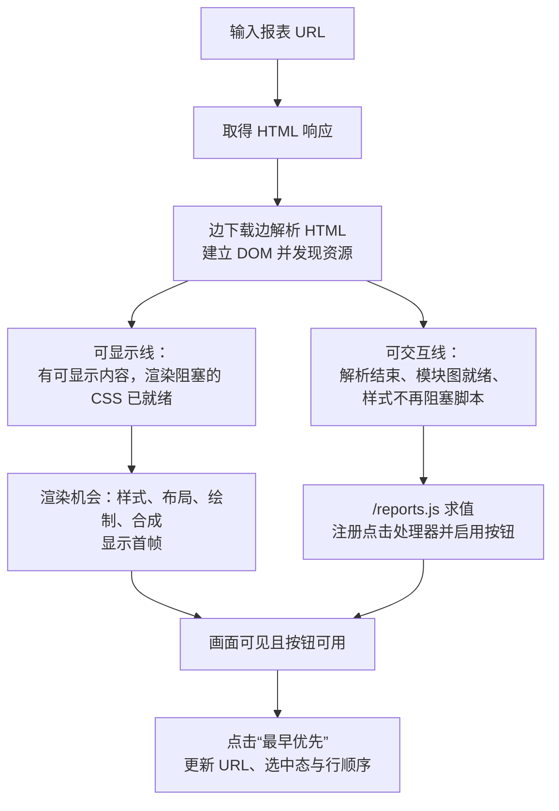

**可显示线**决定画面何时出现：浏览器拿到足够的 HTML，以及当前内容所需的、会阻塞渲染的 CSS 后，就可以给出一帧。**可交互线**决定点击何时有效：模块及其依赖下载完、HTML 解析结束、没有样式表阻塞脚本，模块才会执行并注册处理器。两条线交叠推进，谁先完成取决于网络和资源顺序。首帧已经出现、处理器还没注册时，页面看得见却点不动；模块获取失败或初始化报错，页面会一直停在这个状态。

这张图只描述本例的依赖关系，不代表浏览器内部有一条固定的线程流水线。

### 浏览器先从 URL 里读出什么

浏览器先判断地址栏里的文本是搜索词还是 URL。这里是完整 URL，于是开始一次跨文档导航，也就是加载一个新的 `Document`。

```text
https://reports.example/reports/42?sort=recent#summary
└─┬─┘   └──────┬──────┘└────┬────┘└─────┬────┘└───┬──┘
scheme       host         path        query   fragment
└──────────┬──────────┘
   origin（scheme + host + 默认端口 443）
```

对这次加载来说，path 和 query 会随请求发给服务器，服务器据此返回报表 42、按最近优先排好的行；fragment `#summary` 不发给服务器，留在浏览器里，用来在文档加载后滚动到 `id="summary"` 的元素。各分量的完整定义、path/query/fragment 怎样分工、什么界面状态该写进 URL，统一在[地址变了，浏览器什么时候加载新文档？](#7.%20%E5%9C%B0%E5%9D%80%E5%8F%98%E4%BA%86%EF%BC%8C%E6%B5%8F%E8%A7%88%E5%99%A8%E4%BB%80%E4%B9%88%E6%97%B6%E5%80%99%E5%8A%A0%E8%BD%BD%E6%96%B0%E6%96%87%E6%A1%A3%EF%BC%8C%E7%95%8C%E9%9D%A2%E7%8A%B6%E6%80%81%E4%BD%95%E6%97%B6%E8%AF%A5%E5%86%99%E8%BF%9B%20URL%EF%BC%9F)里讲。

### HTML 从哪里来

确定目标后，浏览器要拿到 `/reports/42?sort=recent` 的响应。它依次经过几个可能的来源，越靠前越可能省掉网络往返：

1. **Service Worker（服务工作线程）。** 如果这个 URL 的作用域内有处于活动状态的 Service Worker，它的 `fetch` 事件处理器可以直接返回自己构造或缓存的响应，也可以自己去请求网络。所以页面不一定向源站重新取 HTML。
2. **HTTP 缓存。** 缓存里若有新鲜且匹配的响应，直接复用；若响应需要验证，浏览器发条件请求，问服务器它是否仍然有效。新鲜度和验证的规则见[发布新版本时，怎样让缓存和还开着的旧页面都不出错？](#51.%20%E5%8F%91%E5%B8%83%E6%96%B0%E7%89%88%E6%9C%AC%E6%97%B6%EF%BC%8C%E6%80%8E%E6%A0%B7%E8%AE%A9%E7%BC%93%E5%AD%98%E5%92%8C%E8%BF%98%E5%BC%80%E7%9D%80%E7%9A%84%E6%97%A7%E9%A1%B5%E9%9D%A2%E9%83%BD%E4%B8%8D%E5%87%BA%E9%94%99%EF%BC%9F)。
3. **复用已有连接。** 需要走网络时，浏览器可以复用一条适用于这次请求的活动连接，例如同一源上已经建立的 HTTP/2 连接。
4. **DNS 与 TLS。** 只有需要新建连接、而且主机地址也没有缓存时，才查询 Domain Name System（DNS，域名系统）。HTTPS 新连接还要完成 Transport Layer Security（TLS，传输层安全协议）握手：验证服务器证书，建立加密通道，然后才发送请求。
5. **重定向。** 若响应是重定向，浏览器按 `Location` 头继续导航；目标换了主机或协议时，连接也要按新目标重新确定。最终请求的地址和拿到的资源由整条重定向链决定。

逐个协议的细节见[浏览器请求如何到达 HTTP 响应？](../../engineering-foundations/networking/http-protocols-and-websockets.md)。

并非每次 URL 变化都要走这条路：`#summary` 这样的片段导航只在当前文档内定位；脚本用 History API 改地址时也不取新文档；用户后退时，浏览器还可能从 back/forward cache（前进/后退缓存）直接恢复整个旧页面，这和复用 HTTP 缓存里的响应是两回事。这些情况都在[地址变了，浏览器什么时候加载新文档？](#7.%20%E5%9C%B0%E5%9D%80%E5%8F%98%E4%BA%86%EF%BC%8C%E6%B5%8F%E8%A7%88%E5%99%A8%E4%BB%80%E4%B9%88%E6%97%B6%E5%80%99%E5%8A%A0%E8%BD%BD%E6%96%B0%E6%96%87%E6%A1%A3%EF%BC%8C%E7%95%8C%E9%9D%A2%E7%8A%B6%E6%80%81%E4%BD%95%E6%97%B6%E8%AF%A5%E5%86%99%E8%BF%9B%20URL%EF%BC%9F)里展开。

### 边下载边解析：DOM 和资源发现

浏览器不必等整个响应体下载完才开始工作。HTML 字节持续交给 HTML parser（HTML 解析器），解析器按到达的内容逐步建出新文档的 Document Object Model（DOM，文档对象模型），同时发现外部样式表、模块脚本和图片，让它们与解析并行下载。

解析器有时要停下来等脚本（下文说明原因）。停着的时候，浏览器还可以用预扫描器（preload scanner）往后读标记，提前发现并请求后面的资源。规范把这叫作推测式解析，是否做、怎样做由实现决定。

**本例 `<main>` 解析出的 DOM 子树**


DOM 只记录节点怎样嵌套。浏览器还要把 CSS 规则匹配到这些节点上，算出样式，生成盒子并布局，再绘制、合成，才能显示像素。这条从 DOM 到像素的流程见[DOM 改动后浏览器重做了什么？](#5.%20DOM%20%E6%94%B9%E5%8A%A8%E5%90%8E%E6%B5%8F%E8%A7%88%E5%99%A8%E9%87%8D%E5%81%9A%E4%BA%86%E4%BB%80%E4%B9%88%EF%BC%8C%E8%AF%BB%E5%87%A0%E4%BD%95%E5%80%BC%E4%B8%BA%E4%BB%80%E4%B9%88%E4%BC%9A%E5%8D%A1%E4%BD%8F%E8%84%9A%E6%9C%AC%EF%BC%9F)；本章只关心哪些资源会推迟它的第一次运行。

> [!info] 实例：三家浏览器的引擎组合
> 页面里有两类引擎协作：JavaScript 引擎执行 `/reports.js`，渲染引擎把 DOM 和 CSS 变成可显示的内容。Chromium 用 V8 与 Blink，Firefox 用 SpiderMonkey 与 Gecko，Safari 用 JavaScriptCore 与 WebKit。这些名字说明组件职责，不规定它们必须运行在哪个进程或线程。

### 哪些 CSS 会挡住首帧，为什么 CSS 还会挡住脚本

样式表能挡住两件不同的事：渲染和脚本执行。两者各有判定条件。

**挡住渲染。** 本例的 `<link rel="stylesheet">` 由解析器在 `<head>` 里创建、处于启用状态、`media` 条件匹配当前环境，所以它是渲染阻塞的：它加载完之前，浏览器可能推迟首帧，以免先画出没有样式的内容再跳变。这不等于“所有 CSS 下载完才能绘制”：`media` 不匹配的样式表（例如 `media="print"`）不阻塞渲染；按规范，`<body>` 出现之后才加入的元素也不再成为渲染阻塞元素。

**挡住脚本。** 脚本可能读取样式，例如调用 `getComputedStyle()`。浏览器不会先分析脚本里是否真的读了样式，而是按统一规则处理：HTML 规范维护一个“阻塞脚本的样式表”集合，解析器创建、处于启用状态、`media` 匹配且仍在加载的 `<style>` 或 stylesheet `<link>` 都在其中。只要这个集合非空，接下来要执行的同步脚本、延后脚本和模块都要等。所以 `/reports.js` 即使只是给按钮注册事件，也可能要先等 `/reports.css` 加载完。`async` 脚本不受这条限制。

**解析器为什么会为脚本停下。** 解析器按顺序读取标记、逐个建立节点；经典脚本却能在文档还没解析完时查询和修改它，甚至用 `document.write()` 往解析器里插入新的标记，改变后面的解析结果。浏览器无法事先断定某个脚本不会这样做，只好先执行它，再继续解析。所以脚本的**下载**可以和其他资源并行，脚本的**执行**却可能成为解析必须等待的点。

### 脚本的六种调度方式

下表只讨论 HTML 解析器在解析过程中遇到的 `<script>` 元素。用 JavaScript 创建并插入的脚本是另一套规则：外部经典脚本默认按 `async` 方式就绪即执行，把 `script.async` 设为 `false` 才按插入顺序执行。

| 脚本形式 | 下载与解析的关系 | 执行时机与顺序 |
|---|---|---|
| 外部经典脚本，不带 `async` / `defer` | 解析器遇到它时开始请求（预扫描器可能更早）；随后解析器停下，等脚本和阻塞脚本的样式表就绪 | 同步执行完，解析器才继续；多个脚本按文档顺序 |
| 外部经典脚本 `defer` | 与解析并行下载 | 解析结束后、`DOMContentLoaded` 前执行；多个按文档顺序 |
| 外部经典脚本 `async` | 与解析并行下载 | 下载完就尽快执行，若解析还在进行，会暂时打断它；多个 `async` 脚本之间不保证顺序 |
| 模块脚本 `type="module"` | 模块文件及其 `import` 依赖与解析并行下载 | 默认延后：解析结束后按文档顺序求值；内联模块同样延后 |
| `async` 模块脚本 | 同上 | 模块及其依赖就绪后尽快执行，不保证与其他异步脚本的顺序 |
| 内联经典脚本（有无 `defer` 都一样） | 没有文件要下载 | 解析器到达它、且没有阻塞脚本的样式表时立即执行；没有 `src` 时 `defer` 不起作用 |

怎样选：

- 需要完整 DOM、几个脚本之间又要保持顺序的代码，用 `defer` 或模块脚本。
- 不依赖 DOM 解析结果、也不依赖其他脚本的独立工作（例如统计脚本），用 `async`。
- 模块脚本默认就像 `defer`；加 `async` 改为就绪即执行。

本例的 `/reports.js` 是普通模块脚本：它和依赖在解析期间下载，但不让解析器停下；它要等解析结束、依赖就绪、`/reports.css` 不再阻塞脚本后才开始求值。“模块下载完”和“处理器注册完”因此是两个不同的时点。模块怎样解析地址、链接依赖，见[import 写下后，谁负责找到、链接和执行文件？](#31.%20import%20%E5%86%99%E4%B8%8B%E5%90%8E%EF%BC%8C%E8%B0%81%E8%B4%9F%E8%B4%A3%E6%89%BE%E5%88%B0%E3%80%81%E9%93%BE%E6%8E%A5%E5%92%8C%E6%89%A7%E8%A1%8C%E6%96%87%E4%BB%B6%EF%BC%9F)。

### readyState、DOMContentLoaded 和 load 各保证什么

文档加载有三个检查点，都可以从 `document.readyState` 读到：

| `readyState` 与事件 | 何时发生 | 此时可以依赖什么 | 不能依赖什么 |
|---|---|---|---|
| `loading` | 解析器仍在解析 | 已解析出的那部分 DOM | 后面的节点还不存在 |
| `interactive`，`Document` 上派发 `readystatechange` | 解析器停止 | HTML 已全部解析成 DOM | 延后脚本和模块可能还在等文件、依赖或样式表 |
| `DOMContentLoaded`（仍是 `interactive`），派发到 `Document` | 延后脚本和普通模块的同步部分执行完之后 | 解析器遇到的 `defer` 和模块脚本都已执行 | 图片、`async` 脚本、模块的异步延续、应用自己的请求 |
| `complete`，`Window` 上的 `load` | 所有会延迟 load 的资源都已完成 | 普通图片、样式表、脚本、iframe 通常都已加载 | 懒加载资源一般不在其中；应用的 API 请求、hydration 或其他 Promise 可能还没完成 |

几点细节：

- **“执行完”只指同步部分。** 模块及其依赖都同步求值时，模块代码会在 `DOMContentLoaded` 前跑完。模块里若有顶层 `await`，`await` 之后的代码可能在事件之后才继续；依赖了这种模块的代码也可能被推迟。初始化如果把工作放进 Promise 回调或网络请求，同样可能晚于事件。所以 `DOMContentLoaded` 不代表应用初始化完成。
- **样式表能间接推迟 `DOMContentLoaded`。** 延后脚本要等阻塞脚本的样式表，事件又要等延后脚本。
- **`load` 的 target 是文档。** 监听器挂在 `window` 上，但出于历史兼容，`event.currentTarget` 是 `window`，`event.target` 却是 `document`。
- **这些事件都不报告首帧。** 首帧可以早于 `load`，也可以早于 `DOMContentLoaded`。

判断主要内容何时出现要看绘制，判断按钮能否使用要看初始化状态，两者不能用同一个事件代替。用户侧怎样测这两件事，见[用户觉得慢时，怎样从指标走到证据？](#55.%20%E7%94%A8%E6%88%B7%E8%A7%89%E5%BE%97%E6%85%A2%E6%97%B6%EF%BC%8C%E6%80%8E%E6%A0%B7%E4%BB%8E%E6%8C%87%E6%A0%87%E8%B5%B0%E5%88%B0%E8%AF%81%E6%8D%AE%EF%BC%9F)。

### 报表页怎样从看得见走到点得动

#### 处理器就绪前先禁用按钮

服务器输出的按钮带着原生 `disabled`。模块还没装好处理器时，点击不会有任何效果；与其让点击被静默丢掉，不如明确显示为不可用。代价是模块加载失败时按钮会一直不可用。如果排序必须在没有 JavaScript 时也能用，可以改用指向 `?sort=oldest` 的链接或 GET 表单，让服务器按查询参数输出排好序的页面；表单怎样把控件序列化成查询串，见[表单控件怎样命名、提交和校验？](#10.%20%E8%A1%A8%E5%8D%95%E6%8E%A7%E4%BB%B6%E6%80%8E%E6%A0%B7%E5%91%BD%E5%90%8D%E3%80%81%E6%8F%90%E4%BA%A4%E5%92%8C%E6%A0%A1%E9%AA%8C%EF%BC%8C%E6%89%8D%E5%AF%B9%E6%89%80%E6%9C%89%E4%BA%BA%E5%8F%AF%E7%94%A8%EF%BC%9F)。

#### 报表模块

下面是 `/reports.js` 的最小版本。它只负责在合适的时机装上处理器、按排序重建行并同步按钮状态；把排序写进地址、支持后退的部分在[地址变了，浏览器什么时候加载新文档？](#7.%20%E5%9C%B0%E5%9D%80%E5%8F%98%E4%BA%86%EF%BC%8C%E6%B5%8F%E8%A7%88%E5%99%A8%E4%BB%80%E4%B9%88%E6%97%B6%E5%80%99%E5%8A%A0%E8%BD%BD%E6%96%B0%E6%96%87%E6%A1%A3%EF%BC%8C%E7%95%8C%E9%9D%A2%E7%8A%B6%E6%80%81%E4%BD%95%E6%97%B6%E8%AF%A5%E5%86%99%E8%BF%9B%20URL%EF%BC%9F)里补上。

```javascript
const records = [
  { id: "r-104", date: "2026-05-01", label: "May report" },
  { id: "r-103", date: "2026-04-01", label: "April report" },
];

function renderReports(list, controls, sort) {
  const rows = [...records].sort((a, b) =>
    sort === "oldest" ? a.date.localeCompare(b.date) : b.date.localeCompare(a.date)
  );
  for (const button of controls.querySelectorAll("button[data-sort]")) {
    button.setAttribute("aria-pressed", String(button.dataset.sort === sort));
  }
  list.replaceChildren(...rows.map(({ id, label }) => {
    const item = document.createElement("li");
    item.dataset.id = id;
    item.textContent = label;
    return item;
  }));
}

function initializeReportControls() {
  const controls = document.querySelector("#sort-controls");
  const list = document.querySelector("#reports");
  if (!controls || !list) return;

  controls.addEventListener("click", (event) => {
    const target = event.target instanceof Element ? event.target : null;
    const button = target?.closest("button[data-sort]");
    if (!button || !controls.contains(button)) return;
    const sort = button.dataset.sort;
    if (sort !== "recent" && sort !== "oldest") return;
    renderReports(list, controls, sort);
  });

  for (const button of controls.querySelectorAll("button[data-sort]")) {
    button.disabled = false;
  }
}

if (document.readyState === "loading") {
  document.addEventListener("DOMContentLoaded", initializeReportControls, { once: true });
} else {
  initializeReportControls();
}
```

初始化不重建列表：服务器输出的 May → April 已经对应 `sort=recent`。点击监听器挂在两个按钮的父元素上，用 `closest()` 找到被点的按钮，所以点到按钮里的文字或 SVG 图标都能命中；这种写法叫事件委托，见[一次点击怎样传播到处理器？](#4.%20%E4%B8%80%E6%AC%A1%E7%82%B9%E5%87%BB%E6%80%8E%E6%A0%B7%E4%BC%A0%E6%92%AD%E5%88%B0%E5%A4%84%E7%90%86%E5%99%A8%EF%BC%8C%E5%A4%84%E7%90%86%E5%99%A8%E8%AF%A5%E6%80%8E%E6%A0%B7%E6%B3%A8%E5%86%8C%E5%92%8C%E6%B8%85%E7%90%86%EF%BC%9F)。

#### 晚到的脚本怎样不错过 DOMContentLoaded

模块末尾的 `if` 是一道就绪检查。`DOMContentLoaded` 只派发一次，不是之后还能订阅的状态：代码若在事件之后才注册监听器（例如通过动态 `import()` 晚加载），处理器永远不会被调用。所以先读 `document.readyState`：仍是 `loading`，就注册一次性监听器等事件；否则说明解析已经结束，直接初始化。同步执行的 JavaScript 不会被浏览器事件打断，检查状态和注册监听器之间不会恰好插进一次 `DOMContentLoaded`。

本例的模块默认延后到解析结束才执行，那时 `readyState` 已是 `interactive`，所以总是走直接初始化的分支；`loading` 分支是为解析期间就运行的其他入口准备的。

这道检查只保证 DOM 已可查询。初始化若依赖另一个尚未执行的延后脚本或模块的副作用，要等那个脚本自己的就绪信号；若依赖报表 API 请求或框架 hydration，也要单独表示并等待。

#### 两种资源到达顺序下的时间线

下表沿时间列出页面状态。前两行对照两种到达顺序：CSS 先到、模块后到；或模块先到、CSS 还在加载。两条路径都汇入第三行。

| 资源状态 | 解析、DOM 与首帧 | 处理器与就绪事件 |
|---|---|---|
| 正文已解析（`interactive`），CSS 已就绪，模块或其依赖还在下载，图片未到 | 浏览器可以先画出标题和 May → April；图片按 320×180 留出位置；按钮显示为不可用 | 监听器未注册；`DOMContentLoaded` 仍在等模块 |
| 模块先到，CSS 仍在阻塞脚本 | 解析器可以继续补全正文，解析结束后变为 `interactive`；首帧也在等这份渲染阻塞的 CSS | 模块不执行；按钮不可用；`DOMContentLoaded` 未触发 |
| 解析结束，模块及依赖就绪，CSS 不再阻塞 | 模块同步运行初始化，保留 May → April，启用两个按钮 | 监听器就绪，`aria-pressed` 为 `true`/`false`；模块同步部分结束后才派发 `DOMContentLoaded` |
| 用户点已启用的“最早优先” | 不再解析 HTML；处理器重建列表 | `aria-pressed` 变为 `false`/`true`，顺序变为 April → May |

这张表把三件事分开：DOM 已建好、可以绘制、处理器已绑定。

#### 图片先留位

`` 写了 `width="320" height="180"`。图片字节还没到或还没解码时，布局已经能按这个尺寸给它留出位置；图片到达后只填进这块区域，不会把下面的按钮和列表挤下去。没写尺寸的图片要等知道真实大小才能确定高度，加载完会让后续内容跳动。晚到的 Web 字体也可能改变文字宽度，引起重排。图片懒加载和优先级见[图片和音视频该怎样写语义、定地址、选文件和定加载时机？](#6.%20%E5%9B%BE%E7%89%87%E5%92%8C%E9%9F%B3%E8%A7%86%E9%A2%91%E8%AF%A5%E6%80%8E%E6%A0%B7%E5%86%99%E8%AF%AD%E4%B9%89%E3%80%81%E5%AE%9A%E5%9C%B0%E5%9D%80%E3%80%81%E9%80%89%E6%96%87%E4%BB%B6%E5%92%8C%E5%AE%9A%E5%8A%A0%E8%BD%BD%E6%97%B6%E6%9C%BA%EF%BC%9F)。

### 页面慢或点不动时，先查哪一段

| 现象 | 先查的阶段 |
|---|---|
| 首个 HTML 字节迟迟不到 | 重定向链、Service Worker 与缓存命中、连接建立、服务端响应 |
| HTML 已到，主要内容仍迟迟不出现 | 渲染阻塞的 CSS 和脚本、主要内容资源（例如主图）被发现和请求的时机 |
| 页面可见，点“最早优先”没反应 | 先确认 `/reports.js` 已求值、处理器已注册、按钮已启用；再查主线程上的其他工作是否拖住了事件处理 |
| 内容出现后位置跳动 | 图片和字体的尺寸与到达时机、后插入的内容 |

同一个“首屏慢”可能来自服务器响应、资源发现或渲染，先沿依赖关系定位是哪一段，再决定改请求、脚本、布局还是绘制。指标和工具见[用户觉得慢时，怎样从指标走到证据？](#55.%20%E7%94%A8%E6%88%B7%E8%A7%89%E5%BE%97%E6%85%A2%E6%97%B6%EF%BC%8C%E6%80%8E%E6%A0%B7%E4%BB%8E%E6%8C%87%E6%A0%87%E8%B5%B0%E5%88%B0%E8%AF%81%E6%8D%AE%EF%BC%9F)。如果页面由框架在服务端渲染，客户端还要做 hydration（水合）才能接上交互，那是可交互线上额外的一段，见[Next.js App Router 怎样把服务端渲染、缓存和客户端交互分开？](#41.%20Next.js%20App%20Router%20%E6%80%8E%E6%A0%B7%E6%8A%8A%E6%9C%8D%E5%8A%A1%E7%AB%AF%E6%B8%B2%E6%9F%93%E3%80%81%E7%BC%93%E5%AD%98%E5%92%8C%E5%AE%A2%E6%88%B7%E7%AB%AF%E4%BA%A4%E4%BA%92%E5%88%86%E5%BC%80%EF%BC%9F)。

### 点击之后：处理器何时运行，画面何时更新

到这里，页面已经可见，`/reports.js` 已注册处理器并启用了按钮。用户点“最早优先”时，处理器同步重建列表、切换 `aria-pressed`；它返回时 DOM 已是 April → May，但屏幕上仍可能是上一帧，要等浏览器的下一次渲染机会才更新。

接下来的问题有三个：

- 点击到达时主线程若正忙，处理器什么时候开始？它改完的 DOM 何时变成像素？这由事件循环决定，见下一章[事件循环怎样安排任务、微任务和渲染？](#2.%20%E4%BA%8B%E4%BB%B6%E5%BE%AA%E7%8E%AF%E6%80%8E%E6%A0%B7%E5%AE%89%E6%8E%92%E4%BB%BB%E5%8A%A1%E3%80%81%E5%BE%AE%E4%BB%BB%E5%8A%A1%E5%92%8C%E6%B8%B2%E6%9F%93%EF%BC%9F)。
- 改 DOM 后浏览器重做了哪些样式、布局和绘制工作，见[DOM 改动后浏览器重做了什么？](#5.%20DOM%20%E6%94%B9%E5%8A%A8%E5%90%8E%E6%B5%8F%E8%A7%88%E5%99%A8%E9%87%8D%E5%81%9A%E4%BA%86%E4%BB%80%E4%B9%88%EF%BC%8C%E8%AF%BB%E5%87%A0%E4%BD%95%E5%80%BC%E4%B8%BA%E4%BB%80%E4%B9%88%E4%BC%9A%E5%8D%A1%E4%BD%8F%E8%84%9A%E6%9C%AC%EF%BC%9F)。
- 怎样把 `sort=oldest` 写进地址，让复制链接和后退都显示对的顺序，见[地址变了，浏览器什么时候加载新文档？](#7.%20%E5%9C%B0%E5%9D%80%E5%8F%98%E4%BA%86%EF%BC%8C%E6%B5%8F%E8%A7%88%E5%99%A8%E4%BB%80%E4%B9%88%E6%97%B6%E5%80%99%E5%8A%A0%E8%BD%BD%E6%96%B0%E6%96%87%E6%A1%A3%EF%BC%8C%E7%95%8C%E9%9D%A2%E7%8A%B6%E6%80%81%E4%BD%95%E6%97%B6%E8%AF%A5%E5%86%99%E8%BF%9B%20URL%EF%BC%9F)。

> [!info]- 来源
> - **URL 分量、片段与 origin（“浏览器先从 URL 里读出什么”）。** [RFC 3986 §3.5 Fragment](https://www.rfc-editor.org/rfc/rfc3986.html#section-3.5)：片段标识主资源中的次级内容；[WHATWG URL Standard，origin](https://url.spec.whatwg.org/#origin)，Living Standard，核对日期：2026-11-11。
> - **HTML 来源链（“HTML 从哪里来”）。** 活动 Service Worker 的 fetch 处理：[Service Workers Editor’s Draft（2026-10-29），Handle Fetch 算法](https://w3c.github.io/ServiceWorker/#handle-fetch)；[WHATWG Fetch Standard，HTTP-network-or-cache fetch](https://fetch.spec.whatwg.org/#http-network-or-cache-fetch)；新鲜缓存复用与验证：[RFC 9111 §4.2](https://www.rfc-editor.org/rfc/rfc9111.html#section-4.2) 与 [§4.3](https://www.rfc-editor.org/rfc/rfc9111.html#section-4.3)；重定向：[RFC 9110 §15.4](https://www.rfc-editor.org/rfc/rfc9110.html#section-15.4)；域名解析：[RFC 1034 §§3.1–3.2](https://www.rfc-editor.org/rfc/rfc1034.html#section-3.1) 与 [RFC 1035](https://www.rfc-editor.org/rfc/rfc1035.html)；HTTP/2 连接复用：[RFC 9113 §9.1.1](https://www.rfc-editor.org/rfc/rfc9113.html#section-9.1.1)；TLS 1.3 握手与证书认证：[RFC 8446 §§2、4.4.2–4.4.3](https://www.rfc-editor.org/rfc/rfc8446.html#section-4.4.3)。核对日期：2026-11-11。
> - **渐进解析与预扫描（“边下载边解析”）。** [WHATWG HTML，Parsing HTML documents](https://html.spec.whatwg.org/multipage/parsing.html) 与 [Speculative HTML parsing](https://html.spec.whatwg.org/multipage/parsing.html#speculative-html-parsing)，Living Standard（2026-11-11 更新）；推测获取的具体时机依实现而异。核对日期：2026-11-12。
> - **样式表阻塞渲染与阻塞脚本（“哪些 CSS 会挡住首帧”）。** [WHATWG HTML，link type stylesheet](https://html.spec.whatwg.org/multipage/links.html#link-type-stylesheet) 与 [render-blocking mechanism](https://html.spec.whatwg.org/multipage/dom.html#render-blocking-mechanism)：解析器创建的 stylesheet link 可能渲染阻塞，处理时检查 `media` 匹配；[interactions of styling and scripting](https://html.spec.whatwg.org/multipage/semantics.html#interactions-of-styling-and-scripting)：阻塞脚本的样式表集合及其条件。Living Standard（2026-11-11 更新），核对日期：2026-11-12。
> - **六种脚本调度（“脚本的六种调度方式”）。** [WHATWG HTML，script processing model](https://html.spec.whatwg.org/multipage/scripting.html#script-processing-model)，Living Standard（2026-11-11 更新）：外部/内联脚本、解析器阻塞脚本、defer 与模块列表、async 集合、非解析器插入脚本的 force-async 行为。核对日期：2026-11-12。
> - **readyState、DOMContentLoaded 与 load（“readyState、DOMContentLoaded 和 load 各保证什么”“晚到的脚本”）。** [WHATWG HTML，The end](https://html.spec.whatwg.org/multipage/parsing.html#the-end)：解析结束、延后脚本队列、DOMContentLoaded 与窗口 load 事件；[Reporting document loading status](https://html.spec.whatwg.org/multipage/dom.html#reporting-document-loading-status)：`loading`/`interactive`/`complete` 与 `readystatechange`。Living Standard（2026-11-11 更新），核对日期：2026-11-12。顶层 `await` 与模块异步求值：[ECMAScript 2027，Module evaluation](https://tc39.es/ecma262/#sec-moduleevaluation)，核对日期：2026-11-12。
> - **引擎组件实例。** [V8](https://v8.dev/)、[JavaScriptCore](https://docs.webkit.org/Deep%20Dive/JSC/JavaScriptCore.html)、[SpiderMonkey](https://firefox-source-docs.mozilla.org/js/)；[Blink](https://www.chromium.org/blink/)、[WebKit](https://webkit.org/)、[Gecko](https://firefox-source-docs.mozilla.org/overview/gecko.html)。核对日期：2026-11-11。
## 2. 事件循环怎样安排任务、微任务和渲染？

本章沿用主线一的报表页（见[打开一个 URL 后，页面怎样变得可见又可交互？](#1.%20%E6%89%93%E5%BC%80%E4%B8%80%E4%B8%AA%20URL%20%E5%90%8E%EF%BC%8C%E9%A1%B5%E9%9D%A2%E6%80%8E%E6%A0%B7%E5%8F%98%E5%BE%97%E5%8F%AF%E8%A7%81%E5%8F%88%E5%8F%AF%E4%BA%A4%E4%BA%92%EF%BC%9F)）。页面已显示 `/reports/42?sort=recent#summary`，`/reports.js` 已在两个排序按钮的容器 `#sort-controls` 上注册了点击处理器。这里假设它已是完整版本，写地址的那一步在[地址变了，浏览器什么时候加载新文档？](#7.%20%E5%9C%B0%E5%9D%80%E5%8F%98%E4%BA%86%EF%BC%8C%E6%B5%8F%E8%A7%88%E5%99%A8%E4%BB%80%E4%B9%88%E6%97%B6%E5%80%99%E5%8A%A0%E8%BD%BD%E6%96%B0%E6%96%87%E6%A1%A3%EF%BC%8C%E7%95%8C%E9%9D%A2%E7%8A%B6%E6%80%81%E4%BD%95%E6%97%B6%E8%AF%A5%E5%86%99%E8%BF%9B%20URL%EF%BC%9F)补上。用户点“最早优先”后，处理器同步做三件事：用 `history.pushState()` 把地址改成 `sort=oldest`，把两个按钮的 `aria-pressed` 从 `true`/`false` 换成 `false`/`true`，把列表从 May → April 重排为 April → May。

本章回答两个问题：点击到达时如果主线程正在运行别的 JavaScript，处理器什么时候开始？处理器同步改完的 DOM，什么时候才有机会变成屏幕上的新画面？答案来自 HTML 规范定义的窗口事件循环，它协调事件、脚本、网络回调和渲染。这是宿主的调度模型，不对应某个浏览器固定的线程安排。

### 一次点击要跨过哪些调度边界

先给出全景，后面各节逐段展开：

1. 用户的点击变成一个排进队列的 task（任务）。
2. 事件循环从有可运行任务的队列里选中它。若当前还有别的任务在运行，它只能等。
3. 点击任务分发 `click` 事件，处理器同步运行到返回，期间不会被别的任务打断。
4. 处理器返回、JavaScript 调用栈变空时，事件循环排空 microtask（微任务）队列，例如 Promise 的后续回调。
5. 渲染机会出现时，浏览器排入一个更新渲染任务。它被选中后先运行 `requestAnimationFrame` 回调，再重算样式和布局，之后进入绘制与合成，新画面才出现。

### task 与 task source：下一项工作从哪里选

task 封装宿主安排的一段工作，例如分发一次点击、运行一个到期的计时器回调。task source（任务源）按工作类别给任务分组，例如用户交互、计时器、网络、更新渲染。

事件循环的 task queue（任务队列）不是所有回调共用的一条先进先出队列。规范允许用户代理把不同任务源合并进一个或多个队列；每一轮，事件循环选一个有可运行任务的队列，从中取最早的可运行任务。同一任务源内部保持顺序；不同队列之间选哪个，由用户代理决定。规范没有规定跨队列的固定优先级。它举过一个例子：用户代理可以把鼠标和键盘工作放进一个队列，四次选择中三次优先选它，同时保证其他队列也能推进。这只是说明实现有这种自由，不是浏览器必须采用的策略。

被选中的普通任务运行到它的步骤结束，期间同步 JavaScript 不会被另一个普通任务抢占。这就是第一个问题的答案：点击到达时如果当前同步脚本很长，或者它不断追加新的微任务，点击处理器只能等待。

**图：任务怎样被选中，两种微任务检查点各回到哪里**


### 渲染机会：画面更新也要排队

rendering opportunity（渲染机会）由用户代理根据显示器刷新、页面是否可见、性能等条件判断。规范把“判断有没有渲染机会、有就排入更新渲染任务”定义为与事件循环主步骤**并行**的步骤。所以同步 JavaScript 运行时，渲染机会照样可能出现，更新渲染任务照样会入队；被推迟的是事件循环之后选中并执行这个任务的时刻。

更新渲染任务和其他任务一样要参与队列选择。若计时器任务和渲染任务都已可运行、又在同一个队列里，先取较早入队的那个；若在不同队列，选哪个由用户代理决定。因此规范不保证每次点击之后立刻更新画面。

文档也可能不参与某一轮更新：页面隐藏、当前没有渲染机会时不更新；用户代理认为更新没有可见效果、又没有待运行的 `requestAnimationFrame` 回调时，也可以跳过，此外还有其他允许跳过的情形。

### 微任务检查点

本节是全领域关于微任务时机的权威说明。

#### 微任务按什么顺序运行

microtask 是当前 JavaScript 工作结束后、下一个普通任务开始前处理的短小延续。最常见的是已兑现 Promise 上注册的 reaction（处理函数）：ECMAScript 把它定义为 Promise job，HTML 宿主把它接进事件循环的微任务队列；`queueMicrotask()` 直接往同一个队列里放回调。

下面的例子里，一个微任务在运行时又排入另一个微任务：

```javascript
console.log("start");
setTimeout(() => console.log("timer task"), 0);
Promise.resolve().then(() => {
  console.log("Promise reaction");
  queueMicrotask(() => console.log("queued by reaction"));
});
queueMicrotask(() => console.log("queued microtask"));
console.log("end");
```

输出顺序是 `start`、`end`、`Promise reaction`、`queued microtask`、`queued by reaction`，之后才是 `timer task`。推演如下：

1. 同步代码依次输出 `start`、`end`，期间登记了一个计时器、入队了 Promise reaction，又入队了 `queued microtask`。此时微任务队列是 `[reaction, queued microtask]`。
2. 脚本结束、调用栈变空，进入微任务检查点。先运行 reaction，它输出后把 `queued by reaction` 排到队尾，队列变成 `[queued microtask, queued by reaction]`。
3. 检查点不会因为某个微任务返回就结束，而是一直取到队列为空，所以接着运行剩下两项。
4. 计时器回调是一个独立的任务，要等延迟到期、并被事件循环选中后才运行。

#### 两个入口：任务结束时，以及调用栈变空时

微任务检查点有两个入口，用的是同一套排空算法，区别在排空之后回到哪里：

- **任务边界检查点。** 一个任务的步骤结束后执行。排空后，事件循环才去选下一个任务。
- **回调返回后的检查点。** 浏览器调用一个 JavaScript 回调（事件监听器、`requestAnimationFrame` 回调等）后，会先做 Web IDL 的回调清理，再做 HTML 的脚本清理。前一步不运行微任务；后一步把脚本移出 JavaScript 执行上下文栈，若此时栈为空，就触发检查点。排空后回到调用这个回调的宿主步骤，当前任务继续执行，并不会跳到下一个任务。

HTML 还有一个防重入标志，阻止嵌套的检查点重复排空同一个队列。无论任务中途是否已经触发过检查点，任务结束时仍有一次边界检查点。

#### 报表点击中的检查点

把这两个入口放到报表页的点击上。假设这次点击会依次经过两个监听器：A 是排序处理器，B 是之后运行、也监听 `click` 的另一个处理器（例如埋点）。

**图：一次物理点击中的状态转换、监听器之间的检查点和后续任务选择**

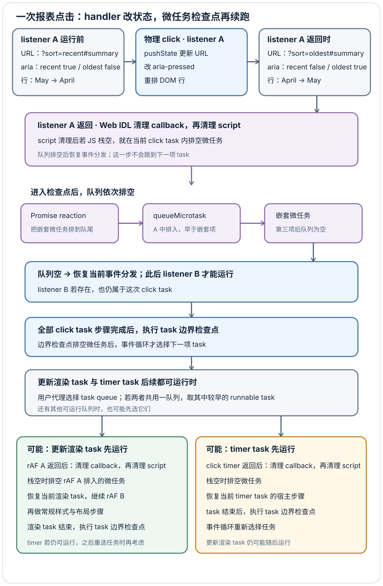

1. 监听器 A 运行前：地址是 `?sort=recent#summary`，`aria-pressed` 为 `true`/`false`，列表 May → April。
2. A 同步调用 `pushState()`，脚本立即就能从 `location` 读到 `sort=oldest`；它不会重新请求文档，也不会替页面排序。A 接着改 `aria-pressed`、重排 DOM 行。A 返回时 DOM 已经是新状态，屏幕上仍可能是旧画面。
3. A 返回后调用栈为空，于是在这次点击任务**内部**排空微任务：A 里排入的 Promise reaction、`queueMicrotask` 回调，以及它们运行时新排入的微任务，都在这里跑完。
4. 排空后恢复事件分发，B 才开始运行。B 仍属于同一个点击任务。
5. 点击任务的全部步骤结束后，执行任务边界检查点，然后事件循环选下一个任务。此时更新渲染任务和 A 里登记的计时器任务可能都已可运行，谁先由队列选择决定。

#### 脚本调用 `.click()` 时为什么不同

上面的步骤 3 依赖“A 返回时栈为空”。如果点击是由脚本调用 `element.click()` 同步触发的，外层脚本还在栈上，A 返回时栈不为空，不会触发检查点。A、B 都先运行完，`.click()` 返回，外层脚本结束，栈空了才排空微任务。

所以同一组监听器，真实用户点击时“A 的微任务在 B 之前”，脚本 `.click()` 时“A、B 都在微任务之前”。测试里用 `.click()` 模拟点击、又依赖微任务时序的代码，可能观察到与真实点击不同的顺序。

> [!example] 实例：两次本机 trace（headless Chrome 157.0.8103.50，CDP）
> 测试页的监听器 A 依次排入 Promise reaction（其中再排入一个微任务）、`queueMicrotask`、两个 `requestAnimationFrame` 回调（A 里再排入一个微任务）和一个 `setTimeout`；监听器 B 只记录自己。
>
> - 用 CDP `Input.dispatchMouseEvent` 模拟鼠标输入（产生可信的 click）：`click A → promise microtask → queueMicrotask → microtask queued by promise → click B → rAF A → microtask from rAF A → rAF B → timer task`。
> - 在同步脚本里调用 `button.click()`：`click A → click B → outer end → promise microtask → queueMicrotask → microtask queued by promise → timer task → rAF A → microtask from rAF A → rAF B`。
>
> 两次运行中渲染任务和计时器任务的先后相反。这只是两次运行记录，不能推出触发方式决定顺序，也不说明哪个任务源有固定优先级。上面的控制台例子在同一浏览器中重放，顺序与推演一致。

### 计时器：`setTimeout(0)` 不是“立刻”，`await` 也不是让出

本节是全领域计时器语义的权威说明。

**延迟是下限，不是准点。** `setTimeout(fn, ms)` 登记一个计时器，延迟到期后才把回调作为任务排入计时器任务源。到期之后，任务还要等当前任务结束、等事件循环选中它。所以 `ms` 是最早可运行的时间，实际运行只会更晚。规范还在两处允许更晚：

- 嵌套层级超过 5 层的计时器（计时器回调里再登记计时器，层层嵌套），延迟小于 4 ms 时按 4 ms 处理。
- 用户代理可以再额外等待一段由实现决定的时间。浏览器借此对后台标签页、省电模式下的计时器节流。

**`setTimeout(fn, 0)` 只是安排一个之后的任务。** 它不会在当前同步代码中途切走，也不保证排在下一次渲染更新之前或之后。

**`await` 不让出给浏览器。** `await Promise.resolve()` 把后续代码安排为微任务；微任务检查点会把它和其后新增的微任务一起排空，期间浏览器不会处理输入或绘制。长同步循环和不断追加的微任务，都会让更新渲染任务一直等着被选中，页面因此卡住。

**真正的让出。** 一段有界计算要给输入和渲染让路，可以拆成多个后续任务（例如每批处理一部分后用 `setTimeout` 安排下一批），交给 Web Worker，或使用框架提供、目标环境支持的调度机制。React 等框架的调度器也建立在这些宿主机制之上，不是 HTML 规范的任务源。50,000 行排序这类计算怎样分块或移进 Worker，见[用户觉得慢时，怎样从指标走到证据？](#55.%20%E7%94%A8%E6%88%B7%E8%A7%89%E5%BE%97%E6%85%A2%E6%97%B6%EF%BC%8C%E6%80%8E%E6%A0%B7%E4%BB%8E%E6%8C%87%E6%A0%87%E8%B5%B0%E5%88%B0%E8%AF%81%E6%8D%AE%EF%BC%9F)。

**按回调次数计时会漂移。** `setInterval(fn, 1000)` 的 1000 ms 只是期望间隔，每次回调都可能晚到；若每次回调把剩余秒数减一，延迟会累积，实际结束时刻越来越晚。需要按真实截止时刻倒数时，每次回调都用当前时间重算剩余量：

```javascript
const deadline = performance.now() + 5000;
const timer = setInterval(() => {
  const remaining = Math.max(0, Math.ceil((deadline - performance.now()) / 1000));
  render(remaining); // render 是应用自己的显示函数
  if (remaining === 0) clearInterval(timer);
}, 250);
```

`clearTimeout()`/`clearInterval()` 只能阻止尚未开始运行的回调；回调一旦开始，清除计时器撤销不了它已经做的事。异步回调用 `setInterval` 轮询时，上一次请求还没结束下一次就可能开始，这类重叠和取消问题见[取消、超时和并发上限各自停得住什么？](#28.%20%E5%8F%96%E6%B6%88%E3%80%81%E8%B6%85%E6%97%B6%E5%92%8C%E5%B9%B6%E5%8F%91%E4%B8%8A%E9%99%90%E5%90%84%E8%87%AA%E5%81%9C%E5%BE%97%E4%BD%8F%E4%BB%80%E4%B9%88%EF%BC%9F)。

### `requestAnimationFrame`：把写入对齐到渲染更新

`requestAnimationFrame(callback)`（rAF）把回调登记到文档的动画帧回调列表。它既不是独立任务，也不是微任务：用户代理选中更新渲染任务后，HTML 在这一轮常规样式和布局更新**之前**依次运行这些回调。页面有渲染机会、用户代理又没有跳过更新时，动画相关的写入就和这次更新对齐。普通 DOM 修改不需要 rAF，也会在后续更新渲染中反映出来。

rAF 回调同样经过回调清理和脚本清理：回调返回、栈变空时，在同一个渲染任务里排空微任务，然后回到更新渲染算法，继续运行下一个 rAF 回调，最后才做样式和布局。所以 rAF 回调里排入的 Promise reaction 会在本轮样式与布局之前执行，但不会多得一次输入处理或绘制机会。

rAF 的调用频率跟随渲染机会，不是固定的 60 Hz 计时器；页面隐藏或被节流时，回调可能推迟。回调收到的时间戳适合计算动画经过的时间。回调里的大量计算仍会拖慢本轮渲染；在里面读几何值还可能触发同步布局，把读写放进 rAF 并不保证只做合成。为什么读几何值会强制布局，见[DOM 改动后浏览器重做了什么，读几何值为什么会卡住脚本？](#5.%20DOM%20%E6%94%B9%E5%8A%A8%E5%90%8E%E6%B5%8F%E8%A7%88%E5%99%A8%E9%87%8D%E5%81%9A%E4%BA%86%E4%BB%80%E4%B9%88%EF%BC%8C%E8%AF%BB%E5%87%A0%E4%BD%95%E5%80%BC%E4%B8%BA%E4%BB%80%E4%B9%88%E4%BC%9A%E5%8D%A1%E4%BD%8F%E8%84%9A%E6%9C%AC%EF%BC%9F)。

### `requestIdleCallback`：只放可推迟的小块工作

`requestIdleCallback(callback, { timeout })` 让用户代理在它认为空闲时运行低优先级工作。浏览器窗口的事件循环只在没有可运行任务时才开始空闲期；空闲期何时开始、有多长都由用户代理决定，页面忙或隐藏时，回调可能很久都不运行。

- `deadline.timeRemaining()` 是剩余空闲时间的估计，不是执行预算，也不是抢占点：回调超时运行不会被打断。
- 传了正数 `timeout` 后，若回调没能在空闲期内运行，到期后用户代理会安排一个超时任务。规范允许它再等一段实现决定的时间才入队，入队后仍要等被选中。`deadline.didTimeout` 只说明这次是因为超时才执行。

```javascript
function runIdleSlice(deadline) {
  if (!workQueue.length) return;
  if (deadline.didTimeout || deadline.timeRemaining() > 0) {
    processNext(workQueue.shift()); // processNext 只处理一个有界项目
  }
  if (workQueue.length) requestIdleCallback(runIdleSlice, { timeout: 2000 });
}

requestIdleCallback(runIdleSlice, { timeout: 2000 });
```

`workQueue` 和 `processNext` 是应用自己的队列和工作函数。使用前要做能力检测；不支持时可以退回普通任务分片，但 `setTimeout()` 不能保证回调运行时浏览器正空闲。

### Node.js 的事件循环不是这一套

Node.js 的宿主边界不同：它按 libuv 的阶段处理计时器、I/O 和 `setImmediate()`，另有 `process.nextTick()` 队列；在 CommonJS 顶层和 ES 模块顶层，`nextTick` 与 Promise 微任务的相对顺序也可能不同。本章的渲染机会和 rAF 只属于浏览器窗口，不能套到 Node 的阶段图上。Node 的模型见[Node.js 事件循环阶段与微任务队列如何交互？](../../engineering-foundations/backend/node-event-loop-and-microtasks.md)。

### 处理器返回之后，下一步是什么

回到开头的两个问题。处理器要等当前任务结束、点击任务被选中才运行；它同步改完的 DOM，要等后续某个更新渲染任务被选中，经过 rAF、样式、布局、绘制和合成后才变成像素。微任务在每次栈变空和每个任务结束时排空，所以 Promise 回调总在下一个任务之前运行，却不会给浏览器让出绘制机会。

处理器能改 DOM 的前提是先找对节点、改对属性。下一章[怎样查询和修改 DOM，才拿到并改到预期的节点？](#3.%20%E6%80%8E%E6%A0%B7%E6%9F%A5%E8%AF%A2%E5%92%8C%E4%BF%AE%E6%94%B9%20DOM%EF%BC%8C%E6%89%8D%E6%8B%BF%E5%88%B0%E5%B9%B6%E6%94%B9%E5%88%B0%E9%A2%84%E6%9C%9F%E7%9A%84%E8%8A%82%E7%82%B9%EF%BC%9F)从这里接手。Promise 本身怎样传递值和失败，见[Promise 和 async 函数怎样传递值和失败？](#27.%20Promise%20%E5%92%8C%20async%20%E5%87%BD%E6%95%B0%E6%80%8E%E6%A0%B7%E4%BC%A0%E9%80%92%E5%80%BC%E5%92%8C%E5%A4%B1%E8%B4%A5%EF%BC%9F)。

> [!info]- 来源
> - **任务源、任务队列、任务选择与渲染机会（“task 与 task source”“渲染机会”）。** [WHATWG HTML §8.1.7 Event loops](https://html.spec.whatwg.org/multipage/webappapis.html#event-loops)，Living Standard，核对日期：2026-11-11；对照 §8.1.7.1 Definitions（任务源怎样映射到任务队列、不同来源可合并）、§8.1.7.2 Queuing tasks 与 [§8.1.7.3 Processing model](https://html.spec.whatwg.org/multipage/webappapis.html#event-loop-processing-model)（从所选队列取最早的可运行任务、任务结束后的微任务检查点、渲染机会在并行步骤中排入 rendering task source、跳过更新的条件）。用户交互优先的例子只是实现自由度示意。
> - **监听器调用、回调清理与空栈检查点（“两个入口”“报表点击中的检查点”“.click()”）。** [WHATWG DOM inner invoke](https://dom.spec.whatwg.org/#concept-event-listener-inner-invoke) 用 Web IDL [§3.11 call a user object's operation](https://webidl.spec.whatwg.org/#call-a-user-objects-operation) 调用事件监听器；rAF 回调走 [§3.12 invoke a callback function](https://webidl.spec.whatwg.org/#invoke-a-callback-function)。两条返回路径依次运行 `clean up after running a callback` 与 [WHATWG HTML §8.1.4.4 clean up after running script](https://html.spec.whatwg.org/multipage/webappapis.html#clean-up-after-running-script)，后者在执行上下文栈为空时调用 [§8.1.7.3 perform a microtask checkpoint](https://html.spec.whatwg.org/multipage/webappapis.html#perform-a-microtask-checkpoint)（含防重入标志）。Living Standard，核对日期：2026-11-11。
> - **History API 不重取文档（“报表点击中的检查点”）。** [WHATWG HTML §7.2.5 The History interface](https://html.spec.whatwg.org/multipage/nav-history-apis.html#the-history-interface)，Living Standard，核对日期：2026-11-11。
> - **Promise reaction 与微任务队列（“微任务按什么顺序运行”）。** [ECMAScript 2026 §27.2.1.8 TriggerPromiseReactions](https://tc39.es/ecma262/2026/#sec-triggerpromisereactions) 与 [§9.5.5 HostEnqueuePromiseJob](https://tc39.es/ecma262/2026/#sec-hostenqueuepromisejob)：按调用顺序运行 Promise job；[WHATWG HTML §8.1.6.6.4 HostEnqueuePromiseJob](https://html.spec.whatwg.org/multipage/webappapis.html#hostenqueuepromisejob) 接入宿主队列；[§8.8 Microtask queuing](https://html.spec.whatwg.org/multipage/timers-and-user-prompts.html#microtask-queuing)：`queueMicrotask()` 使用同一微任务队列。Living Standard，核对日期：2026-11-11。
> - **计时器语义（“计时器”）。** [WHATWG HTML §8.6 Timers，timer initialization steps](https://html.spec.whatwg.org/multipage/timers-and-user-prompts.html#timers)，Living Standard：超时表示最早可运行时间，嵌套层级大于 5 且超时小于 4 ms 时取 4 ms，用户代理可额外等待实现定义的时间；回调作为 timer task source 上的任务排入。核对日期：2026-11-12。
> - **rAF 与更新渲染（“requestAnimationFrame”）。** [WHATWG HTML §8.12 run the animation frame callbacks](https://html.spec.whatwg.org/multipage/imagebitmap-and-animations.html#run-the-animation-frame-callbacks) 与 [§8.1.7 update the rendering](https://html.spec.whatwg.org/multipage/webappapis.html#update-the-rendering)：动画帧回调在样式与布局更新之前运行。Living Standard，核对日期：2026-11-11。
> - **空闲回调（“requestIdleCallback”）。** [W3C requestIdleCallback() Working Draft，2025-05-21，§§2、4.1、4.3、5](https://www.w3.org/TR/requestidlecallback/)：用户代理决定的空闲期、deadline 与超时回调；[WHATWG HTML §8.1.7.3 Processing model](https://html.spec.whatwg.org/multipage/webappapis.html#event-loop-processing-model)：窗口事件循环在没有可运行任务时才启动空闲期。核对日期：2026-11-11。
> - **Node 边界（“Node.js 的事件循环不是这一套”）。** [Node.js v26.13.0 Event Loop](https://nodejs.org/learn/asynchronous-work/event-loop-timers-and-nexttick)：libuv 阶段；[Node.js v26.13.0 process.nextTick() 与 queueMicrotask()](https://nodejs.org/api/process.html#when-to-use-queuemicrotask-vs-processnexttick)：nextTick 队列与 CommonJS/ES 模块的排序差异。核对日期：2026-11-11。
> - **本机 trace（实例 callout）。** headless Chrome 157.0.8103.50，经 CDP `Input.dispatchMouseEvent` 模拟一次鼠标输入，另一次在同步脚本中调用 `button.click()`，记录见 callout；控制台例子以同一语句块重放（只给 `console.log` 包了一层记录器）。改写时另在 Node.js v26.13.1 复跑控制台例子，顺序一致。
## 3. 怎样查询和修改 DOM，才拿到并改到预期的节点？

HTML 解析完成后，页面在内存里是一棵 Document Object Model（DOM，文档对象模型）节点树；脚本查询、修改的都是这棵树，而不是 HTML 源文本。本章沿用主线一的报表页：脚本要找到排序按钮和两行报表，把行顺序从 May、April 改成 April、May，并更新按钮状态。读者手上已经有解析好的 DOM 和已注册的模块脚本（见[打开一个 URL 后，页面怎样变得可见又可交互？](#1.%20%E6%89%93%E5%BC%80%E4%B8%80%E4%B8%AA%20URL%20%E5%90%8E%EF%BC%8C%E9%A1%B5%E9%9D%A2%E6%80%8E%E6%A0%B7%E5%8F%98%E5%BE%97%E5%8F%AF%E8%A7%81%E5%8F%88%E5%8F%AF%E4%BA%A4%E4%BA%92%EF%BC%9F)）；点击怎样到达处理器留给下一章。

### 本章用到的报表页片段

下面是报表页里与排序有关的部分，此时 `/reports.js` 已经求值并启用了按钮，所以不再带 `disabled`。在主线一已有的标识符（`#sort-controls`、`button[data-sort]`、`ol#reports`、行 ID `r-104` / `r-103`）之外，本章只补两处：按钮文字的 `class="sort-label"`，以及每行的 `data-date`，让脚本能直接从 DOM 读出日期。

~~~html
<h1 id="summary">Recent reports</h1>
<div id="sort-controls">
  <button type="button" data-sort="recent" aria-pressed="true">
    <span class="sort-label">Most recent</span>
  </button>
  <button type="button" data-sort="oldest" aria-pressed="false">
    <svg width="16" height="16" viewBox="0 0 16 16"
         aria-hidden="true">
      <path d="M8 13V3m-4 4 4-4 4 4" fill="none" stroke="currentColor"
            stroke-width="1.5" stroke-linecap="round" stroke-linejoin="round" />
    </svg>
    <span class="sort-label">Oldest first</span>
  </button>
</div>
<ol id="reports">
  <li data-id="r-104" data-date="2026-05-01">May report</li>
  <li data-id="r-103" data-date="2026-04-01">April report</li>
</ol>
~~~

“最早优先”（Oldest first）按钮里有一个 SVG 箭头和一段文字；图标的意思已由文字说明，所以用 `aria-hidden="true"` 对辅助技术隐藏。本章和下一章的代码片段都假设这段 HTML 已载入，且各片段在独立页面或作用域中运行：拼进同一个脚本会重复声明 `const controls` 之类的变量。

### DOM 树里有哪些节点？

树里不只有元素。标签之间的换行缩进是文本节点，`<!-- -->` 是注释节点，整棵树的根是 Document。元素的 attribute（属性）有对应的 `Attr` 对象，但它不是树的子节点。

| `nodeType` | 节点 | 报表页中的例子 |
|---:|---|---|
| 1 | Element（元素） | `<ol>`、`<li>`、`<button>` |
| 2 | Attr（属性） | `id="reports"`，不是子节点 |
| 3 | Text（文本） | `May report` |
| 8 | Comment（注释） | `<!-- 排序控件 -->` |
| 9 | Document（文档） | `document` 本身 |

亲属 API 因此成对出现：一个看所有节点，一个只看元素。

| 问题 | 看所有节点 | 只看元素 | 差别出现在哪里 |
|---|---|---|---|
| 父节点 | `parentNode` | `parentElement` | `<html>` 的 `parentNode` 是 Document，`parentElement` 是 `null` |
| 第一个子节点 | `firstChild` | `firstElementChild` | `<ol>` 的 `firstChild` 通常是换行空白的文本节点 |
| 下一个兄弟 | `nextSibling` | `nextElementSibling` | 从 May 行找 April 行要用后者 |
| 全部子节点 | `childNodes` | `children` | 前者含文本和注释 |

名称和值也分节点类型：`nodeName` 适用于任何节点，`tagName` 只有元素才有；`nodeValue` 读单个 Text 节点的内容，在元素上是 `null`。要读元素里的全部文字，用后文的 `textContent`。

### 用选择器查询：拿到一个、拿到全部，或者拿到 null

最常用的入口是 CSS 选择器查询。`querySelector()` 返回第一个匹配的元素，没有匹配时返回 `null`；`querySelectorAll()` 返回所有匹配元素组成的 `NodeList`，没有匹配时是长度为 0 的列表。`getElementById()` 也返回元素或 `null`。选择器字符串不是合法 CSS 时，两者都抛出 `SyntaxError`，而不是返回空结果。

先拿到容器，再在容器内部查询，就不会把页面别处的同类控件当成报表控件：

~~~javascript
const controls = document.querySelector("#sort-controls");
const reports = document.querySelector("#reports");
const oldest = controls?.querySelector('button[data-sort="oldest"]') ?? null;
const rows = reports?.querySelectorAll(":scope > li[data-date]") ?? [];
~~~

`button[data-sort="oldest"]` 同时要求元素名是 `button`、`data-sort` 的值是 `oldest`。`:scope >` 把范围限定为 `#reports` 自己的直接子元素。可选链 `?.` 处理容器不存在的情况：找不到 `#reports` 时 `rows` 是空数组，容器存在但没有匹配行时是空 `NodeList`。

`document.documentElement` 是 `<html>`，`document.body` 是 `<body>`。脚本若在解析器读到 `<body>` 之前运行，`document.body` 可能还是 `null`；报表页的模块脚本在解析结束后才求值，不受影响。

### 集合有两个维度：含什么节点、会不会跟着变

能返回多个节点的 API 不止 `querySelectorAll()`。它们在两点上不同：成员里包括哪些节点，以及查询之后 DOM 再改变时成员会不会跟着变。

| 来源 | 返回类型 | 包含什么 | 查询后 DOM 改变时 |
|---|---|---|---|
| `element.children` | `HTMLCollection` | 直接子元素 | 实时反映当前树 |
| `getElementsByClassName()`、`getElementsByTagName()` | `HTMLCollection` | 匹配的后代元素，含更深层 | 实时反映当前树 |
| `element.childNodes` | `NodeList` | 元素、文本、注释等直接子节点 | 实时反映当前树 |
| `element.querySelectorAll()` | `NodeList` | 匹配的元素 | 保持查询时的成员 |

只看类型判断不了是否实时：`childNodes` 和 `querySelectorAll()` 的结果都是 `NodeList`，前者实时，后者静态。两种集合都不是数组，没有 `map()`、`sort()`；`Array.from()` 把当前成员的引用复制进一个新数组。

“静态”只固定成员名单，不冻结节点本身：名单里的节点被移出文档后，引用还在，但它的 `isConnected` 变成 `false`。“实时”也只描述每次读取看到的成员，不规定浏览器内部多久重算一次。

### 边遍历边删除，为什么会漏掉一行？

报表要显示一批新结果时，代码常先清空旧行。如果按递增索引遍历实时集合并逐个删除，就会漏删。

> [!example] 正向删除实时集合会留下 r2
> 为了看清索引，这里换一个只有三行的独立列表，`r1`、`r2`、`r3` 是教学用 ID。
>
> ~~~html
> <ul id="old-rows">
>   <li class="report" id="r1">报告 1</li>
>   <li class="report" id="r2">报告 2</li>
>   <li class="report" id="r3">报告 3</li>
> </ul>
> ~~~
>
> ~~~javascript
> const list = document.querySelector("#old-rows");
> const liveRows = list.children;
> const queriedRows = list.querySelectorAll(":scope > .report");
>
> for (let i = 0; i < liveRows.length; i += 1) {
>   liveRows[i].remove();
> }
> // 列表里还剩 r2。
> // queriedRows 仍有 3 个成员；queriedRows[0].isConnected 为 false。
> ~~~
>
> 1. `i = 0`：移除 `liveRows[0]`，即 `r1`。实时集合立刻变成 `[r2, r3]`，`r2` 前移到索引 0。
> 2. `i = 1`：此时 `liveRows[1]` 是 `r3`，移除后集合只剩 `[r2]`。
> 3. `i = 2`：条件 `2 < 1` 为假，循环结束，`r2` 被跳过。
>
> 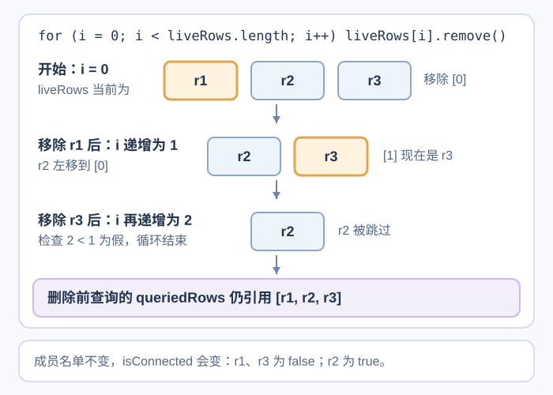
>
> 这时再插入新结果，旧的 `r2` 就会和新行一起显示。静态的 `queriedRows` 仍引用三个节点，其中 `r1`、`r3` 已不在文档里。

修正办法是在改树之前先取快照，或者从末尾往前删：

~~~javascript
// 两种写法二选一，都从同一份初始列表开始。
for (const row of Array.from(liveRows)) row.remove();

for (let i = liveRows.length - 1; i >= 0; i -= 1) {
  liveRows[i].remove();
}
~~~

规律是：实时集合回答“DOM 现在有哪些成员”，静态结果适合对查询那一刻确定的成员逐个操作。一边改树一边按索引读实时集合，索引就不再指向原来的节点。

### 写文字还是写标记：textContent、innerText、innerHTML

找到节点后，第一类修改是改内容。三个接口的区别在于是否解析 HTML、是否看渲染结果：

| 接口 | 读取 | 赋值 | 报表页上的用途 |
|---|---|---|---|
| `textContent` | 全部后代文本 | 用一个文本节点替换整个子树，不解析 HTML | 写入报表名称等纯文字 |
| `innerText` | 渲染后的文字：隐藏内容不计入；元素未渲染时退回后代文本 | 字符串里的换行变成 `<br>` | 读写用户看得见的文本 |
| `innerHTML` | 子树的 HTML 字符串 | 把字符串当 HTML 解析 | 只插入可信或已净化的标记 |

~~~javascript
const textDemo = document.createElement("div");
document.body.append(textDemo); // 附加到页面后，innerText 才按渲染文本处理
textDemo.textContent = "<b>May</b>";
const literal = [textDemo.textContent, textDemo.children.length];
textDemo.innerText = "May\nReport";
const visibleLines = [textDemo.innerHTML, textDemo.innerText];
console.log(JSON.stringify({ literal, visibleLines }));
// literal: ["<b>May</b>", 0]
// visibleLines: ["May<br>Report", "May\nReport"]
~~~

`textContent` 把 `<b>` 原样当文字，所以没有生成子元素。报表标题这类来自用户或服务端的字符串，一律用 `textContent` 写；把它交给 `innerHTML` 等于让数据决定页面结构和脚本，安全边界见[浏览器安全控制分别保护什么信任边界？](../../engineering-foundations/security/web-browser-security-boundaries.md)。

### attribute 和 property 什么时候会分开？

HTML 标记上写的是 content attribute（内容属性），JavaScript 对象上读写的是 DOM property（DOM 对象属性）。许多 property 会 reflect（反射）同名 attribute：读写其中一个，另一个跟着变，例如 `button.id` 与 `id` 属性。但有三种常见情况两者不等价。

#### 输入框的 value：默认值与当前值

`value` attribute 是默认值，`input.value` property 是当前值。HTML 用 dirty value flag（值已修改标记）区分二者：用户输入或脚本写 `input.value` 之后，标记变为 dirty，此后再改 attribute 只更新默认值；`form.reset()` 把当前值恢复为默认值并清除标记。

~~~html
<form id="filter-form">
  <label>筛选报表 <input id="report-filter" value="May"></label>
</form>
~~~

~~~javascript
const filter = document.querySelector("#report-filter");
filter.setAttribute("value", "April"); // 尚未 dirty：当前值跟着变
const beforeEdit = [filter.value, filter.defaultValue];

filter.value = "Ada";                   // 改当前值，标记变为 dirty
filter.setAttribute("value", "May");    // dirty 后只改默认值
const afterEdit = [filter.value, filter.defaultValue];

filter.form.reset();                    // 当前值回到默认值，清除 dirty
const afterReset = [filter.value, filter.defaultValue];
console.log(JSON.stringify({ beforeEdit, afterEdit, afterReset }));
// {"beforeEdit":["April","April"],"afterEdit":["Ada","May"],
//  "afterReset":["May","May"]}
~~~

`defaultValue` property 反射的正是 `value` attribute。

#### 布尔属性只看存不存在

`disabled`、`checked`、`hidden` 这类 boolean attribute（布尔属性）只看是否存在，不看值。`setAttribute("disabled", "false")` 照样禁用元素；要解除，写 `button.disabled = false` 或 `removeAttribute("disabled")`。

#### 禁用状态还会从 fieldset 继承

`button.disabled = false` 只移除按钮自己的属性。按钮若在禁用的 `<fieldset>` 里，它仍然被禁用，匹配 `:disabled`。例外是该 fieldset 第一个 `<legend>` 子元素里的控件，它们不继承禁用。

~~~html
<fieldset disabled>
  <legend>
    <button id="legend-button" type="button">例外位置</button>
  </legend>
  <button id="inherited-button" type="button">受 fieldset 禁用</button>
</fieldset>
<button id="own-button" type="button">自己的 disabled 属性</button>
~~~

~~~javascript
const read = (el) => [el.disabled, el.matches(":disabled")];
const own = document.querySelector("#own-button");
const inherited = document.querySelector("#inherited-button");
const legendButton = document.querySelector("#legend-button");

own.setAttribute("disabled", "false");
const ownAttribute = read(own);
own.disabled = false;
const afterClearingOwn = read(own);
inherited.disabled = false;

console.log(JSON.stringify({
  ownAttribute, afterClearingOwn,
  inherited: read(inherited), firstLegend: read(legendButton),
}));
// ownAttribute: [true, true]; afterClearingOwn: [false, false]
// inherited: [false, true]; firstLegend: [false, false]
~~~

| 控件状态 | `disabled` | `matches(":disabled")` | 原因 |
|---|---|---|---|
| 自身 `setAttribute("disabled", "false")` 后 | `true` | `true` | 布尔属性只看是否存在 |
| 再设自身 `disabled = false` 后 | `false` | `false` | 自身属性已移除 |
| 禁用 fieldset 的普通后代 | `false` | `true` | 自身未禁用，祖先 fieldset 生效 |
| fieldset 第一个 `legend` 里的后代 | `false` | `false` | 该位置不继承禁用 |

所以，问“这个控件现在能不能用”（含 fieldset 继承）时用 `matches(":disabled")`；只读写元素自己的属性时用 `disabled`。

### 改外观和附带数据：class、style 与 dataset

- **class。** `className = "selected"` 整体替换 class 字符串；`classList.add()`、`remove()`、`toggle()` 只改一个类，不会误删别处加上的类。
- **style。** `element.style.backgroundColor` 只读写行内声明，CSS property 名用小驼峰。样式表层叠出来的结果要用 `getComputedStyle(element)` 读；它为什么可能触发同步计算，见[DOM 改动后浏览器重做了什么，读几何值为什么会卡住脚本？](#5.%20DOM%20%E6%94%B9%E5%8A%A8%E5%90%8E%E6%B5%8F%E8%A7%88%E5%99%A8%E9%87%8D%E5%81%9A%E4%BA%86%E4%BB%80%E4%B9%88%EF%BC%8C%E8%AF%BB%E5%87%A0%E4%BD%95%E5%80%BC%E4%B8%BA%E4%BB%80%E4%B9%88%E4%BC%9A%E5%8D%A1%E4%BD%8F%E8%84%9A%E6%9C%AC%EF%BC%9F)。
- **dataset。** `data-*` 属性通过 `dataset` 读写，名称去掉 `data-` 并转成小驼峰：`data-report-id` 对应 `dataset.reportId`。读到的值总是字符串，不存在的键读到 `undefined`。May 行的 `dataset.id` 是 `"r-104"`，`dataset.date` 是 `"2026-05-01"`。

报表页的排序状态用 `aria-pressed` 表达。它不是布尔属性，值是字符串 `"true"` 或 `"false"`，所以要用 `setAttribute("aria-pressed", "true")` 写明值，不能靠存在与否。

### 创建、移动和克隆节点

#### 从数据生成节点

从数据生成一组元素时，用 `createElement()` 建节点、`textContent` 写值、`append()` 挂到树上。这里暂时离开报表，用一张独立的成绩表：三列固定为 Name、Subject、Grade，三条记录应显示为 Ron—Math—100、Jack—Calculus—70、Mar—Business—90。

~~~html
<table>
  <thead><tr><th>Name</th><th>Subject</th><th>Grade</th></tr></thead>
  <tbody id="students"></tbody>
</table>
~~~

~~~javascript
const students = [
  { name: "Ron", subject: "Math", grade: "100" },
  { name: "Jack", subject: "Calculus", grade: "70" },
  { name: "Mar", subject: "Business", grade: "90" },
];
const columns = ["name", "subject", "grade"];
const body = document.querySelector("#students");

for (const student of students) {
  const row = document.createElement("tr");
  for (const column of columns) {
    const cell = document.createElement("td");
    cell.textContent = student[column];
    row.append(cell);
  }
  body.append(row);
}
~~~

列顺序由 `columns` 数组决定，不依赖对象字段的书写顺序，表头和单元格因此始终对齐；数据值只进入文本节点，不会被当作 HTML 解析。

#### 移动已有节点：把报表重排成 April、May

`append()` 把节点放到父节点末尾；传入的节点若已在文档里，它会被**移动**而不是复制。`insertBefore(node, reference)` 把节点放到参考节点之前，`remove()` 把节点移出树。报表页的排序正好利用移动：

~~~javascript
const controls = document.querySelector("#sort-controls");
const reports = document.querySelector("#reports");

function applySort(intent, activeButton) {
  if (intent !== "recent" && intent !== "oldest") return;

  const rows = Array.from(reports.querySelectorAll(":scope > li[data-date]"));
  const direction = intent === "oldest" ? 1 : -1;
  rows.sort((a, b) => direction * a.dataset.date.localeCompare(b.dataset.date));
  for (const row of rows) reports.append(row);

  for (const button of controls.querySelectorAll("button[data-sort]")) {
    button.setAttribute("aria-pressed", String(button === activeButton));
  }
}
~~~

`applySort()` 先拒绝未知的排序值，再取当前行的静态快照，转成数组排序。`data-date` 是 `YYYY-MM-DD` 格式，按字典序比较就是按时间先后比较。`intent` 为 `oldest` 时 `direction` 为 1，April（`2026-04-01`）排在前面；依次 `append()` 现有两行，就把它们移成 April、May，节点本身和它们上面的状态都保留。最后把被点按钮的 `aria-pressed` 设为 `"true"`，另一个设为 `"false"`。

主线一的 `/reports.js` 用的是另一种写法：按数据数组新建两个 `<li>`，再用 `list.replaceChildren(...rows)` 一次替换全部子节点。两种写法得到的行序相同，差别在节点身份：移动保留原来的节点对象，挂在它上面的监听器和 property（例如行内输入框的当前值）都跟着走；重建得到的是新节点，这些都要重新建立。行只是静态文字时两者等价；行里有控件或单独注册了监听器时，要先想清楚需要保留哪一种身份。

| 时点 / 意图 | 行顺序（`data-id`） | `recent` 按钮 | `oldest` 按钮 |
|---|---|---|---|
| 初始 HTML / `recent` | `r-104` → `r-103` | `aria-pressed="true"` | `aria-pressed="false"` |
| `applySort("oldest", oldestButton)` 之后 | `r-103` → `r-104` | `aria-pressed="false"` | `aria-pressed="true"` |

#### 克隆节点不会带上监听器

`cloneNode(true)` 复制节点、全部后代和所有 attribute。写在标记里的 `onclick="..."` 是 attribute，会被复制；通过 `element.onclick = handler` 赋值的处理函数和 `addEventListener()` 注册的监听器都不会复制。副本若带 `id`，插入同一文档前要改成不冲突的值，并同步更新指向它的引用（例如 `aria-describedby`）。

~~~javascript
function handleReportClick(event) {
  console.log(event.currentTarget.dataset.id);
}

const source = document.querySelector('#reports [data-id="r-104"]');
const copy = source.cloneNode(true);       // 保留 data-id、data-date
copy.id = "r-104-copy";                    // 新增一个文档内唯一的 id
copy.addEventListener("click", handleReportClick); // 行为要在副本上重新注册
reports.append(copy);
~~~

May 行自身和后代都没有 `id`，副本保留 `data-id="r-104"` 和 `data-date`，代码再给它加一个唯一 `id`。运行后列表会多出第三行，所以它和上面的排序例子不是同一轮状态。

### 改完 DOM，谁来调用这些函数？

到这里，脚本已经能可靠地找到工具栏、按钮和行，能区分文字与标记、attribute 与 property，也能用 `applySort()` 把 DOM 改成 April、May。还没回答的是：用户点的可能是按钮里的文字或 SVG 箭头，脚本怎样从这次点击找到按钮、读出 `oldest` 并调用 `applySort()`？这由[一次点击怎样传播到处理器，处理器该怎样注册和清理？](#4.%20%E4%B8%80%E6%AC%A1%E7%82%B9%E5%87%BB%E6%80%8E%E6%A0%B7%E4%BC%A0%E6%92%AD%E5%88%B0%E5%A4%84%E7%90%86%E5%99%A8%EF%BC%8C%E5%A4%84%E7%90%86%E5%99%A8%E8%AF%A5%E6%80%8E%E6%A0%B7%E6%B3%A8%E5%86%8C%E5%92%8C%E6%B8%85%E7%90%86%EF%BC%9F)接手。DOM 改完之后画面怎样跟上，则在[DOM 改动后浏览器重做了什么，读几何值为什么会卡住脚本？](#5.%20DOM%20%E6%94%B9%E5%8A%A8%E5%90%8E%E6%B5%8F%E8%A7%88%E5%99%A8%E9%87%8D%E5%81%9A%E4%BA%86%E4%BB%80%E4%B9%88%EF%BC%8C%E8%AF%BB%E5%87%A0%E4%BD%95%E5%80%BC%E4%B8%BA%E4%BB%80%E4%B9%88%E4%BC%9A%E5%8D%A1%E4%BD%8F%E8%84%9A%E6%9C%AC%EF%BC%9F)展开。

> [!info]- 来源
> - 节点类型、亲属与名称字段（`parentNode` / `parentElement`、`nodeName` / `tagName` / `nodeValue`）：[WHATWG DOM Standard §4.4 Node](https://dom.spec.whatwg.org/#interface-node)、[§4.9 Element](https://dom.spec.whatwg.org/#interface-element)，Living Standard，核对于 2026-11-12。
> - `querySelector()` 返回首个匹配或 `null`，`querySelectorAll()` 返回静态结果、无匹配时为空列表，非法选择器抛 `SyntaxError`：[WHATWG DOM Standard §4.2.6 ParentNode](https://dom.spec.whatwg.org/#interface-parentnode)，Living Standard，核对于 2026-11-12。
> - `NodeList` 与 `HTMLCollection` 的成员与实时性；`children`、`childNodes`、`getElementsBy*()` 按各自接口算法定义：[WHATWG DOM Standard §4.2.10 Old-style collections](https://dom.spec.whatwg.org/#old-style-collections-node-list-and-htmlcollection)、[§4.5 Document](https://dom.spec.whatwg.org/#interface-document)，Living Standard，核对于 2026-11-12。
> - `document.body` 可为 `null`：[WHATWG HTML §3.1.1、§3.1.7 Document tree accessors](https://html.spec.whatwg.org/multipage/dom.html#dom-document-body)，Living Standard，核对于 2026-11-12。
> - `innerText` 的读取与写入、`data-*` 与 `dataset`：[WHATWG HTML, DOM](https://html.spec.whatwg.org/multipage/dom.html#the-innertext-and-outertext-properties) §3.2.4、§3.2.6.6、§3.2.7，Living Standard，核对于 2026-11-12。
> - 输入框默认值、dirty value flag 与表单 reset：[WHATWG HTML, The input element](https://html.spec.whatwg.org/multipage/input.html#the-input-element)；控件禁用与 fieldset 继承（含第一个 legend 例外）：[Enabling and disabling form controls](https://html.spec.whatwg.org/multipage/form-control-infrastructure.html#enabling-and-disabling-form-controls:-the-disabled-attribute)、[The fieldset element](https://html.spec.whatwg.org/multipage/form-elements.html#the-fieldset-element)。Living Standard，核对于 2026-11-12。
> - `element.style` 读写行内声明、`getComputedStyle()` 读取解析后的样式：[CSS Object Model (CSSOM)](https://drafts.csswg.org/cssom/) §7，CSS Working Group Editor’s Draft，核对于 2026-11-12。
> - `cloneNode()` 的复制范围（attribute 随节点复制，监听器不复制）：[WHATWG DOM Standard, clone a node](https://dom.spec.whatwg.org/#concept-node-clone)，Living Standard，核对于 2026-11-12。
## 4. 一次点击怎样传播到处理器，处理器该怎样注册和清理？

用户点的是“最早优先”按钮里的文字或箭头，处理器却要拿到按钮本身和它的 `data-sort`。本章回答浏览器怎样把一次输入派发给监听器、监听器该挂在哪里、怎样注册和移除，以及键盘、指针、尺寸和滚动各自的事件契约。沿用主线一的报表页，读者手上已有上一章[怎样查询和修改 DOM？](#3.%20%E6%80%8E%E6%A0%B7%E6%9F%A5%E8%AF%A2%E5%92%8C%E4%BF%AE%E6%94%B9%20DOM%EF%BC%8C%E6%89%8D%E6%8B%BF%E5%88%B0%E5%B9%B6%E6%94%B9%E5%88%B0%E9%A2%84%E6%9C%9F%E7%9A%84%E8%8A%82%E7%82%B9%EF%BC%9F)里的 HTML 片段（`#sort-controls`、`data-sort`、`#reports`）和能把行重排成 April、May 的 `applySort(intent, activeButton)`；本章要让一次点击调用它。

### 注册和移除监听器

`addEventListener(type, listener, options)` 给一个节点添加监听器，事件名不带 `on` 前缀，写 `"click"`、`"keydown"`。另一种写法 `element.onclick = handler` 每个元素只有一个槽位，赋新函数会替换旧的；多段代码都要监听同一事件时，用 `addEventListener()` 各自注册、各自移除。

移除有三种方式：

- **`removeEventListener()`。** 必须传入注册时的**同一个函数引用**和相同的 `capture` 设置。当场写一个新箭头函数，或者传 `handler.bind(x)` 的又一次结果，都是另一个函数，移除不会生效。
- **`{ once: true }`。** 监听器第一次运行前就被移除，适合只响应一次的事件。
- **`{ signal }`。** 把同一个 `AbortSignal`（中止信号）传给多个监听器，页面区域销毁时调用一次 `controller.abort()`，它们全部移除，不必保存每个函数引用。`AbortSignal` 本身的语义见[取消、超时和并发上限各自停得住什么？](#28.%20%E5%8F%96%E6%B6%88%E3%80%81%E8%B6%85%E6%97%B6%E5%92%8C%E5%B9%B6%E5%8F%91%E4%B8%8A%E9%99%90%E5%90%84%E8%87%AA%E5%81%9C%E5%BE%97%E4%BD%8F%E4%BB%80%E4%B9%88%EF%BC%9F)。

~~~javascript
const region = new AbortController();
const controls = document.querySelector("#sort-controls");

function logClick(event) { console.log(event.type); }
controls.addEventListener("click", logClick);
controls.removeEventListener("click", logClick); // 同一引用，移除成功

controls.addEventListener("click", logClick, { signal: region.signal });
window.addEventListener("resize", logClick, { signal: region.signal });
region.abort(); // 两个监听器一起移除
~~~

#### 监听器里的 this 指向谁

普通函数的 `this` 不由定义位置决定，而由调用方式决定：`obj.method()` 里是 `obj`，单独调用时在严格模式下是 `undefined`。DOM 调用监听器时，把注册监听器的那个节点（即后文的 `event.currentTarget`）作为 `this` 传入。箭头函数没有自己的 `this`，沿用定义处外层的值，DOM 换不掉它。所以在监听器里读节点，最稳的写法是显式读 `event.currentTarget`，不依赖 `this`：

~~~javascript
const button = document.createElement("button");
const wrapper = document.createElement("div");
wrapper.append(button);
document.body.append(wrapper);
const results = [];

wrapper.addEventListener("click", function (event) {
  results.push(this === event.currentTarget && this === wrapper
    && event.target === button);
});
wrapper.addEventListener("click", (event) => {
  results.push(event.currentTarget === wrapper && event.target === button);
});
button.dispatchEvent(new MouseEvent("click", { bubbles: true }));
results; // [true, true]
~~~

想让监听器调用某个对象的方法，常写 `el.addEventListener("click", obj.handle.bind(obj))`；这样得到的是新函数，要移除就得把它存进变量。`this` 的完整规则见[函数里的变量和 this 从哪来？](#24.%20%E5%87%BD%E6%95%B0%E9%87%8C%E7%9A%84%E5%8F%98%E9%87%8F%E5%92%8C%20this%20%E4%BB%8E%E5%93%AA%E6%9D%A5%EF%BC%9F)。

### 一次点击沿哪条路径传播？

浏览器派发事件时，先确定 event path（传播路径）：从 `Window` 经 Document 一直到被点中的节点。监听器在三个阶段运行：

1. **capture phase（捕获阶段）**：从 `Window` 向内，运行用 `{ capture: true }` 注册的监听器。
2. **target phase（目标阶段）**：在目标节点上，先运行捕获监听器，再运行普通监听器。
3. **bubble phase（冒泡阶段）**：从目标的父节点向外，运行普通监听器。只有 `bubbles` 为 true 的事件才有这一段，`click` 会冒泡。

被点中的节点是哪个，取决于命中位置。点按钮上的文字时，目标是 `.sort-label` 这个 `span`；点 SVG 箭头的可见描边时是 `<path>`；点图标里没有描边的留白处则可能是 `svg`。SVG 元素是否命中，按可见的 fill/stroke 和 `pointer-events` 规则判断。

下面的代码只打印顺序：

~~~javascript
const controls = document.querySelector("#sort-controls");
const button = controls.querySelector('button[data-sort="oldest"]');
const label = button.querySelector(".sort-label");

document.body.addEventListener("click", () => console.log("body capture"), { capture: true });
label.addEventListener("click", () => console.log("span target"));
button.addEventListener("click", () => console.log("button bubble"));
controls.addEventListener("click", () => console.log("controls bubble"));
document.body.addEventListener("click", () => console.log("body bubble"));
// 点“Oldest first”文字：
// body capture → span target → button bubble → controls bubble → body bubble
~~~

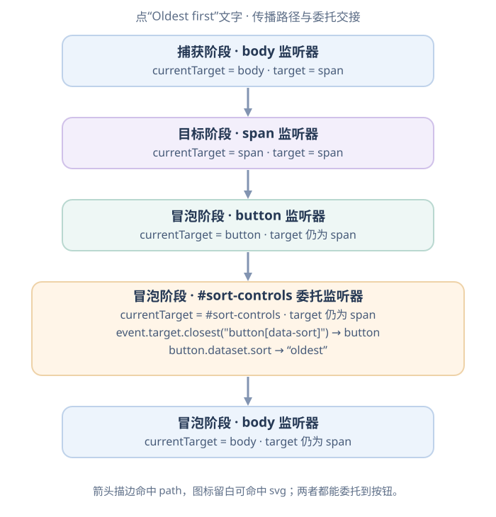

图中 `#sort-controls` 一层画的是后文的委托监听器，它在事件冒泡到工具栏时接手，不是上面只打印日志的 `controls bubble`。点箭头描边时路径是 `path → svg → button → #sort-controls → body`，点图标留白时从 `svg` 开始；两条路径都不经过 `span`。

#### target 与 currentTarget

在一次普通 DOM 派发里，`event.target` 始终是最初命中的节点；`event.currentTarget` 是当前正在运行的监听器所注册的节点。点文字时，`target` 一直是 `span`，`currentTarget` 依次是 `body`、`span`、按钮、工具栏、`body`。派发结束后 `currentTarget` 被重置为 `null`，所以异步回调里读它会落空，要先存成局部变量。

### 哪些事件不冒泡，影子边界又改变什么？

不是所有事件都会冒泡到祖先，依赖冒泡的代码要先确认这一点：

- **焦点。** 输入框获得、失去焦点时派发的 `focus` 和 `blur` 不冒泡；父级要统一处理焦点变化，监听会冒泡的 `focusin` 和 `focusout`。
- **元素滚动。** 元素滚动时派发的 `scroll` 不冒泡，要监听在实际滚动的那个容器上（见后文）。

Shadow DOM（影子 DOM）还会改变外部看到的目标。组件内部的节点被点击后，影子树外的监听器读到的 `target` 会被 retarget（重定向）为该组件的宿主元素，内部结构不外泄。事件能否穿出影子边界由 `composed` 决定，能否向祖先冒泡由 `bubbles` 决定，两者是不同的开关。本章其余例子都在普通文档树中。

### 事件委托：在父级处理一组子控件

冒泡让祖先能收到后代上的事件。event delegation（事件委托）利用这一点：在共同的父级注册一个监听器，处理一组子控件，包括之后才插入的控件。它适用于三个条件同时成立的场景：事件会冒泡；父级确实拥有这些子控件；能从 `event.target` 可靠地判断事件属于哪个控件。委托减少的是注册次数和插入新控件时的重新注册，每次派发和处理器本身的计算并不会变少。

报表页的工具栏正好满足这些条件。处理器从命中的节点出发，向上找到带 `data-sort` 的按钮，再交给上一章的 `applySort()`：

~~~javascript
const controls = document.querySelector("#sort-controls");

controls.addEventListener("click", (event) => {
  const target = event.target instanceof Element ? event.target : null;
  const button = target?.closest("button[data-sort]");
  if (!button || !controls.contains(button)) return;

  const intent = button.dataset.sort; // 点“最早优先”时得到 "oldest"
  applySort(intent, button);
});
~~~

主线一的 `/reports.js` 注册的就是这样一个监听器，只是那里调用重建列表的 `renderReports()`；这里换成上一章移动节点的 `applySort()`，委托部分完全相同。逐步看这次点击：

1. 用户点“Oldest first”文字，`event.target` 是 `span`；点箭头时是 `path` 或 `svg`。`instanceof Element` 排除了文本节点等非元素目标。
2. `closest("button[data-sort]")` 从目标自身开始向上找，找到“最早优先”按钮。
3. `closest()` 可能一路找到工具栏之外的祖先，`controls.contains(button)` 确认按钮属于这个工具栏。
4. 读出 `button.dataset.sort` 得到 `"oldest"`，`applySort()` 把行移成 April、May，并把两个按钮的 `aria-pressed` 改为 `"false"`、`"true"`。

处理器同步返回时，DOM 已经是新顺序；画面要等后续的渲染机会才更新。地址栏里仍是 `sort=recent`，让 URL 和前进/后退跟上这次状态变化，见[地址变了，浏览器什么时候加载新文档，界面状态何时该写进 URL？](#7.%20%E5%9C%B0%E5%9D%80%E5%8F%98%E4%BA%86%EF%BC%8C%E6%B5%8F%E8%A7%88%E5%99%A8%E4%BB%80%E4%B9%88%E6%97%B6%E5%80%99%E5%8A%A0%E8%BD%BD%E6%96%B0%E6%96%87%E6%A1%A3%EF%BC%8C%E7%95%8C%E9%9D%A2%E7%8A%B6%E6%80%81%E4%BD%95%E6%97%B6%E8%AF%A5%E5%86%99%E8%BF%9B%20URL%EF%BC%9F)。

不适合委托的情况也来自这三个条件：`focus`、元素 `scroll` 这类不冒泡的事件；子控件归另一个组件管理，父级不该替它决定行为；或者目标无法用选择器可靠识别。

### 默认动作和传播控制是两回事

工具栏里的按钮都写了 `type="button"`。不写时，表单里的 `<button>` 默认是提交按钮，点击会提交表单（表单控件的默认行为见[表单控件怎样命名、提交和校验，才对所有人可用？](#10.%20%E8%A1%A8%E5%8D%95%E6%8E%A7%E4%BB%B6%E6%80%8E%E6%A0%B7%E5%91%BD%E5%90%8D%E3%80%81%E6%8F%90%E4%BA%A4%E5%92%8C%E6%A0%A1%E9%AA%8C%EF%BC%8C%E6%89%8D%E5%AF%B9%E6%89%80%E6%9C%89%E4%BA%BA%E5%8F%AF%E7%94%A8%EF%BC%9F)）。这种浏览器自带的 default action（默认动作）和事件传播是两件事，各有各的开关：

| 方法 | 作用 | 不做什么 |
|---|---|---|
| `preventDefault()` | 取消默认动作；前提是事件 `cancelable` 为 true，且监听器不是 passive | 不停止传播 |
| `stopPropagation()` | 不再传到路径上的下一个节点；当前节点本轮其余监听器照常运行 | 不取消默认动作 |
| `stopImmediatePropagation()` | 在上一行基础上，跳过当前节点本轮其余监听器 | 不取消默认动作 |

“本轮”指同为捕获或同为普通监听器的一组。目标节点上有一个特例：浏览器先跑目标上的捕获监听器，再跑普通监听器（两轮里 `eventPhase` 都是 `AT_TARGET`）；若捕获监听器调用了 `stopPropagation()`，目标上的普通监听器也会被跳过。

#### passive 监听器

滚轮或触摸监听器若不需要阻止浏览器滚动，可以声明 `{ passive: true }`。浏览器因此不必等监听器跑完再滚动；被动监听器里调用 `preventDefault()` 不起作用。DOM 标准还规定：注册在 `Window`、Document、`documentElement` 或 `body` 上的 `touchstart`、`touchmove`、`wheel`、`mousewheel` 监听器，未显式设置 `passive` 时默认就是 passive。确实要拦截滚动时，显式写 `{ passive: false }`，并在调用 `preventDefault()` 前检查 `event.cancelable`。

### 移动端的点击延迟与触摸手势

触摸手势也有默认动作。部分移动浏览器在一次轻触后会等一会儿，判断它是否是双击缩放，于是 `click` 晚到。这只在特定条件下发生；Chrome 的诊断文档说明，初始视口未针对移动设备设置时，点击可能延后最多 300 毫秒，其他浏览器各有差异。

处理顺序是：

1. 先设置与设备宽度一致的视口（viewport 元标签的含义见[页面结构怎样让所有人都能读懂和操作？](#9.%20%E9%A1%B5%E9%9D%A2%E7%BB%93%E6%9E%84%E6%80%8E%E6%A0%B7%E8%AE%A9%E6%89%80%E6%9C%89%E4%BA%BA%E9%83%BD%E8%83%BD%E8%AF%BB%E6%87%82%E5%92%8C%E6%93%8D%E4%BD%9C%EF%BC%9F)），不要为绕开延迟而禁止用户缩放：

   ~~~html
   <meta name="viewport" content="width=device-width, initial-scale=1">
   ~~~

2. 某个控件不需要双击缩放、但仍应允许平移和双指缩放时，对它使用 `touch-action: manipulation`：

   ~~~css
   #sort-controls button[data-sort] { touch-action: manipulation; }
   ~~~

3. 不要用 `touch-action: none` 全局禁止触摸操作；除非在目标设备上实测仍有问题，也不要同时在 `touchend` 和 `click` 上触发同一动作，否则触摸后浏览器派发的 `click` 会让动作执行两次。

原生 `<button>` 自带键盘激活（Enter 和空格）；用 `role="button"` 自制的按钮要自己补上键盘行为，这就要读懂键盘事件。

### 键盘事件：按键含义、物理位置与自动重复

`keydown` 表示按下，`keyup` 表示释放；系统开启自动重复时，按住不放会持续产生 `keydown`。`key` 是当前布局和修饰键下的按键含义，`code` 是物理按键位置，`repeat` 标出自动重复。下表是美式键盘上的三个独立情形：

| 收到的 `keydown` | `key` | `code` | `repeat` |
|---|---|---|---|
| 初次按下数字 2 | `"2"` | `"Digit2"` | `false` |
| 按住 Shift 后初次按下同一键 | `"@"` | `"Digit2"` | `false` |
| 不按 Shift，长按 2 的后续自动重复 | `"2"` | `"Digit2"` | `true` |

判断“向左移动”这类语义时读 `key === "ArrowLeft"`；只有游戏控制这类要固定物理位置的场景才考虑 `code`，并要处理不同键盘布局的差异。某个动作若要求每次按下只执行一次，可以忽略 `repeat` 为 true 的事件；但这替代不了限流或服务端去重。旧的 `keypress` 和数字式 `keyCode` / `which` 是兼容接口，新代码不要用它们判断字符。

键盘事件也不等于文本变化：粘贴、语音输入和 Input Method Editor（IME，输入法编辑器）都会改变文本，却不一定一次 `keydown` 对应一个字符。观察编辑结果用 `input` 事件；需要在变化发生前处理编辑意图时，用 `beforeinput`，并结合 composition（组合输入）事件判断输入法是否还在组字。

### 指针拖动：坐标、捕获与三种结束

Pointer Events（指针事件）把鼠标、触摸和笔统一成 `pointer*` 事件。一次拖动有一个开始和三种结束：

- `pointerdown` 开始，可调用 `setPointerCapture(pointerId)`，让这个指针的后续事件都发给被拖元素，即使指针移出了它。
- `pointerup`：正常松开。
- `pointercancel`：系统接管手势，例如转成页面滚动。
- `lostpointercapture`：捕获被释放时派发，包括 `pointerup` 或 `pointercancel` 之后的自动释放，也包括意外丢失捕获。

结束事件要按 `pointerId` 匹配当前拖动，避免另一根手指或过期事件结束这次拖动。指针坐标有三个参照系：

| 属性 | 参照系 | 回答的问题 |
|---|---|---|
| `clientX / clientY` | viewport（视口） | 指针在当前可视区域的哪里 |
| `pageX / pageY` | 文档 | 指针在页面内容坐标中的哪里 |
| `screenX / screenY` | 屏幕 | 指针相对设备显示区域的位置 |

下面把一张报表卡片放进定位容器。卡片的位移等于指针 client 坐标的变化量，起点是卡片相对容器的 `offsetLeft` / `offsetTop`（这组属性的参照系见[DOM 改动后浏览器重做了什么，读几何值为什么会卡住脚本？](#5.%20DOM%20%E6%94%B9%E5%8A%A8%E5%90%8E%E6%B5%8F%E8%A7%88%E5%99%A8%E9%87%8D%E5%81%9A%E4%BA%86%E4%BB%80%E4%B9%88%EF%BC%8C%E8%AF%BB%E5%87%A0%E4%BD%95%E5%80%BC%E4%B8%BA%E4%BB%80%E4%B9%88%E4%BC%9A%E5%8D%A1%E4%BD%8F%E8%84%9A%E6%9C%AC%EF%BC%9F)）。例子假设容器没有缩放或旋转、拖动期间不滚动；有变换或滚动时，要先把坐标换算到同一参照系。

~~~html
<div id="report-canvas">
  <button id="movable-report" type="button" aria-describedby="move-report-help">
    May report
  </button>
</div>
<p id="move-report-help">鼠标或触摸拖动卡片；聚焦后也可用方向键移动。</p>
~~~

~~~css
#report-canvas { position: relative; width: 24rem; height: 12rem; border: 1px solid; }
#movable-report { position: absolute; left: 0; top: 0; touch-action: none; }
~~~

~~~javascript
const card = document.querySelector("#movable-report");
let drag = null;

card.addEventListener("pointerdown", (event) => {
  const secondaryMouse = event.pointerType === "mouse" && event.button !== 0;
  if (drag || !event.isPrimary || secondaryMouse) return;
  drag = {
    pointerId: event.pointerId,
    x: event.clientX, y: event.clientY,
    left: card.offsetLeft, top: card.offsetTop,
  };
  card.setPointerCapture(event.pointerId);
});

card.addEventListener("pointermove", (event) => {
  if (!drag || drag.pointerId !== event.pointerId) return;
  card.style.left = `${drag.left + event.clientX - drag.x}px`;
  card.style.top = `${drag.top + event.clientY - drag.y}px`;
});

function finishDrag(event, canceled = false) {
  if (!drag || drag.pointerId !== event.pointerId) return;
  const start = drag;
  drag = null;
  if (canceled) {
    card.style.left = `${start.left}px`;
    card.style.top = `${start.top}px`;
  }
}

card.addEventListener("pointerup", (event) => finishDrag(event));
card.addEventListener("pointercancel", (event) => finishDrag(event, true));
card.addEventListener("lostpointercapture", (event) => finishDrag(event, true));

card.addEventListener("keydown", (event) => {
  const step = event.shiftKey ? 24 : 8;
  const moves = { ArrowLeft: [-step, 0], ArrowRight: [step, 0],
                  ArrowUp: [0, -step], ArrowDown: [0, step] };
  const move = moves[event.key];
  if (!move) return;
  event.preventDefault();
  card.style.left = `${card.offsetLeft + move[0]}px`;
  card.style.top = `${card.offsetTop + move[1]}px`;
});
~~~

正常松开时，`pointerup` 先到，把 `drag` 清空并保留新位置；随后自动释放捕获产生的 `lostpointercapture` 因 `drag` 已为空而被忽略。只有 `pointercancel` 或意外丢失捕获时，卡片才回到起点。键盘路径每个方向键 `keydown` 移动一步，所以按住方向键会连续移动；`preventDefault()` 阻止方向键滚动页面。

`touch-action: none` 禁止从卡片上开始的平移和缩放，否则触摸拖动会被浏览器当作滚动并触发 `pointercancel`。它只放在确实需要拖动的小控件上，页面其余区域照常滚动。同理，`contextmenu`、`selectstart` 的默认动作可以在特定的自定义交互上取消，但全页禁用右键菜单或文字选择会拿走浏览器本身的操作，也起不到任何安全作用。

卸载这张卡片时要注意：捕获中的元素被移出文档后，规范建议（SHOULD）把 `lostpointercapture` 改发给 `document`，卡片自己的监听器不一定收得到。所以先清空状态、释放捕获，再移除节点：

~~~javascript
function disposeCard() {
  const activeDrag = drag;
  drag = null;
  if (activeDrag && card.hasPointerCapture(activeDrag.pointerId)) {
    card.releasePointerCapture(activeDrag.pointerId);
  }
  card.remove();
}
~~~

### 窗口尺寸、元素尺寸与滚动该监听在哪里？

页面布局本身也会变化，三种变化要分开监听：

| 想知道 | 监听什么 | 注意 |
|---|---|---|
| 窗口（视口）尺寸变了 | `window` 的 `resize` | 父容器单独变大小时不会触发 |
| 某个元素自身尺寸变了 | `ResizeObserver`（尺寸变化观察器） | 用 `disconnect()` 停止观察 |
| 页面或容器滚动了 | 页面用 `window`，元素用实际滚动的那个容器 | 元素的 `scroll` 不冒泡 |

这些事件都可能高频触发，处理器只做界面确实需要的更新；需要限频时，debounce 和 throttle 的语义见[怎样包装一个函数而不弄丢参数、this 和结果？](#25.%20%E6%80%8E%E6%A0%B7%E5%8C%85%E8%A3%85%E4%B8%80%E4%B8%AA%E5%87%BD%E6%95%B0%E8%80%8C%E4%B8%8D%E5%BC%84%E4%B8%A2%E5%8F%82%E6%95%B0%E3%80%81this%20%E5%92%8C%E7%BB%93%E6%9E%9C%EF%BC%9F)。

决定用哪种 API 时，直接检测能力，不要按浏览器品牌猜。`navigator.language` 是浏览器报告的首选语言，不是国籍；`navigator.platform` 和 `navigator.userAgent` 是平台和 user-agent 字符串，证明不了某个 API 可用，读取它们还会增加隐私暴露。更一般的能力检测与 polyfill 取舍见[用一个新 API 之前，怎样确认运行时真的支持？](#32.%20%E7%94%A8%E4%B8%80%E4%B8%AA%E6%96%B0%20API%20%E4%B9%8B%E5%89%8D%EF%BC%8C%E6%80%8E%E6%A0%B7%E7%A1%AE%E8%AE%A4%E8%BF%90%E8%A1%8C%E6%97%B6%E7%9C%9F%E7%9A%84%E6%94%AF%E6%8C%81%EF%BC%9F)。

~~~javascript
const reportList = document.querySelector("#reports");
const lifetime = new AbortController();
let sizeObserver = null;

function recordViewportWidth() {
  reportList.dataset.viewportWidth = String(window.innerWidth);
}

if (reportList && typeof ResizeObserver === "function") {
  sizeObserver = new ResizeObserver(([entry]) => {
    if (entry) reportList.dataset.containerWidth = String(Math.round(entry.contentRect.width));
  });
  sizeObserver.observe(reportList);
} else if (reportList) {
  window.addEventListener("resize", recordViewportWidth, { signal: lifetime.signal });
  recordViewportWidth();
}

function stopObservingReport() {
  lifetime.abort();
  sizeObserver?.disconnect();
}
~~~

支持 `ResizeObserver` 时记录的是报表容器的实际宽度；退回 `resize` 时只能知道视口变化。移除这块页面区域的代码负责调用 `stopObservingReport()`，监听器和观察器一起清理。

### 交给 React 时交出的是意图

如果报表页改由 React 管理，浏览器照常派发 `click`，变化的是处理器做什么：它从按钮读出排序意图 `oldest`，交给 state（状态）更新，由 React 计算新界面并提交 DOM 变化，而不是像 `applySort()` 那样直接移动节点。浏览器这一侧交出的是事件和当前 DOM，应用拿到的是“排序变为 `oldest`”这个意图。React 管理的节点若另用 DOM API 改动，下一次提交可能把修改覆盖掉。React 怎样把意图变成界面，见[React 怎样把一次用户操作变成界面更新？](#37.%20React%20%E6%80%8E%E6%A0%B7%E6%8A%8A%E4%B8%80%E6%AC%A1%E7%94%A8%E6%88%B7%E6%93%8D%E4%BD%9C%E5%8F%98%E6%88%90%E7%95%8C%E9%9D%A2%E6%9B%B4%E6%96%B0%EF%BC%9F)。

> [!info] React 19 实例：事件对象与 currentTarget（核对 React DOM v19.2.0，2026-11-12）
> - JSX 事件处理器收到的是 SyntheticEvent（合成事件）。`onClick` 在冒泡阶段运行，`onClickCapture` 对应捕获阶段；`currentTarget` 指向写了该事件属性的元素。
> - React 17 起不再池化事件对象，但每个处理器返回后，React 仍把 `event.currentTarget` 重置为 `null`；`persist()` 在 React DOM 中已无作用。所以在 `await` 之前先把值读成普通字符串：
>
>   ~~~jsx
>   // <button data-sort="oldest" onClick={handleSort}>Oldest first</button>
>   async function handleSort(event) {
>     const intent = event.currentTarget.dataset.sort;
>     await savePreference(intent);
>     setSort(intent); // 用已保存的字符串，不再读 event.currentTarget
>   }
>   ~~~
>
>   若把处理器绑在工具栏上，`currentTarget` 就是工具栏，读不到按钮的 `data-sort`。
> - React 17 把内部委托监听器从 `document` 移到了 React 根容器，这不改变 `currentTarget` 的含义。
> - 原生 `focus` / `blur` 不冒泡，React 的 `onFocus` / `onBlur` 却沿 React 树冒泡。React Native 的事件系统另有规则。

### 处理器返回之后

到这里，一次点击已经从命中的 `span` 或 `path` 冒泡到工具栏，委托监听器找到按钮、读出 `oldest`，同步把 DOM 改成 April、May，并把按钮状态写进 `aria-pressed`。处理器返回时屏幕上还是旧画面：浏览器要在下一次渲染机会重算样式、布局和绘制，而处理器里若读几何值，还可能当场逼浏览器先算布局。这是[DOM 改动后浏览器重做了什么，读几何值为什么会卡住脚本？](#5.%20DOM%20%E6%94%B9%E5%8A%A8%E5%90%8E%E6%B5%8F%E8%A7%88%E5%99%A8%E9%87%8D%E5%81%9A%E4%BA%86%E4%BB%80%E4%B9%88%EF%BC%8C%E8%AF%BB%E5%87%A0%E4%BD%95%E5%80%BC%E4%B8%BA%E4%BB%80%E4%B9%88%E4%BC%9A%E5%8D%A1%E4%BD%8F%E8%84%9A%E6%9C%AC%EF%BC%9F)要回答的问题；处理器何时能运行、渲染机会排在哪里，见[事件循环怎样安排任务、微任务和渲染？](#2.%20%E4%BA%8B%E4%BB%B6%E5%BE%AA%E7%8E%AF%E6%80%8E%E6%A0%B7%E5%AE%89%E6%8E%92%E4%BB%BB%E5%8A%A1%E3%80%81%E5%BE%AE%E4%BB%BB%E5%8A%A1%E5%92%8C%E6%B8%B2%E6%9F%93%EF%BC%9F)。应用层自己实现的发布/订阅与浏览器事件派发有相似的重入问题，见[同步事件总线在分发途中增删监听器会怎样？](#26.%20%E5%90%8C%E6%AD%A5%E4%BA%8B%E4%BB%B6%E6%80%BB%E7%BA%BF%E5%9C%A8%E5%88%86%E5%8F%91%E9%80%94%E4%B8%AD%E5%A2%9E%E5%88%A0%E7%9B%91%E5%90%AC%E5%99%A8%E4%BC%9A%E6%80%8E%E6%A0%B7%EF%BC%9F)。

> [!info]- 来源
> - 监听器注册、移除匹配（回调与 capture）、`once`、`signal`、passive 默认值与 `preventDefault()` 条件：[WHATWG DOM Standard, addEventListener](https://dom.spec.whatwg.org/#dom-eventtarget-addeventlistener)，Living Standard，核对于 2026-11-12。
> - 传播路径、三阶段、目标上先捕获后普通监听器、`target` / `currentTarget`、派发结束清空 `currentTarget`、`stopPropagation` / `stopImmediatePropagation`、影子树重定向与 `composed`：[WHATWG DOM Standard, dispatching events、inner invoke](https://dom.spec.whatwg.org/#concept-event-dispatch)，Living Standard，核对于 2026-11-12。
> - 普通函数监听器以 `currentTarget` 为 `this`：[WHATWG DOM Standard, event listener invoke](https://dom.spec.whatwg.org/#concept-event-listener-invoke)；箭头函数不绑定 `this`、`bind` 返回新函数：[ECMAScript 2026 Arrow Function Definitions](https://tc39.es/ecma262/2026/multipage/ecmascript-language-functions-and-classes.html#sec-arrow-function-definitions)、[Function.prototype.bind](https://tc39.es/ecma262/2026/multipage/fundamental-objects.html#sec-function.prototype.bind)、[OrdinaryCallBindThis](https://tc39.es/ecma262/2026/multipage/ordinary-and-exotic-objects-behaviours.html#sec-ordinarycallbindthis)（§10.2.1.2）。
> - SVG 命中按可见 fill/stroke 和 `pointer-events` 判断：[SVG 2, Pointer Events property](https://www.w3.org/TR/SVG2/interact.html#PointerEventsProperty)，W3C Candidate Recommendation Snapshot（2026-10-06），核对于 2026-11-12。
> - 窗口尺寸、页面与元素滚动的事件目标（元素 `scroll` 不冒泡）：[CSSOM View](https://drafts.csswg.org/cssom-view/)，CSS Working Group Editor’s Draft，核对于 2026-11-12。
> - 初始视口未适配移动设备时，点击可能延迟至多 300 毫秒：[Chrome Performance Insights: Optimize viewport for mobile](https://developer.chrome.com/docs/performance/insights/viewport)，发布于 2025-10-08，核对于 2026-11-12。
> - `key`、`code`、修饰键与自动重复，旧 `keypress` 与文本编辑事件的边界：[UI Events](https://www.w3.org/TR/uievents/)，KeyboardEvent 与 Legacy KeyboardEvent；物理键名：[UI Events code Values](https://www.w3.org/TR/uievents-code/)，核对于 2026-11-13。键盘表按规范中的美式布局说明。
> - 指针捕获、`pointercancel`、`lostpointercapture` 与断开连接后改发 document、`touch-action`：[Pointer Events Level 3](https://www.w3.org/TR/pointerevents3/)，W3C Recommendation，2026-06-30，§§4.1、5.1、7；元素尺寸观察与 `disconnect()`：[Resize Observer](https://drafts.csswg.org/resize-observer/)，CSS Working Group Editor’s Draft。核对于 2026-11-12。
> - Navigator 的语言、平台、userAgent 与隐私要求：[WHATWG HTML, The Navigator object](https://html.spec.whatwg.org/multipage/system-state.html#the-navigator-object)，Living Standard，核对于 2026-11-12。
> - React 事件对象、`currentTarget`、React DOM 不使用 `persist()`：[React event object](https://react.dev/reference/react-dom/components/common#react-event-object)；React 17 移除事件池、委托根移入 root container、`onFocus` / `onBlur` 传播：[React 17 release notes](https://legacy.reactjs.org/blog/2020/10/20/react-v17.html)；处理器返回后清空 `currentTarget`：[React DOM v19.2.0 DOMPluginEventSystem.js L240–L252](https://github.com/facebook/react/blob/v19.2.0/packages/react-dom-bindings/src/events/DOMPluginEventSystem.js#L240-L252)。核对于 2026-11-12。
## 5. DOM 改动后浏览器重做了什么，读几何值为什么会卡住脚本？

点击处理器把报表行改成 April、May 之后，屏幕不会自己变。本章回答两件事：浏览器怎样从 DOM 和 CSS 一路算出像素，一次改动会让其中哪些结果失效；以及脚本读取元素尺寸、位置时，各个几何 API 到底量的是什么，为什么有时要先等浏览器把布局算完。沿用主线一的报表页，读者手上有上一章[一次点击怎样传播到处理器？](#4.%20%E4%B8%80%E6%AC%A1%E7%82%B9%E5%87%BB%E6%80%8E%E6%A0%B7%E4%BC%A0%E6%92%AD%E5%88%B0%E5%A4%84%E7%90%86%E5%99%A8%EF%BC%8C%E5%A4%84%E7%90%86%E5%99%A8%E8%AF%A5%E6%80%8E%E6%A0%B7%E6%B3%A8%E5%86%8C%E5%92%8C%E6%B8%85%E7%90%86%EF%BC%9F)的结果：同步处理器已经改好 DOM，正等待下一次渲染机会（渲染机会怎样排进事件循环，见[事件循环怎样安排任务、微任务和渲染？](#2.%20%E4%BA%8B%E4%BB%B6%E5%BE%AA%E7%8E%AF%E6%80%8E%E6%A0%B7%E5%AE%89%E6%8E%92%E4%BB%BB%E5%8A%A1%E3%80%81%E5%BE%AE%E4%BB%BB%E5%8A%A1%E5%92%8C%E6%B8%B2%E6%9F%93%EF%BC%9F)）。

### 从 DOM 到像素要更新哪几层？

DOM 只记录节点怎样嵌套。要变成画面，还要依次派生出几层数据：

1. **style（样式）**：CSS 规则匹配当前 DOM，为每个元素算出 computed style（计算样式）。
2. **layout（布局）**：为盒子求出尺寸与位置。
3. **paint（绘制）**：把几何、颜色、文字和图片变成有顺序的绘制操作。
4. **raster（栅格化）与 composite（合成）**：需要新像素时把绘制操作转成像素，再把各绘制表面组合成一帧交给显示。

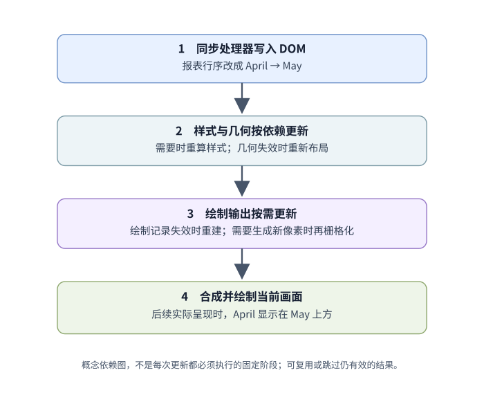

这是说明依赖关系的概念模型。HTML 标准规定了浏览器何时有机会更新渲染，以及其中包括样式和布局等步骤，但没有规定各浏览器使用同样的内部阶段、线程或绘图技术。浏览器可以推迟和合并工作，复用仍然有效的结果，跳过没有失效的层。

### DOM 节点和 CSS 规则怎样变成布局用的盒？

#### 计算样式不是最终几何

`/reports.css` 到达后，CSS 解析器把文本解析成样式表和规则；脚本可见的 CSS Object Model（CSSOM，CSS 对象模型）用 `CSSStyleSheet`、`CSSRule` 等对象表示它们。规则不是 DOM 节点：渲染时浏览器让选择器匹配 DOM，按层叠与继承为每个元素挑出适用声明（冲突怎样裁决见[多条 CSS 声明冲突时谁赢，没有声明时值又从哪来？](#11.%20%E5%A4%9A%E6%9D%A1%20CSS%20%E5%A3%B0%E6%98%8E%E5%86%B2%E7%AA%81%E6%97%B6%E8%B0%81%E8%B5%A2%EF%BC%8C%E6%B2%A1%E6%9C%89%E5%A3%B0%E6%98%8E%E6%97%B6%E5%80%BC%E5%8F%88%E4%BB%8E%E5%93%AA%E6%9D%A5%EF%BC%9F)），得到 computed value（计算值），例如标题的字号和行高。

计算值还不是位置和尺寸。`width: auto` 这样的值要结合可用宽度、字体度量和前面内容，由布局算法求出 used value（使用值）。

#### DOM 和盒不是一一对应

`display` 等属性决定一个元素生成什么盒，但 DOM 节点和盒不是一一对应的：

- `display: none` 的元素不生成盒（各种隐藏方式的差异见[隐藏内容时，布局、指针、焦点和读屏各受什么影响？](#16.%20%E9%9A%90%E8%97%8F%E5%86%85%E5%AE%B9%E6%97%B6%EF%BC%8C%E5%B8%83%E5%B1%80%E3%80%81%E6%8C%87%E9%92%88%E3%80%81%E7%84%A6%E7%82%B9%E5%92%8C%E8%AF%BB%E5%B1%8F%E5%90%84%E5%8F%97%E4%BB%80%E4%B9%88%E5%BD%B1%E5%93%8D%EF%BC%9F)）。
- `display: contents` 的元素自己不生成盒，子元素照常生成。
- 一个文本节点换行后，会对应多个行内片段。

布局再按父容器约束和前面内容的尺寸，确定每个盒或片段的宽高、坐标和顺序。Blink 把一种布局结果组织为 fragment tree（片段树），Gecko 用 frame tree（帧树），一个节点也可能对应多个 frame。共同点是：这些结构携带布局结果，不是 DOM 的原样复制。


### 报表页的纵向布局可以手算

为了看清布局算了什么，给报表页的 `<main>` 子树（标题、摘要图、排序工具栏、两行报表）配一份教学用 CSS。它不是真实站点样式：为消除默认样式对坐标的影响，规则清掉了标题上外边距、按钮内边距和列表缩进，把图片设为块级以去掉行内基线间隙，并全局使用 `border-box`（盒尺寸的算法见[盒子的尺寸怎样计算，块和浮动怎样在流里排开？](#12.%20%E7%9B%92%E5%AD%90%E7%9A%84%E5%B0%BA%E5%AF%B8%E6%80%8E%E6%A0%B7%E8%AE%A1%E7%AE%97%EF%BC%8C%E5%9D%97%E5%92%8C%E6%B5%AE%E5%8A%A8%E6%80%8E%E6%A0%B7%E5%9C%A8%E6%B5%81%E9%87%8C%E6%8E%92%E5%BC%80%EF%BC%9F)）。

```css
*, *::before, *::after { box-sizing: border-box; }
html, body { display: block; margin: 0; padding: 0; }
body { font: 16px Arial, sans-serif; }
main { display: block; width: 100%; padding: 24px; }
h1 { display: block; margin: 0 0 12px; font-size: 24px; line-height: 30px; font-weight: 700; }
img { display: block; width: 320px; height: 180px; margin: 0 0 12px; }
#sort-controls { display: flex; gap: 8px; margin: 0 0 12px; }
button { display: inline-flex; width: 128px; height: 36px; margin: 0; padding: 0; border: 1px solid; font: inherit; }
button svg { display: block; width: 16px; height: 16px; flex: none; }
#reports { display: block; margin: 0; padding: 0; list-style: none; }
#reports li { display: block; height: 34px; margin: 0; padding: 0; line-height: 34px; }
```

视口宽 720 CSS px 时，从这些声明可以直接推出每个盒的位置：

- `main` 宽 720，四边 padding 24，所以内容区从 `(24, 24)` 开始，宽 `720 − 2×24 = 672`。
- 标题、图片、工具栏、列表是纵向排列的块，第一行报表的上边是 `24 + 30 + 12 + 180 + 12 + 36 + 12 = 306`。
- 两个按钮在 flex 行内横排：第一个覆盖 `x = 24…152`，加 8px 间隙后第二个覆盖 `160…288`。
- 两行各高 34，边界是 `306–340` 和 `340–374`；`main` 底边再加 24 的 padding，高 `374 + 24 = 398`。

> [!example] 实测核对：headless Chrome 157.0.8103.50
> 把 `<main>` 子树放进测量页并应用上面的 CSS，图片用本地 `data:` 占位替代。测得 `innerWidth = 720`、`innerHeight = 433`、`devicePixelRatio = 1`。`getBoundingClientRect()`（后文几何 API 一节详解）读数以视口左上为原点、单位 CSS px，与手算一致：
>
> | 元素 | x, y | width × height | 边缘 |
> |---|---:|---:|---:|
> | `main` | `0, 0` | `720 × 398` | 内容区起点 `(24, 24)`，宽 `672` |
> | `h1#summary` | `24, 24` | `672 × 30` | 下边 `54` |
> | `img` | `24, 66` | `320 × 180` | 下边 `246` |
> | `#sort-controls` | `24, 258` | `672 × 36` | 下边 `294` |
> | `ol#reports` | `24, 306` | `672 × 68` | 下边 `374` |
> | May 行 / April 行 | `24, 306` / `24, 340` | 各 `672 × 34` | `306–340`、`340–374` |
>
> 

这条链说明了流式布局的依赖：后面的块位置取决于前面内容的尺寸。所以图片写明 `width` 和 `height` 才能让布局在字节到达前就按 `320×180` 留位（见[打开一个 URL 后，页面怎样变得可见又可交互？](#1.%20%E6%89%93%E5%BC%80%E4%B8%80%E4%B8%AA%20URL%20%E5%90%8E%EF%BC%8C%E9%A1%B5%E9%9D%A2%E6%80%8E%E6%A0%B7%E5%8F%98%E5%BE%97%E5%8F%AF%E8%A7%81%E5%8F%88%E5%8F%AF%E4%BA%A4%E4%BA%92%EF%BC%9F)）；没写尺寸的图片、晚到的字体会在到达后改变前面盒子的尺寸，后面的内容跟着移动。排序后 April 行和 May 行交换了 DOM 顺序，于是 April 的盒落到 `306–340`，May 落到 `340–374`。

### 布局结果怎样变成屏幕上的像素？

布局只给出盒子和文字片段的几何，没有画出字形或背景。绘制阶段按 CSS 绘制顺序把几何、颜色、图片等转成有顺序的绘制项；一个元素可能产生多个绘制项，例如背景和文字。图片未解码时，它的框已参与布局，图像内容要等资源可用。

之后的步骤因引擎而异，下面以一个公开实现为例。

#### Chromium RenderingNG 实例

按 Chromium RenderingNG 架构文档（核对于 2026-11-11）：

1. **Pre-paint** 计算 transform、clip、effect、scroll 四类 property trees（属性树），并标记失效的显示项或图块。
2. **Paint** 按绘制顺序生成 display items（显示项），把共享同一属性状态的显示项分组为 paint chunks（绘制块）。
3. **Commit** 把显示列表和属性树交给合成器；**layerize** 按可独立合成的视觉关系把绘制块组织成一层或多层。
4. **Raster** 把可见空间切成相邻的 tile（图块），每个栅格任务处理覆盖到某个矩形图块的绘制项；互不依赖的图块可以并行。一个绘制项可以跨多个图块，各图块只得到自己那部分像素。长页面可以复用已栅格的图块，滚动时补画新进入视口的区域。
5. **Activate** 产生描述图块摆放和视觉效果的 compositor frame（合成帧）；**Viz** 汇总各可见表面的合成帧，由 GPU 执行 Draw 画出屏幕像素。


图中的 `3×4` 网格是教学假设：每格 `240×100 CSS px`，最下排高 98px，正好铺满 `main` 的 `720×398`（`3×240 = 720`，`3×100 + 98 = 398`）；`main` 完整位于 `720×433` 的视口内，下方还有 35px 空白。它不代表 Chromium 实际的图块尺寸或图层数量，真实引擎按视口、失效范围、图层属性和设备条件决定更新哪些图块。网格线和虚线只是定位参考，合成帧描述的画面里没有它们。

Firefox 的公开说明也从 DOM/CSS 得到布局 frame，再生成 WebRender 显示列表、场景和帧，具体表示和进程安排不同。所以这些阶段名只描述 Chromium，不是网页标准规定的固定流水线。

### 一次改动会让哪些结果失效？

报表页的点击让 DOM 顺序变了，浏览器要在后续渲染机会更新受影响的部分。改什么决定了哪些数据失效：

| 对报表页做什么 | 可能要更新什么 | 仅凭操作名称推不出什么 |
|---|---|---|
| 把两行从 May、April 调成 April、May | 受影响的样式、几何和绘制结果 | 失效范围取决于选择器依赖、布局关系与引擎优化 |
| 只把按钮文字颜色改成强调色 | 重算适用样式，更新相应绘制 | 尺寸和换行不变时，几何通常可复用 |
| 改宽度、字体或会占空间的内容 | 受影响盒子的尺寸和后续位置，再更新绘制 | 重新布局的范围不一定只限于被改的节点 |
| 改 `transform` 或 `opacity` | 某些实现路径可跳过布局，甚至复用绘制结果 | 不能凭属性名保证只走合成或使用 GPU |
| DOM 或样式写入后读取几何 | 若所需样式或布局已失效，读取前同步更新 | 同一个几何 API 并非每次调用都触发布局 |

reflow（重排）和 repaint（重绘）是常见的工程说法，指“重新布局”和“重新绘制”，不是可以跨浏览器比较的指标。一个节点尺寸变化后，排在后面的内容可能都要移动；属性变了但几何没失效时，也可能不必重做布局。`transform` 和 `opacity` 常被选作动画属性，是因为它们在某些渲染路径中能绕过布局或复用绘制内容；目标页面是否真走这条路，要看目标浏览器的性能录制（动画层面的取舍见[过渡和关键帧动画怎样选，怎样不伤性能和可访问性？](#17.%20%E8%BF%87%E6%B8%A1%E5%92%8C%E5%85%B3%E9%94%AE%E5%B8%A7%E5%8A%A8%E7%94%BB%E6%80%8E%E6%A0%B7%E9%80%89%EF%BC%8C%E6%80%8E%E6%A0%B7%E4%B8%8D%E4%BC%A4%E6%80%A7%E8%83%BD%E5%92%8C%E5%8F%AF%E8%AE%BF%E9%97%AE%E6%80%A7%EF%BC%9F)）。

处理器返回时 DOM 已是新顺序，但浏览器不保证每个任务结束就画一帧，读取几何也不会让屏幕立即多画一帧。上表最后一行是脚本能直接撞上的成本，下面先看几何 API 各量什么，再看读取为什么会卡住。

### 哪个几何 API 回答哪个测量问题？

几组几何 API 回答的是不同问题。选错时读到的数值看起来正常，回答的却是另一个问题：

| API | 返回什么 | 不含什么 / 要留意 |
|---|---|---|
| `offsetWidth` / `offsetHeight` | 边框盒的整数宽高（多片段时取轴对齐包围范围）；占布局空间的滚动条计入 | 不含 margin；忽略元素和祖先上的 transform |
| `clientWidth` / `clientHeight` | padding 区的整数尺寸 | 不含 border 和占空间的滚动条；普通 inline 元素或无盒元素返回 `0`；标准模式下根元素表示视口尺寸 |
| `scrollWidth` / `scrollHeight` | 滚动区域的整数尺寸，可大于客户区 | 不含 border；大于客户区不保证用户能滚动 |
| `scrollLeft` / `scrollTop` | 当前滚动位置，可写 | 规范类型允许小数，浏览器可能取整；零点和正负方向取决于书写方向 |
| `offsetLeft` / `offsetTop` | 第一个边框盒片段相对 `offsetParent` 的偏移 | 参照系分三种情况（见下文）；忽略 transform |
| `getBoundingClientRect()` | 变换后边框片段相对布局视口的包围矩形，可为小数 | 不含 margin；结果是读取时的快照，不随后续滚动或布局更新 |

单位都是 CSS 像素，不是设备物理像素。占空间的滚动条会减少 `clientWidth` / `clientHeight`；覆盖在内容上的滚动条通常不占这部分空间。普通 inline 元素即使有文字，`clientWidth` 也是 0：本地测试页里一个普通 `span` 读到 `clientWidth = 0`、`offsetWidth = 101`。

#### 用一组固定数字对照 offsetWidth 与 clientWidth

两个元素都声明 `width: 320px`、左右 padding 16px、border 1px，只有 `box-sizing` 不同；假设横排书写、没有占空间的滚动条：

~~~css
.content-box { box-sizing: content-box; width: 320px; padding-inline: 16px; border: 1px solid; }
.border-box  { box-sizing: border-box;  width: 320px; padding-inline: 16px; border: 1px solid; }
~~~

| `box-sizing` | content 宽度 | `clientWidth` | `offsetWidth` | 计算 |
|---|---:|---:|---:|---|
| `content-box` | 320px | 352px | 354px | content `320` + padding `16×2` = 352；再 + border `1×2` = 354 |
| `border-box` | 286px | 318px | 320px | 总宽 `320` − border `1×2` = 318；再 − padding `16×2` = 286 |


margin 不在这两个值里，所以它们都不能直接当作元素与相邻元素的间距。

#### 滚动区域与 scrollTop

`scrollHeight > clientHeight` 只说明滚动区域比客户区高，不证明用户能滚动：

~~~javascript
const hasVerticalOverflow = element.scrollHeight > element.clientHeight;
const currentY = element.scrollTop;
element.scrollTop = 0; // 在普通向下溢出的例子中，回到滚动起点
~~~

`overflow: hidden` 裁剪内容、不让用户直接滚动，但脚本仍能写 `scrollTop` 滚动它；`overflow: visible` 把溢出画在盒外，不形成滚动区域，写入 `scrollTop` 不起作用。

书写方向会改变零点。`direction: rtl` 的横向溢出容器从右端开始，初始 `scrollLeft = 0`，向左滚动时读数为负。设 `scrollWidth = 240`、`clientWidth = 100`，可滚动距离是 `240 − 100 = 140`，合法范围就是 `−140…0`；写入正数会被限制回 0。带弹性回弹的浏览器还可能在用户拖过边界时暴露范围外的偏移，这是实现差异。所以判断“已到顶 / 已到底”时，要结合方向和范围，不能假设偏移总是非负整数。

> [!info] Chrome 157 本地测试页的读数
> 两个盒子 `scrollHeight` 都是 200、`clientHeight` 都是 80；写入 `scrollTop = 30.5` 后，`hidden` 盒读回 `31`，`visible` 盒仍为 `0`。上面的 RTL 容器写入 `-20.5` 读回 `-20`，写入 `25` 被限制为 `0`。规范允许小数，这一版 Chrome 做了取整。

根元素是例外。标准模式下，`document.documentElement.scrollHeight` 返回视口滚动区域高度与视口高度的较大值，`clientHeight` 是扣除占空间滚动条后的视口高度。

#### offsetLeft 相对谁：offsetParent 的三种情况

`offsetLeft` / `offsetTop` 按以下三种情况取值：

1. **元素是 `body`，或没有布局盒**：返回 0。
2. **其他元素的 `offsetParent` 为 `null`**：返回第一个盒片段的边框边缘相对初始包含块原点的位置。例如没有祖先为固定定位建立包含块时，`position: fixed; left: 55px; top: 30px` 的元素得到 `offsetParent === null`，`(offsetLeft, offsetTop) = (55, 30)`；此时初始包含块原点与布局视口左上角重合。
3. **`offsetParent` 存在**：子元素第一个边框盒片段的边框边缘，减去父元素第一个盒片段的 padding edge。padding edge 指 padding 区靠边框的外缘，不是 content 与 padding 的分界。

`offsetParent` 的选取还要考虑定位方式、表格结构、包含块、缩放和 Shadow DOM 边界，它不总是最近的定位祖先（包含块规则见[定位元素参照谁，为什么大 z-index 还会被盖住？](#14.%20%E5%AE%9A%E4%BD%8D%E5%85%83%E7%B4%A0%E5%8F%82%E7%85%A7%E8%B0%81%EF%BC%8C%E4%B8%BA%E4%BB%80%E4%B9%88%E5%A4%A7%20z-index%20%E8%BF%98%E4%BC%9A%E8%A2%AB%E7%9B%96%E4%BD%8F%EF%BC%9F)）。上一章拖动卡片时，卡片绝对定位在 `position: relative` 的容器里，容器就是它的 `offsetParent`，所以 `offsetLeft` 和 CSS `left` 量的是同一个起点。

#### getBoundingClientRect 与 transform

前面的属性都忽略 transform。要知道元素在视口里实际占据的范围，用 `getBoundingClientRect()`：它先取元素的 client rect 列表（每个盒片段一个矩形，已计入元素自身和祖先的 transform），对普通非零片段求最小的轴对齐包围矩形。元素没有布局盒时返回全 0 的矩形。坐标以 layout viewport（布局视口）左上角为原点。

一个可以手算的例子：文档没有滚动或缩放，祖先没有 transform。

~~~css
#target {
  position: absolute; left: 100px; top: 100px;
  box-sizing: content-box; width: 100px; height: 40px; border: 2px solid;
  transform-origin: 0 0;
  transform: translate(20px, 12px) scale(1.5);
}
~~~

1. 布局边框盒宽 `100 + 2×2 = 104`、高 `40 + 2×2 = 44`。`offsetWidth` / `offsetHeight` 忽略变换，仍是 `104 × 44`。
2. `transform` 列表从左到右相乘成一个矩阵，作用到点上时右侧的函数先生效：先以左上角为原点 `scale(1.5)`，再 `translate(20px, 12px)`。左上角在缩放中不动，平移后从 `(100, 100)` 移到 `(120, 112)`。
3. 宽高变为 `104 × 1.5 = 156`、`44 × 1.5 = 66`。所以 `rect.left = 120`，是视口原点到左边缘的坐标，不是宽度。

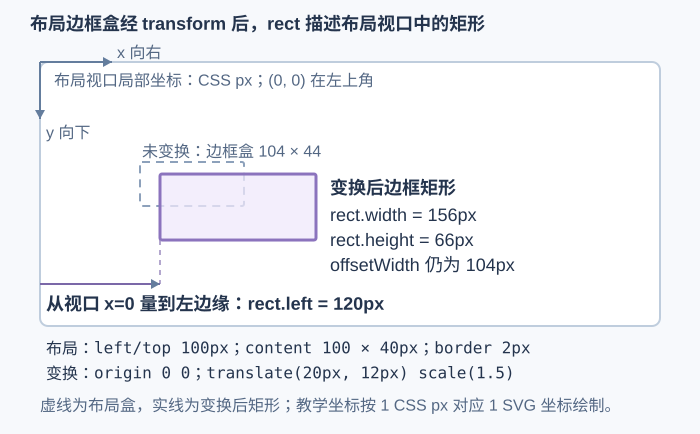

> [!info]- 零宽或零高片段：规范算法与实现不一致
> CSSOM View 草案规定：若每个片段都至少有一边为 0，返回第一个片段；否则对宽或高至少一项非 0 的片段求包围范围，零宽非零高的片段也算在内。Chrome 157.0.8103.51 的合成页里，三个零宽非零高的片段实际返回了最后一个片段；混有普通片段和零宽尾片时，也没有把尾片纳入。依赖这类退化片段时，要按目标浏览器验证。本章的数值例子都用普通非退化盒子。

#### 判断元素是否与视口重叠

有了视口矩形，就能判断元素是否与布局视口有面积大于 0 的重叠。标准模式下根元素的 `clientWidth` / `clientHeight` 是扣除滚动条后的布局视口尺寸；只在边缘相接不算重叠：

~~~javascript
function overlapsLayoutViewport(element) {
  const rect = element.getBoundingClientRect();
  const root = document.documentElement;
  return root.clientWidth > 0 && root.clientHeight > 0 &&
    rect.width > 0 && rect.height > 0 &&
    rect.bottom > 0 && rect.top < root.clientHeight &&
    rect.right > 0 && rect.left < root.clientWidth;
}
~~~

函数名不叫“已可见”，因为它不检查祖先滚动容器的裁剪、遮挡、透明度或旋转后形状内的空白。移动端 pinch-zoom（双指缩放）放大或平移时，布局视口也不等于用户眼前的 visual viewport（视觉视口）。要和视觉视口比较，把 `window.visualViewport` 的 `offsetLeft`、`offsetTop` 当作视觉视口在布局视口中的左上角，四边界取 `(offsetLeft, offsetTop, offsetLeft + width, offsetTop + height)`，再按同样的条件比较。

只想异步知道元素何时与视口或某个根相交时，`IntersectionObserver` 通常比反复读矩形更合适，用法见[图片和音视频该怎样写语义、定地址、选文件和定加载时机？](#6.%20%E5%9B%BE%E7%89%87%E5%92%8C%E9%9F%B3%E8%A7%86%E9%A2%91%E8%AF%A5%E6%80%8E%E6%A0%B7%E5%86%99%E8%AF%AD%E4%B9%89%E3%80%81%E5%AE%9A%E5%9C%B0%E5%9D%80%E3%80%81%E9%80%89%E6%96%87%E4%BB%B6%E5%92%8C%E5%AE%9A%E5%8A%A0%E8%BD%BD%E6%97%B6%E6%9C%BA%EF%BC%9F)。

### 为什么读几何值会让脚本停下来？

#### 读取必须返回当前值

DOM 或样式写入后，浏览器通常只把样式或布局标记为“待更新”，继续运行 JavaScript，把计算留到下一次渲染更新。但几何 API 必须返回调用这一刻的值。如果此前的写入让返回值依赖的数据失效，浏览器就要在返回前同步重算样式或布局；数据仍有效时，读取直接复用结果。


这种同步布局，Chrome 文档称为 forced reflow（强制重排），也常叫强制布局。脚本要等它算完才继续，等待多久取决于此前哪些数据失效、影响范围多大、实现能复用多少，不是 API 本身的固定成本。同样的契约也适用于 `getComputedStyle()`：它要返回当前样式，所以在样式已失效时也可能先同步重算样式。

#### 把读和写分批

为了单独观察读写顺序，换一个与报表无关的小例子：两个普通块元素，没有最小 / 最大宽度约束和变换，边框盒宽分别是 100px 和 160px，任务是各加宽 10px。`border-box` 让声明的 `width` 就是边框盒宽度，目标值是 110px 和 170px。

~~~html
<div id="width-demo">
  <div class="item" style="width: 100px"></div>
  <div class="item" style="width: 160px"></div>
</div>
~~~

~~~css
#width-demo .item { box-sizing: border-box; padding: 4px; border: 1px solid; }
~~~

下面两种写法各自从相同的初始宽度运行，不是先后执行。第一种每写一个宽度就立刻读回；写入让布局失效，紧接着读取就逼浏览器当场算布局，每一项都付一次：

~~~javascript
const items = Array.from(document.querySelectorAll("#width-demo .item"));

const widthsAfterEachWrite = [];
for (const item of items) {
  item.style.width = (item.offsetWidth + 10) + "px";
  widthsAfterEachWrite.push(item.offsetWidth);
}
~~~

如果每个新值只依赖自己的原宽度，不需要观察前一项写入后的中间几何，就先读完所有原值，再统一写入；要验证结果时，在最后集中读：

~~~javascript
const nextWidths = items.map((item) => item.offsetWidth + 10);
items.forEach((item, index) => {
  item.style.width = nextWidths[index] + "px";
});
const widthsAfterBatch = items.map((item) => item.offsetWidth);
~~~

批量版本先读到 `[100, 160]`，再写入两个新值；末尾第一次读取一次处理两项变更，第二次读取复用刚更新的结果。两种写法的最终宽度都是 `[110, 170]`。

> [!example] 实测：headless Chrome 157.0.8103.51 的布局次数
> 探针在开始记录前先读一次两个元素的 `offsetWidth`，保证初始布局已算好；然后用 Chrome DevTools Protocol（CDP）记录脚本段内的 `Layout` 完成事件。逐项写后读观察到 2 次布局，批量读写并在末尾读回观察到 1 次。若开始时布局本已失效，批量代码开头的读取也会先触发一次更新。这只说明这个小例子里读写次序的影响，不证明任何批量写法在所有页面都更快。

排查时的顺序是：先在性能录制里确认出现了同步布局，再找出让数据失效的写入和紧跟其后的读取，把读集中到写之前。性能录制怎样区分处理时长、布局与绘制成本，见[用户觉得慢时，怎样从指标走到证据？](#55.%20%E7%94%A8%E6%88%B7%E8%A7%89%E5%BE%97%E6%85%A2%E6%97%B6%EF%BC%8C%E6%80%8E%E6%A0%B7%E4%BB%8E%E6%8C%87%E6%A0%87%E8%B5%B0%E5%88%B0%E8%AF%81%E6%8D%AE%EF%BC%9F)。

### 跨浏览器的结论停在哪一层？

Web 平台规定的是可观察结果：DOM 状态、CSS 计算出的几何、几何 API 的返回值，以及渲染机会何时出现。它不要求各浏览器共享同一条内部管线。所以能跨浏览器成立的解释停在“输入状态、哪些数据失效、画面结果”这一层；pre-paint、tile、Viz、GPU 纹理这些名称只描述 Chromium 的实现，实际设备还可能用不同的栅格后端或回退路径。具体的性能判断要看目标引擎的录制。

报表增长到成千上万行时，要先分清网络传输、服务端查询、客户端计算和已挂载节点的样式与布局成本。虚拟滚动主要减少同时挂载的 DOM 节点，不会减少已下载的数据，也不消除对全量数据的计算，见[长列表的成本在哪里，分页和虚拟化各省掉什么？](#58.%20%E9%95%BF%E5%88%97%E8%A1%A8%E7%9A%84%E6%88%90%E6%9C%AC%E5%9C%A8%E5%93%AA%E9%87%8C%EF%BC%8C%E5%88%86%E9%A1%B5%E5%92%8C%E8%99%9A%E6%8B%9F%E5%8C%96%E5%90%84%E7%9C%81%E6%8E%89%E4%BB%80%E4%B9%88%EF%BC%9F)。

### 画面跟上了，地址还没有

到这里，点击产生的 DOM 变化已经走完样式、布局、绘制和合成：下一帧里 April 在 `306–340`，May 在 `340–374`，“最早优先”按钮的 `aria-pressed` 已是 `"true"`。脚本也知道该用哪个几何 API 量哪种盒子，以及怎样避免逐项写后读造成的强制布局。还没跟上的是地址栏：它仍然是 `/reports/42?sort=recent#summary`，刷新或分享链接会回到最近优先。点击后该用哪种方式改写 URL、前进和后退怎样恢复排序，由[地址变了，浏览器什么时候加载新文档，界面状态何时该写进 URL？](#7.%20%E5%9C%B0%E5%9D%80%E5%8F%98%E4%BA%86%EF%BC%8C%E6%B5%8F%E8%A7%88%E5%99%A8%E4%BB%80%E4%B9%88%E6%97%B6%E5%80%99%E5%8A%A0%E8%BD%BD%E6%96%B0%E6%96%87%E6%A1%A3%EF%BC%8C%E7%95%8C%E9%9D%A2%E7%8A%B6%E6%80%81%E4%BD%95%E6%97%B6%E8%AF%A5%E5%86%99%E8%BF%9B%20URL%EF%BC%9F)接手。

> [!info]- 来源
> - **渲染机会与更新渲染（概览、失效表、跨浏览器结论）。** [WHATWG HTML §8.1.7 Event loops, update the rendering](https://html.spec.whatwg.org/multipage/webappapis.html#update-the-rendering)，Living Standard，更新于 2026-11-11，核对于 2026-11-12。规范定义渲染机会和更新渲染中的样式、布局等步骤；绘制、栅格化和合成的分层是概念说明。
> - **样式表、规则与计算值 / 使用值。** [CSS Syntax Level 3 §8.1](https://www.w3.org/TR/css-syntax-3/#style-rules)，W3C Candidate Recommendation Draft（2026-10-01）；[CSSOM §6.1、§6.4](https://www.w3.org/TR/cssom-1/#css-rules)，W3C Working Draft（2021-08-26），`CSSStyleSheet` 与规则对象；[CSS Cascading and Inheritance Level 5 §§4.4–4.5](https://www.w3.org/TR/css-cascade-5/#computed-values)，W3C Candidate Recommendation Snapshot（2022-01-13）。核对于 2026-11-11。
> - **DOM 与盒不一一对应（`display:none`、`display:contents`、盒生成）。** [CSS Display Level 3 §2.5](https://www.w3.org/TR/css-display-3/#box-generation)，W3C Candidate Recommendation Draft（2026-06-05），核对于 2026-11-11。
> - **Chromium RenderingNG 实例与 Firefox 对照。** [RenderingNG architecture, Rendering pipeline structure, stages 2–12](https://developer.chrome.com/docs/chromium/renderingng-architecture#rendering-pipeline-structure)；[Key data structures in RenderingNG](https://developer.chrome.com/docs/chromium/renderingng-data-structures)，§§The immutable fragment tree、Property trees、Display lists and paint chunks、Compositor frames（Tiles、Quads and surfaces）；[Firefox Rendering Overview](https://firefox-source-docs.mozilla.org/gfx/RenderingOverview.html)、[Gecko Layout Overview](https://firefox-source-docs.mozilla.org/layout/LayoutOverview.html)。公开引擎实现说明，核对于 2026-11-11。
> - **报表页布局实测。** 本地 headless Chrome `157.0.8103.50`，720×433 视口、DPR 1，`getBoundingClientRect()` 读数；只核对教学 CSS 下的几何。
> - **几何 API 对照表。** `offsetWidth` / `offsetHeight` 忽略变换、量边框盒片段：[W3C CSSOM View §7, HTMLElement 扩展](https://www.w3.org/TR/cssom-view-1/#extensions-to-the-htmlelement-interface)；`clientWidth` / `clientHeight` 的 inline / 无盒返回 0、边框与滚动条、根元素例外，`scrollHeight` 根元素取较大值：[§6 Element 扩展](https://www.w3.org/TR/cssom-view-1/#extensions-to-the-element-interface)；CSS 像素：[§2.1](https://www.w3.org/TR/cssom-view-1/#css-pixels)。W3C Working Draft，2025-09-16，核对于 2026-11-12。
> - **`box-sizing` 计算。** [CSS Sizing Level 3 §3.3, Box Edges for Sizing](https://www.w3.org/TR/css-sizing-3/#box-sizing)，W3C Working Draft，2026-09-04，核对于 2026-11-12。
> - **`scrollTop` / `scrollLeft` 可写、范围与负向坐标。** [CSSOM View Editor’s Draft §6](https://drafts.csswg.org/cssom-view/#extensions-to-the-element-interface)，2026-11-05，IDL 为 `unrestricted double`；`overflow: hidden` 仍可程序滚动、`visible` 不形成滚动区域、滚动原点与 RTL：[CSS Overflow Level 3 §2.3、§3.1](https://drafts.csswg.org/css-overflow-3/)，Editor’s Draft，2026-08-13。取整读数来自本地 Chrome 157 合成页。
> - **弹性回弹暴露范围外偏移是实现差异。** [CSSWG issue 4011](https://github.com/w3c/csswg-drafts/issues/4011)、[WebKit bug 198597](https://bugs.webkit.org/show_bug.cgi?id=198597)，2026-11-12 核对时仍无统一约定；未实测 Safari。
> - **`offsetParent` 三分支与 `getBoundingClientRect()` 片段联合、快照、零尺寸片段规则；布局视口、视觉视口及其偏移。** [W3C CSSOM View §2、§6–7、§12](https://www.w3.org/TR/cssom-view-1/)，W3C Working Draft，2025-09-16，核对于 2026-11-12。零尺寸片段的 Chrome 行为来自本地 Chrome 157.0.8103.51 合成页。
> - **transform 函数的合成顺序。** [CSS Transforms Level 1 §2, Transform Rendering Model](https://drafts.csswg.org/css-transforms/#transform-rendering)，Editor’s Draft，2025-11-30。
> - **IntersectionObserver 异步报告位置关系、不以像素级显示结果为目标。** [W3C Intersection Observer §1](https://www.w3.org/TR/intersection-observer/#introduction)，Working Draft，2023-10-18，核对于 2026-11-12。
> - **强制重排的条件与读写分批建议。** [Chrome Performance Insights: Forced reflow](https://developer.chrome.com/docs/performance/insights/forced-reflow)，更新于 2025-10-08；描述针对 Chrome 实现。
> - **读写分批的本地探针。** headless Chrome `157.0.8103.51`，CDP 记录 `Layout` 完成事件：记录前先读 `offsetWidth`；逐项写后读 2 次、批量写入末尾读回 1 次；结果均为 `[110, 170]`。不作跨版本性能承诺。
## 6. 图片和音视频该怎样写语义、定地址、选文件和定加载时机？

一张图片或一段视频进入页面，要依次回答四个问题：它对读者意味着什么，文件地址相对谁解析，在多个候选文件里下载哪一个，什么时候开始请求。本章沿用主线一的报表页 `/reports/42?sort=recent#summary`，在首屏摘要图 `/report-summary.png` 之外，再给它加一张首屏以下的趋势图，对比四月与五月的合计（640×360；懒加载和观察器两节用 `report-chart-640.webp`，选文件一节改用 `report-640.webp`、`report-1280.webp` 两个分辨率版本），按这四个问题走完，并检查图片到达前后布局是否跳动。文件名、尺寸和 URL 都是教学用合成值。

### 图片在页面里承担什么角色？

先按内容选元素：图像内容用 ``，可播放的音频和视频用 `<audio>`、`<video>`。元素定了，再写 alternative text（替代文本），也就是 `alt` 属性。`alt` 写什么由图片的用途决定，不由图片长什么样决定：

| 图片用途 | `alt` 怎样写 | 报表页里的例子 |
|---|---|---|
| 纯装饰，不增加信息 | `alt=""`，让辅助技术跳过它 | 标题旁的花纹 |
| 传达信息 | 用一句话说出页面需要的信息 | 趋势图：`四月与五月的报表合计对比，五月更高` |
| 是链接或按钮的唯一内容 | 写控件的用途，而不是图案 | 只有放大镜图标的按钮：`搜索报表` |
| 复杂图表 | 简短 `alt` 说内容和主要结论，完整数据交给旁边的正文或数据表 | 多月趋势图配一张数据表 |

如果趋势图旁边已有一张数据表给出全部数值，图像不再增加信息，才可以当作装饰写 `alt=""`。`title` 不能代替 `alt`；同理，表单控件的名称应来自关联的 `<label>`，`title` 只是不可靠的备选。

图片常被包在可点击的元素里，这时还要分清链接和按钮：`<a href>` 用于导航到另一个地址，`<button>` 用于在当前页面执行动作。`href="#"` 不是“什么都不做”的占位写法：它会改变 fragment（片段）位置，还可能新增一条历史记录。链接文字要说明去向。

确需在新浏览上下文打开链接时写 `target="_blank"`。按当前 HTML 标准，只要没写 `rel="opener"`，它默认具有 `noopener` 效果，新页面拿不到指向原页面的 `opener` 引用。显式写 `rel="noopener"` 可以把意图留在标记上，也照顾较旧的浏览器。

### 资源地址相对哪个基准解析？

`` 指向要载入的资源，`<a href>` 指向导航目标，两者按同一套规则解析。URL 各分量的含义和分工见[地址变了，浏览器什么时候加载新文档，界面状态何时该写进 URL？](#7.%20%E5%9C%B0%E5%9D%80%E5%8F%98%E4%BA%86%EF%BC%8C%E6%B5%8F%E8%A7%88%E5%99%A8%E4%BB%80%E4%B9%88%E6%97%B6%E5%80%99%E5%8A%A0%E8%BD%BD%E6%96%B0%E6%96%87%E6%A1%A3%EF%BC%8C%E7%95%8C%E9%9D%A2%E7%8A%B6%E6%80%81%E4%BD%95%E6%97%B6%E8%AF%A5%E5%86%99%E8%BF%9B%20URL%EF%BC%9F)，这里只看相对地址怎样补全：

| 写法 | 示例 | 解析方式 |
|---|---|---|
| 绝对 URL（带 `https:` 这类 scheme 前缀） | `https://example.com/a.png` | 直接使用自身的 scheme 和地址；`mailto:team@example.com` 也是绝对 URL，只是没有主机 |
| 根相对路径 | `/assets/chart.png` | 从文档基准 URL 的 origin（源）根目录解析 |
| 文档相对路径 | `../assets/chart.png` | 相对文档基准 URL 的路径解析 |

文档基准 URL 默认就是当前文档的 URL。以报表页地址 `https://reports.example/reports/42?sort=recent#summary` 为例：

- `assets/chart.png` 相对目录 `/reports/` 解析为 `https://reports.example/reports/assets/chart.png`。查询串 `?sort=recent` 和片段 `#summary` 都不参与。
- `../assets/chart.png` 从 `/reports/` 上退一级，得到 `https://reports.example/assets/chart.png`。
- `/assets/chart.png` 直接从 origin 根开始，同样得到 `https://reports.example/assets/chart.png`。

`<base href>` 会改写文档基准 URL，连 origin 一起改。若页面写了 `<base href="https://cdn.example.net/reports/42/">`，`/assets/chart.png` 解析为 `https://cdn.example.net/assets/chart.png`，`../assets/chart.png` 解析为 `https://cdn.example.net/reports/assets/chart.png`。所以“根相对路径一定指向页面所在的站点”并不成立。

本机文件路径也会被当成 URL。把 `/project/site/image.png` 写进通过 HTTP 访问的页面，浏览器不会去读本机文件，而是把它当作根相对路径，向服务器请求 `https://reports.example/project/site/image.png`。服务器必须真的在这个路径上提供资源。

### 什么时候开始请求？

地址定了，下一步是请求时机。HTML 里图片默认立即获取；首屏之外的普通内容图片可以写 `loading="lazy"`，让浏览器推迟请求，直到图片接近视口。

~~~html

~~~

几条规则决定这个属性能不能按预期工作：

- **真实地址要写在 `src` 或 `srcset` 里。** 浏览器只认标准属性；只写 `data-src` 时根本不会发起请求。
- **“接近视口”的距离由浏览器决定。** 它不是可依赖的固定值。
- **脚本被禁用时不延迟。** HTML 标准规定此时 `loading="lazy"` 按立即加载处理，否则网站可以在不运行脚本的情况下，从图片请求的时间推测用户滚动到了哪里。因为真实地址留在 HTML 里，脚本被禁用的用户照样能看到图片；这一点与后文用 JavaScript 改写 `src` 的自定义做法不同。

#### 宽高属性怎样防止布局跳动？

延迟请求意味着图片文件到达之前，页面已经排好了版。`width` 和 `height` 让浏览器在文件到达前就知道宽高比，从而预留空间。

> [!example] 预留高度的演算
> 上例 `width="640" height="360"`，宽高比是 `640 : 360 = 16 : 9`。CSS 让图片宽 `320px`、`height: auto` 时，文件到达前预留高度为 `320 × 9 ÷ 16 = 180px`。
>
> 如果实际文件是 `800 × 600`，比例是 `4 : 3`。浏览器拿到自然尺寸后把高度改成 `320 × 3 ÷ 4 = 240px`，下方内容被推下 `240 − 180 = 60px`。

所以宽高属性必须对应实际文件的比例；不同裁切的图片尤其要检查。也可以用容器的 `aspect-ratio` 配合 `object-fit` 控制展示盒，让文件比例不同也不改变布局。检查方法：在 DevTools 模拟慢网，分别在图片自然尺寸可用前后读 `getBoundingClientRect().height`，两次读数应相同。这个接口读的是哪一种盒，见[DOM 改动后浏览器重做了什么，读几何值为什么会卡住脚本？](#5.%20DOM%20%E6%94%B9%E5%8A%A8%E5%90%8E%E6%B5%8F%E8%A7%88%E5%99%A8%E9%87%8D%E5%81%9A%E4%BA%86%E4%BB%80%E4%B9%88%EF%BC%8C%E8%AF%BB%E5%87%A0%E4%BD%95%E5%80%BC%E4%B8%BA%E4%BB%80%E4%B9%88%E4%BC%9A%E5%8D%A1%E4%BD%8F%E8%84%9A%E6%9C%AC%EF%BC%9F)。

#### 首屏主图为什么不能延迟？

延迟加载只适合首屏之外的图片。首屏的主图很可能是 Largest Contentful Paint（最大内容绘制，LCP）元素，而浏览器发现和请求它越晚，LCP 就越晚。因此：

- 已确认是 LCP 元素的图片不写 `loading="lazy"`；首屏可见、很可能成为 LCP 的主图（例如报表页的摘要图 `/report-summary.png`）也不写。
- 这张图写在初始 HTML 里，让浏览器边解析边发现并请求它，而不是等脚本插入。
- 测量显示它的请求优先级不够、且目标浏览器支持时，再加 `fetchpriority="high"`。这只是优先级提示，不保证生效；给大量资源都标高等于没标。

LCP 怎样测、慢在哪一段，见[用户觉得慢时，怎样从指标走到证据？](#55.%20%E7%94%A8%E6%88%B7%E8%A7%89%E5%BE%97%E6%85%A2%E6%97%B6%EF%BC%8C%E6%80%8E%E6%A0%B7%E4%BB%8E%E6%8C%87%E6%A0%87%E8%B5%B0%E5%88%B0%E8%AF%81%E6%8D%AE%EF%BC%9F)。

### 从多个候选里下载哪个文件？

时机决定何时下载，`srcset` 和 `sizes` 决定下载哪个文件：

- `srcset` 列出候选文件。`640w`、`1280w` 是各文件本身的像素宽度。
- `sizes` 告诉浏览器布局会给图片留多宽（CSS 像素）。浏览器在下载前还没排版，只能靠这个声明估算展示宽度。

下例让图片在视口不宽于 `640px` 时占满视口宽度，更宽时固定 `640px`。CSS 与 `sizes` 的写法必须一致。它可以和 `loading="lazy"`、宽高属性同时写在一个 `` 上：

~~~html

~~~

~~~css
.report-responsive {
  display: block;
  width: min(100vw, 640px);
  height: auto;
}
~~~

> [!example] 理想文件宽度
> device pixel ratio（设备像素比，DPR）是一个 CSS 像素对应几个设备像素。理想文件宽度 = 展示宽度 × DPR。
>
> - 视口宽 `320px`，按 `sizes` 展示宽度是 `320px`；DPR 为 `2` 时目标是 `320 × 2 = 640` 像素，通常选 `640w`。
> - 视口宽 `1024px`，展示宽度是 `640px`；DPR 为 `2` 时目标是 `640 × 2 = 1280` 像素，通常选 `1280w`。
>
> 这个乘法只说明目标。浏览器还会综合可用候选、缩放、缓存和自身策略来选，不保证一定选中某个候选。

两个常见错误：

- **宽度描述符没写 `sizes`。** 浏览器按 `100vw` 估算。图片实际只占半屏时，它会下载过大的文件。
- **以为 `sizes` 能自动跟随布局。** 普通 `sizes` 只是作者的声明。对 `loading="lazy"` 的图片，HTML 标准允许写 `sizes="auto, (max-width: 640px) 100vw, 640px"`：支持的浏览器在布局后用图片的实际宽度选文件，不支持的浏览器忽略 `auto`，使用后面的列表。各浏览器支持情况要按目标环境核验。

`srcset` 只在同一画面的不同分辨率之间选。窄屏如果需要不同裁切，用 `<picture>` 里带 `media` 条件的 `<source>`；没有 `<source>` 匹配时，浏览器使用 `` 自己的候选。下例窄屏图是 `800 × 600`（4:3），宽屏图是 `640 × 360`（16:9）。`<source>` 上的宽高属性让浏览器按选中裁切的比例预留空间，前一节的 60px 跳动就不会发生：

~~~html
<picture>
  <source media="(max-width: 640px)"
          srcset="/assets/report-narrow-crop.webp"
          width="800" height="600">
  
</picture>
~~~

### CSS 隐藏的图片会被请求吗？

会。CSS 只决定元素显示与否，不推迟普通 `` 的请求。按 HTML 标准，图片默认立即获取；只要 `` 带着 URL 进入文档，即使它处在 `display: none` 的祖先里，浏览器也可以去取。

横幅切换是常见的误区。下面是一张旧电商页面的归档截图，可见中秋活动文案、商品分类和左右切换箭头：


接下来的代码是另一个独立的合成示例，不是截图页面的源码。它用 `.current` 只显示一项：

~~~html
<ul class="report-banner">
  <li class="current">
    <a href="/reports/monthly">
      
    </a>
  </li>
  <li>
    <a href="/reports/quarterly">
      
    </a>
  </li>
</ul>
~~~

~~~css
.report-banner {
  position: relative;
  overflow: hidden;
  aspect-ratio: 16 / 5;
  margin: 0;
  padding: 0;
  list-style: none;
}
.report-banner li { position: absolute; inset: 0; display: none; }
.report-banner li.current { display: block; }
.report-banner img { display: block; width: 100%; height: 100%; object-fit: cover; }
~~~

两个 URL 在 HTML 创建时就已给出，季度项虽然 `display: none`，浏览器仍可以请求它。若要由应用决定请求时机，初始状态不写真实 `src`，选中该项时再设置。

> [!info] 实测：隐藏图片被请求并解码
> Chromium `157.0.8103.51` 的本地小复现中，上例隐藏的季度图片被请求并解码。

这段代码只决定哪项显示，没有自动轮换、前后按钮、键盘操作或暂停控制，因此不是完整的轮播。真正的自动轮播要提供这些操作并照顾焦点、悬停和减少动态效果的偏好；暂停义务见[过渡和关键帧动画怎样选，怎样不伤性能和可访问性？](#17.%20%E8%BF%87%E6%B8%A1%E5%92%8C%E5%85%B3%E9%94%AE%E5%B8%A7%E5%8A%A8%E7%94%BB%E6%80%8E%E6%A0%B7%E9%80%89%EF%BC%8C%E6%80%8E%E6%A0%B7%E4%B8%8D%E4%BC%A4%E6%80%A7%E8%83%BD%E5%92%8C%E5%8F%AF%E8%AE%BF%E9%97%AE%E6%80%A7%EF%BC%9F)。

### 需要自己控制时机时，怎样用 IntersectionObserver？

`loading="lazy"` 把触发时机完全交给浏览器。下面几种情况需要自己控制，这时用 `IntersectionObserver`（相交观察器）：

- 观察范围是某个滚动容器，而不是视口；
- 要指定提前多远开始加载，或可见到什么比例才触发；
- 目标进入范围时，除了加载图片还要做别的事。

如果唯一需求是“首屏外图片晚点加载”，优先用原生 `loading="lazy"`。

下例由一个组件管理一批图片：查询限定在组件容器内，观察器只管这批图片。图片初始 `src` 是本地占位图；`data-src` 只是应用暂存的真实地址，浏览器不会去取它。

~~~html
<div id="report-images">
  
</div>
~~~

~~~javascript
const observer = new IntersectionObserver((entries) => {
  for (const entry of entries) {
    if (!entry.isIntersecting) continue;

    const image = entry.target;
    image.src = image.dataset.src;
    image.removeAttribute("data-src");
    observer.unobserve(image);
  }
}, { root: null, rootMargin: "200px 0px", threshold: 0 });

const imageBatch = document.querySelector("#report-images");
for (const image of imageBatch.querySelectorAll("img[data-src]")) {
  observer.observe(image);
}
// 组件卸载时，由拥有该观察器的组件调用 observer.disconnect()。
~~~

三个配置项（假设图片在顶层页面里，且没有中间容器裁剪它）：

- `root: null` 使用隐式根，即顶层浏览上下文的文档，相交边界是顶层视口。页面嵌在 iframe 里时，这不是 iframe 自己的视口。把某个元素设为 `root` 时，目标必须是它的后代。
- `rootMargin: "200px 0px"` 把根矩形的上、下边各向外扩 `200px`，左右不变，于是图片在进入视口前 200px 就触发。它只扩大根自身的矩形，不改变其他祖先容器的裁剪。
- `threshold: 0` 表示一开始相交就通知。开始观察后，浏览器还会先发一次初始状态通知。

一次回调可能带来多个条目，所以要逐个处理：

1. `isIntersecting` 为 `false` 的条目跳过，继续观察。
2. 为 `true` 时，把真实地址赋给标准的 `src`。这一步才让浏览器开始加载。
3. 之后移除 `data-src`、调用 `unobserve`，只是清理属性和观察关系，不会触发加载。

**图：目标进入上下预加载区后，`src` 赋值触发加载；随后清理属性并停止观察**


这套做法还有几处边界：

- **`isIntersecting` 不等于“至少一像素可见”。** 目标与（扩展后的）根矩形边缘刚好接触时，它也可能为 `true`，此时交集面积为零。它也不能证明图片没被其他元素遮挡。
- **回调仍在主线程上运行。** 通知是异步发送的，但回调在页面的事件循环中执行，里面做重活照样占用主线程。
- **失败要自己处理。** 图片加载失败时，应用要监听 `load` / `error`，并做有次数上限的重试。
- **不运行脚本的用户什么也看不到。** 唯一的地址放在 `data-src` 里，脚本不运行就永远不会加载。需要时另给非脚本后备，例如 `<noscript>` 里的 ``。
- **卸载时断开。** 加载成功后宽高属性继续保持布局；组件卸载时，由拥有观察器的组件调用 `disconnect()` 停止观察全部目标。

只有必须兼容不支持 IntersectionObserver 的浏览器时，才用 `scroll` / `resize` 事件加几何检查作回退：挂载时先检查一次，之后的检查要节流（见[怎样包装一个函数而不弄丢参数、this 和结果？](#25.%20%E6%80%8E%E6%A0%B7%E5%8C%85%E8%A3%85%E4%B8%80%E4%B8%AA%E5%87%BD%E6%95%B0%E8%80%8C%E4%B8%8D%E5%BC%84%E4%B8%A2%E5%8F%82%E6%95%B0%E3%80%81this%20%E5%92%8C%E7%BB%93%E6%9E%9C%EF%BC%9F)）；卸载时移除监听器，并取消尚未执行的定时检查，避免回调继续引用已移除的 DOM 节点。

### 音频和视频还要写什么？

`<audio>` 和 `<video>` 同样有语义和加载时机两方面的问题。

语义上：

- 写 `controls`，用户才能用浏览器自带的控件开始、暂停和调节播放。不要用视觉样式冒充媒体控件。
- 各浏览器和平台支持的格式与编解码器不同，可以按目标环境提供多个 `<source>`，浏览器选第一个能播的。
- 字幕用 `<track>` 提供。
- 给视频写宽高或比例，降低播放器加入布局时的跳动。

加载时机上：

- `preload` 只表达对媒体数据的加载偏好，浏览器可以不照做。单写 `preload="none"` 也不保证 `poster` 封面图不被请求。
- 在支持媒体懒加载的浏览器里，首屏外的播放器可以写 `loading="lazy"`。它推迟媒体数据请求，连 `poster` 也一起推迟，并且优先于 `preload` 生效。首屏的主要媒体不应延迟。
- `autoplay` 只是自动播放请求，可能被浏览器的自动播放策略拒绝。

~~~html
<audio controls loading="lazy" preload="metadata">
  <source src="/media/summary.ogg" type="audio/ogg">
  <source src="/media/summary.mp3" type="audio/mpeg">
</audio>

<video controls loading="lazy" preload="metadata"
       width="640" height="360" poster="/media/preview.jpg">
  <source src="/media/demo.webm" type="video/webm">
  <source src="/media/demo.mp4" type="video/mp4">
  <track kind="captions" src="/media/demo.zh.vtt" srclang="zh" label="中文字幕">
</video>
~~~

> [!info] 媒体元素 `loading` 的支持情况（核对于 2026-11-12）
> HTML 标准已为 `<audio>`、`<video>` 定义 `loading`。Chrome 148（2026-05 发布）起支持；其他浏览器需按目标环境核验。不支持的浏览器忽略这个属性，按 `preload` 行事。

### 这些选择交给谁检验？

到这里，报表页的趋势图有了按用途写的 `alt`，地址按文档基准 URL 解析，`srcset`/`sizes` 或 `<picture>` 决定下载哪个文件，`loading`、`fetchpriority` 或 IntersectionObserver 决定何时请求，宽高属性保证到达前后布局不变。

还有两件事不在本章：这些选择是否真的让 LCP 变快，要在[用户觉得慢时，怎样从指标走到证据？](#55.%20%E7%94%A8%E6%88%B7%E8%A7%89%E5%BE%97%E6%85%A2%E6%97%B6%EF%BC%8C%E6%80%8E%E6%A0%B7%E4%BB%8E%E6%8C%87%E6%A0%87%E8%B5%B0%E5%88%B0%E8%AF%81%E6%8D%AE%EF%BC%9F)里测；同一张图下次访问能否直接用缓存、发布新版本时怎样换文件，见[发布新版本时，怎样让缓存和还开着的旧页面都不出错？](#51.%20%E5%8F%91%E5%B8%83%E6%96%B0%E7%89%88%E6%9C%AC%E6%97%B6%EF%BC%8C%E6%80%8E%E6%A0%B7%E8%AE%A9%E7%BC%93%E5%AD%98%E5%92%8C%E8%BF%98%E5%BC%80%E7%9D%80%E7%9A%84%E6%97%A7%E9%A1%B5%E9%9D%A2%E9%83%BD%E4%B8%8D%E5%87%BA%E9%94%99%EF%BC%9F)。按钮上的小图标该用哪种载体，见[图标该用行内 SVG、外部图片、雪碧图还是图标字体？](#52.%20%E5%9B%BE%E6%A0%87%E8%AF%A5%E7%94%A8%E8%A1%8C%E5%86%85%20SVG%E3%80%81%E5%A4%96%E9%83%A8%E5%9B%BE%E7%89%87%E3%80%81%E9%9B%AA%E7%A2%A7%E5%9B%BE%E8%BF%98%E6%98%AF%E5%9B%BE%E6%A0%87%E5%AD%97%E4%BD%93%EF%BC%9F)。

> [!info]- 来源
> - 替代文本按用途写（信息图、装饰图、功能图、复杂图）：W3C WAI [Images Tutorial](https://www.w3.org/WAI/tutorials/images/)；表单控件标签优先于 `title`：W3C WAI [Labeling Controls](https://www.w3.org/WAI/tutorials/forms/labels/)，核验于 2026-11-12。支持“图片在页面里承担什么角色？”。
> - `target="_blank"` 默认 `noopener`：WHATWG HTML Living Standard，[Links / `noopener`](https://html.spec.whatwg.org/multipage/links.html#link-type-noopener)，最后更新于 2026-11-11，核验于 2026-11-12。
> - 文档基准 URL、`<base>` 与相对 URL 解析：WHATWG HTML Living Standard，[Document base URLs](https://html.spec.whatwg.org/multipage/urls-and-fetching.html#document-base-urls)，最后更新于 2026-11-11；URL Standard，[Basic URL parser](https://url.spec.whatwg.org/#concept-basic-url-parser)，最后更新于 2026-10-19，核验于 2026-11-12。支持“资源地址相对哪个基准解析？”。
> - 图片与媒体 `loading` 的延迟条件（含脚本禁用时不延迟）、`preload` 优先级与 poster 延迟：WHATWG HTML Living Standard，[Lazy loading attributes](https://html.spec.whatwg.org/multipage/urls-and-fetching.html#lazy-loading-attributes)（最后更新于 2026-11-11）与 [Media elements](https://html.spec.whatwg.org/multipage/media.html#attr-media-loading)（最后更新于 2026-11-12）；`fetchpriority`：[Fetch priority attributes](https://html.spec.whatwg.org/multipage/urls-and-fetching.html#fetch-priority-attributes)，最后更新于 2026-11-11，核验于 2026-11-12。
> - `picture`、`source`、`img`、宽高属性、`srcset`、`sizes`（含仅用于懒加载图片的 `sizes="auto"`）、图片默认立即获取与媒体元素：WHATWG HTML Living Standard，[Embedded content](https://html.spec.whatwg.org/multipage/embedded-content.html)、[Images / parsing a sizes attribute](https://html.spec.whatwg.org/multipage/images.html#parsing-a-sizes-attribute)、[Media elements](https://html.spec.whatwg.org/multipage/media.html)，均最后更新于 2026-11-12，核验于 2026-11-12。
> - LCP 图片不宜延迟加载，高优先级提示只给少数关键资源：web.dev，[Optimize Largest Contentful Paint](https://web.dev/articles/optimize-lcp)，最后更新于 2025-03-31，访问于 2026-11-12。
> - Chrome 媒体懒加载的版本与使用条件：[New in Chrome 148](https://developer.chrome.com/blog/new-in-chrome-148#lazy_loading_for_video_and_audio_elements)（发布于 2026-05-05）与 [Lazy-load video and audio](https://developer.chrome.com/docs/modern-web-guidance/guides/performance/lazy-load-video-and-audio)，访问于 2026-11-12。
> - `root`、`rootMargin`、初始通知、阈值、异步通知与边缘相接时的 `isIntersecting`：W3C [Intersection Observer](https://www.w3.org/TR/intersection-observer/)，Working Draft 2023-10-18，§2.2–2.4、§3.2.2–3.2.5、§3.2.7–3.2.8；W3C 页面列为最新发布稿，核验于 2026-11-12。
> - `aspect-ratio`：[CSS Box Sizing Module Level 4](https://www.w3.org/TR/css-sizing-4/#aspect-ratio)，Working Draft 2026-09-04；`object-fit`：[CSS Images Module Level 3](https://www.w3.org/TR/css-images-3/#the-object-fit)，Candidate Recommendation Draft 2023-12-18；`getBoundingClientRect`：[CSSOM View Module](https://www.w3.org/TR/cssom-view-1/)，Working Draft 2025-09-16。
> - 轮播需要的操作控制：W3C [WAI-ARIA APG Carousel Pattern](https://www.w3.org/WAI/ARIA/apg/patterns/carousel/)，核验于 2026-11-12。隐藏横幅图片被请求并解码：Chromium `157.0.8103.51` 本地复现（原稿记录），仅说明该版本行为与标准一致。
## 7. 地址变了，浏览器什么时候加载新文档，界面状态何时该写进 URL？

本章沿用主线一的报表页（见[打开一个 URL 后，页面怎样变得可见又可交互？](#1.%20%E6%89%93%E5%BC%80%E4%B8%80%E4%B8%AA%20URL%20%E5%90%8E%EF%BC%8C%E9%A1%B5%E9%9D%A2%E6%80%8E%E6%A0%B7%E5%8F%98%E5%BE%97%E5%8F%AF%E8%A7%81%E5%8F%88%E5%8F%AF%E4%BA%A4%E4%BA%92%EF%BC%9F)），跟踪三个时刻：用户打开 `https://reports.example/reports/42?sort=recent#summary`；点“最早优先”；再按浏览器的后退键。三个时刻都要显示正确的行序，复制出去的链接也要让同事看到同样的排序。

要做到这一点，先要分清每次地址变化时浏览器做的是哪件事：加载一个新文档，跳到当前文档里的某个片段，还是只改写当前文档的历史地址。然后才能决定哪些界面状态该写进 URL、用哪种方式写。

### URL 由哪些分量组成，各交给谁

本节是全领域关于 URL 分量与分工的权威说明。

```text
https://reports.example/reports/42?sort=recent#summary
└─┬─┘   └──────┬──────┘└────┬────┘└─────┬────┘└───┬──┘
scheme       host         path        query   fragment
```

| 分量 | 本例 | 作用 |
|---|---|---|
| scheme（方案） | `https:` | 用什么协议取资源 |
| host（主机） | `reports.example` | 向哪台服务器要 |
| port（端口） | 省略，HTTPS 默认 443 | 服务器上的哪个端口 |
| path（路径） | `/reports/42` | 要哪份资源 |
| query（查询） | `?sort=recent` | 以什么参数看这份资源 |
| fragment（片段） | `#summary` | 文档里的哪个位置 |

origin（源）由 scheme、host、port 三者确定，本例是 `https://reports.example`。同源策略、存储分区、History API 能改写哪些 URL，都以 origin 为界。URL 里还可以有 username 和 password 分量，但不应使用。并非所有 URL 都有 `//主机/路径` 这种结构，例如 `mailto:reports@example.test` 就没有。

三个分量的分工决定了状态该放哪里：

- **path 标识资源。** `/reports/42` 和 `/reports/43` 是两份不同的报表。换 path 就是换资源，服务器按 path 路由。
- **query 是看这份资源的参数。** 排序、筛选、页码这类“同一份报表的不同视图”放在这里。query 随请求发给服务器，服务器可以据此输出已经排好序的 HTML；它也是 HTTP 缓存键的一部分，`?sort=recent` 和 `?sort=oldest` 是两条缓存记录。
- **fragment 只在浏览器里用。** 它不随请求发送，服务器看不到。浏览器用它定位文档里 `id` 匹配的元素；只改 fragment 不会加载新文档。

所以本例把排序放进 query：它是同一份报表的视图参数，分享链接时要带上，服务器也可以据此输出首屏。“定位到摘要”放进 fragment：它只关系到浏览器滚到哪里。全部界面状态（URL、查询缓存、全局 store、组件、服务端）怎样分配所有者，见[一份界面状态该由谁持有？](#39.%20%E4%B8%80%E4%BB%BD%E7%95%8C%E9%9D%A2%E7%8A%B6%E6%80%81%E8%AF%A5%E7%94%B1%E8%B0%81%E6%8C%81%E6%9C%89%EF%BC%9F)。

### 在脚本里读写 URL：location、URL 与 URLSearchParams

`location` 对象按分量暴露当前地址：

| 属性 | 本例的值 | 说明 |
|---|---|---|
| `href` | 完整 URL | 赋值会触发导航 |
| `protocol` | `"https:"` | 带结尾冒号 |
| `host` / `hostname` | `"reports.example"` | `host` 含非默认端口，`hostname` 不含 |
| `port` | `""` | 非默认端口才有值 |
| `pathname` | `"/reports/42"` | |
| `search` | `"?sort=recent"` | 保留开头的 `?` |
| `hash` | `"#summary"` | 保留开头的 `#` |
| `origin` | `"https://reports.example"` | 只读 |

解析和修改 URL 用 `URL` 和 `URLSearchParams`，不要手动切字符串：

- `searchParams.get("sort")` 在参数缺失时返回 `null`；存在时返回的总是字符串，`?year=2026` 读出来是 `"2026"`，不是数字。
- `getAll()` 读同名的多个值；`set()` 替换所有同名值；`append()` 追加一项。
- 修改后，`URLSearchParams` 按 `application/x-www-form-urlencoded` 规则重新序列化**整个**查询串。例如 `?q=a%20b&sort=recent` 改了 `sort` 之后变成 `?q=a+b&sort=oldest`，没动过的 `q` 也从 `%20` 变成了 `+`。两种写法对它自己的解析器等价，但服务器若按别的规则解析，可能看到不同的值。
- 相对地址按当前 URL 解析：`new URL("?sort=oldest#summary", location.href)` 得到 `https://reports.example/reports/42?sort=oldest#summary`。

### 五种写地址的方式

| 操作 | 文档 | 历史 |
|---|---|---|
| 打开另一个地址：点击 `<a>`、给 `location.href` 赋值、调用 `location.assign()` | 通常加载新的 `Document`；若目标与当前 URL 只差 fragment，沿用当前文档，按片段导航处理 | 新增一项 |
| `location.replace(url)` | 同上 | 替换当前项 |
| `location.reload()` | 重新加载当前文档，即使地址没变；资源仍可能来自缓存 | 不增加 |
| `history.pushState(state, "", url)` | 保留当前文档，不发请求 | 新增一项 |
| `history.replaceState(state, "", url)` | 保留当前文档，不发请求 | 修改当前项 |

History API 只能把地址改成当前文档“可改写”的 URL：对本例的 HTTPS 页面，path、query、fragment 可以改，scheme、username、password、host、port 必须不变。`pushState()` 和 `replaceState()` 本身不派发 `popstate` 或 `hashchange`，也不加载或渲染任何东西。应用要显示与新地址对应的内容，必须自己更新界面；需要服务器上的其他资源时，应正常导航或显式发请求。

在历史中移动用 `history.back()`、`forward()` 和 `go(n)`：正数向前，负数向后，`go(0)` 重新加载当前页，超出范围什么也不做。同一标签页的会话历史可以包含不同 origin 的文档，所以这些方法可能移到跨源页面。“只能改写同源 URL”只限制 `pushState()`/`replaceState()` 写入的地址，不限制后退能到哪里。

`pushState` 还是 `replaceState`，看用户是否期望后退能撤销这次变化。排序是用户主动选择的视图，本例用 `pushState()`，后退回到上一种排序；输入框里每敲一个字都写一次地址时，用 `replaceState()` 更合适，否则历史里会堆满中间状态。

### 让排序跟随地址栏与前进后退

本例的行数据已在客户端的 `records` 数组里，排序只需重排已有数据，所以用 `pushState()` 记录地址，再由处理器主动重建列表。下面在主线一第一章的 `/reports.js` 上补三处：从 URL 读排序、点击时写地址、后退时按地址恢复。`records` 和 `renderReports(list, controls, sort)` 沿用上一版不变。

```javascript
function sortFromUrl() {
  return new URL(location.href).searchParams.get("sort") === "oldest"
    ? "oldest"
    : "recent";
}

function initializeReportControls() {
  const controls = document.querySelector("#sort-controls");
  const list = document.querySelector("#reports");
  if (!controls || !list) return;

  function chooseSort(sort) {
    if (sort !== "recent" && sort !== "oldest") return;
    if (sort === sortFromUrl()) return;
    const url = new URL(location.href);
    url.searchParams.set("sort", sort);
    history.pushState(null, "", url.href);
    renderReports(list, controls, sort);
  }

  controls.addEventListener("click", (event) => {
    const target = event.target instanceof Element ? event.target : null;
    const button = target?.closest("button[data-sort]");
    if (!button || !controls.contains(button)) return;
    chooseSort(button.dataset.sort);
  });
  window.addEventListener("popstate", () => {
    renderReports(list, controls, sortFromUrl());
  });

  renderReports(list, controls, sortFromUrl());
  for (const button of controls.querySelectorAll("button[data-sort]")) {
    button.disabled = false;
  }
}
// 末尾的 readyState 就绪检查与上一版相同
```

写地址时先从 `location.href` 解析现有地址，只改 `sort`，所以 path、其他查询参数和 `#summary` 都保留。初始化时按 URL 渲染一次：若用户打开的是同事分享的 `sort=oldest` 链接，而服务器只会按 `recent` 输出，这一步会把列表改对。更好的做法是让服务器也按查询参数输出行和按钮状态，首屏就不会先显示错的顺序再跳变。

三个时刻加上前进：

| 时点 | 文档、历史与事件 | 地址与界面 |
|---|---|---|
| 初次打开 | 浏览器用收到的 HTML 创建 `Document`；模块初始化时读 URL | `sort=recent`；`aria-pressed` 为 `true`/`false`；May → April |
| 点“最早优先” | `pushState()` 在同一文档上新增历史项；不请求新 HTML，不派发 `popstate`/`hashchange`；处理器自己调用 `renderReports()` | `sort=oldest`；`false`/`true`；April → May |
| 后退 | 激活上一个同文档历史项，派发 `popstate`；`#summary` 没变，不派发 `hashchange` | 监听器读当前 URL，恢复 `sort=recent`、`true`/`false`、May → April |
| 前进 | 再激活 `sort=oldest` 那一项，派发 `popstate` | 恢复 `false`/`true`、April → May |

`pushState()` 的第一个参数可以保存一份可结构化克隆的状态，之后从 `popstate` 事件的 `event.state` 或随时从 `history.state` 读回。本例传 `null`，排序只从 URL 读，所以 `event.state` 是 `null`，也就不会出现 URL 和 state 说法不一的情况。

若用户继续后退、离开了这个文档，当前页面的 `popstate` 监听器就不再参与。浏览器可能从 back/forward cache 恢复整个旧页面，也可能重新加载它；页面怎样感知这两种情况，见[浏览器能把状态存在哪里，标签页和窗口之间怎样互相通知？](#47.%20%E6%B5%8F%E8%A7%88%E5%99%A8%E8%83%BD%E6%8A%8A%E7%8A%B6%E6%80%81%E5%AD%98%E5%9C%A8%E5%93%AA%E9%87%8C%EF%BC%8C%E6%A0%87%E7%AD%BE%E9%A1%B5%E5%92%8C%E7%AA%97%E5%8F%A3%E4%B9%8B%E9%97%B4%E6%80%8E%E6%A0%B7%E4%BA%92%E7%9B%B8%E9%80%9A%E7%9F%A5%EF%BC%9F)。

### 只改片段时发生什么

普通导航只有在目标与当前 URL 除 fragment 外完全相同时，才走同文档的片段导航。在 `/reports/42?sort=oldest#summary` 上执行 `location.hash = "#reports"`：

1. 浏览器沿用当前 `Document`，新增一项历史记录，滚动到 `ol#reports`。
2. 同步派发 `popstate`（`event.state` 为 `null`）。本例的监听器会从 URL 重读排序并重建列表，顺序不变。
3. 再以一个排队的任务派发 `hashchange`。

本机 Chrome 157 在这条路径上观察到的顺序也是先 `popstate`、后 `hashchange`，与规范一致。

两个容易混淆的对照：

- 在 `/reports/42?sort=recent#summary` 上 `location.assign("?sort=oldest#summary")`：query 变了，即使保留了 `#summary`，也会导航到一个新的 `Document`。
- 用 `pushState()` 改成另一个片段：浏览器不滚动，调用本身也不派发 `popstate` 或 `hashchange`；只有之后通过前进后退回到这一项时，才按历史遍历的步骤处理。本例的排序历史项只改 query、保留 `#summary`，所以前进后退只触发 `popstate`。

客户端路由器也建立在这些历史项之上，但改地址和更新视图始终是两件事。路由器怎样在地址变化后加载数据、区分已提交和待定的导航，见[路由怎样把 URL 变成已提交的数据和界面？](#40.%20%E8%B7%AF%E7%94%B1%E6%80%8E%E6%A0%B7%E6%8A%8A%20URL%20%E5%8F%98%E6%88%90%E5%B7%B2%E6%8F%90%E4%BA%A4%E7%9A%84%E6%95%B0%E6%8D%AE%E5%92%8C%E7%95%8C%E9%9D%A2%EF%BC%9F)。

### 什么样的界面状态该写进 URL

写进 URL 的状态能被复制、分享、收藏和后退恢复，代价是它变成了公开的、来自外部的输入。设计时按四条处理：

1. **读出来的值必须校验。** 查询参数来自地址栏或外部链接，可以是任何字符串。本例只接受 `recent` 和 `oldest`；服务器同样要校验，不能因为前端只会写这两个值就信任它。
2. **缺失和未知值要有默认解释。** `sortFromUrl()` 把缺失、未知的值（例如 `sort=other`）都当作 `recent` 显示，但不立即改写地址；点已选中的“最近优先”会提前返回，只有选另一种排序才写回。另一种做法是加载后用 `replaceState()` 把地址规范化成合法值，代价是用户看到的地址和他打开的不同。
3. **写回会重新序列化。** 用 `URLSearchParams` 改一个参数，会按它的规则重写整个查询串（见上文 `%20` 变 `+` 的例子）。依赖查询串原样不变的代码（例如拿完整查询串做签名）要单独处理。
4. **敏感值不进 URL。** 口令、访问令牌、会话标识不要放进 path 或 query：URL 会留在浏览器历史里，会写进服务器和代理日志；默认的 Referrer Policy（`strict-origin-when-cross-origin`）在跨源请求中只发送 origin，但页面若放宽策略，完整 URL 会经 `Referer` 头发给其他站点。会话标识该放在哪里，见[浏览器能把状态存在哪里？](#47.%20%E6%B5%8F%E8%A7%88%E5%99%A8%E8%83%BD%E6%8A%8A%E7%8A%B6%E6%80%81%E5%AD%98%E5%9C%A8%E5%93%AA%E9%87%8C%EF%BC%8C%E6%A0%87%E7%AD%BE%E9%A1%B5%E5%92%8C%E7%AA%97%E5%8F%A3%E4%B9%8B%E9%97%B4%E6%80%8E%E6%A0%B7%E4%BA%92%E7%9B%B8%E9%80%9A%E7%9F%A5%EF%BC%9F)。

适合写进 URL 的，是“别人打开这个链接时也应该看到”的状态：资源标识、排序、筛选、页码、选中的标签页。只属于这次操作过程的状态（输入框里尚未提交的草稿、弹窗开合、悬停）不写进 URL。

### 可取消的倒计时跳转

前面的排序始终留在同一文档内。有时页面确实要离开当前文档，但想先给用户一个等待和取消的机会，例如显示“5 秒后打开 example.com”：

```html
<p id="countdown" role="status">5 秒后打开 example.com。</p>
<button id="cancel-navigation" type="button">取消</button>
```

```javascript
const message = document.querySelector("#countdown");
const cancel = document.querySelector("#cancel-navigation");
const deadline = performance.now() + 5000;
let shown = 5;

const timer = setInterval(() => {
  const remaining = Math.ceil((deadline - performance.now()) / 1000);
  if (remaining <= 0) {
    clearInterval(timer);
    cancel.disabled = true;
    message.textContent = "正在跳转…";
    location.assign("https://example.com/");
    return;
  }
  if (remaining !== shown) {
    shown = remaining;
    message.textContent = `${remaining} 秒后打开 example.com。`;
  }
}, 250);

cancel.addEventListener("click", () => {
  clearInterval(timer);
  message.textContent = "已取消跳转。";
  cancel.disabled = true;
});
```

计时器的间隔只是下限，回调可能因主线程繁忙或后台节流而晚到（规则见[事件循环怎样安排任务、微任务和渲染？](#2.%20%E4%BA%8B%E4%BB%B6%E5%BE%AA%E7%8E%AF%E6%80%8E%E6%A0%B7%E5%AE%89%E6%8E%92%E4%BB%BB%E5%8A%A1%E3%80%81%E5%BE%AE%E4%BB%BB%E5%8A%A1%E5%92%8C%E6%B8%B2%E6%9F%93%EF%BC%9F)）。所以代码不按回调次数减秒，而是每次用当前时间对照截止时刻重算剩余秒数，回调晚到也不会让跳转越推越迟；文字只在秒数变化时更新，`role="status"` 的读屏播报也不会每 250 ms 重复一次。

取消只在归零回调执行之前有效。归零回调一旦开始，它先禁用取消按钮、显示“正在跳转…”，再调用 `location.assign()`；此时 `clearInterval()` 撤销不了已经开始的导航。

### 地址与界面的交接

回到开头的三个时刻：首次打开时，服务器按 path 和 query 返回报表 42 的最近优先视图，浏览器用 `#summary` 定位；点排序时，`pushState()` 只改写同一文档的地址，新列表由应用自己生成；后退时，`popstate` 监听器按地址恢复顺序。地址能复制、能返回，又不会被误当成一次网络导航。

本章的方案靠手写的 `popstate` 监听器把 URL 映射回界面。数据要从服务器取、导航还要显示加载中和错误状态时，这套映射就交给路由器负责，见[路由怎样把 URL 变成已提交的数据和界面？](#40.%20%E8%B7%AF%E7%94%B1%E6%80%8E%E6%A0%B7%E6%8A%8A%20URL%20%E5%8F%98%E6%88%90%E5%B7%B2%E6%8F%90%E4%BA%A4%E7%9A%84%E6%95%B0%E6%8D%AE%E5%92%8C%E7%95%8C%E9%9D%A2%EF%BC%9F)。

到这里，主线一讲完了报表页怎样在浏览器里运行：首帧何时出现、点击何时生效、DOM 改动怎样变成像素、地址怎样跟上界面。同一份 HTML 表达了什么结构、键盘和读屏用户能否同样找到并操作这些按钮，由主线二的[页面结构怎样让所有人都能读懂和操作？](#9.%20%E9%A1%B5%E9%9D%A2%E7%BB%93%E6%9E%84%E6%80%8E%E6%A0%B7%E8%AE%A9%E6%89%80%E6%9C%89%E4%BA%BA%E9%83%BD%E8%83%BD%E8%AF%BB%E6%87%82%E5%92%8C%E6%93%8D%E4%BD%9C%EF%BC%9F)接手。

> [!info]- 来源
> - **URL 分量、origin 与序列化（“URL 由哪些分量组成”）。** [WHATWG URL Standard，URL representation](https://url.spec.whatwg.org/#url-representation) 与 [origin](https://url.spec.whatwg.org/#origin)，Living Standard（2026-10-19 更新）；片段标识次级内容：[RFC 3986 §3.5](https://www.rfc-editor.org/rfc/rfc3986.html#section-3.5)。核对日期：2026-11-12。
> - **查询参数的读取、多值与重新序列化（“在脚本里读写 URL”）。** [WHATWG URL Standard，URLSearchParams](https://url.spec.whatwg.org/#urlsearchparams-class)，Living Standard（2026-10-19 更新）：`get()`、`getAll()`、`set()`、`append()` 与 form-urlencoded 序列化。`%20` → `+` 与相对地址解析的结果在 Node.js v26.13.1 的 WHATWG `URL` 实现中复核。核对日期：2026-11-12。
> - **`location` 分量与 `assign()`/`replace()`/`reload()`（“在脚本里读写 URL”“五种写地址的方式”）。** [WHATWG HTML，Location interface](https://html.spec.whatwg.org/multipage/nav-history-apis.html#the-location-interface)，Living Standard（2026-11-11 更新）。核对日期：2026-11-12。
> - **History API 可改写 URL 的条件、state 与历史遍历（“五种写地址的方式”“让排序跟随地址栏”）。** [WHATWG HTML，History interface](https://html.spec.whatwg.org/multipage/nav-history-apis.html#the-history-interface)，Living Standard（2026-11-11 更新）：同文档 URL 改写规则、`pushState()`/`replaceState()`、`go(delta)`。核对日期：2026-11-12。
> - **普通导航、片段导航与历史步骤（“五种写地址的方式”“只改片段时发生什么”）。** [WHATWG HTML，Navigation and session history](https://html.spec.whatwg.org/multipage/browsing-the-web.html#navigate)：[fragment navigations](https://html.spec.whatwg.org/multipage/browsing-the-web.html#navigate-fragid)、[URL and history update steps](https://html.spec.whatwg.org/multipage/browsing-the-web.html#url-and-history-update-steps)、[updating the document for a history step](https://html.spec.whatwg.org/multipage/browsing-the-web.html#update-document-for-history-step-application)（同文档时先派发 popstate，fragment 变化再排队派发 hashchange）、[reloading](https://html.spec.whatwg.org/multipage/browsing-the-web.html#apply-the-reload-history-step)。Living Standard（2026-11-11 更新），核对日期：2026-11-12。
> - **`popstate`/`hashchange` 事件（“只改片段时发生什么”）。** [WHATWG HTML，Event interfaces](https://html.spec.whatwg.org/multipage/nav-history-apis.html#event-interfaces)，Living Standard（2026-11-11 更新）；事件先后另以本机 Chrome 157 回放核对。核对日期：2026-11-12。
> - **query 是缓存键的一部分、敏感值不进 URL（“URL 由哪些分量组成”“什么样的界面状态该写进 URL”）。** 缓存键至少由请求方法和目标 URI 组成：[RFC 9111 §2](https://www.rfc-editor.org/rfc/rfc9111.html#section-2)；默认 Referrer Policy 为 `strict-origin-when-cross-origin`：[W3C Referrer Policy §3](https://w3c.github.io/webappsec-referrer-policy/#referrer-policies) 与 [WHATWG Fetch，default referrer policy](https://fetch.spec.whatwg.org/#concept-request-referrer-policy)，Editor’s Draft。本轮改写时对照原文核对。
> - **倒计时的文本更新与计时器（“可取消的倒计时跳转”）。** [WHATWG DOM，Node.textContent](https://dom.spec.whatwg.org/#dom-node-textcontent)；[WHATWG HTML，Timers](https://html.spec.whatwg.org/multipage/timers-and-user-prompts.html#timers)，Living Standard（2026-11-11 更新）：超时是最早可运行时间。核对日期：2026-11-12。
## 8. 嵌入原生应用的页面，怎样安全地调用原生能力并更新页面包？

WebView 只给网页一个运行环境；网页能用哪些原生能力，要由原生 App（下称宿主）显式开放。本章回答两件事：页面发来的一条请求怎样经过检查变成原生操作并把结果传回；下载的新页面包怎样经过验证、试启，最后上线或被拒绝。读者需要知道同源（origin）和 Promise 的基本用法；平台接口在专门一节集中对照。

**合成案例。** 沿用主线一的报表页，这次它被打包成页面包 **report-web-17**，放在 Android 或 Apple 的 WebView 里运行。用户在报表 42 上点“打开详情”，页面请宿主显示原生详情界面。稍后服务器发布了 **report-web-18**，它要求 bridge（桥接）API **2.1**，而当前宿主只实现 **2.0**；更新源另外还提供了一个独立包 **report-web-18a**。包名、版本、来源和返回值都是教学用合成数据。

### 先分清两个版本号

案例里有两个互不相干的版本号：

- **bridge API 版本**（2.0、2.1）：宿主向页面开放哪些能力的约定。
- **`protocolVersion`**（本例为 `1`）：消息 envelope（信封）的字段格式，即 `{protocolVersion, id, operation, payload}` 怎样写。

API 兼容不代表消息格式兼容，反过来也一样。后文的兼容检查只比 bridge API 版本，消息解析只认 `protocolVersion`。

### 一条请求要过哪三道检查？

页面请求的是一个很窄的能力：打开报表详情。它不传类名、方法名或任意 JavaScript：

~~~json
{
  "protocolVersion": 1,
  "id": "web-17:request-17",
  "operation": "openReport",
  "payload": { "reportId": 42 }
}
~~~

宿主收到它，要依次回答三个问题。三道检查各管一件事，不能互相替代：

| 检查 | 回答的问题 | 依据 |
|---|---|---|
| 来源 | 哪个网页上下文发来的？ | WebView 回调给出的 origin 与 frame 信息 |
| 参数 | 请求的是什么，格式对不对？ | 消息正文，按协议严格解析 |
| 授权 | 当前用户此刻能不能做这件事？ | 原生登录态与业务数据 |

两条原则贯穿全部检查：

- **`id` 只做关联。** 它把回复对应到页面上正在等待的那次请求，不是身份凭证，也不表示调用已获准。
- **来源信息只取自平台回调。** 即使正文里写了 `origin`、`isMainFrame` 或 `userId`，也不能拿来证明这些事实。

#### 来源检查能证明什么，不能证明什么？

来源检查确认的是“消息来自允许来源的文档主 frame”。宿主把回调里的 origin 与当前 WebView 配置的页面包 origin 精确比较，并要求消息来自主 frame。

它分辨不出是该文档里哪段脚本发的消息：文档里执行的任何脚本都拥有同样的来源和 frame。因此页面内容由谁提供、导航策略、第三方脚本和 XSS 漏洞，都落在桥接的可信边界之内。XSS 的成因与防法见[浏览器安全控制分别保护什么信任边界？](../../engineering-foundations/security/web-browser-security-boundaries.md)。若同一 WebView 还要装载不受宿主控制的同源内容，就把它隔离到另一来源或另一 WebView，或者不给它原生能力。

#### 宿主按什么顺序处理？

宿主先把平台回调拆成两部分：平台给的可信元数据，以及仍不可信的请求正文。然后：

1. **来源门。** 来源等于当前 WebView 配置的页面包 origin，且消息来自主 frame；不符合就不执行。
2. **解析信封。** 限制消息大小和字段，解析 `protocolVersion`、`id`、`operation`、`payload`；拒绝未知协议版本和错误类型。
3. **业务门。** 宿主内存里有一个 `businessReady` 标志。它打开前，只接受受限的引导操作 `bridgeHello`（见[新包怎样试启并晋升为稳定包？](#%E6%96%B0%E5%8C%85%E6%80%8E%E6%A0%B7%E8%AF%95%E5%90%AF%E5%B9%B6%E6%99%8B%E5%8D%87%E4%B8%BA%E7%A8%B3%E5%AE%9A%E5%8C%85%EF%BC%9F)）。
4. **操作白名单与参数。** `openReport` 只在 `businessReady=true` 时接受，且 `reportId` 必须是正的安全整数。拒绝任意类名、方法名、URL、文件路径、JavaScript 字符串或通用 evaluate 请求。
5. **授权。** 从原生登录态取当前主体，检查它此刻能否执行 `report:read` 并访问报表 42。正文里的用户 ID、隐藏的按钮、难猜的报表编号都不能授权。资源级授权怎样做，见[如何逐次授权租户内的报表资源？](../../engineering-foundations/security/web-security-and-authentication.md)。
6. **执行并回复。** 通过后调用一个固定的原生方法，把规范化结果或稳定错误码回给同一个请求 `id`。本例成功时回 `{ opened: true, reportId: 42 }`。

> [!example]- 宿主入口的业务分支（中立伪代码）
> ~~~text
> handle(platformContext, isMainFrame, untrustedBody):
>   reject without executing unless platformContext.origin == platformContext.packageOrigin
>   reject without executing unless isMainFrame
>   reject without executing unless platformContext.callbackBelongsToBoundDocument
>     # 宿主由实际装载与导航建立的绑定，不是正文字段
>   request = parseAndValidateEnvelope(untrustedBody)
>   if request.operation == "bridgeHello":
>     return handleHello(request)          # 见试启一节
>   reject unless request.operation == "openReport" and businessReady
>   reject unless request.payload.reportId is a positive safe integer
>   reject unless currentNativeUser may perform report:read on request.payload.reportId
>   result = openNativeReportDetail(request.payload.reportId)
>   return { protocolVersion: 1, id: request.id, ok: true, payload: normalize(result) }
> ~~~
>
> `callbackBelongsToBoundDocument` 表示宿主的装载器和导航策略已把这个回调绑定到当前实际加载的已验证包；它不假设平台提供了可直接比较的文档 ID，具体怎样建立见[更新包要过哪三道信任检查？](#%E6%9B%B4%E6%96%B0%E5%8C%85%E8%A6%81%E8%BF%87%E5%93%AA%E4%B8%89%E9%81%93%E4%BF%A1%E4%BB%BB%E6%A3%80%E6%9F%A5%EF%BC%9F)。

#### 被拒绝时回什么？

- **来源或 frame 不可信：不执行。** 是否回复取决于平台，见下一节；无论哪种，页面看到的都是一次失败，而不是“操作已取消”。
- **正文格式错误：不执行。** 对已通过来源门、且 `id` 可用的请求，可以回不泄露资源细节的稳定错误：`{ protocolVersion: 1, id, ok: false, error: { code: "FORBIDDEN" } }`。其他错误码用同一形状。

### Android 与 Apple 的桥接接口有什么不同？

两个平台的接口差异很大，不存在统一的桥接 API。下表先给全貌，再逐个说明：

| 平台入口 | 桥接形状 | 来源信息 | 回复方式 |
|---|---|---|---|
| Android `addWebMessageListener`（现代） | 异步消息对象 | 回调给 `sourceOrigin`、`isMainFrame` | `JavaScriptReplyProxy`，按 frame 回消息 |
| Android `addJavascriptInterface`（旧） | 注入的 Java 对象 | 没有逐消息来源；所有 frame 可见 | 页面同步等待 Java 方法返回 |
| Apple `WKScriptMessageHandler` | 单向通知 | `WKScriptMessage.frameInfo` | 不返回值 |
| Apple `WKScriptMessageHandlerWithReply` | 逐调用回复 | `WKScriptMessage.frameInfo` | 该次 `postMessage()` 返回的 Promise |


#### Android：addWebMessageListener

这是 AndroidX WebKit 的 `WebViewCompat.addWebMessageListener()`，1.3.0 起提供。

- **要先探测能力。** 运行时用 `WebViewFeature.WEB_MESSAGE_LISTENER` 确认当前 WebView 支持，并在 `loadUrl()` 等导航之前注册。不支持时禁用原生功能或走不含桥接的网页路径，不能静默降级成没有来源检查的旧接口。
- **来源规则不看路径。** `allowedOriginRules` 用精确规则，例如 `https://reports.example`，不要用 `*`。规则只匹配 scheme、host、port；同一来源下 `/app/report-web-17/` 与其他路径是同一个 origin。
- **子 frame 也会拿到对象。** 对象注入所有匹配来源的 frame，所以每条消息仍要检查 `isMainFrame` 为真。
- **回复走代理。** 回调提供 `sourceOrigin`、`isMainFrame`、消息和 `JavaScriptReplyProxy`。宿主把序列化后的响应字符串交给 `replyProxy.postMessage()`；页面从注入对象的 `message` 事件收到结果，再按信封 `id` 找到等待项。这个代理对应发消息的 frame，可以保留并多次发送；frame 导航或销毁后再发会被静默忽略。
- **拒绝时可以不回。** 来源或 frame 不可信时，宿主可以不发回任何事件，让页面在本地超时后结束等待。

#### Android：addJavascriptInterface（旧入口）

它把带 `@JavascriptInterface` 的方法放到网页可见的对象上。

- Android 4.2（API 17）起、且应用 target API 17 或更高时，只有带此注解的方法可从 JavaScript 调用；面向更旧 target 的应用可能暴露更多 Java 方法。
- 无论哪种 target，对象都对 WebView 里所有 frame 可见，平台不给逐消息的来源身份。
- Java 方法在 WebView 的后台线程执行，发起调用的 JavaScript 同步等待它返回。

因此它只适合内容与导航都由宿主严格控制的遗留 WebView。

#### Apple：WKScriptMessageHandler 与 WithReply

在创建 `WKWebView` 之前，把 `WKUserContentController` 放进 configuration，再注册具名 handler。

- **两种 handler。** 普通 `WKScriptMessageHandler` 只通知宿主，不返回值。`WKScriptMessageHandlerWithReply` 的 `postMessage(body)` 返回一个只属于本次调用的 Promise；宿主调用 `replyHandler(responseDictionary, nil)` 让它兑现。reply handler 最多调用一次。
- **版本要求。** WithReply 以及按 `WKContentWorld` 指定 handler 的注册方式要求 iOS 14 / macOS 11 或更新。较旧系统应关闭这条回复式能力，或另行定义并审查平台专属通道。
- **注册时不能限定来源。** Apple 的 handler 注册接口不接受 origin 白名单，所以宿主要在每次回调里读 `frameInfo.securityOrigin` 的 scheme、host、port，并检查 `frameInfo.isMainFrame`。`WKFrameInfo` 是这次回调的瞬时资料，不能存起来当作该 frame 永远不变的身份。
- **端口要规范化。** 本例页面入口是 `reportassets://bundle/<bundleId>/index.html`，只接受 `(reportassets, bundle, 无端口)`。`WKSecurityOrigin.port` 为 0 表示没有显式端口，本例把它规范成“无端口”。如果比较的是 HTTPS origin，要先换算成有效端口 443，不能拿 0 与 443 字面比较。
- **拒绝会让 Promise 失败。** 来源不可信时可以调用 `replyHandler(nil, "BRIDGE_REJECTED")`，页面的 Promise 随之 reject。在调用 reply handler 之前就释放它，Promise 也会 reject。所以 Apple 上“没有业务回复”不只表现为超时。
- **WKContentWorld 只隔离变量。** 它隔开宿主脚本与网页脚本的 JavaScript 变量，不隔开 DOM，也不能代替 frame/origin 判断。页面要主动调用的 handler 必须装在网页可调用的 content world 里。

两个平台的来源规则或内容世界，解决的都是“接口暴露给谁”，不表示该网页能执行任意操作；授权仍逐次进行。

#### 线程、旧式 URL 拦截与已有 Web API

**回调要尽快返回。** Android WebMessageListener 和 Apple 消息回调都运行在应用 UI 线程 / main actor 上，不能在里面等网络或做长耗时数据库工作。异步查询，再把 UI 更新或回复送回平台要求的线程。旧 `addJavascriptInterface()` 是另一套线程模型，不能照搬。

**隐藏 iframe 加自定义 URL scheme 不是现代桥接的等价物。** 早年用 `myapp://api/location` 这类地址触发宿主拦截，参数长度、回复通道、回调 ID 和错误处理都要自行实现。更关键的是来源：Android `WebResourceRequest.isForMainFrame()` 只说明这次请求是否在取主 frame 文档，URL 只是目标地址，隐藏 iframe 的请求通常得到 `false`，两者都证明不了调用来自哪段脚本。Apple 导航回调可以检查 `WKNavigationAction.sourceFrame`，但 Android 拦截器没有对应元数据。旧系统若必须保留这种通道，只在平台能建立等价来源约束时承载能力；拦截器只有目标 URL 时，就限于内容和导航全程由宿主控制的页面，并继续校验消息格式、当前权限和超时。

**已有 Web API 不必再桥一次。** 例如 Android WebView 里的 `navigator.geolocation` 不会绕过宿主：在安全 origin 上调用、且 WebView 尚无该 origin 的权限决定时，会进入 `WebChromeClient.onGeolocationPermissionsShowPrompt(origin, callback)`，由宿主通过 callback 决定网页能否用这个 Web API；原生应用自己能否读设备位置，还要走 Android 的运行时位置权限流程。不要只为转发一个已有 Web API 就开放泛化的桥接方法。

### 页面端怎样等待回复、处理超时和离页？

页面可能先发 request-17 再发 request-18，宿主处理耗时不同，response-18 可能先到。所以页面按 `id` 找等待项，而不是按“最早发出的请求”接收：

- 未知 `id`、已超时的 `id`、重复回复，一律忽略。
- `id` 只做关联，不防重放。会改变状态的操作，宿主还要按调用 ID 或业务幂等键限制重复执行。

> [!example]- 页面端请求管理：按 ID 匹配、超时与清理
> `transport.send()` 是每个平台各自的适配器：
>
> - Android：调用注入对象的 `postMessage(JSON.stringify(envelope))`，并把该对象的 `message` 事件交给 `bridge.receive(event.data)`。
> - Apple：只调用 `window.webkit.messageHandlers.reportBridge.postMessage(envelope)`，把返回的原生 Promise 直接交给 `request()`。`request()` 会用本次 `id` 检查 Promise 结果，所以 Apple 适配器不要再调用一次 `receive()`。
>
> 这段通用代码只负责页面侧的请求 ID、乱序、超时和离页清理，不实现原生授权。`generation` 是当前文档新建的页面实例代号；安全上下文中可用 `crypto.randomUUID()` 生成，否则由宿主或 `crypto.getRandomValues()` 提供。它只减少复用通道时的 ID 碰撞，不是身份凭证。前文的 `web-17:request-17` 是一次便于追踪的合成 ID；代码实际拼出 `generation:递增序号`，协议只要求每个未完成请求能被唯一关联。
>
> ~~~javascript
> function createPageBridge(transport, generation, timeoutMs = 8000) {
>   if (typeof generation !== "string" || generation.length === 0) {
>     throw new TypeError("A page-instance generation is required");
>   }
>   const pending = new Map();
>   let nextId = 0;
>   let disposed = false;
>
>   function fail(id, code) {
>     const waiter = pending.get(id);
>     if (!waiter) return false;
>     pending.delete(id);
>     clearTimeout(waiter.timer);
>     waiter.reject(new Error(code));
>     return true;
>   }
>
>   function receive(value, expectedId) {
>     let reply;
>     try {
>       reply = typeof value === "string" ? JSON.parse(value) : value;
>     } catch {
>       return false;
>     }
>     if (!reply || reply.protocolVersion !== 1 || typeof reply.id !== "string") return false;
>     if (expectedId !== undefined && reply.id !== expectedId) return false;
>     const waiter = pending.get(reply.id);
>     if (!waiter) return false; // 超时、重复或旧页面代号的迟到响应
>     pending.delete(reply.id);
>     clearTimeout(waiter.timer);
>     if (reply.ok === true) {
>       waiter.resolve(reply.payload);
>     } else if (reply.ok === false && typeof reply.error?.code === "string") {
>       waiter.reject(new Error(reply.error.code));
>     } else {
>       waiter.reject(new Error("INVALID_BRIDGE_REPLY"));
>     }
>     return true;
>   }
>
>   function request(operation, payload, requestTimeoutMs = timeoutMs) {
>     if (disposed) return Promise.reject(new Error("BRIDGE_CONTEXT_GONE"));
>     const id = generation + ":" + (++nextId);
>     const envelope = { protocolVersion: 1, id, operation, payload };
>     return new Promise((resolve, reject) => {
>       const timer = setTimeout(() => fail(id, "BRIDGE_TIMEOUT"), requestTimeoutMs);
>       pending.set(id, { resolve, reject, timer });
>       try {
>         const response = transport.send(envelope);
>         if (response && typeof response.then === "function") {
>           response.then(
>             value => {
>               if (!receive(value, id)) fail(id, "INVALID_BRIDGE_REPLY");
>             },
>             () => fail(id, "BRIDGE_TRANSPORT_ERROR"),
>           );
>         }
>       } catch {
>         fail(id, "BRIDGE_SEND_FAILED");
>       }
>     });
>   }
>
>   function dispose() {
>     if (disposed) return;
>     disposed = true;
>     for (const id of pending.keys()) fail(id, "BRIDGE_CONTEXT_GONE");
>   }
>
>   return { request, receive, dispose };
> }
> ~~~
>
> Apple 的 Promise 成功回调会传入本次的 `expectedId`。若 A 的 Promise 意外收到声称属于 B 的信封，`receive` 在查找 B 之前就判为错配，A 以 `INVALID_BRIDGE_REPLY` 结束，B 继续等自己的 Promise。Apple 宿主的 `BRIDGE_REJECTED` 让 Promise reject，在这里映射为 `BRIDGE_TRANSPORT_ERROR`。Android 的 `message` 事件没有逐调用 Promise，只能按信封 `id` 匹配。

超时和离页只结束页面这一侧的等待：

- **离页时调用 `dispose()`。** 它清掉计时器，以本地错误结束所有等待；之后才到的 Android 回复或 Apple Promise 结果，因为 `id` 已不在 `pending` 里而被丢弃。使用 BFCache 时，页面恢复后重建代号和通道，不沿用旧的等待项。
- **没收到回复不等于没发生。** 宿主可能已经打开了详情。有业务副作用的操作要另定取消、查状态或幂等策略，不能自动盲目重放。
- **宿主也要清理。** 更换或销毁 WebView 时撤销 handler，取消对旧页面的回调，释放等待对象。

取消是另一条协议消息，不是页面清掉计时器。只有宿主操作本身可取消、原生侧保存了取消句柄，并校验取消消息的请求 ID 与权限时，取消才停得住工作；已经发生的副作用，超时或取消都不保证回滚。操作不可取消时，宿主照常完成，旧页面的迟到结果被丢弃。超时与取消各停得住什么，通用规则见[取消、超时和并发上限各自停得住什么？](#28.%20%E5%8F%96%E6%B6%88%E3%80%81%E8%B6%85%E6%97%B6%E5%92%8C%E5%B9%B6%E5%8F%91%E4%B8%8A%E9%99%90%E5%90%84%E8%87%AA%E5%81%9C%E5%BE%97%E4%BD%8F%E4%BB%80%E4%B9%88%EF%BC%9F)。

### 更新包要过哪三道信任检查？

前面默认 report-web-17 可信。但页面包里的 HTML、JavaScript、CSS 不只是静态资源：WebView 执行其中的脚本后，就能调用已开放的原生能力。所以新包也要过信任检查，而且是三道独立的检查：

| 检查 | 证明什么 | 不证明什么 |
|---|---|---|
| 完整性（签名与摘要） | 包确实是发布者签发、文件未被篡改 | 包需要的 API 宿主有没有 |
| 兼容性（API 范围） | 宿主实现的 API 落在包声明的范围内 | 包可信，或某次调用获准 |
| 逐次授权 | 当前用户此刻能做这个操作 | 包来源可信 |

#### 选中的目录，怎样保证就是 WebView 执行的文件？

更新清单（manifest）写明不可变的包 ID、所需 bridge API 范围、入口文件与资源列表，以及每个文件的大小和摘要。宿主用一个活动指针记录选中了哪个包目录。但指针只说明“选中了哪个目录”，不能证明 WebView 实际执行的就是那里的文件，所以装载本身也要受控：

- **包内资源未命中就失败。** 宿主装载器从选中的不可变目录读入口 HTML、JavaScript 和其他可执行资源；找不到就加载失败，不回源到同域网络。
- **不载入包外可执行脚本。** 产品若确实需要远程脚本，它的供应方也进入可信边界，不能算作已被本地包摘要验证。
- **限制主 frame 导航。** 带原生能力的 WebView 只装载宿主认可的包入口。
- **一个包，一个 WebView 实例。** 本例每次换包或重新载入都新建 WebView 和 handler，handler 捕获包 ID 与该实例的代号；宿主只接受仍有效、且等于当前绑定的回调。切换或销毁前先关闭旧业务门、使旧绑定失效，旧实例迟到的消息拿不到新实例的权限。
- **包 ID 以装载记录为准。** 页面在握手里自报的包 ID 只用来发现不匹配，不单独证明脚本来源。

两个平台把已验证目录映射成页面 origin 的方式不同：

- **Android `WebViewAssetLoader`** 把本例目录映射到 `https://reports.example/app/<bundleId>/index.html`。它本身不验证包签名；默认 path handler 未命中时可以回退到网络，所以持有原生能力的装载器必须对包内资源未命中 fail closed（失败即拒绝）。
- **Apple `WKURLSchemeHandler`** 只服务 WebKit 不原生处理的自定义 scheme，不能注册 `https`。本例用 `reportassets://bundle/<bundleId>/index.html`，在 handler 里从对应不可变目录读入口与资源。

> [!info] 自定义 scheme 页面的 origin 是否 opaque（WebKit 固定提交，核对于 2026-11-13）
> WebKit 的 Cocoa 实现（`SecurityOriginData.cpp`）按 App 链接的 SDK 分两种行为：按旧 SDK 链接时，URL 有效且通过 no-access 检查就得到非 opaque origin；按新 SDK 链接时，还要求该自定义 scheme 已注册 handler。本例 `reportassets` 已注册，两种情况都得到非 opaque origin，`WKSecurityOrigin` 对应 `(reportassets, bundle, 无端口)`。回调里的 origin 不符或为 opaque/null，仍须拒绝；宿主应在目标 SDK 与系统版本组合上实测。若改用 `loadFileURL`，回调 origin 不能沿用这个元组，也不能假设是 Android 的 HTTPS origin。

更新包从 `https://updates.example/packages/<bundleId>.zip` 下载，但这个下载地址不会成为 WebView 里文档的 origin。下载源负责“从哪取”，来源门比较的是上面映射出的页面 origin；两者分开配置。

#### 怎样得到一个可信且兼容的候选包？

1. **先启动稳定版本。** 应用启动时读持久化的稳定包记录。若上次进程退出时还有待确认的试启记录，先恢复上一个稳定包，再创建有桥接能力的 WebView；否则启动当前稳定包。更新检查在后台进行，不阻挡首屏。
2. **从允许的更新源取候选。** 通过 `https://updates.example/packages/<bundleId>.zip` 下载，按策略限制重定向。用原生应用内置的信任锚验证发布者签名，覆盖 CDN 或源站被攻陷的威胁；同一份未认证响应里附带的 hash 只能比对字节，不能独立证明发布者身份。
3. **临时下载、逐文件验证。** 清单和资源写入候选目录，核对签名、不可变包 ID、文件大小和摘要。全部通过之前不动正在运行的稳定目录；任何一项不符就删除候选，继续用 report-web-17。
4. **逐个检查 API 范围。** report-web-18 的最低要求是 2.1，宿主只有 2.0，拒绝。report-web-18a 是更新源提供的另一个独立包，有自己的清单、签名和资源摘要，兼容范围包含 2.0，才有资格试启。18a 不是把被拒的 18 改了个名字。


### 新包怎样试启并晋升为稳定包？

验证通过只说明文件可信、版本兼容，还不说明这个包在本机真的能跑起来。试启要回答这个问题，并保证任何时刻崩溃都能回到 report-web-17。

#### 先写恢复记录，再切换

5. **持久化试启状态。** 启动 18a 之前，先可靠写入 `{ stable: "report-web-17", trial: "report-web-18a", pending: true }`，确认写入后再原子地选择 18a。写入失败就不切换。
6. **装载并握手。** 按平台入口装载 18a，建立前述宿主绑定。页面载入后通过同一消息入口发出 `bridgeHello`：

~~~json
{ "protocolVersion": 1, "id": "web-18a:hello-1",
  "operation": "bridgeHello", "payload": { "bundleId": "report-web-18a" } }
~~~

`bridgeHello` 走的是同一个入口，不另开绕过安全门的处理器：平台 origin、主 frame、实际文档绑定、信封解析、协议与 ID 校验都先执行。它是 `businessReady` 为 `false` 时唯一可接受的操作；此时 `openReport` 不能执行。

#### 15 秒内完成健康检查和晋升

宿主不在握手开始时就回复。它让这次 hello 等待，在一个 15 秒的 deadline 内完成：

- 自报 `bundleId` 等于实际绑定的包，选定的 API 版本 2.0 落在已验证清单的范围内；
- 文档、资源、API 有效，原生侧无副作用的健康探测通过；
- 原子提交 `stable=18a, pending=false`。

只有提交成功后，宿主才置 `businessReady=true`，并按原 `id` 回复：

~~~json
{ "protocolVersion": 1, "id": "web-18a:hello-1", "ok": true,
  "payload": { "bridgeApi": "2.0", "businessReady": true } }
~~~

页面的 `request()` 先匹配 `id`，再仅当 `payload.businessReady === true` 时开放“打开详情”入口。

> [!example]- 宿主入口的 bridgeHello 分支（中立伪代码）
> ~~~text
> handleHello(request):
>   require protocol 1, valid id, request.payload.bundleId == boundBundleId
>   require selectedBridgeApi in verifiedManifest.apiRange
>   run host-owned document/API checks and harmless health probe before startupDeadline
>   if trialPending:
>     atomically persist stable=candidate, pending=false before startupDeadline
>     # 这次持久提交就是恢复分界；之后回复迟到也不能撤销它
>   businessReady = true
>   return { protocolVersion: 1, id: request.id, ok: true,
>            payload: { bridgeApi: selectedBridgeApi, businessReady: true } }
>
> on any failure of the above before the commit, or startupDeadline expiry:
>   keep businessReady = false; destroy trial WebView; reload stable bundle
>   clear pending durably, or retain it so the next startup restores stable first
>   reply { protocolVersion: 1, id: request.id, ok: false, error: { code: "TRIAL_FAILED" } }
>     only when a valid id and live reply channel remain
> ~~~

两端的计时器各管各的：

| 计时器 | 时长 | 由谁负责 | 到期做什么 |
|---|---|---|---|
| 宿主试启 deadline | 15 秒，从 pending 记录写入成功起算 | 宿主 | 覆盖装载、有效 hello、健康检查和晋升提交；提交前到期就恢复 17 |
| 页面等待 hello | 20 秒 | 页面 `request()` | 只结束页面等待 |
| 页面等待普通业务请求 | 8 秒（默认） | 页面 `request()` | 只结束页面等待 |

页面等 hello 的 20 秒比宿主的 15 秒多出 5 秒，给宿主在恢复后按原 `id` 回传错误或销毁旧页面留出时间。宿主把 deadline 与 `pending` 的状态转换串行化，避免“提交成功”和“到期回退”同时发生。

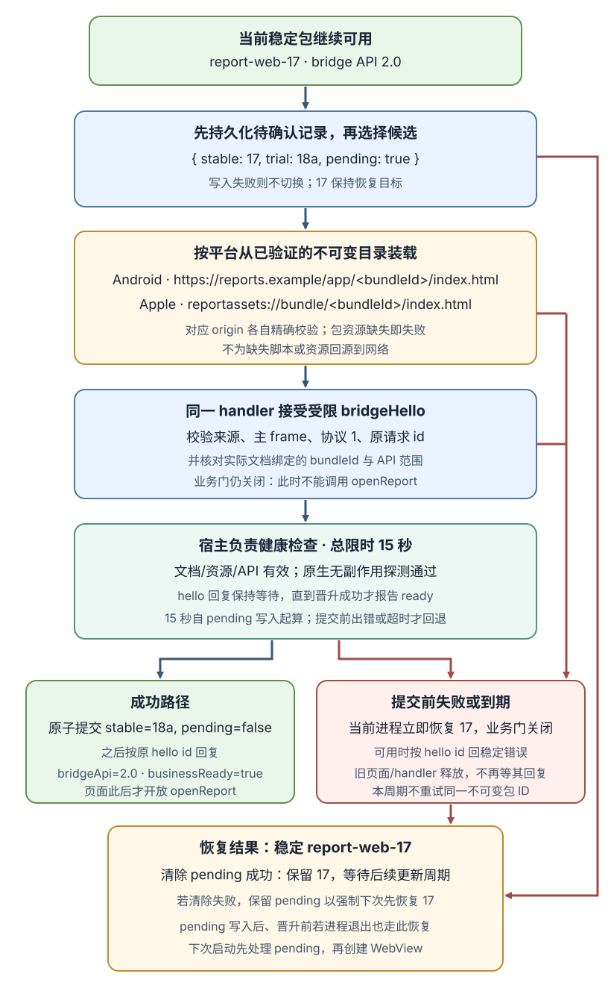

#### 恢复分界在哪里？

提交 `stable=18a, pending=false` 成功，就是唯一的恢复分界：

- **分界之前任何失败都走同一条恢复路径。** 资源缺失或导航失败、握手被拒、协议/ID/包不匹配、健康检查失败、提交前持久化失败、提交前 deadline 到期，都是：业务门保持关闭，当前进程销毁试启 WebView，重新装载 17；回复通道还在就按原 `id` 回稳定错误，通道已断就释放旧 handler 和等待项。清除 `pending` 成功后，本次更新周期不再试同一个不可变包 ID，后续更新按既定退避策略调度；清除失败就保留 `pending`，让下次启动仍先恢复 17。
- **分界之前进程退出。** 下次启动先读到 `pending`，恢复 17，再创建 WebView。不能因为 18a 的文件验签通过，就把它当作健康的稳定包。
- **分界之后。** 即使内存里的 `businessReady` 还没置上、hello 的成功回复还没送达，18a 也已是稳定包。下次启动直接装载 18a，并走同样的 origin/frame/协议/文档检查和稳定启动握手才打开业务门。

稳定包（无论 17 还是晋升后的 18a）的每次重载都走同样的检查和健康门，只有 `bridgeHello` 成功才返回业务就绪。稳定页自己加载或握手失败时，桥保持关闭，宿主显示错误与重试界面。

#### 握手证明了什么？

握手只证明两件事：所选 WebView 文档与宿主用匹配的信封对话，宿主选定的 API 版本与候选清单兼容。可信的内容身份来自宿主对入口和可执行资源的实际装载控制，不来自页面自报的字段。通过试启之后，页面的每次请求仍逐次验证来源、frame、操作格式和当前权限。若更新包换了 origin，宿主要在导航和桥接配置里明确允许那个 origin，不能为了版本滚动放宽成任意来源。

### 工程信任之外还有哪些约束？

**应用商店政策。** 原子切换、签名和桥接白名单解决的是工程信任，不能替代对分发政策的判断：

- Apple 当前审核指南限制下载或执行会改变 App 功能的代码；若产品属于指南列出的 HTML5/JavaScript 小程序等软件类别，还有额外规则，包括未经 Apple 事先许可不得向这些软件开放原生平台 API。
- Google Play 把 WebView 里的 JavaScript 列为解释执行代码的例外之一，但解释代码仍不得造成违反 Play 政策的功能。这不是对任意热更新的批准。

具体应用是否合规，取决于实际产品与当时的规则。

**密钥与日志。** 页面包不持有长期密钥、原生登录凭证或最终权限。秘密留在原生安全存储或服务端，每次敏感调用仍从当前原生会话和业务数据做授权。按包版本记录签名/摘要验证和兼容结果，按调用记录操作、授权结果和关联 ID，有助于定位错误和决定回滚；日志里不写会话秘密或完整的敏感 payload。

### 本章交出了什么？

报表页在 WebView 里得到一条窄通道：每条请求先用平台元数据过来源门，再严格解析、逐次授权，结果按 `id` 回到对应的等待项；新页面包要先过完整性和 API 兼容检查，再在 15 秒试启内握手、健康检查和原子晋升，提交之前任何失败都回到 report-web-17。

页面与宿主之间的消息，与浏览器里窗口之间的 `postMessage` 是同一类问题：都要先验来源，再验消息，再向权威确认。浏览器内的跨窗口与跨源消息怎样做三道校验和握手，见[浏览器能把状态存在哪里，标签页和窗口之间怎样互相通知？](#47.%20%E6%B5%8F%E8%A7%88%E5%99%A8%E8%83%BD%E6%8A%8A%E7%8A%B6%E6%80%81%E5%AD%98%E5%9C%A8%E5%93%AA%E9%87%8C%EF%BC%8C%E6%A0%87%E7%AD%BE%E9%A1%B5%E5%92%8C%E7%AA%97%E5%8F%A3%E4%B9%8B%E9%97%B4%E6%80%8E%E6%A0%B7%E4%BA%92%E7%9B%B8%E9%80%9A%E7%9F%A5%EF%BC%9F)。

> [!info]- 来源
> - **Android 现代桥接与旧入口概览。** Android Developers，[Access native APIs with JavaScript bridge](https://developer.android.com/develop/ui/views/layout/webapps/native-api-access-jsbridge)：Use addWebMessageListener、Initialization、Key features、addJavascriptInterface 及线程/frame 边界，2026-11-12 核对。支持“Android：addWebMessageListener”“Android：addJavascriptInterface（旧入口）”。
> - **AndroidX 接口细节。** [WebViewCompat.addWebMessageListener](https://developer.android.com/reference/androidx/webkit/WebViewCompat)（1.3.0 起、运行时 feature check、origin rule 格式、对象注入与回复代理）；[WebMessageListener](https://developer.android.com/reference/androidx/webkit/WebViewCompat.WebMessageListener)（`sourceOrigin`、`isMainFrame`、`replyProxy`、UI 线程、`file:`/`content:` 的 opaque origin），2026-11-12 核对。
> - **Android 旧桥接风险与导航拦截语义。** [WebView.addJavascriptInterface](https://developer.android.com/reference/android/webkit/WebView)（全 frame 暴露、旧 target 的注解边界、调用线程与返回行为）；[Insecure WebView native bridges](https://developer.android.com/privacy-and-security/risks/insecure-webview-native-bridges)；[WebResourceRequest](https://developer.android.com/reference/android/webkit/WebResourceRequest)（`isForMainFrame()` 与目标 URL），2026-11-12 核对。支持“线程、旧式 URL 拦截与已有 Web API”。
> - **Apple 消息、回复与 frame。** Apple Developer Documentation：[WKScriptMessageHandler](https://developer.apple.com/documentation/webkit/wkscriptmessagehandler)、[WKScriptMessageHandlerWithReply](https://developer.apple.com/documentation/webkit/wkscriptmessagehandlerwithreply)、[WKUserContentController](https://developer.apple.com/documentation/webkit/wkusercontentcontroller)、[WKFrameInfo](https://developer.apple.com/documentation/webkit/wkframeinfo)、[WKNavigationAction.sourceFrame](https://developer.apple.com/documentation/webkit/wknavigationaction/sourceframe)，2026-11-12 核对。支持“Apple：WKScriptMessageHandler 与 WithReply”。
> - **Apple WithReply 版本与 Promise 失败。** WebKit 头文件 [`WKScriptMessageHandlerWithReply.h`](https://github.com/WebKit/WebKit/blob/main/Source/WebKit/UIProcess/API/Cocoa/WKScriptMessageHandlerWithReply.h)：reply handler 最多调用一次、传入 error 字符串使 Promise reject、调用前释放也 reject；[`WKUserContentController.h`](https://github.com/WebKit/WebKit/blob/main/Source/WebKit/UIProcess/API/Cocoa/WKUserContentController.h)：WithReply 与 contentWorld 注册入口 iOS 14 / macOS 11 起可用。WWDC20 [Discover WKWebView enhancements](https://developer.apple.com/videos/play/wwdc2020/10188/) 09:03–09:55（content world 变量隔离）、13:47–14:45（WithReply Promise）；[WKContentWorld](https://developer.apple.com/documentation/webkit/wkcontentworld)（DOM 由不同 world 共用）。版本边界以公开头文件与文档为准，2026-11-12 核对。
> - **Apple origin 端口规范化。** [WKSecurityOrigin](https://developer.apple.com/documentation/webkit/wksecurityorigin) 的 scheme/host/port 与 [WebKit 实现](https://github.com/WebKit/WebKit/blob/e95d3cb282b586c54897b153b498c4fa46310d0a/Source/WebKit/UIProcess/API/Cocoa/WKSecurityOrigin.mm#L53-L66)，2026-11-12 核对；比较前按 origin 语义换算有效端口。
> - **WebView 中的 Web API 权限。** Android [WebChromeClient.onGeolocationPermissionsShowPrompt](https://developer.android.com/reference/android/webkit/WebChromeClient#onGeolocationPermissionsShowPrompt(java.lang.String,android.webkit.GeolocationPermissions.Callback))；[Request location permissions](https://developer.android.com/develop/sensors-and-location/location/permissions)，2026-11-12 核对。
> - **本地资源的 origin 与回源。** Android [Load in-app content](https://developer.android.com/develop/ui/views/layout/webapps/load-local-content)（WebViewAssetLoader 与未命中回源）；Apple [WKURLSchemeHandler](https://developer.apple.com/documentation/webkit/wkurlschemehandler)、[setURLSchemeHandler](https://developer.apple.com/documentation/webkit/wkwebviewconfiguration/seturlschemehandler%28_%3Aforurlscheme%3A%29)（不能接管 `https`）；WebKit [`SecurityOriginData.cpp`](https://github.com/WebKit/WebKit/blob/e95d3cb282b586c54897b153b498c4fa46310d0a/Source/WebCore/page/SecurityOriginData.cpp#L211-L231) 的 Cocoa 条件分支，2026-11-13 核对。支持“选中的目录，怎样保证就是 WebView 执行的文件？”。
> - **页面代码的应用商店分发。** Apple [App Review Guidelines](https://developer.apple.com/app-store/review/guidelines/) §2.5.2（自包含、下载/执行改变功能的代码）、§4.7.2（该类小程序暴露原生 API 的限制）；Google Play [Developer Program Policy](https://support.google.com/googleplay/android-developer/answer/18265346) Device and Network Abuse（解释器代码例外，该版自 2026-10-29 生效），2026-11-12 核对。
> - 试启协议（pending 记录、15/20/8 秒计时、恢复分界）、`bridgeHello` 信封与包名均为本章合成设计，不出自平台文档。
## 9. 页面结构怎样让所有人都能读懂和操作？

同一份 HTML 有几类读者：用眼睛看的人、只用键盘的人、靠屏幕阅读器听页面的人，还有浏览器和搜索引擎。本章回答：HTML 要写出哪些结构，这些读者才都能找到内容、理解它，并按合理的顺序操作。

本章沿用主线一的[报表页](#1.%20%E6%89%93%E5%BC%80%E4%B8%80%E4%B8%AA%20URL%20%E5%90%8E%EF%BC%8C%E9%A1%B5%E9%9D%A2%E6%80%8E%E6%A0%B7%E5%8F%98%E5%BE%97%E5%8F%AF%E8%A7%81%E5%8F%88%E5%8F%AF%E4%BA%A4%E4%BA%92%EF%BC%9F)：地址 `/reports/42?sort=recent#summary`，标题带 `id="summary"`，`#sort-controls` 里的两个排序按钮“最近优先”（`Most recent`）和“最早优先”（`Oldest first`）用 `aria-pressed` 标出当前排序，数据有 May（`r-104`）、April（`r-103`）两行。主线一关心它何时显示、点击何时生效；这里看同一份 HTML 表达了什么结构。

页面界面沿用主线一的英文文字，正文用中文称呼它们。本章给两行补上“订单数”（`Orders`）和“对账状态”（`Reconciliation`）两列，数值是教学用的合成值。

### 文档骨架先告诉浏览器怎样解释页面

骨架里的每一行都回答浏览器的一个问题：

- `<!doctype html>`：用标准模式解析和布局，而不是兼容旧页面的怪异模式。
- `<html lang="en">`：页面主要语言，必须与内容的实际语言一致。屏幕阅读器据此选发音规则，浏览器也可能据此选字体、拼写检查词典和日期选择器等控件的界面语言。页面里夹着另一种语言的片段时，在那个元素上再写 `lang`，例如一段中文说明写 `<p lang="zh-CN">`。
- `<meta charset="utf-8">`：字节按什么编码解码。文件本身也必须真的以 UTF-8 保存；这条声明修不好已经编错的字节。
- `<meta name="viewport" content="width=device-width, initial-scale=1">`：在窄屏上让 layout viewport (布局视口) 的宽度等于设备宽度。它只设视口，不会把固定宽度的布局变成响应式布局；响应式要靠 CSS，见[页面怎样响应视口、容器和用户设置？](#15.%20%E9%A1%B5%E9%9D%A2%E6%80%8E%E6%A0%B7%E5%93%8D%E5%BA%94%E8%A7%86%E5%8F%A3%E3%80%81%E5%AE%B9%E5%99%A8%E5%92%8C%E7%94%A8%E6%88%B7%E8%AE%BE%E7%BD%AE%EF%BC%9F)。
- `<title>`：命名浏览器标签页。

~~~html
<!doctype html>
<html lang="en">
<head>
  <meta charset="utf-8">
  <meta name="viewport" content="width=device-width, initial-scale=1">
  <title>Report 42</title>
</head>
<body>
  <header><!-- 站点名与账户菜单 --></header>
  <nav aria-label="Reports">…</nav>
  <main>
    <h1 id="summary">Recent reports</h1>
    <div id="sort-controls">
      <button type="button" data-sort="recent" aria-pressed="true">Most recent</button>
      <button type="button" data-sort="oldest" aria-pressed="false">Oldest first</button>
    </div>
    <!-- 结果表格，见下文 -->
  </main>
</body>
</html>
~~~

> [!info]- 其他元数据与内容模型
> `meta name="description"` 可提供搜索摘要，但搜索引擎可能改从正文生成；`link rel="icon"` 提供站点图标，搜索结果是否展示仍由搜索引擎决定。Google Search 不把 `meta name="keywords"` 当作排名信号。
>
> 元素按含义选，不按默认外观选：CSS 能改显示方式，改不了语义。`div`、`span` 留给没有更具体含义的容器。内容模型也不随 CSS 改变：段落只接受 phrasing content (短语内容)，把 `div` 设成 `display: inline` 也不能放进 `p`。

### 标题和 landmark 让人跳到想去的地方

视力正常的人扫一眼就知道页面分几块。读屏用户靠两种结构做同样的事：按标题跳，或按 landmark (地标区域) 跳。

- **标题层级**表达文档大纲：页面主题用一个 `h1`，下级区块用 `h2`，再往下用 `h3`。层级表达结构，字号交给 CSS；不要因为想要小一点的字就跳级。
- **landmark** 标记页面区域：`header`、`nav`、`main`、`aside`、`footer`、带名称的 `section` 和 `form` 等。上面骨架里，读屏用户可以直接跳到 `main` 跳过站点导航；页面有多个 `nav` 时用 `aria-label` 区分它们。

`id` 在一份文档中必须唯一，它既用于把标签关联到控件，也是片段导航的目标：地址里的 `#summary` 让浏览器滚到 `h1#summary`。`class` 则把多个元素归入同一组样式，可以重复。

### 文本元素表达含义，不表达外观

下表是常用文本元素的含义。浏览器默认样式只是这些含义的一种呈现，CSS 改了外观，含义不变。

| 想表达的意思 | 用 | 不要用来 |
| --- | --- | --- |
| 段落 | `p` | 用 `br` 连续换行模拟段距 |
| 有意义的换行（地址、诗行） | `br` | 制造垂直间距 |
| 段落级的主题转换 | `hr` | 画装饰分隔线（用 CSS 边框） |
| 重要、严重或紧急 | `strong` | 仅为加粗 |
| 引起注意但不加重要性 | `b` | 表达“重要” |
| 语气重读，改变句意 | `em` | 仅为斜体 |
| 另一种语调或表达方式，如术语、外语词 | `i` | 表达重读 |
| 删除与插入的修订 | `del`、`ins` | 表达“已不准确” |
| 内容已不再准确 | `s` | 记录修订历史 |
| 非文本注记，如标出错别字 | `u` | 装饰下划线 |
| 无序项目 / 有序步骤 / 术语与解释 | `ul` / `ol` / `dl`、`dt`、`dd` | 用连续空格或 `&nbsp;` 对齐 |

`u` 的例子：在“订单状太”中用 `<u>太</u>` 标出误写的字。连续空格和 `&nbsp;` 都不该用来排版，间距和对齐交给 CSS。

### 有行列关系的数据用真表格

主线一为了观察加载时序，把两行写成了列表 `ol#reports`。一旦每行有几列可以横向比较的数据，就该改用表格标记。用 CSS Grid 摆出“像表格”的样子没有表格语义：屏幕阅读器无法告诉用户某个单元格属于哪一行哪一列。

~~~html
<table>
  <caption>Report 42: monthly orders, most recent first</caption>
  <thead>
    <tr>
      <th scope="col">Month</th>
      <th scope="col">Orders</th>
      <th scope="col">Reconciliation</th>
    </tr>
  </thead>
  <tbody>
    <tr data-id="r-104"><th scope="row">May</th><td>128</td><td>Reconciled</td></tr>
    <tr data-id="r-103"><th scope="row">April</th><td>117</td><td class="pending">Pending</td></tr>
  </tbody>
</table>
~~~

`data-id` 仍留给脚本：主线一的排序处理器重排 `ol#reports` 里的 `li`，换成表格后要改为重排 `tbody` 里的 `tr`。这个表格版本只用于本主线讨论结构和布局；其他主线关心行数据和排序代码，仍沿用 `ol#reports`。

- `caption` 给表格起名。读屏用户进入表格时先听到它，知道这张表讲什么、按什么排序。
- `th scope="col"` 标出列标题，`th scope="row"` 标出标识这一行的值。月份唯一标识一行，所以 May、April 用 `th` 而不是 `td`。

有了这两种标题，用户停在 `117` 上时，屏幕阅读器能告诉他这是 April 行、`Orders` 列；停在 `Pending` 上时，能报出它属于 April 行的 `Reconciliation` 列。具体导航键和播报措辞随浏览器与辅助技术而异。

#### 跨行单元格占住后面的位置

`rowspan`、`colspan` 让一个单元格占据多个格位，被占的格位在后续行里不再写单元格。给表格加一列“季度”（`Quarter`），May 和 April 同属第二季度（`Q2`）：

~~~html
<thead>
  <tr><th scope="col">Quarter</th><th scope="col">Month</th><th scope="col">Orders</th><th scope="col">Reconciliation</th></tr>
</thead>
<tbody>
  <tr><th scope="rowgroup" rowspan="2">Q2</th><th scope="row">May</th><td>128</td><td>Reconciled</td></tr>
  <tr><th scope="row">April</th><td>117</td><td>Pending</td></tr>
</tbody>
~~~

四列表格里，第一行写满四个单元格；第二行的第一列已被 `Q2` 占住，所以只写三个。若第二行仍写四个，最后一个会被挤到第五列，整列错位。`scope="rowgroup"` 说明 `Q2` 是整个 `tbody` 的标题。

#### 窄屏上让表格自己横向滚动

列多的表在窄屏上放不下时，不要让整个页面横向溢出，而是把表格放进一个局部横向滚动容器：

~~~html
<div class="table-scroll">
  <table>…</table>
</div>
~~~

~~~css
.table-scroll { overflow-x: auto; }
~~~

这样只有表格区域左右滚动，标题、按钮和正文仍按视口宽度排版。`overflow` 会让容器成为滚动容器，副作用见[盒子的尺寸怎样计算？](#12.%20%E7%9B%92%E5%AD%90%E7%9A%84%E5%B0%BA%E5%AF%B8%E6%80%8E%E6%A0%B7%E8%AE%A1%E7%AE%97%EF%BC%8C%E5%9D%97%E5%92%8C%E6%B5%AE%E5%8A%A8%E6%80%8E%E6%A0%B7%E5%9C%A8%E6%B5%81%E9%87%8C%E6%8E%92%E5%BC%80%EF%BC%9F)；固定内容与流动内容怎样分配宽度见[Flex 和 Grid 怎样把空间分给每个项目？](#13.%20Flex%20%E5%92%8C%20Grid%20%E6%80%8E%E6%A0%B7%E6%8A%8A%E7%A9%BA%E9%97%B4%E5%88%86%E7%BB%99%E6%AF%8F%E4%B8%AA%E9%A1%B9%E7%9B%AE%EF%BC%9F)。

### 焦点顺序跟随源码

键盘用户按 Tab 在可聚焦元素之间移动，这条路径叫 sequential focus navigation (顺序焦点导航)。屏幕阅读器线性朗读页面时走的也是同一种顺序。两者的规则相同：**默认顺序就是 DOM 中的源码顺序**，CSS 把元素画在哪里不影响它。

具体有三条规则：

1. 链接、按钮、表单控件等原生可交互元素天生可聚焦，按源码先后进入 Tab 顺序。
2. `tabindex="0"` 把本来不可聚焦的元素按源码位置加入 Tab 顺序；`tabindex="-1"` 让元素可被脚本 `focus()`，但不进入 Tab 顺序。表单出错后把焦点移到错误摘要，用的就是后者。
3. 正数 `tabindex` 会让这些元素排在所有 `tabindex="0"` 和原生可聚焦元素之前，按数值从小到大访问。它让焦点先跳到页面某处再回到开头，几乎总是破坏顺序，不要用。

#### 视觉重排的代价

Flexbox 的 `order` 和 `flex-direction: row-reverse`、Grid 的放置规则、绝对定位，都只改视觉位置，不改 Tab 顺序和朗读顺序。看报表页的排序按钮：源码里“最近优先”在前。假设设计要求宽屏上把“最早优先”放在左边，有人这样写：

~~~css
#sort-controls { display: flex; }
#sort-controls [data-sort="oldest"] { order: -1; }
~~~

视觉上从左到右是“最早优先 | 最近优先”，但按 Tab 时焦点先到右边的“最近优先”，再往左跳到“最早优先”；屏幕阅读器也先读“最近优先”。看着屏幕操作的键盘用户会觉得焦点在乱跳。

修法是直接调换两个按钮在 HTML 里的顺序，让源码顺序就是想要的阅读顺序，再删掉 `order`。视觉移动只适合不改变阅读意义的场合，例如纯装饰元素。

> [!info] 草案：`reading-flow` 与 `reading-order`
> W3C CSS Display Level 4（Working Draft，2025-11-06）定义了 `reading-flow`（加在 flex、grid 等容器上）和 `reading-order`（加在项目上），让特定布局里的阅读与焦点顺序跟随视觉顺序。它们仍是草案，浏览器支持要按目标环境核对。本章的做法是先修源码顺序，不依赖它们。

#### 焦点要看得见、不被盖住

焦点顺序合理还不够，用户还得看见焦点在哪。不要只写 `outline: none` 去掉浏览器默认焦点框；需要自定义时，用 `:focus-visible` 给出清晰的样式：

~~~css
#sort-controls button:focus-visible {
  outline: 3px solid #1a5fb4;
  outline-offset: 2px;
}
~~~

`:focus-visible` 只在浏览器判断用户需要看到焦点时匹配，例如键盘操作；鼠标点击按钮时通常不显示焦点框。获得焦点的元素也不能被吸顶的页头、页脚或浮层完全盖住，否则用户按了 Tab 却找不到焦点。

### 状态不能只靠颜色

报表页有两处状态：哪个排序按钮处于按下状态，哪一行还没对账。只用颜色表达这两种状态，色觉障碍用户、黑白打印和高对比度模式下的用户都会丢失信息；屏幕阅读器更是读不出颜色。

每种状态要同时满足两个条件：

- **程序可读**：按下状态写在 `aria-pressed="true"` 上，辅助技术会读作“已按下”；对账状态写成单元格里的文字 `Pending`。
- **视觉上不只靠色相**：再加一种颜色以外的线索，例如边框、字重、图标或文字。

~~~css
#sort-controls button[aria-pressed="true"] {
  border-bottom: 3px solid currentColor;
  font-weight: 600;
}

td.pending {
  background: #fff3d6; /* 颜色只是辅助，单元格里仍写 Pending */
}
~~~

样式直接选 `[aria-pressed="true"]`，程序状态和视觉状态就来自同一个属性，脚本只需改一处，两者不会不一致。表单错误也遵循同一原则，见[表单控件怎样命名、提交和校验？](#10.%20%E8%A1%A8%E5%8D%95%E6%8E%A7%E4%BB%B6%E6%80%8E%E6%A0%B7%E5%91%BD%E5%90%8D%E3%80%81%E6%8F%90%E4%BA%A4%E5%92%8C%E6%A0%A1%E9%AA%8C%EF%BC%8C%E6%89%8D%E5%AF%B9%E6%89%80%E6%9C%89%E4%BA%BA%E5%8F%AF%E7%94%A8%EF%BC%9F)。

### 用户输入按文字显示

HTML 源码里的 `<` 和 `&` 有特殊含义，要显示它们本身就写 character reference (字符引用)：普通文本里 `&lt;` 显示为 `<`，`&amp;` 显示为 `&`，`&nbsp;` 是不换行空格。字符引用按所在解析状态处理：`script` 里的 script data 状态和 `style` 里的 RAWTEXT 状态都不会像正文那样解码它们。

字符引用是写源码的手段，不是安全显示动态字符串的手段。报表标题、负责人姓名这类来自用户的值，要通过 DOM 的文本接口（如 `textContent`）写进页面，浏览器只把它当文字；不要把拼接好的字符串交给 `innerHTML` 当标记解析。几种内容接口的区别见[怎样查询和修改 DOM？](#3.%20%E6%80%8E%E6%A0%B7%E6%9F%A5%E8%AF%A2%E5%92%8C%E4%BF%AE%E6%94%B9%20DOM%EF%BC%8C%E6%89%8D%E6%8B%BF%E5%88%B0%E5%B9%B6%E6%94%B9%E5%88%B0%E9%A2%84%E6%9C%9F%E7%9A%84%E8%8A%82%E7%82%B9%EF%BC%9F)，不可信文本的安全显示见[浏览器安全控制分别保护什么信任边界？](../../engineering-foundations/security/web-browser-security-boundaries.md#%E4%B8%8D%E5%8F%AF%E4%BF%A1%E6%8A%A5%E8%A1%A8%E6%A0%87%E9%A2%98%E6%80%8E%E6%A0%B7%E5%AE%89%E5%85%A8%E6%98%BE%E7%A4%BA%EF%BC%9F)。

### 结构定好之后，表单和样式从这里接手

到这里，报表页有了能被正确解释的骨架、可跳转的标题和 landmark、带行列标题的真表格，以及与视觉一致的源码顺序；排序按钮和对账状态都不只靠颜色。

下一步给报表页加一张筛选表单。问题变成：控件的名字从哪来，用户的选择怎样变成 URL 查询串，出错时又怎样让所有人都发现？见[表单控件怎样命名、提交和校验，才对所有人可用？](#10.%20%E8%A1%A8%E5%8D%95%E6%8E%A7%E4%BB%B6%E6%80%8E%E6%A0%B7%E5%91%BD%E5%90%8D%E3%80%81%E6%8F%90%E4%BA%A4%E5%92%8C%E6%A0%A1%E9%AA%8C%EF%BC%8C%E6%89%8D%E5%AF%B9%E6%89%80%E6%9C%89%E4%BA%BA%E5%8F%AF%E7%94%A8%EF%BC%9F)。

> [!info]- 来源
> - 文档骨架、语言、元数据、标题与 landmark 元素、内容模型：WHATWG HTML Living Standard §3–4，[The lang attribute](https://html.spec.whatwg.org/multipage/dom.html#the-lang-and-xml:lang-attributes)（§3.2.6.2：用户代理可据语言选字体、发音、词典和日期选择器等控件界面）、[Document semantics and metadata](https://html.spec.whatwg.org/multipage/semantics.html)、[Sections](https://html.spec.whatwg.org/multipage/sections.html)，更新时间 2026-11-11，检查于 2026-11-11。
> - 文本语义速查（段落、换行、主题分隔、强调、修订、列表）：WHATWG HTML Living Standard，[Grouping content](https://html.spec.whatwg.org/multipage/grouping-content.html)、[Text-level semantics](https://html.spec.whatwg.org/multipage/text-level-semantics.html)、[Edits](https://html.spec.whatwg.org/multipage/edits.html)，检查于 2026-11-11。
> - 表格标题、`th scope`、行列标题关系、`rowspan`/`colspan` 格位：WHATWG HTML Living Standard §4.9，[Tables](https://html.spec.whatwg.org/multipage/tables.html)，检查于 2026-11-11。
> - 顺序焦点导航与 `tabindex` 的 0、负数、正数取值：WHATWG HTML Living Standard §6.6.3，[The tabindex attribute](https://html.spec.whatwg.org/multipage/interaction.html#attr-tabindex)，检查于 2026-11-26。
> - `order` 不影响非视觉媒体与顺序导航，以及 `reading-flow`、`reading-order`：W3C CSS Display Level 4，§3.1、§4，Working Draft（2025-11-06），[CSS Display Level 4](https://www.w3.org/TR/css-display-4/#reading-flow)；Flexbox 重排与可访问性：W3C CSS Flexible Box Layout Level 1 §5.4；Grid 放置：W3C CSS Grid Layout Level 2 §4，检查于 2026-11-11。
> - landmark 区域与多个同类 landmark 用名称区分：W3C HTML Accessibility API Mappings 1.0（元素到 landmark 角色的映射），[HTML AAM](https://www.w3.org/TR/html-aam-1.0/)；WAI-ARIA Authoring Practices Guide，[Landmark Regions](https://www.w3.org/WAI/ARIA/apg/practices/landmark-regions/)，检查于 2026-11-26。
> - `:focus-visible` 由浏览器按启发式判断是否匹配：W3C Selectors Level 4 §9.4，[The Focus-Indicated Pseudo-class](https://www.w3.org/TR/selectors-4/#the-focus-visible-pseudo)，检查于 2026-11-26。
> - 焦点可见、焦点不被完全遮挡、状态不只用颜色：W3C WCAG 2.2，Success Criteria 2.4.7、2.4.11、1.4.1，Recommendation（2024-12-12），[WCAG 2.2](https://www.w3.org/TR/WCAG22/)，检查于 2026-11-11。
> - 字符引用、script data 与 RAWTEXT 解析状态、动态文本：WHATWG HTML Living Standard §13.2.5、§13.5，[Parsing HTML documents](https://html.spec.whatwg.org/multipage/parsing.html)、[Named character references](https://html.spec.whatwg.org/multipage/named-characters.html)；WHATWG DOM Standard，[`Node.textContent`](https://dom.spec.whatwg.org/#dom-node-textcontent)，检查于 2026-11-11。
> - 搜索摘要、站点图标与 meta keywords：Google Search Central，[Snippets](https://developers.google.com/search/docs/appearance/snippet)、[Favicon](https://developers.google.com/search/docs/appearance/favicon-in-search)、[Supported meta tags](https://developers.google.com/search/docs/crawling-indexing/special-tags)，检查于 2026-11-11。
## 10. 表单控件怎样命名、提交和校验，才对所有人可用？

表单把用户的选择交给服务器。它对所有人可用，要过四关：每个控件有能被读出的名字；不用鼠标也能操作；浏览器把选择正确地编码进请求；出错时，每个用户都能发现错在哪、改完后知道已经改对。

本章沿用主线一的报表页，并接着[上一章](#9.%20%E9%A1%B5%E9%9D%A2%E7%BB%93%E6%9E%84%E6%80%8E%E6%A0%B7%E8%AE%A9%E6%89%80%E6%9C%89%E4%BA%BA%E9%83%BD%E8%83%BD%E8%AF%BB%E6%87%82%E5%92%8C%E6%93%8D%E4%BD%9C%EF%BC%9F)的骨架和结果表格。我们在表格上方加一张筛选表单，新增字段 `from`（起始月份）、`region`（地区）和 `status`（订单状态：`open` 处理中、`closed` 已完成），再加一张只有 `email` 字段的通知邮箱表单。控件文字沿用页面的英文界面。服务器怎样解释这些字段是本章合成的应用约定，下文在用到时说明。

### 每个控件先要有名字

屏幕阅读器停在一个控件上时，先读它的 accessible name (可访问名称)。对表单字段，这个名字通常来自与它关联的可见 `label`；对按钮，来自按钮自身的文字。

~~~html
<form action="/reports/42" method="get">
  <input type="hidden" name="sort" value="recent">

  <label for="from">From month</label>
  <input id="from" name="from" type="month" value="2026-04" required>

  <label for="region">Region</label>
  <select id="region" name="region">
    <option value="" selected>All regions</option>
    <option value="north">North</option>
    <option value="south">South</option>
  </select>

  <fieldset>
    <legend>Order status</legend>
    <label><input type="checkbox" name="status" value="open"> Open</label>
    <label><input type="checkbox" name="status" value="closed"> Closed</label>
  </fieldset>

  <button type="submit">Filter reports</button>
</form>
~~~

- **关联标签的两种写法都有效**：用 `for` 指向控件的 `id`（`From month`、`Region`），或把控件直接包在 `label` 里（两个复选框）。关联后，点击标签文字也会作用到控件，例如点 `Open` 这个词就能勾选复选框，点击区域因此变大。
- **`fieldset` 与 `legend` 给一组控件起组名**：两个复选框回答的是同一个问题 `Order status`。辅助技术可能按平台习惯在每个选项前重复读组名，所以组名要短；各选项自己的标签仍要能单独辨认。
- **按钮用文字命名**：`Filter reports` 既是可见文字，也是可访问名称。

#### placeholder 只是样例，不是名字

有人想用 `placeholder`（占位提示）省掉标签，但它们作用不同。`placeholder` 只在控件没有值时显示一个简短样例，例如给后文的通知邮箱字段加 `placeholder="name@example.com"`。它不是字段值：提交时不会代替用户输入，也不能满足 `required`。用户一开始输入它就消失，所以 `Notification email` 这个可见标签和持续显示的帮助文字仍要保留。

CSS 的 `::placeholder` 伪元素只选中提示文字本身：

~~~css
#email::placeholder {
  color: #595959;
  opacity: 1;
}
~~~

这条规则在白色背景上把样例显示成灰色，实际主题仍要检查文字与背景的对比度。它不改输入文字的颜色，也不改字段值。要选中“正在显示占位提示的整个控件”，用 `:placeholder-shown` 伪类，二者作用对象不同。

### 原生控件自带键盘操作

用原生控件，键盘操作和角色、状态的报告都由浏览器提供，不用自己写。跟一位只用键盘的用户走一遍上面的筛选表单：

1. 按 Tab，焦点按源码顺序依次经过起始月份、地区、两个复选框和提交按钮。隐藏字段 `sort` 不可见也不可聚焦。焦点为什么跟随源码顺序，见[焦点顺序跟随源码](#%E7%84%A6%E7%82%B9%E9%A1%BA%E5%BA%8F%E8%B7%9F%E9%9A%8F%E6%BA%90%E7%A0%81)。
2. 起始月份保留预设值 `2026-04`。月份控件内部可能有年、月等多个键盘停靠点；用户继续按 Tab 离开它。
3. 到达“地区”。它是单选的 `<select>`，名称来自关联标签 `Region`，当前选项是 `All regions`。按 HTML Accessibility API Mappings（HTML 到无障碍 API 的映射规范），未设 `multiple`、显示大小为 1 的 `<select>` 映射为 `combobox` (组合框) 角色。用户不改，按 Tab 离开。
4. 到达 `Open` 复选框。它以原生 checkbox 角色报告名称 `Open` 和“未选中”状态；按空格键切换为已选中。再按 Tab 到 `Closed`，同样按空格键选中。
5. 按 Tab 到 `Filter reports` 按钮，按空格键或 Enter 激活，提交表单。

最终选择是：2026 年 4 月起、全部地区、处理中和已完成两种状态。各浏览器和屏幕阅读器的播报措辞不一定相同，但名称、角色、状态和键盘操作都由原生控件提供。

### 浏览器怎样把选择变成 GET 查询串

用户按下提交按钮后，浏览器先构造一份 entry list (表单项列表)，再把它编码成查询串。规则如下：

1. **按控件在文档中的顺序（tree order）逐个收集 `name=value` 项。**
2. **跳过不该提交的控件**：没有 `name` 的、被禁用的、未选中的复选框和单选按钮。按钮只有触发这次提交的那一个才可能产生项，而且它要有 `name`；本例按钮没有 `name`，不产生项。
3. **提交的是控件的当前状态，不是 HTML 属性。** `checked`、`selected`、`value` 属性只设定初始状态；用户操作之后，浏览器读控件此刻的选中状态和值。
4. **同名控件各自产生一项**，顺序按它们在文档中的位置，而不是用户点击的先后。先勾 `Closed` 再勾 `Open`，仍是 `status=open&status=closed`。
5. **按 `application/x-www-form-urlencoded` 规则编码**：空格变成 `+`；ASCII 字母、数字和 `*`、`-`、`.`、`_` 原样保留；其余字符（包括 `&`、`+`、`=` 和中文）按编码后的字节写成 `%XX`，编码通常是 UTF-8。注意“都是 ASCII 字符”不等于无需编码：`a&b` 编码为 `a%26b`，`a+b` 编码为 `a%2Bb`。
6. **用编码结果替换 `action` URL 的整个查询部分**，再导航到这个 URL。`action` 里原有的查询串不会保留。

把这些规则用在刚才的选择上：

| 控件（文档顺序） | 是否产生项 | 项 |
| --- | --- | --- |
| 隐藏字段 `sort` | 是 | `sort=recent` |
| 起始月份 | 是 | `from=2026-04` |
| 地区（选中 `All regions`，值为空串） | 是，值为空 | `region=` |
| `Open`（已选中） | 是 | `status=open` |
| `Closed`（已选中） | 是 | `status=closed` |
| 提交按钮（无 `name`） | 否 | — |

浏览器导航到：

~~~text
/reports/42?sort=recent&from=2026-04&region=&status=open&status=closed
~~~

第 6 条解释了为什么表单里要有隐藏字段 `sort`：当前页面地址是 `/reports/42?sort=recent#summary`，如果不把排序作为字段提交，提交后的 URL 就不再有 `sort`，排序会退回服务器默认值。反过来，用户先点了“最早优先”、脚本把地址改成 `sort=oldest` 时，脚本也要同步更新这个隐藏字段，否则表单会提交旧的排序。URL 里每段该放什么、怎样校验和规范化，见[地址变了，浏览器什么时候加载新文档？](#7.%20%E5%9C%B0%E5%9D%80%E5%8F%98%E4%BA%86%EF%BC%8C%E6%B5%8F%E8%A7%88%E5%99%A8%E4%BB%80%E4%B9%88%E6%97%B6%E5%80%99%E5%8A%A0%E8%BD%BD%E6%96%B0%E6%96%87%E6%A1%A3%EF%BC%8C%E7%95%8C%E9%9D%A2%E7%8A%B6%E6%80%81%E4%BD%95%E6%97%B6%E8%AF%A5%E5%86%99%E8%BF%9B%20URL%EF%BC%9F)。

GET 适合这类不敏感的筛选：结果 URL 可以收藏、分享和后退。查询串会出现在地址栏、浏览历史和服务器日志里，密码、令牌等敏感值不能用 GET 提交。

#### 月份字段的值长什么样

浏览器支持 `type="month"` 时，非空值是 `2026-04` 这样的年月字符串：至少四位且大于零的年份，一个连字符，再加 `01`–`12` 的两位月份。不支持这一类型的浏览器会把它当普通文本框，用户可以输入任意字符串，也没有月份选择器和格式校验。`required` 只能阻止正常途径下的空值提交；有人直接改 URL 或绕过浏览器发请求时，它不起作用。

### 查询串的含义由应用约定

HTML 和 URL 只规定怎样把选择编码成 `name=value`，不规定 `region=` 是“全部地区”还是“地区为空”，也不规定两个 `status` 是“都要满足”还是“满足其一”。这些含义由应用自己约定，服务器必须按约定校验收到的每个值。

本章的合成报表应用这样约定：

- `from` 必须是有效年月。缺失、空或格式无效时返回字段错误，要求重新选择，不静默改用别的月份。报表只列出不早于 `from` 的月份；有效但没有订单的月份显示空结果和说明。
- `region=` 和省略 `region` 都表示全部地区；`north`、`south` 分别表示北区、南区；其他非空值返回错误。
- 省略全部 `status` 表示不限制状态；多个 `status` 组成列表，订单命中其中任一个就计入；未知状态值返回错误。

| 用户选择 | GET 请求 | 服务器按约定怎样筛选 |
| --- | --- | --- |
| 4 月起、全部地区、未选状态 | `/reports/42?sort=recent&from=2026-04&region=` | May、April 两行，统计所有地区和状态的订单 |
| 4 月起、全部地区、处理中与已完成 | `/reports/42?sort=recent&from=2026-04&region=&status=open&status=closed` | 同样两行，只统计这两种状态的订单；就是上面键盘用户发出的请求 |
| 4 月起、北区、只选处理中 | `/reports/42?sort=recent&from=2026-04&region=north&status=open` | 两行，只统计北区处理中的订单 |
| 5 月起、北区、未选状态 | `/reports/42?sort=recent&from=2026-05&region=north` | 只剩 May 一行，统计北区全部状态的订单 |

第一行和第二行的区别在于有没有 `status`。在本应用里，两种状态全选与不选结果相同，但这是约定的巧合：若以后新增“已取消”状态，不选仍是“不限”，全选旧的两项就会把“已取消”排除在外。

### 常被误解的控件行为

- **`type="password"` 只遮住屏幕显示**，不会加密传输，也不替代服务端的安全存储。
- **文件选择器的 `accept` 只是类型提示**，用户仍可能选到别的文件，服务器必须校验收到的内容。
- **一个字段提交多个值有两种写法**：多个同名复选框，或 `<select multiple>`。同名的单选按钮则构成一组，组内只能选中一个。
- **表单里不写 `type` 的 `<button>` 默认是提交按钮。** 表单里放一个“清空筛选”（`Clear filters`）按钮却忘了写类型，点它就会提交表单。所以每个按钮都写明 `type="submit"`、`type="reset"` 或 `type="button"`。要跳转页面则用带真实 `href` 的链接，见[图片和音视频该怎样写语义、定地址？](#6.%20%E5%9B%BE%E7%89%87%E5%92%8C%E9%9F%B3%E8%A7%86%E9%A2%91%E8%AF%A5%E6%80%8E%E6%A0%B7%E5%86%99%E8%AF%AD%E4%B9%89%E3%80%81%E5%AE%9A%E5%9C%B0%E5%9D%80%E3%80%81%E9%80%89%E6%96%87%E4%BB%B6%E5%92%8C%E5%AE%9A%E5%8A%A0%E8%BD%BD%E6%97%B6%E6%9C%BA%EF%BC%9F)中 `<a>` 与 `<button>` 的区分。
- **级联选项要清掉失效的旧值。** 假设地区下面还有一级门店，用户先选北区的某家门店，再把地区改成南区：应用更新门店选项时，必须同时清除已经不属于南区的旧门店值，否则旧值会被一并提交。选项暂时加载不出来时，要明确告诉用户，而不是留一个空下拉框。

### 自定义校验错误：一份完整配方

报表页还有一张独立的通知邮箱表单，用它演示怎样自己显示校验错误。

原生约束 `required` 和 `type="email"` 会阻止空邮箱和格式错误的邮箱提交。每次提交尝试中，浏览器对不满足约束的字段派发可取消的 `invalid` 事件。应用取消它，就能用自己的错误文字替换浏览器的原生提示气泡；表单仍会因约束不满足而不提交。但这样一来，让用户发现错误、更新字段状态就成了应用的责任。

~~~html
<form action="/notification-settings" method="post">
  <label for="email">Notification email</label>
  <input id="email" name="email" type="email" required
         aria-describedby="email-help email-error">
  <p id="email-help">We email you when a filtered report is ready.</p>
  <p id="email-error" hidden></p>
  <button type="submit">Save notification settings</button>
</form>
~~~

这段标记做了两件事：

- **`aria-describedby` 把帮助文字和错误文字都关联为字段的描述。** 焦点进入字段时，辅助技术先读名称 `Notification email`，再读这两段描述。
- **错误段落默认 `hidden` 且为空。** 按名称与描述的计算规则，被 `aria-describedby` 直接引用的节点即使隐藏，其文字也会计入描述。所以隐藏错误时必须同时清空文字，否则修正后的字段仍可能被读出旧错误。

脚本要在表单节点存在之后运行：放在表单标记之后，或作为外部脚本加 `defer`。脚本调度的细节见[打开一个 URL 后，页面怎样变得可见又可交互？](#1.%20%E6%89%93%E5%BC%80%E4%B8%80%E4%B8%AA%20URL%20%E5%90%8E%EF%BC%8C%E9%A1%B5%E9%9D%A2%E6%80%8E%E6%A0%B7%E5%8F%98%E5%BE%97%E5%8F%AF%E8%A7%81%E5%8F%88%E5%8F%AF%E4%BA%A4%E4%BA%92%EF%BC%9F)。

~~~js
const email = document.querySelector("#email");
const error = document.querySelector("#email-error");
let hasShownError = false;

function updateEmailError() {
  const message = email.validity.valueMissing
    ? "Enter your notification email."
    : email.validity.typeMismatch
      ? "Enter a valid email address."
      : email.validity.valid
        ? ""
        : email.validationMessage || "Check your notification email.";

  error.textContent = message;
  error.hidden = message === "";
  if (message) {
    email.setAttribute("aria-invalid", "true");
  } else {
    email.removeAttribute("aria-invalid");
  }
}

email.addEventListener("invalid", (event) => {
  event.preventDefault();
  hasShownError = true;
  updateEmailError();
  email.focus();
});

email.addEventListener("input", () => {
  if (!hasShownError) return;
  updateEmailError();
  if (email.validity.valid) hasShownError = false;
});
~~~

配方的五个部分各管一件事：

1. **`invalid` 事件 + `preventDefault()`**：接管错误显示，同时保留浏览器的阻止提交。
2. **`validity` 区分错因**：`valueMissing` 是空值，`typeMismatch` 是格式不对；两者都不是时回退到浏览器的 `validationMessage`。
3. **`aria-invalid="true"`**：让辅助技术报告字段处于错误状态；修正后移除。
4. **把焦点移回字段**：动态插入的错误文字不保证每种辅助技术都会立刻播报，焦点回到字段后，用户会听到名称和包括错误在内的描述。表单有多个字段时，只把焦点移到第一个无效字段，或移到列出全部错误的摘要上。
5. **首次提交后才实时重验**：用户还没提交时不打扰；一旦显示过错误，每次输入都重新判断，修正后立刻撤下错误。

跟着一次输入看状态怎样变化：

| 时刻 | 字段值 | 可见与程序化状态 | 焦点 |
| --- | --- | --- | --- |
| 初始 | 空 | 帮助文字显示；错误段落为空且 `hidden`；没有 `aria-invalid` | 由用户决定 |
| 提交空值后 | 空 | `valueMissing` 为真：显示 `Enter your notification email.`，移除 `hidden`，设置 `aria-invalid="true"` | 移到邮箱字段 |
| 改成 `person@` | `person@` | `typeMismatch` 为真：错误更新为 `Enter a valid email address.`，保留 `aria-invalid="true"` | 留在字段 |
| 改成 `team@example.com` | `team@example.com` | `validity.valid` 为真：清空错误文字，恢复 `hidden`，移除 `aria-invalid` | 留在字段，可继续 Tab |

修正后用户再次提交，字段满足约束，表单按默认行为 POST 到服务器。服务器仍要重新校验：客户端校验只是方便用户，任何人都能绕过它直接发请求。

### 表单可用之后，下一步看样式怎样生效

到这里，报表页的筛选表单有了可读的名字和原生键盘操作；提交时，浏览器按固定规则把选择编码成 `/reports/42?sort=recent&from=2026-04&region=&status=open&status=closed`，服务器按应用约定解释它；通知邮箱表单出错时，每个用户都能看到或听到错误，也能确认已经改对。

这些控件、按钮和表格的外观由许多条 CSS 规则共同决定，同一属性常有几条声明同时适用。下一章回答：它们冲突时谁赢，没有声明时值又从哪来？见[多条 CSS 声明冲突时谁赢？](#11.%20%E5%A4%9A%E6%9D%A1%20CSS%20%E5%A3%B0%E6%98%8E%E5%86%B2%E7%AA%81%E6%97%B6%E8%B0%81%E8%B5%A2%EF%BC%8C%E6%B2%A1%E6%9C%89%E5%A3%B0%E6%98%8E%E6%97%B6%E5%80%BC%E5%8F%88%E4%BB%8E%E5%93%AA%E6%9D%A5%EF%BC%9F)。

> [!info]- 来源
> - 表单标签、分组、输入类型、按钮默认类型、当前控件状态、月份字符串：WHATWG HTML Living Standard §4.10，[Forms](https://html.spec.whatwg.org/multipage/forms.html)、[The input element](https://html.spec.whatwg.org/multipage/input.html)、[Months](https://html.spec.whatwg.org/multipage/common-microsyntaxes.html#months)，更新时间 2026-11-11，检查于 2026-11-11。
> - placeholder 与标签的边界：[WHATWG HTML — placeholder](https://html.spec.whatwg.org/multipage/input.html#the-placeholder-attribute)；`::placeholder` 与 `:placeholder-shown`：[CSS Pseudo-Elements Level 4 — placeholder](https://www.w3.org/TR/css-pseudo-4/#placeholder-pseudo)、[Selectors Level 4 — placeholder-shown](https://www.w3.org/TR/selectors/#placeholder)，检查于 2026-11-13。
> - 单选 `<select>` 映射为 combobox：W3C HTML Accessibility API Mappings 1.0 §3.5.116，Working Draft（2026-10-12），[HTML AAM](https://www.w3.org/TR/2026/WD-html-aam-1.0-20261012/)，检查于 2026-11-11。
> - 复选框空格键、按钮空格键与 Enter：WAI-ARIA Authoring Practices Guide，[Checkbox keyboard interaction](https://www.w3.org/WAI/ARIA/apg/patterns/checkbox/#keyboardinteraction)、[Button keyboard interaction](https://www.w3.org/WAI/ARIA/apg/patterns/button/#keyboardinteraction)，检查于 2026-11-11。
> - 表单项按 tree order 收集、跳过规则（禁用、非提交者按钮、未选中复选框与单选）、重复名称：WHATWG HTML Living Standard §4.10.22.4，[Constructing the entry list](https://html.spec.whatwg.org/multipage/form-control-infrastructure.html#constructing-form-data-set)，检查于 2026-11-26。
> - GET 提交用编码结果替换 action URL 的查询部分（Mutate action URL）：WHATWG HTML Living Standard §4.10.22.3，[Form submission algorithm](https://html.spec.whatwg.org/multipage/form-control-infrastructure.html#form-submission-algorithm)，检查于 2026-11-26。
> - URL 表单编码（空格变 `+`、保留字符百分号编码）：WHATWG URL Standard，[application/x-www-form-urlencoded serializer](https://url.spec.whatwg.org/#concept-urlencoded-serializer)，检查于 2026-11-11。
> - 约束验证、可取消的 `invalid` 事件、`validity`，以及服务器不能依赖客户端校验：WHATWG HTML Living Standard §4.10.21，[Constraints](https://html.spec.whatwg.org/multipage/form-control-infrastructure.html#constraints)（含 §4.10.21.4 Security），检查于 2026-11-26。
> - 标签、分组、错误通知与提交后的错误处理：W3C WAI Forms Tutorial，[Labeling Controls](https://www.w3.org/WAI/tutorials/forms/labels/)、[Grouping Controls](https://www.w3.org/WAI/tutorials/forms/grouping/)、[User Notification](https://www.w3.org/WAI/tutorials/forms/notifications/#after-submit)，检查于 2026-11-11。
> - 被 `aria-describedby` 直接引用的隐藏节点仍计入描述：W3C Accessible Name and Description Computation 1.2 §4.3.2 步骤 2A（Hidden Not Referenced），Working Draft（2026-11-04），[computation steps](https://www.w3.org/TR/accname-1.2/#computation-steps)，检查于 2026-11-26。
## 11. 多条 CSS 声明冲突时谁赢，没有声明时值又从哪来？

同一个元素的同一个属性，常有好几条 CSS 声明同时适用：浏览器默认样式、组件库、业务样式、工具类，可能还有内联样式。另一些属性则一条声明都没有。本章回答浏览器怎样为每个元素的每个属性定出一个值：哪些声明有资格参与比较，cascade (层叠，也称级联) 按什么顺序选出胜者，没有胜者时值从哪里来。

本章沿用主线一的报表页，并接着前两章已经写好的骨架、表格和表单。浏览器为一个属性求值分四步：

1. **匹配与过滤**：选择器决定声明适用于哪些元素或伪元素，无效声明被丢弃。
2. **层叠**：剩下的声明按固定顺序比较，选出一个 cascaded value (层叠值)。
3. **默认值**：没有任何声明胜出时，继承属性取父元素的计算值，非继承属性取初始值。
4. **关键字**：胜出的值若是 `inherit`、`revert` 等 CSS-wide keyword (CSS 全局关键字)，按关键字取继承值、初始值或回滚结果。

得到的 computed value (计算值) 还不是最终几何；`width: auto` 这类值要到布局阶段才变成 used value (使用值)，见[DOM 改动后浏览器重做了什么？](#5.%20DOM%20%E6%94%B9%E5%8A%A8%E5%90%8E%E6%B5%8F%E8%A7%88%E5%99%A8%E9%87%8D%E5%81%9A%E4%BA%86%E4%BB%80%E4%B9%88%EF%BC%8C%E8%AF%BB%E5%87%A0%E4%BD%95%E5%80%BC%E4%B8%BA%E4%BB%80%E4%B9%88%E4%BC%9A%E5%8D%A1%E4%BD%8F%E8%84%9A%E6%9C%AC%EF%BC%9F)。

### 选择器决定声明落到哪个元素上

层叠只在“已经匹配到该元素”的声明之间比较，所以先要弄清一条规则选中了谁。最容易算错的是结构伪类和伪元素。

#### 结构伪类怎样计数

报表页的表格只有两行，看不出计数差别，这里换一个独立的小表：`tbody` 里有一行组标题，加上数据 A、B、C 三行。

~~~html
<table>
<tbody>
  <tr class="heading"><th>本月订单</th></tr>
  <tr class="data-row"><td>数据 A</td></tr>
  <tr class="data-row"><td>数据 B</td></tr>
  <tr class="data-row"><td>数据 C</td></tr>
</tbody>
</table>
~~~

~~~css
tbody > tr:nth-child(even) { background: #f4f7fb; }
tbody > tr:nth-child(even of .data-row) { font-weight: 600; }
~~~

结构伪类只数元素兄弟，源码里的空白文本节点不占位置，序号从 1 开始。`:nth-child(表达式 of S)` 先用选择器列表 `S` 筛出兄弟，再按筛选后的位置计数：

| 行 | 所有 `tr` 中的序号 | `.data-row` 中的序号 | `:nth-child(even)` | `:nth-child(even of .data-row)` |
| --- | ---: | ---: | --- | --- |
| 组标题 | 1 | — | — | — |
| 数据 A | 2 | 1 | 命中 | — |
| 数据 B | 3 | 2 | — | 命中 |
| 数据 C | 4 | 3 | 命中 | — |

第一条规则给 A、C 加背景，第二条给 B 加粗，两条规则并不争夺同一属性。想按数据行交替着色，就要用 `of .data-row`。写成 `tr.data-row:nth-child(even)` 不行：它只额外要求匹配的行带这个类，`:nth-child()` 仍按全部兄弟计数，结果还是 A、C。

同族的其他写法：

- `:first-child`、`:last-child` 按元素兄弟中的首尾位置匹配；`:nth-last-child()` 从末尾倒数。
- `:nth-child(2n+1)` 中 `n` 依次取 0、1、2……，所以选中第 1、3、5……个。
- `:nth-last-child(-n+2 of .data-row)` 在数据行中从末尾数：C 是 1、B 是 2、A 是 3；`-n+2` 取得 2 和 1，所以选中 B、C。
- `-of-type` 形式（如 `:nth-of-type()`）只在同一父元素下数相同类型的兄弟，即命名空间和标签名都相同的元素。

#### 伪元素生成 DOM 之外的盒子

选择器还能选中伪元素。`::before`、`::after` 在元素实际内容的前、后各生成一个盒子，条件是 `content` 的计算值不是 `none`，而且盒子的生成没有被 `display: none` 等方式抑制。它们不是 DOM 节点，脚本查不到，也不会在 `` 等被替换元素上生成。

~~~html
<span class="status">Open</span>
~~~

~~~css
.status::before { content: "［"; }
.status::after { content: "］"; }
~~~

这里的括号只是装饰，去掉样式后 `Open` 仍在文档里。有意义的状态、说明和功能不要只放在生成内容里：用户关闭或替换样式后，这些内容可能消失，也不一定能像正文一样被选中复制。WAI 曾把非装饰性生成文字列为失败技术 F87，这条现已标为过时，当前浏览器和辅助技术大多能读出生成文字；所以问题不在“读屏读不到”，而在它不属于文档内容。报表页的对账状态因此写成单元格里的实际文字。

clearfix 也是 `::after` 的常见用法：生成一个空的辅助盒，用 `clear: both` 让父容器的高度包住浮动。它和 `display: flow-root` 的取舍见[盒子的尺寸怎样计算，块和浮动怎样在流里排开？](#12.%20%E7%9B%92%E5%AD%90%E7%9A%84%E5%B0%BA%E5%AF%B8%E6%80%8E%E6%A0%B7%E8%AE%A1%E7%AE%97%EF%BC%8C%E5%9D%97%E5%92%8C%E6%B5%AE%E5%8A%A8%E6%80%8E%E6%A0%B7%E5%9C%A8%E6%B5%81%E9%87%8C%E6%8E%92%E5%BC%80%EF%BC%9F)。

### 过滤：哪些声明有资格参与比较

一条声明要进入层叠比较，需同时满足：所在样式表适用于当前文档（例如 `media` 条件成立）；外层的 `@media`、`@supports` 等条件规则为真；选择器匹配目标元素；属性名和值在解析阶段语法有效。不满足的直接丢弃，就像从没写过。

含 `var()` 的值是例外。解析时浏览器还不知道替换结果，只能假定它有效，让它参与层叠；到计算值阶段替换完才可能发现不合法。两种无效的后果不同：

~~~css
.parse-invalid {
  background-color: red;
  background-color: 20px;
}

.var-invalid {
  background-color: red;
  --surface: 20px;
  background-color: var(--surface);
}
~~~

- `.parse-invalid`：`20px` 不是颜色，解析时就被丢弃，等于只写了 `red`，背景是红色。
- `.var-invalid`：`var(--surface)` 解析时合法，于是赢得层叠，压过了 `red`。计算值阶段替换成 `20px` 才发现无效，这时该属性按 `unset` 处理。`background-color` 不继承，所以结果是初始值 `transparent`，而不是退回已经落选的红色。若出问题的是继承属性，结果就是父元素的值。

所以对含 `var()` 的声明，“先写一条兜底值”不起作用。`var(--surface, white)` 的第二个参数也帮不上忙：它只在变量未定义时使用，挡不住“定义了但类型不对”的值。

### 层叠按六步比较

剩下的有效声明按下面的顺序比较。每一步只比较同一元素的同一属性；某一步分出高下，后面的步骤就不再看。

1. **来源与重要性。** 声明来自三个来源：user agent (用户代理，即浏览器默认样式)、用户（读者自己配置的样式）、作者（网页开发者）。加上 `!important` 和动画、过渡，优先级从高到低是：

   | 优先级 | 声明 |
   | ---: | --- |
   | 1 | 过渡中的声明 |
   | 2 | 用户代理 `!important` |
   | 3 | 用户 `!important` |
   | 4 | 作者 `!important` |
   | 5 | 动画声明 |
   | 6 | 作者普通声明 |
   | 7 | 用户普通声明 |
   | 8 | 用户代理普通声明 |

   注意 `!important` 把顺序倒了过来：普通声明里作者最强，重要声明里用户代理和用户最强，这保证了用户为可读性设置的重要样式不会被网页覆盖。HTML 的 `bgcolor` 这类非 CSS 表现提示会被翻译成 CSS 规则，进入用户代理来源，或进入一个介于用户普通声明和作者普通声明之间的专用来源。`!important` 能解燃眉之急，但之后要覆盖它只能再写 `!important`，维护会越来越难。
2. **封装上下文。** 比较 Shadow DOM (影子 DOM) 内外的规则时，普通声明外层胜，重要声明内层胜。组件内部的普通样式因此只是默认值，外部可以覆盖；组件用 `!important` 声明的要求，外部无法覆盖。
3. **元素附加样式。** 来源、上下文和重要性都相同时，写在元素 `style` 属性里的声明胜过选择器匹配到的规则。它不能越过第 1 步：作者样式表里的 `!important` 仍然胜过普通的内联样式。
4. **cascade layer (层叠层)。** 同一来源和上下文内，按层的顺序比较，见下文 [@layer](#%E7%94%A8%20@layer%20%E8%AE%A9%E5%B1%82%E5%BA%8F%E4%BB%A3%E6%9B%BF%E6%9D%83%E9%87%8D%E7%AB%9E%E8%B5%9B)。
5. **specificity (选择器权重)。** 见下一节。
6. **声明顺序。** 前面都持平时，后出现的胜出。同一文件中后写的胜；`@import` 引入的样式表按导入语句所在的位置参与排序；多个 `<link>` 样式表按链接顺序视为首尾相接。

CSS Cascading Level 6 在第 5、6 步之间又加了一步：作用域接近度，见下文 [@scope](#@scope%20%E8%AE%A9%E6%9B%B4%E8%BF%91%E7%9A%84%E4%BD%9C%E7%94%A8%E5%9F%9F%E8%83%9C%E5%87%BA)。

### 选择器权重怎样算

选择器权重写成三列 `(ID, 类/属性/伪类, 元素/伪元素)`，从左往右比：前一列分出高下，后一列再多也不能抵消。通配符 `*` 和组合符 `>`、`+`、`~`、空格不增加权重。

看报表页上一个显示对账状态的段落。两条作者普通声明设置同一个 `color`，前四步都持平：

~~~html
<p id="sync-status" class="report status pending">Pending</p>
~~~

~~~css
#sync-status { color: #8a3b00; }
.report.status.pending { color: #b00020; }
~~~

`#sync-status` 是 `(1, 0, 0)`，三个类是 `(0, 3, 0)`。ID 列先比，1 大于 0，所以棕色胜出，即使类规则写在后面。

几种伪类的权重有特别规则：

- `:is()`、`:not()`、`:has()` 自己不计伪类，权重取参数列表中最具体的那个选择器。
- `:where()` 自己和参数的权重都是零，适合写容易被覆盖的默认样式。
- `:nth-child(… of S)`、`:nth-last-child(… of S)` 先计一个伪类，再加 `S` 中最具体选择器的权重。前面的 `tbody > tr:nth-child(even)` 是 `(0, 1, 2)`；`tbody > tr:nth-child(even of .data-row)` 多了 `.data-row` 的一个类，是 `(0, 2, 2)`。
- “最具体”按整个列表算，与实际匹配的是哪个分支无关。`:nth-child(even of .data-row, #not-in-report)` 即使页面里没有这个 ID，也按 ID 分支计权重；目标行本身仍须匹配其中某个分支才会被选中。

权重越高越难被覆盖。用属性选择器（如 `[data-state="warning"]`）表达显式状态、用扁平的单类选择器，比层层叠加的长选择器更容易维护。CSS-in-JS 生成的类名同样进入这套层叠，不会绕过它。

### 用 @layer 让层序代替权重竞赛

上一节的例子说明，靠提高权重来覆盖，会让后来的规则越写越重。cascade layer 把 reset、第三方组件、业务组件和工具类分到不同的层，由层顺序而不是权重决定胜负。层叠的第 4 步排在权重之前，所以在不同层之间，权重再高也没用。

层的比较规则：

- 层按首次声明的顺序排列。普通声明中，**越靠后的层越强**；未放进任何层的声明视为最后一层，比所有显式层都强。
- 重要声明中层序反转：**越靠前的层越强**，显式层的 `!important` 胜过未分层的 `!important`。
- 层只在同一来源、同一封装上下文内排序，不能越过第 1、2 步。

~~~css
@layer reset, components, utilities;

@layer reset {
  .revert-important.has-reset { color: green; }
}

@layer components {
  #layer-status { color: #8a3b00; }
  .revert-normal { color: #8a3b00; }
  .revert-important { color: revert-layer !important; }
}

@layer utilities {
  .text-muted { color: #555; }
  .revert-normal { color: revert-layer; }
  .revert-important { color: #555 !important; }
}
~~~

~~~html
<p id="layer-status" class="text-muted">状态由工具类设为灰色</p>
<p class="revert-normal">普通声明回退到组件层</p>
<p class="revert-important has-reset">重要声明回退到 reset 层</p>
<p class="revert-important">没有更低的作者声明时退回前一来源</p>
~~~

第一段同时匹配 `components` 层的 ID 选择器 `(1, 0, 0)` 和 `utilities` 层的单类选择器 `(0, 1, 0)`。两者都是普通声明，`utilities` 层靠后，所以灰色胜出，权重在这一步之前就不参与了。

#### revert-layer 回滚到哪里

后三段演示 `revert-layer`。它不是“改用上一条规则”。它让浏览器重新计算这个属性，仿佛**当前层的声明，以及优先级排序中位于当前层“普通级位置”和“重要级位置”之间的所有声明**都不存在。

把这个例子里作者来源的优先级从高到低排开，便于看清“之间”指什么：

~~~text
reset !important > components !important > utilities !important > 未分层 !important
  > 动画 > 未分层普通 > utilities 普通 > components 普通 > reset 普通
~~~

- **第二段**：普通声明里 `utilities` 层最强，它的 `revert-layer` 胜出。回滚时略去 `utilities` 普通到 `utilities !important` 之间的一切；本例中只有 `utilities` 层自己的声明与这一段相关，下面露出 `components` 层的棕色。
- **第三段**：重要声明里靠前的层强，`components` 层的 `revert-layer !important` 胜出，压过 `utilities` 的 `#555 !important`。回滚时略去 `components !important` 到 `components 普通` 之间的一切，其中包括 `utilities` 层的重要灰色；`reset` 层的普通绿色在区间之外，于是绿色胜出。
- **第四段**：没有 `.has-reset`，略去同一区间后，作者来源里已经没有可用的声明。这时退回前一来源：先看用户样式，没有用户样式就露出浏览器默认颜色。

### @scope 让更近的作用域胜出

`@scope (根选择器) { … }` 把内部规则限定在根元素的子树里。CSS Cascading Level 6 为它在层叠里加了一步 scope proximity (作用域接近度)，位置在选择器权重之后、声明顺序之前：权重持平时，作用域根到目标元素之间隔的代数或兄弟数（跳数）少的规则胜出；没有作用域根的规则视为隔了无限跳。

`@scope` 括号里的根选择器不计入内部规则的权重。下面三条规则的权重都是 `(0, 1, 0)`：

~~~html
<section id="report-42">
  <div class="status-group"><p class="status">Pending</p></div>
</section>
~~~

~~~css
@scope (#report-42) { .status { color: #8a3b00; } }
@scope (.status-group) { .status { color: #555; } }
.status { color: purple; }
~~~

从 `p.status` 往上数：到 `div.status-group` 一跳，到 `section#report-42` 两跳，无作用域的规则是无限跳。所以 `.status-group` 作用域里的 `#555` 胜出，即使无作用域的紫色写在最后。

### 没有胜出声明时：继承与初始值

一个属性在层叠后没有任何胜出声明，就按属性定义取默认值：**继承属性取父元素的计算值，非继承属性取初始值。** 继承只传值，不传权重：父元素的选择器再强，也不会帮继承来的值压过子元素自己的任何声明。

~~~html
<article id="report">
  <span class="status">Open</span>
</article>
~~~

~~~css
#report { color: #222; font-family: system-ui, sans-serif; margin: 2rem; }
.status { color: #8a3b00; }
~~~

`span` 自己的 `color` 声明胜出，显示棕色；它没有 `font-family` 声明，于是从父级继承 `system-ui, sans-serif`；父级的 `margin` 不继承，`span` 的外边距仍是初始值 0。`color`、`font-family`、`line-height` 默认继承；`width`、`padding`、`margin`、`display`、`position` 默认不继承。具体以每个属性定义表里的“Inherited”一栏为准。

#### 五个全局关键字

任何属性都可以写下面五个关键字，显式选择值从哪来：

| 关键字 | 结果 |
| --- | --- |
| `inherit` | 取父元素的计算值，即使该属性通常不继承 |
| `initial` | 取属性定义的初始值 |
| `unset` | 继承属性等同 `inherit`，非继承属性等同 `initial` |
| `revert` | 在作者样式里使用时，去掉作者来源（含动画）对该属性的全部声明，露出用户样式；没有用户样式就露出浏览器默认样式 |
| `revert-layer` | 去掉当前层及其普通级与重要级之间的声明；同一来源没有更低的声明时退回前一来源（见上文 [revert-layer](#revert-layer%20%E5%9B%9E%E6%BB%9A%E5%88%B0%E5%93%AA%E9%87%8C)） |

`initial` 与 `revert` 的差别最容易踩坑。浏览器给 `<em>` 的默认样式是斜体，但 `font-style` 的初始值是 `normal`。对 `em` 写 `font-style: initial` 得到正体；写 `font-style: revert` 则去掉作者声明，浏览器默认的斜体重新生效。两种回滚关键字也都不等同于 `unset`。

#### line-height：继承的是数字还是长度

`line-height` 写成数字、长度或百分比，继承下去的东西不同。设父元素字号 `20px`，子元素字号 `12px`：

| 父元素写法 | 父元素计算值 | 子元素继承到 | 子元素行高 |
| --- | --- | --- | --- |
| `line-height: 1.5` | 数字 `1.5` | 数字 `1.5` | `12 × 1.5 = 18px` |
| `line-height: 30px` | 长度 `30px` | 长度 `30px` | `30px` |
| `line-height: 150%` | 长度 `20 × 150% = 30px` | 长度 `30px` | `30px` |

百分比在父元素上就按父字号算成了长度，子元素继承的是这个长度，字号再小也是 `30px`，行距显得过松。数字则让每个元素按自己的字号重新计算，所以正文行高一般写无单位数字。

#### text-decoration 看起来像继承，其实是传播

链接的下划线会画到链接内部的所有文字上，看起来像继承，其实不是。`text-decoration` 本身不继承；祖先画的装饰线沿盒树延伸到后代的文字上。

~~~html
<a href="/reports/41">Report 41 <em>(archived)</em></a>
~~~

对 `em` 写 `text-decoration: none` 去不掉 `(archived)` 下方的线，因为那条线属于 `a`，`em` 自己本来就没有装饰。要改，就改给 `a` 设置下划线的那条规则，例如让 `a` 不画下划线，再给需要的部分单独加。

### 简写会重置没写出的子属性

shorthand property (简写属性) 展开成一组 longhand (长属性) 声明，每个长属性各自参与层叠。**简写里没写出的子属性会被设为初始值**，这经常悄悄覆盖掉前面的设置。

~~~css
.report-title {
  font-style: italic;
  font-kerning: none;
  font: 600 1.25rem/1.3 system-ui, sans-serif;
}
~~~

`font` 简写写在后面，展开后同时声明了 `font-style`、`font-kerning` 等所有字体子属性。它没写字体样式，于是 `font-style` 被重置为 `normal`；它根本不能写字距，`font-kerning` 也被重置为 `auto`。标题最终不是斜体，字距调整也恢复了。只想改字重或字号时，用 `font-weight`、`font-size` 这样的长属性。`font-family` 写一串字体时，浏览器按顺序尝试，末尾应给出 `sans-serif`、`serif` 等通用字体族兜底，上例的 `sans-serif` 就是这个作用。

`background` 简写同理。下面的规则用一张封面图铺满报表页的头图区，`/assets/report-cover.jpg` 只是示例路径：

~~~css
.report-cover {
  background: center / cover no-repeat url("/assets/report-cover.jpg");
}
~~~

位置和尺寸之间用斜线分隔：`center / cover`。`cover` 等比缩放并盖满整个背景区，可能裁掉图片边缘；`contain` 等比缩放并完整放进背景区，可能留下空白。这条简写同时把没写出的 `background-color` 重置为 `transparent`，图片加载前或透明处就没有底色了。只想改一个方面时用长属性：

~~~css
.report-status {
  color: #704000;
  background-color: #fff3d6;
  background-image: linear-gradient(180deg, rgb(255 255 255 / 35%), transparent);
}
~~~

背景图像（包括 `linear-gradient()` 生成的渐变）画在背景色上方，背景色从图像的透明处透出来，也在图片未加载时提供底色。报表状态仍要作为文字保留，不能只靠背景色或渐变表达。

### 内联关键 CSS 是加载取舍，不是层叠技巧

把首屏需要的关键 CSS 直接写进 HTML 的 `<style>`，有时能省掉等待外部样式表的时间；外部样式表为什么会阻塞首次渲染，见[打开一个 URL 后，页面怎样变得可见又可交互？](#1.%20%E6%89%93%E5%BC%80%E4%B8%80%E4%B8%AA%20URL%20%E5%90%8E%EF%BC%8C%E9%A1%B5%E9%9D%A2%E6%80%8E%E6%A0%B7%E5%8F%98%E5%BE%97%E5%8F%AF%E8%A7%81%E5%8F%88%E5%8F%AF%E4%BA%A4%E4%BA%92%EF%BC%9F)。代价是 HTML 响应变大；外部样式表里若仍有同样的规则，这部分会下载两次；内联部分也无法被单独缓存。

在层叠里，`<style>` 和 `<link>` 的规则都是作者样式表，按文档中的位置参与声明顺序比较，内联本身不提高优先级。是否内联要看缓存命中、加载路径和实测，见[用户觉得慢时，怎样从指标走到证据？](#55.%20%E7%94%A8%E6%88%B7%E8%A7%89%E5%BE%97%E6%85%A2%E6%97%B6%EF%BC%8C%E6%80%8E%E6%A0%B7%E4%BB%8E%E6%8C%87%E6%A0%87%E8%B5%B0%E5%88%B0%E8%AF%81%E6%8D%AE%EF%BC%9F)；它与选择器匹配速度无关。

### 计算值有了，下一步算盒子

到这里，报表页每个元素的每个属性都能追到来源：要么是某条在过滤和层叠中胜出的声明，要么是继承值或初始值，要么是全局关键字指向的结果。这些计算值是布局的输入。

下一章从这些计算值出发：`width`、`padding`、`border` 和 `box-sizing` 怎样变成盒子的实际尺寸，块和浮动怎样在流里排开？见[盒子的尺寸怎样计算，块和浮动怎样在流里排开？](#12.%20%E7%9B%92%E5%AD%90%E7%9A%84%E5%B0%BA%E5%AF%B8%E6%80%8E%E6%A0%B7%E8%AE%A1%E7%AE%97%EF%BC%8C%E5%9D%97%E5%92%8C%E6%B5%AE%E5%8A%A8%E6%80%8E%E6%A0%B7%E5%9C%A8%E6%B5%81%E9%87%8C%E6%8E%92%E5%BC%80%EF%BC%9F)。

> [!info]- 来源
> - 声明过滤、来源与重要性的八级顺序、非 CSS 表现提示的来源（§6.5）、封装上下文、元素附加样式、层排序、声明顺序，以及 `revert` / `revert-layer` 的回滚范围（“current cascade layer—or between its normal and important levels”）：W3C CSS Cascading and Inheritance Level 5，§5–7.3.5，Candidate Recommendation Snapshot（2022-01-13），[CSS Cascade Level 5](https://www.w3.org/TR/css-cascade-5/)，检查于 2026-11-26。
> - `@scope` 接近度位于权重之后、声明顺序之前，跳数含代际与兄弟，无作用域根视为无限跳，根选择器不计入内部规则权重：W3C CSS Cascading and Inheritance Level 6，§2.1、§2.5.1，Working Draft（2024-09-06），[CSS Cascade Level 6](https://www.w3.org/TR/css-cascade-6/)，检查于 2026-11-26。
> - 结构伪类计数、`of S` 筛选、选择器权重与 `:is()`/`:not()`/`:has()`/`:where()` 的权重规则：W3C Selectors Level 4，§13.3–13.4、§15，Working Draft（2026-01-22），[Selectors Level 4](https://www.w3.org/TR/selectors-4/)，检查于 2026-11-11。
> - `::before`、`::after` 的生成位置与被替换元素限制：W3C CSS Pseudo-Elements Level 4 §4.1，Working Draft（2025-06-27），[CSS Pseudo-Elements](https://www.w3.org/TR/css-pseudo-4/#generated-content)；`content: normal` 在这两个伪元素上计算为 `none`：W3C CSS Generated Content Level 3 §1，Working Draft（2025-12-04），[CSS Generated Content](https://www.w3.org/TR/css-content-3/)；`display: none` 不生成盒子：W3C CSS Display Level 3 §2.5，Candidate Recommendation Draft（2026-06-05），[CSS Display](https://www.w3.org/TR/css-display-3/#box-generation)，检查于 2026-11-12。
> - 生成内容用于装饰的条件，以及旧失败技术 F87 已标为过时：W3C WAI WCAG 2.2 Technique C9（2026-01-12 更新）、[C9](https://www.w3.org/WAI/WCAG22/Techniques/css/C9)、[F87（Obsolete）](https://www.w3.org/WAI/WCAG22/Techniques/failures/F87)，检查于 2026-11-11。
> - clearfix 中 `clear: both` 把正常流块盒推到浮动下方、正常流子盒计入父级自动高度：W3C CSS 2.2 §9.5.2、§10.6.3，[floats](https://www.w3.org/TR/CSS22/visuren.html#flow-control)、[block auto height](https://www.w3.org/TR/CSS22/visudet.html#normal-block)，检查于 2026-11-12。
> - `var()` 替换后在计算值阶段无效时按 `unset` 处理，不恢复先前声明；回退参数只在变量为保证无效值（如未定义）时使用：W3C CSS Custom Properties for Cascading Variables Level 1 §3.1，Candidate Recommendation Snapshot（2022-06-16），[CSS Variables](https://www.w3.org/TR/css-variables-1/#invalid-variables)，检查于 2026-11-12。
> - 数字、长度与百分比 `line-height` 的计算与继承：W3C CSS Inline Layout Level 3 §5.1，Working Draft（2024-12-18），[CSS Inline Layout](https://www.w3.org/TR/css-inline-3/)，检查于 2026-11-12。
> - 文本装饰沿盒树传播：W3C CSS Text Decoration Level 3 §2，Candidate Recommendation Draft（2022-05-05），[CSS Text Decoration](https://www.w3.org/TR/css-text-decor-3/#line-decoration)，检查于 2026-11-11。
> - 字体族回退、`font` 简写重置子属性（含 `font-kerning`）：W3C CSS Fonts Level 4 §2.7、§3，Working Draft（2026-11-04），[CSS Fonts](https://www.w3.org/TR/css-fonts-4/)，检查于 2026-11-12。
> - 背景层、背景色与图像的绘制次序、`background` 简写与 `cover`/`contain`：W3C CSS Backgrounds and Borders Level 3 §2.1–2.3、§2.9–2.10，Candidate Recommendation Draft（2024-03-11），[CSS Backgrounds and Borders](https://www.w3.org/TR/css-backgrounds-3/)，检查于 2026-11-12。
> - 状态信息不能只用颜色：W3C WCAG 2.2 Success Criterion 1.4.1，Recommendation（2024-12-12），[Use of Color](https://www.w3.org/TR/WCAG22/#use-of-color)，检查于 2026-11-11。
> - 内联关键 CSS 的适用情况与 HTML 体积、缓存权衡：web.dev，[Optimize resource loading — Inline critical CSS](https://web.dev/learn/performance/optimize-resource-loading/)，2023-11-01 更新，检查于 2026-11-11。
## 12. 盒子的尺寸怎样计算，块和浮动怎样在流里排开？

层叠决定了每个元素最后拿到哪些声明（见[多条 CSS 声明冲突时谁赢](#11.%20%E5%A4%9A%E6%9D%A1%20CSS%20%E5%A3%B0%E6%98%8E%E5%86%B2%E7%AA%81%E6%97%B6%E8%B0%81%E8%B5%A2%EF%BC%8C%E6%B2%A1%E6%9C%89%E5%A3%B0%E6%98%8E%E6%97%B6%E5%80%BC%E5%8F%88%E4%BB%8E%E5%93%AA%E6%9D%A5%EF%BC%9F)）。本章接着回答：尺寸声明怎样变成盒子的实际宽高，块、浮动和外边距又怎样在 normal flow (普通流) 里排开。例子沿用主线一的报表页 `/reports/42`，只看页面上的几个块：筛选面板、带“异常”徽标的摘要卡和上下排列的状态卡。数值都是为了便于手算而设定的，标明 Chromium 实测的除外。

### width 量的是哪一层盒

每个元素生成的盒子由内到外分四层：content box (内容盒)、padding box (内边距盒)、border box (边框盒) 和 margin box (外边距盒)。margin 在边框外，背景透明，只负责和别的盒子拉开距离。

给 `width` 或 `height` 写固定值时，`box-sizing` 决定这个值量的是哪一层：

- `content-box`（默认）：声明值就是内容盒，padding 和 border 再往外加。
- `border-box`：声明值是边框盒，内容盒等于声明值减去两侧 padding 和 border。

两种取值都不含 margin。`min-width`、`max-width` 和 `flex-basis` 这类尺寸属性的固定值，也按 `box-sizing` 量到同一层。

#### 用筛选面板逐层演算

筛选面板放在内容区宽 `360px` 的父级里，左右各有 `16px` padding、`1px` border 和 `12px` margin。面板从父级内容区左边界 `x=0` 开始排，左边框因此落在 `x=12px`。

为了只看固定宽度的效果，例子排除了会改写尺寸的因素：面板用 `inline-block`，让 `width` 生效、又不触发下一节块盒的“过约束”调整；父级不换行；不设最小/最大宽度，也不放进 Flex 或 Grid。

~~~css
.track { width: 360px; white-space: nowrap; }
.panel {
  display: inline-block;
  width: 360px;
  margin-inline: 12px;
  padding-inline: 16px;
  border: 1px solid;
}
.panel.border-box { box-sizing: border-box; }
.panel.border-box.fit { width: 336px; }
~~~

下图三行分别对应 `panel`、`panel border-box` 和 `panel border-box fit`，每行各在一个独立的 `360px` 父级里。虚线是父级内容区边界，斜线是透明的 margin。


从里往外加：padding box = 内容 + 两侧 padding，border box 再加两侧 border，margin box 最后加两侧 margin。

| 声明 | 内容盒 | padding box | border box | margin box | 边框盒右缘 |
|---|---:|---:|---:|---:|---:|
| `content-box; width:360px` | `360px` | `392px` | `394px` | `418px` | `406px`，越界 `46px` |
| `border-box; width:360px` | `326px` | `358px` | `360px` | `384px` | `372px`，越界 `12px` |
| `border-box; width:336px` | `302px` | `334px` | `336px` | `360px` | `348px`，在界内 |

第一行：`360 + 16 × 2 = 392`，`392 + 2 = 394`，`394 + 24 = 418`；边框盒右缘在 `12 + 394 = 406px`，margin box 右缘在 `418px`，越界 `58px`。第二行：内容盒 `360 − 32 − 2 = 326px`，边框盒恰好是声明的 `360px`，但它从 `x=12` 开始，右缘仍越界 `12px`，margin box 越界 `24px`。第三行把 margin 也算进去：父级宽度减两侧 margin，`360 − 24 = 336px`，就是能放下的最大 border-box 宽度。

内容盒不会变成负数。border-box 声明宽 `20px`，而两侧 padding 与 border 合计 `34px` 时，内容宽度取下限 `0px`，边框盒仍长到 `34px`；加上两侧 `12px` margin，margin box 是 `58px`。

常见的重置让所有元素和伪元素都用 border-box，使组件声明的宽度就是可见边框的宽度：

~~~css
*, *::before, *::after {
  box-sizing: border-box;
}
~~~

`padding` 和 `margin` 的一至四值简写按上、右、下、左分配：一值设四边；两值为上下、左右；三值为上、左右、下；四值按顺时针。

### 不写 width 时，块盒怎样放满父级

普通流里的非替换块级盒满足一个等式：

```text
margin-left + border-left + padding-left + width
  + padding-right + border-right + margin-right = 包含块宽度
```

`width: auto` 时，浏览器取让等式成立的宽度。把筛选面板改成 `display: block` 并删掉 `width`，内容宽度就是 `360 − 12 × 2 − 1 × 2 − 16 × 2 = 302px`，边框盒 `336px`，margin box 恰好 `360px`，和上表第三行相同，却不需要手算。所以想让块“放满父级”，保持 `width: auto` 就够了。写 `width: 100%` 反而要小心：在 `content-box` 下它把内容盒设成 `360px`，再加 padding 和 border 就越界。

如果 `width` 和两侧 margin 都写了固定值，等式通常不成立，这叫 over-constrained (过约束)。包含块为从左到右书写时，浏览器忽略 `margin-right` 的声明值，改用让等式成立的值。块盒写 `width: 360px` 时，`margin-right` 的使用值变成 `360 − 12 − 394 = −46px`，边框盒右缘照样在 `406px`。上一节用 `inline-block`，就是为了不让这条规则掺进演算。

行内盒不认 `width`。普通 `span` 这样的 non-replaced inline box (非替换行内盒) 的宽度由内容决定，写 `width` 不生效；`img` 这类替换元素除外。`inline-block` 对外像一个字一样排在行里，对内按块盒规则计算宽高，所以 `width` 和 `height` 对它生效。

### 用边框画一个小三角

边框也占几何空间，这一点可以用来画三角。内容宽高和 padding 都为零时，四条等宽的实线边框在中心汇合，各自成为一个三角形（下图是 Chromium 的渲染结果，放大 4 倍）。只给左边框着色，其余三边透明，就露出一个朝右的三角：


~~~css
.caret-right {
  display: inline-block;
  width: 0;
  height: 0;
  padding: 0;
  border: 10px solid transparent;
  border-left-color: currentColor;
  border-radius: 0;
}
~~~

用在空 `span` 上时，`inline-block` 让宽高声明生效。透明的三条边框虽然不着色，仍然占位，所以边框盒是 `20 × 20px`。`padding: 0` 和 `border-radius: 0` 保证尖角。

需要三角随盒子尺寸缩放时，可以改用 `clip-path` 裁切背景。下面画一个朝下的三角：多边形的百分比坐标以盒子左上角为原点、y 向下增加，三个点依次是左上、右上和底边中点。

~~~css
.caret-down {
  display: inline-block;
  width: 1rem;
  aspect-ratio: 1;
  background: currentColor;
  clip-path: polygon(0 0, 100% 0, 50% 100%);
}
~~~

报表页的“最近优先”“最早优先”两个排序按钮如果在文字旁加这样的三角，三角只是装饰，可以对辅助技术隐藏。当前按哪种顺序排，仍由按钮文字和 `aria-pressed` 表达，不能只靠三角朝向。

### 父级为什么包不住浮动的徽标

float (浮动盒) 脱离普通流，但仍会把旁边的 line box (行框) 挤窄，让文字绕着它排。普通块计算自动高度时，不直接算上内部浮动的底边；只有浮动把行框挤窄、文字因此多出几行时，块才会间接变高。

摘要卡就是这样出问题的。卡片宽 `360px`，根字号 `16px`；“异常”徽标左浮动，宽高各 `3rem`，右 margin `8px`；文字行高 `20px`：

~~~html
<div class="summary">
  <span class="badge">异常</span>
  <p>12 条记录等待复核</p>
</div>
~~~

~~~css
html { font-size: 16px; }
.summary { width: 360px; background: #f3f6fa; }
.summary.flow-root { display: flow-root; }
.badge {
  float: left;
  inline-size: 3rem;
  block-size: 3rem;
  margin-right: 8px;
}
.summary p { margin: 0; line-height: 20px; }
~~~

徽标是 `48 × 48px`，加上右 margin 共占 `56px`，所以文字旁的行框宽 `360 − 48 − 8 = 304px`。段落的块盒本身仍是 `360px` 宽，只是行框被浮动挤窄。文字在 Chromium 中实测约 `162px` 宽，一行就放得下，于是普通块卡片的自动高度只有这一行的 `20px`，徽标在卡片背景下方露出 `48 − 20 = 28px`。

把卡片改成 `display: flow-root`，它就成为一个 block formatting context (BFC，块格式化上下文) 的根。BFC 是一块独立的块级排版区域：根盒的内容在新的上下文里排版，根盒自己仍按外层上下文参与布局。BFC 根的高度为 `auto` 时，会延伸到本 BFC 内浮动后代的 bottom margin edge (底部外边距边缘)，所以卡片高度增至 `48px`，把徽标完整包住。若设了固定高度或最大高度，仍以这些限制为准。


旧代码常用 clearfix 达到类似的视觉效果：

~~~css
.legacy-parent::after {
  content: "";
  display: table;
  clear: both;
}
~~~

`clear: both` 把这个生成的盒放到前面浮动的下方。它是普通流子盒，参与父级自动高度，所以父级背景能延伸到浮动底部。但父级并没有成为 BFC 根，下面两节讲的“避开外部浮动”和“阻止父子 margin 折叠”，clearfix 都不提供。新代码只想包住浮动时，用 `flow-root`。

### BFC 根怎样避开旁边的浮动

上一节的浮动在 BFC 根内部。反过来，浮动也可能在 BFC 根外面、与它并排。若两者属于同一个外层 BFC，BFC 根的边框盒不能与该浮动的 margin box 重叠。空间不够时，根可以变窄，也可以移到浮动下方。

外层容器宽 `360px`，先放一个 `120 × 80px` 的左浮动，再放一个自身建立 BFC 的提示卡。浮动和提示卡都没有 margin、padding 或 border；有的话，避让比较的仍是浮动的 margin box 和根的 border box。

~~~css
.outer { display: flow-root; inline-size: 360px; }
.external-float { float: left; inline-size: 120px; block-size: 80px; }
.note { display: flow-root; block-size: 32px; } /* 自动宽度 */
.note.fixed { inline-size: 300px; }             /* 固定宽度 */
~~~


> [!example] Chromium 149.0.7827.55 实测
> 自动宽度的提示卡从 `x=120px` 开始，占满剩余的 `360 − 120 = 240px`；固定为 `220px` 时仍能并排，右边余 `20px`；固定为 `300px` 时放不进 `240px`，提示卡移到浮动下方 `y=80px` 处。规范只要求两者不重叠，并没有为所有空间条件规定唯一的处理方式，所以这些落点是该浏览器在这组数值下的结果。

普通块没有这种避让：它的边框盒会伸到浮动下面，只有里面的行框被挤窄。

### 相邻 margin 什么时候折叠

BFC 的另一个作用是划定 margin collapsing (外边距折叠) 的范围。在同一个 BFC 里，上下相接的普通流块的垂直 margin 会合成一段，而不是相加。

#### 兄弟块之间

前一个块的下 margin 和紧随其后的兄弟块的上 margin 会折叠。两者之间隔着行框、padding、border 或 clearance (`clear` 为避开浮动而插入的间隔) 时不折叠；每个兄弟自己的 padding 和 border 在自己的 margin 以内，隔不开这两条朝外的 margin。

合并规则：

- 两个正值取较大者：状态卡 A 的下 margin `24px` 与卡 B 的上 margin `16px` 合成 `24px`，不是 `40px`。
- 一正一负，用最大正值加上最负值：`24px + (−16px) = 8px`。
- 两个负值取更负者：`−24px` 与 `−16px` 合成 `−24px`。

~~~css
.report-card { block-size: 20px; margin-block-end: 24px; }
.report-card + .report-card { margin-block-start: 16px; }
~~~


#### 父级和第一个子块之间

`.panel` 是父级，`.first-row` 是它的第一个普通流子块。父级上边没有 border 或 padding、两条 margin 之间没有行框、子块也没有 clearance 时，父 margin `24px` 与子 margin `16px` 折叠成父级外侧的一段 `24px`，子盒紧贴父盒顶部，父级自动高度只有子盒的 `20px`。

~~~css
.sheet { display: flow-root; inline-size: 200px; }
.panel { margin-block-start: 24px; }
.panel > .first-row {
  inline-size: 150px;
  block-size: 20px;
  margin-block-start: 16px;
}
.panel.flow-root { display: flow-root; }
~~~

把父级改成 `display: flow-root` 后，BFC 边界挡住了跨边界的折叠：父级外侧仍是 `24px`，子块的 `16px` 留在父盒内部，父级自动高度变成 `16 + 20 = 36px`。

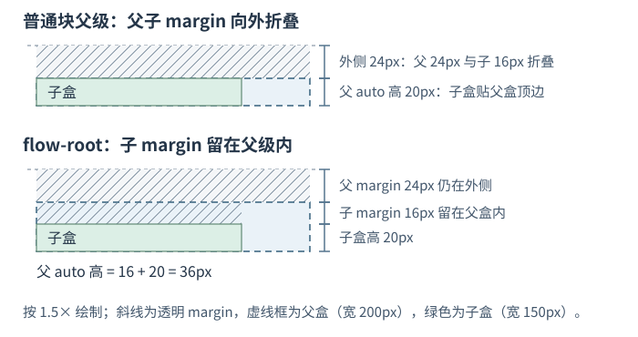

BFC 阻止的只是盒内外跨边界的折叠。BFC 根自己的 margin 仍按外层规则与兄弟折叠。

### 哪些声明会建立 BFC，各带什么副作用

前面的例子都用 `flow-root`。不少声明会顺带建立 BFC 或别的独立格式化上下文，选用时要看清附带效果：

- `display: flow-root`：专门用来建立 BFC，不裁切内容，也不创建滚动容器。只想包住浮动或隔开 margin 时选它。
- 浮动、绝对定位、`inline-block`、表格单元格和表格标题：也为内容建立格式化上下文，但它们自身还带着浮动、定位、行内排版或表格布局的行为。
- Flex 和 Grid 容器：建立各自的格式化上下文，不是 BFC。相邻项目的 margin 不折叠，项目上写 `float` 也不会让它按浮动盒排布。
- 块盒的计算值 `overflow` 为 `hidden`、`auto` 或 `scroll`：建立独立格式化上下文，同时让盒子成为 scroll container (滚动容器)。`hidden` 不显示滚动条，但脚本仍能滚动它；`auto` 只在内容溢出时显示滚动界面（在使用可见滚动条的平台上）；`scroll` 在这类平台上即使不溢出也显示滚动条。所以 `overflow: hidden` 不是“无副作用的 BFC 开关”：它会裁掉溢出内容（包括焦点轮廓），会改变 sticky 定位找到的滚动容器，还会让 Flex/Grid 项目的自动最小尺寸变成零。
- `overflow: clip`：裁切溢出，但本身不建立格式化上下文，也不成为滚动容器。另一轴设成 `visible`、`clip` 以外的值时，计算值里的 `clip` 可能变成 `hidden`，这时要按计算值判断。

滚动容器对 sticky 的影响见[定位元素参照谁](#sticky%20%E4%B8%BA%E4%BB%80%E4%B9%88%E6%B2%A1%E6%9C%89%E8%B4%B4%E4%BD%8F)，对自动最小尺寸的影响见[Flex 和 Grid 怎样分空间](#%E8%87%AA%E5%8A%A8%E6%9C%80%E5%B0%8F%E5%B0%BA%E5%AF%B8%E8%AE%A9%E9%A1%B9%E7%9B%AE%E6%8B%92%E7%BB%9D%E6%94%B6%E7%BC%A9)。

### 下一步：一行里的空间怎样分给多个项目

到这里，给定一组声明，可以算出每个块的边框盒宽度、它在父级里占多少空间，以及浮动和 margin 让它落在哪里。脚本要读这些结果时，各几何 API 量哪一层见[读几何值为什么会卡住脚本](#5.%20DOM%20%E6%94%B9%E5%8A%A8%E5%90%8E%E6%B5%8F%E8%A7%88%E5%99%A8%E9%87%8D%E5%81%9A%E4%BA%86%E4%BB%80%E4%B9%88%EF%BC%8C%E8%AF%BB%E5%87%A0%E4%BD%95%E5%80%BC%E4%B8%BA%E4%BB%80%E4%B9%88%E4%BC%9A%E5%8D%A1%E4%BD%8F%E8%84%9A%E6%9C%AC%EF%BC%9F)：例如 `offsetWidth` 读的是边框盒宽度（含占布局空间的滚动条），不含 margin，也不计 transform。

普通流里的块只会从上到下堆叠。报表页的工具栏要在一行里分配剩余空间，摘要卡要对齐成列，这些交给下一章[Flex 和 Grid 怎样把空间分给每个项目](#13.%20Flex%20%E5%92%8C%20Grid%20%E6%80%8E%E6%A0%B7%E6%8A%8A%E7%A9%BA%E9%97%B4%E5%88%86%E7%BB%99%E6%AF%8F%E4%B8%AA%E9%A1%B9%E7%9B%AE%EF%BC%9F)。

> [!info]- 来源
> - **四层盒与 margin/padding 简写**（“width 量的是哪一层盒”）：CSS Box Model Module Level 3，W3C Recommendation 2024-04-11，§2.1、§3.2、§4.2，<https://www.w3.org/TR/css-box-3/#boxes-edges>。margin 在 border 外且背景透明；简写按一至四值分配边缘。访问于 2026-11-12。
> - **`box-sizing` 与内容尺寸下限为零**（“width 量的是哪一层盒”）：CSS Box Sizing Module Level 3，W3C Working Draft 2026-09-04，§3.3，<https://www.w3.org/TR/css-sizing-3/#box-sizing>。`border-box` 不含 margin，内容尺寸的负值取零。访问于 2026-11-12。
> - **块盒宽度等式与过约束**（“不写 width 时，块盒怎样放满父级”）：CSS 2.2，W3C First Public Working Draft 2016-04-12，§10.3.3，<https://www.w3.org/TR/CSS22/visudet.html#blockwidth>。该文档是历史草案。
> - **非替换行内盒不认 width、inline-block 的宽度**（同上节）：CSS 2.2，§10.3.1、§10.3.9，<https://www.w3.org/TR/CSS22/visudet.html#inlineblock-width>。访问于 2026-11-12。
> - **边框三角与 `clip-path`**（“用边框画一个小三角”）：边框三角在 Chromium 149 实际渲染；CSS Backgrounds Level 3 §4.4 并未规定角部颜色切换的精确路径，<https://www.w3.org/TR/css-backgrounds-3/#corner-transitions>。透明边框见 CSS 2.2 §8.5，<https://www.w3.org/TR/CSS22/box.html#border-properties>；形状裁切见 CSS Masking Module Level 1，W3C Candidate Recommendation Draft 2021-08-05，§5.1，<https://www.w3.org/TR/css-masking-1/#the-clip-path>。访问于 2026-11-12。
> - **BFC 定义、flow-root、Flex/Grid 各自的格式化上下文**（“父级为什么包不住浮动的徽标”“哪些声明会建立 BFC”）：CSS Display Module Level 3，W3C Candidate Recommendation Draft 2026-06-05，§2.2、附录 A，<https://www.w3.org/TR/css-display-3/>。
> - **浮动、避让与 clearance**（“父级为什么包不住浮动的徽标”“BFC 根怎样避开旁边的浮动”）：CSS 2.2，§9.4.1、§9.5、§9.5.2，<https://www.w3.org/TR/CSS22/visuren.html#block-formatting>、<https://www.w3.org/TR/CSS22/visuren.html#floats>、<https://www.w3.org/TR/CSS22/visuren.html#flow-control>。§9.5 的避让对象限定为同一外层 BFC 中浮动的 margin box；clearance 不检查其他 BFC 中的浮动。外部浮动避让的落点数值是 Chromium 149.0.7827.55 实测。
> - **BFC 根的自动高度**（“父级为什么包不住浮动的徽标”）：CSS 2.2，§10.6.7，<https://www.w3.org/TR/CSS22/visudet.html#root-height>。只计入参与该 BFC 的浮动后代；其他 BFC、绝对定位后代与嵌套在其他浮动里的浮动不计入。
> - **margin 折叠**（“相邻 margin 什么时候折叠”）：CSS 2.2，§8.3.1，<https://www.w3.org/TR/CSS22/box.html#collapsing-margins>。边缘相邻条件、父子折叠条件和正负值合并算法。
> - **overflow、滚动容器与格式化上下文**（“哪些声明会建立 BFC”）：CSS Overflow Module Level 3，W3C Working Draft 2025-10-07，§3.1，<https://www.w3.org/TR/css-overflow-3/#overflow-properties>。可滚动值、`clip` 例外、滚动界面条件与计算值。访问于 2026-11-12。
> - **Flex/Grid 项目的 margin 与 float**（同上节）：CSS Flexbox Level 1 §4.2，<https://www.w3.org/TR/css-flexbox-1/#item-margins>；CSS Grid Level 2 §6.4，<https://www.w3.org/TR/css-grid-2/#item-margins>。
> - **`offsetWidth`**（结尾一节）：CSSOM View Module，W3C Working Draft 2025-09-16，§7，<https://www.w3.org/TR/cssom-view-1/#dom-htmlelement-offsetwidth>。访问于 2026-11-12。
## 13. Flex 和 Grid 怎样把空间分给每个项目？

[上一章](#12.%20%E7%9B%92%E5%AD%90%E7%9A%84%E5%B0%BA%E5%AF%B8%E6%80%8E%E6%A0%B7%E8%AE%A1%E7%AE%97%EF%BC%8C%E5%9D%97%E5%92%8C%E6%B5%AE%E5%8A%A8%E6%80%8E%E6%A0%B7%E5%9C%A8%E6%B5%81%E9%87%8C%E6%8E%92%E5%BC%80%EF%BC%9F)的块在普通流里只会从上到下堆叠。报表页（沿用主线一的 `/reports/42`）还需要三种排法：外框由固定宽度的侧栏和可伸缩的主栏 `<main>` 组成；主栏标题下的工具栏在一行里排链接、报表名和导出按钮；摘要区的卡片在变窄时自动减少列数。本章回答 Flexbox (弹性盒布局) 和 Grid (网格布局) 怎样把容器的空间分给每个项目，为什么项目有时拒绝收缩，以及怎样在流内居中。例子里的宽度都是为手算设定的；实测值注明浏览器版本。

### 一条轴还是共同的列

选型先看项目之间要怎样对齐：

- **Flex** 沿一条 main axis (主轴) 排列项目，按比例分配剩余空间或分摊不足。工具栏只有一排控件，适合 Flex。Flex 也能换行，但每条 flex line (弹性行) 各自分配空间，不同行的项目不会对成共同的列。
- **Grid** 同时定义行和列轨道，项目落进格子。摘要卡要对齐成列，适合 Grid。

外框的“固定侧栏 + 伸缩主栏”两种都能写，后文给出两种写法。Flex 和 Grid 都只改变盒子在屏幕上的位置：`order`、`row-reverse` 和 Grid 的区域放置不改 DOM 里的源码顺序，Tab 键和屏幕阅读器仍按源码前进，所以不要用它们修补错误的源码顺序（规则与代价见[焦点顺序跟随源码](#%E7%84%A6%E7%82%B9%E9%A1%BA%E5%BA%8F%E8%B7%9F%E9%9A%8F%E6%BA%90%E7%A0%81)）。

### Flex 怎样在一条主轴上分配空间

`display: flex` 或 `inline-flex` 创建 flex container (弹性容器)，它的直接子元素成为 flex item (弹性项目)。直接写在容器里的非空白文本会被包进匿名项目；绝对定位的子元素不参与空间分配。

`flex-direction` 决定主轴方向，cross axis (交叉轴) 与之垂直。下图是默认横向书写、`direction: ltr`、`flex-direction: row` 的情形：主轴从左向右，交叉轴从上向下。改成 `column` 后两轴交换；两轴起止的物理方向随书写模式和 `direction` 变化，`row-reverse` / `column-reverse` 反转主轴。main size (主尺寸) 和 cross size (交叉尺寸) 指项目沿两轴的尺寸。


| 属性 | 负责什么 |
| --- | --- |
| `flex-direction`、`flex-wrap` | 主轴方向；是否允许产生多条弹性行 |
| `flex-basis` | 项目的基础尺寸 |
| `flex-grow` | 有正剩余空间时的增长比例 |
| `flex-shrink` | 空间不足时的收缩权重 |
| `gap` | 项目间距，先从容器可用空间里扣除 |
| `order` | 改变视觉顺序，不改 DOM 顺序 |

对齐属性（`justify-content`、`align-*`）在尺寸确定之后才起作用，放在[对齐与流内居中](#%E5%AF%B9%E9%BD%90%E4%B8%8E%E6%B5%81%E5%86%85%E5%B1%85%E4%B8%AD)一节。

#### 三步算出每个项目的主尺寸

在一条弹性行上：

1. **求假设主尺寸。** 每个项目先得到 flex base size (基础尺寸)，再限制到自己的最小/最大尺寸之间，得到 hypothetical main size (假设主尺寸)。
2. **决定增长还是收缩。** 把各项的假设主尺寸、外边距和间距加起来，和容器的主轴内尺寸比较：总和较小就增长，否则收缩。因为第 1 步已经应用了 min/max，这些约束在选方向之前就参与了判断。
3. **从基础尺寸出发分配差额。** 增长时按 `flex-grow` 的比例分 positive free space (正剩余空间)；收缩时按 `flex-shrink × 基础尺寸`，即 scaled flex-shrink factor (缩放后的收缩权重)，分摊 negative free space (负剩余空间)。某个项目分完后违反了自己的最小或最大尺寸，就把它固定在边界上，称为 freeze (冻结)，再把剩下的差额分给其余项目，直到全部确定。

收缩按“权重 × 基础尺寸”分摊，是为了让大项目多缩、小项目少缩，避免小项目先被压到零。增长则只看 `flex-grow`。一行的 `flex-grow` 合计小于 1 时，项目只分走相应比例的正剩余空间，其余留空。

> [!example] 负剩余空间遇到最小尺寸时重新分配
> 容器内宽 `256px`，间距 `16px`，两项可用 `240px`。基础尺寸 `200px` 和 `100px`，`flex-shrink` 都为 1，合计多出 `60px`。
>
> 1. 收缩权重 `1 × 200 : 1 × 100 = 2 : 1`，第一项缩 `40px`、第二项缩 `20px`，暂定 `160px` 和 `80px`。
> 2. 第一项最小行内尺寸是 `180px`，暂定值低于下限，冻结在 `180px`。
> 3. 第二项拿到剩下的 `240 − 180 = 60px`。
>
> 最终 `180 + 60 + 16 = 256px`，正好填满容器。Chromium 探针也测得 `180px`、`60px`。

~~~html
<div class="shrink-demo">
  <div class="first"></div>
  <div class="second"></div>
</div>
~~~

~~~css
.shrink-demo { display: flex; inline-size: 256px; gap: 16px; }
.first { flex: 0 1 200px; min-inline-size: 180px; }
.second { flex: 0 1 100px; min-inline-size: 0; }
~~~

#### flex 简写各代表什么

`flex` 按 `flex-grow flex-shrink flex-basis` 的顺序一次设三项：

| 写法 | 等价于 | 含义 |
| --- | --- | --- |
| `flex: 1 1 0` | 同左 | 从零出发，按比例分配全部空间。本章的主栏和报表名都用它 |
| `flex: 1` | 规范中为 `1 1 0` | 单值正数表示零基准；浏览器的计算值可能是 `0%`，见下方实例 |
| `flex: auto` | `1 1 auto` | 先用明确的主轴尺寸，没有时按内容，再增长或收缩 |
| `flex: none` | `0 0 auto` | 按基础尺寸排布，不增长也不收缩 |
| `flex: initial` | `0 1 auto` | 有剩余时不增长，空间不足时可收缩到最小尺寸 |

能缩到多小还要看项目的自动最小尺寸，见[自动最小尺寸让项目拒绝收缩](#%E8%87%AA%E5%8A%A8%E6%9C%80%E5%B0%8F%E5%B0%BA%E5%AF%B8%E8%AE%A9%E9%A1%B9%E7%9B%AE%E6%8B%92%E7%BB%9D%E6%94%B6%E7%BC%A9)。

> [!info] 实例：Chromium 157 中 `flex: 1` 与 `flex: 1 1 0` 的差异
> 本机 headless Chrome `157.0.8103.51` 的 `getComputedStyle()` 把 `flex: 1` 的基础尺寸报告为 `0%`，`flex: 1 1 0` 为 `0px`。在主轴尺寸不确定的列容器里，百分比基准按内容解析，两者表现不同：自动高度的列容器里有两个项目，文字内容高 `40px` 和 `20px`，项目设 `min-height: 0; overflow: hidden`。写 `flex: 1` 时两项按内容得到 `40px`、`20px`，容器高 `60px`；写 `flex: 1 1 0px` 时容器和两项都是 `0px`。这是本机对这组输入的观察。布局依赖确定的零基准、且主轴尺寸可能不确定时，写三值形式。

### Grid 轨道怎样定尺寸

`display: grid` 或 `inline-grid` 让容器按行列 track (轨道) 排布子项。轨道可以用 `grid-template-columns` / `grid-template-rows` 显式定义，也会在放置项目时隐式生成。轨道尺寸的写法：

- 固定长度，如 `14rem`：适合不变的导航。
- `fr`：按比例分配剩余空间，但每条轨道仍要满足自己的最小和最大尺寸。
- 由内容决定：`min-content` (最小内容尺寸) 是在所有合法断点都换行时的最窄宽度；`max-content` (最大内容尺寸) 是不利用软换行机会时的宽度；`auto` 和 `fit-content()` 介于其间，结果还受容器空间和显式约束影响。
- `minmax(最小, 最大)`：分别给轨道定下限和上限。

关键的一条：单独写的 `1fr` 等价于 `minmax(auto, 1fr)`，下限是 `auto`，不是零。下一节的问题就从这里来。

### 自动最小尺寸让项目拒绝收缩

Flex 项目和 Grid 项目的 `min-width` / `min-height` 初始值是 `auto`。这个 `auto` 在不同条件下解析成不同的值：

| 项目 | 自动最小尺寸取内容下限的条件 | 否则 |
| --- | --- | --- |
| Flex 项目（主轴方向） | 项目不是滚动容器 | `0` |
| Grid 项目 | 项目不是滚动容器，且跨越的轨道中有最小尺寸函数为 `auto` 的（跨多条时其中不能有 `fr` 轨道） | `0` |

内容下限大致是项目内容的 `min-content`；若项目另写了确定的尺寸，则不超过那个尺寸。于是一个不能断行的长链接、一张宽表格，会让项目宁可溢出容器也不缩小。

是否是滚动容器由 `overflow` 的计算值决定：`hidden`、`auto`、`scroll` 让盒子成为滚动容器，自动最小尺寸就变成零；`visible` 和 `clip` 不是，内容下限仍然有效。`overflow: clip` 只裁切，不能替代 `hidden` 来解除下限。滚动容器的完整含义见[哪些声明会建立 BFC](#%E5%93%AA%E4%BA%9B%E5%A3%B0%E6%98%8E%E4%BC%9A%E5%BB%BA%E7%AB%8B%20BFC%EF%BC%8C%E5%90%84%E5%B8%A6%E4%BB%80%E4%B9%88%E5%89%AF%E4%BD%9C%E7%94%A8)。

解除下限的办法有两种：在项目上写 `min-inline-size: 0`（Flex 和 Grid 都适用）；在 Grid 里把轨道写成 `minmax(0, 1fr)`，轨道下限不再是 `auto`，项目的自动最小尺寸也随之为零。两种办法都只是允许项目变窄，内容是换行、裁切还是滚动，要另外决定。

#### 外框：1fr 主栏被长内容撑开

外框内容宽 `1120px`，侧栏 `14rem`（根字号 `16px` 时为 `224px`），间距 `16px`。主栏里有一段不能断行的长链接地址，下例用一个人为设定为 `920px` 宽的行内块模拟它：

~~~html
<div class="report-layout">
  <nav aria-label="报表分类导航">...</nav>
  <main>
    <h1>月度订单</h1>
    <p class="report-url">
      <span class="synthetic-token">合成的 920px 不可断内容</span>
    </p>
  </main>
</div>
~~~

~~~css
.report-layout {
  display: grid;
  inline-size: 1120px;
  grid-template-columns: 14rem minmax(0, 1fr);
  gap: 16px;
}
.report-url {
  display: block;
  overflow: hidden;
  white-space: nowrap;
}
.synthetic-token { display: inline-block; inline-size: 920px; }
~~~

> [!example] 主栏轨道宽度
> 没有内容下限时，主栏应得 `1120 − 224 − 16 = 880px`。
>
> 写成 `14rem 1fr` 时，`1fr` 的下限是 `auto`，主栏 `<main>` 这个 grid item (网格项目) 的自动最小尺寸取内容下限 `920px`，轨道被撑到 `920px`。两轨加间距 `224 + 16 + 920 = 1160px`，超出外框 `40px`。
>
> 写成 `14rem minmax(0, 1fr)` 时，轨道下限为零，主栏回到 `880px`。`920px` 的行内块在 `.report-url` 里被裁掉 `40px`。
>
> headless Chrome `157.0.8103.51` 实测：`1fr` 时主轨道 `920px`，`minmax(0, 1fr)` 时 `880px`。

裁切只是为了看清轨道宽度。真实页面里，要显示完整链接地址，就去掉固定宽度、`white-space: nowrap` 和裁切，改给长词设 `overflow-wrap: anywhere`。如果主栏里是宽数据表，保留真实 `<table>` 的行列和标题关系，把表放进局部横向滚动容器；这个滚动区域要有名称，并确认键盘用户在目标浏览器里能到达和滚动它。

同一外框用 Flex 写，沿用 `1120px`、`16px` 间距和 `14rem` 侧栏：

~~~css
.report-layout { display: flex; inline-size: 1120px; gap: 16px; }
.report-layout > nav { flex: 0 0 14rem; }
.report-layout > main { flex: 1 1 0; min-inline-size: 0; }
~~~

主栏从零基准增长到 `880px`。这里的 `min-inline-size: 0` 不能省：没有它，主栏的自动最小尺寸是 `920px`，项目拒绝缩到 `880px`。两种写法宽度相同；之后若要让多块内容按共同的列对齐，Grid 更容易扩展。

#### 工具栏：报表名增长后截断

工具栏在一行里排两个导航链接、当前报表名和导出按钮。为了能手算，两个链接固定 `64px`，按钮固定 `43px`，间距 `16px`；报表名从零基准增长，放不下时显示单行省略号。宽度分别取 `360px` 和 `1120px` 演算，与上面 `880px` 的主栏无关。

~~~html
<nav class="report-toolbar" aria-label="当前报表操作">
  <a class="fixed-link" href="/reports">全部报表</a>
  <a class="fixed-link" href="/reports/monthly">月度报表</a>
  <span class="current-report">
    2026 年 10 月跨地区订单处理与复核情况汇总
  </span>
  <button type="button">导出</button>
</nav>
~~~

~~~css
.report-toolbar {
  display: flex;
  align-items: center;
  gap: 16px;
  inline-size: 360px;
  font-size: 16px;
}
.report-toolbar > * { box-sizing: border-box; }
.fixed-link { flex: 0 0 64px; white-space: nowrap; }
.current-report {
  flex: 1 1 0;
  overflow: hidden;
  white-space: nowrap;
  text-overflow: ellipsis;
}
.report-toolbar > button { flex: 0 0 43px; padding: 0; }
~~~

固定部分共占 `64 + 64 + 43 + 3 × 16 = 219px`。工具栏 `360px` 时，报表名从零基准得到 `360 − 219 = 141px` 的正剩余空间。这不是 `flex-shrink` 把它压窄，而是它按 `flex-grow` 只长到 `141px`，再在盒内显示省略号。本机 Chromium 中这行标题在 `16px` 字号下的完整宽度约 `316px`，随字体而变。工具栏改为 `1120px` 时，报表名得到 `1120 − 219 = 901px`，足以完整显示。

报表名不需要 `min-inline-size: 0`，因为它自己写了 `overflow: hidden`，已是滚动容器，自动最小尺寸为零。

如果报表名外面多包了一层，只在内层链接上裁切，外层 Flex 项目就不是滚动容器，仍会按内容下限拒绝收缩。这时在直接项目上解除下限，在内层文本元素上裁切：

~~~html
<div class="toolbar">
  <div class="report-name">
    <a href="/reports/42">2026 年 10 月跨地区订单处理与复核情况汇总</a>
  </div>
  <button type="button">筛选</button>
</div>
~~~

~~~css
.toolbar { display: flex; inline-size: 360px; gap: 16px; }
.toolbar > .report-name {
  flex: 1 1 0;
  min-inline-size: 0;
}
.toolbar > .report-name > a {
  display: block;
  overflow: hidden;
  white-space: nowrap;
  text-overflow: ellipsis;
}
~~~

省略号只隐藏视觉部分，文本仍在 DOM 中。报表名若要可点击，就用真实链接并保留完整的可访问名称，不要用截断后的字符串替换完整标题；还要确认裁切容器没有裁掉键盘焦点指示。单行省略的三个前提和多行裁切见[文字放不下时](#%E6%96%87%E5%AD%97%E6%94%BE%E4%B8%8D%E4%B8%8B%E6%97%B6%E6%80%8E%E6%A0%B7%E7%9C%81%E7%95%A5%E5%92%8C%E8%A3%81%E5%88%87)。

### auto-fit 与 auto-fill 按宽度决定列数

摘要区的卡片要在宽度变窄时自动减列，而列数不应依赖卡片文字有多宽。Grid 的自动重复轨道按容器可用宽度和每列最小宽度算出列数：

~~~css
.cards {
  display: grid;
  grid-template-columns:
    repeat(auto-fit, minmax(min(100%, 15rem), 1fr));
  gap: 1rem;
}
~~~

~~~html
<section class="cards" aria-label="月度报表摘要">
  <article><h2>订单总量</h2><p>本月订单数量与上月比较。</p></article>
  <article><h2>准时交付</h2><p>按地区查看订单交付情况。</p></article>
  <article><h2>待复核</h2><p>需要进一步检查的订单。</p></article>
</section>
~~~

`repeat(auto-fit, ...)` 在不溢出的前提下放尽可能多条列轨道，每条至少 `min(100%, 15rem)`，多余空间由 `1fr` 均分。卡片是 `.cards` 的直接子项，默认自动放置让每张依次占一格。`min(100%, 15rem)` 保证容器比 `15rem` 还窄时，单列下限缩到容器宽度，而不是溢出。

> [!example] 880px 主栏里的列数
> 根字号 `16px`，轨道下限 `15rem = 240px`，间距 `16px`。
>
> - 3 列需要 `3 × 240 + 2 × 16 = 752px`，放得下；4 列需要 `4 × 240 + 3 × 16 = 1008px`，放不下。所以最多 3 列。
> - 三张卡片：每列 `(880 − 2 × 16) ÷ 3 ≈ 282.67px`。第四张会进入下一行。
> - 两张卡片：仍能容纳 3 条重复轨道，但 `auto-fit` 折叠没有项目的第三条轨道及其相邻间距，两列各 `(880 − 16) ÷ 2 = 432px`。
> - 主栏缩到 `220px`：`min(100%, 15rem)` 取 `220px`，单列轨道宽 `220px`。
>
> headless Chrome `157.0.8103.51` 实测：三张各约 `282.66px`，两张各 `432px`，`220px` 容器中轨道 `220px`。

轨道宽度和卡片自身的尺寸约束是两回事：卡片若写了 `min-inline-size: 300px`，在 `220px` 轨道里仍会撑到 `300px` 并溢出轨道（同一探针实测）。

`auto-fill` 和 `auto-fit` 算出的重复次数相同，区别只在空轨道：`auto-fill` 保留空轨道的位置，两张卡片后留出一个空槽，卡片不被拉宽；`auto-fit` 折叠空轨道，让现有卡片伸展。

### 对齐与流内居中

项目尺寸确定后，容器里还剩的空间由对齐属性分配：

| 属性 | 负责什么 |
| --- | --- |
| `justify-content` | 项目尺寸和自动外边距确定后，沿主轴（Grid 中沿行内轴）分配剩余空间 |
| `align-items`、`align-self` | 项目在所在弹性行或网格区域里沿交叉轴（Grid 中沿块轴）对齐 |
| `align-content` | Flex 中沿交叉轴对齐各条弹性行，只对允许换行的容器生效；Grid 中沿块轴对齐整组行轨道 |
| `justify-items`、`place-items` | Grid 项目在格内沿行内轴对齐；`place-items` 同时设 `align-items` 和 `justify-items` |

> [!example] 允许换行的容器只有一条行也能移动它
> 容器高 `100px`，唯一项目高 `20px`，设 `flex-wrap: wrap`、`align-content: flex-end`、`align-items: flex-start`。这是多行容器，唯一一条弹性行高 `20px`，被推到底部，项目从 `y = 80px` 开始。改成 `flex-wrap: nowrap` 后，它是单行容器，那条行占满 `100px` 高，`align-content` 不生效，项目按 `align-items: flex-start` 从 `y = 0px` 开始。

居中未知尺寸的内容，最简单的办法就是让父容器负责对齐。内容留在普通流里，可以两个方向都居中，也可以只居中一个方向：

~~~css
.center-grid {
  display: grid;
  place-items: center;
}

.center-flex {
  display: flex;
  justify-content: center;
  align-items: center;
}
~~~

Grid 版把项目在格内两个方向对齐；Flex 版分别沿主轴和交叉轴对齐。前提是容器比内容大，否则没有剩余空间可分。需要覆盖整个区域时，让容器从父级布局或轨道取得预期高度，不要给内容写固定尺寸。弹窗这类要脱离普通流的浮层，居中方式不同，见[未知尺寸浮层居中](#%E8%AE%A9%E6%9C%AA%E7%9F%A5%E5%B0%BA%E5%AF%B8%E7%9A%84%E6%B5%AE%E5%B1%82%E5%B1%85%E4%B8%AD)。

### 读懂旧布局手段

维护旧代码时会遇到这些写法，它们各有用途，但不是新布局的首选：

- **float (浮动)：** 本意是让文字绕排。父级怎样包住浮动、margin 怎样折叠，见[盒子和浮动怎样在流里排开](#12.%20%E7%9B%92%E5%AD%90%E7%9A%84%E5%B0%BA%E5%AF%B8%E6%80%8E%E6%A0%B7%E8%AE%A1%E7%AE%97%EF%BC%8C%E5%9D%97%E5%92%8C%E6%B5%AE%E5%8A%A8%E6%80%8E%E6%A0%B7%E5%9C%A8%E6%B5%81%E9%87%8C%E6%8E%92%E5%BC%80%EF%BC%9F)。
- **表格布局：** `display: table-cell` 只借用表格的排版，不产生 HTML 表格的标题、行列语义。
- **inline-block (行内块)：** 源码里的空白会形成项目间隙，基线也会影响对齐。
- **绝对定位：** 适合把按钮锚定到卡片角落，但它脱离普通流，不参与父级尺寸计算，见[定位元素参照谁](#14.%20%E5%AE%9A%E4%BD%8D%E5%85%83%E7%B4%A0%E5%8F%82%E7%85%A7%E8%B0%81%EF%BC%8C%E4%B8%BA%E4%BB%80%E4%B9%88%E5%A4%A7%20z-index%20%E8%BF%98%E4%BC%9A%E8%A2%AB%E7%9B%96%E4%BD%8F%EF%BC%9F)。
- **Bootstrap Grid：** 是框架的类名约定，不等同于 CSS Grid。先确认项目实际用的 Bootstrap 版本，再按对应官方文档选类名和断点。

> [!info]- 归档：Bootstrap 3.4.1 与 4.6 的网格（核对日期 2026-11-12）
> Bootstrap 3.4.1 用十二列系统：`.container` / `.container-fluid`、`.row`、`.col-xs-*` / `.col-sm-*` / `.col-md-*` / `.col-lg-*`，断点为 `<768px`、`≥768px`、`≥992px`、`≥1200px`。它的插件 JavaScript 需要先加载 jQuery，CSS 网格本身不需要。
>
> 归档截图展示的是 Bootstrap 4.6：它有 `.col-` 与 `.col-xl-`，并多了 `576px` 断点，不能用它推断 Bootstrap 3 的类名和断点。[打开归档 Bootstrap 4 网格截图](../../archive/front-end/0-1_Learning_Notes/CSS/grid.png)。
>
> 官方文档把两者都标为结束支持：3.4.1 的维护于 2019-07-24 结束，4.6.2 于 2023-01-01 结束。它们适合维护旧项目，不是新项目的默认选择。

### 下一步：脱离流的盒子参照谁

到这里，给定容器宽度和项目的尺寸声明，可以算出每个 Flex 项目和 Grid 轨道的宽度，判断项目为什么拒绝收缩，并在流内居中内容。这些项目都留在流里，彼此推开。徽标贴卡片角、弹窗盖在页面上、工具栏滚动时贴顶，则要让盒子脱离或部分脱离流，下一章[定位元素参照谁，为什么大 z-index 还会被盖住](#14.%20%E5%AE%9A%E4%BD%8D%E5%85%83%E7%B4%A0%E5%8F%82%E7%85%A7%E8%B0%81%EF%BC%8C%E4%B8%BA%E4%BB%80%E4%B9%88%E5%A4%A7%20z-index%20%E8%BF%98%E4%BC%9A%E8%A2%AB%E7%9B%96%E4%BD%8F%EF%BC%9F)接着回答。

> [!info]- 来源
> - **Flex 容器与项目、两轴、三步尺寸算法、冻结、`flex` 简写、自动最小尺寸**（“Flex 怎样在一条主轴上分配空间”“flex 简写各代表什么”“自动最小尺寸让项目拒绝收缩”）：W3C CSS Flexible Box Layout Module Level 1，Candidate Recommendation Draft 2025-10-14，§§4.1、4.5、6、7.1、8.3–8.4、9，<https://www.w3.org/TR/css-flexbox-1/>；并核对 CSSWG 编辑草案 2026-05-08，<https://drafts.csswg.org/css-flexbox/>。
> - **Grid 轨道尺寸、`1fr` 的自动下限、Grid 项目自动最小尺寸、`auto-fit` 折叠空轨道**（“Grid 轨道怎样定尺寸”“自动最小尺寸让项目拒绝收缩”“auto-fit 与 auto-fill 按宽度决定列数”）：W3C CSS Grid Layout Module Level 2，Candidate Recommendation Draft 2025-03-26，§§6.6、7.2.3、12，<https://www.w3.org/TR/css-grid-2/>。
> - **`hidden`/`auto`/`scroll` 是滚动容器、`clip` 不是**（“自动最小尺寸让项目拒绝收缩”）：W3C CSS Overflow Module Level 3，Working Draft 2025-10-07，§3.1，<https://www.w3.org/TR/css-overflow-3/>。核对日期 2026-11-12。
> - **`order` 与重排只改视觉顺序**（“一条轴还是共同的列”）：W3C CSS Display Module Level 3，Candidate Recommendation Draft 2026-06-05，§3.1，<https://www.w3.org/TR/css-display-3/>。
> - **焦点顺序需保留含义与操作关系**（同上）：W3C Understanding Success Criterion 2.4.3: Focus Order，<https://www.w3.org/WAI/WCAG22/Understanding/focus-order.html>。
> - **Bootstrap 网格与结束支持**（“读懂旧布局手段”归档 callout）：Bootstrap 3.4 Grid system，<https://getbootstrap.com/docs/3.4/css/#grid>；Bootstrap 3.4 JavaScript 插件依赖，<https://getbootstrap.com/docs/3.4/javascript/>；Bootstrap 4.6 Grid system，<https://getbootstrap.com/docs/4.6/layout/grid/>；官方结束支持说明，<https://getbootstrap.com/docs/4.6/end-of-life/>。核对日期 2026-11-12。
> - **本地布局探针**（各 `[!example]` 与 Chromium 实例）：headless Chrome `157.0.8103.51`。外框 `1fr` 主轨道 `920px`、合计 `1160px`，`minmax(0, 1fr)` 主轨道 `880px`；`auto-fit` 在 `880px` 容器中排出 3 × `282.66px` 或 2 × `432px`，`220px` 容器轨道 `220px`，`min-inline-size: 300px` 卡片为 `300px` 并溢出；冻结例 `180px`、`60px`；`flex: 1` 计算基础尺寸 `0%`、`flex: 1 1 0` 为 `0px`，列容器两项 `40px`/`20px`、容器 `60px` 对比全为 `0px`；工具栏标题完整宽约 `316px`。这些是对固定输入的核验，不是跨浏览器兼容性保证。
## 14. 定位元素参照谁，为什么大 z-index 还会被盖住？

[上一章](#13.%20Flex%20%E5%92%8C%20Grid%20%E6%80%8E%E6%A0%B7%E6%8A%8A%E7%A9%BA%E9%97%B4%E5%88%86%E7%BB%99%E6%AF%8F%E4%B8%AA%E9%A1%B9%E7%9B%AE%EF%BC%9F)的项目都留在流里，互相推开。报表页（沿用主线一的 `/reports/42`）还有三个需求要让盒子脱离或部分脱离流：卡片的状态徽标贴住卡片右上角；弹窗位于视口中央；工具条在滚动时贴住顶部，直到它所在的区域滚出视口。本章回答定位盒的坐标参照哪个矩形，以及重叠时谁画在上面。

### 先分清四个问题

| 属性或概念 | 回答的问题 | 例子 |
| --- | --- | --- |
| `display` | 生成什么盒子，内部怎样排布？ | `block`、`flex`、`grid` 选择盒子类型和内部布局；`none` 不为元素及其后代生成盒子 |
| `position` | 盒子是否保留流中位置，偏移怎样解释？ | `relative` 保留原位置再视觉偏移；`absolute` 脱离普通流 |
| containing block (包含块) | 定位坐标相对哪个矩形计算？ | 绝对定位常用最近建立包含块的祖先的 padding edge (内边距边缘) |
| stacking context (堆叠上下文) | 哪些盒子作为一组参与前后绘制？ | 组内先排序，再由父级把整个组和别人比较 |

偏移用 inset properties (偏移属性) 表达：物理方向的 `top`、`right`、`bottom`、`left`，或逻辑方向的 `inset-block-start`、`inset-inline-end` 等；`inset` 是四边的简写。padding edge 是 padding box 的外缘。`display: none` 怎样影响布局、焦点和读屏，见[隐藏内容时各受什么影响](#16.%20%E9%9A%90%E8%97%8F%E5%86%85%E5%AE%B9%E6%97%B6%EF%BC%8C%E5%B8%83%E5%B1%80%E3%80%81%E6%8C%87%E9%92%88%E3%80%81%E7%84%A6%E7%82%B9%E5%92%8C%E8%AF%BB%E5%B1%8F%E5%90%84%E5%8F%97%E4%BB%80%E4%B9%88%E5%BD%B1%E5%93%8D%EF%BC%9F)。

### position 的五个值

| `position` | 普通流中的位置 | 偏移参照 | 滚动表现 |
| --- | --- | --- | --- |
| `static`（静态） | 保留 | 偏移属性不生效 | 随文档移动 |
| `relative`（相对） | 保留原位置 | 自己原来的流位置 | 随文档移动 |
| `absolute`（绝对） | 不占原位置 | 最近建立绝对定位包含块的祖先；没有则用初始包含块 | 随该包含块移动 |
| `fixed`（固定） | 不占原位置 | 最近建立固定定位包含块的祖先；通常是视口 | 相对该包含块固定；若某个祖先建立了这种包含块，就不再贴着视口 |
| `sticky`（粘性） | 保留原位置 | 最近滚动容器的可视区域，并受自身包含块约束 | 某轴至少一个偏移不是 `auto` 时，滚动中才沿该轴贴边 |

`absolute` 和 `fixed` 会把盒子的外部 `display` 类型 blockify (块化)，例如 `display: inline` 的元素变成块级盒。这只改盒子类型，与包含块和堆叠上下文无关。

### 包含块：绝对定位和固定定位参照谁

所有非 `static` 的 `position` 值都会为绝对定位后代建立包含块，边界通常是这个祖先的 padding edge。最常见的写法是给父级加 `position: relative`。找绝对定位的参照时，要沿祖先链向上找最近一个建立了包含块的祖先，而不是默认用父元素。

除了 `position`，下面这些属性也会为绝对定位**和固定定位**后代建立包含块：

- `transform` 或 `perspective` 不为 `none`；
- `filter` 不为 `none`（根元素除外）；
- `contain: layout` 或 `contain: paint`。

所以祖先上一个 `transform`，就能让 `fixed` 后代不再相对视口定位，而是相对这个祖先：做动画时给外层加了 `transform`，里面的全屏遮罩突然只盖住外层，就是这个原因。这些属性同时还会创建堆叠上下文，`contain: paint` 还会裁切后代的绘制。反过来，`position: relative` 配默认的 `z-index: auto` 只提供坐标参照，不新建堆叠上下文。若建立包含块的祖先是 Grid 容器，绝对定位子项可以用 `grid-area` 等放置属性把包含块缩小到某个网格区域。

#### 把徽标放到卡片右上角

卡片 `320 × 180px`，没有 padding 和 border，所以 padding box 就是内容盒。徽标 `32 × 24px`，距卡片上边和右边各 `8px`：

~~~css
.report-card {
  position: relative;
  width: 320px;
  height: 180px;
}

.report-card__badge {
  position: absolute;
  top: 8px;
  right: 8px;
  width: 32px;
  height: 24px;
}
~~~

卡片的 `position: relative` 建立了包含块，徽标的 `top`、`right` 从卡片 padding box 的边缘算起。左坐标 `320 − 8 − 32 = 280px`，上坐标 `8px`，徽标左上角在 `(280, 8)`。徽标脱离普通流，卡片标题仍按自己的流位置排版，不会为徽标让位。


### 让未知尺寸的浮层居中

弹窗要盖在页面上，不能留在流里，所以不能直接用[流内居中](#%E5%AF%B9%E9%BD%90%E4%B8%8E%E6%B5%81%E5%86%85%E5%B1%85%E4%B8%AD)。两种做法都先让遮罩层用 `position: fixed; inset: 0` 铺满视口。设视口 `1120 × 700px`、弹窗 `320 × 160px`，视口中心在 `(560, 350)`，弹窗左上角应在 `(560 − 160, 350 − 80) = (400, 270)`。

**遮罩法：** 遮罩本身是 Grid 容器，弹窗作为普通网格项目由对齐属性居中。

~~~css
.dialog-backdrop {
  position: fixed;
  inset: 0;
  display: grid;
  place-items: center;
}

.dialog {
  width: 320px;
  height: 160px;
}
~~~

**translate 法：** 遮罩是 `fixed` 盒，同时为弹窗建立绝对定位包含块。弹窗先把左上角放到包含块中心，再向左上平移自身宽高的一半。

~~~css
.dialog-backdrop {
  position: fixed;
  inset: 0;
  display: block;
}

.dialog {
  position: absolute;
  top: 50%;
  left: 50%;
  width: 320px;
  height: 160px;
  transform: translate(-50%, -50%);
}
~~~

遮罩没有 padding 和 border，尺寸就是 `1120 × 700px`。`top: 50%`、`left: 50%` 相对遮罩的 padding box，把弹窗左上角放到 `(560, 350)`；`translate(-50%, -50%)` 的百分比相对弹窗自身，向左、向上各移 `160px`、`80px`，结果同样是 `(400, 270)`。弹窗尺寸未知时，这一步照样成立，因为平移量由浏览器按弹窗的实际尺寸算。

两种做法都依赖遮罩铺满视口。若某个祖先为 `fixed` 后代建立了包含块（见上一节），遮罩就只铺满那个祖先。原生 `<dialog>` 用 `showModal()` 打开时进入 top layer，不受这个问题影响，见[z-index 为什么还在下面](#z-index%20%E4%B8%BA%E4%BB%80%E4%B9%88%E8%BF%98%E5%9C%A8%E4%B8%8B%E9%9D%A2)。

### sticky 为什么没有贴住

`sticky` 在要粘住的轴上至少需要一个非 `auto` 的偏移，例如 `top: 0`。它相对最近滚动容器的可视区域贴边，但不能移出自身包含块（通常是父元素）的范围。没贴住，通常是下面两个原因之一。

#### 包含块里没有移动空间

文档顶部有一个 `300px` 高的包裹层，工具条是它的第一个子元素，高 `32px`，设 `top: 0`，窗口是滚动容器：

- 窗口滚动 `100px`：包裹层顶边在 `y=−100`，工具条贴在视口 `y=0`。
- 滚动到 `268px`：包裹层底边到了 `y=32`，工具条正好贴着包裹层底边，仍在 `y=0`。
- 滚动到 `290px`：包裹层底边在 `y=10`，工具条不能越出包裹层，只能停在 `y = 10 − 32 = −22px`，随后跟着包裹层滚走。

若包裹层只有 `32px` 高，和工具条一样高，就没有移动空间：滚动 `100px` 后工具条在 `y=−100px`，看起来完全没粘住。

#### 最近的滚动容器不是你以为的那个

`overflow` 为 `hidden`、`auto` 或 `scroll` 的祖先会成为滚动容器（见[哪些声明会建立 BFC](#%E5%93%AA%E4%BA%9B%E5%A3%B0%E6%98%8E%E4%BC%9A%E5%BB%BA%E7%AB%8B%20BFC%EF%BC%8C%E5%90%84%E5%B8%A6%E4%BB%80%E4%B9%88%E5%89%AF%E4%BD%9C%E7%94%A8)）。即使它没有可见滚动条，工具条也会相对它而不是视口贴边；如果这个祖先自己并不滚动，工具条就永远不会动。排查时沿祖先链找出实际的滚动容器，再看 sticky 元素在包含块里还有多少移动空间。

### z-index 为什么还在下面

位置确定后，还要决定重叠时谁画在上面。常见的困惑是：弹窗设了很大的 `z-index`，仍被别的内容盖住。最小结构如下：`.shell` 和 `.other` 是 `.stage` 下的兄弟，`.dialog` 是 `.shell` 的子元素，三者覆盖同一块区域。

~~~html
<div class="stage">
  <div class="shell"><div class="dialog">弹窗</div></div>
  <div class="other">其他内容</div>
</div>
~~~

~~~css
.stage { position: relative; width: 240px; height: 120px; }
.shell, .other { position: absolute; inset: 0; }
.shell  { z-index: 1; }
.shell .dialog {
  position: absolute; inset: 20px; width: auto; height: auto;
  z-index: 9999; background: #ded3f4;
}
.other { z-index: 2; background: #cfe2fa; }
~~~

`z-index` 的数值只在同一个堆叠上下文里比较。`.shell` 是定位盒且 `z-index: 1`，它建立了自己的堆叠上下文，`.dialog` 在这个组里。父上下文 `.stage` 里比较的是 `.shell`（1）和 `.other`（2），组内的 `9999` 越不过组的边界。结果是蓝色的 `.other` 盖住紫色弹窗；只把 `.shell` 改成 `z-index: 3`，弹窗才出现在上面。修复方法是调整实际参与比较的那一层祖先，或把弹窗移到能与目标同层比较的结构里。

> [!info] 常见的堆叠上下文创建条件
> 定位盒配非 `auto` 的 `z-index`；`fixed` 或 `sticky`（即使 `z-index: auto`）；Flex/Grid 项目配非 `auto` 的 `z-index`；非 `none` 的 `transform`、`perspective` 或 `filter`；小于 `1` 的 `opacity`；`isolation: isolate`；`contain: layout` 或 `contain: paint`。`will-change` 只有在它指向的属性本来就会产生这些效果时，才提前建立包含块或堆叠上下文。这些条件不都会建立包含块：例如 `opacity` 只建堆叠上下文。

以上比较都发生在普通文档内部。原生 `<dialog>` 调用 `showModal()` 后进入 top layer (顶层)，显示的 popover 也进入 top layer。顶层内容绘制在整个文档之上，也不受祖先包含块和堆叠上下文影响，文档里任何 `z-index` 都盖不住它。做模态弹窗时，这通常比和 `z-index` 较劲更可靠。

### 排查位置与重叠问题先看哪一层

| 观察到的问题 | 先检查 |
| --- | --- |
| 兄弟节点被推开或覆盖 | 普通流位置；绝对定位的包含块 |
| `fixed` 遮罩没铺满视口 | 祖先上的 `transform`、`perspective`、`filter`、`contain` |
| sticky 不贴边 | 偏移是否非 `auto`；最近滚动容器；包含块剩余空间 |
| 高 `z-index` 元素仍被遮住 | 实际参与比较的祖先堆叠上下文及其层级 |
| 浮动没有计入父元素高度 | [BFC 与浮动](#%E7%88%B6%E7%BA%A7%E4%B8%BA%E4%BB%80%E4%B9%88%E5%8C%85%E4%B8%8D%E4%BD%8F%E6%B5%AE%E5%8A%A8%E7%9A%84%E5%BE%BD%E6%A0%87) |

### 下一步：尺寸不再固定时

本章给出了定位盒的坐标怎样从包含块算出、sticky 的移动范围，以及堆叠上下文和 top layer 怎样决定前后。例子里的视口、卡片和工具栏宽度都是固定值。真实页面上，视口会变、同一组件会放进宽窄不同的容器、用户会调大字号。规则该随谁切换、长度单位参照什么，见下一章[页面怎样响应视口、容器和用户设置](#15.%20%E9%A1%B5%E9%9D%A2%E6%80%8E%E6%A0%B7%E5%93%8D%E5%BA%94%E8%A7%86%E5%8F%A3%E3%80%81%E5%AE%B9%E5%99%A8%E5%92%8C%E7%94%A8%E6%88%B7%E8%AE%BE%E7%BD%AE%EF%BC%9F)。定位元素的显示与隐藏、进出动画，分别见[隐藏内容时各受什么影响](#16.%20%E9%9A%90%E8%97%8F%E5%86%85%E5%AE%B9%E6%97%B6%EF%BC%8C%E5%B8%83%E5%B1%80%E3%80%81%E6%8C%87%E9%92%88%E3%80%81%E7%84%A6%E7%82%B9%E5%92%8C%E8%AF%BB%E5%B1%8F%E5%90%84%E5%8F%97%E4%BB%80%E4%B9%88%E5%BD%B1%E5%93%8D%EF%BC%9F)和[过渡和关键帧动画怎样选](#17.%20%E8%BF%87%E6%B8%A1%E5%92%8C%E5%85%B3%E9%94%AE%E5%B8%A7%E5%8A%A8%E7%94%BB%E6%80%8E%E6%A0%B7%E9%80%89%EF%BC%8C%E6%80%8E%E6%A0%B7%E4%B8%8D%E4%BC%A4%E6%80%A7%E8%83%BD%E5%92%8C%E5%8F%AF%E8%AE%BF%E9%97%AE%E6%80%A7%EF%BC%9F)；`transform` 动画在渲染流水线里走哪一段，见[DOM 改动后浏览器重做了什么](#5.%20DOM%20%E6%94%B9%E5%8A%A8%E5%90%8E%E6%B5%8F%E8%A7%88%E5%99%A8%E9%87%8D%E5%81%9A%E4%BA%86%E4%BB%80%E4%B9%88%EF%BC%8C%E8%AF%BB%E5%87%A0%E4%BD%95%E5%80%BC%E4%B8%BA%E4%BB%80%E4%B9%88%E4%BC%9A%E5%8D%A1%E4%BD%8F%E8%84%9A%E6%9C%AC%EF%BC%9F)。

> [!info]- 来源
> - **`position` 五值、包含块、偏移、sticky 滚动视口与定位盒层叠**（“position 的五个值”“包含块”“sticky 为什么没有贴住”“z-index 为什么还在下面”）：W3C CSS Positioned Layout Level 3，Working Draft 2025-10-07，§§2、2.1、2.2、3.4，<https://www.w3.org/TR/css-position-3/>。
> - **top layer 绘制顺序**（“z-index 为什么还在下面”）：W3C CSS Positioned Layout Level 4，Working Draft 2025-10-07，§§3.1、4，<https://www.w3.org/TR/css-position-4/>。
> - **`display: none`、blockification**（“先分清四个问题”“position 的五个值”）：W3C CSS Display Module Level 3，Candidate Recommendation Draft 2026-06-05，§§2.5、2.7，<https://www.w3.org/TR/css-display-3/>。
> - **Flex/Grid 项目的 `z-index` 与绝对定位、Grid 容器作包含块**（堆叠条件 callout、“包含块”）：W3C CSS Flexible Box Layout Module Level 1，Candidate Recommendation Draft 2025-10-14，§§4.1、4.3，<https://www.w3.org/TR/css-flexbox-1/>；CSS Grid Layout Module Level 1，Candidate Recommendation Draft 2025-03-26，§§6.5、9.1、9.2，<https://www.w3.org/TR/css-grid-1/>。
> - **`transform`、`perspective`、`contain` 建立包含块与堆叠上下文**（“包含块”与堆叠条件 callout）：W3C CSS Transforms Module Level 1，Candidate Recommendation 2019-02-14，§3，<https://www.w3.org/TR/css-transforms-1/>；CSS Transforms Module Level 2，Working Draft 2021-11-09，§8，<https://www.w3.org/TR/css-transforms-2/>；CSS Containment Module Level 2，Working Draft 2022-09-17，§§3.2、3.4，<https://www.w3.org/TR/css-contain-2/>。
> - **`filter`、`will-change`、`opacity`、`isolation`**（同上）：W3C Filter Effects Module Level 1，Working Draft 2018-12-18，§5，<https://www.w3.org/TR/filter-effects-1/>；CSS Will Change Module Level 1，Candidate Recommendation Draft 2022-05-05，§2，<https://www.w3.org/TR/css-will-change-1/>；CSS Color Module Level 4，Candidate Recommendation Draft 2026-11-03，§3.3，<https://www.w3.org/TR/css-color-4/>；Compositing and Blending Level 1，Candidate Recommendation Draft 2024-03-21，§3.4.2，<https://www.w3.org/TR/compositing-1/>。
> - **`showModal()` 与 popover 进入 top layer**（“z-index 为什么还在下面”“让未知尺寸的浮层居中”）：WHATWG HTML Living Standard，更新于 2026-11-11，§4.11.4，<https://html.spec.whatwg.org/multipage/interactive-elements.html#dom-dialog-showmodal>；The popover attribute，<https://html.spec.whatwg.org/multipage/popover.html#the-popover-attribute>。
## 15. 页面怎样响应视口、容器和用户设置？

前几章的例子都用固定宽度手算。真实页面的视口会变，同一组件会放进宽窄不同的容器，用户还可能在浏览器里调大基础字号。本章回答两个问题：长度单位“相对于什么”计算；样式规则该在“谁的尺寸或状态”变化时切换。例子沿用主线一的报表页 `/reports/42`，看它的外框、筛选表单、标题和摘要在不同空间下怎样变化。

### 长度单位各参照什么

| 单位 | 参照 | 常见用途 | 要记住的边界 |
| --- | --- | --- | --- |
| `px` | CSS reference pixel (CSS 参考像素) | 边框、精确间距 | 不保证画成一个物理设备像素，见文末细线一节 |
| `%` | 该属性定义的参照盒或参照值 | 流动宽度、偏移 | 每个属性的百分比基准不同，不能只看符号 |
| `em` | 使用该值的元素的计算字号；用在 `font-size` 上时取继承来的字号 | 随文字缩放的局部间距 | 嵌套字号会逐层相乘 |
| `rem` | 根元素的计算字号 | 跨组件一致的文字相对尺寸 | 在 `@media`、`@container` 里参照不同，见下一节 |
| `vw` / `vh` | 默认 large viewport (大视口) 宽、高的 1% | 视口区域 | 视口不是内容盒；移动端工具栏展开时，`100vh` 可能大于可见高度 |
| `svh` / `lvh` / `dvh` | small (小)、large (大)、dynamic (动态) 视口高度的 1% | 移动端全高界面 | 要选是否随浏览器工具栏伸缩 |
| `vmin` / `vmax` | 默认大视口短边 / 长边的 1% | 随方向变化的尺寸 | 不表示内容容器宽度 |

几个演算：

- 初始字号与根字号都是 `16px` 时，`1.5rem = 24px`；把根元素计算字号改为 `20px` 后，普通声明里的 `5rem = 100px`。
- `em` 用在 `font-size` 上会逐层相乘：父级 `16px`，子元素 `font-size: 1.25em` 得 `20px`，孙元素再写 `1.25em` 得 `25px`。`rem` 让一组声明共用根字号，没有这种累积。
- `rem` 用在根元素自己的 `font-size` 上时，为避免循环引用，参照初始字号。

页面用 `px` 把根字号写死（如 `html { font-size: 16px; }`），会覆盖用户在浏览器里设置的基础字号偏好。用百分比写根字号，如 `html { font-size: 125%; }`，结果按用户的初始字号缩放，保留了这份偏好。

移动端浏览器的地址栏和工具栏会展开、收起，可见视口高度随之变化。`100svh` 按工具栏展开时的小视口算，`100lvh` 按收起时的大视口算，`100dvh` 跟随当前视口。要让关键内容在工具栏展开时也完整可见，用小视口单位；要让元素跟着可见区域伸缩，用动态单位，并接受伸缩时布局随之变化。

### 同一个 em 和 rem 在查询条件里参照不同

| 使用位置 | `em` 的参照 | `rem` 的参照 |
| --- | --- | --- |
| 普通样式声明 | 使用该值的元素的计算字号；`font-size` 上取父元素字号 | 根元素计算字号 |
| `@media` 条件 | 初始 `font-size` 值 | 初始 `font-size` 值 |
| `@container` 尺寸条件 | 被选中的查询容器的计算字号 | 根元素计算字号 |

所以媒体查询里的 `rem` 断点不随页面自己写的 `html { font-size: ... }` 改变，只跟随初始字号，而初始字号受用户的浏览器字号设置影响。容器查询则相反：`rem` 跟页面根字号走，`em` 跟查询容器自己的字号走。两节之后的例子会分别演算。

### 100vw 和 100% 为什么不同

`100vw` 按视口宽度算，`100%` 按父级提供的宽度算。页面内部滚动容器的滚动条只占该容器自己的宽度，不缩小视口，两者就会出现差异。

> [!example] headless Chrome 157.0.8103.51 的内部滚动区域
> 视口 `700px`。内部 `<section>` 设 `width: 700px; height: 100px; overflow-x: hidden; overflow-y: auto; scrollbar-gutter: stable`，内容高 `202px`。经典垂直滚动条在容器内预留 `15px`，容器内容宽 `685px`。子项写 `width: 100vw` 得 `700px`，比容器内容宽多出 `15px`（被 `overflow-x: hidden` 裁掉）；写 `width: 100%` 得 `685px`。
>
> 数值取决于本机滚动条样式；overlay scrollbar (覆盖式滚动条) 不占宽度，就没有差异。整页滚动条的情况不同：CSS Overflow 规定根元素的 `scrollbar-gutter` 作用于视口，`vw` 与整页滚动条的关系要在目标浏览器里另行检查，不能套用这个内部容器的结果。

目标是填满当前内容区时，块级元素保持 `width: auto` 即可，它已经按[块盒宽度等式](#%E4%B8%8D%E5%86%99%20width%20%E6%97%B6%EF%BC%8C%E5%9D%97%E7%9B%92%E6%80%8E%E6%A0%B7%E6%94%BE%E6%BB%A1%E7%88%B6%E7%BA%A7)扣掉了 padding、border 和 margin。手动写 `width: 100%` 时，带 padding 或 border 的元素要配 `box-sizing: border-box`，否则外尺寸超出父级。

### 三种响应机制怎样选

| 需要响应的变化 | 机制 | 报表页里的例子 |
| --- | --- | --- |
| 整个视口的宽度、方向或用户偏好 | `@media` | 窄视口把侧栏 + 主栏改为单列，区域按源码顺序堆叠 |
| 组件自己分到的宽度 | `@container` | 同一筛选表单在宽主栏里横排，在窄面板里竖排 |
| 重复项目随可用宽度换列 | Grid `repeat(auto-fit, ...)` | 摘要卡有空间就放下一列，不写断点 |

断点应设在内容开始放不下的位置，而不是机械套用“手机/平板/桌面”的设备标签。

#### @media：按视口切换外框

报表外框在视口宽度不超过 `48rem` 时，从两列（侧栏 + 主栏）改为单列。这条规则只改列数，各区域仍按 HTML 源码顺序上下堆叠：

~~~css
.report-layout {
  display: grid;
  grid-template-columns: 14rem minmax(0, 1fr);
  gap: 1rem;
}

@media (max-width: 48rem) {
  .report-layout { grid-template-columns: minmax(0, 1fr); }
}
~~~

`minmax(0, 1fr)` 的作用见[自动最小尺寸](#%E8%87%AA%E5%8A%A8%E6%9C%80%E5%B0%8F%E5%B0%BA%E5%AF%B8%E8%AE%A9%E9%A1%B9%E7%9B%AE%E6%8B%92%E7%BB%9D%E6%94%B6%E7%BC%A9)。初始字号是 `16px` 时，`48rem = 768px`；`max-width` 含等号，视口正好 `768px` 时也是单列。即使页面写了 `html { font-size: 20px; }`，断点仍是 `768px`，不会变成 `960px`。用户在浏览器里改了初始字号，断点就按那个值计算。

#### @container：按组件自身宽度切换

媒体查询只知道视口。筛选表单可能放在宽主栏里，也可能放在窄面板里，应该按面板自身宽度换列。做法是把面板设为 inline-size query container (行内尺寸查询容器)，再用 `@container` 规则调整它的后代：

- 查询条件只能用来设置查询容器的后代，不能设置容器自己。
- 未命名的 `@container` 从被设样式的元素向外找最近的合格祖先容器；要查询更外层的特定容器，用 `container-name` 命名。
- inline size (行内尺寸) 是沿文字排列方向的尺寸：横向书写时就是内容盒宽度，纵向书写时物理上对应高度。

沿用[表单一章](#10.%20%E8%A1%A8%E5%8D%95%E6%8E%A7%E4%BB%B6%E6%80%8E%E6%A0%B7%E5%91%BD%E5%90%8D%E3%80%81%E6%8F%90%E4%BA%A4%E5%92%8C%E6%A0%A1%E9%AA%8C%EF%BC%8C%E6%89%8D%E5%AF%B9%E6%89%80%E6%9C%89%E4%BA%BA%E5%8F%AF%E7%94%A8%EF%BC%9F)的筛选表单，这里只保留起始月份、地区和提交按钮三项。为了让每个控件和它的标签成为一个 Grid 项目，改用把控件包进 `label` 的关联写法（两种写法都有效，见那一章）：

~~~html
<section class="report-panel">
  <form class="report-filter" action="/reports/42" method="get">
    <label>From month
      <input name="from" type="month" value="2026-04">
    </label>
    <label>Region
      <select name="region">
        <option value="">All regions</option>
        <option value="north">North</option>
        <option value="south">South</option>
      </select>
    </label>
    <button type="submit">Filter reports</button>
  </form>
</section>
~~~

~~~css
.report-panel {
  container-type: inline-size;
}
.report-filter {
  display: grid;
  grid-template-columns: 1fr;
}

@container (inline-size > 30rem) {
  .report-filter {
    grid-template-columns: 1fr 1fr auto;
    align-items: end;
  }
}
~~~

根字号 `16px` 时 `30rem = 480px`。条件用严格大于号，面板内容盒正好 `480px` 时仍是单列，超过才是三列：以整数 CSS px 计，`481px` 是第一个匹配值；容器宽度可以是小数时，`480px` 以上的任何值都匹配。页面把根字号改为 `20px` 时，`rem` 阈值变成 `600px`。要让阈值随面板自身字号缩放，改用 `em`，它按查询容器的计算字号求值。

> [!example] headless Chrome 157.0.8103.51 探针
> 根字号 `20px`、查询容器字号 `10px`：`30rem` 条件在容器宽 `601px` 时匹配（阈值 `600px`）；`30em` 条件在 `301px` 时就匹配（阈值 `300px`）。

条件用的是逻辑特征 `inline-size`，它随书写模式沿行内轴查询。改用物理特征 `width`，横向书写时指向同一宽度；纵向书写时 `width` 与行内轴垂直，未必由 `container-type: inline-size` 提供。

`container-type: inline-size` 除了让元素可被查询，还给它施加行内尺寸包含（inline-size containment）和样式包含，并建立独立格式化上下文。行内尺寸包含意味着计算容器的内在宽度时不考虑子内容，所以容器宽度要由父级布局或明确约束提供，不能指望子内容把它撑宽。本例的 `section` 是普通块盒，宽度来自父级。

#### auto-fit：不写断点的换列

摘要卡用 `repeat(auto-fit, minmax(min(100%, 15rem), 1fr))`，由 Grid 容器的可用宽度和每列下限直接算出列数，与卡片文字宽度无关，也不需要断点。`880px` 主栏放 3 列、两张卡片时折叠空轨道等演算，以及 `auto-fill` 的区别，见[auto-fit 与 auto-fill](#auto-fit%20%E4%B8%8E%20auto-fill%20%E6%8C%89%E5%AE%BD%E5%BA%A6%E5%86%B3%E5%AE%9A%E5%88%97%E6%95%B0)。

### 用 clamp 让字号连续变化

视口单位能把设计稿尺寸换算成随视口缩放的尺寸。设计稿宽 `1000px`、视口也是 `1000px` 时，宽 `200px` 的图标占 `20%`，对应 `20vw`。但这只在那个设计宽度下成立：视口变窄时 `20vw` 会一直缩小。要在窄屏上保持可读，就用 `clamp(最小值, 首选值, 最大值)` 给出上下限，或者在内容放不下时改变布局。

报表标题的字号随视口连续变化：

~~~css
.report-title {
  font-size: clamp(1.25rem, calc(2vw + 0.75rem), 2rem);
}
~~~

根字号 `16px` 时，下限 `1.25rem = 20px`，上限 `2rem = 32px`，`0.75rem = 12px`：

| 视口宽度 | `2vw + 0.75rem` | 最终字号 |
| --- | --- | --- |
| `300px` | `6 + 12 = 18px` | `20px`，下限生效 |
| `600px` | `12 + 12 = 24px` | `24px`，随视口变化 |
| `1000px` | `20 + 12 = 32px` | `32px`，正好到上限 |
| `1200px` | `24 + 12 = 36px` | `32px`，上限生效 |

首选值里保留一个 `rem` 项，使字号在视口固定时仍随根字号变化。需要台阶式变化时用媒体查询，需要适配组件大小时用容器查询。

### 文字放不下时怎样省略和裁切

空间不够时，除了换列和缩放，还可以裁切文字。单行 ellipsis (省略号) 要同时满足三个条件：

1. 文本所在的盒子行内宽度受限；
2. 文字不换行（`white-space: nowrap`）；
3. 溢出部分被裁切（`overflow: hidden` 等非 `visible` 值）。

`text-overflow: ellipsis` 只决定用什么提示溢出，不能代替这三个条件：

~~~css
.report-name {
  display: block;
  inline-size: 240px;
  white-space: nowrap;
  overflow: hidden;
  text-overflow: ellipsis;
}
~~~

文字在 Flex 或 Grid 项目里时，第 1 条还取决于项目能不能缩小：项目的自动最小尺寸可能让它按内容宽度拒绝收缩，于是宽度从未受限，省略号也不出现。报表工具栏的标题截断、外面多包一层时要在哪一层写 `min-inline-size: 0`，见[自动最小尺寸让项目拒绝收缩](#%E8%87%AA%E5%8A%A8%E6%9C%80%E5%B0%8F%E5%B0%BA%E5%AF%B8%E8%AE%A9%E9%A1%B9%E7%9B%AE%E6%8B%92%E7%BB%9D%E6%94%B6%E7%BC%A9)。

#### 多行摘要按行数裁切

多行摘要按行数裁切，要用目标浏览器支持的写法。CSS Overflow Level 4 草案定义了未加前缀的 `line-clamp`，但在本机 Chromium 157 中，`CSS.supports("line-clamp", "3")` 返回 `false`，`CSS.supports("-webkit-line-clamp", "3")` 返回 `true`。下面带前缀的写法在该浏览器中有效，其他目标浏览器仍需验证：

~~~css
.report-summary {
  display: -webkit-box;
  -webkit-box-orient: vertical;
  -webkit-line-clamp: 3;
  overflow: hidden;
}
~~~

裁切改变的是可见部分，不删除文本。用户能否看见、朗读或复制未显示的部分，取决于交互和所用工具。关键信息要提供阅读或复制全文的办法，不要把省略号当成唯一的披露方式。

### 细线：1px 何时等于一个设备像素

`1px` 是一个 CSS 参考像素，不保证画成一个物理设备像素宽的线。effective device pixel ratio (DPR，有效设备像素比) 约为 2 时，一个 CSS 像素对应两个设备像素，`0.5px` 名义上约等于一个设备像素；实际绘制还受页面缩放、边缘对齐和栅格化影响。所以用小数宽度的边框或阴影画 hairline (细线) 只是视觉技巧，要在目标设备上检查效果：

~~~css
.hairline {
  box-shadow: 0 0 0 0.5px #d9d9d9;
}
~~~

### 布局之后：收起一块内容会影响什么

到这里，报表页的外框、筛选表单、标题和摘要都能随视口、容器和用户字号变化：单位决定参照什么，`@media`、`@container` 和 `auto-fit` 决定规则在谁变化时切换，省略和裁切处理最后放不下的文字。界面还会在状态变化时隐藏或展开某些部分，例如收起筛选面板；那时布局、指针、焦点和读屏各受什么影响，见下一章[隐藏内容时，布局、指针、焦点和读屏各受什么影响](#16.%20%E9%9A%90%E8%97%8F%E5%86%85%E5%AE%B9%E6%97%B6%EF%BC%8C%E5%B8%83%E5%B1%80%E3%80%81%E6%8C%87%E9%92%88%E3%80%81%E7%84%A6%E7%82%B9%E5%92%8C%E8%AF%BB%E5%B1%8F%E5%90%84%E5%8F%97%E4%BB%80%E4%B9%88%E5%BD%B1%E5%93%8D%EF%BC%9F)。

> [!info]- 来源
> - **绝对、相对与视口单位，`clamp()`**（“长度单位各参照什么”“用 clamp 让字号连续变化”）：W3C CSS Values and Units Module Level 4，Working Draft 2024-03-12，§§6.1–6.2，<https://www.w3.org/TR/css-values-4/>；并核对 CSSWG 编辑草案 2026-08-24，<https://drafts.csswg.org/css-values-4/>。包括 `px`、`em`、`rem`、`vw`/`vh`、`svh`/`lvh`/`dvh`、`vmin`/`vmax`、根元素 `font-size` 上的 `rem`。
> - **媒体查询中的相对单位按初始字号求值**（“同一个 em 和 rem 在查询条件里参照不同”“@media”）：W3C Media Queries Level 5，Working Draft 2026-02-19，§1.3，<https://www.w3.org/TR/mediaqueries-5/>。核对日期 2026-11-12。
> - **查询容器、`container-type: inline-size` 的包含效果、容器条件中的 `em`/`rem`**（“同一个 em 和 rem 在查询条件里参照不同”“@container”）：W3C CSS Conditional Rules Level 5，Working Draft 2025-10-30，§§5、6.1，<https://www.w3.org/TR/css-conditional-5/>。核对日期 2026-11-12。
> - **根元素 `scrollbar-gutter` 作用于视口；文本溢出；`line-clamp` 与 `-webkit-line-clamp`**（“100vw 和 100% 为什么不同”“文字放不下时怎样省略和裁切”）：W3C CSS Overflow Level 3，Working Draft 2025-10-07，§§3.1、5.1，<https://www.w3.org/TR/css-overflow-3/>；CSS Overflow Level 4，Working Draft 2023-03-21，§5.1，<https://www.w3.org/TR/css-overflow-4/>；并核对 CSSWG 编辑草案 2026-10-16，§§5.1、5.1.1，<https://drafts.csswg.org/css-overflow-4/>。
> - **Flex/Grid 自动最小尺寸**（“文字放不下时怎样省略和裁切”的链接说明）：W3C CSS Flexible Box Layout Level 1，Candidate Recommendation Draft 2025-10-14，§4.5，<https://www.w3.org/TR/css-flexbox-1/>；CSS Grid Layout Level 2，Candidate Recommendation Draft 2025-03-26，§6.6，<https://www.w3.org/TR/css-grid-2/>。核对日期 2026-11-12。
> - **本地探针**（各 `[!example]` 与 `line-clamp` 支持）：headless Chrome `157.0.8103.51`。根字号 `20px`、查询容器字号 `10px` 时 `30rem` 在 `601px` 匹配、`30em` 在 `301px` 匹配；`CSS.supports()` 对 `line-clamp` 返回 `false`、对 `-webkit-line-clamp` 返回 `true`；`700px` 视口内部滚动区域（内容高 `202px`）中 `100vw`/`100%` 子项为 `700px`/`685px`。不代表根元素视口滚动条的行为，也不能替代目标浏览器矩阵检查。
## 16. 隐藏内容时，布局、指针、焦点和读屏各受什么影响？

“把它藏起来”在 CSS 和 HTML 里有好几种写法，它们各自只关掉一部分能力：有的还占位，有的还能被点到，有的还能用 Tab 聚焦，有的还会被屏幕阅读器读出来。本章先把五种隐藏方式按这四个维度对照清楚，再用一个可淡出的详情面板说明关闭时焦点和隐藏状态的先后顺序。读者已经知道焦点顺序跟随源码顺序（见[页面结构怎样让所有人都能读懂和操作？](#9.%20%E9%A1%B5%E9%9D%A2%E7%BB%93%E6%9E%84%E6%80%8E%E6%A0%B7%E8%AE%A9%E6%89%80%E6%9C%89%E4%BA%BA%E9%83%BD%E8%83%BD%E8%AF%BB%E6%87%82%E5%92%8C%E6%93%8D%E4%BD%9C%EF%BC%9F)）。

### 关闭一个面板，要回答哪四个问题

沿用[主线一的报表页](#1.%20%E6%89%93%E5%BC%80%E4%B8%80%E4%B8%AA%20URL%20%E5%90%8E%EF%BC%8C%E9%A1%B5%E9%9D%A2%E6%80%8E%E6%A0%B7%E5%8F%98%E5%BE%97%E5%8F%AF%E8%A7%81%E5%8F%88%E5%8F%AF%E4%BA%A4%E4%BA%92%EF%BC%9F)。本章在它上面加一个普通的 disclosure（展开/折叠控件）：“查看详情”按钮（`Show details`）控制下方的 `#report-details` 面板，面板里有一个“关闭详情”按钮（`Close details`），页面其余部分始终可操作。用户在面板里点“关闭详情”时，期望三件事：内容淡出；焦点回到“查看详情”；之后按 Tab 不再进入已关闭的面板。

关闭其实改变了两件事，而且时点不同：

- **内容还能不能用**：应在关闭的那一刻就结束。
- **内容在屏幕上怎样消失**：可以花 180 ms 慢慢淡出。

要把这两个时点分开，得先知道每种隐藏方式影响哪几项：

1. **布局空间**：元素还占不占位置，周围内容会不会移动。
2. **指针命中**：鼠标或触摸还能不能点中它。
3. **键盘焦点**：Tab 还能不能落到它里面的控件上。
4. **accessibility tree (无障碍树)**：浏览器交给辅助技术的那棵树里还有没有它；屏幕阅读器按这棵树朗读和导航。

### 五种隐藏方式各关掉了什么

| 隐藏方式 | 布局空间 | 指针命中 | 键盘焦点 | 无障碍树 |
| --- | --- | --- | --- | --- |
| `display: none`，或未被作者样式覆盖的 HTML `hidden` | 移除 | 不绘制，不命中 | 隐藏期间不能聚焦 | 通常不暴露 |
| `visibility: hidden` | 保留 | 保持 hidden 的后代不命中；显式设为 `visible` 的后代可命中 | hidden 后代通常不能聚焦；设回 `visible` 的可聚焦后代可以 | hidden 后代通常不暴露；`visible` 后代可能暴露 |
| `opacity: 0` | 保留 | 仍可能命中 | 仍可能聚焦 | 通常仍暴露 |
| `inert` | 由样式决定 | 子树退出用户交互 | 子树不可聚焦 | 辅助技术忽略该子树 |
| `aria-hidden="true"` | 由样式决定 | 由样式决定 | 不影响 | 从辅助技术呈现中隐藏子树 |

前三行是 CSS 渲染属性，它们决定“画不画、占不占位”，焦点和读屏的变化只是附带结果。后两行是 HTML/ARIA 状态，它们不改变外观，只改变交互或辅助技术呈现。几个容易误判的细节：

- **HTML `hidden` 的效果来自默认样式。** 普通 `hidden` 靠浏览器默认的 `display: none` 生效；作者 CSS 如果给这个元素写了别的 `display`，它就又显示出来了。判断时要看计算后的 `display`，不能只看属性。
- **`visibility: hidden` 可以被后代推翻。** 它会继承，但后代显式写 `visibility: visible` 后会重新绘制、参与命中，原本可聚焦的控件也能再次获得焦点。所以父级 `visibility: hidden` 不等于把整棵子树禁用。
- **`opacity` 不继承，而是整组透明。** 浏览器把元素连同后代当作一个整体按该不透明度绘制，子元素写 `opacity: 1` 也穿不透父元素的 `opacity: 0`。但它只管“看不看得见”：透明的按钮仍可能被点中、被 Tab 到、被读出来。
- **`pointer-events: none` 只关指针。** 它让指针命中穿过元素，但不关闭键盘焦点，也不影响无障碍树，所以不是隐藏方式。
- **`inert` 与 `aria-hidden` 的职责不同。** `inert` 让子树同时退出用户交互、焦点和辅助技术呈现，外观仍由 CSS 决定，也不阻止脚本读取 DOM 或调用函数。`aria-hidden` 只对辅助技术隐藏，不管焦点；把仍可聚焦的区域标成 `aria-hidden`，键盘用户会 Tab 进一块读屏“看不见”的区域，所以不要用它代替焦点管理。

> [!warning] 模态对话框是 inert 的例外
> 用 `showModal()` 打开的 modal dialog（模态对话框）可以脱离祖先的 inert 状态，除非对话框自身也显式设置了 `inert`。不要假设给外层容器加 `inert` 就能连带关掉其中的模态对话框。

### until-found：可以被页内查找揭示的隐藏

HTML `hidden` 还有第二种状态 `hidden="until-found"`，用于折叠起来但仍应能被页内查找（Ctrl/Cmd+F）或片段导航找到的内容，例如长文档里收起的章节。它和普通 `hidden` 的区别：

- 元素仍有盒子、边框和间距，只是内容不显示。
- 页内查找或片段导航命中其中内容时，浏览器先在元素上派发 `beforematch` 事件，再移除 `hidden` 属性。页面可以在 `beforematch` 里同步自己的展开状态，例如更新触发按钮的 `aria-expanded`。
- 它依赖 layout containment（布局包含）。作者样式若把元素设成 `display: none`、`contents` 或 `inline`，查找就无法揭示它。

报表页的详情面板关闭后不需要被查找到，所以下面用普通 `hidden`。

### 关闭面板：先移焦点，再停交互，最后移除盒子

按上表的分工，关闭时组合三样东西：

- HTML `hidden` 表达“已关闭”的目标状态，最终移除布局盒。
- `inert` 立即停止交互、焦点和读屏。
- `opacity` 负责淡出。

下图沿一次关闭画出状态变化。起点是面板完全展开、焦点在面板里的“关闭详情”上，并假设浏览器支持下一节的 `display` 离散过渡。图中 `hidden` 是属性值，表示关闭目标；`display` 是各时刻实际计算出的值，淡出期间盒子暂时保留，好让淡出画完。


**顺序是先移焦点，再禁用面板。** 反过来做，焦点会停在一块刚变得不可用的区域里，下一次 Tab 落到哪里由浏览器决定，而不是由界面逻辑决定。

下面的 HTML、CSS 和 JavaScript 是同一个例子：

~~~html
<button type="button" aria-controls="report-details" aria-expanded="false">
  Show details
</button>
<section id="report-details" hidden inert>
  <h2>Report details</h2>
  <button type="button" data-close>Close details</button>
</section>
~~~

~~~css
#report-details {
  display: none;
  opacity: 0;
  transition: opacity 180ms ease, display 180ms allow-discrete;
}

#report-details:not([hidden]) {
  display: block;
  opacity: 1;
}

@starting-style {
  #report-details:not([hidden]) { opacity: 0; }
}

@media (prefers-reduced-motion: reduce) {
  #report-details { transition-duration: 0s; }
}
~~~

~~~javascript
const trigger = document.querySelector('[aria-controls="report-details"]');
const panel = document.querySelector("#report-details");
const closeButton = panel.querySelector("[data-close]");

function setDetailsOpen(open) {
  if (!open && panel.contains(document.activeElement)) trigger.focus();
  panel.inert = !open;
  panel.hidden = !open;
  trigger.setAttribute("aria-expanded", String(open));
}

trigger.addEventListener("click", () => setDetailsOpen(panel.hidden));
closeButton.addEventListener("click", () => {
  trigger.focus();
  setDetailsOpen(false);
});
~~~

逐项说明这段代码的选择：

- **触发按钮的语义。** `aria-controls` 关联按钮与面板，`aria-expanded` 报告展开状态；原生 `<button>` 本身支持 Enter 和 Space 激活，不需要额外键盘处理。
- **打开时不抢焦点。** 打开只移除 `hidden` 和 `inert` 并把 `aria-expanded` 设为 `true`，焦点留在触发按钮上，用户按 Tab 进入面板。
- **关闭时只在必要时移焦点。** `setDetailsOpen(false)` 只在焦点确实在面板内时才把它移回触发按钮；关闭若由别处发起、焦点本来就在面板外，就不去动它。
- **“关闭详情”无条件先聚焦触发按钮。** 用鼠标点击原生按钮时，按钮会不会获得焦点由浏览器决定，所以不能假设此刻焦点一定在面板里，也就不能只依赖上面的 `contains` 判断。
- **不等 `transitionend`。** 焦点、`inert`、`hidden`、`aria-expanded` 在调用当下同步更新，可用状态不依赖动画是否播完。淡出途中再次打开时，CSS 直接转向新的目标值，也没有遗留的定时器或动画回调随后把面板又藏起来。
- **减少动态效果时照样成立。** 用户开启 `prefers-reduced-motion: reduce` 时过渡时长为零，状态切换不变，只是没有淡出过程。

### display 怎样参与离散过渡

上面的 CSS 让 `display` 也参与过渡，这需要单独解释。`opacity` 可以从 1 连续变到 0，`display` 却没有介于 `block` 与 `none` 之间的“半个盒子”。`transition` 里的 `allow-discrete`（即 `transition-behavior: allow-discrete`）允许这类离散属性参与过渡；`none` 与可显示值之间的切换有专门规则：

- **打开**：过渡一开始就生成盒子，然后 `opacity` 从 0 变到 1。原本不渲染的元素没有“上一帧样式”可作起点，`@starting-style` 为它提供起始的 `opacity: 0`；没有这条规则，面板会直接以 `opacity: 1` 出现。
- **关闭**：过渡期间保留盒子，`opacity` 从 1 变到 0，结束时才切成 `display: none`，移除布局占位。

所以图中淡出阶段会同时出现 `hidden=true` 和计算值 `display: block`：属性表达目标，过渡只是暂时保留盒子来画完退出。这段时间面板仍有盒子，本例靠显式的 `inert` 让它不可交互。CSS Display Level 4 草案对此也有规定：不计过渡和动画时 `display` 为 `none` 的元素应处于惰性状态；显式写 `inert` 让例子不依赖浏览器是否已实现这条规定。

不支持这些特性的浏览器仍按基础样式和属性显示或隐藏，只是没有淡入淡出。

> [!info] Chrome 157 中的观察（Chrome 157.0.8103.51，核对于 2026-11-12）
> 关闭当下焦点已移出面板、面板已退出无障碍树，而过渡中的计算值 `display` 仍是 `block`，结束后才变为 `none`。这是对浏览器状态的检查，不能代替用真实屏幕阅读器操作验证。

### 隐藏状态归属性，运动归 CSS

本章的结论可以概括成一条分工：能不能用由 `hidden`、`inert`、`aria-expanded` 这些属性在操作当下决定，屏幕上的消失过程交给 CSS 过渡，两者互不等待。淡出只是最简单的一种运动。按钮颜色怎样平滑变化、面板怎样带过冲地进入、自动循环的装饰怎样做才不伤可访问性，接着在[过渡和关键帧动画怎样选，怎样不伤性能和可访问性？](#17.%20%E8%BF%87%E6%B8%A1%E5%92%8C%E5%85%B3%E9%94%AE%E5%B8%A7%E5%8A%A8%E7%94%BB%E6%80%8E%E6%A0%B7%E9%80%89%EF%BC%8C%E6%80%8E%E6%A0%B7%E4%B8%8D%E4%BC%A4%E6%80%A7%E8%83%BD%E5%92%8C%E5%8F%AF%E8%AE%BF%E9%97%AE%E6%80%A7%EF%BC%9F)里讨论。

> [!info]- 来源
> - 五种方式对照表中 `display` 与显示盒生成：W3C CSS Display Level 3，Candidate Recommendation Draft（2026-06-05），[CSS Display](https://www.w3.org/TR/css-display-3/)，核对于 2026-11-12。
> - `visibility` 的继承与后代覆盖：W3C CSS Display Level 3，§4，[visibility](https://www.w3.org/TR/css-display-3/#visibility)，核对于 2026-11-12。
> - `opacity` 不继承、整组透明绘制与命中测试：W3C CSS Color Level 4，Candidate Recommendation Draft（2026-11-03），[CSS Color](https://www.w3.org/TR/css-color-4/)，核对于 2026-11-12。
> - `pointer-events` 只影响指针命中、不影响顺序焦点导航：W3C CSS Basic User Interface Level 4，Working Draft（2026-01-20），[CSS Basic User Interface](https://www.w3.org/TR/css-ui-4/)，核对于 2026-11-12。
> - `inert` 子树的交互、焦点与辅助技术行为，以及 modal dialog 例外：WHATWG HTML Living Standard（2026-11-11 更新），[Inert subtrees](https://html.spec.whatwg.org/multipage/interaction.html#inert-subtrees)，核对于 2026-11-12。
> - 普通 `hidden` 与 `hidden="until-found"`、`beforematch` 与布局包含要求：WHATWG HTML Living Standard（2026-11-11 更新），[The `hidden` attribute](https://html.spec.whatwg.org/multipage/interaction.html#the-hidden-attribute)，核对于 2026-11-12。
> - `aria-hidden` 与 `aria-expanded` 状态：W3C WAI-ARIA 1.2，Recommendation（2023-06-06），[WAI-ARIA](https://www.w3.org/TR/wai-aria-1.2/)，核对于 2026-11-12。
> - 关闭时先移焦点、键盘操作与焦点管理：W3C WAI [ARIA APG Keyboard Interface](https://www.w3.org/WAI/ARIA/apg/practices/keyboard-interface/)，核对于 2026-11-12。
> - 展开控件的按钮、键盘与 `aria-expanded` / `aria-controls` 约定：W3C WAI [ARIA APG Disclosure Pattern](https://www.w3.org/WAI/ARIA/apg/patterns/disclosure/)，核对于 2026-11-12。
> - 鼠标点击按钮后是否获得焦点由 user agent 决定：WHATWG HTML，[Focus](https://html.spec.whatwg.org/multipage/interaction.html#focus)，click focusable 定义，核对于 2026-11-12。
> - `allow-discrete` 离散过渡：W3C CSS Transitions Level 2，Working Draft（2026-02-04），[transition-behavior](https://www.w3.org/TR/css-transitions-2/#transition-behavior-property)，核对于 2026-11-12。
> - `display` 过渡中生成/移除显示盒的时点，以及 `display: none` 元素的惰性规定：W3C CSS Display Level 4，§2.9，Working Draft（2025-11-06），[Animating and Interpolating display](https://www.w3.org/TR/css-display-4/#display-animation)，核对于 2026-11-12。
> - 减少动态效果偏好：W3C Media Queries Level 5，Working Draft（2026-02-19），[prefers-reduced-motion](https://www.w3.org/TR/mediaqueries-5/#prefers-reduced-motion)，核对于 2026-11-12。
## 17. 过渡和关键帧动画怎样选，怎样不伤性能和可访问性？

CSS 有两种让样式随时间变化的机制：transition (过渡) 在某个样式值改变时，在旧值与新值之间插值；keyframe animation (关键帧动画) 用 `@keyframes` 规定若干时间点上的样式。本章先给出选择规则，再分别讲两者的行为边界，最后讲自动运动的可访问性义务和性能上的常见误解。上一章已经用 `opacity` 过渡做过面板淡出，并说明了 `display` 怎样参与离散过渡（见[隐藏内容时，布局、指针、焦点和读屏各受什么影响？](#display%20%E6%80%8E%E6%A0%B7%E5%8F%82%E4%B8%8E%E7%A6%BB%E6%95%A3%E8%BF%87%E6%B8%A1)），这里不再重复。

沿用[主线一的报表页](#1.%20%E6%89%93%E5%BC%80%E4%B8%80%E4%B8%AA%20URL%20%E5%90%8E%EF%BC%8C%E9%A1%B5%E9%9D%A2%E6%80%8E%E6%A0%B7%E5%8F%98%E5%BE%97%E5%8F%AF%E8%A7%81%E5%8F%88%E5%8F%AF%E4%BA%A4%E4%BA%92%EF%BC%9F)：排序按钮 `button[data-sort]`（“最近优先”与“最早优先”）在悬停和获得焦点时变色；本章新增两个类名，报表面板 `.report-panel` 出现时先略过终点再回落，报表卡片 `.report-card` 用来演示多属性过渡。翻牌卡片和图片条带在报表页里没有自然位置，用两个独立小例子说明。

### 先按状态模型选机制

- **只有起点和终点，由状态变化触发**（悬停、获得焦点、class 或属性改变）：用 transition。
- **需要规定多个时间点的状态，或需要自动开始、循环、控制方向和暂停**：用 `@keyframes`。
- **只想让值略过目标再回来**：用一条输出超出 `[0, 1]` 的 easing (缓动函数) 即可，仍是 transition；要精确安排中间状态出现的时刻，才写关键帧。

无论哪种，界面状态都应由 class 和属性表达，动画只画过程。这条约定让后面的“减少动态效果”可以直接关掉运动而不改变结果。

### transition：在两个状态之间插值

~~~css
button[data-sort] {
  background-color: #17324d;
  transition: background-color 180ms ease-out;
}

button[data-sort]:hover,
button[data-sort]:focus-visible {
  background-color: #24547d;
}
~~~

`transition` 是四个子属性的简写：

| 属性 | 作用 |
| --- | --- |
| `transition-property` | 参与过渡的属性，如 `opacity`、`transform` |
| `transition-duration` | 插值持续时间 |
| `transition-timing-function` | 把时间进度映射为值进度的曲线，如 `ease-out`、`cubic-bezier(...)` |
| `transition-delay` | 开始前等待的时间 |

每个子属性都可以写逗号列表，按位置一一对应。下例中 `transform` 用 300 ms、`ease-out`、无延迟，`opacity` 用 200 ms、`linear`、延迟 100 ms：

~~~css
.report-card {
  transition-property: transform, opacity;
  transition-duration: 300ms, 200ms;
  transition-timing-function: ease-out, linear;
  transition-delay: 0ms, 100ms;
}
~~~

**过渡声明写在基础状态上。** 浏览器在值改变时，看的是改变后那份样式里的过渡声明。写在 `button[data-sort]` 上，进入和离开悬停都有过渡；只写在 `:hover` 规则里，离开悬停时基础状态没有过渡声明，颜色会直接跳回。

### 过渡途中改目标：从当前值出发，返回会缩短

状态规则只决定目标值；过渡进行中，屏幕上显示的是当前插值。目标在途中改变时，浏览器从当前值出发转向新目标，而不是先跳到终点。

最常见的情形是返回原值：鼠标移入排序按钮，颜色变到一半又移出。这时浏览器不会把原过渡倒放，也不会用完整的 180 ms 走回去，而是启动一段**缩短的**返回过渡。缩短比例取决于目标改变那一刻原过渡的**缓动输出进度**，也就是值已经走过的比例，而不是已经过去的时间占总时长的比例。

> [!example] 半程移出时，返回过渡多长
> `ease-out` 等价于 `cubic-bezier(0, 0, 0.58, 1)`。鼠标在第 90 ms（时间进度 0.5）移出时，先在曲线上找横坐标为 0.5 的点：参数 `s ≈ 0.626`，此时纵坐标（值进度）约为 0.685。也就是说时间才过一半，颜色已经走了约 68.5%。
>
> 返回过渡的时长按值进度缩短：`180 ms × 0.685 ≈ 123 ms`，而不是按时间比例算出的 90 ms。

**过冲要靠属性能取到越界值。** 例如 `cubic-bezier(.34, 1.56, .64, 1)` 的输出会超过 1，`transform: translateY(0)` 到 `translateY(100px)` 就会先越过 `100px` 再回落。`opacity` 从 0 到 1 则看不到过冲：越界的插值会被限制在 `[0, 1]`。

### @keyframes：规定多个时间点

~~~css
@keyframes panel-enter {
  0%   { transform: translateY(8px); opacity: 0; }
  55%  { transform: translateY(-2px); opacity: 1; }
  100% { transform: translateY(0); opacity: 1; }
}

.report-panel {
  transform: none;
  opacity: 1;
}

.report-panel.is-entering {
  animation: panel-enter 240ms ease-out both;
}
~~~

给面板加上 `.is-entering` 就启动动画：面板从下方 `8px` 处淡入上移，在 55% 处越过终点 `2px`，最后回到原位。只要简单过冲的话，上一节的过冲缓动也能做到；写出 55% 关键帧是为了精确控制越界发生的时刻。

`animation` 简写包含这些子属性：

| 属性 | 作用 |
| --- | --- |
| `animation-name` | 选择 `@keyframes` 规则 |
| `animation-duration` | 一轮的时长 |
| `animation-timing-function` | 在相邻的、定义了该属性的关键帧之间映射时间进度；也可以在某个关键帧里为下一段另设缓动 |
| `animation-delay` | 第一轮开始前的等待 |
| `animation-iteration-count` | 轮数或 `infinite` |
| `animation-direction` | 正向、反向或交替播放 |
| `animation-fill-mode` | 动画区间外是否应用边界时刻的值 |
| `animation-play-state` | `running` 或 `paused`；暂停后停在当前位置，恢复后从那里继续 |

### fill-mode 决定动画区间外显示什么

动画只在“延迟结束到最后一轮结束”这段区间里生效。区间外元素显示什么，由 fill mode (填充模式) 决定：`backwards` 让延迟期间显示起点值，`forwards` 让结束后保留终点值，`both` 两者都要。

上例只播一轮、正向、无延迟，起点和终点就是 0% 与 100% 关键帧，`both` 保证结束后停在 100% 的样式。但起点和终点不一定是 0% 和 100%：反向或交替播放会交换方向，小数轮数（如 `1.5`）会让动画停在一轮中间，这时边界值可能是两个关键帧之间的插值。

**填充值不是永久状态。** 它只在动画声明仍然作用于元素时有效。移除 `.is-entering` 后，面板回到基础样式 `opacity: 1; transform: none`。这也是本例在基础样式里写好终态的原因：终态由 class 和样式表达，不依赖动画留下的填充值。

### 小例子：用两面翻牌理解 3D transform

翻牌是一个两状态过渡，但要用到三维 transform (变换)。下例只是视觉演示：真正可交互的翻牌卡片还需要按钮状态、焦点行为和内容语义；CSS 隐藏背面只影响绘制，不影响辅助技术读到什么，所以整块标了 `aria-hidden="true"`，文字不承载页面内容。

~~~html
<div class="flip-demo" aria-hidden="true">
  <div class="flip-demo__inner">
    <div class="flip-demo__face flip-demo__front">正面</div>
    <div class="flip-demo__face flip-demo__back">背面</div>
  </div>
</div>
~~~

~~~css
.flip-demo {
  width: 200px;
  height: 120px;
  perspective: 800px;
}

.flip-demo__inner {
  position: relative;
  width: 100%;
  height: 100%;
  transform-style: preserve-3d;
  transition: transform 600ms ease;
}

.flip-demo.is-flipped .flip-demo__inner { transform: rotateY(180deg); }

.flip-demo__face {
  position: absolute;
  inset: 0;
  display: grid;
  place-items: center;
  backface-visibility: hidden;
  color: white;
}

.flip-demo__front { background: #24547d; }
.flip-demo__back { background: #8c3d16; transform: rotateY(180deg); }
~~~

这个配方由四个部件组成：

1. 外层 `perspective` 提供近大远小的透视。
2. 内层 `transform-style: preserve-3d` 让两个面保留各自的三维位置，而不是被压平到内层平面上。
3. 两个面都设 `backface-visibility: hidden`，背向读者时不绘制。
4. 背面预先旋转 `180deg`。未加 `.is-flipped` 时蓝色正面朝前、背面背向读者；加上后内层转过 `180deg`，正面转到背后，背面的 `180deg` 与内层的 `180deg` 相加正好朝前，橙色背面出现。

transform 只改变绘制结果：`translate` 移动，`rotate` 改变朝向，`scale` 改变绘制尺寸。`transform-origin` 默认在盒子中心，旋转和缩放都绕它进行。多个变换函数按书写顺序组合，交换平移和旋转的顺序可能得到不同位置。transform 不会让周围的普通流内容重新排列，但可能扩大可滚动溢出区域；它还会为后代建立 containing block (包含块) 和 stacking context (堆叠上下文)，影响见[定位元素参照谁，为什么大 z-index 还会被盖住？](#14.%20%E5%AE%9A%E4%BD%8D%E5%85%83%E7%B4%A0%E5%8F%82%E7%85%A7%E8%B0%81%EF%BC%8C%E4%B8%BA%E4%BB%80%E4%B9%88%E5%A4%A7%20z-index%20%E8%BF%98%E4%BC%9A%E8%A2%AB%E7%9B%96%E4%BD%8F%EF%BC%9F)。

### 小例子：无缝循环的图片条带

装饰用的图片条带需要不停循环，要用 `infinite` 关键帧动画。思路是把同一组图片复制一份接在后面，动画移动正好一组的距离后重新开始。下面的例子按理想 CSS px 演算：条带水平、从左到右；视窗宽 `320px`；原组三张加复制组三张共六张，每张与视窗同宽。

~~~html
<div class="strip-window" aria-hidden="true">
  <div class="strip-track">
    
    
    
    
    
    
  </div>
</div>
~~~

~~~css
.strip-window {
  width: 320px;
  overflow: hidden;
  writing-mode: horizontal-tb;
  direction: ltr;
}

.strip-track {
  display: flex;
  flex-direction: row;
  align-items: flex-start;
  width: 600%;
  animation: strip-loop 18s linear infinite;
}

.strip-track img {
  flex: 0 0 calc(100% / 6);
  min-inline-size: 0;
  height: auto;
}

@keyframes strip-loop {
  to { transform: translateX(-50%); }
}
~~~

> [!example] 循环距离
> 轨道宽 `600% × 320px = 1920px`，原组和复制组各占 `960px`。`translateX(-50%)` 的百分比相对轨道自身而不是视窗，所以位移是 `1920 × 0.5 = 960px = 3 × 320px`，正好让复制组移到原组原来的位置。

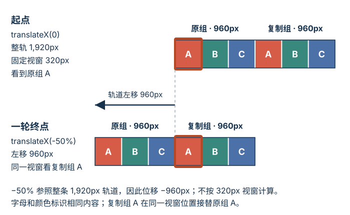

每轮结束时，位移从 `-960px` 跳回 `0`，视窗里的复制组 A 换成原组 A。两组内容、顺序和尺寸完全相同，跳回前后画面一致，用户看不出接点；这就是要复制一整组的原因。视窗宽度或每组张数改变时，要同步调整轨道宽度和每张的比例。

代码里另外三条声明各管一件事：

- **`min-inline-size: 0`**：每张图的宽度应由 `flex-basis: calc(100% / 6)` 决定，但 flex 项目默认的自动最小尺寸不让图片窄于内容宽度（机制见[Flex 和 Grid 怎样把空间分给每个项目？](#13.%20Flex%20%E5%92%8C%20Grid%20%E6%80%8E%E6%A0%B7%E6%8A%8A%E7%A9%BA%E9%97%B4%E5%88%86%E7%BB%99%E6%AF%8F%E4%B8%AA%E9%A1%B9%E7%9B%AE%EF%BC%9F)）。原图自然宽 `640px` 时，不加这条，Chrome 中每张仍宽 `640px`，移动半条轨道后第四张落在 `x = 960px`，接不上；加上后每张约 `320px`，第四张落在 `x ≈ 0`，实测子像素误差不到 `0.05px`。这是理想 CSS px 下的演算，不能保证所有图片、浏览器和屏幕上都没有接缝。
- **`align-items: flex-start`**：避免 flex 默认的交叉轴拉伸把每张图拉成同一高度。
- **`height: auto`**：按图片比例确定高度。自然尺寸 `640×320`、`640×640`、`640×480` 的三张图缩到 `320px` 宽后，分别高 `160px`、`320px`、`240px`。高度不同不影响横向组宽和移动距离。

### 自动运动要能停下来

条带是自动开始、无限循环的运动，这带来三项要求。

**第一，它不能冒充内容轮播。** 上面的条带没有控制按钮、键盘操作或轮播语义，也不能承载唯一的信息。真正的内容轮播要提供前后切换；若自动播放，还要提供停止/开始按钮，键盘焦点进入时停止、只在用户明确要求时恢复，鼠标悬停时也停止。

**第二，自动运动要能暂停。** `aria-hidden="true"` 只把条带从无障碍树中隐藏，不会停下屏幕上的运动。自动移动的内容与页面其他内容并列显示且持续超过 5 秒时，WCAG 2.2 成功准则 2.2.2 要求提供暂停、停止或隐藏机制，除非这种运动对活动不可或缺。

**第三，尊重减少动态效果偏好。** 用户在系统中选择减少动态效果后，媒体查询 `prefers-reduced-motion` 匹配 `reduce`，表示希望减少可能引起不适或分心的非必要运动：

~~~css
@media (prefers-reduced-motion: reduce) {
  .report-panel.is-entering,
  .strip-track { animation: none; }

  button[data-sort],
  .report-card,
  .flip-demo__inner { transition: none; }
}
~~~

这条规则生效后，面板直接显示基础样式，条带停在第一组的起点；按钮颜色和翻牌状态照样改变，只是没有中间过程。之所以能这样一刀切，是因为本章所有状态都由 class 和属性表达，不依赖动画播放完毕。

### 合成与 will-change：属性名保证不了性能

动画的每一帧都可能触发样式计算、布局、绘制、栅格化或合成，具体做哪些取决于动画的属性、元素内容和浏览器实现（管线各阶段见[DOM 改动后浏览器重做了什么，读几何值为什么会卡住脚本？](#5.%20DOM%20%E6%94%B9%E5%8A%A8%E5%90%8E%E6%B5%8F%E8%A7%88%E5%99%A8%E9%87%8D%E5%81%9A%E4%BA%86%E4%BB%80%E4%B9%88%EF%BC%8C%E8%AF%BB%E5%87%A0%E4%BD%95%E5%80%BC%E4%B8%BA%E4%BB%80%E4%B9%88%E4%BC%9A%E5%8D%A1%E4%BD%8F%E8%84%9A%E6%9C%AC%EF%BC%9F)）。`transform` 和 `opacity` 通常不影响周围布局，满足浏览器的合成条件时可以跳过逐帧的布局和绘制；但只凭属性名不能断定动画一定在合成线程或 GPU 上执行，要在目标页面上测量。

`will-change` 只是预告某个属性将要变化，不是强制创建 GPU 图层的开关。浏览器可以据此提前优化，做法各不相同。如果被提示的属性本身会建立堆叠上下文或包含块，提示会提前产生这些效果，还可能占用额外内存。只在测量确认有收益时，对少量元素短时间使用，变化结束后移除。`translateZ(0)` 同理，也不是通用的加速开关。

> [!info] 在 Chrome DevTools 里检查未合成的动画（核对于 2026-11-12）
> Performance 面板的 Animations 轨道会标出未合成的动画，选中后可以查看未合成的原因。

### 主线二到此：结构、外观和可用性都由状态驱动

主线二从文档结构、表单、层叠和布局一路走到隐藏与动画，得到的共同约定是：页面的状态写在 HTML 属性和 class 上，CSS 根据这些状态决定外观和运动，可访问性跟着属性一起成立。谁来在点击、请求返回时改这些属性？这是 JavaScript 的工作。主线三从[JavaScript 的值有哪些类型，“相等”又有几种？](#18.%20JavaScript%20%E7%9A%84%E5%80%BC%E6%9C%89%E5%93%AA%E4%BA%9B%E7%B1%BB%E5%9E%8B%EF%BC%8C%E2%80%9C%E7%9B%B8%E7%AD%89%E2%80%9D%E5%8F%88%E6%9C%89%E5%87%A0%E7%A7%8D%EF%BC%9F)开始，讲清 JavaScript 与 TypeScript 的值、对象、函数和异步按什么规则工作。

> [!info]- 来源
> - 隐式过渡的触发、过渡声明取自变化后的样式、中断时从当前值出发、返回过渡的缩短因子（按缓动输出计算）：W3C CSS Transitions Level 1，Working Draft（2026-01-08），§§2–4、§3.1，[CSS Transitions](https://www.w3.org/TR/css-transitions-1/)，检查于 2026-11-12。
> - 关键帧、动画子属性、移除动画、暂停与填充模式：W3C CSS Animations Level 1，Working Draft（2023-03-02），§§1–2、3.4–3.9、4，[CSS Animations](https://www.w3.org/TR/css-animations-1/)，检查于 2026-11-12。
> - `ease-out` 的控制点、cubic Bézier 的进度映射（“半程移出”算例的依据）：W3C CSS Easing Functions Level 2，First Public Working Draft（2024-08-29），§2.3，[CSS Easing](https://www.w3.org/TR/css-easing-2/)，检查于 2026-11-12。
> - `opacity` 越界值限制在 `[0,1]`：W3C CSS Color Module Level 4，Candidate Recommendation Draft（2026-11-03），§3.3，[CSS Color](https://www.w3.org/TR/css-color-4/)，检查于 2026-11-12。
> - flex 项目默认交叉轴拉伸与 `align-items: flex-start`：W3C CSS Flexible Box Layout Module Level 1，Candidate Recommendation Draft（2025-10-14），§8.3；自动最小尺寸：§4.5，[CSS Flexbox](https://www.w3.org/TR/css-flexbox-1/#align-items-property)，检查于 2026-11-12。
> - `min-inline-size` 在水平书写模式下对应宽度：W3C CSS Logical Properties and Values Level 1，Working Draft（2025-12-04），§4.1，[CSS Logical Properties](https://www.w3.org/TR/css-logical-1/)，检查于 2026-11-12。
> - 变换函数顺序、变换原点、平移百分比相对 reference box、可滚动溢出、包含块与堆叠上下文：W3C CSS Transforms Level 1，Candidate Recommendation（2019-02-14），§§3–6、9.1，[CSS Transforms](https://www.w3.org/TR/css-transforms-1/)，检查于 2026-11-12。
> - 三维变换、`preserve-3d`、透视与背面可见性：W3C CSS Transforms Level 2，Working Draft（2021-11-09），§§4.1、7、8、10，[backface-visibility](https://www.w3.org/TR/css-transforms-2/#backface-visibility-property)，检查于 2026-11-12。
> - 轮播控制、焦点进入时停止、悬停停止：W3C WAI [ARIA APG Carousel Pattern](https://www.w3.org/WAI/ARIA/apg/patterns/carousel/)，About This Pattern，检查于 2026-11-12。
> - 自动移动内容超过 5 秒的暂停、停止或隐藏机制：W3C WCAG 2.2 Recommendation（2024-12-12），成功准则 2.2.2，[Pause, Stop, Hide](https://www.w3.org/TR/WCAG22/#pause-stop-hide)，检查于 2026-11-12。
> - `aria-hidden` 只影响无障碍树：W3C WAI-ARIA 1.2 Recommendation（2023-06-06），§7.1，[Excluding Elements from the Accessibility Tree](https://www.w3.org/TR/wai-aria-1.2/#aria-hidden)，检查于 2026-11-12。
> - 减少非必要运动的用户偏好：W3C Media Queries Level 5，Working Draft（2026-02-19），§12.1，[prefers-reduced-motion](https://www.w3.org/TR/mediaqueries-5/#prefers-reduced-motion)，检查于 2026-11-12。
> - `will-change` 的实现差异、资源消耗与副作用：W3C CSS Will Change Level 1，Candidate Recommendation Draft（2022-05-05），§§1.2、2，[CSS Will Change](https://www.w3.org/TR/css-will-change-1/)，检查于 2026-11-12。
> - 检查未合成动画及原因：Chrome DevTools [Performance features reference](https://developer.chrome.com/docs/devtools/performance/reference)，View animations 一节，检查于 2026-11-12。
## 18. JavaScript 的值有哪些类型，“相等”又有几种？

本章回答两件事：JavaScript 的值分成哪些类型、在条件和算术里怎样转换；以及代码说“两个值相等”时，实际用的是哪一种相等规则。读者手上是报表页请求代码拿到的两份行数据，读完应能判断金额 `0` 算不算“没有数据”、两条记录算不算“同一条”，并知道结构比较为什么必须先写契约。

### 案例：同一行数据到了两次

沿用主线一的报表页 `/reports/42?sort=recent#summary`。主线一只用到 May 行 `r-104` 的 `id`、`date` 和 `label`；请求代码拿到的完整行数据还有金额 `amount` 和负责人 `owner`（Ada，用户 ID `u-17`）。第一次响应里金额是 `0`。用户点了重试，第二次响应里同一行的金额变成 `120`。代码把两份结果都留着：

~~~javascript
const owner = { id: "u-17", name: "Ada" };
const first = { id: "r-104", amount: 0, owner };
const retry = {
  id: "r-104",
  amount: 120,
  owner: { id: "u-17", name: "Ada" }, // 第二次响应解析出的新对象
};
~~~

接下来要回答三个问题：`first.amount` 为 `0` 是不是“缺数据”；`first` 和 `retry` 是不是同一条记录；两个 `owner` 是不是同一个人。答案取决于用哪种转换、哪种相等。主线三后面几章继续用这组数据。

### 七种原始类型，其余都是对象

JavaScript 有七种 primitive type（原始类型），其余的值都是 object（对象），函数也是对象。

| 类型 | 本章用到的行为 |
|---|---|
| `undefined` | 读取不存在的属性或越界索引的常见结果；也可以显式存进属性 |
| `null` | 显式表示“当前没有对象”；历史原因使 `typeof null` 为 `"object"` |
| `Boolean` | `true` 与 `false` |
| `Number` | IEEE 754 `binary64`（64 位二进制浮点）；包含 `NaN`、正负无穷和 `+0`/`-0` |
| `BigInt` | 任意精度整数；不能直接与 `Number` 混合做算术 |
| `String` | 不可变的 UTF-16 code unit（码元）序列 |
| `Symbol` | 每次 `Symbol()` 都产生一个新的唯一值；`Symbol.for(key)` 从全局注册表取回同一个值；可作属性键 |

对象和原始值的关键区别在“身份”。把对象赋给另一个变量，复制的是指向它的引用，两个变量从此指向同一个对象；修改其中一个看到的属性，另一个也看得到。常说的 reference type（引用类型）只是这条语义的简称：值在内存里放在栈上还是堆上，由引擎决定，语言并不规定。

案例里，`first.owner` 和变量 `owner` 是同一个对象；`retry.owner` 是第二次响应解析出来的另一个对象，只是字段内容相同。

### 真值转换和数值转换是两套规则

条件判断只问一个值算真还是算假，这叫真值转换，`Boolean(value)` 和 `!!value` 都执行它。假值只有 `false`、`0`、`-0`、`0n`、`""`、`null`、`undefined` 和 `NaN`；其他值都为真，包括空数组、空对象和字符串 `"false"`。

转成数字是另一套规则：空字符串和 `null` 变成 `0`，`undefined` 变成 `NaN`，带尾随字符的字符串整体变成 `NaN`。

~~~javascript
Boolean("false");  // true
Boolean([]);       // true
Boolean({});       // true

Number("");        // 0
Number(null);      // 0
Number(undefined); // NaN
Number("12px");    // NaN；parseInt("12px", 10) 才会读出 12

Number.isNaN("x"); // false：不做转换，只认真正的 NaN
isNaN("x");        // true：先把 "x" 转成数字 NaN
~~~

对象转布尔值一律为 `true`，唯一例外是浏览器的历史对象 `document.all`：标准附录为兼容旧网页，规定它转布尔值为 `false`、`typeof` 为 `"undefined"`、`document.all == null` 为 `true`。普通对象不受影响，业务代码不该依赖它。

逻辑运算符 `&&`、`||` 返回的是其中一个操作数，不一定是布尔值：`0 && "x"` 的结果是 `0`，`"" || "默认"` 的结果是 `"默认"`。React 里写 `{count && <List />}` 时页面会显示一个 `0`，原因就在这里，见[一份界面状态该由谁持有？](#39.%20%E4%B8%80%E4%BB%BD%E7%95%8C%E9%9D%A2%E7%8A%B6%E6%80%81%E8%AF%A5%E7%94%B1%E8%B0%81%E6%8C%81%E6%9C%89%EF%BC%9F)。

回到案例：`first.amount` 是 `0`，所以 `if (!first.amount)` 会把合法的零金额当成缺数据。要问“有没有值”，就直接比较 `first.amount === undefined`，或者用只认 `null`/`undefined` 的 `??`，见[读写一个属性时，JavaScript 沿什么规则查找、落在哪里？](#%E7%BC%BA%E5%A4%B1%E5%B1%9E%E6%80%A7%EF%BC%9A%E5%8F%AF%E9%80%89%E9%93%BE%E3%80%81%E7%A9%BA%E5%80%BC%E5%90%88%E5%B9%B6%E4%B8%8E%E8%A7%A3%E6%9E%84%E9%BB%98%E8%AE%A4%E5%80%BC)。

### == 会先转换，=== 不会

strict equality（严格相等，`===`）不做跨类型转换，类型不同直接为 `false`。loose equality（宽松相等，`==`）在类型不同时按一串规则转换后再比，结果常常出人意料：

~~~javascript
5 == "5";          // true：字符串转成数字
"" == 0;           // true
"0" == false;      // true：两边都转成数字 0
[] == false;       // true：[] 先转成 ""，再转成 0
null == undefined; // true：规范里的特例
null == 0;         // false：null 只与 undefined 宽松相等
~~~

所以默认用 `===`。`value == null` 是少数有意的用法：它恰好匹配 `null` 和 `undefined`，不匹配 `0`、`""` 或 `false`（`document.all` 这个历史例外除外）。

比较对象时，两个运算符都只看 identity（身份）：

~~~javascript
first.id === retry.id;       // true：业务字段相同
first === retry;             // false：两个对象
first.owner === retry.owner; // false：内容相同，身份不同
first.owner === owner;       // true：同一个对象
~~~

`id` 相同，说明两条记录描述同一个业务实体；但在语言层面它们是两个对象。“按 `id` 认定同一行”是应用定下的规则，语言不会替你推断。

### 三种相等规则：===、Object.is 与 SameValueZero

除了带转换的 `==`，语言里还有三种不做转换的相等规则。它们对对象都只看身份，差别只在 `NaN` 和带符号的零上：

| 规则 | `NaN` 与自身 | `+0` 与 `-0` | 对象 | 谁在用 |
|---|---|---|---|---|
| IsStrictlyEqual（严格相等） | 不等 | 相等 | 按身份 | `===`、`!==`；数组 `indexOf`、`lastIndexOf`；`switch` 的 `case` 匹配 |
| SameValue（同值） | 相等 | 不等 | 按身份 | `Object.is`；React 判断 state 是否变化、依赖是否变化 |
| SameValueZero（同值零） | 相等 | 相等 | 按身份 | `Map` 的键、`Set` 的成员、数组 `includes` |

~~~javascript
NaN === NaN;                      // false
Object.is(NaN, NaN);              // true
Object.is(+0, -0);                // false
+0 === -0;                        // true

[NaN].indexOf(NaN);               // -1：indexOf 用 ===
[NaN].includes(NaN);              // true：includes 用 SameValueZero
new Set([NaN, NaN, -0, +0]).size; // 2：一个 NaN，一个 0
~~~

记住两条就能推出大多数结果：`===` 是唯一认为 `NaN` 不等于自身的规则；`Object.is` 是唯一区分 `+0` 与 `-0` 的规则。用 `indexOf` 找 `NaN` 永远找不到，用 `Set` 去重会把 `-0` 和 `+0` 合成一个。

三种规则都不比较对象内容。React 用 `Object.is` 比较新旧 state，所以原地修改一个对象再把同一引用交给 setter，React 会认为没有变化；原地修改从哪里来，见[复制一个对象到底复制了什么？](#23.%20%E5%A4%8D%E5%88%B6%E4%B8%80%E4%B8%AA%E5%AF%B9%E8%B1%A1%E5%88%B0%E5%BA%95%E5%A4%8D%E5%88%B6%E4%BA%86%E4%BB%80%E4%B9%88%EF%BC%9F)；React 怎样据此决定是否重渲染，见[React 怎样把一次用户操作变成界面更新？](#37.%20React%20%E6%80%8E%E6%A0%B7%E6%8A%8A%E4%B8%80%E6%AC%A1%E7%94%A8%E6%88%B7%E6%93%8D%E4%BD%9C%E5%8F%98%E6%88%90%E7%95%8C%E9%9D%A2%E6%9B%B4%E6%96%B0%EF%BC%9F)。`Map`、`Set` 怎样用 SameValueZero 去重和建索引，见[数组、Map、Set 和普通对象怎样选，空位和去重有哪些坑？](#22.%20%E6%95%B0%E7%BB%84%E3%80%81Map%E3%80%81Set%20%E5%92%8C%E6%99%AE%E9%80%9A%E5%AF%B9%E8%B1%A1%E6%80%8E%E6%A0%B7%E9%80%89%EF%BC%8C%E7%A9%BA%E4%BD%8D%E5%92%8C%E5%8E%BB%E9%87%8D%E6%9C%89%E5%93%AA%E4%BA%9B%E5%9D%91%EF%BC%9F)。

### 浮点数比较要先定容差

`Number` 是二进制浮点数，`0.1`、`0.2` 这类十进制小数大多不能用有限位二进制精确表示，相加后会带上舍入误差：

~~~javascript
0.1 + 0.2;                           // 0.30000000000000004
0.1 + 0.2 === 0.3;                   // false
Math.abs((0.1 + 0.2) - 0.3);         // 5.551115123125783e-17
Math.abs((0.1 + 0.2) - 0.3) < 1e-12; // true：对这个量级的数成立
~~~

容差要按领域定：数值量级、业务能接受的误差和舍入规则共同决定它，没有对所有场景都成立的固定 epsilon（误差容限）。`Number.EPSILON`（约 `2.22e-16`）只是 `1` 附近相邻两个浮点数的间距，数值变大后间距随之变大，它不是通用容差。

金额这类需要精确相等的量，可在币种规则允许时换成最小单位的整数：`0.10 + 0.20` 元改记为 `10 + 20` 分，得到精确的 `30`。整数在 `Number.MAX_SAFE_INTEGER`（2⁵³ − 1 = 9007199254740991）以内才能精确表示，超出时用 `BigInt` 或明确舍入规则的十进制库。

### 变量保存引用：赋值顺序与传参

对象按引用共享，带来两个常见的推理题。

第一个是连续赋值。属性赋值先确定左边要写哪个对象的哪个属性，再求右边的值；右边即使让变量改指别处，已经确定的写入位置也不变：

~~~javascript
let a = { n: 1 };
const b = a;
a.x = a = { n: 2 };

a.x; // undefined
b.x; // { n: 2 }：写入落在先前记下的旧对象上
~~~

设旧对象为 A、新对象为 B。求值分三步：先记下写入位置 `A.x`；再执行右边的 `a = { n: 2 }`，让 `a` 改指 B；最后把 B 写进记下的 `A.x`。


*图：左侧求值时固定写入位置；表达式结束后，`a` 指向新对象 B，`b` 仍指向旧对象 A，且 `A.x` 指向 B。*

第二个是函数传参。JavaScript 一律按值传递：形参拿到实参值的副本。实参是原始值时，修改形参不影响调用方；实参是对象时，副本是同一个引用，所以改属性对调用方可见，但给形参重新赋一个对象，调用方的变量不会改指。

~~~javascript
function update(count, profile) {
  count += 1;
  profile.name = "Grace";            // 改的是调用方也指向的那个对象
  profile = { name: "Replacement" }; // 只让形参改指，调用方不受影响
}

let count = 1;
const profile = { name: "Ada" };
update(count, profile);
count;        // 1
profile.name; // "Grace"
~~~

这也是浅复制会共享嵌套对象的原因：新数组或新记录里装的仍是原来那些对象的引用，见[复制一个对象到底复制了什么？](#23.%20%E5%A4%8D%E5%88%B6%E4%B8%80%E4%B8%AA%E5%AF%B9%E8%B1%A1%E5%88%B0%E5%BA%95%E5%A4%8D%E5%88%B6%E4%BA%86%E4%BB%80%E4%B9%88%EF%BC%9F)。

### 类型检查各回答什么

几种常见检查各自只回答一个窄问题：

- `typeof` 适合区分原始值和函数：`typeof 1n` 为 `"bigint"`，`typeof (() => {})` 为 `"function"`；但 `typeof null` 是 `"object"`，数组也是 `"object"`。
- `Array.isArray(value)` 检查是不是数组，也能认出来自另一个 realm（执行环境，例如 iframe 或另一个窗口各有一套全局对象）的数组。
- `value instanceof C` 检查 `C.prototype` 是否在 `value` 的原型链上。不同 realm 的 `Array` 各有自己的 `prototype`，所以 iframe 里创建的数组 `instanceof Array` 为 `false`；`Symbol.hasInstance` 还能改写这项检查。
- `Object.prototype.toString.call(value)` 给出 `"[object Array]"` 这类内建标签，但 `Symbol.toStringTag` 可以伪造它：

~~~javascript
const misleading = { [Symbol.toStringTag]: "Array" };
Object.prototype.toString.call(misleading); // "[object Array]"，但它不是数组
~~~

这些检查都证明不了“这个值具有程序需要的形状”。处理响应、存储这类外部数据时，应按需要的形状逐项检查，见[TypeScript 能保证什么，外部数据又该怎样验证？](#34.%20TypeScript%20%E8%83%BD%E4%BF%9D%E8%AF%81%E4%BB%80%E4%B9%88%EF%BC%8C%E5%A4%96%E9%83%A8%E6%95%B0%E6%8D%AE%E5%8F%88%E8%AF%A5%E6%80%8E%E6%A0%B7%E9%AA%8C%E8%AF%81%EF%BC%9F)。

### 结构相等：先写契约再比较

`===` 对对象只看身份，可业务常要问另一件事：两份数据的内容是否一样。比如判断用户改过的筛选条件和初始值是否相同。语言没有内建的统一答案，因为“内容一样”要先回答很多问题：键的顺序算不算、`{ amount: undefined }` 和 `{}` 算不算相同、`NaN` 等不等于自身、`Date` 怎么比。所以先写比较契约，再写代码。

下面的教学实现针对接口返回值、筛选条件这类纯数据，契约是：

- **整体形状**：有限、无环的对象图；不同属性可以共享同一个子对象。代码不检测循环，由调用方保证无环。
- **容器**：当前 realm 的普通数组、普通对象或 null 原型对象。只比较自有、可枚举、字符串键的数据属性；对象键的顺序不重要，数组的索引顺序重要；键缺失和“键存在但值为 `undefined`”算不同。数组的 `length` 是不可枚举的自有属性，单独比较。
- **叶子**：`null`、`undefined`、布尔值、字符串或数字，用 `Object.is` 比较。
- **契约之外**：Symbol 键或其他不可枚举属性、访问器、Proxy、函数、BigInt 和 Symbol 值，以及 `Date`、`Map` 等带内部状态的对象。

递归分四步：先区分叶子与容器，叶子直接用 `Object.is`；再确认两边同为数组或同为对象；然后对象比较原型类别、数组比较 `length`；最后比较可枚举自有键的集合，并对每个键的值递归。

> [!example]- 契约内的 deepEqual 教学实现
>
> ~~~javascript
> function isPlainObject(value) {
>   const prototype = Object.getPrototypeOf(value);
>   return prototype === Object.prototype || prototype === null;
> }
>
> function deepEqual(left, right) {
>   const leftIsObject = left !== null && typeof left === "object";
>   const rightIsObject = right !== null && typeof right === "object";
>   if (!leftIsObject || !rightIsObject) {
>     return !leftIsObject && !rightIsObject && Object.is(left, right);
>   }
>
>   const leftIsArray = Array.isArray(left);
>   const rightIsArray = Array.isArray(right);
>   if (leftIsArray !== rightIsArray) return false;
>
>   if (leftIsArray) {
>     if (Object.getPrototypeOf(left) !== Array.prototype ||
>         Object.getPrototypeOf(right) !== Array.prototype) {
>       throw new TypeError("只支持当前 realm 的普通数组");
>     }
>     if (left.length !== right.length) return false;
>   } else {
>     if (!isPlainObject(left) || !isPlainObject(right)) {
>       throw new TypeError("只支持普通对象或 null 原型对象");
>     }
>     if (Object.getPrototypeOf(left) !== Object.getPrototypeOf(right)) {
>       return false;
>     }
>   }
>
>   if (Object.is(left, right)) return true;
>
>   const leftKeys = Object.keys(left);
>   const rightKeys = Object.keys(right);
>   if (leftKeys.length !== rightKeys.length) return false;
>
>   for (const key of leftKeys) {
>     if (!Object.hasOwn(right, key)) return false;
>
>     const leftDescriptor = Object.getOwnPropertyDescriptor(left, key);
>     const rightDescriptor = Object.getOwnPropertyDescriptor(right, key);
>     if (!Object.hasOwn(leftDescriptor, "value") ||
>         !Object.hasOwn(rightDescriptor, "value")) {
>       throw new TypeError("只支持数据属性");
>     }
>     if (!deepEqual(leftDescriptor.value, rightDescriptor.value)) {
>       return false;
>     }
>   }
>   return true;
> }
> ~~~

实现里有几处值得注意。它通过属性描述符读值，不会调用输入里的 getter，遇到可枚举的访问器就抛 `TypeError`。数组的空位不出现在 `Object.keys` 里，所以“某个索引是否存在”会影响结果。两边是同一个引用时，通过类别检查后直接由 `Object.is` 判为相等，不再看内部内容，这也是它不能充当输入校验器的原因之一。

| 输入 | 差异 | 结果 |
| --- | --- | --- |
| `{ a: 1, b: 2 }` 与 `{ b: 2, a: 1 }` | 只有键的插入顺序不同 | `true` |
| `{ amount: undefined }` 与 `{}` | 一边缺少自有键 | `false` |
| `[]` 与 `[,]` | `length` 分别为 0 和 1 | `false` |
| `[,]` 与 `[undefined]` | 前者索引 0 是空位，后者有自有元素 | `false` |
| `[1, 2]` 与 `[2, 1]` | 索引顺序不同 | `false` |
| `{ value: NaN }` 与 `{ value: NaN }` | `Object.is(NaN, NaN)` | `true` |
| `{ value: -0 }` 与 `{ value: +0 }` | `Object.is(-0, +0)` | `false` |
| `{}` 与 `Object.create(null)` | 自有键相同，原型类别不同 | `false` |
| 左边两个属性共享同一子对象，右边各存一份等值副本 | 只比值，不比共享关系 | `true` |
| 两个不同的 `new Date(0)` | `Date` 在契约之外 | 抛 `TypeError` |

回到案例，三个问题都有了答案：

~~~javascript
deepEqual(first.owner, retry.owner); // true：两个对象，内容相同
deepEqual(first, retry);             // false：amount 一个是 0，一个是 120
first.id === retry.id;               // true：按业务规则是同一行
~~~

所以“同一行”和“内容相同”是两个问题：按 `id` 认定同一行，再按契约比较内容，才能知道重试带来了哪些变化。

这份契约依赖调用方提供可信的纯数据，例如刚由 `JSON.parse` 得到的值。原型检查证明不了对象是纯数据：把一个 `Date` 的原型改成 `Object.prototype`，它就能混过检查。递归深度还受调用栈限制，过深的对象图会栈溢出。

有人用 `JSON.stringify` 的结果字符串代替结构比较，但两者不等价：键的插入顺序会改变输出，值为 `undefined` 的属性被省略，`-0` 写成 `0`，`NaN` 写成 `null`。

~~~javascript
JSON.stringify({ a: 1, b: 2 }) === JSON.stringify({ b: 2, a: 1 }); // false
JSON.stringify({ amount: undefined }) === JSON.stringify({});    // true
JSON.stringify({ amount: -0 }) === JSON.stringify({ amount: 0 }); // true
~~~

### 从值到属性

本章给案例定下了几条判断：金额 `0` 是合法值，判断缺失要比较 `undefined` 或用 `??`；`first` 和 `retry` 是两个对象，“同一行”由 `id` 这条业务规则决定；`Object.is`、`===`、SameValueZero 只在 `NaN` 和 `±0` 上有分歧，对象一律比身份；内容是否相同需要一份写明范围的比较契约。

这些判断都要先读出 `first.amount`、`first.owner` 这样的属性。下一章接着问：读写一个属性时，JavaScript 到哪些对象上去找，写入又落在哪个对象上？见[读写一个属性时，JavaScript 沿什么规则查找、落在哪里？](#19.%20%E8%AF%BB%E5%86%99%E4%B8%80%E4%B8%AA%E5%B1%9E%E6%80%A7%E6%97%B6%EF%BC%8CJavaScript%20%E6%B2%BF%E4%BB%80%E4%B9%88%E8%A7%84%E5%88%99%E6%9F%A5%E6%89%BE%E3%80%81%E8%90%BD%E5%9C%A8%E5%93%AA%E9%87%8C%EF%BC%9F)。

> [!info]- 来源
> - 七种原始类型、`Number` 的 binary64 表示、对象与引用语义（“七种原始类型，其余都是对象”“浮点数比较要先定容差”）：[ECMAScript 2026 §6.1 ECMAScript Language Types](https://tc39.es/ecma262/2026/multipage/ecmascript-data-types-and-values.html)；安全整数上限：[§21.1.2.6 Number.MAX_SAFE_INTEGER](https://tc39.es/ecma262/2026/multipage/numbers-and-dates.html#sec-number.max_safe_integer)、[§21.1.2.1 Number.EPSILON](https://tc39.es/ecma262/2026/multipage/numbers-and-dates.html#sec-number.epsilon)。
> - 真值转换与数值转换（“真值转换和数值转换是两套规则”）：[ECMAScript 2026 §7.1.2 ToBoolean、§7.1.4 ToNumber](https://tc39.es/ecma262/2026/multipage/abstract-operations.html)；`Number.isNaN` 与全局 `isNaN`：[§21.1.2.4](https://tc39.es/ecma262/2026/multipage/numbers-and-dates.html#sec-number.isnan)、[§19.2.3 isNaN](https://tc39.es/ecma262/2026/multipage/global-object.html#sec-isnan-number)；`&&`、`||` 返回操作数：[§13.13 Binary Logical Operators](https://tc39.es/ecma262/2026/multipage/ecmascript-language-expressions.html#sec-binary-logical-operators)。
> - `document.all` 的历史例外：[ECMAScript 2026 Annex B IsHTMLDDA internal slot](https://tc39.es/ecma262/2026/multipage/additional-ecmascript-features-for-web-browsers.html#sec-IsHTMLDDA-internal-slot)。
> - 宽松相等、严格相等、SameValue、SameValueZero（“== 会先转换，=== 不会”“三种相等规则”）：[ECMAScript 2026 §7.2.9 SameValue、§7.2.10 SameValueZero、§7.2.13 IsLooselyEqual、§7.2.14 IsStrictlyEqual](https://tc39.es/ecma262/2026/multipage/abstract-operations.html)，访问于 2026-11-12；`indexOf` 与 `includes` 的比较规则：[§23.1.3.17 Array.prototype.indexOf](https://tc39.es/ecma262/2026/multipage/indexed-collections.html#sec-array.prototype.indexof)、[§23.1.3.16 Array.prototype.includes](https://tc39.es/ecma262/2026/multipage/indexed-collections.html#sec-array.prototype.includes)；`switch` 匹配：[CaseClauseIsSelected](https://tc39.es/ecma262/2026/multipage/ecmascript-language-statements-and-declarations.html#sec-runtime-semantics-caseclauseisselected)；`Map`/`Set` 使用 SameValueZero：[§24.1–24.2 Keyed Collections](https://tc39.es/ecma262/2026/multipage/keyed-collections.html)。
> - React 用 `Object.is` 判断新 state 是否与当前 state 相同并跳过重渲染（“三种相等规则”表中“谁在用”一列）：[React 文档 useState — Caveats](https://react.dev/reference/react/useState)；依赖逐项用 `Object.is` 比较：[React 文档 useEffect — Parameters](https://react.dev/reference/react/useEffect)，访问于 2026-11-26；React 条件渲染中 `0` 会被渲染（“真值转换”一节）：[React 文档 Conditional Rendering](https://react.dev/learn/conditional-rendering)，访问于 2026-11-06。
> - 赋值先求左侧引用、再求右侧值并写回（“变量保存引用”）：[ECMAScript 2026 §13.15.2 Assignment Operators — Runtime Semantics](https://tc39.es/ecma262/2026/multipage/ecmascript-language-expressions.html#sec-assignment-operators-runtime-semantics-evaluation)，访问于 2026-11-12。
> - `instanceof` 与 `Object.prototype.toString` 的检查行为（“类型检查各回答什么”）：[ECMAScript 2026 §13.10.2 InstanceofOperator](https://tc39.es/ecma262/2026/multipage/ecmascript-language-expressions.html#sec-instanceofoperator)、[§20.1.3.6 Object.prototype.toString](https://tc39.es/ecma262/2026/multipage/fundamental-objects.html#sec-object.prototype.tostring)；`Array.isArray`：[§23.1.2.3](https://tc39.es/ecma262/2026/multipage/indexed-collections.html#sec-array.isarray)。
> - 教学 `deepEqual` 用到的属性描述符、数组 `length` 与自有性检查（“结构相等”）：[ECMAScript 2026 OrdinaryGetOwnProperty](https://tc39.es/ecma262/2026/multipage/ordinary-and-exotic-objects-behaviours.html#sec-ordinarygetownproperty)、[Array Exotic Objects](https://tc39.es/ecma262/2026/multipage/ordinary-and-exotic-objects-behaviours.html#sec-array-exotic-objects)、[Object.hasOwn](https://tc39.es/ecma262/2026/multipage/fundamental-objects.html#sec-object.hasown)、[数组实例的 length](https://tc39.es/ecma262/2026/multipage/indexed-collections.html#sec-properties-of-array-instances-length)，访问于 2026-11-12。比较契约、不支持的类型和“输入必须无环”由本章示例定义。
> - `JSON.stringify` 对 `undefined` 属性、`-0`、`NaN` 与键顺序的处理（“结构相等”末段）：[ECMAScript 2026 §25.5.4.2 SerializeJSONProperty、§25.5.4.5 SerializeJSONObject](https://tc39.es/ecma262/2026/multipage/structured-data.html#sec-json.stringify)、[§10.1.11.1 OrdinaryOwnPropertyKeys](https://tc39.es/ecma262/2026/multipage/ordinary-and-exotic-objects-behaviours.html#sec-ordinaryownpropertykeys)，访问于 2026-11-12。
> - 本章示例在 Node.js v26.13.1 / V8 14.6.202.34-node.40 复跑，2026-11-26；原稿在 Node.js v26.13.0 下执行于 2026-11-12，`deepEqual` 边界用例原始复演日期 2026-11-09。
## 19. 读写一个属性时，JavaScript 沿什么规则查找、落在哪里？

本章回答：写下 `object.key` 或 `object.key = value` 时，键先被转成什么，读取沿哪些对象查找，找到后是直接取值还是执行代码，赋值又落在哪个对象上。读者手上有上一章的行数据 `first`、`retry`，以及一个格式化行标题的报表服务；读完应能说清共享方法为什么放在原型上、属性缺失时默认值怎样生效，以及批量复制属性时哪些会被带走。

### 案例：行数据与报表服务

沿用主线一的报表页，并接着用[上一章](#18.%20JavaScript%20%E7%9A%84%E5%80%BC%E6%9C%89%E5%93%AA%E4%BA%9B%E7%B1%BB%E5%9E%8B%EF%BC%8C%E2%80%9C%E7%9B%B8%E7%AD%89%E2%80%9D%E5%8F%88%E6%9C%89%E5%87%A0%E7%A7%8D%EF%BC%9F)的两份 `r-104` 行数据。为了观察“读不到”的情况，本章把它们按位置放进 `rows`，中间故意留一个空位（索引 1 上没有元素，空位的完整规则在下一章）：

~~~javascript
const owner = { id: "u-17", name: "Ada" };
const first = { id: "r-104", amount: 0, owner };
const retry = { id: "r-104", amount: 120, owner: { id: "u-17", name: "Ada" } };
const rows = [first, , retry];
const report = { profile: null, rows };
~~~

页面还用一个报表服务 `ReportService` 生成行标题。每个服务实例有自己的区域前缀，所有实例共用一个格式化方法。读 `service.prefix` 在实例自身就能找到；读 `service.format` 却要到别的对象上找。本章从键开始，沿着这两次读取走一遍。

### 属性键只有字符串和 Symbol

property key（属性键）只能是字符串或 `Symbol`。点号写法 `object.key` 用字符串 `"key"`；方括号写法 `object[expr]` 先求出 `expr`，再用规范操作 `ToPropertyKey` 把它转成键，分两步：

1. 以 string hint（字符串提示）调用 `ToPrimitive`，把值转成原始值。对象若定义了可调用的 `Symbol.toPrimitive`，就以 `"string"` 为参数调用它，返回对象则抛 `TypeError`；若该属性是 `null`/`undefined` 以外的不可调用值，也抛 `TypeError`。没有定义时依次尝试 `toString`、`valueOf`，取第一个返回的原始值；都不返回原始值则抛 `TypeError`。
2. 得到 `Symbol` 就原样作为键，其他原始值转成字符串。

所以“对象作键时调用 `toString`”只是默认情况，钩子可以改变结果。

| 键表达式 | `ToPrimitive` 的结果 | 最终属性键 |
|---|---|---|
| `123` | 数值 `123` | 字符串 `"123"` |
| `accountKey`（钩子返回 `"account"`） | 字符串 `"account"` | 字符串 `"account"` |
| `symbolKey`（钩子返回一个 Symbol） | `Symbol("account")` | 同一个 Symbol |
| `first`、`retry` | 都是继承来的 `toString` 给出的 `"[object Object]"` | 同一个字符串键，后写覆盖先写 |
| `Object.create(null)` | 没有 `toString`、`valueOf` 可用 | 抛 `TypeError` |

~~~javascript
const dictionary = {};
dictionary[123] = "number key";
dictionary["123"]; // "number key"

const accountKey = {
  [Symbol.toPrimitive](hint) {
    console.log(hint); // "string"
    return "account";
  },
};
dictionary[accountKey] = "Ada";
dictionary.account; // "Ada"

const symbol = Symbol("account");
const symbolKey = {
  [Symbol.toPrimitive](hint) {
    return symbol;
  },
};
dictionary[symbolKey] = "symbol key";
dictionary[symbol]; // "symbol key"：Symbol 被保留为键

dictionary[first] = "first object";
dictionary[retry] = "retry object";
dictionary["[object Object]"]; // "retry object"：两条记录撞在同一个键上
~~~

最后两行是用普通对象按记录建索引时的典型错误。键要保持对象身份、要区分数字 `7` 和字符串 `"7"`，或者需要任意类型的键时，应改用 `Map`，见[数组、Map、Set 和普通对象怎样选，空位和去重有哪些坑？](#22.%20%E6%95%B0%E7%BB%84%E3%80%81Map%E3%80%81Set%20%E5%92%8C%E6%99%AE%E9%80%9A%E5%AF%B9%E8%B1%A1%E6%80%8E%E6%A0%B7%E9%80%89%EF%BC%8C%E7%A9%BA%E4%BD%8D%E5%92%8C%E5%8E%BB%E9%87%8D%E6%9C%89%E5%93%AA%E4%BA%9B%E5%9D%91%EF%BC%9F)。

### 读取：先查自有属性，再沿原型链

每个对象都有一个内部链接 `[[Prototype]]`，指向它的原型对象（或 `null`）。一串这样的链接组成 prototype chain（原型链）。读取 `object.key` 时：

1. 先在 `object` 自身找这个键的 property descriptor（属性描述符）。
2. 没有找到，就沿 `[[Prototype]]` 到下一个对象继续找，直到命中或到达 `null`。
3. 命中 data descriptor（数据描述符）时返回它的 `value`，值也可以是函数；命中 accessor descriptor（访问器描述符）时，调用它的 getter（读取器），没有 getter 就得到 `undefined`。
4. 到达 `null` 仍未找到，结果是 `undefined`。

继承不是拷贝：对象只保存自己的属性，继承来的成员每次读取都要重新查找。

~~~javascript
const base = { kind: "report" };
const record = Object.create(base); // record.[[Prototype]] 是 base
record.title = "May report";
const marker = Symbol("reviewed");
record[marker] = true;

Object.hasOwn(record, "title");          // true：自有属性
Object.hasOwn(record, "kind");           // false：kind 在 base 上
"kind" in record;                        // true：in 会沿原型链查
record.kind;                             // "report"
record.missing;                          // undefined：查到链末端也没有
Object.hasOwn(record, marker);           // true：Symbol 也是键
Object.getPrototypeOf(record) === base;  // true
~~~

`Object.hasOwn(object, key)` 只问键是否在对象自身；`key in object` 还会报告继承属性。属性的值本身也可以是 `undefined`，所以判断“有没有这个属性”不能只看 `object[key] === undefined`。读写原型用 `Object.getPrototypeOf` 和 `Object.setPrototypeOf`；`__proto__` 访问器是规范标为遗留的可选特性。

### 访问器以最初的接收者为 this

getter 定义在原型上时，调用它的 `this` 仍是最初被读取的那个对象（接收者），而不是原型。setter（设置器）同理。所以原型上的访问器能读写每个实例自己的状态：

~~~javascript
const profile = { _name: "John" };
Object.defineProperty(profile, "name", {
  get() { return this._name; },
  set(value) { this._name = value; },
  enumerable: true,
  configurable: true,
});

const guestProfile = Object.create(profile);

guestProfile.name;
// "John"：在 profile 上找到 getter，this 是 guestProfile；
// guestProfile 自身没有 _name，于是沿链读到 profile._name。

guestProfile.name = "Jo";
// 在 profile 上找到 setter，this 仍是 guestProfile；
// setter 里的 this._name = value 在 guestProfile 上新建 _name。

[profile.name, guestProfile.name,
  Object.hasOwn(guestProfile, "name"),
  Object.hasOwn(guestProfile, "_name")];
// ["John", "Jo", false, true]
~~~

setter 里那次 `this._name = value` 为什么新建了属性而没有改 `profile._name`，是下面“赋值的三种结局”里的第二种。访问器是会执行的代码：读取可能有副作用或抛错；只有 getter、没有 setter 的属性不能用普通赋值改变。`this` 怎样由调用形式决定，见[函数里的变量和 this 从哪来？](#24.%20%E5%87%BD%E6%95%B0%E9%87%8C%E7%9A%84%E5%8F%98%E9%87%8F%E5%92%8C%20this%20%E4%BB%8E%E5%93%AA%E6%9D%A5%EF%BC%9F)。

### 实例状态放实例，共享方法放原型

有了查找规则，就能回到报表服务。每个实例的前缀和处理器放在实例上；格式化函数只有一份，放在 `ReportService.prototype` 上。工厂函数 `makeReportHandler` 用 closure（闭包）给每个处理器保存标签和调用次数：

~~~javascript
function makeReportHandler(tag) {
  let calls = 0;
  return function onReport(row) {
    "use strict";
    calls += 1;
    return this.format(row, tag, calls);
  };
}

function ReportService(prefix) {
  this.prefix = prefix;                       // 每个实例各自持有
  this.onReport = makeReportHandler("daily"); // 每个实例各自一个闭包
}

ReportService.prototype.format = function (row, tag, sequence) {
  return this.prefix + "/" + tag + ": " + row.label + " #" + sequence;
};

const service = new ReportService("Sales");
service.onReport({ label: "May report" }); // "Sales/daily: May report #1"
service.onReport({ label: "May report" }); // "Sales/daily: May report #2"
Object.hasOwn(service, "format");                           // false
Object.hasOwn(ReportService.prototype, "format");           // true
Object.getPrototypeOf(service) === ReportService.prototype; // true
~~~

调用 `service.onReport(...)` 时，先在实例上找到自己的处理器；处理器读 `this.format`，在 `service` 上没找到，沿 `[[Prototype]]` 在 `ReportService.prototype` 上命中；共享函数再以 `service` 为 `this` 读 `this.prefix`，取到实例自己的 `"Sales"`。

这里同时出现了两种名字相近的“原型”：

- 对象的内部链接 `[[Prototype]]`：属性查找沿它进行。函数本身也是对象，它自己的链通常是 `Function.prototype` → `Object.prototype` → `null`。
- 函数对象上的普通属性 `prototype`：`new C()` 时，构造过程读取此刻 `C.prototype` 的值，把它设为新实例的 `[[Prototype]]`。实例查找成员时经过的是 `C.prototype`，不是函数 `C` 自己的链。


*图：第一行，读取 `service.format` 从实例查到 `ReportService.prototype` 并停止；一路未找到才在 `null` 处返回 `undefined`。第二行，函数对象 `ReportService` 沿自己的 `[[Prototype]]` 走到 `null`，`null` 是链末端而非对象。第三行虚线表示 `new` 读取 `ReportService.prototype` 的值并用作新实例的 `[[Prototype]]`；该值不是对象时，改用构造函数所在 realm 的 `Object.prototype`。*

两种关系分开后，修改原型的后果就能推出来：

- **在原型对象上增改方法**：所有能沿链查到它的实例立刻看到变化；实例若有同名自有属性，查找在实例处停下，原型方法被遮蔽。
- **把函数的 `prototype` 换成另一个对象**：已创建的实例仍连着旧原型，只有之后 `new` 出的实例用新对象。新对象若是字面量，还会丢掉原来的 `constructor` 属性。

~~~javascript
function Service() {}
const before = new Service();
const oldPrototype = Service.prototype;
Service.prototype = { format() { return "new"; } };
const after = new Service();

Object.getPrototypeOf(before) === oldPrototype;      // true：旧实例不迁移
Object.getPrototypeOf(after) === Service.prototype;  // true
before.constructor === Service;                      // true
after.constructor === Service;                       // false：新原型没有 constructor
~~~

`prototype` 的值只要是对象即可，函数也可以充当原型；若被设成 `null` 或其他原始值，`new` 改用构造函数所在 realm 的 `Object.prototype`：

~~~javascript
function Parent() {}
function Child() {}
Child.prototype = Parent;                      // 函数也是对象
Object.getPrototypeOf(new Child()) === Parent; // true

function FallbackDemo() {}
FallbackDemo.prototype = null;
Object.getPrototypeOf(new FallbackDemo()) === Object.prototype; // true
~~~

`class` 语法沿用同一套布局：公开实例字段在每个新实例上创建自有属性；公开的非静态方法和访问器放在类的 `prototype` 上；`static` 成员是构造函数自身的属性。

~~~javascript
class User {
  label = "member";
  get displayLabel() { return this.label; }
  greet() { return "Hi"; }
  static category = "account";
}

const user = new User();
Object.hasOwn(user, "label");                               // true：实例字段
Object.hasOwn(user, "greet");                               // false：方法在原型上
Object.hasOwn(Object.getPrototypeOf(user), "displayLabel"); // true
Object.hasOwn(User, "category");                            // true：静态属性
~~~

不是所有函数都有 `prototype` 属性。箭头函数和 `greet()` 这样的方法简写没有，也不能 `new`；生成器方法和异步生成器方法有 `prototype`，但同样不能 `new`。`new` 的完整步骤、构造函数显式返回对象时的结果，见[new 一个对象时发生了什么？](#20.%20new%20%E4%B8%80%E4%B8%AA%E5%AF%B9%E8%B1%A1%E6%97%B6%E5%8F%91%E7%94%9F%E4%BA%86%E4%BB%80%E4%B9%88%EF%BC%9F)。

### 描述符的字段、默认值与切换

查找只决定找到哪个属性；找到后直接取值还是执行代码，由描述符决定。

| 字段 | 属于 | 作用 |
|---|---|---|
| `value`、`writable` | 数据描述符 | 保存的值；普通赋值能否改它 |
| `get`、`set` | 访问器描述符 | 读取、写入时调用的函数；未提供的相当于 `undefined` |
| `enumerable` | 两类共有 | 是否出现在 `Object.keys`、`for...in` 等枚举里 |
| `configurable` | 两类共有 | 能否删除、改标记、在数据与访问器之间切换 |

默认值取决于创建方式：对象字面量和普通赋值创建的数据属性，三个标记（`writable`、`enumerable`、`configurable`）都是 `true`；用 `Object.defineProperty` 新建属性时，没给出的标记都是 `false`。

更新已有属性时，没给出的同类字段保持原值。在数据属性和访问器属性之间切换要求属性可配置；切换时旧类型专有的字段被去掉，新类型专有的字段按默认值补齐，共有的 `enumerable`、`configurable` 没给出就保持原值：

~~~javascript
const demo = {};
Object.defineProperty(demo, "item", {
  value: 1, writable: true, enumerable: true, configurable: true,
});

Object.defineProperty(demo, "item", { value: 2 });
// { value: 2, writable: true, enumerable: true, configurable: true }：只改了 value

Object.defineProperty(demo, "item", { get() { return 3; } });
// { get, set: undefined, enumerable: true, configurable: true }：value、writable 被去掉

Object.defineProperty(demo, "item", { value: 4 });
// { value: 4, writable: false, enumerable: true, configurable: true }：
// 切回数据属性，新补的 writable 取默认值 false

Object.defineProperty(demo, "fresh", { value: 1 });
// { value: 1, writable: false, enumerable: false, configurable: false }
~~~

不可配置的属性不能删除或任意重定义。给不可写属性或没有 setter 的访问器赋值时，strict mode（严格模式）下普通赋值抛 `TypeError`，非严格代码静默失败。

### 赋值的三种结局

赋值 `object.key = value` 和读取一样沿原型链找同名属性，但找到之后的处理不同：

1. **找到 setter**：以最初被赋值的对象为 `this` 调用它。setter 自己决定改哪份状态，所以“给属性赋值”不一定等于“写同名字段”。
2. **没找到，或找到的是可写的数据属性**：在被赋值的对象自身新建（或更新）一个数据属性，原型上的同名属性不变。对象不可扩展时，新建会失败。
3. **找到不可写的数据属性（自有或继承）**：赋值被拒绝，不会新建自有属性。

~~~javascript
const defaults = { mode: "shared" };
const localSettings = Object.create(defaults);
localSettings.mode = "local"; // 结局 2

[defaults.mode, localSettings.mode, Object.hasOwn(localSettings, "mode")];
// ["shared", "local", true]

const lockedDefaults = {};
Object.defineProperty(lockedDefaults, "mode", { value: "fixed" }); // 默认不可写
const lockedSettings = Object.create(lockedDefaults);
Reflect.set(lockedSettings, "mode", "changed"); // false：结局 3
lockedSettings.mode;                            // "fixed"
~~~

严格模式下，对 `lockedSettings.mode` 的普通赋值会因这次拒绝抛 `TypeError`；`Reflect.set` 则用布尔值报告写入是否成功。

结局 2 产生的自有属性会遮住原型上的同名属性；删除它后，查找重新落回原型。构造函数上的静态属性是函数对象自己的属性，实例的查找链不经过函数对象，所以读不到（前面 `Child.prototype = Parent` 那种特意把函数放进链里的写法除外）：

~~~javascript
function Example() {
  Example.value = function () { return 1; };
  this.value = function () { return 2; };
}
Example.prototype.value = function () { return 3; };
Example.value = function () { return 4; };

Example.value();   // 4
const instance = new Example();
instance.value();  // 2：实例自有属性遮住原型方法
delete instance.value;
instance.value();  // 3：遮蔽属性删掉后，查找回到原型
Example.value();   // 1：构造函数体改写了函数对象自己的静态属性
~~~

### 列举与复制属性：keys、entries、assign 与展开

上面都是按单个键读写。批量处理属性时，先看 API 选中哪些属性：

- `Object.keys`、`Object.values`、`Object.entries` 选同一批属性：自有、可枚举、字符串键，不含 Symbol 键。`keys` 只列键；`values`、`entries` 要读值，可能触发 getter。
- `for...in` 还会遍历继承来的可枚举字符串键，不适合遍历对象数据或数组。
- 要 Symbol 键用 `Object.getOwnPropertySymbols`，要全部自有键用 `Reflect.ownKeys`。

普通对象的键顺序是：先按数值升序列出 array index（数组索引，`0` 到 2³² − 2 的规范整数字符串），再按创建顺序列出其他字符串键。`Proxy` 和特殊对象的顺序可能不同。

~~~javascript
const record = { name: "Ada", age: 36 };
Object.entries(record); // [["name", "Ada"], ["age", 36]]

const keyOrder = {};
keyOrder.z = "created first";
keyOrder["4294967296"] = "2^32，不是数组索引";
keyOrder["4294967295"] = "2^32 − 1，比最大数组索引大 1";
keyOrder["10"] = "index";
keyOrder["2"] = "index";
Object.keys(keyOrder);
// ["2", "10", "z", "4294967296", "4294967295"]
~~~

`"2"` 和 `"10"` 是数组索引，按数值排在最前；其余三个键按创建顺序排列，`"4294967296"` 和 `"4294967295"` 虽然像数字，却超出了数组索引范围。

复制属性有两种常用写法，都只复制一层：

- `Object.assign(target, ...sources)` 把各来源的自有可枚举属性（字符串键和 Symbol 键）赋值到已有的 `target` 上，修改并返回 `target`；后面的来源覆盖前面的。读取来源可能触发 getter，写入 `target` 走普通赋值，可能触发 setter。
- 对象展开 `{ ...source }` 选同样的属性，但在新对象上直接定义数据属性，不写已有对象，也不触发 setter。

~~~javascript
const target = { a: 1, b: 2 };
Object.assign(target, { b: 3, c: 4 }); // target 变为 { a: 1, b: 3, c: 4 }

const withSetter = { set retries(value) { console.log("setter", value); } };
Object.assign(withSetter, { retries: 4 }); // 打印 "setter 4"
const spread = { ...{ retries: 2 }, ...{ retries: 4 } };
// spread 是新对象，retries 是值为 4 的数据属性
~~~

嵌套对象仍然共享：`{ ...first }.owner === first.owner` 为 `true`。数组的复制方式和对象图的隔离，见[复制一个对象到底复制了什么？](#23.%20%E5%A4%8D%E5%88%B6%E4%B8%80%E4%B8%AA%E5%AF%B9%E8%B1%A1%E5%88%B0%E5%BA%95%E5%A4%8D%E5%88%B6%E4%BA%86%E4%BB%80%E4%B9%88%EF%BC%9F)。

### 缺失属性：可选链、空值合并与解构默认值

回到案例的零金额和空位。optional chaining（可选链）`?.` 只在左侧为 `null` 或 `undefined` 时短路，返回 `undefined`；`0`、`false`、空字符串不算缺失。它有两个边界：根变量未声明仍抛 `ReferenceError`；用括号截断链后，括号外的普通访问不受保护。

~~~javascript
report.profile?.name;   // undefined
// report?.profile.name // TypeError：report 存在，后面的 .name 遇到 null 没有保护
report.rows[0]?.amount; // 0：合法的零值
report.rows[1]?.amount; // undefined：空位

(0)?.toFixed(0);        // "0"：0 不是 null/undefined
const key = "amount";
first?.[key];           // 0
const maybeCall = undefined;
maybeCall?.();          // undefined

const user = null;
user?.profile?.name;    // undefined
// (user?.profile).name // TypeError：括号结束了短路
// undeclaredUser?.name // ReferenceError：根标识符不存在
~~~

只在值缺失时取默认值，用 nullish coalescing（空值合并）`??`；`||` 会把所有假值都换掉。`??` 与 `||` 或 `&&` 混用时必须加括号，否则是语法错误。

~~~javascript
report.rows[0].amount ?? 100;  // 0：保留零金额
report.rows[0].amount || 100;  // 100：零被当成缺失
report.rows[1]?.amount ?? 100; // 100：空位读出 undefined
~~~

destructuring（解构）的默认值只在读到 `undefined` 时生效，不会覆盖 `0`、`false`、空字符串或 `null`。对象的剩余项 `...rest` 收集余下的自有可枚举属性，只复制一层。数组解构按迭代器逐个取值，模式里留空的位置也会消耗一个值。

~~~javascript
const { amount: firstAmount = 100, owner: firstOwner, ...rowFields } = first;
firstAmount;                 // 0
firstOwner === first.owner;  // true
rowFields;                   // { id: "r-104" }：浅层新对象

const { profile = { name: "Guest" } } = report;
profile;                     // null：默认值只处理 undefined

const [firstRow, , ...tail] = rows;
firstRow === first;          // true
tail[0] === retry;           // true：rest 收集剩余项，形成新数组
Object.hasOwn(rows, 1);      // false：索引 1 没有自有属性
1 in rows;                   // false：本例原型链上也没有索引 1
~~~

要区分“空位”和“存了 `undefined` 的元素”，不能只看读取结果：`Object.hasOwn` 只看自有索引，`in` 还会查原型链。空位在各数组方法里的表现，见[数组、Map、Set 和普通对象怎样选，空位和去重有哪些坑？](#%E7%A9%BA%E4%BD%8D%EF%BC%9A%E6%B2%A1%E6%9C%89%E5%85%83%E7%B4%A0%E3%80%81%E5%AD%98%E4%BA%86%20undefined%20%E4%B8%8E%E8%AF%BB%E5%87%BA%20undefined)。

> [!info] Lodash 实例：`_.get` 的默认值只对 `undefined` 生效（Lodash 4.18.1，2026-11-26 复跑）
> `_.get(object, path, defaultValue)` 按路径读取深层属性，路径结果为 `undefined` 时才用默认值；接口明确返回的 `null` 会原样保留。这和解构默认值的规则一致，而与 `??` 不同：
>
> ~~~javascript
> const missingOwner = { owner: {} };
> const emptyOwner = { owner: { name: null } };
>
> _.get(missingOwner, "owner.name", "Unknown"); // "Unknown"
> _.get(emptyOwner, "owner.name", "Unknown");   // null
> emptyOwner.owner?.name ?? "Unknown";          // "Unknown"：null 也触发回退
> ~~~
>
> 当“负责人字段没返回”和“明确没有负责人”要显示不同文案时，这个差异就有意义。路径固定时，原生可选链加显式回退通常更直接；只有业务也把 `null` 当缺失，才用 `??` 统一回退。

### 没有原型的字典与对象形状

`Object.create(null)` 创建没有原型的对象，不继承 `Object.prototype` 上的 `toString`、`hasOwnProperty` 等属性，适合确实不想要继承键的字典：

~~~javascript
const bag = Object.create(null);
bag.toString;        // undefined
"toString" in bag;   // false
~~~

代价是不能直接调用这些常用方法，需要时用 `Object.hasOwn` 这类静态函数。去掉原型不改变键转换规则：`bag[123]` 和 `bag["123"]` 仍是同一个属性。

> [!info] V8 实例：hidden class
> V8 用 hidden class（隐藏类）记录对象的属性布局，并沿属性添加顺序做布局转换，以加快属性访问。这是引擎的实现选择，不是 ECMAScript 语义。只有性能测量确认瓶颈在属性访问时，才值得为了保持对象形状稳定而调整代码。

### 属性值拼进文本：带标签模板不会净化

行数据最后常被拼进文本。template literal（模板字面量）把表达式的值插进字符串；tagged template（带标签模板）调用一个标签函数，把固定文本片段和各个表达式的值分开传给它：

~~~javascript
function capture(strings, ...values) {
  return { strings: [...strings], values };
}

const untrusted = "<b>user text</b>";
capture`label: ${untrusted}`;
// { strings: ["label: ", ""], values: ["<b>user text</b>"] }
~~~

标签函数可以做格式化或转义，但“用了标签”本身不让插入的用户输入变安全；转义规则要按输出上下文（HTML 文本、属性、URL）选择。报表文本进入 DOM 时的上下文边界见[浏览器安全控制分别保护什么信任边界？](../../engineering-foundations/security/web-browser-security-boundaries.md)。

### 属性规则定下后：集合该怎样选

本章给出了属性读写的完整路径：键先转成字符串或 Symbol；读取先查自有属性、再沿 `[[Prototype]]` 链，命中访问器时以原接收者为 `this` 调用；赋值有调用 setter、在接收者上建属性、被拒绝三种结局。报表服务据此把前缀放在实例上、把 `format` 放在原型上；缺失的金额用 `??` 或解构默认值处理，而不是 `||`。

普通对象当索引时，`first` 和 `retry` 会撞在 `"[object Object]"` 上，`rows` 里的空位也在各处读出 `undefined`。下一章接着问：一组记录该放进数组、`Map`、`Set` 还是普通对象，空位和去重又怎样处理？见[数组、Map、Set 和普通对象怎样选，空位和去重有哪些坑？](#22.%20%E6%95%B0%E7%BB%84%E3%80%81Map%E3%80%81Set%20%E5%92%8C%E6%99%AE%E9%80%9A%E5%AF%B9%E8%B1%A1%E6%80%8E%E6%A0%B7%E9%80%89%EF%BC%8C%E7%A9%BA%E4%BD%8D%E5%92%8C%E5%8E%BB%E9%87%8D%E6%9C%89%E5%93%AA%E4%BA%9B%E5%9D%91%EF%BC%9F)。

> [!info]- 来源
> - 属性键只能是字符串或 Symbol，`ToPropertyKey` 先以 string hint 执行 `ToPrimitive`（含 `OrdinaryToPrimitive`）再保留 Symbol 或转字符串（“属性键只有字符串和 Symbol”）：[ECMAScript 2026 §7.1.1 ToPrimitive、§7.1.1.1 OrdinaryToPrimitive、§7.1.19 ToPropertyKey](https://tc39.es/ecma262/2026/multipage/abstract-operations.html#sec-topropertykey)，访问于 2026-11-12。
> - 读取沿原型链查找并把原接收者传给 getter（“读取”“访问器以最初的接收者为 this”）：[ECMAScript 2026 §10.1.8.1 OrdinaryGet](https://tc39.es/ecma262/2026/multipage/ordinary-and-exotic-objects-behaviours.html#sec-ordinaryget)；Symbol 自有键：[§20.1.2.11 Object.getOwnPropertySymbols](https://tc39.es/ecma262/2026/multipage/fundamental-objects.html#sec-object.getownpropertysymbols)；`__proto__` 为遗留可选特性：[§20.1.3.8 Object.prototype.\_\_proto\_\_](https://tc39.es/ecma262/2026/multipage/fundamental-objects.html#sec-object.prototype.__proto__)。
> - 普通构造器按 `prototype` 属性选择新实例原型、非对象时回退到构造器所在 realm 的内建原型（“实例状态放实例”）：[ECMAScript 2026 §10.1.14 GetPrototypeFromConstructor](https://tc39.es/ecma262/2026/multipage/ordinary-and-exotic-objects-behaviours.html#sec-getprototypefromconstructor)；类字段、方法与静态成员的创建位置：[§15.7 Class Definitions](https://tc39.es/ecma262/2026/multipage/ecmascript-language-functions-and-classes.html#sec-class-definitions)。
> - 描述符字段、`Object.defineProperty` 的默认值与切换规则（“描述符的字段、默认值与切换”）：[ECMAScript 2026 §20.1.2.4 Object.defineProperty](https://tc39.es/ecma262/2026/multipage/fundamental-objects.html#sec-object.defineproperty)、[§10.1.6.3 ValidateAndApplyPropertyDescriptor](https://tc39.es/ecma262/2026/multipage/ordinary-and-exotic-objects-behaviours.html#sec-validateandapplypropertydescriptor)。
> - 赋值沿链判断 setter、可写数据属性或拒绝（“赋值的三种结局”）：[ECMAScript 2026 §10.1.9.1 OrdinarySet](https://tc39.es/ecma262/2026/multipage/ordinary-and-exotic-objects-behaviours.html#sec-ordinaryset)、[§10.1.9.2 OrdinarySetWithOwnDescriptor](https://tc39.es/ecma262/2026/multipage/ordinary-and-exotic-objects-behaviours.html#sec-ordinarysetwithowndescriptor)。
> - `Object.keys`/`values`/`entries`、`Object.assign`、`Object.hasOwn` 的属性范围与普通对象键顺序（“列举与复制属性”）：[ECMAScript 2026 §20.1.2 Properties of the Object Constructor](https://tc39.es/ecma262/2026/multipage/fundamental-objects.html)（含 §20.1.2.14 Object.hasOwn、§20.1.2.19 Object.keys）、[§10.1.11.1 OrdinaryOwnPropertyKeys](https://tc39.es/ecma262/2026/multipage/ordinary-and-exotic-objects-behaviours.html#sec-ordinaryownpropertykeys)。
> - 可选链与空值合并的短路条件和优先级（“缺失属性”）：[ECMAScript 2026 §13.3.9 Optional Chains](https://tc39.es/ecma262/2026/multipage/ecmascript-language-expressions.html#sec-optional-chains)、[§13.13 Binary Logical Operators](https://tc39.es/ecma262/2026/multipage/ecmascript-language-expressions.html#sec-binary-logical-operators)；解构默认值、剩余项与迭代读取：[§14.3.3 Destructuring Binding Patterns](https://tc39.es/ecma262/2026/multipage/ecmascript-language-statements-and-declarations.html#sec-destructuring-binding-patterns)、[§23.1.3.38 Array.prototype.values](https://tc39.es/ecma262/2026/multipage/indexed-collections.html#sec-array.prototype.values)，访问于 2026-11-12。
> - Lodash `_.get` 只在结果为 `undefined` 时采用默认值（Lodash 实例 callout）：[Lodash 4.18.1 API 文档 `_.get`](https://github.com/lodash/lodash/blob/4.18.1/doc/README.md)，原稿核验 2026-11-12；本轮用 npm 上的 lodash 4.18.1 复跑，2026-11-26。
> - V8 hidden class 与属性访问优化（V8 实例 callout）：[V8 blog — Fast properties in V8](https://v8.dev/blog/fast-properties)。
> - 带标签模板调用参数的组成（“带标签模板不会净化”）：[ECMAScript 2026 §13.3.11 Tagged Templates](https://tc39.es/ecma262/2026/multipage/ecmascript-language-expressions.html#sec-tagged-templates)。
> - 本章示例在 Node.js v26.13.1 / V8 14.6.202.34-node.40 复跑，2026-11-26；原稿在 Node.js v26.13.0 下核对于 2026-11-12。
## 20. new 一个对象时发生了什么？

沿用主线一的报表页：页面创建一个报表服务 `new ReportService("Sales")`，新对象要保存自己的前缀和带独立计数的处理器，格式化方法则放在原型上共享。本章跟着这次 `new` 走完：目标能不能构造，新对象的原型从哪来，构造器里的 `this` 是谁，最后为什么可能拿到另一个对象。普通函数的 `this` 规则见[函数里的变量和 this 从哪来？](#24.%20%E5%87%BD%E6%95%B0%E9%87%8C%E7%9A%84%E5%8F%98%E9%87%8F%E5%92%8C%20this%20%E4%BB%8E%E5%93%AA%E6%9D%A5%EF%BC%9F)，本章只讲构造调用。

### 一次 new 的全过程

先看案例。`makeReportHandler` 用闭包保存计数，`format` 放在 `ReportService.prototype` 上：

~~~javascript
function makeReportHandler(tag) {
  let calls = 0;
  return function onReport(report) {
    "use strict";
    calls += 1;
    return this.format(report, tag, calls);
  };
}

function ReportService(prefix) {
  this.prefix = prefix;
  this.onReport = makeReportHandler("daily");
}

ReportService.prototype.format = function (report, tag, sequence) {
  return this.prefix + "/" + tag + ": " + report.title + " #" + sequence;
};

const service = new ReportService("Sales");
Object.getPrototypeOf(service) === ReportService.prototype; // true
service.prefix;                    // "Sales"
service.onReport({ title: "May" }); // "Sales/daily: May #1"
~~~

`new C(a, b)` 对普通基类构造器依次做五件事：

1. 求值构造器表达式 `C` 和实参 `a`、`b`。
2. 检查 `C` 能否构造，不能就抛 `TypeError`。
3. 读 `newTarget.prototype` 选定原型，创建新对象，即 receiver（接收者）。直接 `new C(...)` 时，`newTarget` 就是 `C`。
4. 以接收者为 `this` 初始化实例字段（若有），再运行构造器函数体。
5. 看函数体的返回值：是对象就用它，否则用接收者。

本例中 `ReportService.prototype` 是对象，函数体运行前接收者就已连上它；函数体把 `prefix` 和 `onReport` 写在接收者上；没有显式 `return`，所以 `service` 就是这个接收者。之后 `service.onReport(...)` 以 `service` 为 `this`，处理器沿原型找到 `format`，再从接收者读 `prefix`。共享方法怎样被找到，见[读写一个属性时，JavaScript 沿什么规则查找、落在哪里？](#19.%20%E8%AF%BB%E5%86%99%E4%B8%80%E4%B8%AA%E5%B1%9E%E6%80%A7%E6%97%B6%EF%BC%8CJavaScript%20%E6%B2%BF%E4%BB%80%E4%B9%88%E8%A7%84%E5%88%99%E6%9F%A5%E6%89%BE%E3%80%81%E8%90%BD%E5%9C%A8%E5%93%AA%E9%87%8C%EF%BC%9F)。

任一步抛错，本次构造就中断，不会正常返回。下面几节逐步展开，派生 `class`、`new.target` 和绑定函数各自改变其中某一步。

### 目标必须可构造

能被普通调用不等于能 `new`。语言用 `IsConstructor` 检查目标有没有 `[[Construct]]` internal method（内部构造方法）——这是语言定义的构造操作，不是对象上叫 `Construct` 的属性。

有没有 `prototype` 属性不能证明能否构造。下表检查的是语法刚创建、尚未手动增删属性的函数：

| 函数形式 | 自有 `prototype` | 能否作为构造目标 |
|---|---|---|
| 普通 `function F() {}` | 有 | 能 |
| `class C {}` | 有 | 能；但直接调用 `C()` 报错 |
| 箭头函数 | 无 | 不能 |
| 普通（非生成器、非异步）简洁方法，如 `{ m() {} }` 的 `m` | 无 | 不能 |
| 生成器函数或生成器简洁方法 | 有 | 不能 |
| 异步函数或异步简洁方法 | 无 | 不能 |
| 异步生成器函数或方法 | 有 | 不能 |

class 构造器有构造能力：可以 `new`，可以作 `Reflect.construct` 的目标，可以经派生类的 `super()` 调用，只是不能普通调用。

构造能力检查发生在实参求值**之后**。下面的目标不可构造，但计数已经加一，所以 `new` 抛 `TypeError` 不代表什么都没发生：

~~~javascript
const notAConstructor = () => {};
let argumentCount = 0;
let constructionError;
try {
  new notAConstructor(++argumentCount);
} catch (error) {
  constructionError = error.name;
}
[constructionError, argumentCount]; // ["TypeError", 1]
~~~

### 原型取自 newTarget.prototype

通过检查后，普通基类构造先读 `newTarget.prototype`，再创建接收者：

~~~mermaid
%%{init: {"flowchart": {"wrappingWidth": 280}}}%%
flowchart TD
  P["读取 newTarget.prototype"] --> T{"读到的值是对象？"}
  T -->|是，函数也算| V["用这个对象作原型"]
  T -->|否，包括 null| R["用 newTarget 所属 Realm 的<br/>Object.prototype"]
  V --> I["创建接收者，绑定为 this<br/>初始化实例字段（若有）"]
  R --> I
~~~

两条分支都能直接验证：

~~~javascript
function Parent() {}
function Child() {}
Child.prototype = Parent; // 函数也是对象，可以作原型
Object.getPrototypeOf(new Child()) === Parent; // true

function FallbackDemo() {}
FallbackDemo.prototype = null;
Object.getPrototypeOf(new FallbackDemo()) === Object.prototype; // true（同一 Realm）
~~~

右支的回退值取自 `newTarget` 所属的 Realm（执行域）。每个 Realm（例如一个 iframe）有自己的一套内建对象，所以跨 Realm 构造时，回退得到的不一定是当前代码所在 Realm 的 `Object.prototype`。

### 构造器的返回值可能替换接收者

接收者建好后，构造器带着实参运行函数体。函数体对 `this` 的修改都留在接收者上，但 `new` 表达式最终得到什么，要看返回值：

~~~mermaid
%%{init: {"flowchart": {"wrappingWidth": 280}}}%%
flowchart TD
  I["接收者作为 this<br/>运行构造器函数体"] --> T{"返回值是对象？"}
  T -->|是，函数也算| O["返回这个对象<br/>新建的接收者被丢弃"]
  T -->|否，包括 null 和 undefined| N["返回新建的接收者"]
~~~

数字、字符串、布尔值、Symbol、BigInt、`null`、`undefined` 都是 primitive value（原始值），不会替换接收者。没有 `return` 相当于返回 `undefined`，报表案例走的就是右支。

~~~javascript
function ReturnsPrimitive() {
  this.created = true;
  return 1;
}
new ReturnsPrimitive().created; // true：数字被忽略

function ReturnsNull() {
  this.created = true;
  return null;
}
new ReturnsNull().created; // true：null 不是对象

function ReturnsObject() {
  this.ignored = true;
  return { replacement: true };
}
new ReturnsObject(); // { replacement: true }

function ReturnsFunction() {
  return function replacement() {};
}
typeof new ReturnsFunction(); // "function"
~~~

### 派生 class 的 this 由 super() 初始化

派生 `class` 的构造器（derived constructor）不自己创建接收者，第 3 步换成了 `super()`：它用**同一个** `newTarget` 调用基类构造器，把基类的构造结果绑定为派生构造器的 `this`，再初始化派生类自己的实例字段。调用 `super()` 之前不能读写 `this`。

派生构造器的返回规则也比基类严格：

| 派生构造器的结局 | 结果 |
|---|---|
| 调用过 `super()`，返回 `undefined`（或没有 `return`） | 采用已初始化的 `this` |
| 返回对象或函数（调用过 `super()` 与否都行） | 用返回值替换 |
| 没调用 `super()`，返回 `undefined` | `ReferenceError`：没有接收者 |
| 返回 `null` 或其他非 `undefined` 原始值 | `TypeError` |

下面的例子沿用上文的 `ReportService`：

~~~javascript
class FactoryReport extends ReportService {
  constructor(prefix) {
    return new ReportService(prefix); // 返回对象，可以不调用 super()
  }
}
const factoryResult = new FactoryReport("North");
factoryResult.prefix;                                          // "North"
Object.getPrototypeOf(factoryResult) === ReportService.prototype; // true
factoryResult instanceof FactoryReport;                        // false：结果是替换对象

class InvalidDerivedReport extends ReportService {
  constructor() {
    return 1;
  }
}
try { new InvalidDerivedReport(); } catch (error) { error.name; } // "TypeError"

class UninitializedReport extends ReportService {
  constructor() {
    return undefined; // 没有 super()，this 从未初始化
  }
}
try { new UninitializedReport(); } catch (error) { error.name; } // "ReferenceError"
~~~

基类显式返回对象时，`super()` 把这个对象绑定为派生层的 `this`，派生层接着往它身上写。三层例子里，每一层都在基类返回的那个普通对象上继续初始化：

~~~javascript
class ReplacementBase {
  constructor() {
    return { fromBase: true, seenByBase: new.target };
  }
}
class MiddleLayer extends ReplacementBase {
  constructor() {
    super();
    this.fromMiddle = true;
  }
}
class LeafLayer extends MiddleLayer {
  constructor() {
    super();
    this.seenByLeaf = new.target;
  }
}
const leaf = new LeafLayer();
[
  leaf.fromBase,
  leaf.fromMiddle,
  leaf.seenByBase === LeafLayer,
  leaf.seenByLeaf === LeafLayer,
  leaf instanceof LeafLayer,
];
// [true, true, true, true, false]
~~~

`leaf` 是基类返回的普通对象，原型是 `Object.prototype`，所以不是 `LeafLayer` 的实例。`seenByBase` 也是 `LeafLayer`，原因见下一节。

### new.target 是沿一次构造传递的目标

`new.target` 读的是本次构造的 `newTarget`。普通 `new C()` 中它是 `C`；普通调用时是 `undefined`。派生类每次 `super()` 都把同一个 `newTarget` 传给基类，所以多层继承里每一层看到的都是最初那次 `new` 的目标——上例基类里的 `new.target` 是 `LeafLayer`，不是“当前正在执行的构造器”。

这也是派生类实例能连上派生类原型的原因：基类按 `newTarget.prototype` 选原型。

~~~javascript
class RegionalReportService extends ReportService {
  constructor(prefix) {
    super(prefix);
    this.createdBy = new.target;
  }
}

const regional = new RegionalReportService("Sales");
regional.createdBy === RegionalReportService;                          // true
Object.getPrototypeOf(regional) === RegionalReportService.prototype;   // true
regional.onReport({ title: "May" });                                    // "Sales/daily: May #1"
~~~

箭头函数没有自己的 `new.target`，沿词法环境读外层那次调用收到的值：

~~~javascript
function TargetReader() {
  return () => new.target;
}

const arrowFromCall = TargetReader();
const arrowFromConstruction = new TargetReader();
[arrowFromCall() === undefined, arrowFromConstruction() === TargetReader];
// [true, true]
~~~

`Reflect.construct(C, args, D)` 把“执行谁”和“按谁选原型”分开：运行的是 `C` 的函数体，但 `D` 成为 `newTarget`，普通基类改从 `D.prototype` 选原型。省略第三个参数时 `newTarget` 仍为 `C`。

~~~javascript
function BaseReader() {
  this.seenTarget = new.target;
}
function AlternateTarget() {}
AlternateTarget.prototype = { source: "alternate" };

const reflected = Reflect.construct(BaseReader, [], AlternateTarget);
[
  reflected.seenTarget === AlternateTarget,
  Object.getPrototypeOf(reflected) === AlternateTarget.prototype,
];
// [true, true]
~~~

> [!info] `Reflect.construct` 的检查顺序
> 它是普通函数调用，先求值三个实参表达式。进入后先检查 `C` 可构造；显式给出 `D` 时再检查 `D` 可构造（所以 `Reflect.construct(function C() {}, [], () => {})` 抛 `TypeError`，不进入 `C` 的函数体）；然后要求 `args` 是对象，按 `length` 和索引读出实参列表；最后启动构造。任一步抛错就不再继续——目标不可构造时，连 `args.length` 都不会读。

### 绑定函数构造时丢弃保存的 this

bound function（绑定函数）能否构造取决于目标：目标可构造，`bind` 返回的函数也可构造。用 `new` 调用它时：

- 已保存的 `this` 被忽略，接收者照常新建；
- 保存的前置参数仍放在实参列表前面；
- 若 `newTarget` 就是绑定函数本身（如直接 `new boundFn()`），改用原目标函数作 `newTarget`，所以新对象的原型取自原函数的 `prototype`。绑定函数自己没有 `prototype` 属性。

~~~javascript
function BuildReport(prefix, title) {
  this.prefix = prefix;
  this.title = title;
  this.seenTarget = new.target;
}

const boundBuildReport = BuildReport.bind({ prefix: "ignored" }, "North");
const builtReport = new boundBuildReport("May");
[
  builtReport.prefix,
  builtReport.title,
  builtReport.seenTarget === BuildReport,
  Object.getPrototypeOf(builtReport) === BuildReport.prototype,
];
// ["North", "May", true, true]
~~~

### 把步骤串成一个简化模型

把原型选择、接收者绑定和返回值替换串起来，可以写一个教学模型。它只覆盖当前 Realm 中直接使用的普通基类函数构造器，并假设：目标已知可构造；函数体不依赖 `new.target`；`fn.prototype` 和返回值都不是浏览器的历史遗留对象 `document.all`（它的 `typeof` 是 `"undefined"`，语言却把它当对象，模型会判错）。

~~~javascript
function emulateNew(fn, ...args) {
  const candidate = fn.prototype;
  const prototype =
    candidate !== null &&
    (typeof candidate === "object" || typeof candidate === "function")
      ? candidate
      : Object.prototype;
  const receiver = Object.create(prototype);
  const result = Reflect.apply(fn, receiver, args);
  const isObject =
    result !== null &&
    (typeof result === "object" || typeof result === "function");
  return isObject ? result : receiver;
}

function SimpleReport(prefix) {
  this.prefix = prefix;
}
SimpleReport.prototype.describe = function () { return this.prefix; };

const simple = emulateNew(SimpleReport, "West");
[Object.getPrototypeOf(simple) === SimpleReport.prototype, simple.describe()];
// [true, "West"]
~~~

用 `Reflect.apply` 而不是 `fn.apply(...)`，是为了不被函数自己的 `apply` 属性遮住内建方法。模型仍替代不了 `[[Construct]]`：

- 没有 `newTarget`，所以没有 `new.target`，也做不了 `Reflect.construct` 式的原型改选；
- 会把不可构造的箭头函数当普通函数调用，遇到 class 构造器则因不能普通调用而抛错；`typeof fn === "function"` 不足以判断能否构造；
- 不实现派生构造器、绑定函数、内置构造器、Proxy 的 `construct` trap 和跨 Realm 回退。

应用代码直接用 `new`、class 语法或 `Reflect.construct`。

### 构造完成后，谁接手这个对象

一次 `new` 交出的是：一个原型取自 `newTarget.prototype` 的接收者（或构造器显式返回的对象），上面带着函数体写入的自有属性。派生类改由 `super()` 提供接收者，`new.target` 沿整次构造传递，绑定函数构造时丢弃保存的 `this`。

之后对这个对象的每次读写，按原型链和属性描述符进行，见[读写一个属性时，JavaScript 沿什么规则查找、落在哪里？](#19.%20%E8%AF%BB%E5%86%99%E4%B8%80%E4%B8%AA%E5%B1%9E%E6%80%A7%E6%97%B6%EF%BC%8CJavaScript%20%E6%B2%BF%E4%BB%80%E4%B9%88%E8%A7%84%E5%88%99%E6%9F%A5%E6%89%BE%E3%80%81%E8%90%BD%E5%9C%A8%E5%93%AA%E9%87%8C%EF%BC%9F)。若要拦截构造本身——代理一个构造器、在 `construct` trap 里转发 `newTarget`——见[Proxy 能拦截什么，又在哪里拦不住？](#%E5%87%BD%E6%95%B0%E4%BB%A3%E7%90%86%E4%BF%9D%E7%95%99%E8%B0%83%E7%94%A8%E4%B8%8E%E6%9E%84%E9%80%A0%E8%83%BD%E5%8A%9B)。

> [!info]- 来源
> - `new` 先求值实参、再检查构造能力（“一次 new 的全过程”“目标必须可构造”）：[ECMAScript 2026 EvaluateNew](https://tc39.es/ecma262/2026/multipage/ecmascript-language-expressions.html#sec-evaluatenew)（§13.3.5.1.1）。
> - 普通函数 `[[Construct]]`：接收者创建、实例字段初始化、基类与派生类的返回规则（“构造器的返回值可能替换接收者”“派生 class 的 this 由 super() 初始化”）：[ECMAScript 2026 `[[Construct]]`](https://tc39.es/ecma262/2026/multipage/ordinary-and-exotic-objects-behaviours.html#sec-ecmascript-function-objects-construct-argumentslist-newtarget)（§10.2.2）。
> - 从 `newTarget.prototype` 选原型及非对象回退到所属 Realm（“原型取自 newTarget.prototype”）：[ECMAScript 2026 GetPrototypeFromConstructor](https://tc39.es/ecma262/2026/multipage/ordinary-and-exotic-objects-behaviours.html#sec-getprototypefromconstructor)（§10.1.14）。
> - 派生 class 构造器与 `super()` 沿用同一 `newTarget`、绑定基类结果为 `this`：[ECMAScript 2026 Class Definitions](https://tc39.es/ecma262/2026/multipage/ecmascript-language-functions-and-classes.html#sec-class-definitions)（§15.7）、[SuperCall](https://tc39.es/ecma262/2026/multipage/ecmascript-language-expressions.html#sec-super-keyword)（§13.3.7.1）。
> - `new.target` 取当前函数环境的 `NewTarget`，箭头函数沿词法环境解析（“new.target 是沿一次构造传递的目标”）：[ECMAScript 2026 GetNewTarget](https://tc39.es/ecma262/2026/multipage/executable-code-and-execution-contexts.html#sec-getnewtarget)（§9.4.5）、[Function Environment Records](https://tc39.es/ecma262/2026/multipage/executable-code-and-execution-contexts.html#sec-function-environment-records)（§9.1.1.3）、[Arrow Function Definitions](https://tc39.es/ecma262/2026/multipage/ecmascript-language-functions-and-classes.html#sec-arrow-function-definitions)（§15.3）。
> - `Reflect.construct` 的检查顺序（同节 callout）：[ECMAScript 2026 Reflect.construct](https://tc39.es/ecma262/2026/multipage/reflection.html#sec-reflect.construct)（§28.1.2）。
> - 绑定函数仅在目标可构造时有 `[[Construct]]`，构造时合并前置实参并替换 `newTarget`（“绑定函数构造时丢弃保存的 this”）：[ECMAScript 2026 Bound Function Exotic Objects](https://tc39.es/ecma262/2026/multipage/ordinary-and-exotic-objects-behaviours.html#sec-bound-function-exotic-objects)（§10.4.1）。
> - `document.all` 带 `[[IsHTMLDDA]]`，`typeof` 返回 `"undefined"`（“把步骤串成一个简化模型”）：[WHATWG HTML HTMLAllCollection](https://html.spec.whatwg.org/multipage/common-dom-interfaces.html#the-htmlallcollection-interface)（§2.6.4.1）。
> - 本章各代码块的结果在 Node.js 26.13.1 上复跑核对。
## 21. Proxy 能拦截什么，又在哪里拦不住？

`new Proxy(target, handler)` 创建一个 Proxy（代理对象），让你在读、写、删、枚举、调用、构造这些对象操作上插入自己的逻辑：记录、校验、改写或拒绝。本章先说明 Proxy 拦的是哪一层的操作，再用报表服务的例子看 receiver（接收者）怎样决定 getter 的 `this` 和写入落点，最后列出它拦不住的地方：内部槽、私有字段、trap 结果的不变量、绕过代理的原始引用。读者需要先知道属性沿原型链查找、getter/setter 以接收者为 `this`（见[读写一个属性时，JavaScript 沿什么规则查找、落在哪里？](#19.%20%E8%AF%BB%E5%86%99%E4%B8%80%E4%B8%AA%E5%B1%9E%E6%80%A7%E6%97%B6%EF%BC%8CJavaScript%20%E6%B2%BF%E4%BB%80%E4%B9%88%E8%A7%84%E5%88%99%E6%9F%A5%E6%89%BE%E3%80%81%E8%90%BD%E5%9C%A8%E5%93%AA%E9%87%8C%EF%BC%9F)）。

### Proxy 把内部方法交给 trap

JavaScript 的读取、赋值、删除等操作，在规范里都落到对象的 internal method（内部方法）上，例如读属性对应 `[[Get]]`。Proxy 执行某个内部方法时，会在 handler 上查找规范规定的同名方法，这类方法叫 trap（拦截方法）：

- 找到可调用的 trap：调用它，由它观察、改写或拒绝这次操作；
- 该属性是 `undefined` 或 `null`：把同一个内部操作原样转发给 target；
- 该属性是 `0` 之类不可调用的其他值：抛 `TypeError`。

规范给 Proxy 定义了 13 个内部方法，一一对应 13 个 trap：

| 常见操作 | trap |
| --- | --- |
| `Object.getPrototypeOf(obj)` / `Object.setPrototypeOf(obj, proto)` | `getPrototypeOf` / `setPrototypeOf` |
| `Object.isExtensible(obj)` / `Object.preventExtensions(obj)` | `isExtensible` / `preventExtensions` |
| `Object.getOwnPropertyDescriptor(obj, key)` / `Object.defineProperty(obj, key, desc)` | `getOwnPropertyDescriptor` / `defineProperty` |
| `key in obj` / `obj[key]` / `obj[key] = value` / `delete obj[key]` | `has` / `get` / `set` / `deleteProperty` |
| `Reflect.ownKeys(obj)` | `ownKeys` |
| `fn()` / `new fn()` | `apply` / `construct` |

日常 API 常组合多个内部方法：`Object.keys()` 先取全部键（`ownKeys`），再逐个查描述符（`getOwnPropertyDescriptor`）；`Object.freeze()` 也组合了多步。所以只在一个 trap 里记录或校验，不能断定整个高层操作都经过了检查。

### Reflect：按内部方法原样转发

Reflect（反射 API）有 13 个函数，名字和参数与 13 个 trap 一一对应，例如 `Reflect.get(target, key, receiver)` 就是对 `target` 执行 `[[Get]]`。trap 里通常用它把操作转发给 target，只在需要的地方加逻辑。`Reflect.set`、`Reflect.defineProperty` 返回布尔值表示成功与否，而不是抛错，正好对上 trap 的返回约定。

读写属性的 trap 和 Reflect 函数都带一个 `receiver` 参数，它决定 getter/setter 里的 `this`，以及赋值最终落在哪个对象上。`Reflect.get` / `Reflect.set` 省略它时默认用 target，不会自动猜出原来的代理。下一节的差别全部来自这一点。

### receiver 决定 getter 的 this 和写入落点

沿用主线一的报表页。报表服务实例 `service` 有自有属性 `prefix = "Sales"`，原型上的 `label` 访问器读写 `this.prefix`：getter 返回 `this.prefix + " reports"`，setter 执行 `this.prefix = value`。我们想记录外部对它的读写，也想看到 getter 内部又读了什么。为此用两个 Proxy 包装同一个实例，`get` trap 都先打印属性名，区别只在转发方式：

- `direct` 直接求值 `target[property]`，写入用 `Reflect.set(target, property, value)`，都不传 receiver；
- `observed` 用 `Reflect.get(target, property, receiver)` 和 `Reflect.set(target, property, value, receiver)`。

#### 读取：getter 的 this 跟着 receiver 走

从 `observed.label` 到 getter 经过这几步：

1. 普通属性表达式 `obj[key]` 对 `obj` 调用 `obj.[[Get]](key, obj)`，`obj` 就是这次的 receiver。
2. `obj` 是 Proxy，`observed.[[Get]]("label", observed)` 找到 `handler.get`，传入 target、键和 receiver。没有 trap 时，Proxy 执行 `target.[[Get]]("label", observed)`，同样把 receiver 传下去。
3. trap 调用 `Reflect.get(target, "label", observed)`。target 没有自有 `label`，沿原型找到 getter，并以 receiver `observed` 为 getter 的 `this`。
4. getter 里的 `this.prefix` 是一次新读取。`this` 是 `observed`，所以又经过代理，记录 `get prefix`。

`direct.label` 同样以 `direct` 为 receiver 进入 trap，但 trap 里的 `target[property]` 是一次从 target 开始的全新读取，receiver 和 getter 的 `this` 都成了 target，所以只记录 `direct get label`。两者都返回 `"Sales reports"`，区别在日志和后续读取路径。


#### 写入：值落在 receiver 上

赋值有对称的路径：`obj[key] = value` 从 `obj.[[Set]](key, value, obj)` 开始，`set` trap 收到 target、键、值和 receiver。沿原型找到 setter 时，setter 的 `this` 是 receiver；找到可写数据属性时，赋值在 **receiver** 上更新或新建自有属性（前提是 receiver 已有的描述符和可扩展性允许）。所以 trap 收到的 `target` 参数不能说明值最终写到哪个对象。

按顺序做三次写入：

1. **`observed.prefix = "Ops"`。** receiver 是代理本身。`Reflect.set` 在 target 上找到可写的 `prefix`，接着查询 receiver 的自有描述符、在 receiver 上定义属性；handler 没有 `getOwnPropertyDescriptor` 和 `defineProperty` trap，这两步又被转发给 `service`，所以最终改的是 `service.prefix`。
2. **`observedChild.label = "Branch"`，其中 `observedChild = Object.create(observed)`。** 子对象自己没有 `label`，赋值沿原型进入代理，receiver 是子对象。`Reflect.set` 转发后，继承来的 setter 以子对象为 `this`；setter 里的 `this.prefix = value` 也沿原型经过代理，最终由 `Reflect.set` 在子对象上新建自有 `prefix`，target 仍是 `"Ops"`。之后读子对象的 `label`，getter 的 `this` 仍是子对象，但 `this.prefix` 命中它自己的键，不再经过代理。
3. **`directChild.label = "West"`，其中 `directChild = Object.create(direct)`。** `direct` 的 `set` trap 省略了 receiver，默认用 target：setter 把 target 的 `prefix` 改成 `"West"`，子对象没有新建这个键。

| 按顺序操作 | 子对象有自己的 `prefix` 吗 | 此时 `service.prefix` | 读子对象的 `label` |
|---|---|---|---|
| `observedChild.label = "Branch"` | 有，`"Branch"` | `"Ops"` | `"Branch reports"` |
| `directChild.label = "West"` | 没有 | `"West"` | `"West reports"` |

#### 方法调用，以及绕过代理的引用

服务实例上的 `onReport` 由工厂函数创建：每次调用先把闭包里的计数加一，再调用 `this.format` 拼出结果。`observed.onReport(...)` 是方法调用：`get` trap 取出处理器后，调用以 `observed` 为 `this`；处理器读 `this.format` 记录 `get format`，`format` 读 `this.prefix` 记录 `get prefix`。即使 trap 改用 `target[property]` 取出方法，调用表达式仍以 `observed` 为 `this`。

三条边界：

- 代码若保留了原始 `service` 引用，经它进行的操作完全绕过代理。代理有独立身份，`observed !== service`。
- 从对象代理取出的是原函数本身；`apply` trap 只在被调用的函数**本身**是 Proxy 时介入（trap 内用 `Reflect.apply(target, thisArg, args)` 转发）。
- Proxy 是运行时特性，TypeScript 的类型系统看不到这些拦截。

> [!example]- 完整代码：对照属性读取、子对象写入和方法日志
> 从 `Sales` 开始：先调用报表方法得到 `Sales/daily: May #1`，改成 `Ops` 后再调用得到 `Ops/daily: May #2`，最后依次做上表两次子对象写入。全部代码共用同一个实例，按顺序运行。
>
> ~~~javascript
> function makeReportHandler(tag) {
>   let calls = 0;
>   return function onReport(report) {
>     "use strict";
>     calls += 1;
>     return this.format(report, tag, calls);
>   };
> }
>
> function ReportService(prefix) {
>   this.prefix = prefix;
>   this.onReport = makeReportHandler("daily");
> }
>
> ReportService.prototype.format = function (report, tag, sequence) {
>   return this.prefix + "/" + tag + ": " + report.title + " #" + sequence;
> };
>
> Object.defineProperty(ReportService.prototype, "label", {
>   configurable: true,
>   get() {
>     return this.prefix + " reports";
>   },
>   set(value) {
>     this.prefix = value;
>   },
> });
>
> const service = new ReportService("Sales");
> const direct = new Proxy(service, {
>   get(target, property) {
>     console.log("direct get", String(property));
>     return target[property];
>   },
>   set(target, property, value) {
>     console.log("direct set", String(property));
>     return Reflect.set(target, property, value);
>   },
> });
>
> const observed = new Proxy(service, {
>   get(target, property, receiver) {
>     console.log("get", String(property));
>     return Reflect.get(target, property, receiver);
>   },
>   set(target, property, value, receiver) {
>     console.log("set", String(property));
>     if (property === "prefix" && typeof value !== "string") {
>       throw new TypeError("prefix must be a string");
>     }
>     return Reflect.set(target, property, value, receiver);
>   },
> });
>
> console.log("direct.label =", direct.label);
> // 记录 direct get label；输出 "Sales reports"，getter 的 this 是 target
>
> console.log("observed.label =", observed.label);
> // 记录 get label、get prefix；输出 "Sales reports"，getter 的 this 是 observed
>
> console.log("report =", observed.onReport({ title: "May" }));
> // 记录 get onReport、get format、get prefix；输出 "Sales/daily: May #1"
>
> observed.prefix = "Ops"; // 记录 set prefix
> console.log("observed.prefix =", observed.prefix); // 记录 get prefix；输出 "Ops"
> console.log("report =", observed.onReport({ title: "May" })); // "Ops/daily: May #2"
> console.log("separate identity =", observed !== service); // true
>
> const observedChild = Object.create(observed);
> observedChild.label = "Branch"; // 记录 set label、set prefix
> console.log("observed child =", observedChild.label,
>   Object.hasOwn(observedChild, "prefix"), service.prefix);
> // 记录 get label；结果为 "Branch reports"、true、"Ops"
>
> const directChild = Object.create(direct);
> directChild.label = "West"; // 记录 direct set label
> console.log("direct child =", directChild.label,
>   Object.hasOwn(directChild, "prefix"), service.prefix);
> // 记录 direct get label；结果为 "West reports"、false、"West"
> console.log("Reflect.get default receiver =", Reflect.get(service, "label"));
> // receiver 省略时用 target，输出 "West reports"
> ~~~

### 内部槽和私有字段拦不住

上面的方法以代理为 `this` 能正常工作，是因为方法内部只做普通属性读取。依赖只有原对象才有的内部状态的方法则会失败。

`Map.prototype.get` 要求 `this` 带有 `[[MapData]]` internal slot（内部槽）。包住 Map 的 Proxy 没有 target 的内部槽，所以即使 `Reflect.get` 正确取到了方法，方法以 Proxy 为 `this` 执行时仍抛 `TypeError`：

~~~javascript
const originalMap = new Map([["May", 5]]);
const proxiedMap = new Proxy(originalMap, {
  get(target, property, receiver) {
    return Reflect.get(target, property, receiver);
  },
});

originalMap.get("May"); // 5
try {
  proxiedMap.get("May");
} catch (error) {
  error.name; // "TypeError"：代理没有 [[MapData]]
}
~~~

class private field（私有字段）类似。它不是字符串或 Symbol 键属性，`this.#id` 不触发 `get` trap，而是直接在 `this` 指向的对象上查私有元素；Proxy 没有原实例的私有元素，于是抛 `TypeError`：

~~~javascript
class PrivateReport {
  #id = 7;
  readId() { return this.#id; }
}

const rawReport = new PrivateReport();
const proxyReport = new Proxy(rawReport, {
  get(target, property, receiver) {
    console.log("get", String(property));
    return Reflect.get(target, property, receiver);
  },
});

rawReport.readId(); // 7
try {
  proxyReport.readId();
} catch (error) {
  error.name; // 记录 get readId 后抛 "TypeError"；没有 get #id
}
~~~

把所有方法绑定到 target 不是通用修复：绑定改变了方法的 `this`，方法里的普通读写也因此绕开代理。被代理的内建对象行为是否不变，要按具体 API 的 `this` 语义逐个设计。

### trap 的结果受不变量约束

trap 可以自己决定结果，但规范会检查这个结果。

`set` 的返回值被转成布尔值，`false` 表示赋值失败：非严格模式下静默失败，严格模式下抛 `TypeError`。`true` 只表示 trap **报告**成功，不证明它真的写了：

~~~javascript
const rejected = new Proxy({ prefix: "Sales" }, {
  set() { return false; },
});
Reflect.set(rejected, "prefix", "Ops"); // false
rejected.prefix;                        // "Sales"
(function () {
  "use strict";
  try {
    rejected.prefix = "Ops";
  } catch (error) {
    error.name; // "TypeError"：严格赋值不接受 false
  }
})();

const reportedTarget = { label: "Sales" };
const reportedOnly = new Proxy(reportedTarget, {
  set() { return true; },
});
Reflect.set(reportedOnly, "label", "Ops"); // true
reportedTarget.label;                      // "Sales"：trap 没有写入
~~~

后一种“报告成功却没写”之所以被接受，是因为 `label` 可配置。Proxy invariant（代理不变量）禁止 trap 对 target 上已经固定的**自有**属性报告矛盾的结果，违反就抛 `TypeError`：

| trap | 约束 |
|---|---|
| `get` | 不可配置且不可写的自有数据属性，只能返回它的固定值；不可配置且没有 getter 的访问器，只能返回 `undefined` |
| `set` | 对不可配置且不可写的数据属性报告 `true` 时，写入值必须与固定值满足 `SameValue`；不可配置且没有 setter 的访问器，不能报告成功 |
| `ownKeys` | target 不可扩展时，必须给出完全相同的一组自有键（包括可配置的键），顺序可以不同 |

`SameValue` 是规范里三种相等规则之一，见[JavaScript 的值有哪些类型，“相等”又有几种？](#18.%20JavaScript%20%E7%9A%84%E5%80%BC%E6%9C%89%E5%93%AA%E4%BA%9B%E7%B1%BB%E5%9E%8B%EF%BC%8C%E2%80%9C%E7%9B%B8%E7%AD%89%E2%80%9D%E5%8F%88%E6%9C%89%E5%87%A0%E7%A7%8D%EF%BC%9F)。

~~~javascript
const fixed = Object.freeze({ id: 7 });
const inconsistent = new Proxy(fixed, {
  get(target, property, receiver) {
    if (property === "id") return 8;
    return Reflect.get(target, property, receiver);
  },
});
try { inconsistent.id; } catch (error) { error.name; } // "TypeError"：不能用 8 代替 7

const reportsSet = new Proxy(Object.freeze({ id: 7 }), { set() { return true; } });
Reflect.set(reportsSet, "id", 7); // true：与固定值相同
try { Reflect.set(reportsSet, "id", 8); } catch (error) { error.name; } // "TypeError"

const noSetter = Object.defineProperty({}, "id", {
  get() { return 7; }, configurable: false,
});
const reportsNoSetter = new Proxy(noSetter, { set() { return true; } });
try { Reflect.set(reportsNoSetter, "id", 8); } catch (error) { error.name; } // "TypeError"

const closedTarget = Object.preventExtensions({ id: 7, note: 8 });
const missingKey = new Proxy(closedTarget, { ownKeys() { return ["id"]; } });
try { Reflect.ownKeys(missingKey); } catch (error) { error.name; } // "TypeError"：漏掉 note
~~~

### 一次高层操作可能经过多个 trap

`array.push(value)` 会读方法、读当前长度，再写索引、更新 `length`：

~~~javascript
const events = [];
const values = new Proxy([], {
  get(target, property, receiver) {
    events.push(`get ${String(property)}`);
    return Reflect.get(target, property, receiver);
  },
  set(target, property, value, receiver) {
    events.push(`set ${String(property)}=${value}`);
    return Reflect.set(target, property, value, receiver);
  },
});

values.push("new");
events.join(" | "); // "get push | get length | set 0=new | set length=1"
~~~

所以用 Proxy 做校验，要先问这条校验覆盖了哪些写入入口。下面的产品价格从 `10` 改为 `12`，负值在转发前被拒绝；但 `Object.defineProperty` 走 `[[DefineOwnProperty]]`，没有 `defineProperty` trap 时直接转发给 target，不经过 `set`：

~~~javascript
const product = new Proxy({ price: 10 }, {
  get(target, property, receiver) {
    console.log("read", String(property));
    return Reflect.get(target, property, receiver);
  },
  set(target, property, value, receiver) {
    console.log("write", String(property));
    if (property === "price" && (!Number.isFinite(value) || value < 0)) {
      throw new RangeError("price must be a non-negative finite number");
    }
    return Reflect.set(target, property, value, receiver);
  },
});

product.price = 12; // 记录 write price
product.price;      // 记录 read price；12
try {
  product.price = -1;
} catch (error) {
  console.log(error.name, product.price); // "RangeError" 12：无效值未写入
}

Object.defineProperty(product, "price", { value: -1 });
product.price; // -1：校验只覆盖了赋值路径
~~~

要完整守住一个属性，`set`、`defineProperty`（必要时还有 `deleteProperty`）都要拦，而且不能把原始 target 引用交给别人。

### 函数代理保留调用与构造能力

Proxy 的 target 和 handler 只要求是对象，所以函数也能被代理：target 可调用，代理就可调用；target 可构造，代理就可构造，`construct` trap 必须返回对象。`new` 的完整步骤见[new 一个对象时发生了什么？](#20.%20new%20%E4%B8%80%E4%B8%AA%E5%AF%B9%E8%B1%A1%E6%97%B6%E5%8F%91%E7%94%9F%E4%BA%86%E4%BB%80%E4%B9%88%EF%BC%9F)；这里要点是 trap 必须把 `newTarget` 一起转发。

~~~javascript
function ReportFactory(prefix) {
  this.prefix = prefix;
}

const tracedFactory = new Proxy(ReportFactory, {
  construct(target, args, newTarget) {
    console.log("construct", args[0]);
    return Reflect.construct(target, args, newTarget);
  },
});

class RegionalReport extends tracedFactory {}
const created = new RegionalReport("Finance"); // 记录 construct Finance
created instanceof RegionalReport; // true
created instanceof ReportFactory;  // true

const arrowProxy = new Proxy(() => {}, {
  construct() { return {}; },
});
try {
  new arrowProxy();
} catch (error) {
  error.name; // "TypeError"：Proxy 不会让箭头函数变成构造器
}
~~~

转发了 `newTarget`，`ReportFactory` 里的 `new.target` 就是 `RegionalReport`，实例从 `RegionalReport.prototype` 创建，所以同时属于两个类。若 trap 写成 `Reflect.construct(target, args)` 漏传 `newTarget`，对象仍是 `ReportFactory` 的实例，却不再是 `RegionalReport` 的实例。Proxy 只保留 target 原有的能力：给箭头函数写 `construct` trap 也不能让它可构造。

### 实例：Vue 2 与 Vue 3 的响应式

> [!info] 版本
> Vue 2 已于 2023 年底停止维护，仍见于旧项目；Vue 3 按官方文档。

Vue 的响应式实现可以用“操作是否经过拦截路径”来理解：

- **Vue 2** 在初始化时为已有属性安装 getter/setter。之后直接给对象新增属性（例如给筛选条件对象加一个新键），不经过任何 setter，也就不被追踪，需要用 `Vue.set` 之类的 API 添加响应式属性。
- **Vue 3** 的 `reactive()` 改用 Proxy：读取时经 `get` 等 trap 记录依赖；经代理且值确实变化的写入触发相关依赖，新键赋值也经过 trap。但绕过代理直接改原对象时，数据变了，这次更新却不会被触发——正是上文“原始引用绕过代理”的边界。`ref.value` 仍通过 getter/setter 工作。

这是框架选择的操作路径，不是所有应用都要照搬。

### 访问器还是 Proxy

本章的结论：Proxy 拦的是 13 个内部方法，`Reflect` 按同样的签名原样转发；带上 receiver 转发，getter 的 `this` 和写入落点才跟着调用者走。它拦不住内部槽和私有字段，trap 的结果受不变量约束，一次高层操作可能经过多个 trap，而保留下来的原始 target 引用完全绕过它。

所以选择时：属性集合固定、读写契约稳定，用访问器就够；需要拦截事先不知道的键或整类操作（例如校验后来新增的键、记录一组属性访问）时再用 Proxy，并确认所有写入入口都经过代理。Proxy 只在运行时起作用，TypeScript 看不到它；类型能保证什么、运行时数据又该怎样验证，见[TypeScript 能保证什么，外部数据又该怎样验证？](#34.%20TypeScript%20%E8%83%BD%E4%BF%9D%E8%AF%81%E4%BB%80%E4%B9%88%EF%BC%8C%E5%A4%96%E9%83%A8%E6%95%B0%E6%8D%AE%E5%8F%88%E8%AF%A5%E6%80%8E%E6%A0%B7%E9%AA%8C%E8%AF%81%EF%BC%9F)。

> [!info]- 来源
> - trap 分发、receiver 转发、13 个内部方法与 `set` / `get` / `ownKeys` 不变量（“Proxy 把内部方法交给 trap”“trap 的结果受不变量约束”）：[ECMAScript 2026 Proxy Object Internal Methods and Internal Slots](https://tc39.es/ecma262/2026/multipage/ordinary-and-exotic-objects-behaviours.html#sec-proxy-object-internal-methods-and-internal-slots)（§10.5）；内部方法的一般约束：[Invariants of the Essential Internal Methods](https://tc39.es/ecma262/2026/multipage/ecmascript-data-types-and-values.html#sec-invariants-of-the-essential-internal-methods)（§6.1.7.3）。
> - 属性读写进入内部方法、receiver 沿原型传递（“receiver 决定 getter 的 this 和写入落点”）：[ECMAScript 2026 GetValue](https://tc39.es/ecma262/2026/multipage/ecmascript-data-types-and-values.html#sec-getvalue)（§6.2.5.5）、[PutValue](https://tc39.es/ecma262/2026/multipage/ecmascript-data-types-and-values.html#sec-putvalue)（§6.2.5.6）、[OrdinaryGet](https://tc39.es/ecma262/2026/multipage/ordinary-and-exotic-objects-behaviours.html#sec-ordinaryget)（§10.1.8.1）、[OrdinarySetWithOwnDescriptor](https://tc39.es/ecma262/2026/multipage/ordinary-and-exotic-objects-behaviours.html#sec-ordinarysetwithowndescriptor)（§10.1.9.2）。
> - Reflect 的 receiver 默认值与构造转发（“Reflect：按内部方法原样转发”“函数代理保留调用与构造能力”）：[ECMAScript 2026 Reflect](https://tc39.es/ecma262/2026/multipage/reflection.html#sec-reflection)（§28.1，含 `Reflect.get`、`Reflect.set`、`Reflect.construct`）。
> - Map 内部槽与私有元素访问（“内部槽和私有字段拦不住”）：[ECMAScript 2026 Map.prototype.get](https://tc39.es/ecma262/2026/multipage/keyed-collections.html#sec-map.prototype.get)（§24.1.3.6）、[PrivateGet](https://tc39.es/ecma262/2026/multipage/abstract-operations.html#sec-privateget)（§7.3.30）。
> - Vue 实例（“实例：Vue 2 与 Vue 3 的响应式”）：Vue 2 新增属性限制 [Change Detection Caveats](https://v2.vuejs.org/v2/guide/reactivity.html#Change-Detection-Caveats)；Vue 3 代理读写与原对象边界 [Reactivity in Depth](https://vuejs.org/guide/extras/reactivity-in-depth.html#how-reactivity-works-in-vue)、[Reactive Proxy vs. Original](https://vuejs.org/guide/essentials/reactivity-fundamentals.html#reactive-proxy-vs-original)。
> - 本章各代码块的日志与结果在 Node.js 26.13.1 上复跑核对。
## 22. 数组、Map、Set 和普通对象怎样选，空位和去重有哪些坑？

本章回答：一组记录该放进数组、`Map`、`Set` 还是普通对象，以及数组里的空位、去重、删除、排序和展平各按什么规则处理。读者手上有前两章的行数据 `first`、`retry` 和带空位的 `rows`，还有主线一的 May、April 两行；读完应能为“按 `id` 去重”“为某个行对象记状态”“按日期排序”各选出结构，并预测每个数组方法遇到空位时的结果。

### 案例：重复的行与缺失的位置

沿用主线一的报表页和前两章的数据：

~~~javascript
const owner = { id: "u-17", name: "Ada" };
const first = { id: "r-104", amount: 0, owner };
const retry = { id: "r-104", amount: 120, owner: { id: "u-17", name: "Ada" } };
const rows = [first, , retry]; // 索引 1 是空位
~~~

`first` 和 `retry` 是同一行 `r-104` 的两次响应，页面最终只该显示一条；`rows` 中间缺了一个位置。实际业务数组通常是稠密的，这里留空位是为了看清各个操作怎样对待缺失的索引。排序部分改用主线一的两行：

~~~javascript
const records = [
  { id: "r-104", date: "2026-05-01", label: "May report" },
  { id: "r-103", date: "2026-04-01", label: "April report" },
];
~~~

### 选结构前先问三件事

1. **“相同”指什么？** 按值、按对象身份，还是按某个业务字段（如 `id`）？
2. **键是什么类型？** 只有字符串，还是数字、对象也要作键并保持区分？
3. **要不要按位置或插入顺序访问？** 是否允许重复项？

| 结构 | 适合的数据 | 键、成员与顺序 |
|---|---|---|
| `Array`（数组） | 有位置、允许重复、按索引访问的数据 | 每个位置独立，相同的值可以重复出现 |
| `Map`（映射） | 任意类型键的键值对、以对象身份作键、需要 `size` 或直接遍历 | 键按 SameValueZero 匹配；按首次插入顺序遍历 |
| `Set`（集合） | 唯一成员、频繁的成员查询 | 成员按 SameValueZero 去重；按插入顺序遍历 |
| 普通对象 | 字段固定的记录；键本来就是字符串或 Symbol 的字典 | 其他键先转成字符串；默认继承 `Object.prototype` 的属性 |

SameValueZero 是三种相等规则之一：`NaN` 等于自身，`+0` 与 `-0` 相同，对象只比身份，规则对照见[JavaScript 的值有哪些类型，“相等”又有几种？](#%E4%B8%89%E7%A7%8D%E7%9B%B8%E7%AD%89%E8%A7%84%E5%88%99%EF%BC%9A===%E3%80%81Object.is%20%E4%B8%8E%20SameValueZero)。

案例的两类需求据此落到不同结构：页面要按 `id` 每行只留一条，用以 `id` 为键的 `Map`；要为某个具体行对象记“是否选中”，用以对象为键的 `Map`（或下文的 `WeakMap`）。

### 空位：没有元素、存了 undefined 与读出 undefined

先分清三件事：hole（空位）是该索引上根本没有自有属性；显式 `undefined` 是有属性、值为 `undefined`；读取空位时得到的 `undefined` 只是“查到原型链末端也没找到”的结果。三者读出来都是 `undefined`，结构上却不同。

数组方法按两类策略对待空位：

- **先检查再访问**：`map`、`filter`、`forEach`、`some`、`every`、`reduce` 等先用 `HasProperty` 检查索引是否存在，不存在就跳过。`HasProperty` 也查原型链，原型上若有同一索引，就会访问那个继承值。
- **直接按索引读或走迭代器**：`find` 系列、`for...of`、数组展开、`Array.from` 逐个读取索引，空位读成 `undefined`（原型链提供该索引时读到继承值）。

下表按没有继承索引属性的普通数组描述：

| 操作 | 遇到空位 | 改原数组？ |
|---|---|---|
| `map` | 跳过回调，结果对应位置仍是空位 | 否 |
| `filter` | 跳过，结果只含通过的现存值 | 否 |
| `forEach`、`some`、`every`、`reduce` | 不调用回调；`reduce` 无初始值且没有现存项时抛 `TypeError` | 否 |
| `find`、`findIndex`、`findLast`、`findLastIndex` | 按方向读取，空位以 `undefined` 传给回调，命中即停 | 否 |
| `for...of`、展开、`Array.from` | 走迭代器，空位读成 `undefined`，结果是稠密的 | 否 |
| `flat` | 被展平层级中的空位不写入结果 | 否 |
| `sort`、`reverse`、`splice` | 原地操作，稀疏结构可能改变 | 是 |
| `toSorted`、`toReversed`、`toSpliced`、`with` | 生成副本，空位写成显式 `undefined` | 否 |

~~~javascript
const sparse = [, "x"];

Object.hasOwn(sparse, 0);   // false：索引 0 没有自有属性
0 in sparse;                // false：原型链上也没有
sparse[0];                  // undefined
sparse.map(value => value); // [ <1 empty item>, "x" ]
sparse.filter(() => true);  // ["x"]

const visited = [];
sparse.find((value, index) => {
  visited.push(index);
  return value === undefined;
});
visited;                    // [0]：空位读成 undefined 后命中，find 随即停止

[...sparse];                // [undefined, "x"]
Object.keys(sparse);        // ["1"]
~~~

原型链能“补上”空位。下面第一段让原型提供索引 0；第二段对比 `for...in` 和 `for...of`：`for...in` 枚举可枚举的字符串属性名，会带上自定义属性和继承属性；`for...of` 按位置读值，遍历数组应该用它。

~~~javascript
const inheritedPrototype = Object.create(Array.prototype);
inheritedPrototype[0] = "from prototype";
const holeWithInheritedIndex = new Array(1);
Object.setPrototypeOf(holeWithInheritedIndex, inheritedPrototype);
Object.hasOwn(holeWithInheritedIndex, 0);   // false：仍没有自有索引 0
0 in holeWithInheritedIndex;                // true：原型链提供了它
holeWithInheritedIndex.map(value => value); // ["from prototype"]

const enumerableArray = [10, 20];
enumerableArray.note = "custom property";
const extraProperties = Object.create(Array.prototype);
extraProperties.label = "inherited property";
Object.setPrototypeOf(enumerableArray, extraProperties);

const keys = [];
for (const key in enumerableArray) keys.push(key);
keys;   // ["0", "1", "note", "label"]

const values = [];
for (const value of enumerableArray) values.push(value);
values; // [10, 20]
~~~

`some` 和 `every` 在答案确定后提前停止，也跳过空位。空数组上 `some` 为 `false`、`every` 为 `true`；全是空位的数组同理。业务若要求“全部满足且至少有一项”，要另判空：

~~~javascript
[].some(() => true);             // false
[].every(() => false);           // true
new Array(2).every(() => false); // true：两个空位都被跳过
~~~

### 去重先定义“相同”

对原始值，`Set` 按 SameValueZero 去重并保留首次出现的顺序；对象按身份去重：

~~~javascript
[...new Set([1, 1, NaN, NaN, -0, +0])];      // [1, NaN, 0]
[...new Set([{ id: 1 }, { id: 1 }])].length; // 2：两个对象
~~~

常见的 `filter` + `indexOf` 写法不等价：`indexOf` 用 `===`，`indexOf(NaN)` 永远返回 `-1`，所以每个 `NaN` 都被滤掉；`filter` 还会跳过空位。

~~~javascript
const values = [NaN, NaN, 1, 1];
values.filter((value, index) => values.indexOf(value) === index); // [1]
[...new Set(values)];                                             // [NaN, 1]
~~~

回到案例：`first` 和 `retry` 是两个对象，`Set` 会都留下。要按业务字段判重，就以 `id` 为键建 `Map`。重复的 `id` 让后来的记录替换旧值，但该键的遍历位置仍是首次插入时的位置：

~~~javascript
function uniqueById(items) {
  const byId = new Map();
  items.forEach(item => byId.set(item.id, item)); // forEach 跳过空位
  return [...byId.values()];
}

uniqueById(rows); // [retry]：保留最后一次写入
~~~

“同 `id` 保留最后一条”是本例的业务策略（重试结果更新），不是 `Map` 推断出来的对象相等。若要按版本号或时间决定哪条更新，必须先比较再决定是否 `set`。输入里若可能有显式 `undefined`，`forEach` 不会跳过它，要在边界另行校验。

结果允许改变顺序时，还可以先排序副本，让相同的记录相邻，再逐个比较相邻项。这个策略保留的是“排序后每组的第一项”。`sort` 是稳定排序，两条 `r-104` 比较结果相等，保持原来的先后，所以结果留下 `first`（金额 `0`），与 `Map` 策略留下 `retry`（金额 `120`）不同：

~~~javascript
function uniqueSorted(items, compare, same) {
  const result = [];
  const presentItems = items.filter(() => true); // 跳过空位，得到稠密副本
  for (const item of presentItems.sort(compare)) {
    if (result.length === 0 || !same(result[result.length - 1], item)) {
      result.push(item);
    }
  }
  return result;
}

const compareId = (left, right) =>
  left.id === right.id ? 0 : left.id < right.id ? -1 : 1;
const sameId = (left, right) => left.id === right.id;

uniqueSorted(rows, compareId, sameId).map(item => item.amount); // [0]
uniqueById(rows).map(item => item.amount);                      // [120]
~~~

`compare` 必须把所有算作重复的项排到一起，`same` 必须和 `compare` 认定同一批项相等。`filter` 已生成副本，`sort` 只重排这个副本，`items` 不受影响。函数假设每个现存元素都是记录、没有显式 `undefined`，外部输入不满足时先校验。需要保持原始出现顺序时，用 `Set` 或 `Map`，不要用排序去重。

### 删除匹配项：返回副本还是原地修改

原数组还要给别人用时，用 `filter` 返回新数组。排除值不多时直接 `includes`；排除列表大时先建 `Set`。`includes` 和 `Set.has` 都按 SameValueZero 比较：

~~~javascript
const removeWithFilter = (items, ...excluded) =>
  items.filter(item => !excluded.includes(item));

const removeWithSet = (items, ...excluded) => {
  const removed = new Set(excluded);
  return items.filter(item => !removed.has(item));
};

removeWithFilter([1, 2, 1, 3], 1); // [2, 3]
removeWithSet([NaN, 1, NaN], NaN); // [1]
~~~

长度为 n 的输入、m 个排除值时，第一种至多做 n×m 次比较；第二种建一次 `Set`，再逐项查询。规范只要求 `Set` 的平均访问时间相对集合大小是次线性的，不规定具体常数。按记录的业务 id 删除时，先从记录取出 id 再比较，不要拿一个“字段相同”的新对象去匹配。

调用方明确要求原地修改时，用 `splice`。删掉一个元素后，后面的元素左移一位，所以命中时索引不能加一，否则会漏检下一个：

~~~javascript
function removeInPlace(items, ...excluded) {
  let index = 0;
  while (index < items.length) {
    if (excluded.includes(items[index])) items.splice(index, 1);
    else index += 1;
  }
  return items;
}

const mutable = [1, 2, 1, 3];
removeInPlace(mutable, 1); // mutable 变为 [2, 3]
~~~

每次 `splice` 都要移动后面的元素，大量删除时总成本可能接近平方级；批量删除时，先构造结果数组，或用双指针一次线性压缩。

稀疏数组上两种写法结果不同：`filter` 根本不为空位调用回调；按索引的循环把空位读成 `undefined`，排除列表里若有 `undefined`，空位也会被当成命中删掉。

~~~javascript
[, 1].filter(value => value !== 1);  // []：空位被跳过
removeInPlace([, 1], 1).length;      // 1：删掉 1，空位仍在
removeInPlace([, 1], undefined);     // [1]：空位读成 undefined，被删除
~~~

### 回调参数：map(parseInt) 为什么得到 NaN

`map`、`filter` 的回调都收到 `(value, index, array)` 三个参数。把 `parseInt` 直接传给 `map`，索引就被当成第二个参数 `radix`（进制）：`parseInt("1", 0)` 的进制 0 表示按默认规则，得到 `1`；`parseInt("2", 1)` 的进制 1 无效，得到 `NaN`；`parseInt("3", 2)` 里 `"3"` 不是二进制数字，也是 `NaN`。

~~~javascript
["1", "2", "3"].map(parseInt);                   // [1, NaN, NaN]
["1", "2", "3"].map(text => parseInt(text, 10)); // [1, 2, 3]
["1", "2", "3"].map(Number);                     // [1, 2, 3]
~~~

把任何多参数函数直接传给数组方法前，都要先确认它会怎样解读多出来的参数。

### 从可迭代对象或类数组创建数组

`Array.from` 既能消费可迭代对象，也能按 `length` 和数字索引读取 array-like object（类数组对象：有 `length` 和数字索引、但不是数组）。第二个参数是映射函数，在创建时转换元素。它读稀疏数组时走迭代器，结果是稠密的。数组展开也走迭代器，但不能处理不可迭代的类数组对象。

~~~javascript
Array.from(rows);                                // [first, undefined, retry]
Array.from(new Set(["paid", "review", "paid"])); // ["paid", "review"]
Array.from({ 0: "r-104", 1: "r-103", length: 2 }); // ["r-104", "r-103"]
Array.from({ length: 3 }, (_, index) => index * 2); // [0, 2, 4]
// [...{ 0: "r-104", length: 1 }];               // TypeError：不可迭代

Array(3);          // 长度为 3、全是空位的数组
Array.of(3);       // [3]：参数本身作为元素
Array.of(1, 2, 3); // [1, 2, 3]
~~~

DOM 查询返回的 `NodeList`、`HTMLCollection` 常用 `Array.from` 转成快照，见[怎样查询和修改 DOM，才拿到并改到预期的节点？](#3.%20%E6%80%8E%E6%A0%B7%E6%9F%A5%E8%AF%A2%E5%92%8C%E4%BF%AE%E6%94%B9%20DOM%EF%BC%8C%E6%89%8D%E6%8B%BF%E5%88%B0%E5%B9%B6%E6%94%B9%E5%88%B0%E9%A2%84%E6%9C%9F%E7%9A%84%E8%8A%82%E7%82%B9%EF%BC%9F)；迭代协议本身见[迭代器和生成器怎样按需产出值，提前退出时怎样清理？](#29.%20%E8%BF%AD%E4%BB%A3%E5%99%A8%E5%92%8C%E7%94%9F%E6%88%90%E5%99%A8%E6%80%8E%E6%A0%B7%E6%8C%89%E9%9C%80%E4%BA%A7%E5%87%BA%E5%80%BC%EF%BC%8C%E6%8F%90%E5%89%8D%E9%80%80%E5%87%BA%E6%97%B6%E6%80%8E%E6%A0%B7%E6%B8%85%E7%90%86%EF%BC%9F)。`Array.from(string)` 按 Unicode 码点拆分字符串，但用户感知的一个字符可能由多个码点组成，见[文本算法应按码元、码点还是字素簇处理？](../../engineering-foundations/algorithms/text-units-and-algorithms.md)。

### 排序：默认按字符串比较

`sort` 原地排序。不传比较函数时，先把元素转成字符串再按 UTF-16 码元比较，所以数字排序必须传比较函数。`undefined` 一律排到最后，空位排在 `undefined` 之后。

~~~javascript
[1, 11, 2].sort();                        // [1, 11, 2]："11" < "2"
[10, 9, 1].sort();                        // [1, 10, 9]
[1, 11, 2].sort((left, right) => left - right); // [1, 2, 11]
[undefined, 3, , 1].sort();               // [1, 3, undefined, <1 empty item>]
~~~

自 ES2019 起规范要求排序稳定：比较结果相等的元素保持原有相对顺序，上一节的 `uniqueSorted` 就依赖这一点。ES2023 的 `toSorted` 用同样的规则，但返回副本、不改原数组。主线一的 `renderReports` 先写 `[...records]` 再 `sort`，正是为了不改 `records`；`toSorted` 一步做到：

~~~javascript
const oldest = records.toSorted((a, b) => a.date.localeCompare(b.date));
oldest.map(record => record.label); // ["April report", "May report"]
records.map(record => record.label); // ["May report", "April report"]：原数组不变
oldest[0] === records[1];            // true：只是新顺序，行对象仍共享
~~~

`date` 是 `YYYY-MM-DD` 格式的字符串，字典序与时间顺序一致，所以可以直接比较字符串。新数组只是行引用的新排列，改 `oldest[0]` 的属性，`records[1]` 也会变，这是浅复制的问题，见[复制一个对象到底复制了什么？](#23.%20%E5%A4%8D%E5%88%B6%E4%B8%80%E4%B8%AA%E5%AF%B9%E8%B1%A1%E5%88%B0%E5%BA%95%E5%A4%8D%E5%88%B6%E4%BA%86%E4%BB%80%E4%B9%88%EF%BC%9F)。旧运行时是否支持 `toSorted`，见[用一个新 API 之前，怎样确认运行时真的支持？](#32.%20%E7%94%A8%E4%B8%80%E4%B8%AA%E6%96%B0%20API%20%E4%B9%8B%E5%89%8D%EF%BC%8C%E6%80%8E%E6%A0%B7%E7%A1%AE%E8%AE%A4%E8%BF%90%E8%A1%8C%E6%97%B6%E7%9C%9F%E7%9A%84%E6%94%AF%E6%8C%81%EF%BC%9F)；50,000 行排序的耗时怎样测，见[用户觉得慢时，怎样从指标走到证据？](#55.%20%E7%94%A8%E6%88%B7%E8%A7%89%E5%BE%97%E6%85%A2%E6%97%B6%EF%BC%8C%E6%80%8E%E6%A0%B7%E4%BB%8E%E6%8C%87%E6%A0%87%E8%B5%B0%E5%88%B0%E8%AF%81%E6%8D%AE%EF%BC%9F)。

### 展平：flat 与旧写法的空位差异

`flat(depth)` 返回展平后的新数组，默认展开一层；`flat(Infinity)` 不限层数，但不检测循环，只用于无环的嵌套数组，极深嵌套仍可能耗尽资源。它跳过被访问层级中的空位，也不展开 `Set` 等非数组可迭代对象。

`flat` 出现之前，常用 `[].concat(...items)` 展平一层。它的空位结果分两步产生：外层展开走迭代器，把外层空位变成 `undefined`；`concat` 复制嵌套数组时又保留了里面的空位。

~~~javascript
const sparseNested = [, [, 1]];
[].concat(...sparseNested);     // [undefined, <1 empty item>, 1]
sparseNested.flat(Infinity);    // [1]
[1, [2, [3]], 4].flat();        // [1, 2, [3], 4]
[1, [2, [3]], 4].flat(Infinity); // [1, 2, 3, 4]
~~~

另一种旧写法是递归循环。它按数字索引逐个读，空位变成 `undefined`，与 `flat` 不同；嵌套极深时可能耗尽调用栈：

~~~javascript
function flattenNested(items) {
  const result = [];
  function append(list) {
    for (let index = 0; index < list.length; index += 1) {
      const value = list[index];
      if (Array.isArray(value)) append(value);
      else result.push(value);
    }
  }
  append(items);
  return result;
}

flattenNested([1, [2, [3]], 4]); // [1, 2, 3, 4]
flattenNested([, [, 1]]);        // [undefined, undefined, 1]
~~~

还可以反复执行 `[].concat(...items)`，每轮展平一层，直到没有嵌套数组：

~~~javascript
function flattenByLevels(items) {
  while (items.some(Array.isArray)) items = [].concat(...items);
  return items;
}
~~~

这种写法问题更多：每轮都复制整个数组，展开可能超过实参数量上限（见下一节），空位行为也与 `flat` 不同；输入本来没有嵌套时，它直接返回原数组而不是副本；某个嵌套数组若设了 `Symbol.isConcatSpreadable = false`，`some(Array.isArray)` 仍会发现它，`concat` 却不展开，循环永远不会结束。

展平的层数、空位语义和是否返回新数组都是接口行为，选写法前先定下来。

### 大数组不要展开成实参

`Math.max(...values)` 和 `Math.max.apply(null, values)` 都把每个元素变成一个函数实参。实参数量有引擎上限，数组很大时会抛 `RangeError`；阈值取决于引擎和栈大小，在 Node.js v26.13.1 下 120,000 个元素还能通过、150,000 个就抛错。用循环每次只传两个参数，还能写明空数组和非法值的处理：

~~~javascript
function maxOfNumbers(values) {
  let max = -Infinity;
  for (const value of values) {
    max = Math.max(max, value);
  }
  return max;
}

maxOfNumbers([]);        // -Infinity
maxOfNumbers([7, NaN]);  // NaN
maxOfNumbers([, 7]);     // NaN：迭代器把空位读成 undefined，转成数字是 NaN
~~~

业务若把空位视为不存在，就改用跳过空位的遍历（`forEach` 或 `reduce`）；空输入返回什么、遇到 `NaN` 怎么办，由调用方决定。`[].concat(...items)`、`push(...items)` 也有同样的上限。

### Map：键按 SameValueZero 匹配，位置按首次插入

`Map` 的键可以是任意值。数字 `7` 和字符串 `"7"` 是两个键；同一个对象作键能查回条目，字段相同但分别创建的对象是两个键。`NaN` 能作键并被查回，`+0` 和 `-0` 是同一个键。更新已有键只替换值，不改变遍历位置；删除后再插入，才移到末尾。

~~~javascript
const byId = new Map();
byId.set(7, { name: "Ada" });
byId.set("7", { name: "Grace" });
byId.get(7);  // { name: "Ada" }
byId.size;    // 2

const firstKey = { id: "r-104" };
const copiedKey = { id: "r-104" };
const byObject = new Map([[firstKey, "selected"], ["next", "another"]]);

byObject.get(copiedKey);          // undefined：字段相同，身份不同
byObject.set(firstKey, "reviewed");
[...byObject.keys()];             // [firstKey, "next"]：更新不移动位置
byObject.delete(firstKey);
byObject.set(firstKey, "reselected");
[...byObject.keys()];             // ["next", firstKey]：删后再插，位于末尾
~~~

常用操作是 `set`、`get`、`has`、`delete`、`clear` 和 `size`。`keys()`、`values()`、`entries()` 返回迭代器；默认迭代器产出 `[key, value]`，可以直接解构；`forEach` 的回调参数顺序是 `(value, key, map)`，与解构顺序相反。

`get(key)` 返回 `undefined` 时，可能是没有这个键，也可能是键存在且存了 `undefined`；要区分就用 `has`：

~~~javascript
const optionalValue = new Map([["cached", undefined]]);
[optionalValue.get("cached"), optionalValue.has("cached")];   // [undefined, true]
[optionalValue.get("missing"), optionalValue.has("missing")]; // [undefined, false]
~~~

回到案例的两类需求：

~~~javascript
const rowById = new Map();
rowById.set(first.id, first);
rowById.set(retry.id, retry);
rowById.get("r-104") === retry; // true：后一次写入替换值
rowById.size;                   // 1

const metadataByRow = new Map([[first, { selected: true }]]);
metadataByRow.has(retry);       // false：重试记录是另一个对象
~~~

### Set：成员语义与 ES2025 集合运算

`Set` 保存不重复的成员，按插入顺序遍历；删除后再添加，成员移到末尾。它同样用 SameValueZero 判重：

~~~javascript
const tags = new Set(["js", "runtime", "js"]);
tags.add("language");
[...tags];                                  // ["js", "runtime", "language"]
[...new Set([first.id, retry.id])];         // ["r-104"]：按业务 ID
new Set([first, retry]).size;               // 2：按对象身份
~~~

常用操作是 `add`、`has`、`delete`、`clear` 和 `size`。`keys()` 与 `values()` 产出相同成员；`entries()` 为了和 `Map` 兼容，产出 `[value, value]`；`forEach` 的参数是 `(value, value, set)`。

ECMAScript 2025 给 `Set` 加了集合运算：`union`（并）、`intersection`（交）、`difference`（差）、`symmetricDifference`（对称差）、`isSubsetOf`、`isSupersetOf`、`isDisjointFrom`。调用方法的对象（接收者）必须是真正的 `Set`；参数可以是 set-like object（类 Set 对象），但必须提供三个成员：

- `size`：转成数值后为 `NaN` 抛 `TypeError`，为负数抛 `RangeError`；
- `has(value)`：判断成员，不可调用抛 `TypeError`；
- `keys()`：返回带 `next` 方法的迭代器，不可调用抛 `TypeError`。

所以数组不能直接作参数：它能被 `for...of` 遍历，却没有 `size` 和 `has`。`Map` 满足这组接口，按键参与运算。

~~~javascript
const enabled = new Set(["search", "export"]);
const available = new Set(["search", "export", "admin"]);
[...enabled.intersection(available)]; // ["search", "export"]
enabled.isSubsetOf(available);        // true

const availableByName = new Map([["search", true], ["admin", true]]);
[...enabled.intersection(availableByName)]; // ["search"]：按 Map 的键

const requestedInOrder = new Set(["review", "export", "search"]);
const supported = new Set(["export", "review"]);
[...requestedInOrder.intersection(supported)]; // ["export", "review"]

const sameSizeRequest = new Set(["review", "export"]);
[...sameSizeRequest.intersection(supported)];  // ["review", "export"]

const arrayAsKeys = {
  size: 2,
  has(value) { return supported.has(value); },
  keys() { return ["export", "review"]; }, // 返回数组，不是迭代器
};
// requestedInOrder.intersection(arrayAsKeys); // TypeError
~~~

结果顺序取决于算法遍历哪一侧。`intersection` 遍历较小的一侧：接收者成员数不大于参数的 `size` 时，按接收者顺序逐个用参数的 `has` 检查；接收者更大时，改按参数 `keys()` 的顺序检查。所以 `requestedInOrder`（3 个）与 `supported`（2 个）求交按 `supported` 的顺序产出；两个同为 2 个成员的集合求交按接收者顺序。`arrayAsKeys` 报告的 `size` 为 2，小于接收者的 3，算法于是调用它的 `keys()`，因返回值不是迭代器而抛错。结果顺序要用于展示时，显式排序。

> [!info] 支持情况（MDN，核对于 2026-11-17）
> Set 运算方法自 2024 年 6 月起在主流浏览器当前版本中可用（Chrome 122、Firefox 127、Safari 17）。面向更旧的运行时，先按[用一个新 API 之前，怎样确认运行时真的支持？](#32.%20%E7%94%A8%E4%B8%80%E4%B8%AA%E6%96%B0%20API%20%E4%B9%8B%E5%89%8D%EF%BC%8C%E6%80%8E%E6%A0%B7%E7%A1%AE%E8%AE%A4%E8%BF%90%E8%A1%8C%E6%97%B6%E7%9C%9F%E7%9A%84%E6%94%AF%E6%8C%81%EF%BC%9F)的方法确认。

### 普通对象作字典

像 `{ id, amount, owner }` 这样字段固定的记录，用普通对象最清楚。拿它当字典时要记住两点。第一，键会先转成字符串或 Symbol：`123` 和 `"123"` 是同一个属性，两个不同的行对象会撞在 `"[object Object]"` 上，无法转成原始值的对象作键会抛 `TypeError`，规则见[读写一个属性时，JavaScript 沿什么规则查找、落在哪里？](#%E5%B1%9E%E6%80%A7%E9%94%AE%E5%8F%AA%E6%9C%89%E5%AD%97%E7%AC%A6%E4%B8%B2%E5%92%8C%20Symbol)。第二，默认继承 `Object.prototype` 的属性，`"toString" in dictionary` 为 `true`。

不想要继承键时，用 `Object.create(null)` 创建字典，用 `Object.hasOwn` 检查自有属性；它不受对象覆盖 `hasOwnProperty` 或没有原型的影响。去掉原型不改变键转换规则。

遍历顺序也与 `Map` 不同：`Object.keys` 先按数值升序列出数组索引形式的键，再按创建顺序列出其他字符串键，且不列 Symbol 键：

~~~javascript
const orderedObject = {};
orderedObject.z = "created first";
orderedObject["10"] = "index ten";
orderedObject["2"] = "index two";
Object.keys(orderedObject); // ["2", "10", "z"]
~~~

所以用对象存 `{ "104": row, "103": row }` 这样以数字形式 ID 为键的字典时，遍历顺序是数值顺序，不是插入顺序。处理结果依赖插入顺序时，用 `Map`。

### 成本与生命周期也是选择条件

规范要求 `Map`、`Set` 和弱集合的平均访问时间相对集合大小是次线性的，但不规定必须用哈希表或做到常数时间。总成本还取决于外围算法：过滤 n 项时若每一项都重建一张同样的查找表，建表成本就付了 n 次。

`Map` 强引用当前条目的键和值，`Set` 强引用当前成员：只要集合可达，这些对象就不会被回收。替换某个键的值后，旧值不再被集合引用；删除条目也会解除引用。为对象记的元数据若不该延长对象的寿命，用 `WeakMap`（弱映射）；它不提供遍历、`size`，也没有确定的清理时间，见[对象什么时候能被回收，弱引用能帮什么、不能帮什么？](#33.%20%E5%AF%B9%E8%B1%A1%E4%BB%80%E4%B9%88%E6%97%B6%E5%80%99%E8%83%BD%E8%A2%AB%E5%9B%9E%E6%94%B6%EF%BC%8C%E5%BC%B1%E5%BC%95%E7%94%A8%E8%83%BD%E5%B8%AE%E4%BB%80%E4%B9%88%E3%80%81%E4%B8%8D%E8%83%BD%E5%B8%AE%E4%BB%80%E4%B9%88%EF%BC%9F)。

### Lodash 实例：先看返回值和是否修改输入

> [!info] 版本
> 本节以 Lodash 4.18.1（2026-04-01 发布）为准，示例在 npm 安装的 4.18.1 上复跑于 2026-11-26。

前面的原生规则讲清后，Lodash 的数组方法可以按同样两个问题检查：返回新数组还是原数组，判等和空位按什么规则。

`_.orderBy` 按指定字段和方向返回新数组，不改输入；`_.sortBy` 同样返回新数组，只按升序。和 `toSorted` 一样，新数组只是行引用的新顺序：

~~~javascript
const oldest = _.orderBy(records, ["date"], ["asc"]);
oldest.map(record => record.label);  // ["April report", "May report"]
records.map(record => record.label); // ["May report", "April report"]
oldest[0] === records[1];            // true：仍共享 April 行对象
~~~

报表页的排序方式由 URL 的 `sort` 决定。组件拿到完整数据时才适合本地排序；客户端只拿到分页中的一页时，本地排序只排了这一页，得不到正确的整体顺序。排序状态归谁，见[一份界面状态该由谁持有？](#39.%20%E4%B8%80%E4%BB%BD%E7%95%8C%E9%9D%A2%E7%8A%B6%E6%80%81%E8%AF%A5%E7%94%B1%E8%B0%81%E6%8C%81%E6%9C%89%EF%BC%9F)。

| 方法 | 契约 |
|---|---|
| `_.uniq(array)` | 返回保留首次出现顺序的新数组，按 SameValueZero 判等，`_.uniq([1, 1, NaN, NaN, -0, 0])` 为 `[1, NaN, 0]`；只要原生值去重时，`[...new Set(array)]` 同样清楚 |
| `_.compact(array)` | 返回去掉所有假值的新数组，包括 `0`、`false`、`""`、`NaN`；清理指标数组时会删掉合法的 `0`。行对象本身是真值，不会因字段为 `0` 被删 |
| `_.keys(object)` | 普通对象返回自有可枚举字符串键；稀疏数组会把空位也列为索引，`_.keys([, "April"])` 为 `["0", "1"]`，而 `Object.keys` 只给 `["1"]` |
| `_.concat(array, ...values)` | 返回浅拼接的新数组；传入的数组只展开一层，`_.concat([1], [2, [3]], 4)` 为 `[1, 2, [3], 4]` |
| `_.drop(array, n = 1)` | 返回去掉前 `n` 项的新切片 |
| `_.find(collection, predicate, fromIndex = 0)` | 返回第一条匹配项，不返回全部匹配行 |
| `_.each(collection, iteratee)` | 遍历后返回原集合本身；`_.forEach` 是别名，不能当作变换后的新列表 |
| `_.times(n, iteratee)` | 调用 `iteratee` n 次并返回结果数组 |
| `_.uniqueId(prefix)` | 只用当前 Lodash 模块实例里的递增计数器（`row-1`、`row-2`……）；受先前调用影响，跨进程或多份模块不保证唯一，也不是安全令牌。列表行用服务端稳定的 `id` |

路径明确时，原生的可选链、`flat`、`Set`、`toSorted` 或对象展开通常更易读。按方法导入能帮构建器裁剪依赖，但最终包体还受模块格式和构建配置影响，要用生产产物测量，见[构建器怎样把源码变成可部署的文件？](#50.%20%E6%9E%84%E5%BB%BA%E5%99%A8%E6%80%8E%E6%A0%B7%E6%8A%8A%E6%BA%90%E7%A0%81%E5%8F%98%E6%88%90%E5%8F%AF%E9%83%A8%E7%BD%B2%E7%9A%84%E6%96%87%E4%BB%B6%EF%BC%9F)。Lodash 的 `_.debounce` 见[怎样包装一个函数而不弄丢参数、this 和结果？](#25.%20%E6%80%8E%E6%A0%B7%E5%8C%85%E8%A3%85%E4%B8%80%E4%B8%AA%E5%87%BD%E6%95%B0%E8%80%8C%E4%B8%8D%E5%BC%84%E4%B8%A2%E5%8F%82%E6%95%B0%E3%80%81this%20%E5%92%8C%E7%BB%93%E6%9E%9C%EF%BC%9F)。

### 选好集合之后：副本里到底有什么

本章为案例选定了结构：按 `id` 去重用 `Map`，保留最后一次写入；为行对象记状态用以对象为键的 `Map` 或 `WeakMap`；排序用带比较函数的 `toSorted`，不改原数组。空位在“先检查”的方法里被跳过，在走迭代器的写法里变成 `undefined`。

多处结果都提醒了同一件事：`toSorted`、`orderBy`、`filter` 返回的新数组仍共享原来的行对象。下一章接着问：复制一个对象或数组时，究竟哪些节点是新的、哪些仍然共享？见[复制一个对象到底复制了什么？](#23.%20%E5%A4%8D%E5%88%B6%E4%B8%80%E4%B8%AA%E5%AF%B9%E8%B1%A1%E5%88%B0%E5%BA%95%E5%A4%8D%E5%88%B6%E4%BA%86%E4%BB%80%E4%B9%88%EF%BC%9F)。

> [!info]- 来源
> - 数组方法对缺失索引的处理（`HasProperty` 检查、`find` 系列直接读取）、回调参数、`concat`、`flat`、`toSorted` 等副本方法（“空位”“回调参数”“展平”）：[ECMAScript 2026 §23.1.3 Properties of the Array Prototype Object](https://tc39.es/ecma262/2026/multipage/indexed-collections.html)，含 [§23.1.3.2 concat](https://tc39.es/ecma262/2026/multipage/indexed-collections.html#sec-array.prototype.concat)、[§23.1.3.13 flat](https://tc39.es/ecma262/2026/multipage/indexed-collections.html#sec-array.prototype.flat)、[§23.1.3.34 toSorted](https://tc39.es/ecma262/2026/multipage/indexed-collections.html#sec-array.prototype.tosorted)。
> - 排序的默认字符串比较、稳定性、`undefined` 与空位的放置（“排序”）：[ECMAScript 2026 §23.1.3.30 Array.prototype.sort 与 §23.1.3.30.1 SortIndexedProperties](https://tc39.es/ecma262/2026/multipage/indexed-collections.html#sec-array.prototype.sort)。
> - `for...in` 与 `for...of` 的枚举与迭代（“空位”）：[ECMAScript 2026 §14.7.5](https://tc39.es/ecma262/2026/multipage/ecmascript-language-statements-and-declarations.html#sec-for-in-and-for-of-statements)；数组迭代器按索引读取：[§23.1.3.38 Array.prototype.values](https://tc39.es/ecma262/2026/multipage/indexed-collections.html#sec-array.prototype.values)；`Object.hasOwn` 只查自有属性：[§20.1.2.14](https://tc39.es/ecma262/2026/multipage/fundamental-objects.html#sec-object.hasown)，访问于 2026-11-12。
> - `Array.from`、`Array.of`（“从可迭代对象或类数组创建数组”）：[ECMAScript 2026 §23.1.2.1、§23.1.2.4](https://tc39.es/ecma262/2026/multipage/indexed-collections.html#sec-array.from)。
> - `Math.max` 的实参处理（“大数组不要展开成实参”）：[ECMAScript 2026 §21.3.2.25](https://tc39.es/ecma262/2026/multipage/numbers-and-dates.html#sec-math.max)；120,000 / 150,000 元素的阈值为本轮在 Node.js v26.13.1 / V8 14.6.202.34-node.40 实测，2026-11-26。
> - `Map`/`Set` 的键与成员比较、遍历顺序、平均次线性访问要求，以及强集合与弱集合的引用边界（“Map”“Set”“成本与生命周期”）：[ECMAScript 2026 §24.1–24.4 Keyed Collections](https://tc39.es/ecma262/2026/multipage/keyed-collections.html)；[§7.2.10 SameValueZero](https://tc39.es/ecma262/2026/multipage/abstract-operations.html#sec-samevaluezero)。
> - Set 运算与 set-like 参数契约、`intersection` 遍历较小一侧（“Set：成员语义与 ES2025 集合运算”）：[ECMAScript 2025 §24.2.1.2 GetSetRecord、§24.2.4.5–24.2.4.16](https://tc39.es/ecma262/2025/multipage/keyed-collections.html#sec-getsetrecord)、[§24.2.4.9 Set.prototype.intersection](https://tc39.es/ecma262/2025/multipage/keyed-collections.html#sec-set.prototype.intersection)。
> - Set 运算的浏览器支持（Chrome 122、Firefox 127、Safari 17，2024 年 6 月起 Baseline Newly available）：[MDN Set.prototype.intersection](https://developer.mozilla.org/en-US/docs/Web/JavaScript/Reference/Global_Objects/Set/intersection)，核对于 2026-11-17。
> - 普通对象键顺序与键转换（“普通对象作字典”）：[ECMAScript 2026 §10.1.11.1 OrdinaryOwnPropertyKeys](https://tc39.es/ecma262/2026/multipage/ordinary-and-exotic-objects-behaviours.html#sec-ordinaryownpropertykeys)、[§20.1.2.19 Object.keys](https://tc39.es/ecma262/2026/multipage/fundamental-objects.html#sec-object.keys)、[§7.1.19 ToPropertyKey](https://tc39.es/ecma262/2026/multipage/abstract-operations.html#sec-topropertykey)。
> - Lodash 方法契约（“Lodash 实例”）：[Lodash 4.18.1 release](https://github.com/lodash/lodash/releases/latest)（发布于 2026-04-01）、[Lodash 4.18.1 API 文档](https://github.com/lodash/lodash/blob/4.18.1/doc/README.md)、[稀疏数组键枚举实现](https://github.com/lodash/lodash/blob/4.18.1/lodash.js#L2430)，原稿核验 2026-11-12；本轮复跑 2026-11-26。
> - 本章其余示例在 Node.js v26.13.1 / V8 14.6.202.34-node.40 复跑，2026-11-26；原稿核对环境为 Node.js v26.13.0，2026-11-12。
## 23. 复制一个对象到底复制了什么？

本章回答：浅复制、JSON 往返、`structuredClone` 和手写深拷贝各自新建了哪些对象，哪些引用仍与原数据共享，循环、原型、getter 和二进制缓冲区又怎样处理。读者手上有前几章的行数据，以及一份要在编辑前保存的报表快照；读完应能按数据契约选出复制方式，并说清它丢掉或拒绝了什么。

### 案例：编辑前先存一份快照

沿用主线一的报表页。用户打开编辑抽屉前，页面要存一份当前报表数据的快照，让编辑过程不影响列表，取消时还能恢复。这份数据是一张 object graph（对象图）：对象是节点，属性引用是边。下面让 May 行 `r-104` 和 April 行 `r-103` 共用同一个负责人对象，页面还用 `focusedOwner` 记着当前查看的负责人，并让根对象的 `self` 指回自己，构成一个循环：

~~~javascript
const sharedOwner = { id: "u-17", name: "Ada" };
const report = {
  rows: [
    { id: "r-104", amount: 0, owner: sharedOwner },
    { id: "r-103", amount: 120, owner: sharedOwner },
  ],
  focusedOwner: sharedOwner,
};
report.self = report;
~~~

这张图有 5 个对象：根 `report`、`rows` 数组、两条行记录和 `sharedOwner`。`sharedOwner` 被三处引用。

“复制”要回答的不止“嵌套对象有没有复制”，而是五个问题：

1. 哪些节点得到新身份，哪些仍与原图共享？
2. 原图里多处指向同一节点的 shared reference（共享引用），副本里是否仍指向同一个节点？
3. cyclic reference（循环引用）怎样处理？
4. 原型、属性描述符、getter、`Map` 条目这类内部状态保留多少？
5. 二进制缓冲区这类底层资源是复制、共享还是转移？

| 方式 | 新建哪些节点 | 共享引用与循环 | 原型与特殊对象 |
|---|---|---|---|
| 浅复制（展开、`slice`、`Object.assign`） | 只有最外层 | 内层全部与原图共享 | 外层是普通对象或数组；`Object.assign` 写入已有目标 |
| JSON 往返 | 全部（只要能序列化） | 共享被拆成多份；循环抛错 | 只留 JSON 能表示的值，原型丢失 |
| `structuredClone` | 全部 | 保留共享与循环 | 标准类型按各自规则复制；类原型丢失；函数等抛错 |
| 手写深拷贝 | 由契约决定 | 用记忆表可以保留 | 由契约决定 |

不存在脱离数据契约的“通用深拷贝”。下面逐行展开。

### 浅复制只新建最外层

浅复制新建最外层的数组或对象，里面装的仍是原来的引用。这是上一章那几个结果的共同原因：`toSorted`、`filter` 返回的新数组里，行对象仍和原数组共享。

数组的浅复制方法对空位处理不同。用前两章的 `rows = [first, , retry]` 对比：

| 写法 | 新数组的索引 1 | 现存记录及其 `owner` |
|---|---|---|
| `rows.slice()`、`rows.concat()` | 仍是空位 | 共享 |
| `[...rows]`、`Array.from(rows)` | 显式 `undefined`（走迭代器） | 共享 |
| `structuredClone(rows)` | 仍是空位 | 新对象 |
| `JSON.parse(JSON.stringify(rows))` | `null` | 新对象 |

~~~javascript
const slicedRows = rows.slice();
const spreadRows = [...rows];

Object.hasOwn(slicedRows, 1);          // false：slice 保留空位
Object.hasOwn(spreadRows, 1);          // true：展开写入显式 undefined
slicedRows[0] === rows[0];             // true：同一条记录
spreadRows[0].owner === rows[0].owner; // true：嵌套对象也共享
spreadRows[0].owner.name = "Grace";
rows[0].owner.name;                    // "Grace"：原数组也看到了修改
~~~

`concat` 也返回浅复制的新数组，但它按 `Symbol.isConcatSpreadable` 决定是否展开参数，与数组展开并不总是等价：展开要求输入可迭代；`concat` 能展开设置了这个符号的类数组对象，即使它不可迭代。

~~~javascript
const concatOnly = { 0: "x", length: 1, [Symbol.isConcatSpreadable]: true };
[1].concat(concatOnly); // [1, "x"]
// [...concatOnly];     // TypeError：没有迭代器
~~~

对象的浅复制用展开 `{ ...source }` 或 `Object.assign`：二者都复制自有可枚举属性，`Object.assign` 写入已有目标并可能触发 setter，展开在新对象上直接定义属性，细节见[读写一个属性时，JavaScript 沿什么规则查找、落在哪里？](#%E5%88%97%E4%B8%BE%E4%B8%8E%E5%A4%8D%E5%88%B6%E5%B1%9E%E6%80%A7%EF%BC%9Akeys%E3%80%81entries%E3%80%81assign%20%E4%B8%8E%E5%B1%95%E5%BC%80)。

浅复制够用的条件很明确：只改最外层，或者内层对象本来就不会被修改。不可变更新（每层改动都新建该层对象，未改的层沿用旧引用）就是有意利用这一点：它只复制改动路径上的节点，其余节点共享。

### JSON 往返：只保留 JSON 能表示的部分

`JSON.parse(JSON.stringify(value))` 先把值写成 JSON 文本，再解析出新值。文本不记录对象身份：两个属性指向同一对象时，文本里写出两份内容，解析后变成两个对象；循环结构根本无法表示，`stringify` 直接抛 `TypeError`。

~~~javascript
const jsonShared = { id: "u-17", name: "Ada" };
const jsonSource = { first: jsonShared, second: jsonShared };
const jsonCopy = JSON.parse(JSON.stringify(jsonSource));
jsonCopy.first !== jsonCopy.second; // true：共享引用被拆成两个对象

JSON.stringify([, undefined, NaN]);     // "[null,null,null]"
JSON.stringify({ notFinite: Infinity }); // '{"notFinite":null}'
~~~

在没有自定义 `toJSON` 或 `replacer` 时，各类值的去向是：

- **`Date`**：经 `Date.prototype.toJSON()` 变成 ISO 时间字符串，解析回来仍是字符串，不是 `Date`。
- **`Map`、`Set`**：条目存在内部槽里，不是自有可枚举属性，所以（没有额外自有可枚举属性时）变成 `{}`。
- **对象属性**：值为 `undefined`、函数或 `Symbol` 的属性被省略；Symbol 键属性不参与。
- **数组元素**：按 `length` 逐个索引读取；值为 `undefined`、函数或 `Symbol` 的元素，以及原型链上也没有值的空位，都变成 `null`。原型链若为空位提供了值，写出的就是那个值。
- **数值**：`NaN`、`Infinity`、`-Infinity` 变成 `null`，`-0` 变成 `0`。
- **`BigInt` 和循环引用**：抛 `TypeError`。

~~~javascript
const inheritedArrayPrototype = Object.create(Array.prototype);
inheritedArrayPrototype[0] = "inherited";
const inheritedHole = [];
Object.setPrototypeOf(inheritedHole, inheritedArrayPrototype);
inheritedHole.length = 1;
JSON.stringify(inheritedHole); // '["inherited"]'：原型链提供了索引 0

function stringifyErrorName(value) {
  try {
    JSON.stringify(value);
    return "serialized";
  } catch (error) {
    return error.name;
  }
}
stringifyErrorName({ amount: 1n }); // "TypeError"
stringifyErrorName(report);         // "TypeError"：report.self 构成循环
~~~

自定义 `toJSON` 或 `replacer` 能改变部分结果，但那是在按 JSON 契约转换数据，不再是对象图复制。所以 JSON 往返只在数据契约本来就是 JSON 值、且共享引用、原型和特殊数值的上述变化都能接受时才合适。案例的 `report` 有循环，不满足这个条件。

### structuredClone：复制对象图，保留图内关系

`structuredClone(value)` 是宿主 API：WHATWG HTML 标准规定它执行 structured clone（结构化克隆），ECMAScript 本身不提供这个全局函数，Node.js 等运行时也实现了它。算法先把输入序列化成与 realm（执行环境，每个 realm 有自己一套全局对象和内建对象）无关的记录，再在调用方所在的 realm 中反序列化。序列化过程维护一张记忆表：第一次遇到某个对象时登记它，再次遇到同一对象时直接复用登记项。因此循环引用回指克隆出的对象，原本指向同一子对象的多处引用，在副本里也仍指向同一个克隆对象。

把案例的 `report` 交给它：

~~~javascript
const snapshot = structuredClone(report);
snapshot !== report;                                // true：根对象是新的
snapshot.self === snapshot;                         // true：循环回到副本根
snapshot.rows[0].owner === snapshot.rows[1].owner;  // true：共享关系保留
snapshot.focusedOwner === snapshot.rows[0].owner;   // true
snapshot.rows[0].owner !== sharedOwner;             // true：与原图分离
~~~

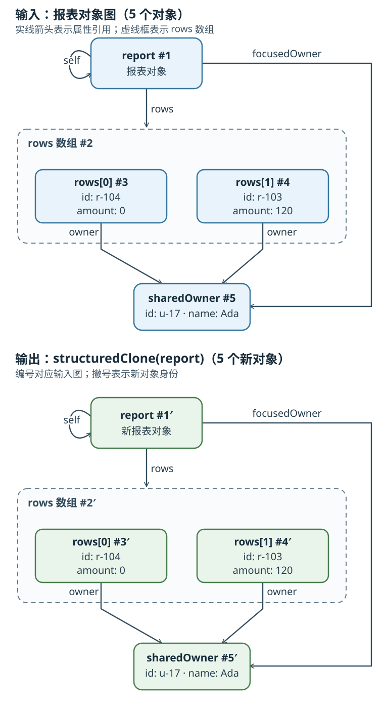

*图：上半是输入的 5 个对象，实线箭头是属性引用，虚线框是 `rows` 数组；下半是克隆结果。相同编号表示对应位置，带撇号表示新身份：5 个对象都是新的，`self` 回到新根 #1′，三条 `owner`/`focusedOwner` 引用都指向同一个 #5′。*

克隆不是绕过代码直接复制对象内部。对普通对象和数组，它只读取自有、可枚举的字符串键：getter 会被执行，读到的值在副本中成为普通数据属性；Symbol 键和不可枚举属性被跳过。

~~~javascript
const metadataKey = Symbol("metadata");
let getterReads = 0;
const propertyInput = {};
Object.defineProperty(propertyInput, "label", {
  enumerable: true,
  get() {
    getterReads += 1;
    return "May report";
  },
});
Object.defineProperty(propertyInput, "internal", {
  enumerable: false,
  value: () => "hidden",
});
propertyInput[metadataKey] = Symbol("not visited");

const propertyCopy = structuredClone(propertyInput);
getterReads;                // 1：克隆时执行了 getter
Object.keys(propertyCopy);  // ["label"]
Object.getOwnPropertyDescriptor(propertyCopy, "label");
// { value: "May report", writable: true, enumerable: true, configurable: true }
propertyCopy[metadataKey];  // undefined
~~~

不可枚举的 `internal` 虽然是函数，却因为被跳过而没有导致报错。其他类型按各自的规则处理：

- **有序列化步骤的标准对象**：`Date`、`RegExp`、`Map`、`Set`、`ArrayBuffer`、typed array（类型化数组）、`Error` 等，内部槽里的数据按类型复制；额外挂在对象上的属性不一定参与，例如 `Map` 的条目会复制，自己加的 `note` 属性不会。平台对象能否克隆，取决于该接口是否定义了序列化步骤。
- **用户自定义类的实例**：当作普通对象处理，自有可枚举数据会复制，但类原型、原型方法和访问器都不随之复制。
- **拒绝的值**：函数、`WeakMap`、`Symbol` 值、`Proxy` 和普通 DOM `Node` 不能序列化；对象图中任何待复制的位置出现它们，调用就抛 `DataCloneError`。
- **`BigInt`**：与 JSON 不同，可以克隆。

~~~javascript
structuredClone(9007199254740993n); // 9007199254740993n

const mapWithExpando = new Map([["r-104", 120]]);
mapWithExpando.note = "visible only on the input";
const clonedMap = structuredClone(mapWithExpando);
clonedMap.get("r-104"); // 120：条目保留
clonedMap.note;         // undefined：扩展属性没有复制

class ReportRow {
  constructor() { this.id = "r-104"; }
  label() { return this.id; }
}
const classCopy = structuredClone(new ReportRow());
Object.getPrototypeOf(classCopy) === Object.prototype; // true
classCopy.label;                                       // undefined：方法没有复制

function cloneErrorName(value) {
  try {
    structuredClone(value);
    return "cloned";
  } catch (error) {
    return error.name;
  }
}
cloneErrorName(() => {});                    // "DataCloneError"
cloneErrorName(new WeakMap());               // "DataCloneError"
cloneErrorName(Symbol("value"));             // "DataCloneError"
cloneErrorName({ format: () => "r-104" });   // "DataCloneError"：嵌套的函数也算
~~~

所以案例的快照能用 `structuredClone`：`report` 只含普通对象、数组和原始值，循环和共享都会保留。若行对象换成带方法的类实例，副本会丢掉方法；若数据里存了回调函数，克隆直接失败。

### 转移与共享：transfer 和 SharedArrayBuffer

上面讨论的都是复制。`structuredClone` 的 `transfer`（转移）选项则把可转移资源的所有权交给结果，而不是再复制一份。对 `ArrayBuffer`，结果接管原缓冲区的字节，原 `ArrayBuffer` 变为 detached（已分离）状态：对象还在，长度变为 0，不能再读写内容。只有确实要交出所有权时才转移，普通快照不要带 `transfer`。

~~~javascript
const buffer = new ArrayBuffer(8);
const transferred = structuredClone({ buffer }, { transfer: [buffer] });
transferred.buffer.byteLength; // 8
buffer.byteLength;             // 0：原 buffer 已分离
~~~

反过来，得到新的包装对象也不代表底层数据独立了。`SharedArrayBuffer`（共享数组缓冲区）被结构化克隆时，得到一个新的包装对象，但两者仍共享同一块字节；在浏览器中，克隆它还要求页面处于 cross-origin isolated（跨源隔离）状态。要得到独立快照，就把内容复制到普通 `ArrayBuffer`：

~~~javascript
const sharedBuffer = new SharedArrayBuffer(1);
const sharedCopy = structuredClone(sharedBuffer);
const sourceByte = new Uint8Array(sharedBuffer);
const copiedByte = new Uint8Array(sharedCopy);

sharedCopy !== sharedBuffer; // true：包装对象不同
sourceByte[0] = 42;
copiedByte[0];               // 42：底层字节仍共享

const independentByte = new Uint8Array(new ArrayBuffer(sharedBuffer.byteLength));
independentByte.set(sourceByte);
sourceByte[0] = 7;
copiedByte[0];               // 7：共享缓冲区继续变化
independentByte[0];          // 42：复制出的快照不随之变化
~~~

若其他线程在复制期间仍在写，复制结果不保证对应同一时刻，读写双方要另行协调。`TypedArray.prototype.set()` 在两端元素类型相同时按字节复制，不同时（但同为 Number 类或同为 BigInt 类）逐元素读取并转换，两种都不提供跨元素的一致快照；Number 类与 BigInt 类数组互相复制会抛 `TypeError`。

### 手写深拷贝：先写类型范围

JSON 会丢掉共享关系和多种类型，`structuredClone` 会丢掉原型并拒绝函数。只有当应用处理一小组稳定的类型、又确实需要自定义规则时，才值得维护手写复制器。写之前先定契约。下面的实现支持：同一 realm 中的基础 `Date`、`RegExp`、`Map`、`Set`、数组，以及原型为当前 realm 的 `Object.prototype` 或 `null` 的普通对象；普通对象分支遇到其他原型就抛 `TypeError`。

它的核心是记忆表 `seen`，一次复制共用一个 `WeakMap`（键是输入对象，弱引用不延长它们的寿命，见[对象什么时候能被回收，弱引用能帮什么、不能帮什么？](#33.%20%E5%AF%B9%E8%B1%A1%E4%BB%80%E4%B9%88%E6%97%B6%E5%80%99%E8%83%BD%E8%A2%AB%E5%9B%9E%E6%94%B6%EF%BC%8C%E5%BC%B1%E5%BC%95%E7%94%A8%E8%83%BD%E5%B8%AE%E4%BB%80%E4%B9%88%E3%80%81%E4%B8%8D%E8%83%BD%E5%B8%AE%E4%BB%80%E4%B9%88%EF%BC%9F)）。每个对象在递归处理子项之前，先登记“输入对象 → 副本”；再次遇到同一对象时直接返回登记的副本。所以循环不会无限递归，图内共享关系也得以保留，作用与结构化克隆的记忆表相同。原始值直接返回；函数和 `Symbol` 值也原样返回，结果中的函数与输入共享同一身份。

> [!example]- 有限范围的递归复制器
>
> ~~~javascript
> function deepCopy(value, seen = new WeakMap()) {
>   if (value === null || typeof value !== "object") return value;
>   if (seen.has(value)) return seen.get(value);
>
>   let copy;
>   if (value instanceof Date) {
>     copy = new Date(value.getTime());
>   } else if (value instanceof RegExp) {
>     copy = new RegExp(value.source, value.flags);
>     copy.lastIndex = value.lastIndex;
>   } else if (value instanceof Map) {
>     copy = new Map();
>     seen.set(value, copy);
>     for (const [key, item] of value) {
>       copy.set(deepCopy(key, seen), deepCopy(item, seen));
>     }
>     return copy;
>   } else if (value instanceof Set) {
>     copy = new Set();
>     seen.set(value, copy);
>     for (const item of value) copy.add(deepCopy(item, seen));
>     return copy;
>   } else if (Array.isArray(value)) {
>     copy = new Array(value.length);
>   } else {
>     const prototype = Object.getPrototypeOf(value);
>     if (prototype !== Object.prototype && prototype !== null) {
>       throw new TypeError("Unsupported object type");
>     }
>     copy = Object.create(prototype);
>   }
>
>   seen.set(value, copy);
>   if (value instanceof Date || value instanceof RegExp) return copy;
>
>   for (const key of Object.keys(value)) {
>     Object.defineProperty(copy, key, {
>       value: deepCopy(value[key], seen),
>       enumerable: true,
>       writable: true,
>       configurable: true,
>     });
>   }
>   return copy;
> }
> ~~~

对案例的 `report`，结果与 `structuredClone` 相同：`self` 回到副本根，两条行的 `owner` 和 `focusedOwner` 指向同一个 owner 副本，所有新对象都与原图分离。`Map`、`Set` 里的循环也能复制：

~~~javascript
const manualSnapshot = deepCopy(report);
manualSnapshot.self === manualSnapshot;                         // true
manualSnapshot.rows[0].owner === manualSnapshot.rows[1].owner;  // true
manualSnapshot.focusedOwner === manualSnapshot.rows[0].owner;   // true
manualSnapshot.rows[0].owner !== sharedOwner;                   // true

const cyclicMap = new Map();
cyclicMap.set(cyclicMap, cyclicMap);
const cyclicMapCopy = deepCopy(cyclicMap);
cyclicMapCopy.get(cyclicMapCopy) === cyclicMapCopy; // true：键和值都回指副本
~~~

普通对象和数组部分只复制自有、可枚举的字符串键。数组先按原 `length` 新建，所以原型链也没有值的空位会保留；数组上的可枚举扩展属性也会复制。Symbol 键、不可枚举属性被忽略；getter 在读取 `value[key]` 时执行，结果写成可写、可枚举、可配置的数据属性。

~~~javascript
const trailingHoles = deepCopy([1, , ,]);
[trailingHoles.length, 0 in trailingHoles, 1 in trailingHoles]; // [3, true, false]
Object.keys(deepCopy(new Array(3)));                            // []
deepCopy(Object.assign([, 1], { note: "extra" })).note;          // "extra"

class CustomMap extends Map {}
class CustomArray extends Array {}
deepCopy(new CustomMap([["r-104", 120]])) instanceof CustomMap;  // false：降为 Map
Object.getPrototypeOf(deepCopy(new CustomArray(1, 2))) === Array.prototype; // true
deepCopy(new ReportRow());                                       // TypeError
~~~

下面这些是调用方必须满足的输入契约，代码不会全部检查：

- 不传 `Proxy`、跨 realm 对象、未知宿主对象，或覆写了这段代码会读取的内建方法、属性和迭代器的实例。
- 分支顺序会让 `Date`、`RegExp`、`Map`、`Set` 的子类降为对应基础类型；数组子类和跨 realm 数组进入数组分支，成为当前 realm 的普通数组。
- `Date`、`RegExp`、`Map`、`Set` 上的自有扩展属性被忽略；`RegExp` 的 `lastIndex` 原值赋给副本，要求它是普通的数字位置。
- 递归要求对象图深度受控；执行中调用的 getter 或迭代器抛出的错误会向外传播。

输入不能可靠满足这些条件时，应缩窄数据契约，或换用明确支持目标类型的机制，而不是把结果称作完整副本。

### Lodash 实例：_.merge 与 _.set 原地修改

> [!info] 版本
> 本节以 Lodash 4.18.1 为准，示例在 npm 安装的 4.18.1 上复跑于 2026-11-26。

前面的复制方式都返回新值。Lodash 的 `_.merge(target, ...sources)` 不同：它递归合并，直接修改第一个参数并返回它；数组按索引逐项合并，不拼接；来源中值为 `undefined` 的属性在目标已有值时被跳过。假设页面缓存了一份报表数据，要把一个补丁合进去：

~~~javascript
const cached = {
  reports: [
    { id: "r-104", label: "May report", owner: { team: "Ops" } },
    { id: "r-103", label: "April report" },
  ],
};
const patch = { reports: [{ owner: { reviewed: true } }] };

const changed = _.merge(cached, patch);
changed === cached;               // true：返回的就是被改过的目标
cached.reports[0].owner.reviewed; // true
cached.reports.length;            // 2：patch 的第 0 项合进了原第 0 项
~~~

把这个被改过的同一引用再交给 React 的 state setter，React 用 `Object.is` 比较新旧值，可能认为没有变化而跳过渲染，见[React 怎样把一次用户操作变成界面更新？](#37.%20React%20%E6%80%8E%E6%A0%B7%E6%8A%8A%E4%B8%80%E6%AC%A1%E7%94%A8%E6%88%B7%E6%93%8D%E4%BD%9C%E5%8F%98%E6%88%90%E7%95%8C%E9%9D%A2%E6%9B%B4%E6%96%B0%EF%BC%9F)。`cached` 若还被请求缓存、其他组件或测试共享，它们也会一起看到被改的值。要建立新值，就把新对象作为目标：

~~~javascript
const next = _.merge({}, cached, { reports: [{ owner: { reviewed: false } }] });
next !== cached;                                  // true
next.reports !== cached.reports;                  // true：reports 数组重新建立
next.reports[0].owner !== cached.reports[0].owner; // true：嵌套 owner 也重新建立
next.reports[0].id;                               // "r-104"：仍按索引合并
next.reports[0].owner.reviewed;                   // false
cached.reports[0].owner.reviewed;                 // true：原对象没被这次合并改写
~~~

以 `{}` 为目标时，来源里的普通对象和数组会被递归合并进新建的节点，所以 `reports` 和嵌套 `owner` 都是新对象。但合并仍按索引进行，不会按 `id` 匹配。按索引合并还有一个隐患：同一个 `patch.reports[0]` 会随当前排序落到不同的报表上。

| 合并时的顺序 | 第 0 行 | 补丁落到 |
|---|---|---|
| `sort=recent`：May、April | `r-104` | May 的 `owner.reviewed` |
| `sort=oldest`：April、May | `r-103` | April 的 `owner.reviewed` |

补丁实际针对某个 `id` 时，先按 `id` 找到那一行再更新，不要把“第 0 行”当成报表身份。纯列表补项应显式拼接，例如 `[...cached.reports, newReport]`。`_.assign` 同样修改目标，只做浅层赋值。

`_.set` 写入嵌套路径，也原地修改目标；路径中缺失的索引段会建出数组，其他段建出对象：

~~~javascript
const draft = {};
const result = _.set(draft, "owner.team", "Ops");
result === draft;  // true
draft.owner.team;  // "Ops"

_.set(draft, "rows[0].amount", 0);
Array.isArray(draft.rows); // true
~~~

用库方法前，先看它返回哪个对象、是否改变输入。

### 复制之后：从数据转向函数

本章给案例的快照选了 `structuredClone`：报表数据只含普通对象、数组和原始值，它能新建全部 5 个节点，同时保留三处共享的 `owner` 和 `self` 循环。浅复制只新建最外层；JSON 往返拆散共享、拒绝循环；手写复制器只在类型范围写清后才可靠；`_.merge`、`_.set` 原地修改目标，按索引合并还会让补丁随排序落到不同的行上。

到这里，主线三的“值与对象”一组讲完了：值怎样比较，属性怎样查找，集合怎样选，复制复制了什么。下一组转向函数与异步，先问：函数里用到的变量和 `this` 从哪里来？见[函数里的变量和 this 从哪来？](#24.%20%E5%87%BD%E6%95%B0%E9%87%8C%E7%9A%84%E5%8F%98%E9%87%8F%E5%92%8C%20this%20%E4%BB%8E%E5%93%AA%E6%9D%A5%EF%BC%9F)。

> [!info]- 来源
> - 数组浅复制、`concat` 与 `Symbol.isConcatSpreadable`、展开走迭代器（“浅复制只新建最外层”）：[ECMAScript 2026 §23.1.3.2 Array.prototype.concat](https://tc39.es/ecma262/2026/multipage/indexed-collections.html#sec-array.prototype.concat)、[§23.1.3.38 Array.prototype.values](https://tc39.es/ecma262/2026/multipage/indexed-collections.html#sec-array.prototype.values)、[§23.1.2.1 Array.from](https://tc39.es/ecma262/2026/multipage/indexed-collections.html#sec-array.from)；对象展开与 `Object.assign`：[§20.1.2.1 Object.assign](https://tc39.es/ecma262/2026/multipage/fundamental-objects.html#sec-object.assign)。
> - JSON 序列化的属性选择、对象中未表示的值、数组中的 `null` 替代、`BigInt` 与循环结构错误（“JSON 往返”）：[ECMAScript 2026 §25.5.4 JSON.stringify](https://tc39.es/ecma262/2026/multipage/structured-data.html#sec-json.stringify)，尤其 §25.5.4.2 SerializeJSONProperty、§25.5.4.5–§25.5.4.6 对象与数组序列化；日期的 JSON 表示：[§21.4.4.37 Date.prototype.toJSON](https://tc39.es/ecma262/2026/multipage/numbers-and-dates.html#sec-date.prototype.tojson)。
> - 结构化克隆的宿主 API、复制与转移的区别、不可序列化时的错误、反序列化到 `structuredClone` 接收者的 relevant realm（“structuredClone”“转移与共享”）：[WHATWG HTML Living Standard §2.7.11 Structured cloning API](https://html.spec.whatwg.org/multipage/structured-data.html#structured-cloning-api)，更新于 2026-11-11。
> - 记忆表对循环和重复身份的处理，Symbol、函数、`WeakMap`、`Proxy`、`Error` 及其他内部槽对象的克隆规则，普通对象只读自有可枚举键并反序列化为数据属性：[WHATWG HTML §2.7.4 StructuredSerializeInternal](https://html.spec.whatwg.org/multipage/structured-data.html#structuredserializeinternal)、[§2.7.7 StructuredDeserialize](https://html.spec.whatwg.org/multipage/structured-data.html#structureddeserialize)。
> - `ArrayBuffer` 复制字节、`SharedArrayBuffer` 的跨源隔离检查与共享底层数据、转移后分离（“转移与共享”）：[WHATWG HTML §2.7.4、§2.7.8 StructuredSerializeWithTransfer](https://html.spec.whatwg.org/multipage/structured-data.html#structuredserializewithtransfer)；DOM `Node` 未定义序列化步骤：[DOM Standard §4.4 Interface Node](https://dom.spec.whatwg.org/#interface-node)。
> - `TypedArray.prototype.set()` 的同类别要求、按字节或逐元素复制、无跨元素一致快照：[ECMAScript 2026 SetTypedArrayFromTypedArray](https://tc39.es/ecma262/2026/multipage/indexed-collections.html#sec-settypedarrayfromtypedarray)。
> - 手写复制器用到的语言操作（“手写深拷贝”）：[ECMAScript 2026 §20.1.2.2 Object.create、§20.1.2.4 Object.defineProperty、§20.1.2.12 Object.getPrototypeOf、§20.1.2.19 Object.keys](https://tc39.es/ecma262/2026/multipage/fundamental-objects.html#sec-object.create)、[§23.1.2.3 Array.isArray](https://tc39.es/ecma262/2026/multipage/indexed-collections.html#sec-array.isarray)、[§21.4.4.10 Date.prototype.getTime](https://tc39.es/ecma262/2026/multipage/numbers-and-dates.html#sec-date.prototype.gettime)、[RegExp 的 flags、source 与 lastIndex](https://tc39.es/ecma262/2026/multipage/text-processing.html#sec-get-regexp.prototype.flags)、[§24.1–24.3 Map、Set、WeakMap](https://tc39.es/ecma262/2026/multipage/keyed-collections.html)。
> - Node.js 中的 `structuredClone` 入口：[Node.js Global objects — structuredClone](https://nodejs.org/api/globals.html#structuredclonevalue-options)（原稿核对 v26.13.1 文档）。
> - Lodash `_.merge`（修改目标、数组按索引合并、跳过 `undefined` 来源值）、`_.set`（缺失索引段建数组）、`_.assign`（“Lodash 实例”）：[Lodash 4.18.1 API 文档](https://github.com/lodash/lodash/blob/4.18.1/doc/README.md)，原稿核验 2026-11-12；本轮复跑 2026-11-26。React 用 `Object.is` 比较 state：[React 文档 useState — Caveats](https://react.dev/reference/react/useState)。
> - 本章示例在 Node.js v26.13.1 / V8 14.6.202.34-node.40 复跑，2026-11-26；原稿核对环境为 Node.js v26.13.0，2026-11-12。
## 24. 函数里的变量和 this 从哪来？

沿用主线一的报表页。本章看它的两段代码：给排序按钮注册点击日志的 `attachLogger(elementId, label)`，以及把一行报表格式化成文本的处理器 `service.onReport(report)`。注册函数早已返回，点击时回调为什么还读得到 `label`？同一个处理器作为方法调用正常，取出来单独调用却抛 `TypeError`，变的又是什么？

答案分两半。函数体里的变量按函数**定义**处的环境查找，closure（闭包）让这些绑定在外层调用返回后仍可访问；普通函数的 `this` 由每次**调用**的形式提供，闭包不保留它。本章先讲变量，再讲 `this`。

以下代码块彼此独立，注释给出求值结果。标为 HTML 的代码要在浏览器里运行；含非严格函数的代码块要作为 classic script（经典脚本）运行，因为模块代码总是严格模式。

### 名称沿函数定义处的环境链查找

读取一个标识符时，JavaScript 先在当前 lexical environment（词法环境）里找对应的 binding（绑定，即名称与值的关联）；找不到才去外层环境，逐层向外。“外层”指函数**定义**时所在的环境，不是调用它的地方。

下面的代码里有三个 `label`。按执行顺序走一遍：

1. 调用 `outer` 时，函数体执行前先做声明实例化：建立 `inner` 的绑定并创建函数对象。函数对象的内部槽 `[[Environment]]` 记下这次 `outer` 调用的环境。
2. 函数体执行，初始化 `label = "outer"`，返回 `inner`。`outer` 调用结束了，但返回的函数仍引用那份环境，所以环境不会被回收。
3. `callFromElsewhere` 调用这个返回值时，才为 `inner` 新建本次调用的环境，它的外层指向第 1 步记下的环境。

~~~javascript
const label = "global";

function outer() {
  const read = inner;
  const label = "outer";
  function inner() {
    const detail = "inner";
    return [label, detail];
  }
  return read;
}

function callFromElsewhere() {
  const label = "caller";
  const read = outer();
  return read();
}

callFromElsewhere(); // ["outer", "inner"]
~~~

`inner` 的环境里有 `detail`，没有 `label`，于是查找沿函数对象保存的外层环境继续，在 `outer` 那次调用里命中：

~~~mermaid
flowchart TB
  Q["inner 读取 label"] -->|先查当前环境| I["inner 的环境<br/>有 detail；没有 label"]
  I -->|沿定义时的外层环境| O["outer 本次调用的环境<br/>label = outer；命中并停止"]
~~~

调用者 `callFromElsewhere` 的环境（其中也有 `label`）不在这条链上。调用者能影响的只有实参，以及普通函数的 `this`。

图里的环境节点是规范描述名称查找用的抽象，引擎不必按这个形状分配对象。规范还用 execution context（执行上下文）描述正在执行的代码及其状态，用 environment record（环境记录）保存绑定。调用栈回答“哪些调用还没返回”，词法链回答“名称按什么顺序解析”：上例调用 `inner` 时，调用栈里有 `callFromElsewhere`，词法链里没有。

### 声明方式决定绑定建在哪里、何时可读

上一节假设绑定已经存在且有值。绑定建在哪个环境、何时初始化，取决于声明方式：

| 声明 | 绑定范围 | 初始化时机 | 重复声明与重新赋值 |
| --- | --- | --- | --- |
| `var` | 所在函数；在脚本或模块顶层时属于各自的顶层 | 进入作用域时就初始化为 `undefined`（与形参同名时沿用形参值）；`= 值` 要执行到这一行才运行 | 兼容的 `var` 可重复声明；可重新赋值 |
| `let` | 所在代码块，或脚本、模块顶层 | 进入作用域时建立未初始化的绑定，执行到声明才初始化；中间这段是 temporal dead zone（暂时性死区，TDZ） | 同一作用域不能重复声明；可重新赋值 |
| `const` | 同 `let` | 同 `let`；必须写初始化式（`for...in` / `for...of` 头部除外） | 同一作用域不能重复声明；不能重新赋值 |

~~~javascript
function readBeforeAssignment() {
  const before = status; // undefined
  if (true) {
    var status = "ready";
  }
  return [before, status];
}

let count = 0;
let tdzError;
{
  try {
    count;
  } catch (error) {
    tdzError = error.name;
  }
  let count = 1;
}

const options = { theme: "light" };
options.theme = "dark";
let reassignmentError;
try {
  options = {};
} catch (error) {
  reassignmentError = error.name;
}

[readBeforeAssignment(), tdzError, count, options.theme, reassignmentError];
// [[undefined, "ready"], "ReferenceError", 0, "dark", "TypeError"]
~~~

逐项看结果：

- `if` 块不为 `var` 新建绑定，函数开头读到的就是已初始化为 `undefined` 的同一个 `status`。
- 块里的 `let count` 从块开头起就遮蔽了外层 `count`。查找遇到这个尚未初始化的内层绑定就抛 `ReferenceError`，不会跳过它去读外层的 `0`；离开块后外层 `count` 仍是 `0`。
- `const` 只禁止给名称重新赋值，不冻结它指向的对象，所以 `options.theme` 能改成 `"dark"`。

兼容的 `var` 不能与同一作用域里冲突的 `let` / `const` 混用。新代码在绑定不需要重新赋值时用 `const`，需要时用 `let`；只有维护依赖函数作用域的旧代码才需要 `var`。

### 各宿主的“顶层”不同

上表说的“脚本或模块顶层”，在不同宿主里外层环境不同，top-level `this`（顶层 `this`）也不总是全局对象。要在所有环境里拿到当前 Realm（执行域，一套独立的全局对象和内建对象）的全局对象，标准写法是 `globalThis`。

| 运行方式 | 顶层声明 | 顶层 `this` | 全局对象入口 |
| --- | --- | --- | --- |
| 浏览器 classic script（`<script>` 不写 `type="module"`） | `var` 通常成为 `window` 的属性；`let` / `const` 是 global lexical binding（全局词法绑定），不是 `window` 属性 | `window` | `window`、`globalThis` |
| 浏览器 module script（`type="module"`） | `var`、`let`、`const` 都是模块局部绑定 | `undefined` | `globalThis`；窗口页面另有 `window` |
| Node.js CommonJS（CJS） | 都是模块包装函数内的局部绑定 | 包装函数收到的初始 `exports` 对象 | `globalThis` |
| Node.js ECMAScript module（ESM） | 都是模块局部绑定 | `undefined` | `globalThis` |

浏览器主线程的 `window` 代表窗口全局。Web Worker 有自己的全局环境，用 `self` 或 `globalThis` 访问，没有 `window`。

~~~html
<script>
  var scriptValue = "global object property";
  let scriptBinding = "global lexical binding";

  const browserScriptResults = [
    window.scriptValue,
    window.scriptBinding,
    scriptBinding,
    this === globalThis,
  ];
  // ["global object property", undefined, "global lexical binding", true]
</script>
~~~

模块怎样被找到、链接和执行，以及 CJS 包装函数的细节，见[import 写下后，谁负责找到、链接和执行文件？](#31.%20import%20%E5%86%99%E4%B8%8B%E5%90%8E%EF%BC%8C%E8%B0%81%E8%B4%9F%E8%B4%A3%E6%89%BE%E5%88%B0%E3%80%81%E9%93%BE%E6%8E%A5%E5%92%8C%E6%89%A7%E8%A1%8C%E6%96%87%E4%BB%B6%EF%BC%9F)。

### 闭包保留的是绑定，不是快照

有了名称查找和初始化规则，就能准确地说闭包保留了什么：函数以后仍能访问它定义处可见的**绑定**，而绑定的值可以继续变化。

每次调用 `makeCounter(start)` 都建立一份独立的 `value`。`value++` 先读旧值，把加一后的值写回原绑定，再以旧值作表达式结果。所以第一次调用把 `value` 从 `10` 写成 `11` 并返回 `10`；第二次从 `11` 开始。

~~~javascript
function makeCounter(start) {
  let value = start;
  return () => value++;
}

const first = makeCounter(10);
const second = makeCounter(-2);
[[first(), first(), first()], [second(), second(), second()]];
// [[10, 11, 12], [-2, -1, 0]]
~~~

同一次调用也可以返回多个共享状态的函数。`increment`、`decrement`、`reset` 都访问同一份 `current`；`reset` 把它改回初值，不会新建计数器。

~~~javascript
function createCounter(init) {
  let current = init;
  return {
    increment() { return ++current; },
    decrement() { return --current; },
    reset() { return current = init; },
  };
}

const counter = createCounter(5);
[counter.increment(), counter.reset(), counter.decrement()]; // [6, 5, 4]
~~~

### 循环里的回调各读哪份绑定

闭包保留绑定，所以在循环里保存回调、稍后再调用时，关键是这些回调读同一份绑定还是每轮各一份。

`var` 循环变量在整个函数（顶层则是整个脚本或模块）只有一份绑定，每轮只是重新赋值。带 `let` 的 `for` 循环每轮提供新绑定：第一轮体读 `j = 0`，回调记住这份绑定；本轮结束后，语言先把当前值复制进下一轮的新绑定，再在新绑定上执行 `j++`。所以第一份回调仍读旧的 `0`。

~~~javascript
const fromVar = [];
for (var i = 0; i < 3; i++) fromVar.push(() => i);

const fromLet = [];
for (let j = 0; j < 3; j++) fromLet.push(() => j);

[fromVar.map(fn => fn()), fromLet.map(fn => fn())];
// [[3, 3, 3], [0, 1, 2]]
~~~

没有 `let` 的旧代码常用 Immediately Invoked Function Expression（IIFE，立即调用函数表达式）：每轮调用一次函数，借形参为每轮新建一份绑定。

~~~javascript
const callbacks = [];
for (var index = 0; index < 3; index++) {
  (function (capturedIndex) {
    callbacks.push(() => capturedIndex);
  })(index);
}
callbacks.map(fn => fn()); // [0, 1, 2]
~~~

### 工厂函数和延后执行的回调

工厂函数把一次调用的参数绑定留在闭包里，返回一个更专用的函数。`add(5)` 返回后 `x` 仍可读；它之后没有被赋值，看起来像“捕获了值 5”，其实只是没人改它。

~~~javascript
function add(x) {
  return function (y) {
    return x + y;
  };
}

const addFive = add(5);
addFive(3); // 8
~~~

同一机制回答了开头的问题。`attachLogger` 注册监听器后就返回了；之后点击时，箭头回调读的是那次 `attachLogger` 调用的 `label` 参数绑定。下例在页面 `<body>` 存在后运行，用 `dispatchEvent` 模拟点击：它同步派发事件，监听器在 `dispatchEvent` 返回前运行。

~~~javascript
function attachLogger(elementId, label) {
  document.getElementById(elementId).addEventListener("click", () => {
    console.log("Clicked: " + label);
  });
}

const sortButton = document.createElement("button");
sortButton.id = "sort-toggle";
document.body.append(sortButton);
attachLogger("sort-toggle", "sort");
sortButton.dispatchEvent(new MouseEvent("click"));
// 控制台输出："Clicked: sort"
~~~

`requestAnimationFrame` 的回调也是延后执行。每次调用 `animate` 都建立 `element`、`from`、`to`、`duration`、`start` 这几份绑定，之后不再赋值；每一帧的 `update` 都读同一次 `animate` 调用的这些绑定，算出当前位置，再决定是否请求下一帧。`performance.now()` 返回毫秒时间戳，所以 `duration` 也以毫秒计，且必须大于 `0`。

~~~javascript
function animate(element, from, to, duration) {
  const start = performance.now();

  function update() {
    const elapsed = performance.now() - start;
    const progress = Math.min(elapsed / duration, 1);
    element.style.left = from + (to - from) * progress + "px";
    if (progress < 1) requestAnimationFrame(update);
  }

  requestAnimationFrame(update);
}

const banner = document.createElement("div");
banner.textContent = "报表已更新";
banner.style.position = "relative"; // 静态定位元素上 left 不起作用
document.body.append(banner);
animate(banner, 0, 100, 1000);
~~~

进度到 `1` 时 `left` 停在 `100px`，不再请求下一帧。`position: relative` 只移动绘制位置，元素在正常流中占的空间不变。rAF 回调在事件循环里的位置见[事件循环怎样安排任务、微任务和渲染？](#2.%20%E4%BA%8B%E4%BB%B6%E5%BE%AA%E7%8E%AF%E6%80%8E%E6%A0%B7%E5%AE%89%E6%8E%92%E4%BB%BB%E5%8A%A1%E3%80%81%E5%BE%AE%E4%BB%BB%E5%8A%A1%E5%92%8C%E6%B8%B2%E6%9F%93%EF%BC%9F)。

闭包保留绑定，会不会造成内存泄漏？语言只保证返回的函数仍能读到它用到的绑定；引擎通常只保留闭包实际可能用到的部分。数据能否回收取决于可达性：长期挂着的监听器让它的闭包和闭包引用的数据一直可达，所以控件销毁时要移除监听器。循环引用本身不等于泄漏。可达性与保留路径见[对象什么时候能被回收，弱引用能帮什么、不能帮什么？](#33.%20%E5%AF%B9%E8%B1%A1%E4%BB%80%E4%B9%88%E6%97%B6%E5%80%99%E8%83%BD%E8%A2%AB%E5%9B%9E%E6%94%B6%EF%BC%8C%E5%BC%B1%E5%BC%95%E7%94%A8%E8%83%BD%E5%B8%AE%E4%BB%80%E4%B9%88%E3%80%81%E4%B8%8D%E8%83%BD%E5%B8%AE%E4%BB%80%E4%B9%88%EF%BC%9F)。

### 普通函数的 this 由调用形式提供

现在看开头的第二个问题。报表服务用工厂函数 `makeReportHandler(tag)` 创建处理器：返回的普通函数通过闭包访问 `tag` 和计数器 `calls`，但闭包不会顺带保留 `this`。

~~~javascript
function makeReportHandler(tag) {
  let calls = 0;
  return function onReport(report) {
    "use strict";
    calls += 1;
    return this.format(report, tag, calls);
  };
}

const service = {
  prefix: "Sales",
  format(report, tag, sequence) {
    return `${this.prefix}/${tag}: ${report.title} #${sequence}`;
  },
  onReport: makeReportHandler("daily"),
};

const firstReport = service.onReport({ title: "May" });
const detached = service.onReport;
let detachedError;
try {
  detached({ title: "May" });
} catch (error) {
  detachedError = error.name;
}
const thirdReport = service.onReport({ title: "May" });
[firstReport, detachedError, thirdReport];
// ["Sales/daily: May #1", "TypeError", "Sales/daily: May #3"]
~~~

`service.onReport(...)` 是方法调用：属性访问 `service.onReport` 的基底 `service` 成为这次调用的 `this`；函数体里的 `this.format(...)` 又是方法调用，所以 `format` 里的 `this` 也是 `service`。存进变量 `detached` 再调用时，调用表达式里没有基底，严格函数的 `this` 是 `undefined`，读 `this.format` 抛 `TypeError`。失败发生在 `calls += 1` 之后，所以第三次调用返回 `#3`：`tag`、`calls` 来自定义处的环境，`this` 每次由调用形式重新提供。

普通函数的 `this` 分两步确定：

1. **调用表达式给出初值**，即 receiver（接收者）。`obj.m()` 或 `obj[key]()` 把属性访问的基底作为接收者，基底也可以是原始值，如 `"May".toString()`；变量裸调 `fn()` 给出 `undefined`。唯一的例外是非严格代码的 `with` 块，它可以为裸调提供对象接收者。
2. **被调函数的模式决定怎样用这个初值**，下一节展开。

### 严格模式改变 this 的第二步

strict mode（严格模式）把一些历史上静默出错的写法变成异常，也改变普通函数使用 `this` 初值的方式。经典脚本或函数体开头写 `"use strict"` 启用它；ES 模块和 class 内的代码自动严格。

strict function（严格函数）原样使用初值。sloppy function（非严格函数）把 `null` 或 `undefined` 换成函数所属 Realm 的全局 `this`，并把数字、字符串、布尔值、BigInt、Symbol 接收者装箱成对象：

| 被调函数模式 | 裸调 `fn()` | `fn.call(null)` | `fn.call(7)` |
| --- | --- | --- | --- |
| 严格函数 | `undefined` | `null` | 原始数字 `7` |
| 非严格函数 | 所属 Realm 的全局 `this` | 所属 Realm 的全局 `this` | `Number` 包装对象 |

起作用的是**被调函数**的模式，不是调用处的：

~~~javascript
function sloppyTarget() {
  return this;
}

function strictCaller() {
  "use strict";
  return sloppyTarget();
}
strictCaller() === globalThis; // true：被调函数仍按非严格规则替换 undefined

function writeUndeclaredName() {
  "use strict";
  undeclaredName = 1;
}
try {
  writeUndeclaredName();
} catch (error) {
  error.name; // "ReferenceError"：不会悄悄创建全局变量
}
~~~

严格代码还会在给不可写属性赋值时抛 `TypeError`，并禁止 `with`、旧式八进制字面量和重复形参。严格模式不是安全沙箱，也不会让 `eval` 变安全。

### call、apply 与 bind 显式指定接收者

除了调用形式，还可以用函数自带的 `call`、`apply`、`bind` 指定接收者。三者的第一个参数都是 `thisArg`，原样交给目标，再由目标按上一节的模式规则处理；区别在何时执行、实参从哪来：

| 方法 | 目标何时执行 | 实参来源 |
| --- | --- | --- |
| `call` | 立即 | 后续分开的参数 |
| `apply` | 立即 | 省略或传 `null` / `undefined` 时为空列表；否则必须是对象，按它的 `length` 和数字索引读取，不遍历迭代器 |
| `bind` | 调用返回的新函数时 | 保存的前置参数，加上调用时的参数 |

目标若是箭头函数或 bound function（绑定函数），会忽略传入的 `thisArg`。

~~~javascript
function describe(prefix, report, punctuation) {
  "use strict";
  const message = this.prefix + ": " + prefix + " " + report.title;
  return message + (punctuation === undefined ? "" : punctuation);
}

const salesContext = { prefix: "Sales" };
const report = { title: "May" };
const boundDescribe = describe.bind(salesContext, "Ready");
const reboundDescribe = boundDescribe.bind({ prefix: "Ignored" }, report, "!");

[
  describe.call(salesContext, "Ready", report),
  describe.apply(salesContext, ["Ready", report]),
  describe.apply(salesContext, { 0: "Ready", 1: report, length: 2 }),
  boundDescribe(report),
  reboundDescribe(),
];
// 前四项都是 "Sales: Ready May"，最后一项是 "Sales: Ready May!"

function countArgs() {
  return arguments.length;
}
let primitiveListError;
try {
  countArgs.apply(salesContext, "May");
} catch (error) {
  primitiveListError = error.name;
}
[
  countArgs.apply(salesContext),
  countArgs.apply(salesContext, null),
  countArgs.apply(salesContext, { 0: "one", length: 1 }),
  countArgs.apply(salesContext, new Set(["one"])),
  primitiveListError,
];
// [0, 0, 1, 0, "TypeError"]
~~~

- 对绑定函数再 `bind`，不替换最初保存的接收者，但新的前置参数追加在原有前置参数之后，所以 `reboundDescribe()` 仍用 `Sales`，并多了 `"!"`。
- `Set` 实例没有 `length`，`apply` 又不读迭代器，于是得到空实参列表；原始字符串不是对象，作实参列表会抛 `TypeError`。
- 用 `new` 调用可构造的绑定函数时，已保存的接收者被忽略，前置参数保留，见[new 一个对象时发生了什么？](#%E7%BB%91%E5%AE%9A%E5%87%BD%E6%95%B0%E6%9E%84%E9%80%A0%E6%97%B6%E4%B8%A2%E5%BC%83%E4%BF%9D%E5%AD%98%E7%9A%84%20this)。自己写包装函数模拟 `bind` 得不到这种构造行为，也得不到相同的 `name`、`length`。

### 箭头函数读外层的 this

arrow function（箭头函数）没有自己的 `this`、`arguments`、`super` 和 `new.target`，读的是定义处外层的 lexical `this`（词法 `this`）。`call`、`apply`、`bind` 能传参或预填参数，但换不掉这个 `this`。箭头函数也不能用 `new` 构造，且没有自有的 `prototype` 属性。

~~~javascript
function makePanel(title) {
  return {
    title,
    read() { return this.title; },
    readArrow: label => this.title + ":" + label,
  };
}

const panel = makePanel.call({ title: "Outer" }, "May");
const arrowReader = panel.readArrow;
let arrowConstructError;
try {
  new arrowReader();
} catch (error) {
  arrowConstructError = error.name;
}
[
  panel.read(),
  panel.readArrow("direct"),
  panel.readArrow.call({ title: "Call" }, "call"),
  panel.readArrow.apply({ title: "Apply" }, ["apply"]),
  panel.readArrow.bind({ title: "Bind" }, "bind")(),
  Object.hasOwn(arrowReader, "prototype"),
  arrowConstructError,
];
// ["May", "Outer:direct", "Outer:call", "Outer:apply", "Outer:bind", false, "TypeError"]
~~~

`makePanel` 这次调用经 `call` 收到 `{ title: "Outer" }` 作 `this`。`readArrow` 调用时访问的就是这次调用的 `this`，所以总是 `"Outer"`，后面三种显式指定都无效，但实参照常传入。`panel.read()` 是普通方法，才以 `panel` 为接收者。需要对象作接收者时用普通方法；需要沿用外层 `this` 时才用箭头函数。

宿主 API 调用回调时也会提供接收者。普通函数作 DOM 事件监听器时，`this` 是注册监听器的那个对象（`event.currentTarget`），箭头函数则仍是外层 `this`，详见[一次点击怎样传播到处理器，处理器该怎样注册和清理？](#4.%20%E4%B8%80%E6%AC%A1%E7%82%B9%E5%87%BB%E6%80%8E%E6%A0%B7%E4%BC%A0%E6%92%AD%E5%88%B0%E5%A4%84%E7%90%86%E5%99%A8%EF%BC%8C%E5%A4%84%E7%90%86%E5%99%A8%E8%AF%A5%E6%80%8E%E6%A0%B7%E6%B3%A8%E5%86%8C%E5%92%8C%E6%B8%85%E7%90%86%EF%BC%9F)。

> [!example]- 练习：借方法调用实现一个范围受限的 call 与 apply
>
> 既然方法调用以基底为 `this`，就能借它模拟 `call`：把函数放到接收者的一个临时 Symbol 键上，以 `receiver[key](...)` 调用，再删掉这个键。唯一的 Symbol 避免与已有字符串键冲突；`finally` 保证目标抛错时也尝试删除。
>
> ~~~javascript
> function callWithObjectReceiver(fn, receiver, ...args) {
>   if (receiver === null ||
>       (typeof receiver !== "object" && typeof receiver !== "function")) {
>     throw new TypeError("This exercise requires an object receiver");
>   }
>   const key = Symbol("temporary call");
>   Object.defineProperty(receiver, key, { value: fn, configurable: true });
>   try {
>     return receiver[key](...args);
>   } finally {
>     delete receiver[key];
>   }
> }
>
> function applyWithObjectReceiver(fn, receiver, args) {
>   const list = args === null || args === undefined
>     ? []
>     : Array.prototype.slice.call(args); // 复制类数组实参
>   return callWithObjectReceiver(fn, receiver, ...list);
> }
>
> const receiver = { base: 10 };
> function addToBase(a, b) { "use strict"; return this.base + a + b; }
> function countArgs() { return arguments.length; }
> function failAfterReceivingThis() {
>   "use strict";
>   if (this !== receiver) throw new TypeError("receiver was lost");
>   throw new Error("target failed");
> }
> let failureName;
> try {
>   callWithObjectReceiver(failAfterReceivingThis, receiver);
> } catch (error) {
>   failureName = error.name;
> }
> [
>   callWithObjectReceiver(addToBase, receiver, 1, 2),
>   applyWithObjectReceiver(countArgs, receiver, null),
>   applyWithObjectReceiver(addToBase, receiver, [3, 4]),
>   failureName,
>   Object.getOwnPropertySymbols(receiver).length,
> ];
> // [13, 0, 17, "Error", 0]
> ~~~
>
> 这个练习只覆盖有限契约：
>
> - 只接受对象或函数接收者。原生 `call` / `apply` 把任何值交给目标，再由目标按自身模式决定是否转换。
> - 箭头函数和绑定函数会忽略这个方法接收者。
> - 不可扩展对象、Proxy 和宿主对象可能让定义、读取或删除属性失败或产生额外行为。目标若把临时键改成不可配置，非严格模式下删除返回 `false`，键会留下；严格模式下删除抛 `TypeError`，并可能覆盖目标原先抛出的异常。
> - 不完全复现原生 `apply` 对非对象实参列表的检查。
>
> 练习常写成 `Function.prototype.myCall`；那会修改共享内置对象，应用代码应直接用内置方法。

### 包装函数要同时保住这两个来源

本章得出两条规则：变量来自函数定义处的环境链，闭包让这些绑定活得比外层调用更久；普通函数的 `this` 来自每次调用的形式，再经严格模式处理，箭头函数则沿用外层的 `this`。

下一章把两条规则用在包装函数上：包装器用闭包保存计时器、缓存这类跨调用的状态，又必须把调用者的 `this` 和全部实参转给原函数。见[怎样包装一个函数而不弄丢参数、this 和结果？](#25.%20%E6%80%8E%E6%A0%B7%E5%8C%85%E8%A3%85%E4%B8%80%E4%B8%AA%E5%87%BD%E6%95%B0%E8%80%8C%E4%B8%8D%E5%BC%84%E4%B8%A2%E5%8F%82%E6%95%B0%E3%80%81this%20%E5%92%8C%E7%BB%93%E6%9E%9C%EF%BC%9F)。

> [!info]- 来源
> - 名称查找沿词法环境链（“名称沿函数定义处的环境链查找”）：[ECMAScript 2026 Execution Contexts](https://tc39.es/ecma262/2026/multipage/executable-code-and-execution-contexts.html#sec-execution-contexts)、[Environment Records](https://tc39.es/ecma262/2026/multipage/executable-code-and-execution-contexts.html#sec-environment-records)、[GetIdentifierReference](https://tc39.es/ecma262/2026/multipage/executable-code-and-execution-contexts.html#sec-getidentifierreference)、[NewFunctionEnvironment](https://tc39.es/ecma262/2026/multipage/executable-code-and-execution-contexts.html#sec-newfunctionenvironment)；函数对象的 `[[Environment]]`：[ECMAScript Function Objects](https://tc39.es/ecma262/2026/multipage/ordinary-and-exotic-objects-behaviours.html#sec-ecmascript-function-objects)（§10.2）。
> - `var` / `let` / `const` 的绑定建立、初始化与声明限制（“声明方式决定绑定建在哪里、何时可读”）：[ECMAScript 2026 FunctionDeclarationInstantiation](https://tc39.es/ecma262/2026/multipage/ordinary-and-exotic-objects-behaviours.html#sec-functiondeclarationinstantiation)、[Source Text Module Record InitializeEnvironment](https://tc39.es/ecma262/2026/multipage/ecmascript-language-scripts-and-modules.html#sec-source-text-module-record-initialize-environment)、[Let and Const Declarations](https://tc39.es/ecma262/2026/multipage/ecmascript-language-statements-and-declarations.html#sec-let-and-const-declarations)、[Variable Statement](https://tc39.es/ecma262/2026/multipage/ecmascript-language-statements-and-declarations.html#sec-variable-statement)。
> - 各宿主的顶层与全局（“各宿主的‘顶层’不同”）：[WHATWG HTML The `script` element](https://html.spec.whatwg.org/multipage/scripting.html#the-script-element)、[Workers: The global scope](https://html.spec.whatwg.org/multipage/workers.html#the-global-scope)（Living Standard，核对日期 2026-11-12）；Node.js [CommonJS module wrapper](https://nodejs.org/api/modules.html#the-module-wrapper) 与 [ECMAScript modules](https://nodejs.org/api/esm.html)（官方文档 26.13.1，实际回放 Node.js 26.13.0）。
> - `for (let ...)` 每轮复制绑定再更新（“循环里的回调各读哪份绑定”）：[ECMAScript 2026 ForBodyEvaluation](https://tc39.es/ecma262/2026/multipage/ecmascript-language-statements-and-declarations.html#sec-forbodyevaluation)、[CreatePerIterationEnvironment](https://tc39.es/ecma262/2026/multipage/ecmascript-language-statements-and-declarations.html#sec-createperiterationenvironment)。
> - 延后回调示例的宿主 API（“工厂函数和延后执行的回调”）：[Document.body](https://html.spec.whatwg.org/multipage/dom.html#dom-document-body)、[WHATWG DOM `dispatchEvent`](https://dom.spec.whatwg.org/#dom-eventtarget-dispatchevent)、[`addEventListener`](https://dom.spec.whatwg.org/#dom-eventtarget-addeventlistener)、[WHATWG HTML `requestAnimationFrame`](https://html.spec.whatwg.org/multipage/imagebitmap-and-animations.html#dom-animationframeprovider-requestanimationframe)（Living Standard，核对日期 2026-11-12）；[W3C High Resolution Time `performance.now()`](https://www.w3.org/TR/hr-time-3/#dom-performance-now)（Level 3）；[CSS Positioned Layout Level 3 `position: relative`](https://drafts.csswg.org/css-position-3/#valdef-position-relative)（Editor’s Draft，2026-05-14）。
> - 调用形式提供接收者、严格与非严格函数的 `this` 转换（“普通函数的 this 由调用形式提供”“严格模式改变 this 的第二步”）：[ECMAScript 2026 Function Calls](https://tc39.es/ecma262/2026/multipage/ecmascript-language-expressions.html#sec-function-calls)、[EvaluateCall](https://tc39.es/ecma262/2026/multipage/ecmascript-language-expressions.html#sec-evaluatecall)、[OrdinaryCallBindThis](https://tc39.es/ecma262/2026/multipage/ordinary-and-exotic-objects-behaviours.html#sec-ordinarycallbindthis)（§10.2.1.2）、[Strict Mode Code](https://tc39.es/ecma262/2026/multipage/ecmascript-language-source-code.html#sec-strict-mode-code)。
> - 显式接收者与绑定函数（“call、apply 与 bind 显式指定接收者”）：[ECMAScript 2026 Function.prototype.call](https://tc39.es/ecma262/2026/multipage/fundamental-objects.html#sec-function.prototype.call)、[Function.prototype.apply](https://tc39.es/ecma262/2026/multipage/fundamental-objects.html#sec-function.prototype.apply)、[Function.prototype.bind](https://tc39.es/ecma262/2026/multipage/fundamental-objects.html#sec-function.prototype.bind)。
> - 箭头函数没有自己的 `this` 等绑定（“箭头函数读外层的 this”）：[ECMAScript 2026 Arrow Function Definitions](https://tc39.es/ecma262/2026/multipage/ecmascript-language-functions-and-classes.html#sec-arrow-function-definitions)；普通函数监听器以 `currentTarget` 为 `this`：[WHATWG DOM Event Listener Invocation](https://dom.spec.whatwg.org/#concept-event-listener-invoke)。
## 25. 怎样包装一个函数而不弄丢参数、this 和结果？

wrapper（包装器）是一个新函数：它调用原函数，并在调用前后加一种策略，比如固定部分参数、计时、只执行一次、缓存结果、推迟执行。上一章讲了闭包保存跨调用的状态、`this` 由调用形式提供；本章把两者用到包装器上。

每个包装器都要回答四个问题：实参何时凑齐，`this` 怎样转给原函数，返回值和异常怎样传出，闭包里存什么状态。本章按这四个问题依次看 currying（柯里化）、composition（组合）、计时包装、`once`、memoization（记忆化），最后是 debounce（防抖）和 throttle（节流）。

### rest 参数收集实参

rest parameter（剩余参数）把前面形参没接住的实参收集成数组。下面的函数只有 `...args`，所以收集全部实参；显式传入的 `undefined` 也算一个。

~~~javascript
function argumentsLength(...args) {
  return args.length;
}

argumentsLength();            // 0
argumentsLength(undefined);   // 1
argumentsLength({}, null, 3); // 3
~~~

返回的函数只有在以后要读外层绑定时才需要闭包状态。`createHelloWorld` 返回的函数不声明形参也能接收多余实参；它既不读实参也不读外层变量，所以既不需要 rest 参数也不需要闭包。

~~~javascript
function createHelloWorld() {
  return () => "Hello World";
}

createHelloWorld()({}, null, 42); // "Hello World"
~~~

### 柯里化与部分应用：实参分几次给

严格意义的 currying 把多参数函数变成一串单参数函数：`sum(a, b, c)` 变成 `curriedSum(a)(b)(c)`。partial application（部分应用）先固定一部分实参，返回等待其余实参的函数，不要求每次只给一个。

下面是常见的宽松版 `curry`：每次可以给一个或多个实参，凑够声明的个数才调用原函数。“声明的个数”取 `fn.length`，即 arity（元数）。

~~~javascript
function curry(fn) {
  "use strict";
  return function curried(...args) {
    if (args.length >= fn.length) return fn.apply(this, args);
    return function (...next) {
      return curried.apply(this, args.concat(next));
    };
  };
}

const sum = (a, b, c) => a + b + c;
const curriedSum = curry(sum);

curriedSum(1)(2)(3); // 6
curriedSum(1, 2)(3); // 6
curriedSum(1, 2, 3); // 6
~~~

以 `curriedSum(1)(2)(3)` 为例，每一步返回的函数都用闭包保存已收集的实参（下称“前缀”）：

| 这次调用 | 已收集的实参 | 调用 `sum` 吗 | 返回值 |
| --- | --- | --- | --- |
| `curriedSum(1)` | `[1]` | 否，`sum.length` 是 `3`，还差两个 | 等待函数 |
| 上一步结果 `(2)` | `[1, 2]` | 否，还差一个 | 新的等待函数 |
| 上一步结果 `(3)` | `[1, 2, 3]` | 是，调用 `sum(1, 2, 3)` | `6` |

每次都用 `concat` 生成新数组，所以从同一前缀分出的多次调用互不影响：`const addOne = curriedSum(1)` 之后，`addOne(2, 3)` 得 `6`，`addOne(4, 5)` 得 `10`，两次都从 `[1]` 开始。这一步既是宽松柯里化，也是固定前缀的部分应用。不借助 `curry` 也能部分应用：`(b, c) => sum(1, b, c)`。

> [!warning] `fn.length` 不是可靠的参数契约
> `fn.length` 只数第一个带默认值的形参或 rest 参数**之前**的形参。`function f(a, b = 10) { return a + b; }` 的 `length` 是 `1`，所以 `curry(f)(2)` 立刻返回 `12`，不会等第二次调用。用 `curry` 之前先约定参数个数；占位符和可变参数函数要另定规则。

这个实现转发的是**凑齐参数那次**调用的 `this`，不保存早先部分调用的 `this`；凑齐时多出的实参也一并传给原函数。这些是该辅助函数自己的约定：

~~~javascript
function describeParts(prefix, period) {
  return this.name + ":" + prefix + "/" + period;
}

const partial = curry(describeParts).call({ name: "first" }, "daily");
partial.call({ name: "final" }, "May"); // "final:daily/May"
~~~

### 组合：上一步的输出接到下一步的输入

function composition（函数组合）按从右到左执行：`compose([f, g, h])(x)` 计算 `f(g(h(x)))`。列表为空时返回 identity function（恒等函数），原样返回输入。

~~~javascript
function compose(functions) {
  return function (value) {
    for (let i = functions.length - 1; i >= 0; i--) {
      const step = functions[i];
      value = step(value);
    }
    return value;
  };
}

const transform = compose([
  value => value + 1,
  value => value * value,
  value => 2 + value,
]);

transform(4);    // 37：4 → 6 → 36 → 37
compose([])(42); // 42
~~~

几个容易忽略的点：

- **接收者。** 循环先把步骤取到局部变量 `step` 再调用；若写成 `functions[i](value)`，数组 `functions` 会成为接收者。直接调用传入的 `this` 是 `undefined`，非严格步骤会按自己的规则换成全局对象。
- **异常。** 这是同步组合：某一步抛错立即退出循环，异常原样传给调用者，左侧剩余步骤不运行。
- **Promise。** 某一步返回 Promise 时，它把 Promise 对象原样交给下一步，不等待兑现值。步骤需要异步串接时，要显式选 Promise 链或 async/await 的组合方式。
- **成本。** 组合 `n` 个单参数函数，一次调用让每步各执行一次，额外空间是常数。步骤带副作用或不可交换时，顺序会改变结果。

### 包装通则：用 apply 转发，用 finally 收尾

计时包装器展示了包装器的基本写法：转发 `this` 和全部实参；无论原函数正常返回还是抛错，都报告耗时。

~~~javascript
function withTiming(fn) {
  "use strict";
  return function (...args) {
    const started = performance.now();
    try {
      return fn.apply(this, args);
    } finally {
      console.log((fn.name || "operation") + ": " +
        (performance.now() - started) + " ms");
    }
  };
}
~~~

- **`fn.apply(this, args)` 转发接收者和实参。** 包装器本身是严格函数，所以被直接调用时收到的 `undefined` 会原样交给 `fn`，再由 `fn` 按自己的模式处理。若包装器是非严格函数，`undefined` 会先被换成全局对象，`apply` 就保不住原调用的接收者。
- **`finally` 覆盖返回和抛错两条路径。** 只要 `finally` 里的代码正常结束，原返回值或异常就继续向外传。`finally` 自己抛错或执行 `return`，会覆盖原结果。
- **只测同步时间。** `fn` 返回 Promise 时，`finally` 在 Promise 对象返回后就运行，不计异步操作完成前的时间；测完成耗时要按 Promise 的生命周期另写包装。

用 TypeScript 给包装器标注时，显式的 `this` 参数只向类型检查器描述接收者，编译后不多出运行时实参，见[泛型和工具类型怎样从已有类型推出新类型？](#35.%20%E6%B3%9B%E5%9E%8B%E5%92%8C%E5%B7%A5%E5%85%B7%E7%B1%BB%E5%9E%8B%E6%80%8E%E6%A0%B7%E4%BB%8E%E5%B7%B2%E6%9C%89%E7%B1%BB%E5%9E%8B%E6%8E%A8%E5%87%BA%E6%96%B0%E7%B1%BB%E5%9E%8B%EF%BC%9F)。这里的“装饰”指用包装器加调用策略的设计模式，和 `@` 装饰器语法不是一回事，后者见[TypeScript 的两种装饰器模式有什么不同？](#36.%20TypeScript%20%E7%9A%84%E4%B8%A4%E7%A7%8D%E8%A3%85%E9%A5%B0%E5%99%A8%E6%A8%A1%E5%BC%8F%E6%9C%89%E4%BB%80%E4%B9%88%E4%B8%8D%E5%90%8C%EF%BC%9F)。

### once：最多执行一次，失败也算一次

`once` 用闭包里的布尔值 `called` 记录是否调用过，并在调用目标**之前**就设为 `true`。第一次的返回值或异常原样传出，之后的调用都返回 `undefined`。

~~~javascript
function once(fn) {
  "use strict";
  let called = false;
  return function (...args) {
    if (called) return undefined;
    called = true;
    return fn.apply(this, args);
  };
}

let calls = 0;
const onlyOnce = once(function (a, b, c) {
  calls += 1;
  return a + b + c;
});

onlyOnce(1, 2, 3); // 6
onlyOnce(2, 3, 6); // undefined
calls;             // 1
~~~

因为标志先于调用设好，首次调用抛错也算用掉了机会，不会重试；首次返回的 Promise 后来拒绝，同样不会重置标志：

~~~javascript
let attempts = 0;
const failOnce = once(function () {
  attempts += 1;
  throw new Error("failed");
});

try { failOnce(); } catch (error) { error.message; } // "failed"
failOnce(); // undefined
attempts;   // 1
~~~

“最多尝试一次”和“只允许成功一次”是两种策略。包装可能失败的操作时，先决定要哪一种。

### memoize：先定义缓存键和失败结果

memoization 缓存函数结果，命中时不再调用原函数。用之前先确认两点：相同的键确实可以复用同一个结果；跳过原调用的副作用可以接受。函数读取随时间变化的状态时，还需要失效策略。判断命中要看键**是否存在**，不看缓存值真假：`0`、`false`、`undefined` 都可能是有效结果，`Map.has` 能区分“没有这个键”和“缓存值是 `undefined`”。

下例假设输入契约是有限范围的整数实参（如 `0 ≤ a, b ≤ 10^5`），这时按顺序把实参用 `JSON.stringify` 序列化成键是安全的。键只含实参，所以只适用于结果不依赖 `this` 的函数；未命中时代码照样转发 `this`，但键并没有考虑它。

~~~javascript
function memoizeNumeric(fn) {
  "use strict";
  const cache = new Map();
  return function (...args) {
    const key = JSON.stringify(args);
    if (cache.has(key)) return cache.get(key);
    const result = fn.apply(this, args);
    cache.set(key, result);
    return result;
  };
}

let evaluations = 0;
const add = memoizeNumeric(function (a, b) {
  evaluations += 1;
  return a + b;
});

[add(2, 2), add(2, 2), add(1, 2), evaluations];
// [4, 4, 3, 2]
~~~

把这种键推广到任意值就会出错：

| 输入 | 序列化结果 | 问题 |
| --- | --- | --- |
| `[NaN]`、`[Infinity]`、`[undefined]`、`[null]` | 都是 `"[null]"` | 不同输入碰撞成同一键 |
| `[-0]` | `"[0]"` | `-0` 与 `0` 不再可分 |
| 对象实参 | 按当前内容序列化 | 对象身份丢失，之后修改对象也不会让旧键失效 |
| 含循环引用的对象 | 抛 `TypeError` | 包装器在调用原函数前就失败 |

`[2, 3]` 和 `[3, 2]` 是不同键，即使结果相同。通用的记忆化必须先定义实参怎样比较、接收者身份算不算、可变输入怎么办、失败结果存不存，再选缓存结构。“相同”有哪几种定义，见[JavaScript 的值有哪些类型，“相等”又有几种？](#18.%20JavaScript%20%E7%9A%84%E5%80%BC%E6%9C%89%E5%93%AA%E4%BA%9B%E7%B1%BB%E5%9E%8B%EF%BC%8C%E2%80%9C%E7%9B%B8%E7%AD%89%E2%80%9D%E5%8F%88%E6%9C%89%E5%87%A0%E7%A7%8D%EF%BC%9F)。

失败语义来自代码顺序：先调用 `fn`，再写缓存。

- `fn` 同步抛错时 `cache.set` 不执行，下次同键调用会重试。
- `fn` 返回 Promise 时，Promise 对象立即入缓存，后续同键调用共享它；它后来拒绝也不会自动清除。用于异步请求时，要另定拒绝结果是否保留、何时过期或重试。
- 只包装 `fib` 的外层调用时，原始 `fib` 内部的递归调用不经过缓存。要缓存每个子问题，递归调用也得走记忆化后的函数或共享缓存。

### debounce 与 throttle：闭包里的计时状态

沿用主线一的报表页，本章给它加一个搜索框：用户停止输入后再按搜索词请求报表列表。排序按钮则不该延迟，点击就立即导航。

debounce（防抖）在一串连续调用停下、静默一段时间后，只执行最后一次；throttle（节流）限制执行频率。执行时机可以在 leading edge（首沿，一串调用的开头）、trailing edge（尾沿，一串调用结束后），或两者都要。两者都由返回的包装函数用闭包保存状态，区别在存什么、何时更新。

#### 尾沿防抖与首沿节流的实现

示例中 `wait` 和 `interval` 都是正整数毫秒数。

~~~javascript
function debounce(fn, wait) {
  let timer;

  function debounced(...args) {
    const receiver = this;
    clearTimeout(timer);
    timer = setTimeout(() => {
      timer = undefined;
      fn.apply(receiver, args);
    }, wait);
  }

  debounced.cancel = function () {
    clearTimeout(timer);
    timer = undefined;
  };

  return debounced;
}

function throttleLeading(fn, interval) {
  let lastCallAt = null;

  return function (...args) {
    const now = performance.now();
    if (lastCallAt !== null && now - lastCallAt < interval) return;
    lastCallAt = now;
    return fn.apply(this, args);
  };
}
~~~

- **防抖存一个 `timer`。** 它属于某一次 `debounce(fn, wait)` 调用，被返回的 `debounced` 在多次调用间共享。每次调用 `debounced` 都新建本次的 `args` 和 `receiver`；旧计时器被清除，新计时器的回调读到的就是本次的接收者和参数，所以静默期结束时只执行最后一组输入。
- **节流存上次通过的时刻 `lastCallAt`。** 它用 `performance.now()` 这个单调时钟计算间隔，系统校时不影响差值。初值 `null` 表示“还没执行过”，即使时钟读数恰好是 `0`，第一次调用也会通过；差值正好等于 `interval` 时也放行。
- **节流先写 `lastCallAt` 再调用目标。** 目标同步重入时看到的是这次调用的时刻：未过间隔就被挡下；目标同步耗时已达到间隔才重入，则会通过。`interval` 为 `0` 时不限制同步重入，所以本节只讨论正间隔。

#### 同一条时间线上两者怎样不同

下表是合成时间线：防抖等待和节流间隔都是 `100ms`；`debouncedSearch`、`throttledSearch` 分别包装同一个搜索函数，该函数记下接收者（`pageA`、`pageB`、`pageC` 代表不同接收者）和搜索词。每行把相同输入同时交给两个包装器。时刻按理想时钟推演，不是实测。

| 理想时刻 | 防抖包装器 | 首沿节流包装器 |
| ---: | --- | --- |
| `0ms` | 收到 `pageA, "A"`：设 `100ms` 计时 | 收到 `pageA, "A"`：立即执行，记下 `0` |
| `40ms` | 收到 `pageB, "B"`：清掉旧计时，重新等 `100ms` | 收到 `pageB, "B"`：丢弃，距上次通过 `40ms` |
| `110ms` | 收到 `pageC, "C"`：再次清掉旧计时，重新等 `100ms` | 收到 `pageC, "C"`：执行，距上次通过 `110ms` |
| `210ms` 起 | 无新调用时，以 `pageC, "C"` 执行 | 无新调用 |

防抖只执行了最后一次；首沿节流执行了第一次和间隔外的一次，丢掉了中间的 B。

#### leading、trailing 与 maxWait

两种包装都可以扩展成可配置的首沿、尾沿：

- **只要尾沿**：一串调用结束、静默 `wait` 后执行最后一次输入。搜索框通常这样用。
- **只要首沿**：一串调用的第一次立即执行，之后在窗口内的调用被忽略。按钮防连点通常这样用。
- **首沿和尾沿都要**：第一次立即执行；窗口内若又有调用，窗口结束时再执行最后那次。窗口内只有一次调用时，尾沿不会重复执行它。

只用尾沿防抖时，用户一直输入就永远不触发。maxWait（最大等待时间）给出上限：从这串调用开始（或上次执行）算起，等满 `maxWait` 就先执行当时最新的输入，不再等静默。节流可以看成 `maxWait` 等于 `wait` 的防抖：连续调用期间每隔 `wait` 至少执行一次。

#### cancel 和 flush 只管还没执行的调用

`cancel()` 撤销尚未执行的那次调用；`flush()`（若实现提供）让它立即执行。两者都不触及**已经执行**的调用。如果那次调用已经发出 `fetch`，`cancel` 撤不回它：

- 想让旧响应不写回界面，要给每次请求一个身份（如递增的请求代次），响应回来时核对，见[服务端数据怎样缓存、刷新和乐观更新，迟到的响应又归谁？](#42.%20%E6%9C%8D%E5%8A%A1%E7%AB%AF%E6%95%B0%E6%8D%AE%E6%80%8E%E6%A0%B7%E7%BC%93%E5%AD%98%E3%80%81%E5%88%B7%E6%96%B0%E5%92%8C%E4%B9%90%E8%A7%82%E6%9B%B4%E6%96%B0%EF%BC%8C%E8%BF%9F%E5%88%B0%E7%9A%84%E5%93%8D%E5%BA%94%E5%8F%88%E5%BD%92%E8%B0%81%EF%BC%9F)。
- 想停止浏览器传输，要把 `AbortController` 的 `signal` 交给 `fetch`，在需要时调用 `abort()`；这只结束客户端这一侧，撤不回服务端已开始的工作，见[取消、超时和并发上限各自停得住什么？](#28.%20%E5%8F%96%E6%B6%88%E3%80%81%E8%B6%85%E6%97%B6%E5%92%8C%E5%B9%B6%E5%8F%91%E4%B8%8A%E9%99%90%E5%90%84%E8%87%AA%E5%81%9C%E5%BE%97%E4%BD%8F%E4%BB%80%E4%B9%88%EF%BC%9F)。

控件销毁时，移除事件监听器并调用 `cancel()`。

两个使用前提也由闭包状态决定：

- **同一组件要一直复用同一个包装实例。** 每次渲染都新建 `debounce(...)`，旧实例里的计时器就成了孤儿，每个实例只见过一次调用，防抖失效。
- **不要在每次输入时 `cancel`。** 那会清掉 `maxWait` 的计时起点。只在清空输入、排序成功提交或组件卸载这类“旧输入作废”的时点取消。

`setTimeout` 的延迟只是交给宿主安排计时任务，不保证回调在精确时刻运行；用 Node.js 26.13.0 的高分辨率时钟实测，有时会观察到比传入值略短的等待，而 Node.js 还会把小于 `1ms` 或大于 `2147483647ms` 的延迟当作 `1ms`、截掉小数部分（Node.js 规则，不能套到所有宿主）。计时器在事件循环里的语义见[事件循环怎样安排任务、微任务和渲染？](#2.%20%E4%BA%8B%E4%BB%B6%E5%BE%AA%E7%8E%AF%E6%80%8E%E6%A0%B7%E5%AE%89%E6%8E%92%E4%BB%BB%E5%8A%A1%E3%80%81%E5%BE%AE%E4%BB%BB%E5%8A%A1%E5%92%8C%E6%B8%B2%E6%9F%93%EF%BC%9F)。

### 实例：lodash 的 `_.debounce` 与 `_.throttle`

> [!info] 版本
> 本节按 lodash 4.18.1（2026-04-01 发布；2026-11-12 核对仍为最新稳定版）。下面的时刻用 lodash 4.18.1 源码配合假时钟复算。

`_.debounce(func, wait, options)` 默认只在尾沿执行；`options` 有 `leading`、`trailing`、`maxWait`，返回的函数带 `cancel()` 和 `flush()`。`_.throttle(func, wait, options)` 默认 `leading` 和 `trailing` 都为 `true`，实现上就是调用 `_.debounce`，并令 `maxWait` 等于 `wait`。

> [!example] maxWait 已处理的输入，不会被尾沿重复发送
> 搜索框用 `_.debounce(search, 300, { trailing: true, maxWait: 1000 })`。第一次输入在 `0ms`，之后每隔 `120ms` 输入一次，依次是 `Ops 0`、`Ops 1`……
>
> | 输入情况 | `1000ms` 时（maxWait 到期） | 停止输入之后 |
> |---|---|---|
> | 共 9 次，最后一次在 `960ms` | 执行最新的 `Ops 8` | 没有待执行输入，不再调用 |
> | 共 12 次，最后一次在 `1320ms` | 执行当时最新的 `Ops 8` | `1080`–`1320ms` 又有新输入；`1620ms`（最后输入后 `300ms`）尾沿执行 `Ops 11` |
>
> 尾沿只执行仍待执行的输入。第一种情况里 `Ops 8` 已被 maxWait 执行，尾沿就没有可做的事。

首沿、尾沿都开时，第一次立即执行；窗口内再有调用，尾沿才执行。需要立即提交尚待执行的尾部输入时调用 `flush()`：

~~~javascript
const search = _.debounce(fetchReports, 300, { leading: true, trailing: true });
search({ sort: "recent", query: "O" });   // 首沿立即执行
search({ sort: "recent", query: "Ops" }); // 窗口内第二次调用，尾沿待执行
search.flush();                           // 现在就执行 "Ops"
~~~

把上节的 `0/40/110ms` 时间线交给默认的 `_.throttle(search, 100)`，结果和手写的首沿节流不同：A 在 `0ms` 首沿执行；B 不会被丢弃，而在 `100ms` 尾沿执行；C 在 `110ms` 到达时已处在新窗口里，于 `210ms` 尾沿执行。要得到“只要首沿”的行为，需显式传 `{ trailing: false }`。

在 React 组件里，同一个 debounce 实例要跨渲染保存（例如放进 ref，只创建一次）。下面的 Hook 把本章规则放回报表页：排序由路由提交，Hook 只用已提交的 `committedSort`（已提交与待定导航的区别见[路由怎样把 URL 变成已提交的数据和界面？](#40.%20%E8%B7%AF%E7%94%B1%E6%80%8E%E6%A0%B7%E6%8A%8A%20URL%20%E5%8F%98%E6%88%90%E5%B7%B2%E6%8F%90%E4%BA%A4%E7%9A%84%E6%95%B0%E6%8D%AE%E5%92%8C%E7%95%8C%E9%9D%A2%EF%BC%9F)）；每次输入只更新参数和请求代次，不取消实例；清空输入、排序提交或卸载时才取消，并递增代次让旧响应作废。

> [!example]- React Hook：复用计时器、按已提交排序重查、拒绝过时响应
>
> 输入 `Ops` 后，计时器调用 `fetchReports({ sort: "recent", query: "Ops" })`，合成服务返回 `[May Ops, April Ops]`。点击“最早优先”会立即导航；loader 成功提交 `oldest` 后，Effect 清理旧计时器、作废旧的 recent 请求，再排入 `(oldest, Ops)`。等待期间页面显示 loader 给的基础列表 April、May，拿到当前结果后显示 `[April Ops, May Ops]`。Back / Forward 同样以成功提交的 sort 驱动重查。点击当前已提交的排序是空操作，不取消当前搜索。页面用 `searchResults ?? loaderReports` 在搜索结果和基础列表间选择；只有 `(committedSort, query)` 与当前一致的结果和错误才显示。
>
> ~~~javascript
> import { useEffect, useRef, useState } from "react";
> import _ from "lodash";
> import { fetchReports } from "./report-api";
>
> function useReportSearch(committedSort, navigate) {
>   const [query, setQuery] = useState("");
>   const queryRef = useRef("");
>   const [searchResult, setSearchResult] = useState(null);
>   const [searchFailure, setSearchFailure] = useState(null);
>   const [searching, setSearching] = useState(false);
>   const requestGenerationRef = useRef(0);
>   const scheduleRef = useRef(null);
>   if (scheduleRef.current === null) {
>     scheduleRef.current = _.debounce(
>       async (queryAtInput, sortAtInput, generation) => {
>         try {
>           const reports = await fetchReports({ sort: sortAtInput, query: queryAtInput });
>           if (generation === requestGenerationRef.current) {
>             setSearchResult({ sort: sortAtInput, query: queryAtInput, reports });
>           }
>         } catch (error) {
>           if (generation === requestGenerationRef.current) {
>             setSearchFailure({ sort: sortAtInput, query: queryAtInput, error });
>           }
>         } finally {
>           if (generation === requestGenerationRef.current) setSearching(false);
>         }
>       },
>       300,
>       { trailing: true, maxWait: 1000 }
>     );
>   }
>   const scheduleReportSearch = scheduleRef.current;
>
>   useEffect(() => {
>     const generation = ++requestGenerationRef.current;
>     const latestQuery = queryRef.current;
>     setSearchResult(null);
>     setSearchFailure(null);
>     setSearching(Boolean(latestQuery));
>     if (latestQuery) scheduleReportSearch(latestQuery, committedSort, generation);
>     return () => {
>       requestGenerationRef.current += 1;
>       scheduleReportSearch.cancel();
>     };
>   }, [scheduleReportSearch, committedSort]);
>
>   function onSearchInput(nextQuery) {
>     queryRef.current = nextQuery;
>     setQuery(nextQuery);
>     setSearchResult(null);
>     setSearchFailure(null);
>     const generation = ++requestGenerationRef.current;
>     if (!nextQuery) {
>       scheduleReportSearch.cancel();
>       setSearching(false);
>       return;
>     }
>     setSearching(true);
>     scheduleReportSearch(nextQuery, committedSort, generation);
>   }
>
>   function onSortNavigation(nextSort) {
>     if (nextSort === committedSort) return; // 当前排序不再导航，也不取消搜索
>     navigate(`/reports/42?sort=${encodeURIComponent(nextSort)}#summary`); // 立即导航
>   }
>
>   const currentSearchResult =
>     searchResult?.sort === committedSort && searchResult?.query === query ? searchResult.reports : null;
>   const currentSearchError =
>     searchFailure?.sort === committedSort && searchFailure?.query === query ? searchFailure.error : null;
>
>   return {
>     query,
>     searchResults: currentSearchResult,
>     searchError: currentSearchError,
>     searching,
>     onSearchInput,
>     onSortNavigation,
>   };
> }
> ~~~

### 实例：ahooks 的防抖与节流 Hook

> [!info] 版本
> 本节按 ahooks v3.11.0（2026-10-27 发布；2026-11-12 核对仍为最新）。

ahooks 把同样的计时策略包成两类 Hook：一类延迟**值**，一类包装**函数**。

| Hook | 返回 | 默认时序 |
|---|---|---|
| `useDebounce(value, options)` | 延迟更新后的值 | `wait` 1000 ms，`leading` false，`trailing` true；`maxWait` 可选 |
| `useThrottle(value, options)` | 限频后的值 | `wait` 1000 ms，`leading` 与 `trailing` 都为 true |
| `useDebounceFn(fn, options)` | `{ run, cancel, flush }` | `wait` 1000 ms，`leading` false，`trailing` true |
| `useThrottleFn(fn, options)` | `{ run, cancel, flush }` | `wait` 1000 ms，`leading` 与 `trailing` 都为 true |

默认等待是 1000 ms，比搜索框常用的 300 ms 长，用时要显式传 `wait`。`useDebounce` 只返回一个延迟更新的值，本身不发请求；请求由依赖这个值的请求 Hook 发起，`useRequest` 的依赖刷新与取消契约见[服务端数据怎样缓存、刷新和乐观更新，迟到的响应又归谁？](#42.%20%E6%9C%8D%E5%8A%A1%E7%AB%AF%E6%95%B0%E6%8D%AE%E6%80%8E%E6%A0%B7%E7%BC%93%E5%AD%98%E3%80%81%E5%88%B7%E6%96%B0%E5%92%8C%E4%B9%90%E8%A7%82%E6%9B%B4%E6%96%B0%EF%BC%8C%E8%BF%9F%E5%88%B0%E7%9A%84%E5%93%8D%E5%BA%94%E5%8F%88%E5%BD%92%E8%B0%81%EF%BC%9F)。这里的 `cancel` 同样只取消尚未执行的调用，已发出的请求要另行管理。

`useRequest` 自带的选项在 v3 叫 `debounceWait` / `throttleWait`；维护 v2 项目时会遇到旧名 `debounceInterval` / `throttleInterval`。升级前核对实际依赖版本，不要混用两代选项。

### 包装异步函数时，策略要重新定义

本章的包装器都在同步调用上回答了四个问题：用 rest 参数收齐实参，用 `fn.apply(this, args)` 转发接收者，用 `finally` 保证收尾而不吞掉结果，用闭包保存 `called`、缓存或计时器这类状态。防抖与节流的闭包状态决定了 leading、trailing、maxWait 的时序，而 `cancel` / `flush` 只管还没执行的调用。

一旦原函数返回 Promise，这些策略就要重新定义：计时包装少算了异步时间，`once` 把拒绝也算作用掉的一次，`memoize` 缓存了可能拒绝的 Promise。Promise 怎样传递值和失败，见[Promise 和 async 函数怎样传递值和失败？](#27.%20Promise%20%E5%92%8C%20async%20%E5%87%BD%E6%95%B0%E6%80%8E%E6%A0%B7%E4%BC%A0%E9%80%92%E5%80%BC%E5%92%8C%E5%A4%B1%E8%B4%A5%EF%BC%9F)。

> [!info]- 来源
> - rest 参数、函数闭包与 `length` 属性（“rest 参数收集实参”“柯里化与部分应用”）：[ECMAScript 2026 Function Objects](https://tc39.es/ecma262/2026/multipage/ordinary-and-exotic-objects-behaviours.html#sec-ecmascript-function-objects)（§10.2）、[Function instances `length`](https://tc39.es/ecma262/2026/multipage/fundamental-objects.html#sec-function-instances-length)（§20.2.4.1）。
> - 包装器转发接收者与实参（“包装通则”及各实现）：[ECMAScript 2026 Function.prototype.apply](https://tc39.es/ecma262/2026/multipage/fundamental-objects.html#sec-function.prototype.apply)；计时 API：[W3C High Resolution Time `performance.now()`](https://www.w3.org/TR/hr-time-3/#dom-performance-now)（Level 3，核对日期 2026-11-12）；TypeScript 显式 `this` 参数：[TypeScript Handbook: Declaring `this` in a Function](https://www.typescriptlang.org/docs/handbook/2/functions.html#declaring-this-in-a-function)。
> - 缓存键的存在检查与序列化（“memoize”）：[ECMAScript 2026 Map.prototype.has](https://tc39.es/ecma262/2026/multipage/keyed-collections.html#sec-map.prototype.has)（§24.1.3.9）、[JSON.stringify](https://tc39.es/ecma262/2026/multipage/structured-data.html#sec-json.stringify)（§25.5.4）。
> - 原始练习的题目契约与作者解法（rest 参数、组合、`once`、记忆化）：存档 [Return Length of Arguments Passed](../../archive/front-end/0-1_Learning_Notes/Typescript/leetcode30days/FunctionTransformations/2703.%20Return%20Length%20of%20Arguments%20Passed.md)、[Function Composition](../../archive/front-end/0-1_Learning_Notes/Typescript/leetcode30days/FunctionTransformations/2629.%20Function%20Composition.md)、[Allow One Function Call](../../archive/front-end/0-1_Learning_Notes/Typescript/leetcode30days/FunctionTransformations/2666.%20Allow%20One%20Function%20Call.md)、[Memoize](../../archive/front-end/0-1_Learning_Notes/Typescript/leetcode30days/FunctionTransformations/2623.%20Memoize.md)。
> - 计时器延迟只是安排任务、Node.js 的延迟钳制（“cancel 和 flush 只管还没执行的调用”末段）：[WHATWG HTML Timers](https://html.spec.whatwg.org/multipage/timers-and-user-prompts.html#timers)（Living Standard，核对日期 2026-11-12）、[Node.js Timers: `setTimeout`](https://nodejs.org/api/timers.html#settimeoutcallback-delay-args)（官方文档 26.13.1；略短等待为 Node.js 26.13.0 实测）。请求取消只停客户端：[WHATWG DOM Aborting ongoing activities](https://dom.spec.whatwg.org/#aborting-ongoing-activities)、[Fetch Standard: Aborting a fetch](https://fetch.spec.whatwg.org/#abort-fetch)、[MDN AbortController.abort()](https://developer.mozilla.org/en-US/docs/Web/API/AbortController/abort)。
> - lodash 实例（“实例：lodash 的 `_.debounce` 与 `_.throttle`”）：[Lodash 4.18.1 release](https://github.com/lodash/lodash/releases/latest)（2026-04-01 发布，2026-11-12 核对）；[`_.debounce` 的 leading/trailing/maxWait、cancel、flush 说明](https://github.com/lodash/lodash/blob/4.18.1/doc/README.md#_debouncefunc-wait0-options)；`_.throttle` 默认值及其委托 `_.debounce`、`maxWait: wait` 的实现：[lodash 4.18.1 `lodash.js`](https://github.com/lodash/lodash/blob/4.18.1/lodash.js)（`throttle` 函数）。maxWait 表与 `_.throttle` 时间线为 lodash 4.18.1 + 假时钟复算。Hook 例子用到的 React [`useRef`](https://react.dev/reference/react/useRef) 与 [`useEffect`](https://react.dev/reference/react/useEffect)，核对日期 2026-11-12。
> - ahooks 实例（“实例：ahooks 的防抖与节流 Hook”）：[useDebounce](https://ahooks.js.org/hooks/use-debounce/)、[useDebounceFn](https://ahooks.js.org/hooks/use-debounce-fn/)、[useThrottle](https://ahooks.js.org/hooks/use-throttle/)、[useThrottleFn](https://ahooks.js.org/hooks/use-throttle-fn/)；v3 `debounceWait` / `throttleWait`：[v3.11.0 useRequest option types](https://github.com/alibaba/hooks/blob/v3.11.0/packages/hooks/src/useRequest/src/types.ts)；v2 旧选项迁移：[ahooks upgrade guide](https://ahooks.js.org/guide/upgrade/)（2026-11-06）；版本：[ahooks v3.11.0 release](https://github.com/alibaba/hooks/releases/tag/v3.11.0)（2026-10-27 发布，2026-11-12 核对）。
## 26. 同步事件总线在分发途中增删监听器会怎样？

沿用主线一的报表页：报表 42 每次更新，页面都发布一条 `report:updated` 事件，通知摘要、旧版界面和恢复模块三个本地模块。监听器处理事件时可能增删订阅，甚至同步再发布一次同名事件，这时谁先谁后就不再直观。本章用一个自建的同步事件总线追踪这种 reentrancy（重入：回调还没返回，又进入了同一段分发逻辑），答案取决于区分两样东西：本次分发开始时复制的监听器快照，和总线此刻保存的监听器集合。

这里的 event bus（事件总线）是应用层的 publish–subscribe（发布订阅）实现，与浏览器 DOM 的事件分发无关；DOM 事件的传播与取消见[一次点击怎样传播到处理器，处理器该怎样注册和清理？](#4.%20%E4%B8%80%E6%AC%A1%E7%82%B9%E5%87%BB%E6%80%8E%E6%A0%B7%E4%BC%A0%E6%92%AD%E5%88%B0%E5%A4%84%E7%90%86%E5%99%A8%EF%BC%8C%E5%A4%84%E7%90%86%E5%99%A8%E8%AF%A5%E6%80%8E%E6%A0%B7%E6%B3%A8%E5%86%8C%E5%92%8C%E6%B8%85%E7%90%86%EF%BC%9F)。

### 一个用 Map 和 Set 实现的总线

总线用 Map（映射）按事件名找到一个 Set（集合）。同一个函数对同一事件重复 `on` 只占一个位置，Set 按插入顺序迭代。每次 `emit` 先把该事件当前的全部监听器复制成数组，再同步地逐个调用。Map、Set 的语义见[数组、Map、Set 和普通对象怎样选，空位和去重有哪些坑？](#22.%20%E6%95%B0%E7%BB%84%E3%80%81Map%E3%80%81Set%20%E5%92%8C%E6%99%AE%E9%80%9A%E5%AF%B9%E8%B1%A1%E6%80%8E%E6%A0%B7%E9%80%89%EF%BC%8C%E7%A9%BA%E4%BD%8D%E5%92%8C%E5%8E%BB%E9%87%8D%E6%9C%89%E5%93%AA%E4%BA%9B%E5%9D%91%EF%BC%9F)。

~~~javascript
class EventBus {
  events = new Map();

  on(type, listener) {
    let listeners = this.events.get(type);
    if (!listeners) this.events.set(type, listeners = new Set());
    listeners.add(listener);
    return () => this.off(type, listener);
  }

  once(type, listener) {
    let fired = false;
    const wrapper = (...args) => {
      if (fired) return;
      fired = true;
      this.off(type, wrapper); // 在用户代码运行前注销
      listener(...args);
    };
    return this.on(type, wrapper);
  }

  off(type, listener) {
    const listeners = this.events.get(type);
    if (!listeners) return;
    listeners.delete(listener);
    if (listeners.size === 0) this.events.delete(type);
  }

  emit(type, ...args) {
    for (const listener of [...(this.events.get(type) ?? [])]) {
      listener(...args);
    }
  }
}
~~~

`once` 每次注册都新建一个包装函数和独立的 `fired` 标记，所以对同一事件调用两次 `once`，Set 里有两个包装器，各自最多调用一次原回调。

### 当前分发只走自己的快照

`emit` 开始时，`[...(this.events.get(type) ?? [])]` 立即复制出数组快照，本次循环只沿这个数组走：

- 监听器从 Set 删除后，只要它已在本次快照里且还没轮到，本次分发**仍会调用它**。
- 新加的监听器不进入已建立的快照；下一次 `emit`（包括同步嵌套的 `emit`）从更新后的 Set 复制新快照。
- 删的若是最后一个监听器，`off` 还会从 Map 删掉这个事件名；已有的数组快照不受影响。

所以“注销成功”只表示以后的快照不再包含这个监听器，不会改写已经建立的快照。

### 跟踪一次三层嵌套分发

初始注册顺序是 `summary`（摘要）、用 `once` 注册的一次性监听器（下称 `once`）、`legacy`（旧版界面）。处理 `v10` 时，`summary` 移除 `legacy`、加入 `recovery`（恢复模块），然后同步发布 `v11`。处理 `v11` 时，`once` 的包装器先注销自己，再运行用户回调，回调又同步发布 `v12`。

`v10`、`v11`、`v12` 只是区分三次本地发布的合成标签，取自载荷里的 `version`，不是服务端的事件序列。总线不会按版本排序或丢弃旧事件；消费者要拒绝过时状态，得自己比较版本。

~~~javascript
const bus = new EventBus();
const trace = [];
let onceReentered = false;
const legacy = e => trace.push(`legacy v${e.version}`);
const recovery = e => trace.push(`recovery v${e.version}`);

bus.on("report:updated", e => {
  trace.push(`summary v${e.version}`);
  if (e.version === 10) {
    bus.off("report:updated", legacy);
    bus.on("report:updated", recovery);
    bus.emit("report:updated", { reportId: 42, version: 11 });
  }
});
bus.once("report:updated", e => {
  trace.push(`once v${e.version}`);
  if (!onceReentered) {
    onceReentered = true;
    bus.emit("report:updated", { reportId: 42, version: 12 });
  }
});
bus.on("report:updated", legacy);
bus.emit("report:updated", { reportId: 42, version: 10 });
trace.join(" → ");
// "summary v10 → summary v11 → once v11 → summary v12 → recovery v12 → recovery v11 → legacy v10"
~~~

> [!example] 每层快照怎样变化、怎样返回
>
> | 当前分发 | 本层开始时的快照 | 本层发生的事 |
> | --- | --- | --- |
> | `v10` | `[summary, once, legacy]` | `summary v10` 从 Set 删掉 `legacy`、加入 `recovery`，然后进入 `v11`。`v10` 的快照不变。 |
> | `v11` | `[summary, once, recovery]` | `summary v11` 之后轮到 `once`：包装器先设 `fired = true` 并注销自己，再调用用户回调，进入 `v12`。 |
> | `v12` | `[summary, recovery]` | Set 里已没有 `once`。依次记录 `summary v12`、`recovery v12`，返回 `v11`。 |
> | 回到 `v11`、`v10` | 各层继续原快照 | `v11` 接着记录 `recovery v11`。回到 `v10`，旧快照还会碰到 `once` 包装器，`fired` 让它直接返回；旧快照里的 `legacy` 仍记录 `legacy v10`。 |
>
> 按嵌套深度缩进的日志：
>
> ```text
> summary v10
>   summary v11
>   once v11
>     summary v12
>     recovery v12
>   recovery v11
> legacy v10
> ```

注意 `legacy` 在 `v10` 里就被删了，却仍记录了 `legacy v10`：删除发生时它已在 `v10` 的快照里。`recovery` 在 `v10` 中途才加入，所以不在 `v10` 里出现，却出现在之后的每一层。

`once` 靠两道保护才真正只运行一次，各管一处：

- **先注销包装器**，让之后建立的快照（`v12`）不再包含它；
- **`fired` 标记**拦住仍持有包装器的旧快照（`v10`），不让它再次进入用户函数。

设 `fired` 和注销都发生在调用用户代码之前，所以用户回调抛错时，这次 `once` 仍算已消费——和[包装函数一章的 `once`](#once%EF%BC%9A%E6%9C%80%E5%A4%9A%E6%89%A7%E8%A1%8C%E4%B8%80%E6%AC%A1%EF%BC%8C%E5%A4%B1%E8%B4%A5%E4%B9%9F%E7%AE%97%E4%B8%80%E6%AC%A1) 是同一种“最多尝试一次”的策略。

### 这份实现的行为边界

快照的复制时机、同步重入和 `once` 的注销顺序，都是这份实现自己的选择；只有 Set 的插入顺序由 ECMAScript 保证。换成别的库时，逐项核对：

- **分发是同步的。** 嵌套 `emit` 先完成，再回到外层监听器。
- **同步异常向外传播。** 某个监听器抛错，异常沿调用栈传给 `emit` 的调用者，本次快照里排在后面的监听器不再执行。
- **不等待 Promise。** 返回 Promise 的监听器不会被等待，它的拒绝也不由 `emit` 收集或处理。
- **增删不影响已建立的快照。** 若实现改为直接遍历实时集合、改用异步队列或隔离监听器异常，调用顺序和错误约定都会不同。

### 事件总线还是观察者模式

另一种常见做法是 Observer pattern（观察者模式）：拥有状态的对象自己保存观察者列表，直接通知它们。事件总线则让发布者和订阅者只通过事件名和中间的总线通信。

| | 观察者模式 | 事件总线 |
| --- | --- | --- |
| 订阅关系在哪 | 在拥有状态的对象上，顺着对象就能找到 | 在总线上，按事件名查 |
| 模块间引用 | 订阅者要拿到被观察对象 | 只共享总线和事件名 |
| 主要代价 | 耦合到具体对象 | 依赖清楚的事件名、载荷约定和调试追踪 |

两者都只是同一浏览上下文（例如一个标签页）内的内存实现，快照与重入的问题同样存在。

### 跨出一个标签页之后

本章的结论：同步总线的每次分发只遍历开始时复制的快照，增删订阅只影响之后的分发；嵌套 `emit` 像普通函数调用一样先完成再返回；`once` 需要“先注销 + 标记”两道保护。这些顺序是实现选择，不是通用保证。

当通知要跨标签页或窗口传递时，内存里的总线就不够了：消息要经过浏览器提供的通道，而且收到通知后还要回到权威来源核实数据。见[浏览器能把状态存在哪里，标签页和窗口之间怎样互相通知？](#47.%20%E6%B5%8F%E8%A7%88%E5%99%A8%E8%83%BD%E6%8A%8A%E7%8A%B6%E6%80%81%E5%AD%98%E5%9C%A8%E5%93%AA%E9%87%8C%EF%BC%8C%E6%A0%87%E7%AD%BE%E9%A1%B5%E5%92%8C%E7%AA%97%E5%8F%A3%E4%B9%8B%E9%97%B4%E6%80%8E%E6%A0%B7%E4%BA%92%E7%9B%B8%E9%80%9A%E7%9F%A5%EF%BC%9F)。

> [!info]- 来源
> - Set 对每个值至多保存一次、`add` 不重复加入、按插入顺序遍历，支持快照的初始顺序（“一个用 Map 和 Set 实现的总线”“这份实现的行为边界”）：[ECMAScript 2026 Set Objects](https://tc39.es/ecma262/2026/multipage/keyed-collections.html#sec-set-objects)（§24.2、§24.2.4.1、§24.2.4.7、§24.2.4.17），核验于 2026-11-12。快照复制、`once` 包装器与异常传播是本章代码的可观察结果，不是规范规定的事件总线语义；三层嵌套日志在 Node.js 26.13.1 上复跑核对。
> - 浏览器 `EventTarget` 的分发、传播路径、监听器移除与取消属平台事件系统，与本章自建总线分开：[WHATWG DOM Living Standard §2.9–2.11 Events](https://dom.spec.whatwg.org/#events)，核验于 2026-11-12。
## 27. Promise 和 async 函数怎样传递值和失败？

本章讲异步结果怎样表示成 Promise，怎样沿 `then` 链和 `await` 往下传，又怎样被组合器汇总。本章沿用[主线一的报表页](#1.%20%E6%89%93%E5%BC%80%E4%B8%80%E4%B8%AA%20URL%20%E5%90%8E%EF%BC%8C%E9%A1%B5%E9%9D%A2%E6%80%8E%E6%A0%B7%E5%8F%98%E5%BE%97%E5%8F%AF%E8%A7%81%E5%8F%88%E5%8F%AF%E4%BA%A4%E4%BA%92%EF%BC%9F)：用户打开 `/reports/42?sort=recent`，页面要拿到报表、摘要和权限三份可信数据。读者需要知道浏览器有任务和微任务两种队列；Promise 处理器什么时候跑，由[事件循环的微任务检查点](#2.%20%E4%BA%8B%E4%BB%B6%E5%BE%AA%E7%8E%AF%E6%80%8E%E6%A0%B7%E5%AE%89%E6%8E%92%E4%BB%BB%E5%8A%A1%E3%80%81%E5%BE%AE%E4%BB%BB%E5%8A%A1%E5%92%8C%E6%B8%B2%E6%9F%93%EF%BC%9F)决定。

### 本章要写的请求：报表、摘要和权限

三项数据互相独立，可以同时请求。Fetch API 先交回的是 `Response`（响应对象），正文要另外读取和解析。只有三份响应状态都成功、正文都能解析、内容都通过校验，页面才算拿到一组可信数据。权限结果里的 `canReadRows` 再决定要不要继续读取报表行。

本章最后写出的 `loadReport(reportId, sort, signal)` 要么履行为三份已校验的数据，要么以失败原因拒绝。传进去的 `AbortSignal` 能停住什么，留给[下一章](#28.%20%E5%8F%96%E6%B6%88%E3%80%81%E8%B6%85%E6%97%B6%E5%92%8C%E5%B9%B6%E5%8F%91%E4%B8%8A%E9%99%90%E5%90%84%E8%87%AA%E5%81%9C%E5%BE%97%E4%BD%8F%E4%BB%80%E4%B9%88%EF%BC%9F)；失败交给哪一层处理，见[错误处理一章](#30.%20%E4%B8%80%E6%AC%A1%E5%A4%B1%E8%B4%A5%E8%AF%A5%E7%94%B1%E5%93%AA%E4%B8%80%E5%B1%82%E5%A4%84%E7%90%86%EF%BC%9F)。

### 回调把后续步骤交给别人调用

callback (回调) 是作为参数交给另一段代码、由那段代码决定何时调用的函数。回调不一定异步：`array.map(fn)` 在当前调用里同步调用 `fn`，Fetch 的完成处理器则稍后才运行。

如果每一步都要等上一步的值，嵌套回调会把成功路径、失败路径和后续动作拆散在好几层函数里：

~~~javascript
readUser(userId, (error, user) => {
  if (error) return handle(error);
  readOrders(user.id, (error, orders) => {
    if (error) return handle(error);
    renderOrders(orders);
  });
});
~~~

Promise 把“将来才有的值或失败原因”变成一个可以传递的对象。后续步骤挂在这个对象上，不必一层层嵌套，失败也能沿同一条链传下去。

### Promise 的状态与执行器时机

Promise 从 pending (待定) 变为 fulfilled (履行) 或 rejected (拒绝) 之一，状态只改变一次；履行或拒绝统称 settled (已结算)。Promise 不带通用的取消命令，也不意味着底层工作在另一个线程运行。

`new Promise(executor)` 在构造时同步调用 executor (执行器)；执行器同步抛错时，这个 Promise 以该异常拒绝。执行器用 `resolve` 和 `reject` 报告结果。通过 `.then()` 注册的处理器总是稍后才运行，不会在注册它的那段同步代码里执行：

~~~javascript
const response = new Promise(resolve => {
  console.log("执行器");
  setTimeout(() => resolve("报表响应已到"), 20);
});

console.log("构造完成");
response.then(value => console.log(value));
// 执行器
// 构造完成
// （约 20 ms 或更久之后）报表响应已到
~~~

20 毫秒只是计时器的最短等待，计时器由宿主提供，不属于语言本身。在浏览器里，Promise 处理器和 `await` 之后的代码作为 microtask (微任务) 排队：当前调用栈清空后，浏览器在微任务检查点把队列逐个跑完。微任务何时插进事件循环、和绘制怎样交错，见[事件循环怎样安排任务、微任务和渲染？](#2.%20%E4%BA%8B%E4%BB%B6%E5%BE%AA%E7%8E%AF%E6%80%8E%E6%A0%B7%E5%AE%89%E6%8E%92%E4%BB%BB%E5%8A%A1%E3%80%81%E5%BE%AE%E4%BB%BB%E5%8A%A1%E5%92%8C%E6%B8%B2%E6%9F%93%EF%BC%9F)；Node.js 的调度边界不同，见 [Node.js 事件循环阶段与微任务队列如何交互？](../../engineering-foundations/backend/node-event-loop-and-microtasks.md)。

### then 链怎样决定下一个 Promise

每次调用 `.then()` 都返回一个新 Promise，它的结局由处理器决定：

- 处理器返回普通值，新 Promise 以该值履行；
- 处理器抛出异常，新 Promise 以该异常拒绝；
- 处理器返回 Promise，新 Promise 跟随它的最终结局，这一步叫“采用”；
- 处理器返回 thenable（带 `then` 方法的对象），新 Promise 会调用这个 `then`，看它回调解析函数还是拒绝函数来决定结局。

内建 Promise 也有 `then` 方法，但有一条捷径：`Promise.resolve(p)` 遇到真正的 Promise、且读到 `p.constructor === Promise` 时直接返回 `p`，不经过采用。普通 thenable 没有这条捷径，[组合器一节](#%E7%BB%84%E5%90%88%E5%99%A8%E6%80%8E%E6%A0%B7%E4%BF%9D%E6%8C%81%E8%BE%93%E5%85%A5%E9%A1%BA%E5%BA%8F)会看到它的处理步骤。

`.catch(handler)` 等价于 `.then(undefined, handler)`。拒绝会沿链一路传播，直到遇到拒绝处理器：

~~~javascript
function parseReport(response) {
  if (!response.ok) throw new Error("报表响应 HTTP " + response.status);
  return response.json();
}

fetch("/api/reports/42?sort=recent")
  .then(parseReport)
  .then(validateReport)
  .then(renderReport)
  .catch(showRequestFailure);
~~~

`parseReport`、`validateReport` 或 `renderReport` 抛错，或 `response.json()` 返回的 Promise 拒绝，都会跳过中间步骤到达 `showRequestFailure`。要注意拒绝处理器的返回值：它返回普通值，或返回最终履行的 Promise / thenable，后续链就恢复为成功。所以 `showRequestFailure` 如果返回一段提示文字，调用方会以为请求成功；后续代码若需要知道失败，处理器应重新抛错，或返回调用方约定的失败状态。

`.finally(cleanup)` 无论履行还是拒绝都会运行，回调不接收原来的值或原因。回调返回的普通值被忽略；返回 Promise 或 thenable 时，链会等它结算。清理成功后，原来的值或拒绝原因原样继续传递。只有清理抛错，或返回最终拒绝的 Promise / thenable，清理错误才会取代原结果。`finally` 可以等待异步清理，但不能用返回值改写业务结果：

~~~javascript
Promise.resolve("报表值")
  .finally(() => Promise.resolve("清理结果"))
  .then(console.log); // 报表值

Promise.resolve("报表值")
  .finally(() => { throw new Error("清理失败"); })
  .catch(error => console.log(error.message)); // 清理失败
~~~

### async 函数在哪里暂停

`async function` 把 `then` 链写成顺序代码。调用它时，函数体立即同步执行，直到遇到第一个 `await` 或函数结束；调用总是返回 Promise，即使函数体在第一个 `await` 之前就抛错，调用方拿到的也是一个拒绝的 Promise，而不是同步异常。

`await` 让当前函数暂停，把控制权还给调用者，等被等待的值履行后再继续。即使这个值已经可用，后续代码也要等到之后的某个微任务才继续。被等待的值拒绝时，效果等于在 `await` 处抛错：可以被包围它的 `try/catch` 捕获，否则使函数返回的 Promise 拒绝。

~~~javascript
async function loadUserAndOrders(userId) {
  const user = await getUser(userId);
  const orders = await getOrders(user.id);
  return { user, orders };
}

loadUserAndOrders("u-42")
  .then(({ orders }) => renderOrders(orders))
  .catch(showRequestFailure);
~~~

第二个请求要用第一个请求给出的 `user.id`，所以顺序 `await` 是数据依赖决定的。两个请求互不依赖时，顺序 `await` 会白白等前一个完成，应先启动两项工作再组合，见下面的 `loadReport`。语句级 `finally` 会替换结果、`return p` 与 `return await p` 的差别，属于“谁接住失败”的问题，放在[错误处理一章的 try 语句一节](#try%20%E8%AF%AD%E5%8F%A5%E8%A6%86%E7%9B%96%E5%93%AA%E6%AE%B5%E6%8E%A7%E5%88%B6%E6%B5%81)。

### fetch 履行不等于请求成功

Fetch 把一次 HTTP 请求拆成几步，每一步各有自己的“成功”和“失败”。只看 `fetch()` 的 Promise 是否履行，会把 404 当成成功。

| 步骤 | 履行时得到什么 | 什么情况下拒绝 | 调用方还要做什么 |
| --- | --- | --- | --- |
| `fetch(url, { signal })` | 响应头到达后的 `Response`；HTTP 404、500 也照样履行 | 网络错误（包括 CORS 检查失败）；`Response` 交出之前被中止，原因为 `signal.reason` | 检查 `response.ok`，或按接口契约检查 `status` |
| `response.ok` | 状态码在 200–299 时为 `true` | —— | 不是 `true` 时由应用自己抛错 |
| `response.json()` | 读完正文并按 JSON 解析出的值 | 正文读取失败；读取期间被中止；正文不是有效 JSON | 把解析结果当作未知数据 |
| 运行时校验 | 应用接受的数据 | 由应用代码在数据不符时抛错 | 只交出校验后的值 |

中止的时点决定它落在哪一步。`fetch()` 还没履行时中止，Fetch Promise 拒绝；`fetch()` 已经履行、`json()` 还在读正文时中止，`json()` 拒绝；`json()` 已经履行后再中止，不会撤回已解析的值。

最后一步不能交给类型系统。TypeScript 的 `Promise<Report>` 只在编译期约束代码，编译后被擦除，不会检查服务端返回的 JSON；外部数据应先当作 `unknown`，再用运行时校验收窄，见 [TypeScript 能保证什么，外部数据又该怎样验证？](#34.%20TypeScript%20%E8%83%BD%E4%BF%9D%E8%AF%81%E4%BB%80%E4%B9%88%EF%BC%8C%E5%A4%96%E9%83%A8%E6%95%B0%E6%8D%AE%E5%8F%88%E8%AF%A5%E6%80%8E%E6%A0%B7%E9%AA%8C%E8%AF%81%EF%BC%9F)。

### 三项请求一起等：loadReport

调用 `fetch()` 会立即启动请求并返回 Promise。把已经启动的 Promise 交给 `Promise.all`，只是等待它们的结果，不会把请求排进稍后才启动的队列。下图是第一轮等待：三次 `fetch()` 立即发出，`Promise.all` 等三份 `Response` 都到达，代码才检查 HTTP 状态。


走到成功出口时，只得到三份状态可接受的响应，正文还没读。第二轮同时读取三份 JSON，全部解析完成后再运行同步校验器，然后由页面根据权限分支：

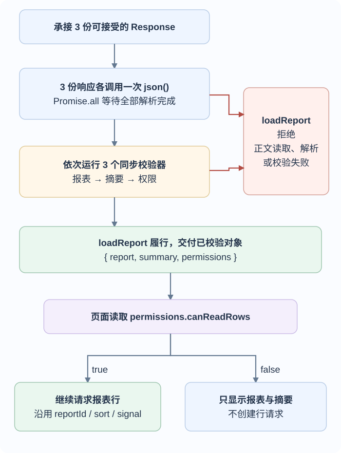

~~~javascript
async function loadReport(reportId, sort, signal) {
  const base = "/api/reports/" + encodeURIComponent(reportId);
  const paths = [
    base + "?sort=" + encodeURIComponent(sort),
    base + "/summary",
    base + "/permissions",
  ];

  const responses = await Promise.all(
    paths.map(path => fetch(path, { signal }))
  );

  const failed = responses.find(response => !response.ok);
  if (failed) throw new Error("HTTP " + failed.status);

  const [rawReport, rawSummary, rawPermissions] = await Promise.all(
    responses.map(response => response.json())
  );

  // 三个校验器同步返回已校验值；数据不符时同步抛错。
  return {
    report: validateReport(rawReport),
    summary: validateSummary(rawSummary),
    permissions: validatePermissions(rawPermissions),
  };
}
~~~

按时间顺序看这段代码：

1. 第一轮 `Promise.all` 等三个 Fetch Promise 全部履行。任一项拒绝时，它尽早以该原因拒绝，但不会取消另外两项已经发出的请求。
2. 三份 `Response` 都到达后，代码按输入顺序检查状态。所以即使报表的 404 最先到达，也要等另外两份响应到齐才被发现。有一项不成功就抛错，三份正文都不会读取。
3. 状态都成功后，第二轮同时调用三个 `json()`。任一项解析拒绝，后面的校验都不运行。
4. 三个校验器依次同步返回，或同步抛错。如果把校验器改成 `async` 函数，返回对象里的字段会变成 Promise：外层 `async` 函数不会递归等待普通对象的属性。

本例假设权限接口返回 `{ canReadRows: true }`，这是教学用的合成字段。页面持有中止控制器，在 `await loadReport(...)` 之后按权限分支：

~~~javascript
const controller = new AbortController();
window.addEventListener("pagehide", () => controller.abort(), { once: true });

const data = await loadReport("42", "recent", controller.signal);
if (data.permissions.canReadRows) {
  // 继续读取报表行，见迭代器与生成器一章
} else {
  // 只显示报表和摘要
}
~~~

前端分支只决定要不要继续请求；明细 API 仍须在服务端独立验证调用者的读取权限。三项 Fetch 共用同一个 signal，页面离开时调用 `abort()`，Fetch 按自己的中止规则停止；Promise 组合器不会替页面调用 `abort()`。

### 组合器各在什么时候结束

`Promise.all` 适合“全部必需”。其他需求选其他 combinator (组合器)：

| 方法 | 组合 Promise 何时结束 | 空输入 | 报表页中的用途 |
| --- | --- | --- | --- |
| `Promise.all` | 全部履行才履行，结果数组按输入顺序；任一拒绝就拒绝 | 履行为 `[]` | 报表、摘要和权限都必需 |
| `Promise.allSettled` | 所有输入都结算后履行，每项给出 `status` 和 `value` 或 `reason` | 履行为 `[]` | 每个独立小部件分别显示成功或失败 |
| `Promise.any` | 首个履行就履行；全部拒绝才以 `AggregateError` 拒绝 | 以 `errors` 为空的 `AggregateError` 拒绝 | 多个镜像端点任一成功即可 |
| `Promise.race` | 首个结算的输入决定结果 | 永远 pending | 观察任务和计时器谁先结束 |

四个方法都接收同步 iterable (可迭代对象)，都只决定组合 Promise 何时结算：没赢的、没被等到的输入仍在继续，可能还会产生副作用。传入的若是已经启动的请求，任何组合器都无法限流；要做到“有空槽才发起”，得把任务写成工厂交给[有界并发池](#%E6%9C%89%E7%95%8C%E5%B9%B6%E5%8F%91%E6%B1%A0%EF%BC%9A%E4%BA%94%E9%A1%B5%E6%98%8E%E7%BB%86%EF%BC%8C%E5%90%8C%E6%97%B6%E6%9C%80%E5%A4%9A%E4%B8%A4%E9%A1%B5)。

> [!example] 完成顺序不改变结果位置
> 请求 A 在 20 ms 后履行 `2`，请求 B 在 60 ms 后履行 `5`。A 先完成，但 `Promise.all([A, B])` 给出 `[2, 5]`，相加得 `7`。
>
> 换成 A 在 50 ms 后履行 `10`、B 在 30 ms 后履行 `-12`：这次 B 先完成，结果仍是 `[10, -12]`，相加得 `-2`。任一项拒绝时 `Promise.all` 拒绝，另一项照样继续运行。

### 组合器怎样保持输入顺序

原生组合器同步遍历输入，对每一项调用 `Promise.resolve`，再注册一个记得自己位置的处理器。第二项先结算，它的处理器也只写入第二个位置，所以结果顺序取决于输入顺序，与完成先后无关。

`Promise.resolve` 采用普通 thenable 时分两步：读取 `then` 属性是同步的，调用取到的 `then` 函数则排成一个稍后的 Promise 作业：

~~~javascript
const events = [];
const thenable = {
  get then() {
    events.push("读取 then");
    return resolve => {
      events.push("调用 then");
      resolve("摘要已到");
    };
  },
};

Promise.resolve(thenable).then(value => events.push(value));
events.push("当前同步代码结束");
// 立即：["读取 then", "当前同步代码结束"]
// 随后再依次追加 "调用 then"、"摘要已到"
~~~

下面折叠的实现只用来观察这套最小机制，不能当 polyfill 用：它假设普通内建 `Promise`，不模拟子类构造器、`Symbol.species`，也不防御恶意 thenable。

> [!example]- 教学实现：四个 Promise 组合器
>
> ~~~javascript
> function allTeaching(iterable) {
>   return new Promise((resolve, reject) => {
>     const values = [];
>     let remaining = 1; // 哨兵：同步遍历还没结束
>     let index = 0;
>
>     for (const item of iterable) {
>       const current = index++;
>       remaining++;
>       Promise.resolve(item).then(value => {
>         values[current] = value;
>         if (--remaining === 0) resolve(values);
>       }, reject);
>     }
>
>     if (--remaining === 0) resolve(values);
>   });
> }
>
> function allSettledTeaching(iterable) {
>   return new Promise(resolve => {
>     const results = [];
>     let remaining = 1;
>     let index = 0;
>
>     for (const item of iterable) {
>       const current = index++;
>       remaining++;
>       Promise.resolve(item).then(
>         value => {
>           results[current] = { status: "fulfilled", value };
>           if (--remaining === 0) resolve(results);
>         },
>         reason => {
>           results[current] = { status: "rejected", reason };
>           if (--remaining === 0) resolve(results);
>         }
>       );
>     }
>
>     if (--remaining === 0) resolve(results);
>   });
> }
>
> function anyTeaching(iterable) {
>   return new Promise((resolve, reject) => {
>     const errors = [];
>     let remaining = 1;
>     let index = 0;
>
>     for (const item of iterable) {
>       const current = index++;
>       remaining++;
>       Promise.resolve(item).then(resolve, reason => {
>         errors[current] = reason;
>         if (--remaining === 0) {
>           reject(new AggregateError(errors, "没有输入履行"));
>         }
>       });
>     }
>
>     if (--remaining === 0) {
>       reject(new AggregateError(errors, "没有输入履行"));
>     }
>   });
> }
>
> function raceTeaching(iterable) {
>   return new Promise((resolve, reject) => {
>     for (const item of iterable) {
>       Promise.resolve(item).then(resolve, reject);
>     }
>     // 空输入没有能决定胜负的项，结果保持 pending。
>   });
> }
> ~~~
>
> `remaining` 从 `1` 开始，把“同步遍历还在进行”也算作一个未完成项，防止遍历途中就提前履行。两项 `all` 的计数经历 `1 → 2 → 3`，遍历结束减掉哨兵成为 `2`，两个处理器各减一次，归零时履行。空输入是 `1 → 0`，组合 Promise 当场履行 `[]`，但之后附加的 `.then()` 仍要稍后才运行。`any` 用同一个哨兵等待全部拒绝，并按输入位置登记原因。
>
> 规范里的同步遍历还有几条边界。读取普通 thenable 的 `then` 取值器时抛错，该项变成一个拒绝的 Promise，组合器继续读取后续项。已经取出一项、但处理它时同步抛错（例如已有 Promise 的 `constructor` 取值器抛错），组合 Promise 拒绝，并调用尚未耗尽的迭代器的可选 `return()` 关闭它。内建 Promise 走 `Promise.resolve` 捷径后，组合器仍会在同步遍历中读取并调用它的 `then`。如果是 `iterator.next()` 自己抛错，或读取结果的 `done` / `value` 时抛错，规范把迭代记录标为已完成，组合 Promise 拒绝，但不再调用 `return()`。

### 进阶：多条 Promise 链的处理器怎样交错

推导顺序时，要分清“注册处理器”和“把处理器作业放进队列”：

- 对已履行的 Promise 调用 `.then`，处理器作业立即入队；
- 对待定的 Promise 调用 `.then`，只保存一条 reaction (反应记录)，等它结算才入队；
- 一个作业运行后若使下游 Promise 履行，下游已保存的 reaction 排到队尾。

第一组代码里，两个源 Promise 都已履行，同步代码先把处理器 `0` 和 `2` 排进队列。`0` 运行后，它的下游处理器 `1` 才入队，排在 `2` 后面：

~~~javascript
Promise.resolve().then(() => console.log(0)).then(() => console.log(1));
Promise.resolve().then(() => console.log(2)).then(() => console.log(3));
// 0, 2, 1, 3
~~~

处理器返回 Promise 时，“采用”它要多出两个作业。看这段代码：

~~~javascript
Promise.resolve().then(() => {
  console.log(0);
  return Promise.resolve(4);
}).then(value => console.log(value));

Promise.resolve().then(() => console.log(1))
  .then(() => console.log(2))
  .then(() => console.log(3))
  .then(() => console.log(5))
  .then(() => console.log(6));
// 0, 1, 2, 3, 4, 5, 6
~~~

下表追踪它的微任务队列，最左侧是下一个要运行的作业：

| 步骤 | 动作 | 队列 |
| --- | --- | --- |
| 起始 | 两条链的首个处理器注册在已履行的 Promise 上 | `[输出 0, 输出 1]` |
| 1 | 输出 0 的处理器返回 `Promise.resolve(4)`，解析流程安排采用作业 | `[输出 1, 采用]` |
| 2 | 输出 1 运行，下游处理器入队 | `[采用, 输出 2]` |
| 3 | 采用作业调用所返回 Promise 的 `then`；它已以 `4` 履行，转发作业入队 | `[输出 2, 转发 4]` |
| 4 | 输出 2 运行，输出 3 排到队尾 | `[转发 4, 输出 3]` |
| 5 | 转发作业履行第一条链的下游 Promise，输出 4 才入队 | `[输出 3, 输出 4]` |

所以 `4` 排在 `3` 之后。下面两段再看多条链怎样交错。本节三段代码的输出都在 Node.js v26.13.1（CommonJS）逐段运行得到，原稿在 v26.13.0 得到相同顺序；它们展示的是这些例子里的入队关系，不是跨宿主通用的“第几个 tick”公式：

~~~javascript
Promise.resolve().then(() => console.log(0))
  .then(() => console.log(1)).then(() => console.log(2));
Promise.resolve().then(() => console.log(3))
  .then(() => console.log(4)).then(() => console.log(5));
Promise.resolve().then(() => console.log(6))
  .then(() => console.log(7)).then(() => console.log(8));
// 0, 3, 6, 1, 4, 7, 2, 5, 8
~~~

~~~javascript
Promise.resolve().then(() => {
  console.log(0);
  return Promise.resolve(1);
}).then(() => console.log(2)).then(() => console.log(3));

Promise.resolve().then(() => {
  console.log(4);
  return Promise.resolve(5);
}).then(() => console.log(6)).then(() => console.log(7));
// 0, 4, 2, 6, 3, 7
~~~

最后一段里，两条链各自的“采用”和“转发”交替进行，于是 `2` 和 `6` 都要等两个额外作业。旧的 Promise reaction 顺序练习原页仍在[归档入口](../../archive/front-end/Deprecated_Interview_Notes/promise-reaction-order-exercises.md)。这些顺序只涉及微任务之间；不要把它推成浏览器计时器、绘制和 Promise 之间的固定先后。

### 拿到结果之后：不再需要的请求怎样停下？

本章交出的 `loadReport` 契约是：三项数据全部成功、解析并通过校验才履行；任一步失败就拒绝，但已经启动的其他请求不会因此停下。Promise 只负责传递结果和失败，限流、超时和取消都要另外实现。下一章[取消、超时和并发上限各自停得住什么？](#28.%20%E5%8F%96%E6%B6%88%E3%80%81%E8%B6%85%E6%97%B6%E5%92%8C%E5%B9%B6%E5%8F%91%E4%B8%8A%E9%99%90%E5%90%84%E8%87%AA%E5%81%9C%E5%BE%97%E4%BD%8F%E4%BB%80%E4%B9%88%EF%BC%9F)从这里接手：`signal` 能让哪些工作停下，`Promise.race` 超时又为什么只是停止等待。`canReadRows` 为真之后怎样逐页读取行，见[迭代器和生成器一章](#29.%20%E8%BF%AD%E4%BB%A3%E5%99%A8%E5%92%8C%E7%94%9F%E6%88%90%E5%99%A8%E6%80%8E%E6%A0%B7%E6%8C%89%E9%9C%80%E4%BA%A7%E5%87%BA%E5%80%BC%EF%BC%8C%E6%8F%90%E5%89%8D%E9%80%80%E5%87%BA%E6%97%B6%E6%80%8E%E6%A0%B7%E6%B8%85%E7%90%86%EF%BC%9F)。

> [!info]- 来源
> - **Promise 状态、执行器、then 链、thenable 采用、`finally`、组合器与 async 函数（全章）。** [ECMAScript 2027 草案（2026-11-08）](https://tc39.es/ecma262/)，核对日期：2026-11-12。异步函数 §15.8，迭代抽象操作 §7.4，Promise §27.5；对应 [Promise 对象](https://tc39.es/ecma262/#sec-promise-objects)、[`Promise.resolve`](https://tc39.es/ecma262/#sec-promise.resolve)、[thenable 采用作业](https://tc39.es/ecma262/#sec-newpromiseresolvethenablejob)、[`Promise.all`](https://tc39.es/ecma262/#sec-promise.all)、[`allSettled`](https://tc39.es/ecma262/#sec-promise.allsettled)、[`any`](https://tc39.es/ecma262/#sec-promise.any)、[`race`](https://tc39.es/ecma262/#sec-promise.race)、[`finally`](https://tc39.es/ecma262/#sec-promise.prototype.finally)、[PerformPromiseThen](https://tc39.es/ecma262/#sec-performpromisethen)、[TriggerPromiseReactions](https://tc39.es/ecma262/#sec-triggerpromisereactions)、[NewPromiseReactionJob](https://tc39.es/ecma262/#sec-newpromisereactionjob)、[IteratorStepValue](https://tc39.es/ecma262/#sec-iteratorstepvalue)、[IteratorClose](https://tc39.es/ecma262/#sec-iteratorclose)、[async function definitions](https://tc39.es/ecma262/#sec-async-function-definitions)。
> - **“Promise 的状态与执行器时机”中的宿主队列。** 浏览器把 Promise 作业放进微任务队列并在检查点运行：[WHATWG HTML §8.1.6.6.4 HostEnqueuePromiseJob](https://html.spec.whatwg.org/multipage/webappapis.html#hostenqueuepromisejob)、[§8.1.7 Event loops](https://html.spec.whatwg.org/multipage/webappapis.html#event-loops)、[Perform a microtask checkpoint](https://html.spec.whatwg.org/multipage/webappapis.html#perform-a-microtask-checkpoint)，Living Standard 更新时间 2026-11-11。计时器最短延迟见 [HTML §8.7 Timers](https://html.spec.whatwg.org/multipage/timers-and-user-prompts.html#timers)。Node.js 的 `process.nextTick()`、`queueMicrotask()` 与 Promise 微任务边界见 [Node.js v26.13.0 Process](https://nodejs.org/download/release/v26.13.0/docs/api/process.html#when-to-use-queuemicrotask-vs-processnexttick)。
> - **“fetch 履行不等于请求成功”表。** [WHATWG Fetch §2.2.6 Responses](https://fetch.spec.whatwg.org/#responses)、[Response.ok](https://fetch.spec.whatwg.org/#dom-response-ok)（200–299）、[§5.3 Body mixin 与 `json()`](https://fetch.spec.whatwg.org/#dom-body-json)、[Main fetch](https://fetch.spec.whatwg.org/#main-fetch)、[§5.5 Abort a fetch](https://fetch.spec.whatwg.org/#abort-fetch)，Living Standard 更新时间 2026-10-19，核对日期 2026-11-12。HTTP 非成功状态仍产生 Response；网络错误与中止使 Fetch Promise 拒绝；中止会使仍在读取的正文出错。
> - **“loadReport”中的页面中止。** [WHATWG DOM §3 Aborting ongoing activities](https://dom.spec.whatwg.org/#aborting-ongoing-activities)，Living Standard 更新时间 2026-11-11：Promise 本身没有内建中止，API 自行选择是否接受 `AbortSignal`。
> - **TypeScript 类型擦除一句。** [TypeScript Handbook：Erased Types](https://www.typescriptlang.org/docs/handbook/2/basic-types.html#erased-types)，访问日期 2026-11-12。
> - **“进阶：多条 Promise 链的处理器怎样交错”输出与本章其他示例输出。** 原稿在 Node.js v26.13.0 运行；本次在 Node.js v26.13.1（ESM 与 CommonJS 顺序一致）重跑四段交错代码、thenable 取值时序、`finally` 结果传递和空输入组合器，结果相同。
## 28. 取消、超时和并发上限各自停得住什么？

本章区分三种常被混为一谈的“停”：超时停止等待、`AbortSignal` 请求取消、并发上限推迟启动，并说明每一种停不住什么。读者手上有[上一章的 `loadReport`](#%E4%B8%89%E9%A1%B9%E8%AF%B7%E6%B1%82%E4%B8%80%E8%B5%B7%E7%AD%89%EF%BC%9AloadReport)：它同时发出三个 Fetch，把页面的 `signal` 传给每一个，并且知道 Promise 组合器不会取消没被等到的工作。本章沿用主线一的报表页，新增五页已知页码的明细行，用它演示有界并发；最后用一个独立的 LazyMan 小例子看串行任务队列。

### 三种“停”分别停住什么

Promise 没有通用的取消操作。拿到一个 Promise，只能决定还等不等它，不能让产生它的工作停下。前端常用的三种手段作用在不同对象上：

| 手段 | 真正停住什么 | 停不住什么 |
| --- | --- | --- |
| 超时竞速（`Promise.race` 与计时器） | 调用方不再等待：先到的拒绝决定结果 | 底层工作仍可能继续，并在之后完成或产生副作用 |
| `AbortSignal`（中止信号） | 接受并监听这个 signal 的 API 按自己的规则停止，例如 Fetch 中止请求和正文读取 | 忽略 signal 的代码、普通 Promise、同步函数；服务端已经收到并执行的写入 |
| 并发上限（任务池的 `limit`） | 还没启动的任务暂时不启动 | 已经启动的任务；任务内部另外发起、却没纳入返回值的工作 |

`AbortSignal` 是 cooperative cancellation (协作式取消)：发出信号的一方只是请求停止，接收方要自己检查 `signal.aborted`、监听 `abort` 事件，或把 signal 继续传给支持它的 API。它也只作用在本地：请求已经到达服务器、写入已经执行，客户端中止只是不再等结果。结果不明的写入怎样对账，见[外部写入与对账](../../ai-engineering/runs/external-writes-and-reconciliation.md)。

### AbortSignal 怎样传到工作里

`AbortController`（中止控制器）由拥有这项工作生命周期的一方持有，例如页面；它的 `controller.signal` 交给工作方。调用 `controller.abort(reason)` 后，`signal.aborted` 变为 `true`，`signal.reason` 记下原因（不传时是名为 `AbortError` 的 `DOMException`），并派发一次 `abort` 事件。

Fetch 收到中止后落在哪一步，取决于它进行到哪里：`Response` 交出之前中止，Fetch Promise 以 `signal.reason` 拒绝；正文还在读取时中止，`json()` 拒绝；`json()` 已经履行后中止，不会撤回结果。完整的步骤表在[上一章“fetch 履行不等于请求成功”](#fetch%20%E5%B1%A5%E8%A1%8C%E4%B8%8D%E7%AD%89%E4%BA%8E%E8%AF%B7%E6%B1%82%E6%88%90%E5%8A%9F)。

应用自己写的异步代码要在边界处主动检查信号：开始一步之前看 `signal.aborted`，一步做完、准备要下一项之前再看一次。[游标分页的消费循环](#%E6%B8%B8%E6%A0%87%E5%88%86%E9%A1%B5%E7%9A%84%E5%BC%82%E6%AD%A5%E7%94%9F%E6%88%90%E5%99%A8)就在每行追加前后各查一次。

### 用计时器等待：sleep

~~~javascript
function sleep(millis) {
  return new Promise(resolve => setTimeout(resolve, millis));
}

const start = Date.now();
sleep(100).then(() => console.log(Date.now() - start)); // 约 100 ms 或更久
~~~

`sleep` 只等一个宿主计时器，不阻塞当前线程。计时器的延迟到期，只表示回调从此可以被调度：它不会打断正在运行的 JavaScript，负载重时回调还会更晚运行。计时器怎样排进事件循环，见[事件循环怎样安排任务、微任务和渲染？](#2.%20%E4%BA%8B%E4%BB%B6%E5%BE%AA%E7%8E%AF%E6%80%8E%E6%A0%B7%E5%AE%89%E6%8E%92%E4%BB%BB%E5%8A%A1%E3%80%81%E5%BE%AE%E4%BB%BB%E5%8A%A1%E5%92%8C%E6%B8%B2%E6%9F%93%EF%BC%9F)。浏览器的 `setTimeout` / `setInterval` 返回数值 ID，Node.js 返回 `Timeout` 对象；TypeScript 里对应哪种类型，取决于项目选择的宿主类型声明。

### 超时包装只停止等待

下面的 `timeLimit` 让一次调用与计时器竞速，先结束的一方决定调用方看到的结果：

~~~javascript
function timeLimit(fn, millis) {
  // 在 ES module 或严格模式中定义，调用时的 this 才原样传递。
  return function (...args) {
    let timerId;
    const timeout = new Promise((_, reject) => {
      timerId = setTimeout(
        () => reject(new Error("Time Limit Exceeded")),
        millis
      );
    });

    let work;
    try {
      work = Promise.resolve(fn.apply(this, args));
    } catch (error) {
      work = Promise.reject(error);
    }

    return Promise.race([work, timeout])
      .finally(() => clearTimeout(timerId));
  };
}
~~~

包装器返回普通函数而不是箭头函数，以便用 `fn.apply(this, args)` 转发调用时的 `this`；转发参数和 `this` 的通则见[怎样包装一个函数而不弄丢参数、this 和结果？](#25.%20%E6%80%8E%E6%A0%B7%E5%8C%85%E8%A3%85%E4%B8%80%E4%B8%AA%E5%87%BD%E6%95%B0%E8%80%8C%E4%B8%8D%E5%BC%84%E4%B8%A2%E5%8F%82%E6%95%B0%E3%80%81this%20%E5%92%8C%E7%BB%93%E6%9E%9C%EF%BC%9F)。`try/catch` 把 `fn` 的同步抛错转成拒绝，工作先结束时 `finally` 清掉还没触发的计时器。只有超时回调真正运行了，结果才是超时拒绝；即便如此，`fn` 的工作仍会继续。

> [!example] 50 ms 的等待上限不是 50 ms 后强行中断
> - 请求要 100 ms 才完成，`timeLimit(request, 50)` 在超时回调得到调度后拒绝调用方，底层请求还在继续。
> - 函数等待 120 ms 后返回两参数之和，`timeLimit(fn, 150)(5, 10)` 在正常调度下得到 `15`。
> - 函数同步抛错时，拒绝立刻传播，计时器被清除，不必等满预算。
> - 函数同步占用 80 ms，再返回一个已履行的 Promise。80 ms 里计时器无法抢占 JavaScript；同步代码让出后，`work` 的处理器是微任务，先于已到期的计时器任务运行，所以这次调用成功。50 ms 不是硬实时截止线。

要让超时真正停止支持取消的工作，超时触发时应调用控制器的 `abort()`，或者直接把 DOM 标准提供的 `AbortSignal.timeout(ms)` 交给 Fetch：它到时自动中止，`reason` 是名为 `TimeoutError` 的 `DOMException`。

> [!info] TypeScript 的 this 参数不改变运行时调用
> 可以用显式 this 参数写出包装函数的调用类型；它在编译时擦除，不是实际传入的第一个参数。运行时仍要用普通 function 接住调用上下文，再用 `fn.apply(this, args)` 调用原函数。
>
> ~~~typescript
> type TimedFunction<This, Args extends unknown[], Result> =
>   (this: This, ...args: Args) => Promise<Result>;
> ~~~

### 取消计时器：哪些调用还会发生

一次性计时器可以把 ID 封进取消函数。下面的输入来自常见的计时器练习：给定 `fn`、参数 `args` 和延迟 `t`（毫秒，即代码里的 `millis`），在 `cancelT` 毫秒时调用返回的取消函数：

~~~javascript
function cancellable(fn, args, millis) {
  const timerId = setTimeout(() => fn(...args), millis);
  return () => clearTimeout(timerId);
}
~~~

| 输入 | 预期调用 | 原因 |
| --- | --- | --- |
| `fn(x)=x*5`，`args=[2]`，`t=20`，`cancelT=50` | 约 20 ms 调用一次，结果 `10` | 回调先运行，之后的取消撤不回它 |
| `fn(x)=x²`，`args=[2]`，`t=100`，`cancelT=50` | 不调用 | 取消时回调仍在等待 |
| `fn(x,y)=x*y`，`args=[2,4]`，`t=30`，`cancelT=100` | 约 30 ms 调用一次，结果 `8` | 回调在取消前已完成 |

`clearTimeout` 只能清掉还没执行的回调，不打断已开始运行的函数，也不把函数结果交给 `cancellable` 的调用者。`fn` 依赖 `this` 时，要显式传接收者或先绑定。

重复计时器版本要求先立即调用一次，再按间隔安排后续调用：

~~~javascript
function cancellableInterval(fn, args, millis) {
  fn(...args); // 第一次同步调用
  const intervalId = setInterval(() => fn(...args), millis);
  return () => clearInterval(intervalId);
}
~~~

| 输入 | 理想化调用时刻 | 每次结果 |
| --- | --- | --- |
| `fn(x)=2*x`，`args=[4]`，`t=35`，`cancelT=190` | `0, 35, 70, 105, 140, 175 ms` | `8` |
| `fn(x,y)=x*y`，`args=[2,5]`，`t=30`，`cancelT=165` | `0, 30, 60, 90, 120, 150 ms` | `10` |
| `fn(x,y,z)=x+y+z`，`args=[5,1,3]`，`t=50`，`cancelT=180` | `0, 50, 100, 150 ms` | `9` |

表里的毫秒是题目输入，不是计时保证。`setInterval` 不等待回调返回的 Promise：`fn` 是异步函数且一次执行比间隔长时，下一次调用照样开始，多次调用会重叠。`clearInterval` 只阻止以后的回调，不取消已经启动的 Promise 工作；重叠和失败策略要由调用方另外规定，例如改用“上一次结束后再 `setTimeout` 下一次”。

### 把任务写成工厂，才能控制何时启动

`fetch(url)` 一调用就发出请求。如果先创建五个 Fetch Promise 再交给 `Promise.all`，五个请求在创建时就已全部发出，组合器只能等结果，无从控制启动时机。

报表 42 在 `canReadRows === true` 之后要读取明细行，共五页，页码事先已知。要控制何时启动，就把每页写成 task factory (任务工厂)：一个被调用时才发起请求的函数。下面的 `map` 只生成五个函数，此时一页也没请求：

~~~javascript
function createPageTasks(reportId, sort) {
  return [1, 2, 3, 4, 5].map(page => async ({ signal }) => {
    const query = new URLSearchParams({ page: String(page), sort });
    const url =
      "/api/reports/" + encodeURIComponent(reportId) + "/rows?" + query;
    const response = await fetch(url, { signal });
    if (!response.ok) throw new Error("页 " + page + " 请求失败");
    return response.json();
  });
}
~~~

任务池只能看到工厂返回的 Promise，并在它结算后释放槽位。工厂启动了别的工作却提前返回，池会释放槽位，那项工作仍在继续；工厂内部再并发发起多项工作，池也无法分别限流。

本例的工厂就有这种情况。状态不是 2xx 时，工厂检查 `response.ok` 后立即抛错，但没有读取或取消这条响应的正文流：工厂的 Promise 已经结算、槽位已经释放，正文流却可能还开着。状态成功时，工厂要等 `response.json()` 读完并解析才结算。所以 `limit` 限制的是池正在等待的任务数，不是 HTTP 请求、连接或响应体流的数量。

### 有界并发池：五页明细，同时最多两页

本例要求同时进行的任务不超过两个。`2` 是案例给定的资源限制，不是通用最佳值。任务池 `runBounded(tasks, limit, options)` 接收一个同步 iterable，其中每项都是任务工厂；它最多同时运行 `limit` 个工厂调用，调用时传入 `{ signal, index }`。

调度过程如下：

1. `nextIndex` 记录下一个输入位置，`active` 集合保存正在运行的任务，`peakActive` 记录同时运行任务数的峰值。
2. 有空槽时，不断取出下一项并启动。
3. 槽位填满后，用 `Promise.race` 等“某个任务结算”与“池收到停止通知”中先发生的一个。
4. 任务结算腾出槽位，回到第 2 步。每项结果写入 `results[index]`，完成先后不改变结果位置。

关键问题是某个任务失败后怎么办。池支持两种 failure policy (失败策略)：`stop` 遇到失败就停止，`collect` 收集每项结果后继续。为看清过程，下图把五页缩成三页合成输入：页 1 用 30 ms 得到 `"A"`；页 2 用 10 ms 以 `new Error("B failed")` 拒绝；页 3 启动后用 20 ms 得到 `"C"`。这些延迟是合成值，只表达完成先后。


页码从 1 开始，工厂的 `index` 从 0 开始，所以页 2 对应 `results[1]`。同一个错误在两种策略下的结局：


| 时刻 | 活动状态 | `failure: "stop"` | `failure: "collect"` |
| --- | --- | --- | --- |
| `0 ms` | 页 1、页 2 启动，活动数 `2` | `peakActive = 2` | `peakActive = 2` |
| `10 ms` | 页 2 拒绝，页 1 仍在运行 | 记下首个失败，停止取项，尝试调用一次迭代器的 `return()`；页 3 不启动 | 在 `results[1]` 记下拒绝，腾出的槽位启动页 3 |
| `30 ms` | 页 1 完成；`collect` 下页 3 也在此刻完成（10 + 20） | 排空后以 `new Error("B failed")` 拒绝 | 履行三条按位置排列的记录：A、错误、C；峰值仍是 `2` |

`stop` 是默认策略。它停止取项后，对还没取完的输入迭代器调用一次可选的 `return()`，通知它提前结束（例如让生成器执行 `finally`），然后等已启动的任务全部结算，这一步叫 drain (排空)，最后以首个停止原因拒绝。一次 `return()` 不保证迭代器完成了自己的清理；排空也只表示池不再等任何任务，不回滚已完成的写入，不强行终止忽略 signal 的工作。

`collect` 为每个实际启动的任务保存一条记录：`{ status: "fulfilled", value }` 或 `{ status: "rejected", reason }`。它在失败后继续填充空槽，直到输入取完、活动任务全部结算。没有启动的任务没有记录。

### 页面离开时：abort 停止调度，不终止任务

用户离开页面时，页面调用 `controller.abort()`；池把这个 `pageSignal` 同时用作自己的停止信号，并传给每个工厂。收到 `abort` 后，池停止取项，尝试一次 `return()`，并立即唤醒等待中的调度器。Fetch 按自己的规则中止；如果某个任务忽略信号或永远不结算，池就一直等下去。

| 时刻 | 池和输入 | 已启动的任务 |
| --- | --- | --- |
| `0 ms` | 页 1、页 2 启动，活动数 `2` | 两个工厂收到同一个 `pageSignal` |
| `5 ms`，页面调用 `abort()` | 停止取项，尝试 `return()` 一次，不启动页 3，唤醒调度器 | 支持中止的 Fetch 收到信号；忽略它的工作继续运行 |
| 已启动任务全部结算后 | 以首个停止原因拒绝池调用 | 不再启动新任务 |

任务失败和 abort 都走池内部的 `stop(reason)`，停止原因以最先的那次为准：`stop` 策略下页 2 的失败先到，后来的 abort 不会替换它；abort 先到，随后的任务失败也不替换中止原因。`collect` 不因单项失败停止，但外部 abort 仍会停止整池并拒绝。

“页面离开就取消”和“任一任务失败就取消兄弟请求”是两项独立策略。本例只把页面的信号传给任务，任务失败不会调用 `abort()`；需要失败时中止在途请求，要另建控制器并写明策略。

调用方在权限校验通过后创建任务，选用 `collect`，让单页失败不影响其他页：

~~~javascript
const pageSignal = controller.signal;
const pageTasks = createPageTasks("42", "recent");
const { results, peakActive } = await runBounded(pageTasks, 2, {
  failure: "collect",
  signal: pageSignal,
});

for (const [index, result] of results.entries()) {
  if (result.status === "fulfilled") console.log(index, result.value);
  else console.error(index, result.reason);
}
~~~

外部 abort、输入迭代器出错或非法任务项会让整个池拒绝，此时 `await runBounded(...)` 抛出原因，拿不到 `results`。

如果事先不知道页码，每一页要等上一页返回 `nextCursor` 才能确定，就无法提前构造这组任务，只能顺序读取，见[游标分页的异步生成器](#%E6%B8%B8%E6%A0%87%E5%88%86%E9%A1%B5%E7%9A%84%E5%BC%82%E6%AD%A5%E7%94%9F%E6%88%90%E5%99%A8)。

### 教学实现：runBounded

这份实现的契约：

- `limit` 必须是大于 0 的安全整数；`failure` 只能是 `"stop"` 或 `"collect"`。
- 输入是同步可迭代对象，逐项产出的值必须是函数；池只在有空槽时以 `{ signal, index }` 调用它。输入中尚未取到的项不检查。
- 池仍在等待的任务数不超过 `limit`。成功时履行 `{ results, peakActive }`；`stop` 时以首个停止原因拒绝；`collect` 时履行已运行项的状态记录。
- 外部 abort、同步输入错误和非法任务项都会拒绝整个池，即使 `failure` 是 `"collect"`。
- 停止或 abort 后不再取项，并尝试对未耗尽的迭代器调用一次可选的 `return()`；清理异常不覆盖首个停止原因。池会等已启动任务的返回值结算。
- 不提供重试、异步迭代输入、持久配额或持久化。

还有一种重入边界：池调用 `iterator.next()` 时会运行输入方的代码，这段代码可能同步触发 abort。本实现只处理 `next()` 函数体内同步触发 abort、且返回普通数据属性结果的情况：返回 `{ done: true }` 时，池记下输入已取完，不再调用 `return()`；返回 `{ done: false, value: task }` 时，池调用一次 `return()`，不启动刚取到的任务。结果对象的 `done` 或 `value` 若是自定义取值器，读取时还会运行别的代码，这种情况不在本实现范围内。

> [!example]- 完整代码：runBounded
>
> ~~~javascript
> async function runBounded(tasks, limit, { failure = "stop", signal } = {}) {
>   if (!Number.isSafeInteger(limit) || limit < 1) {
>     throw new RangeError("limit 必须是正整数");
>   }
>   if (failure !== "stop" && failure !== "collect") {
>     throw new TypeError('failure 必须是 "stop" 或 "collect"');
>   }
>   if (tasks == null || typeof tasks[Symbol.iterator] !== "function") {
>     throw new TypeError("tasks 必须是同步 iterable");
>   }
>
>   const iterator = tasks[Symbol.iterator]();
>   if (iterator == null || typeof iterator.next !== "function") {
>     throw new TypeError("tasks 必须产生 iterator");
>   }
>
>   const results = [];
>   const active = new Set();
>   let nextIndex = 0;
>   let activeCount = 0;
>   let peakActive = 0;
>   let exhausted = false;
>   let pulling = false;
>   let returnAfterNext = false;
>   let iteratorReturnAttempted = false;
>   let stopped = false;
>   let stopReason;
>   let wakeStop;
>   const stopSignal = new Promise(resolve => {
>     wakeStop = resolve;
>   });
>
>   function attemptIteratorReturn() {
>     if (iteratorReturnAttempted || exhausted) return;
>     iteratorReturnAttempted = true;
>     const returnMethod = iterator.return;
>     if (returnMethod == null) return;
>     if (typeof returnMethod !== "function") {
>       throw new TypeError("iterator.return 必须是函数");
>     }
>     const result = returnMethod.call(iterator);
>     if (result === null ||
>         (typeof result !== "object" && typeof result !== "function")) {
>       throw new TypeError("iterator.return 必须返回对象");
>     }
>   }
>
>   function attemptIteratorReturnSafely() {
>     try {
>       attemptIteratorReturn();
>     } catch {
>       // 清理错误不覆盖原先确定的失败或 abort reason。
>     }
>   }
>
>   function stop(reason) {
>     if (!stopped) {
>       stopped = true;
>       stopReason = reason;
>     }
>     if (pulling) returnAfterNext = true;
>     else attemptIteratorReturnSafely();
>     wakeStop();
>   }
>
>   const onAbort = () => stop(signal.reason);
>   if (signal) {
>     if (signal.aborted) onAbort();
>     else signal.addEventListener("abort", onAbort, { once: true });
>   }
>
>   async function runTask(task, index) {
>     activeCount++;
>     peakActive = Math.max(peakActive, activeCount);
>     try {
>       const value = await task({ signal, index });
>       results[index] = failure === "collect"
>         ? { status: "fulfilled", value }
>         : value;
>     } catch (reason) {
>       if (failure === "collect") {
>         results[index] = { status: "rejected", reason };
>       } else {
>         stop(reason);
>       }
>     } finally {
>       activeCount--;
>     }
>   }
>
>   try {
>     while (!stopped && !exhausted) {
>       while (!stopped && !exhausted && active.size < limit) {
>         if (signal?.aborted) {
>           stop(signal.reason);
>           break;
>         }
>
>         pulling = true;
>         let step;
>         try {
>           step = iterator.next();
>         } finally {
>           pulling = false;
>         }
>
>         if (step === null ||
>             (typeof step !== "object" && typeof step !== "function")) {
>           throw new TypeError("iterator.next 必须返回对象");
>         }
>         if (step.done) {
>           exhausted = true;
>           returnAfterNext = false;
>           break;
>         }
>         if (returnAfterNext) {
>           returnAfterNext = false;
>           attemptIteratorReturnSafely();
>         }
>         if (stopped || signal?.aborted) {
>           if (!stopped) stop(signal.reason);
>           break;
>         }
>
>         const task = step.value;
>         if (stopped || signal?.aborted) {
>           if (!stopped) stop(signal.reason);
>           break;
>         }
>         if (typeof task !== "function") {
>           throw new TypeError("第 " + nextIndex + " 项不是任务函数");
>         }
>
>         const index = nextIndex++;
>         let tracked;
>         tracked = runTask(task, index).finally(() => active.delete(tracked));
>         active.add(tracked);
>       }
>
>       if (!stopped && active.size > 0) {
>         await Promise.race([...active, stopSignal]);
>       }
>     }
>   } catch (error) {
>     stop(error);
>   }
>
>   if (stopped && !exhausted) attemptIteratorReturnSafely();
>   await Promise.all(active);
>   if (signal) signal.removeEventListener("abort", onAbort);
>   if (stopped) throw stopReason;
>   return { results, peakActive };
> }
> ~~~

`runTask` 在每项任务内部捕获抛错和拒绝，所以 `active` 里的 Promise 都不会拒绝，池可以统一等待。`Promise.race([...active, stopSignal])` 只用来在“任一任务结算”和“池已停止”之间唤醒调度器，不取消输掉的 Promise；最后的 `Promise.all(active)` 负责排空。

首个停止原因优先、尝试一次 `return()`、abort 后仍等待活动任务，都是这个教学池的应用层契约。ECMAScript 只规定迭代步骤怎样读取和调用 `return()`，DOM 和 Fetch 只规定哪些活动响应 `AbortSignal`；stop / collect 策略不来自任何标准。

### 小例子：LazyMan 链式任务队列

并发池管“同时最多几个”；有时需要的是“严格一个接一个”，且每项何时完成由任务自己说了算。报表页里没有自然的场景，所以换一个独立的合成例子 LazyMan：调用者一口气写完三条命令，希望之后依次看到吃水果、等待后醒来、吃面包。

~~~javascript
new LazyMan("Ada").eat("fruit").sleep(10).eat("bread");
~~~

整条链在当前同步代码里执行完，三项任务只是被放进实例自己的 `tasks` 数组；这个数组是应用维护的函数队列，不是宿主事件循环的任务队列。`"Ada"` 只是实例名，输出为突出顺序不打印名字。

~~~javascript
class LazyMan {
  constructor(name) {
    this.name = name;
    this.tasks = [];
    setTimeout(() => this.next(), 0);
  }

  eat(food) {
    this.tasks.push(() => {
      console.log("eat " + food);
      this.next();
    });
    return this;
  }

  sleep(ms) {
    this.tasks.push(() => {
      setTimeout(() => {
        console.log("wake up after " + ms + "ms");
        this.next();
      }, ms);
    });
    return this;
  }

  next() {
    const task = this.tasks.shift();
    if (task) task();
  }
}
~~~

三处设计各管一件事：

- **构造函数延后第一项。** 如果构造时直接调用 `next()`，`tasks` 还是空的，后面的 `.eat()`、`.sleep()` 都还没执行。改用 `setTimeout` 安排回调，JavaScript 不会在同步代码执行到一半时切去运行它，于是整条链先登记完。
- **登记方法只入队并返回 `this`。** closure (闭包) 记住入队时的 `food` 或 `ms`；箭头函数没有自己的 `this`，回调里的 `this` 仍是这个实例，见[函数里的变量和 this 从哪来？](#24.%20%E5%87%BD%E6%95%B0%E9%87%8C%E7%9A%84%E5%8F%98%E9%87%8F%E5%92%8C%20this%20%E4%BB%8E%E5%93%AA%E6%9D%A5%EF%BC%9F)。
- **`next()` 是类自己的普通方法**，不是任何宿主或 Promise 接口。第一次由构造函数的计时器回调调用，之后由每项任务在自己的工作完成时调用一次：`eat` 打印后立刻推进；`sleep` 轮到自己时才安排计时器并返回，等回调打印醒来消息后再推进。


| 阶段 | 队列剩余（左边先执行） | 正在执行的工作 | 谁触发下一步 |
| --- | --- | --- | --- |
| 链式调用结束 | `eat fruit → sleep 10 → eat bread` | 尚未启动 | 构造函数安排的计时器回调，等同步代码结束后运行 |
| 初始 `next()` | `sleep 10 → eat bread` | 打印 `eat fruit`，同步调用 `next()` | 当前调用 |
| 取出等待闭包 | `eat bread` | 安排延迟参数为 10 ms 的计时器后返回，队列暂停 | 稍后运行的计时器回调 |
| 等待回调运行 | `eat bread` | 打印醒来消息，调用 `next()` | 当前回调 |
| 最后一项 | 空 | 打印 `eat bread`，调用 `next()`；`shift()` 得到 `undefined`，结束 | 无 |

> [!example] Ada 的三条命令
> `sleep` 任务入队时并不等待；轮到它时才启动 10 ms 计时器，回调运行后队列才推进到面包任务。输出：
>
> ~~~text
> eat fruit
> wake up after 10ms
> eat bread
> ~~~
>
> 10 ms 是传给计时器的延迟参数，醒来日志只是复述它，不是实测时间。本例只依赖一个先后关系：等待回调运行后，队列才推进。

外部代码保存实例后再追加任务，结果取决于队列是否还在推进。在 `sleep` 等待期间调用 `.eat("cake")`，新闭包排在 `eat bread` 之后执行。链以 `.sleep(10)` 结尾时，等待闭包出队后 `tasks.length` 暂时为 0，但回调还没运行，此时追加的任务仍会在回调推进后执行。只有最后一项完成、`next()` 看到空队列返回之后，再追加的任务才不会自动运行：登记方法只入队，不会安排新的启动回调。

这个队列靠一条约定运转：调用者只登记任务，每个出队任务在完成时恰好调用一次 `next()`。由此可以列出它的失效方式：

- 漏调 `next()`，队列停住；
- 提前或重复调用，后续任务在当前工作完成前启动；调用者直接调用 `next()` 也会跳过尚未结束的等待；
- 任务抛错没有恢复策略；
- 等待中的计时器没有保存 ID，无法取消；
- 连续的同步任务经 `next()` 层层递归推进，任务很多时可能耗尽调用栈。

所以它只演示链式登记、闭包保存参数和显式推进。任务需要返回值、组合或把失败交给调用者时，应改用 Promise 链或 `async` 函数。

### 停下来之后：失败交给谁处理？

本章交出三条结论：超时竞速只停止等待；`AbortSignal` 只让接受它的 API 停下，且不撤销服务端副作用；并发上限只推迟未启动的任务工厂，`stop` / `collect` 决定失败后还启不启动新任务。无论用哪种手段，调用方最终收到的仍是一个履行或拒绝的 Promise。下一章[一次失败该由哪一层处理？](#30.%20%E4%B8%80%E6%AC%A1%E5%A4%B1%E8%B4%A5%E8%AF%A5%E7%94%B1%E5%93%AA%E4%B8%80%E5%B1%82%E5%A4%84%E7%90%86%EF%BC%9F)接手这个拒绝：它在哪一层恢复，哪一层只记录，取消原因又怎样与真正的错误分开。

> [!info]- 来源
> - **“三种停”与“AbortSignal 怎样传到工作里”：协作式取消、`reason`、`abort` 事件、`AbortSignal.timeout()`。** [WHATWG DOM §3 Aborting ongoing activities](https://dom.spec.whatwg.org/#aborting-ongoing-activities)，Living Standard 更新时间 2026-11-11。Promise 本身没有内建中止；API 可以选择接受、响应或忽略 `AbortSignal`。
> - **Fetch 中止的时点与响应体。** [WHATWG Fetch §5.5 Abort a fetch](https://fetch.spec.whatwg.org/#abort-fetch)、[§2.2.3 Statuses、§5.3 Body mixin](https://fetch.spec.whatwg.org/)，Living Standard 更新时间 2026-10-19。Fetch 可响应 signal 中止请求和正文处理，不能撤销远端已发生的副作用；`ok` 对应 200–299，HTTP 非成功状态仍产生 Response。
> - **“用计时器等待”与“取消计时器”：计时器调度与不精确延迟。** [WHATWG HTML §8.7 Timers](https://html.spec.whatwg.org/multipage/timers-and-user-prompts.html#timers)、[§8.1.7 Event loops](https://html.spec.whatwg.org/multipage/webappapis.html#event-loops)，Living Standard 更新时间 2026-11-11。Node.js 计时器返回 `Timeout` 对象，不保证精确时刻和回调顺序，小于 1 ms 的延迟按 1 ms 处理：[Node.js v26.13.0 Timers](https://nodejs.org/download/release/v26.13.0/docs/api/timers.html)。
> - **“超时包装只停止等待”：`Promise.race` 与 `finally`。** [ECMAScript 2027 草案（2026-11-08）§27.5 `Promise.race`](https://tc39.es/ecma262/#sec-promise.race)、[`Promise.prototype.finally`](https://tc39.es/ecma262/#sec-promise.prototype.finally)，核对日期 2026-11-12。显式 this 参数在编译时擦除：[TypeScript Handbook：Declaring this in a Function](https://www.typescriptlang.org/docs/handbook/2/functions.html#declaring-this-in-a-function)。
> - **“有界并发池”与“教学实现”：同步迭代步骤与关闭。** [ECMAScript 2027 草案 §7.4.4、§7.4.10–7.4.11、§27.8.1.3](https://tc39.es/ecma262/#sec-iteratorclose)，核对日期 2026-11-12。`GetIterator`、`IteratorStepValue`、`IteratorClose` 和生成器 `return()` 支持同步输入与关闭语义；一次生成器 `return()` 可以返回 `done: false`，所以池的单次尝试不保证生成器清理完毕。
> - **LazyMan 中的闭包与箭头函数 this。** [ECMAScript 2027 草案 §10.2 ECMAScript Function Objects、§15.3 Arrow Function Definitions](https://tc39.es/ecma262/)，核对日期 2026-11-12。
> - **运行核对。** 原稿在 Node.js v26.13.0 / V8 14.6.202.34-node.40 实测 `stop` / `collect`、abort、iterator `return()` 与本地 loopback 响应体场景。本次在 Node.js v26.13.1 重跑 `runBounded` 的三项合成输入（stop 约 30 ms 以 `B failed` 拒绝；collect 履行 A、错误、C，`peakActive = 2`；5 ms abort 后等忽略信号的任务到约 30 ms 才拒绝；生成器输入在 stop 与 abort 时都进入 `finally`）以及 `timeLimit` 的 150 ms / 50 ms / 同步 80 ms 三例，结果与正文一致。图表中的 10/20/30 ms 是合成延迟。
## 29. 迭代器和生成器怎样按需产出值，提前退出时怎样清理？

本章讲 JavaScript 的迭代协议怎样让消费者一项一项地取值，生成器怎样把取值进度保存在暂停的函数里，以及消费者提前退出时迭代器怎样得到清理机会。读者手上有[上一章的 `loadReport`](#%E4%B8%89%E9%A1%B9%E8%AF%B7%E6%B1%82%E4%B8%80%E8%B5%B7%E7%AD%89%EF%BC%9AloadReport) 交出的已校验权限 `canReadRows === true`，以及[取消一章](#28.%20%E5%8F%96%E6%B6%88%E3%80%81%E8%B6%85%E6%97%B6%E5%92%8C%E5%B9%B6%E5%8F%91%E4%B8%8A%E9%99%90%E5%90%84%E8%87%AA%E5%81%9C%E5%BE%97%E4%BD%8F%E4%BB%80%E4%B9%88%EF%BC%9F)里 `AbortSignal` 能停住什么的结论。本章沿用主线一的报表页，用一个按游标分页的异步生成器读取报表 42 的行。

### 报表行要按游标逐页读取

行接口是分页的：每页返回若干行和下一页的 cursor (游标)，下一页的地址要等当前响应给出游标后才知道。页面希望逐行追加到列表 `ol#reports`，找到目标行或用户取消时就停止。

这里有两层“按需”。Fetch 和 `response.json()` 先取得并解析**一整页**；异步生成器再把这一页的行逐个交给消费者。消费循环追加完当前行才要下一项，当前页交付完毕生成器才请求下一页。所以它是按行、按页按需，不是逐字节读取响应体。因为下一页 URL 依赖上一页的游标，页与页只能顺序请求；如果接口事先给出独立页码，才可以改用[有界并发池](#%E6%9C%89%E7%95%8C%E5%B9%B6%E5%8F%91%E6%B1%A0%EF%BC%9A%E4%BA%94%E9%A1%B5%E6%98%8E%E7%BB%86%EF%BC%8C%E5%90%8C%E6%97%B6%E6%9C%80%E5%A4%9A%E4%B8%A4%E9%A1%B5)。

本章说的“清理”指关闭迭代器、释放它持有的资源，不是删除报表行。要写出这个生成器，先看迭代协议。

### 迭代协议：iterable 给出 iterator，iterator 逐项交出

iterable (可迭代对象) 负责告诉消费者怎样取得 iterator (迭代器)，迭代器再逐项交出值：

- 同步可迭代对象通过 `Symbol.iterator` 方法给出同步迭代器，它的 `next()` 当场返回结果对象 `{ value, done }`；
- 异步可迭代对象通过 `Symbol.asyncIterator` 给出异步迭代器，它的 `next()` 返回 Promise，履行值才是结果对象。

消费者把 `done` 当布尔值判断：为真表示结束，为假则消费 `value` 再要下一项。缺少 `done` 等同于假；表示结束的结果可以省略 `value`。

~~~javascript
const values = [10, 20];
const iterator = values[Symbol.iterator]();

iterator.next(); // { value: 10, done: false }
iterator.next(); // { value: 20, done: false }
iterator.next(); // { value: undefined, done: true }
~~~

~~~mermaid
flowchart TD
  A["同步 iterable<br/>Symbol.iterator()"] --> B["iterator.next() 返回 result"]
  B --> C{"Boolean(result.done)"}
  C -- "false" --> D["消费 result.value"]
  D --> B
  C -- "true" --> E["结束"]
~~~

数组、字符串、`Map`、`Set`、类型化数组和 `arguments` 对象都可迭代；普通对象只有 `length` 或数字键，不会因此可迭代。DOM 的 `NodeList` 也可迭代，但它是宿主接口，实时变化还是静态快照由具体接口决定，见[怎样查询和修改 DOM，才拿到并改到预期的节点？](#3.%20%E6%80%8E%E6%A0%B7%E6%9F%A5%E8%AF%A2%E5%92%8C%E4%BF%AE%E6%94%B9%20DOM%EF%BC%8C%E6%89%8D%E6%8B%BF%E5%88%B0%E5%B9%B6%E6%94%B9%E5%88%B0%E9%A2%84%E6%9C%9F%E7%9A%84%E8%8A%82%E7%82%B9%EF%BC%9F)。

协议不保证能重复遍历：可迭代对象每次可以给出新迭代器，也可以总返回自身。下面的 `range` 和数组一样每次给出新迭代器；生成器对象（下一节）的迭代器就是它自己，只能遍历一次：

~~~javascript
const range = {
  start: 1,
  end: 3,
  [Symbol.iterator]() {
    let current = this.start;
    const end = this.end;
    return {
      next() {
        if (current <= end) return { value: current++, done: false };
        return { value: undefined, done: true };
      }
    };
  }
};

[...range]; // [1, 2, 3]
[...range]; // [1, 2, 3]，每次创建新的迭代器

const oneShot = (function* values() { yield 1; })();
oneShot[Symbol.iterator]() === oneShot; // true
[...oneShot]; // [1]
[...oneShot]; // []
~~~

展开语法、`for...of`、数组解构等消费者各自按规则使用这个协议。协议只规定“怎样取得下一项”，不保证生产者内部没有预取、缓存或副作用。

### 生成器把进度保存在暂停的函数体里

手写迭代器要自己保存进度，像 `range` 里的 `current`。生成器把进度保存在暂停的函数体里，写起来更直接。

`function*` 声明 generator function (生成器函数)。调用它会创建生成器对象：参数绑定和默认参数表达式在调用时就处理，函数体要到第一次 `next()` 才开始执行。每次 `yield` 暂停函数体并产出一个值；之后调用 `next(value)` 恢复执行，暂停处的 `yield` 表达式求值为传入的 `value`。第一次 `next(value)` 时还没有暂停的 `yield` 接收，参数被忽略：

~~~javascript
function* conversation() {
  const name = yield "你叫什么名字？";
  const hobby = yield "你好，" + name + "！你喜欢做什么？";
  return name + "喜欢" + hobby;
}

const chat = conversation();
chat.next("这个参数无人接收"); // { value: "你叫什么名字？", done: false }
chat.next("Ada");              // { value: "你好，Ada！你喜欢做什么？", done: false }
chat.next("编程");             // { value: "Ada喜欢编程", done: true }
~~~

`return` 的值放在最后结果的 `value` 里，但 `done: true` 表示序列已结束，它不算一项产出，`for...of` 和展开语法都会忽略它。

下面验证调用时机：调用生成器时默认参数已经求值，函数体里的日志和 `try` 都还没运行。对尚未启动的生成器调用 `return()`，它直接结束，`finally` 不会运行：

~~~javascript
const events = [];
function* sample(label = (events.push("参数初始化"), "报表")) {
  events.push("函数体开始：" + label);
  try {
    yield "第一行";
  } finally {
    events.push("清理");
  }
}

const rows = sample();
events; // ["参数初始化"]
rows.return("未启动"); // { value: "未启动", done: true }
events; // ["参数初始化"]；函数体没进入过 try/finally
~~~

### yield* 委托与无限序列

`yield*` 把一段迭代委托给另一个可迭代对象。委托期间，外部的 `next()` 转交给子迭代器的 `next()`；`throw()` 和 `return()` 能否转交，取决于子迭代器有没有实现这两个可选方法。子迭代器自然结束时，它最后结果里的 `value` 成为 `yield*` 表达式的值，外层从这里继续：

~~~javascript
function* flatten(items) {
  for (const item of items) {
    if (Array.isArray(item)) yield* flatten(item);
    else yield item;
  }
}

[...flatten([1, [2, [3, 4]], 5])]; // [1, 2, 3, 4, 5]

function* child() {
  yield "item";
  return 42;
}
function* parent() {
  return yield* child();
}
const delegated = parent();
delegated.next(); // { value: "item", done: false }
delegated.next(); // { value: 42, done: true }
~~~

委托期间外部提前关闭，规则如下：

- 对外层调用 `return(v)`：子迭代器没有 `return` 方法，外层直接在 `yield*` 处执行这次返回；子 `return()` 给出 `done: false`，外层原样交出这个结果并继续暂停；给出 `done: true`，外层以其 `value` 执行返回，但外层自己的 `finally` 仍可能改写结果。
- 对外层调用 `throw(e)`，而子迭代器没有 `throw` 方法：委托先尝试调用子迭代器的 `return` 关闭它，然后抛出 `TypeError` 表示协议不匹配；关闭过程本身抛错时，传播关闭错误。
- 不涉及委托时，对暂停的生成器调用 `throw(e)`，会在暂停处抛出 `e`，可被生成器内的 `catch` 捕获，或经过 `finally` 后向外传播。

同样的暂停与恢复可以按需产出无限序列。无限生成器不会自己结束，消费者拿够数据后必须主动停止：

~~~javascript
function* fibonacci() {
  let a = 0, b = 1;
  while (true) {
    yield a;
    [a, b] = [b, a + b];
  }
}

const fib = fibonacci();
fib.next().value; // 0
fib.next().value; // 1
fib.next().value; // 1
fib.next().value; // 2
~~~

序号也可以按需生成，不必预先分配大数组。下面的 ID 只在同一个生成器实例内、计数不超过安全整数范围时唯一；不同实例用同一前缀会产生重复 ID：

~~~javascript
function* ids(prefix = "id") {
  let next = 0;
  while (true) yield prefix + "_" + next++;
}

const userIds = ids("user");
userIds.next().value; // "user_0"
userIds.next().value; // "user_1"
~~~

### 提前退出怎样通知迭代器清理

循环体通过 `break`、`return` 或抛错提前离开时，`for...of` 会调用迭代器的可选方法 `return()`。生成器把这次调用变成暂停点处的一次 `return`，所以已经进入 `try` 的生成器会运行 `finally`；生成器持有的资源应在这个 `finally` 里清理。手写迭代器则直接实现 `return()`：

~~~javascript
const source = {
  [Symbol.iterator]() {
    let value = 0;
    return {
      next() {
        return { value: value++, done: false };
      },
      return() {
        console.log("关闭迭代器");
        return { done: true };
      }
    };
  }
};

for (const value of source) {
  if (value === 2) break; // 退出时调用 return()
}
~~~

错误来自哪里，决定会不会关闭：

- 同步迭代器的 `next()` 自己抛错，或原生异步迭代器的 `next()` 返回的 Promise 拒绝：循环直接传播该错误，不调用 `return()`。
- 循环体抛错：循环请求关闭；`return()` 也抛错时，传播的仍是循环体的原错误。
- 正常 `break` 时 `return()` 抛错：传播 `return()` 的错误。

#### 清理路径上不要再 yield

生成器暂停在 `try` 里时，`return(value)` 让 `finally` 运行；但 `finally` 里也可以再 `yield` 暂停：

~~~javascript
function* withCleanupYield() {
  try {
    yield "row";
  } finally {
    yield "cleanup step";
  }
}

const cleanupRows = withCleanupYield();
cleanupRows.next();             // { value: "row", done: false }
cleanupRows.return("finished"); // { value: "cleanup step", done: false }
cleanupRows.next();             // { value: "finished", done: true }
~~~

`return()` 得到 `{ done: false }` 后不会自动继续推进。`for...of` 的 `break` 只调用一次 `return()`，确认返回值是对象就退出，不会因为 `done: false` 再调用 `next()`；`for await...of` 等待这一次异步 `return()` 完成，同样不重复关闭。于是 `yield` 之后的清理代码会一直挂着：

~~~javascript
const cleanup = [];
function* rowsWithCleanupYield() {
  try {
    yield "row";
  } finally {
    cleanup.push("开始清理");
    yield "清理步骤";
    cleanup.push("完成清理");
  }
}

const rowsToStop = rowsWithCleanupYield();
for (const row of rowsToStop) break;
cleanup; // ["开始清理"]；循环只调用一次 return()
rowsToStop.next();
cleanup; // ["开始清理", "完成清理"]；必须显式再恢复才完成
~~~

希望一次关闭就完成清理，清理路径上就不要再 `yield`。

> [!warning] 关闭请求不等于强制取消
> `return()` 只执行迭代器自己定义的关闭步骤。`next()` 正在等待网络、文件或流时，迭代器协议无法打断宿主 API。异步生成器的 `next()`、`return()` 和 `throw()` 都返回 Promise，并按调用顺序排队：一个 `next()` 还停在函数体内的 `await` 上时，随后调用的 `return()` 不会插队，要等前一个请求完成才执行关闭路径。这保证生成器代码不会被并发重入，但不会取消它正在等的 Fetch。所以还要同时使用宿主资源自己的取消接口，例如把 `AbortSignal` 交给 Fetch。

### for await...of 怎样取值

消费分页生成器要用 `for await...of`。它优先调用 `Symbol.asyncIterator`，等待 `next()` 返回的 Promise，再把结果里的 `value` 原样交给循环体。对象没有异步迭代方法时，它把同步迭代器包装成异步迭代器，包装器还会等待每项 `value` 中的 Promise 或 thenable。异步生成器在 `yield` 时也会先等待被产出的值。所以 `value` 本身是 Promise 时，三种来源表现不同：

~~~javascript
async function compareForAwaitValues() {
  const promiseValue = Promise.resolve("x");
  const nativeAsyncIterator = {
    [Symbol.asyncIterator]() { return this; },
    next() {
      return Promise.resolve({ value: promiseValue, done: false });
    }
  };
  const observed = [];

  for await (const value of nativeAsyncIterator) {
    observed.push(value === promiseValue); // true：原生异步迭代器的 value 不解包
    break;
  }
  for await (const value of [promiseValue]) observed.push(value); // "x"：同步包装器等待 value
  for await (const value of (async function* () { yield promiseValue; })()) {
    observed.push(value); // "x"：异步生成器等待 yield 的值
  }
  return observed;
}

compareForAwaitValues().then(console.log); // [true, "x", "x"]
~~~

同步包装器还有一条关闭规则：它等待的某个 `value` 拒绝时，会先关闭底层的同步迭代器，再传播拒绝。这与上一节“`next()` 自身出错不关闭”不同；在 Node.js 中用同步生成器验证，确实会进入它的 `finally`。

### 游标分页的异步生成器

报表行接口每次返回一页 `items`（行数组）和 `nextCursor`（没有下一页时为 `null`）。分页生成器先等响应、检查 HTTP 状态、读取 JSON 并校验整页结构，再逐行 `yield`；当前页的行全部被消费后，才用游标请求下一页。Fetch 各步的履行和拒绝条件见 [fetch 履行不等于请求成功](#fetch%20%E5%B1%A5%E8%A1%8C%E4%B8%8D%E7%AD%89%E4%BA%8E%E8%AF%B7%E6%B1%82%E6%88%90%E5%8A%9F)。

下面用一组合成数据走一遍：页 1 按 `sort=recent` 返回主线一的 May 行和 April 行，`items: [r-104, r-103]`，以及 `nextCursor: "c2"`；页 2 返回更早的 `items: [r-102]` 和 `nextCursor: null`。消费者的目标行是 April 行 `r-103`。

| 消费者做什么 | 生成器推进到哪里 | 本次结果 / 是否请求下一页 |
|---|---|---|
| 第一次 `next()` | 请求并校验页 1，暂停在 `yield r-104` | 交付 `r-104`；页 1 留在内存里 |
| 追加完 `r-104` 后再 `next()` | 恢复页内循环，暂停在 `yield r-103` | 交付 `r-103`；还没更新游标 |
| `r-103` 是目标，追加后 `break` | 一次 `return()` 进入 `finally` | 关闭；不请求 `c2` |
| 若不停止，追加完 `r-103` 后再 `next()` | 把游标更新为 `c2`，请求并校验页 2 | 交付 `r-102` |
| 追加完 `r-102` 后再 `next()` | 读到 `nextCursor: null`，结束并清理 | `done: true`；没有下一页 |

`break` 会调用一次异步迭代器的 `return()`，并等待生成器的 `finally` 完成；生成器没走到更新游标那一步，所以不请求 `c2`。两类坏数据在不同时点暴露：结构错误的页在 `validateReportPage` 里、该页第一次 `yield` 之前就拒绝；重复游标要等当前页的行都交付后才检查。

> [!example]- 分页生成器与逐行消费者的完整实现
> `appendRow` 返回“当前行追加完成”的 Promise，写入本次筛选自己的报表列表；`currentSort`、`selectedRowId`、取消按钮和错误展示函数由页面提供。`appendReportRows` 的两次信号检查分别守住“开始追加”和“再次拉取”两个边界。
>
> ~~~javascript
> function validateReportRow(value) {
>   if (!value || typeof value !== "object" || Array.isArray(value) ||
>       typeof value.id !== "string") {
>     throw new Error("报表行缺少字符串 id");
>   }
>   return value;
> }
>
> function validateReportPage(value) {
>   if (!value || typeof value !== "object" || !Array.isArray(value.items)) {
>     throw new Error("报表分页响应缺少 items 数组");
>   }
>   if (value.nextCursor !== null &&
>       (typeof value.nextCursor !== "string" || value.nextCursor.length === 0)) {
>     throw new Error("nextCursor 必须是非空字符串或 null");
>   }
>   return {
>     items: value.items.map(validateReportRow),
>     nextCursor: value.nextCursor
>   };
> }
>
> async function* reportRows(reportId, sort, signal) {
>   let cursor = null;
>   const seenCursors = new Set();
>
>   try {
>     while (true) {
>       const query = new URLSearchParams({ sort });
>       if (cursor !== null) query.set("cursor", cursor);
>       const response = await fetch(
>         "/api/reports/" + encodeURIComponent(reportId) + "/rows?" + query,
>         { signal }
>       );
>       if (!response.ok) throw new Error("HTTP " + response.status);
>
>       const page = validateReportPage(await response.json());
>       for (const row of page.items) yield row;
>
>       if (page.nextCursor === null) return;
>       if (seenCursors.has(page.nextCursor)) {
>         throw new Error("报表接口重复返回分页游标");
>       }
>       seenCursors.add(page.nextCursor);
>       cursor = page.nextCursor;
>     }
>   } finally {
>     console.log("报表行迭代已关闭");
>   }
> }
>
> async function appendReportRows(reportId, sort, stopAfterId, signal, appendRow) {
>   try {
>     for await (const row of reportRows(reportId, sort, signal)) {
>       if (signal.aborted) throw signal.reason;
>       await appendRow(row);
>       if (signal.aborted) throw signal.reason;
>       if (row.id === stopAfterId) break;
>     }
>   } catch (error) {
>     if (signal.aborted && error === signal.reason) return;
>     throw error;
>   }
> }
>
> const controller = new AbortController();
> cancelButton.addEventListener("click", () => controller.abort(), { once: true });
> appendReportRows("42", currentSort, selectedRowId, controller.signal, appendRow)
>   .catch(showReportError);
> ~~~

**内存。** 任一时刻内存里是当前页解析并校验后的 `page.items`，生成器逐项交付，不把整份报表合并成一个大数组。消费者处理完一行才继续拉取，这形成了一种 backpressure (背压)，但只约束经由拉取产生的工作；生产者若在后台自己预取，就不受约束。`seenCursors` 防止接口重复返回游标导致无限分页，占用空间与已读页数成正比。

**取消。** 本例的 `finally` 只记录迭代已关闭，真正中止网络请求和正文读取的是传给 Fetch 的 signal：还没收到响应的请求被中止，`response.json()` 还在读正文时这次读取拒绝。取消若发生在 `appendRow` 等待期间，已经开始的追加无法回滚，这一行仍可能写进列表。`appendReportRows` 在追加前查一次信号，避免启动新的追加；追加后再查一次，避免向迭代器要下一项或请求下一页。它只吞掉与当前 `signal.reason` 完全相同的取消原因，其他错误照常向上传播。

若需要并发处理行，要另行规定顺序、背压和失败策略；本例的 `appendRow` 完成后才拉取下一行。

### 已启动的 Promise 数组不适合用 for await 收集

`for await...of` 也能消费包含 Promise 的同步可迭代对象，比如 Promise 数组。同步包装器按数组顺序逐个等待；这些 Promise 可能在循环开始前就已启动，完成先后与交付顺序不一定相同：

~~~javascript
let resolveFirst;
let resolveSecond;
const first = new Promise(resolve => { resolveFirst = resolve; });
const second = new Promise(resolve => { resolveSecond = resolve; });

async function collectInInputOrder() {
  const values = [];
  for await (const value of [first, second]) values.push(value);
  return values;
}

const collected = collectInInputOrder();
resolveSecond("second"); // 第二项先履行
resolveFirst("first");
collected.then(values => console.log(JSON.stringify(values)));
// ["first","second"]：交付仍按数组顺序
~~~

`Promise.all` 和 `Promise.allSettled` 的结果也按输入顺序排列，区别在于它们一开始就给每个成员注册处理器。`for await...of` 轮到某一项才开始监听它：后面的 Promise 在前一项完成前就拒绝时，这个拒绝暂时无人处理，宿主可能把它报告为未处理拒绝；前一项拒绝或一直不完成时，循环可能永远走不到后面的项。所以遍历已启动的 Promise 数组时，应改用组合器。未处理拒绝的报告时机因宿主而异。

### 历史：co 用生成器写异步流程

在 async/await 标准化之前，`co` 等库用生成器表达异步流程：runner (执行器) 读到 `yield promise` 后等待它，成功时用 `next(value)` 把结果送回生成器，失败时用 `throw(error)` 在暂停处抛出。这正是前面 `next(value)` 和 `throw(e)` 两条规则的组合。了解这个模式有助于维护旧代码；现代 `async function` 有自己的 Promise 语义，不暴露生成器对象。

### appendReportRows 交给页面的契约

本章交出 `appendReportRows(reportId, sort, stopAfterId, signal, appendRow)`：逐页逐行读取，每行等 `appendRow` 完成才继续；找到目标行时关闭迭代器、不请求下一页；当前 signal 的取消使它**正常返回**；HTTP 失败、坏结构、重复游标和其他追加错误使它拒绝。页面点击处理器怎样同时调用 `loadReport` 和它、怎样用请求序号和每次筛选独立的列表挡住换筛选后迟到的旧行，见[一次失败该由哪一层处理？](#%E5%AE%8C%E6%95%B4%E4%BE%8B%E5%AD%90%EF%BC%9A%E5%88%B7%E6%96%B0%E6%8A%A5%E8%A1%A8%E7%9A%84%E9%A1%B5%E9%9D%A2%E5%A4%84%E7%90%86%E5%99%A8)。

> [!info]- 来源
> - **迭代协议、生成器、委托、关闭与异步适配（全章）。** [ECMAScript 2026](https://tc39.es/ecma262/2026/)，正式版。§7.4.11、§7.4.14 同步/异步 IteratorClose；§14.7.5.7 `for...of` / `for await...of` 的遍历与关闭；§15.5.5 生成器函数与委托；§27.1.5.4 同步迭代器 Promise 值的异步适配与拒绝时关闭；§27.5、§27.6 生成器状态与异步生成器请求排队。
> - **“已启动的 Promise 数组”中组合器按输入位置收集。** [ECMAScript 2026 §27.2.4](https://tc39.es/ecma262/2026/#sec-properties-of-the-promise-constructor)，§27.2.4.1 `Promise.all`、§27.2.4.2 `Promise.allSettled`。
> - **“游标分页的异步生成器”中的 HTTP 响应、正文读取与取消。** [Fetch Standard：Response](https://fetch.spec.whatwg.org/#response-class)、[Body mixin](https://fetch.spec.whatwg.org/#body-mixin)、[Main fetch](https://fetch.spec.whatwg.org/#main-fetch)、[Abort fetch](https://fetch.spec.whatwg.org/#abort-fetch)，Living Standard（最近更新 2026-10-19），核对日期 2026-11-12。HTTP 非成功状态仍是 Response；取消 Fetch 不撤回服务端已执行的副作用。
> - **未处理拒绝的宿主报告。** [WHATWG HTML 8.1.4.7 Unhandled promise rejections](https://html.spec.whatwg.org/multipage/webappapis.html#unhandled-promise-rejections)，Living Standard（最近更新 2026-11-11），核对日期 2026-11-12。Node.js 等宿主有各自的报告机制。
> - **运行核对。** 原稿在 Node.js v26.13.0 检查生成器启动/关闭、`yield*` 缺方法分支、异步关闭等待、异步生成器排队、原生异步迭代器与同步包装器的 Promise 值差异、拒绝处理和同步包装器关闭，并用 loopback 服务覆盖两页固定游标、坏结构、重复游标、目标行提前停止、Fetch 等待期中止和正文读取期中止（不代表真实网络时延）。本次在 Node.js v26.13.1 重跑 `conversation`、`sample`、`withCleanupYield`、`rowsWithCleanupYield`、`parent/child`、`yield*` 缺 `throw` 时先调用子 `return` 再抛 `TypeError`、`compareForAwaitValues`、`collectInInputOrder`、同步包装器拒绝时进入 `finally`、循环体错误优先于 `return()` 错误，结果与正文一致。
## 30. 一次失败该由哪一层处理？

本章讲一个失败从产生到被处理要经过哪些层，每层该恢复、继续传播还是只记录。读者手上有三份契约：[`loadReport`](#%E4%B8%89%E9%A1%B9%E8%AF%B7%E6%B1%82%E4%B8%80%E8%B5%B7%E7%AD%89%EF%BC%9AloadReport) 要么交出三份已校验数据、要么拒绝；[`AbortSignal`](#28.%20%E5%8F%96%E6%B6%88%E3%80%81%E8%B6%85%E6%97%B6%E5%92%8C%E5%B9%B6%E5%8F%91%E4%B8%8A%E9%99%90%E5%90%84%E8%87%AA%E5%81%9C%E5%BE%97%E4%BD%8F%E4%BB%80%E4%B9%88%EF%BC%9F) 只请求协作式取消；[`appendReportRows`](#appendReportRows%20%E4%BA%A4%E7%BB%99%E9%A1%B5%E9%9D%A2%E7%9A%84%E5%A5%91%E7%BA%A6) 在当前 signal 取消时正常返回，其他错误时拒绝。本章沿用主线一的报表页，最后把它们装进一个刷新报表的页面处理器。

### 每个失败先回答三个问题

一条错误链要回答三个问题：**哪个操作失败了？哪一层还有足够的上下文？这一层选择恢复，还是继续拒绝？**

在报表页里，服务层的 `loadReport` 知道哪个接口、哪一步失败，但不知道该显示什么；页面处理器知道当前排序、中止信号和界面状态，最适合决定显示什么提示、保留哪些旧数据、要不要重试。两种做法会弄错层次：

- 低层记一条日志就正常返回，上层会以为操作成功；
- 页面已经决定恢复，却没有结束原来的拒绝链，原错误又变成一条未处理拒绝。

页面之外还有两个入口，但职责不同。React 的 error boundary (错误边界) 处理组件树渲染时的失败；浏览器的全局错误事件只给出诊断信号。下文先看失败从哪里来，再看语言怎样传递它，最后看各层入口。

### 报表链路上的失败点

从点击刷新到报表行出现，每一步都可能失败，失败的形态也不同：

| 步骤 | 怎样失败 | 失败以什么形式出现 |
| --- | --- | --- |
| 三个 `fetch()` | 网络错误；`Response` 交出之前被中止 | Fetch Promise 拒绝 |
| 检查 `response.ok` | HTTP 404、500 | Fetch 正常履行，由 `loadReport` 自己抛错 |
| `response.json()` | 正文读取失败、读取期间被中止、无效 JSON | `json()` 拒绝 |
| 运行时校验 | 结构不符 | 校验器同步抛错 |
| 分页生成器 | 某页 HTTP 失败、坏结构、重复游标 | `appendReportRows` 拒绝 |
| 追加行 | `prepareReportRow` 或 DOM 操作抛错 | `appendRow` 拒绝，经 `appendReportRows` 传出 |

前四步的履行和拒绝条件在[“fetch 履行不等于请求成功”](#fetch%20%E5%B1%A5%E8%A1%8C%E4%B8%8D%E7%AD%89%E4%BA%8E%E8%AF%B7%E6%B1%82%E6%88%90%E5%8A%9F)有完整说明。和错误处理相关的是 `loadReport` 第一轮 `Promise.all` 的时序：任一 Fetch Promise 先拒绝，`loadReport` 立即以该原因拒绝，状态检查根本不运行；三项都履行时，即使报表的 404 最先到达，也要等另外两份 `Response` 到齐才被发现。`Promise.all` 拒绝本身不中止其他请求；本章页面处理器在 `catch` 里调用 `controller.abort()`，那是页面选择的同组取消策略。

### try 语句覆盖哪段控制流

`try/catch` 捕获的是 `try` 块执行期间、当前同步调用栈上抛出的值。在 `try` 里 `await` 的 Promise 拒绝时，拒绝在 `await` 处变成一次抛错，同样进入 `catch`。捕获之后只有两条路：明确恢复，返回一个表示成功的结果；或继续抛出，让上层拿到错误。JavaScript 的 `throw` 可以抛出任意值，不限于 `Error` 实例。

~~~javascript
try {
  const data = await loadReport("42", currentSort, controller.signal);
  renderReport(data);
} catch (error) {
  showError(toUserMessage(error));
  throw error; // 本层只更新了提示；契约仍要求拒绝时继续传播
} finally {
  setLoading(false);
}
~~~

`try` 看不到“稍后另一个调用栈”里的抛错。计时器回调运行时，原来的 `try` 早已结束；而 `async` 函数即使在第一个 `await` 之前就抛错，调用方得到的也只是一个拒绝的 Promise，必须 `await` 它或注册拒绝处理器：

~~~javascript
try {
  setTimeout(() => {
    throw new Error("未来计时器回调中的抛错");
  }, 0);
} catch (error) {
  // 捕获不到计时器回调里的抛错
}

try {
  await loadReport("42", currentSort, controller.signal);
} catch (error) {
  // 能捕获 loadReport 返回的 Promise 的拒绝
}
~~~

#### finally 会替换结果

语句级 `finally` 在 `try` 正常结束、抛错或 `return` 时都会运行。`finally` 自己 `return` 或抛错时，会替换原来的结果，可能把真正的业务失败掩盖掉：

~~~javascript
async function languageFinally() {
  try {
    return "报表值";
  } finally {
    return "被 finally 替换的值";
  }
}

languageFinally().then(console.log); // 被 finally 替换的值
~~~

`Promise.prototype.finally()` 不同：回调的普通返回值被忽略，原值或原拒绝原样传下去，只有清理自己失败才取代结果，见[上一章 then 链一节](#then%20%E9%93%BE%E6%80%8E%E6%A0%B7%E5%86%B3%E5%AE%9A%E4%B8%8B%E4%B8%80%E4%B8%AA%20Promise)。

#### return p 与 return await p

在 `async` 函数里返回一个尚未结算的 Promise，写不写 `await` 决定本层的 `catch` 能不能看到它的拒绝：

~~~javascript
async function returnWithoutAwait(pendingPromise) {
  try {
    return pendingPromise;
  } catch (error) {
    console.log("此 catch 看不到返回 Promise 的拒绝");
    throw error;
  } finally {
    console.log("return Promise 后先运行 finally");
  }
}

async function catchAfterAwait(pendingPromise) {
  try {
    return await pendingPromise;
  } catch (error) {
    logReportError(error, { operation: "pending report" });
    throw error;
  } finally {
    console.log("await 结束后 finally 才运行");
  }
}
~~~

`return pendingPromise` 立即离开 `try` 并运行 `finally`，函数返回的 Promise 之后才跟随它的结局；它后来拒绝，也不会回到已经离开的 `catch`。`return await pendingPromise` 在 `await` 处等待，拒绝先进入本层 `catch`，然后才运行 `finally`。需要本层处理或记录时，写 `return await`。

#### 拒绝处理器决定链恢复还是继续拒绝

`.catch()` 和 `.then()` 的拒绝处理器返回普通值或最终履行的 Promise，后续链就恢复为履行；抛错或返回最终拒绝的 Promise，后续链继续拒绝。下面的诊断层记录后重新抛出，把拒绝交回掌握上下文的页面层：

~~~javascript
function loadReportWithDiagnostic(sort, signal) {
  return loadReport("42", sort, signal)
    .catch(error => {
      logReportError(error, { operation: "load report" });
      throw error; // 这个 catch 返回的新 Promise 仍然拒绝
    });
}

async function refreshAndRecover(sort, signal) {
  try {
    return await loadReportWithDiagnostic(sort, signal);
  } catch (error) {
    setError(toUserMessage(error));
    return undefined; // 页面已恢复，调用方收到履行
  }
}

void refreshAndRecover(currentSort, controller.signal)
  .catch(error => logReportError(error, { operation: "refresh handler" }));
~~~

### 错误值怎样补上下文又不丢根因

错误向上传播时，每层可能要补上自己的上下文。ES2022 起，`Error` 构造器支持 `cause` 选项：包装出带当前操作语义的新错误，同时保留根因。再加一个稳定的 `code` 字段，调用方可以按类别分支，不必解析消息文字：

~~~javascript
class ReportDecodeError extends Error {
  constructor(message, cause) {
    super(message, { cause });
    this.name = "ReportDecodeError";
    this.code = "REPORT_DECODE_FAILED";
  }
}

function decodeReport(raw) {
  try {
    return validateReport(raw);
  } catch (cause) {
    throw new ReportDecodeError("报表数据无法读取", cause);
  }
}
~~~

给用户看的文字另外映射。服务端返回的消息可能含内部细节、用户数据或随实现变化的措辞，不应直接展示。页面的 `toUserMessage` 按已知的错误类型或 `code` 映射到安全文案，遇到未知值——包括 `null`、字符串这类非 `Error` 的抛出值——给出通用兜底消息。

按类别判断时，`instanceof` 只在构造函数只有一份时可靠。它沿对象的原型链查找右侧构造函数的 `prototype`；跨 iframe 或 realm (执行环境)，或同一个库被重复加载出多份构造函数时，错误对象继承的是另一份原型，判断就会失败。跨这类边界时应依赖 `code` 这类明确字段或序列化格式。只有代码被转译到无法正确继承内置 `Error` 的旧目标（如 ES5）时，才需要用 `Object.setPrototypeOf` 修复原型链。

### 记录器自己不能再抛

诊断记录器处在错误路径上，它自己出错会造成两种伤害：替换掉原来的错误，或者制造一条新的未处理拒绝。所以记录器要满足三条：

- 接受任意抛出值，直接把原值交给诊断通道，不先读取 `error.message`：抛出值是 `null` 时，读 `message` 本身就会产生新的 `TypeError`；
- 隔离诊断出口的同步抛错；
- 隔离诊断出口返回的拒绝。

~~~javascript
function logReportError(error, context) {
  try {
    Promise.resolve(diagnostics?.capture?.({ error, context })).catch(() => {});
  } catch {
    // 诊断出口自己的失败不替换原错误，也不再产生未处理拒绝。
  }
}
~~~

`diagnostics.capture` 是应用自己的诊断出口。记录器自身的失败若也必须保存，要走另一个独立的诊断出口，不能递归调用同一个记录器。

### 全局 error 和 unhandledrejection 只是诊断信号

浏览器还提供全局入口，但它们看到的既不是“应用里所有未恢复的错误”，也不能代替页面的恢复逻辑：

- **`window.onerror` 和全局 `error` 事件**观察宿主报告的脚本异常。HTML 的 muted errors (静音错误) 规则会隐藏某些跨源 classic script (经典脚本) 的错误细节，页面只看到通用的 `Script error.`；静音脚本里的 Promise 拒绝还可能根本不被追踪。要拿到这类脚本的错误详情，`<script>` 要加 `crossorigin` 属性启用 CORS 检查，并由服务器允许该来源。两种失败处在不同阶段：CORS 检查失败时脚本根本不加载；静音是脚本已经运行，只是错误细节被隐藏。
- **`unhandledrejection`** 只在宿主准备报告时该拒绝仍无人处理才触发。宿主报告前就补上拒绝处理器，事件不派发；报告之后才补上，页面还会收到 `rejectionhandled`。事件发生时，拒绝产生时的调用栈早已结束。
- **资源加载失败**（图片、脚本等）的 `error` 事件以元素本身为目标，而且不冒泡；要在祖先节点或 `window` 上集中记录，必须注册捕获阶段的监听器，捕获与冒泡见[一次点击怎样传播到处理器？](#4.%20%E4%B8%80%E6%AC%A1%E7%82%B9%E5%87%BB%E6%80%8E%E6%A0%B7%E4%BC%A0%E6%92%AD%E5%88%B0%E5%A4%84%E7%90%86%E5%99%A8%EF%BC%8C%E5%A4%84%E7%90%86%E5%99%A8%E8%AF%A5%E6%80%8E%E6%A0%B7%E6%B3%A8%E5%86%8C%E5%92%8C%E6%B8%85%E7%90%86%EF%BC%9F)。

`window.onerror` 处理器返回 `true` 会抑制该运行时错误的默认报告；下面改用 `addEventListener`，只记录不抑制，同时用捕获阶段接住资源错误：

~~~javascript
window.addEventListener("unhandledrejection", event => {
  logReportError(event.reason, { source: "unhandledrejection" });
  // 只有明确要取消默认报告时才调用 event.preventDefault()
});

window.addEventListener("error", event => {
  if (event.target === window) {
    logReportError(event.error, { source: "window error" });
  } else {
    logReportError(undefined, { source: "resource error", target: event.target });
  }
}, true); // 捕获阶段：同时记录全局脚本错误与资源 error
~~~

可预期的失败应尽早回到掌握上下文的那一层处理；全局监听器只用来发现漏网的错误，不应把本可恢复的请求错误静默吞掉。

### React 错误边界只接住渲染错误

React 错误边界在子组件渲染抛错时显示局部备用界面，但接不住事件处理器和 `setTimeout` 这类普通异步回调里的错误。所以按钮触发的 Fetch 仍要像下面的 `onRefreshClick` 一样，自己 `await` 并处理拒绝。边界的分类、粒度和重置见 [错误发生在哪里，决定了谁能接住它？](#46.%20%E9%94%99%E8%AF%AF%E5%8F%91%E7%94%9F%E5%9C%A8%E5%93%AA%E9%87%8C%EF%BC%8C%E5%86%B3%E5%AE%9A%E4%BA%86%E8%B0%81%E8%83%BD%E6%8E%A5%E4%BD%8F%E5%AE%83%EF%BC%9F)。

### 完整例子：刷新报表的页面处理器

用户点击刷新或改排序时，页面要做四件事：发起新请求，让旧请求停下，挡住没能停下的旧结果，并为本次请求显示唯一的错误提示和 loading 状态。三个工具各管一部分：

- **请求序号 `requestId`**：只有最新请求才能提交报表、摘要、权限、错误提示和 loading。它是一种按身份归属的守卫，共同原理见[异步结果按身份归属](#42.%20%E6%9C%8D%E5%8A%A1%E7%AB%AF%E6%95%B0%E6%8D%AE%E6%80%8E%E6%A0%B7%E7%BC%93%E5%AD%98%E3%80%81%E5%88%B7%E6%96%B0%E5%92%8C%E4%B9%90%E8%A7%82%E6%9B%B4%E6%96%B0%EF%BC%8C%E8%BF%9F%E5%88%B0%E7%9A%84%E5%93%8D%E5%BA%94%E5%8F%88%E5%BD%92%E8%B0%81%EF%BC%9F)。
- **每次请求自己的 `AbortController`**：尽力停止支持取消的网络工作。
- **每次筛选一个新的 `ol#reports`**：没能取消、又在之后完成的旧行追加，最多写进已经脱离文档的旧列表。

下面的代码假定页面已有主线一的报表列表 `ol#reports`、刷新和取消按钮、排序控件，以及 `setReport`、`setLoading`、`setError` 等状态更新函数；这些同步初始化与 DOM 替换都按约定正常运行。`prepareReportRow` 只创建 `li` 行节点，`appendRow` 再把它加进本次筛选的列表。

~~~javascript
let latestReportRequest = 0;
let activeController = null;

async function onRefreshClick(sort) {
  const requestId = ++latestReportRequest;
  activeController?.abort();

  const controller = new AbortController();
  activeController = controller;
  setLoading(true);

  const rowTarget = document.createElement("ol");
  document.getElementById("reports").replaceWith(rowTarget); // 换下旧列表
  rowTarget.id = "reports";

  const appendRow = async row => {
    const element = await prepareReportRow(row);
    rowTarget.append(element);
  };

  try {
    const { report, summary, permissions } =
      await loadReport("42", sort, controller.signal);
    if (requestId !== latestReportRequest) return;

    setReport(report);
    setSummary(summary);
    setPermissions(permissions);
    clearError();

    // 权限字段已由服务层校验为布尔值；无权时不发起行请求。
    if (permissions.canReadRows === true) {
      await appendReportRows("42", sort, null, controller.signal, appendRow);
    }
  } catch (error) {
    // 只静默本请求自己的取消原因；其他错误都留下诊断记录。
    if (controller.signal.aborted &&
        error === controller.signal.reason) return;

    if (!controller.signal.aborted) controller.abort();
    logReportError(error, { requestId, sort });
    if (requestId !== latestReportRequest) return;
    setError(toUserMessage(error));
  } finally {
    if (requestId === latestReportRequest) {
      setLoading(false);
      activeController = null;
    }
  }
}

cancelButton.addEventListener("click", () => activeController?.abort());
refreshButton.addEventListener("click", () => {
  void onRefreshClick(sortSelect.value)
    .catch(error => logReportError(error, { source: "refresh handler" }));
});
~~~

当前请求的取消在两处被接住：基础三项请求以与 `signal.reason` 完全相同的值拒绝时，`catch` 直接静默返回；分页阶段的取消已由 `appendReportRows` 吞掉并正常返回，根本不进 `catch`。其他错误——包括与 `signal.reason` 不同的追加错误——都会被记录，并为当前请求显示提示。最外层的 `.catch` 只防止处理器本身意外抛错变成未处理拒绝。

下面用三种情况检验这段代码。

> [!example] HTTP 404 怎样走到界面提示
> 报表 Fetch 得到 404，摘要和权限 Fetch 也都履行为 `Response`。第一轮 `Promise.all` 履行后，`loadReport` 检查 `response.ok` 并抛错；状态检查先于 `json()`，三份正文都不读，也不提交新的报表、摘要和权限。`catch` 记录原始错误，中止当前控制器，显示错误提示；`finally` 关闭 loading。上一次已提交的报表、摘要和权限仍然保留，但刷新开始时已换上空列表，旧行不会保留。错误处理完成后，`onRefreshClick` 的 Promise 履行 `undefined`。若摘要或权限的 Fetch 先拒绝，第一轮 `Promise.all` 以它的原因拒绝，404 检查不会运行。

> [!example] 两次筛选交错返回
> 用户先按 `recent` 发起请求，随后改为 `oldest`。新请求先递增序号，再中止旧信号、换上新列表。旧请求之后无论成功还是失败，都过不了 `requestId !== latestReportRequest` 这一关：它不提交报表，不覆盖当前提示，它的 `finally` 也不会关闭新请求的 loading。旧请求里已经开始、又无法取消的行追加，完成后只写进已移除的旧列表；`appendReportRows` 每次追加后都检查信号，不会再拉取下一行。旧请求的非取消错误仍交给 `logReportError` 记录。

> [!example] 追加 r-104 时点了取消
> 分页第一页是 `r-104`、`r-103`。用户在 `prepareReportRow(r-104)` 等待时点“取消”，已经开始的追加撤不回来；当前列表仍在页面上，这一行完成后照样出现。`appendReportRows` 随即复查信号、关闭迭代器并正常返回，不再交付内存里的 `r-103`，也不请求下一页。页面的 `await appendReportRows(...)` 正常履行，跳过 `catch`，由 `finally` 关闭 loading。

| 等待行追加时发生什么 | 已开始的 `r-104` 追加写到哪里 | 谁结束 loading |
|---|---|---|
| 当前筛选点“取消” | 当前列表仍在页面上，行仍可能出现 | `appendReportRows` 正常返回，当前请求的 `finally` |
| 改为新筛选 | 旧列表已移除，迟到的旧行不会混入新列表 | 旧请求退出但不改 loading；新请求结束时自己关闭 |

分工归结为一句：信号只请求停止；已经开始、又不支持取消的工作照样会完成，它对界面的影响由请求序号和每次筛选独立的列表隔离。

### 页面接住失败之后

本章交出的是一套分工：服务层只把失败变成带上下文的拒绝；页面处理器用序号、信号和独立列表决定提交什么、显示什么，并把自己的取消与真正的错误分开；记录器接受任意值且自身不抛；全局事件只做诊断。请求序号背后“异步结果按身份落到对的界面上”的一般原理，以及它在 Effect、Redux 和查询缓存里的对应物，由[服务端状态与乐观更新一章](#42.%20%E6%9C%8D%E5%8A%A1%E7%AB%AF%E6%95%B0%E6%8D%AE%E6%80%8E%E6%A0%B7%E7%BC%93%E5%AD%98%E3%80%81%E5%88%B7%E6%96%B0%E5%92%8C%E4%B9%90%E8%A7%82%E6%9B%B4%E6%96%B0%EF%BC%8C%E8%BF%9F%E5%88%B0%E7%9A%84%E5%93%8D%E5%BA%94%E5%8F%88%E5%BD%92%E8%B0%81%EF%BC%9F)接手；渲染期的失败交给[错误边界一章](#46.%20%E9%94%99%E8%AF%AF%E5%8F%91%E7%94%9F%E5%9C%A8%E5%93%AA%E9%87%8C%EF%BC%8C%E5%86%B3%E5%AE%9A%E4%BA%86%E8%B0%81%E8%83%BD%E6%8E%A5%E4%BD%8F%E5%AE%83%EF%BC%9F)。

主线三的“函数与异步”一组到这里结束。下一组转向程序与运行时：代码拆成多个文件后，`import` 写下的依赖由谁找到、链接和执行？见[import 写下后，谁负责找到、链接和执行文件？](#31.%20import%20%E5%86%99%E4%B8%8B%E5%90%8E%EF%BC%8C%E8%B0%81%E8%B4%9F%E8%B4%A3%E6%89%BE%E5%88%B0%E3%80%81%E9%93%BE%E6%8E%A5%E5%92%8C%E6%89%A7%E8%A1%8C%E6%96%87%E4%BB%B6%EF%BC%9F)。

> [!info]- 来源
> - **“try 语句覆盖哪段控制流”：try/catch/finally 完成值优先级、async/await、`return` 与 `await`、Promise `catch` / `finally` 的结果传递、`Promise.all` 首个拒绝。** [ECMAScript 2026](https://tc39.es/ecma262/2026/)，正式版，§14.15、§15.8、§27.2.4.1、§27.2.5.1、§27.2.5.3。
> - **“报表链路上的失败点”：Fetch 响应、正文与取消。** [Response](https://fetch.spec.whatwg.org/#response-class)、[Body mixin](https://fetch.spec.whatwg.org/#body-mixin)、[Main fetch](https://fetch.spec.whatwg.org/#main-fetch)、[Abort fetch](https://fetch.spec.whatwg.org/#abort-fetch) 与 DOM [AbortSignal](https://dom.spec.whatwg.org/#interface-AbortSignal)，Living Standards，核对日期 2026-11-12（Fetch 最近更新 2026-10-19，DOM 最近更新 2026-11-12）。HTTP 状态响应与网络错误、取消是不同结果；客户端取消不撤销服务端已发生的副作用。
> - **“错误值怎样补上下文又不丢根因”：`cause` 与 `instanceof`。** [ECMAScript 2026](https://tc39.es/ecma262/2026/)，§20.5.1.1（`Error` 的 `cause` 选项）与 §7.3.21（`instanceof` 按右侧构造函数的 `prototype` 身份沿原型链检查）。
> - **“全局 error 和 unhandledrejection 只是诊断信号”。** [HTML runtime script errors](https://html.spec.whatwg.org/multipage/webappapis.html#runtime-script-errors)、[unhandled promise rejections](https://html.spec.whatwg.org/multipage/webappapis.html#unhandled-promise-rejections)、[HostPromiseRejectionTracker](https://html.spec.whatwg.org/multipage/webappapis.html#host-promise-rejection-tracker)，WHATWG HTML Living Standard（最近更新 2026-11-11），核对日期 2026-11-12：后补的拒绝处理器触发 `rejectionhandled`，静音经典脚本可跳过拒绝追踪。资源错误事件在元素上触发且不冒泡：[HTML 4.8.4.3.5 Updating the image data](https://html.spec.whatwg.org/multipage/images.html#updating-the-image-data)、[DOM event dispatch](https://dom.spec.whatwg.org/#concept-event-dispatch)。
> - **“React 错误边界只接住渲染错误”。** [React Component reference：`componentDidCatch`](https://react.dev/reference/react/Component#componentdidcatch) 与 [Catching rendering errors with an Error Boundary](https://react.dev/reference/react/Component#catching-rendering-errors-with-an-error-boundary)，官方文档 v19.3，核对日期 2026-11-12。
> - **运行核对。** 原稿在 Node.js v26.13.0 检查 `return promise` / `return await promise`、Promise `finally` 与拒绝链、任意抛出值、跨 realm Error、`Promise.all` 同组失败、计时器回调抛错与后补拒绝处理器的宿主事件；本次在 Node.js v26.13.1 重跑 `languageFinally`、两种 `return` 写法与 Promise `finally`，结果一致。Node 观测不外推为浏览器保证。
## 31. import 写下后，谁负责找到、链接和执行文件？

写下 `import { loadReport } from "./report-api.js"`，只是声明了一条依赖。去哪里取文件、按什么格式执行、能不能找到这个名字，由宿主（浏览器或 Node.js）按自己的规则决定；构建器还可能在发布前把整张依赖图改写一遍。本章先在浏览器里沿报表页从入口模块走到数据显示，再切到 Node.js，看 CommonJS 怎样加载、缓存，又怎样和 ECMAScript 模块互通。

读者已经知道经典脚本怎样被 HTML 解析器调度，也知道作用域和顶层绑定的规则。本章用到它们时只做一句提示。

### 语言、宿主和构建器各管哪一层？

ECMAScript module（ECMAScript 模块，ESM）由 ES2015 引入。它的语法只回答“依赖谁、公开哪些名字”，不规定发哪个 HTTP 请求、读哪个磁盘路径。

| 层 | 决定什么 | 报表页里的例子 |
| --- | --- | --- |
| ESM 语法 | 导入、导出哪些名字；依赖是静态声明还是运行时请求 | `import { loadReport } from "./report-api.js"` |
| 宿主（浏览器、Node.js） | 文件格式、说明符怎样解析成地址、怎样取回、在什么环境执行 | 浏览器用 URL 和 import map；Node.js 看扩展名和 `package.json` |
| bundler（打包器） | 构建时怎样解析、转换、拆分和优化 | 可能保留 ESM，也可能输出 CommonJS 或普通浏览器脚本 |

同一行 `import` 能否成立，要先问它运行在哪个宿主、经过了哪个构建器。下面按这三层依次展开。

### 浏览器怎样从入口模块走到页面结果？

沿用主线一的报表页，但为了只看模块加载，页面简化成一个显示报表 42 总额的 `output`。原来的 `/reports.js` 拆成四个模块：入口 `report-page.js`、读取数据的 `report-api.js`、格式化金额的 `report-format.js`，以及按需加载的 `lazy-tip.js`。示例的运行条件如下：

- 用本地 HTTP 服务器提供页面。模块不能从 `file:` 地址加载，JavaScript 文件要以 `text/javascript` 类型返回，因为浏览器要求模块脚本使用 JavaScript MIME 类型。
- 服务器让 `/api/reports/42` 返回 JSON `{ "total": 1200 }`。这是本章为演示设定的合成响应。
- 页面加载后，`output` 从“读取中”变成 `1,200`；控制台另外打印一条按需模块的提示。

目录结构是 `index.html`、`lazy-tip.js` 和 `reports/` 目录下的三个模块。

`index.html`：

```html
<!doctype html>
<meta charset="utf-8">
<title>报表 42</title>
<p>总额：<output id="total">读取中</output></p>
<script type="importmap">
{
  "imports": {
    "@reports/": "./reports/"
  }
}
</script>
<script type="module" src="./reports/report-page.js"></script>
<script>
  // 经典脚本不能写静态 import，但可以调用 import()。
  import("./lazy-tip.js").then(({ message }) => console.log(message()));
</script>
```

`reports/report-page.js`：

```javascript
import { loadReport } from "./report-api.js";
import formatTotal from "@reports/report-format.js";

const result = await loadReport("42");
if (!result || !Number.isFinite(result.total)) {
  throw new TypeError("报表响应必须包含数值 total");
}
document.querySelector("#total").textContent = formatTotal(result.total);
```

`reports/report-api.js`：

```javascript
export async function loadReport(reportId) {
  // 页面没有跨源 <base>，根相对地址仍指向本站。
  const response = await fetch(`/api/reports/${encodeURIComponent(reportId)}`);
  if (!response.ok) throw new Error(`报表请求失败：${response.status}`);
  return response.json();
}
```

`reports/report-format.js`：

```javascript
export default function formatTotal(total) {
  return new Intl.NumberFormat("zh-CN").format(total);
}
```

`lazy-tip.js`：

```javascript
export function message() {
  return "按需模块已加载";
}
```

浏览器处理这张模块图分四步：

| 步骤 | 输入与操作 | 输出 |
| --- | --- | --- |
| 定位入口 | HTML 解析到模块脚本，按文档 base URL（基准 URL）解析 `src`，取回 `report-page.js` | 入口模块源码 |
| 解析并取回依赖 | 读出入口的静态 `import`：`./report-api.js` 相对导入者解析；`@reports/` 经 import map 映射。再递归处理每个依赖的静态导入。已发现的模块并行取回，但浏览器只能边取边发现，事先并不知道整张图 | `report-api.js`、`report-format.js` 的源码；跨源模块还必须通过 Cross-Origin Resource Sharing（跨源资源共享，CORS） |
| 链接 | 把每个导入名连到目标模块的导出绑定，检查名字是否存在 | 绑定连好；有名字对不上时，任何模块代码都不会开始执行 |
| 求值 | 先执行依赖，再执行入口；入口的顶层 `await` 等待接口响应 | 检查通过后，入口把 `1,200` 写进 `output` |

链接只是把名字连起来，不等于变量已经有值。如果导出方的 `let` 或 `const` 还没执行到初始化语句，提前读取仍抛 `ReferenceError`。这条边界和[作用域里的暂时性死区](#24.%20%E5%87%BD%E6%95%B0%E9%87%8C%E7%9A%84%E5%8F%98%E9%87%8F%E5%92%8C%20this%20%E4%BB%8E%E5%93%AA%E6%9D%A5%EF%BC%9F)相同，通常在循环依赖里才会碰到；本例没有循环，依赖总是先求值完毕。

入口检查了 `total` 是有限数值才去格式化。`response.json()` 得到的是运行时数据，变量名和 TypeScript 类型都不会替服务端检查结构；怎样系统地验证外部数据，见[TypeScript 能保证什么，外部数据又该怎样验证？](#34.%20TypeScript%20%E8%83%BD%E4%BF%9D%E8%AF%81%E4%BB%80%E4%B9%88%EF%BC%8C%E5%A4%96%E9%83%A8%E6%95%B0%E6%8D%AE%E5%8F%88%E8%AF%A5%E6%80%8E%E6%A0%B7%E9%AA%8C%E8%AF%81%EF%BC%9F)。

### 三种地址各按什么基准解析？

`@reports/report-format.js` 不以 `/`、`./`、`../` 开头，也不是完整 URL，属于 bare module specifier（裸模块说明符）。浏览器不会像 Node.js 那样去包目录里找它；没有 import map 提供映射，这条导入直接失败。

页面里有三类地址，基准各不相同：

- 模块里的相对导入 `./report-api.js`，相对**导入它的模块**的 URL 解析。
- HTML 里入口脚本的 `src`，相对**文档的 base URL** 解析。
- `fetch("/api/reports/42")` 是数据请求，不是模块加载。它按当前窗口的 API base URL 解析，通常就是文档 base URL。如果文档有跨源的 `<base href>`，根相对路径会指向那个源，请求也要受 CORS 约束。本例没有 `<base>`，请求发往提供页面的站点。

Node.js 的 `fetch()` 没有文档可作基准，直接传 `"/api/reports/42"` 会因缺少绝对 URL 而失败；要传完整地址，或用 `new URL("/api/reports/42", base)` 拼出来。

### 导入拿到的是绑定还是值？

导入建立的是到导出变量的 live binding（实时绑定），不是导入那一刻的拷贝。导出方后来写入的新值，导入方读得到；但导入方不能给导入名赋值。

`month-state.js`：

```javascript
export let selectedMonth = "2026-04";

export function selectNextMonth() {
  selectedMonth = "2026-05";
}
```

`read-month.js`：

```javascript
import { selectedMonth, selectNextMonth } from "./month-state.js";

const before = selectedMonth;
selectNextMonth();
console.log(JSON.stringify([before, selectedMonth])); // ["2026-04","2026-05"]
// selectedMonth = "2026-06"; // TypeError：导入绑定不能由导入方写入
```

`before` 是普通变量，保存了第一次读到的字符串；第二次读 `selectedMonth` 时，读的是导出方的同一个绑定，所以拿到新值。

导出有两种写法。named export（命名导出）要求导入方写对名字，可以用 `as` 换成本地名；default export（默认导出）每个模块最多一个，导入方自己起名。两者可以并存：

```javascript
// report-format.js
export default function formatTotal(total) {
  return new Intl.NumberFormat("zh-CN").format(total);
}
export function formatMonth(month) {
  return month.replace("-", "年") + "月";
}

// use-format.js
import formatTotal, { formatMonth as monthLabel } from "./report-format.js";
console.log(JSON.stringify([monthLabel("2026-05"), formatTotal(1200)]));
// ["2026年05月","1,200"]
```

`export { name } from "./other.js"` 转发的也是绑定，不会复制值。用一个目录入口集中重导出（barrel）不改变加载方式，也不保证产物变小；barrel 的写法、`export *` 同名歧义和它与 tree shaking 的关系，见[构建器怎样把源码变成可部署的文件？](#50.%20%E6%9E%84%E5%BB%BA%E5%99%A8%E6%80%8E%E6%A0%B7%E6%8A%8A%E6%BA%90%E7%A0%81%E5%8F%98%E6%88%90%E5%8F%AF%E9%83%A8%E7%BD%B2%E7%9A%84%E6%96%87%E4%BB%B6%EF%BC%9F)。

### 动态导入和顶层 await 改变了什么？

静态 `import` 只能写在模块顶层，不能放进条件分支。要等用户需要时再加载，用 dynamic import（动态导入）`import()`：执行到调用处才开始加载，返回 Promise，兑现值是模块命名空间对象。

```javascript
export async function loadOptionalChart(shouldOpen) {
  if (!shouldOpen) return null;
  const { renderChart } = await import("./optional-chart.js");
  return renderChart();
}
```

已经加载过的模块会被复用，重复调用 `import()` 不会每次重新取回和执行。浏览器经典脚本、Node.js 的 CommonJS 文件和 ESM 都能调用 `import()`，前面 `index.html` 里的经典脚本就是这样加载 `lazy-tip.js` 的。它会不会被拆成独立 chunk（代码块），由构建配置决定。

top-level await（顶层 await）自 ES2022 起可用。报表入口在顶层等待接口响应，在无环的模块图里，导入它的模块要等它求值完毕才执行自己的模块体；与它无关的依赖分支可以继续求值。Promise 回调在事件循环中何时运行，见[事件循环怎样安排任务、微任务和渲染？](#2.%20%E4%BA%8B%E4%BB%B6%E5%BE%AA%E7%8E%AF%E6%80%8E%E6%A0%B7%E5%AE%89%E6%8E%92%E4%BB%BB%E5%8A%A1%E3%80%81%E5%BE%AE%E4%BB%BB%E5%8A%A1%E5%92%8C%E6%B8%B2%E6%9F%93%EF%BC%9F)。

### ESM 和 CommonJS 在语言层面差在哪里？

CommonJS（简称 CJS）是 Node.js 早期采用的模块格式，靠包装函数和 `require()` / `module.exports` 实现，不属于 ECMAScript 规范。ESM 的语法在浏览器和 Node.js 中相同，但文件怎样定位、取回仍由宿主决定。

| 关注点 | ESM | CJS（Node.js） |
| --- | --- | --- |
| 导入与导出 | 静态 `import` / `export`；也可调用 `import()` | 运行时调用 `require()`，用 `module.exports` 导出；也可调用 `import()` |
| 依赖何时建立 | 模块体运行前，从语法就能识别 | 执行到 `require()` 那一行才同步加载 |
| 顶层 `this` | `undefined` | 包装函数收到的初始 `exports` 对象 |
| strict mode（严格模式） | 自动启用 | 默认不启用，可写 `"use strict"` |
| 顶层 `await` | 支持 | 不能直接用；可以用 `import()` 加载含顶层 `await` 的 ESM |
| 谁来解析 | 浏览器或 Node.js | Node.js 或构建工具 |

在 CJS 文件里调用 `import()` 是运行时的异步加载，不会让这个文件变成 ESM。

浏览器里对应的区分是 classic script（经典脚本）和 module script（模块脚本）。两者由同一个引擎执行，但脚本类型决定允许的语法和顶层名字落在哪里：经典脚本写静态 `import` 是语法错误，只能用 `import()`；模块脚本自动处于严格模式，有自己的模块作用域，顶层 `var` 不会成为 `window` 属性。所以去掉 `type="module"` 不只是换了加载方式，代码本身就可能不再合法。模块脚本还要求跨源请求通过 CORS、裸说明符经 import map 映射。

两种脚本何时取回、何时执行（`async`、`defer`、模块脚本默认延迟到解析完成后求值），见[打开一个 URL 后，页面怎样变得可见又可交互？](#1.%20%E6%89%93%E5%BC%80%E4%B8%80%E4%B8%AA%20URL%20%E5%90%8E%EF%BC%8C%E9%A1%B5%E9%9D%A2%E6%80%8E%E6%A0%B7%E5%8F%98%E5%BE%97%E5%8F%AF%E8%A7%81%E5%8F%88%E5%8F%AF%E4%BA%A4%E4%BA%92%EF%BC%9F)；各宿主顶层 `this` 和顶层声明落在哪里的完整对照，见[函数里的变量和 this 从哪来？](#24.%20%E5%87%BD%E6%95%B0%E9%87%8C%E7%9A%84%E5%8F%98%E9%87%8F%E5%92%8C%20this%20%E4%BB%8E%E5%93%AA%E6%9D%A5%EF%BC%9F)。

### Node.js 怎样判定文件格式并解析说明符？

Node.js 同时支持两种格式，先要判定一个文件按哪种执行。下表按 Node.js 26.13 文档整理，换主版本时要复核。

| 文件标记 | 按什么格式处理 |
| --- | --- |
| `.mjs` | 总是 ESM |
| `.cjs` | 总是 CJS |
| `.js`，最近的 `package.json` 写 `"type": "module"` | ESM |
| `.js`，最近的 `package.json` 写 `"type": "commonjs"` | CJS |
| `.js`，没有任何显式标记 | 语法探测：含有 CJS 包装器里不成立的语法就按 ESM，否则按 CJS |

syntax detection（语法探测）从 Node.js 22.7.0 和 20.19.0 起默认开启，26.13.1 文档仍标为 Release candidate，扫描歧义文件有额外开销。它找的是 CJS 里不能成立的语法：静态 `import` / `export`、`import.meta`、顶层 `await`，以及在顶层用 `const` / `let` 重新声明包装器参数（例如 `const require = 1`）。`import()` 在 CJS 里本来就合法，所以只出现 `import()` 的文件不会被判为 ESM。新项目应在 `package.json` 写明 `"type"`，或直接用 `.mjs` / `.cjs`，不让宿主和构建工具去猜：

```json
{
  "type": "module"
}
```

判定格式之后才解析说明符。`require()` 走 CJS 的同步解析路径；静态 `import` 和 `import()` 走 ESM 路径。两者的相对路径都从当前文件所在目录解析，区别在于：

- CJS 会自动补扩展名，会查找目录下的 `index.js` 或包入口。
- Node 的 ESM 要求写出完整扩展名，也不会替你补目录的 `index.js`。
- 裸包名按 Node 的包查找规则解析，可能受 `package.json` 的 `exports` 字段限制。浏览器只认 URL 和 import map，不做这种查找。

### CJS 的包装函数怎样决定 exports 和 this？

Node.js 把每个 CJS 文件的内容包进一个函数执行，`exports`、`require`、`module`、`__filename`、`__dirname` 是这个函数的参数，所以在文件里像局部变量一样可用。顶层声明也只是这个函数的局部变量，不会变成全局变量。

`exports` 起初和 `module.exports` 指向同一个对象。往 `exports` 上加属性能公开函数；给 `exports` 本身重新赋值只改了局部变量。要替换整个导出，必须赋给 `module.exports`。

`math.cjs` 与 `read-math.cjs`：

```javascript
// math.cjs
const taxRate = 0.08; // 只在包装函数内可见
exports.totalWithTax = function totalWithTax(net) {
  return net * (1 + taxRate);
};

// read-math.cjs
const math = require("./math.cjs");
console.log(math.totalWithTax(100)); // 108
```

下面这个文件把三种赋值放在一起：

```javascript
// replace-exports.cjs
const initialExports = this;
exports = { ignored: true };
const shortcutDidNotReplace = module.exports === initialExports;
module.exports = { replaced: true };
console.log(JSON.stringify([
  shortcutDidNotReplace,
  this === initialExports,
  this === module.exports,
])); // [true,true,false]
```

令 A 为初始导出对象，B 为 `{ ignored: true }`，C 为 `{ replaced: true }`，三个引用随时间这样变化：

| 时刻 | 局部 `exports` | `module.exports` | 顶层 `this` |
| --- | --- | --- | --- |
| 包装函数刚开始执行 | A | A | A |
| 执行 `exports = B` 后 | B | A | A |
| 执行 `module.exports = C` 后 | B | C | A |

`require()` 交给调用者的是最终的 `module.exports`，即 C。顶层 `this` 在包装函数开始时就固定为 A，之后哪种赋值都改不了它。

### require 第二次调用返回什么？

`require()` 是普通的同步函数调用，可以放在条件分支或函数里。没有循环依赖时，第一次 `require()` 某个文件，Node 解析路径、执行包装函数，再把此时的 `module.exports` 交给调用者。之后再 `require()` 同一个文件，Node 不再执行模块体，而是从缓存的模块记录里返回**此刻**的 `module.exports`。只有导出没被替换过，两次才拿到同一个对象。

下面故意在第一次加载后替换导出：

```javascript
// load-once.cjs
console.log("module evaluated");
const april = { month: "April" };
module.exports = april;
april.replace = () => {
  module.exports = { month: "May" };
};

// use-cache.cjs
console.log("before first require");
const first = require("./load-once.cjs");
console.log("after first require");
first.replace();
const second = require("./load-once.cjs");
console.log(JSON.stringify([first === second, first.month, second.month]));
```

运行 `use-cache.cjs`，依次输出 `before first require`、`module evaluated`、`after first require` 和 `[false,"April","May"]`。第二次调用没有再打印 `module evaluated`：变量 `first` 仍引用旧对象，缓存里的模块记录已经指向新对象。如果清掉了缓存，或路径解析到另一个文件，就不会命中这条缓存。

### 实例：Node.js 26 里 CJS 与 ESM 怎样互相导入？

> [!info] 版本范围
> 本节按 Node.js v26.13.1 文档整理，示例在 Node.js v26.13.1 上运行，结果与原稿在 v26.13.0 的实测一致（核对于 2026-11）。跨格式互操作的细节随版本变化；要在多个 Node 主版本或打包器之间表现一致，应显式声明文件格式，并在目标运行时上验证。

| 方向 | 结果 |
| --- | --- |
| ESM 导入 CJS | `module.exports` 的值作为默认导出，它可以是对象，也可以是数字、函数。Node 还会静态分析 CJS 源码，猜出可能的命名导出；这是启发式的兼容功能，不是 ECMAScript 的保证 |
| CJS 用 `import()` 导入 ESM | 异步加载，得到 Promise；含顶层 `await` 的 ESM 也可以 |
| CJS 用 `require()` 导入 ESM | 默认可以同步加载不含顶层 `await` 的 ESM 依赖图，通常返回模块命名空间对象，默认导出在 `.default`；图里有顶层 `await` 时抛 `ERR_REQUIRE_ASYNC_MODULE`，要改用 `import()`。该功能自 v25.4.0 起不再是实验性 |

**CJS 读取 ESM。** `modern-report.mjs` 没有顶层 `await`，可以同步 `require()`；`async-report.mjs` 有，只能用 `import()`：

```javascript
// modern-report.mjs
export const reportName = "April";
export default function formatTotal(total) {
  return new Intl.NumberFormat("en-US").format(total);
}

// async-report.mjs
await Promise.resolve();
export const ready = "ready";

// legacy-report.cjs
module.exports = { source: "legacy CJS" };

// use-modules.cjs
const modern = require("./modern-report.mjs");
const legacy = require("./legacy-report.cjs");
console.log(JSON.stringify([modern.reportName, modern.default(1200), legacy.source]));
// ["April","1,200","legacy CJS"]

try {
  require("./async-report.mjs");
} catch (error) {
  console.log(error.code); // ERR_REQUIRE_ASYNC_MODULE
}

import("./async-report.mjs").then(({ ready }) => console.log(ready)); // ready
```

ESM 也可以写 `export { value as "module.exports" }`，让 CJS 的 `require()` 直接拿到 `value`，而不是命名空间对象。这时其他命名导出不会并入 `value`。

**ESM 读取 CJS 的默认值。** 默认导入拿到的就是 `module.exports`，不一定是对象：

```javascript
// number.cjs
module.exports = 42;

// use-number.mjs
import value from "./number.cjs";
import legacy from "./legacy-report.cjs";
console.log(typeof value, value); // number 42
console.log(legacy.source);       // legacy CJS
```

**ESM 读取 CJS 的命名导出。** Node 在 CJS 模块执行完（或从缓存复用）时，用**当时**的 `module.exports` 属性值初始化这些命名导出，之后的修改不会同步过去。下例先把 `month` 从 `April` 改为 `May`，再让 ESM 导入，导入完成后又改为 `June`：

```javascript
// mutable-month.cjs
exports.month = "April";
exports.setMonth = (month) => { exports.month = month; };

// read-month.mjs
import legacy, { month } from "./mutable-month.cjs";
export { month };
export default legacy;

// use-months.cjs
const legacy = require("./mutable-month.cjs");
legacy.setMonth("May");
import("./read-month.mjs").then((namespace) => {
  const importedDefault = namespace.default;
  legacy.setMonth("June");
  console.log(JSON.stringify([importedDefault.month, namespace.month]));
});
```

输出 `["June","May"]`。默认导入引用的是 `module.exports` 对象本身，所以读到后来的 `June`；命名导入 `month` 是初始化时取到的 `May`，此后不再变化。这一点和 ESM 之间的 live binding 不同。

### 模块加载完之后

到这里，`import` 一行背后的三层已经分开：语法声明依赖和绑定；浏览器按 URL 和 import map、Node 按扩展名和包配置找到文件并执行；CJS 另有包装函数、`module.exports` 和 `require` 缓存。构建器怎样在发布前改写这张图，由[构建器怎样把源码变成可部署的文件？](#50.%20%E6%9E%84%E5%BB%BA%E5%99%A8%E6%80%8E%E6%A0%B7%E6%8A%8A%E6%BA%90%E7%A0%81%E5%8F%98%E6%88%90%E5%8F%AF%E9%83%A8%E7%BD%B2%E7%9A%84%E6%96%87%E4%BB%B6%EF%BC%9F)接着讲。

模块执行完以后并不会消失：模块作用域里的变量、`require` 缓存里的 `module.exports`，以及它们引用的对象，在模块存续期间都一直可达。一个对象到底什么时候才能被回收，见下一章[对象什么时候能被回收，弱引用能帮什么、不能帮什么？](#33.%20%E5%AF%B9%E8%B1%A1%E4%BB%80%E4%B9%88%E6%97%B6%E5%80%99%E8%83%BD%E8%A2%AB%E5%9B%9E%E6%94%B6%EF%BC%8C%E5%BC%B1%E5%BC%95%E7%94%A8%E8%83%BD%E5%B8%AE%E4%BB%80%E4%B9%88%E3%80%81%E4%B8%8D%E8%83%BD%E5%B8%AE%E4%BB%80%E4%B9%88%EF%BC%9F)。

> [!info]- 来源
> - **ESM 语法、加载、链接、求值**（“语言、宿主和构建器各管哪一层”“浏览器怎样从入口模块走到页面结果”“导入拿到的是绑定还是值”“动态导入和顶层 await”）：ECMAScript 2026 §16 [Scripts and Modules](https://tc39.es/ecma262/2026/multipage/ecmascript-language-scripts-and-modules.html)，其中 §16.2.1.6 循环模块记录与异步求值，§16.2.1.7 源码模块记录、导出解析与环境初始化；导入绑定间接读取目标绑定、模块顶层 `this` 为 `undefined`：§9.1.1.5 [Module Environment Records](https://tc39.es/ecma262/2026/multipage/executable-code-and-execution-contexts.html#sec-module-environment-records)；ESM 自动严格模式：[Strict Mode Code](https://tc39.es/ecma262/2026/multipage/ecmascript-language-source-code.html#sec-strict-mode-code)。顶层 `await` 自 ES2022 进入标准。
> - **经典脚本与模块脚本**（“ESM 和 CommonJS 在语言层面差在哪里”）：WHATWG HTML Living Standard §4.12.1 [The script element](https://html.spec.whatwg.org/multipage/scripting.html#the-script-element)：两类脚本的语法、取回和执行时机、模块跨源 CORS 要求。核对日期 2026-11-12。
> - **三种地址的解析基准**：WHATWG HTML [Module specifier resolution](https://html.spec.whatwg.org/multipage/webappapis.html#resolve-a-module-specifier)、[Import maps](https://html.spec.whatwg.org/multipage/webappapis.html#import-maps)；Window 环境的 API base URL 取文档当前 base URL：[Window script settings](https://html.spec.whatwg.org/multipage/nav-history-apis.html#script-settings-for-window-objects)；`<base href>` 改变文档 base URL：[Document base URLs](https://html.spec.whatwg.org/multipage/urls-and-fetching.html#document-base-urls)；`Request` 的字符串输入按 API base URL 解析：[Fetch Standard §5.4](https://fetch.spec.whatwg.org/#dom-request)。核对日期 2026-11-12。
> - **Node.js 格式判定与说明符**（“Node.js 怎样判定文件格式并解析说明符”）：Node.js v26.13.1 [Determining module system](https://nodejs.org/docs/v26.13.1/api/packages.html#determining-module-system)（扩展名、最近的 `package.json` `type`、语法探测自 v22.7.0 / v20.19.0 默认开启、Stability 1.2 Release candidate、显式声明建议）；[Import specifiers](https://nodejs.org/docs/v26.13.1/api/esm.html#import-specifiers)（ESM 相对说明符要求扩展名）。
> - **CJS 包装函数、exports 与缓存**（“CJS 的包装函数怎样决定 exports 和 this”“require 第二次调用返回什么”）：Node.js v26.13.1 [The module wrapper](https://nodejs.org/docs/v26.13.1/api/modules.html#the-module-wrapper)、[The exports shortcut](https://nodejs.org/docs/v26.13.1/api/modules.html#exports-shortcut)、[Caching](https://nodejs.org/docs/v26.13.1/api/modules.html#caching)。
> - **CJS↔ESM 互操作**（实例节）：Node.js v26.13.1 [CommonJS namespaces](https://nodejs.org/docs/v26.13.1/api/esm.html#commonjs-namespaces)（默认导出为 `module.exports`、启发式命名导出）；[Loading ECMAScript modules using require()](https://nodejs.org/docs/v26.13.1/api/modules.html#loading-ecmascript-modules-using-require)（同步图限制、`ERR_REQUIRE_ASYNC_MODULE`、`"module.exports"` 导出名、v25.4.0 起非实验性）。本章 CJS 与互操作示例在 Node.js v26.13.1 上重新运行，输出与正文一致。
> - **barrel 与 tree shaking**（一句链接所依据的事实）：Webpack 官方指南 [Tree shaking](https://webpack.js.org/guides/tree-shaking)；详细讨论在构建章。
>
> 来源核对日期：2026-11-12。
## 32. 用一个新 API 之前，怎样确认运行时真的支持？

开发机上的浏览器能跑某个新方法，不代表用户的浏览器、App 里的 WebView 或线上的 Node.js 进程也能跑。一项 API 能否直接用，要回答四个问题：它进入了哪一版规范？目标运行时从哪个版本起实现了它？构建工具补的是语法还是 API？实际发布的产物在目标环境里能否跑通？本章以 `Object.groupBy` 为例把这四个问题接成一条检查链，并说明转译、polyfill、运行时探测、TypeScript 的 `target` / `lib` 和 Vite 的构建目标各自管什么。

本章是主线三的支线。沿用主线一的报表页，行数据已经通过[外部数据的三步验证](#34.%20TypeScript%20%E8%83%BD%E4%BF%9D%E8%AF%81%E4%BB%80%E4%B9%88%EF%BC%8C%E5%A4%96%E9%83%A8%E6%95%B0%E6%8D%AE%E5%8F%88%E8%AF%A5%E6%80%8E%E6%A0%B7%E9%AA%8C%E8%AF%81%EF%BC%9F)，现在要按状态把行分组。

### 规范版次能说明运行时支持吗？

不能。ECMAScript 的每一版（edition）规定语言和内建对象的标准行为，但它不是浏览器、Node.js 或 WebView 的发布计划。

`Object.groupBy` 被纳入 ECMAScript 2024。各浏览器却按自己的节奏实现：Chrome 117（2023-09）、Firefox 119（2023-10）和 Safari 17.4（2024-03）的发布说明分别记录了它，三者都**早于** ECMA-262 2024 在 2024-06-26 获批。所以“规范年份”和“运行时从哪个版本起可用”要分开核对，不能从版次推出引擎的最低版本。

| 运行环境 | 怎样核对 | 能得出的结论 |
| --- | --- | --- |
| Chrome | Chrome 117 发布说明列出该方法 | Chrome 117 起已实现；不能据此推断嵌入式 WebView 跟随同版 Chrome，或所有设备都能升级到该版 |
| Firefox | Firefox 119 发布说明 | Firefox 119 起已实现；项目仍要对照自己支持的版本 |
| Safari / WebKit | Safari 17.4 发布说明 | Safari 17.4 起已实现；不能从 Chrome 版本推断 Safari |
| Node.js | 在目标进程运行 `node -p 'process.version + " " + typeof Object.groupBy'` | 原稿实测 Node 20.15.1 返回 `undefined`，22.22.3 与 26.13.0 返回 `function`；这几个点不构成所有发行版的最低支持承诺 |

下表列出各版次的代表性 API，用来判断一项能力属于哪一年的规范。再强调一次：年份只回答“何时进入标准”，不回答“目标运行时何时实现”。

| 版次 | 代表 API 与要点 |
| --- | --- |
| ES5 | `Object.keys` 只返回自有、可枚举的字符串键，不含 `Symbol` 键 |
| ES2015 | `Object.assign` 修改传入的目标对象；`Object.is` 使用 SameValue 规则；`Array.from` 接收可迭代或类数组，`Array.of` 由各实参组成数组；`Promise.all`、`Promise.race` |
| ES2017 | `Object.values`、`Object.entries` 选取自有、可枚举的字符串键 |
| ES2020 | `Promise.allSettled` 在所有输入结算后返回各项状态；`globalThis` 是当前 realm 的全局 `this` 值，浏览器窗口中是 `WindowProxy`，Node.js 中是 Node 的全局对象 |
| ES2021 | `Promise.any` 在任一输入兑现时兑现，全部拒绝才以 `AggregateError` 拒绝 |
| ES2022 | `Array.prototype.at` 接受负索引；`Object.hasOwn` 检查自有属性 |
| ES2024 | `Object.groupBy` 按属性键分组，`Map.groupBy` 按 Map 键分组；`Promise.withResolvers` 一次拿到 Promise 和它的控制函数 |
| ES2025 | `Set` 的并、交、差、对称差与包含、不相交判断；`RegExp.escape` 转义要拼进正则的字面文本 |

这些 API 的语义各有权威章节：相等规则见[JavaScript 的值有哪些类型，“相等”又有几种？](#18.%20JavaScript%20%E7%9A%84%E5%80%BC%E6%9C%89%E5%93%AA%E4%BA%9B%E7%B1%BB%E5%9E%8B%EF%BC%8C%E2%80%9C%E7%9B%B8%E7%AD%89%E2%80%9D%E5%8F%88%E6%9C%89%E5%87%A0%E7%A7%8D%EF%BC%9F)，属性枚举见[读写一个属性时，JavaScript 沿什么规则查找、落在哪里？](#19.%20%E8%AF%BB%E5%86%99%E4%B8%80%E4%B8%AA%E5%B1%9E%E6%80%A7%E6%97%B6%EF%BC%8CJavaScript%20%E6%B2%BF%E4%BB%80%E4%B9%88%E8%A7%84%E5%88%99%E6%9F%A5%E6%89%BE%E3%80%81%E8%90%BD%E5%9C%A8%E5%93%AA%E9%87%8C%EF%BC%9F)，`Set` 运算见[数组、Map、Set 和普通对象怎样选，空位和去重有哪些坑？](#22.%20%E6%95%B0%E7%BB%84%E3%80%81Map%E3%80%81Set%20%E5%92%8C%E6%99%AE%E9%80%9A%E5%AF%B9%E8%B1%A1%E6%80%8E%E6%A0%B7%E9%80%89%EF%BC%8C%E7%A9%BA%E4%BD%8D%E5%92%8C%E5%8E%BB%E9%87%8D%E6%9C%89%E5%93%AA%E4%BA%9B%E5%9D%91%EF%BC%9F)，Promise 组合器见[Promise 和 async 函数怎样传递值和失败？](#27.%20Promise%20%E5%92%8C%20async%20%E5%87%BD%E6%95%B0%E6%80%8E%E6%A0%B7%E4%BC%A0%E9%80%92%E5%80%BC%E5%92%8C%E5%A4%B1%E8%B4%A5%EF%BC%9F)。

表里没有 `structuredClone`，因为它是浏览器、Node.js 等宿主提供的 API，不属于任何 ECMAScript 版次，要按宿主自身的版本核对；它复制什么、拒绝什么，见[复制一个对象到底复制了什么？](#23.%20%E5%A4%8D%E5%88%B6%E4%B8%80%E4%B8%AA%E5%AF%B9%E8%B1%A1%E5%88%B0%E5%BA%95%E5%A4%8D%E5%88%B6%E4%BA%86%E4%BB%80%E4%B9%88%EF%BC%9F)。

### 先弄清 Object.groupBy 做什么

核对支持之前，先确认要用的行为。沿用报表页的 May（r-104）和 April（r-103）两行，再补一行合成的 March（r-102），让一个分组里有两行。代码按状态分组，记录回调被调用的顺序，并在分组之后改掉第一行的标题，观察分组结果是否复制了行对象：

```typescript
type ReportRow = {
  id: string;
  month: string;
  status: "open" | "published";
  title: string;
};

const rows: ReportRow[] = [
  { id: "r-104", month: "2026-05", status: "open", title: "May" },
  { id: "r-103", month: "2026-04", status: "published", title: "April" },
  { id: "r-102", month: "2026-03", status: "open", title: "March" },
];

const callbackVisits: Array<[string, number]> = [];
const groups = Object.groupBy(rows, (row, index) => {
  callbackVisits.push([row.id, index]);
  return row.status;
});
rows[0].title = "May corrected";

console.log(JSON.stringify({
  openIds: (groups.open ?? []).map(row => row.id),
  publishedIds: (groups.published ?? []).map(row => row.id),
  callbackVisits,
  hasOpenGroup: Object.hasOwn(groups, "open"),
  sameRowReference: groups.open?.[0] === rows[0],
  titleThroughGroup: groups.open?.[0]?.title,
  nullPrototype: Object.getPrototypeOf(groups) === null,
}, null, 2));
```

输出：

```json
{
  "openIds": ["r-104", "r-102"],
  "publishedIds": ["r-103"],
  "callbackVisits": [["r-104", 0], ["r-103", 1], ["r-102", 2]],
  "hasOpenGroup": true,
  "sameRowReference": true,
  "titleThroughGroup": "May corrected",
  "nullPrototype": true
}
```

从输出读出五条行为：

- **同步逐项调用。** 方法同步遍历可迭代对象，对每一项调用回调，第二个参数是从 0 开始的序号。本例依次访问 `open`、`published`、`open`。
- **组名是属性键。** 回调的返回值被转换成属性键。
- **不复制行对象。** 方法新建了分组对象和各组数组，数组里放的是原始行的引用。改掉 `rows[0].title` 后，从 `groups.open[0]` 读到的也是新值。
- **结果没有原型。** 分组对象不继承 `Object.prototype`，不能调用 `groups.hasOwnProperty(...)`，要用 `Object.hasOwn(groups, "open")`。注意 `Object.hasOwn` 本身来自 ES2022，同样需要核对目标运行时。
- **某组可能不存在。** TypeScript 把返回类型声明为 `Partial<Record<K, T[]>>`：`status` 的类型虽然包含 `"open"`，某次输入也可能一行 `open` 都没有，所以 `groups.open` 可能是 `undefined`，`?? []` 不是多余的。`callbackVisits` 标注元组数组类型，是为了避免严格模式下空数组被推断成隐式 `any[]`。

如果组名本身是对象、需要按对象身份区分，用 `Map.groupBy`：它返回 `Map`，组名不经过属性键转换，用 `map.get(key)` 取组。两种方法都同步遍历，都放原始引用。

#### 异步输入和异步回调

两个方法都是同步的，遇到异步来源要先处理：

- 上游给的是 `Promise<ReportRow[]>` 时，先 `await` 得到数组，再分组。直接把 Promise 传进去会抛 `TypeError`，因为 Promise 不可迭代。
- 只支持异步迭代的来源（例如异步生成器）没有同步迭代接口，同样抛 `TypeError`。应先用 `for await...of` 收集，或边取边分组；异步迭代见[迭代器和生成器怎样按需产出值，提前退出时怎样清理？](#29.%20%E8%BF%AD%E4%BB%A3%E5%99%A8%E5%92%8C%E7%94%9F%E6%88%90%E5%99%A8%E6%80%8E%E6%A0%B7%E6%8C%89%E9%9C%80%E4%BA%A7%E5%87%BA%E5%80%BC%EF%BC%8C%E6%8F%90%E5%89%8D%E9%80%80%E5%87%BA%E6%97%B6%E6%80%8E%E6%A0%B7%E6%B8%85%E7%90%86%EF%BC%9F)。
- 回调写成 `async row => row.status` 时，返回值是 Promise，被转成属性键 `"[object Promise]"`，三行全落进同一组，而且不报错。

### 转译、polyfill 和运行时探测各补什么？

知道目标运行时可能缺少 `Object.groupBy` 后，要分清三种手段各补哪一块：

| 手段 | 补什么 | 补不了什么 |
| --- | --- | --- |
| transpiler（转译器） | 旧引擎读不懂的**语法**，例如把箭头函数改写成普通函数 | 通常不会往运行时里补上缺失的内建 API |
| polyfill（兼容补丁） | 缺失的**内建 API**，在运行时把实现装上 | 新语法；解析失败时补丁代码根本执行不到 |
| 运行时探测，如 `typeof Object.groupBy === "function"` | 在代码成功解析后，为缺失的 API 走另一条分支 | 同上，文件里有旧引擎解析不了的语法时，整个文件在解析阶段就失败 |

所以顺序是：先用转译保证每个文件在目标引擎上能解析，再用 polyfill 或探测处理缺失的 API。

下面是只覆盖本例需求的窄回退（fallback）：输入只能是已验证的行数组，组名只能是字符串状态。原生方法存在时直接调用；缺失时创建无原型的分组对象，放入原始行的引用。

```typescript
function groupRowsByStatus(rows: ReportRow[]) {
  if (typeof Object.groupBy === "function") {
    return Object.groupBy(rows, row => row.status);
  }

  const groups: Partial<Record<ReportRow["status"], ReportRow[]>> =
    Object.create(null);
  for (const row of rows) {
    let bucket = groups[row.status];
    if (bucket === undefined) {
      bucket = [];
      groups[row.status] = bucket;
    }
    bucket.push(row);
  }
  return groups;
}

const fallbackGroups = groupRowsByStatus(rows);
console.log(JSON.stringify({
  open: (fallbackGroups.open ?? []).map(row => row.id),
  published: (fallbackGroups.published ?? []).map(row => row.id),
}));
// {"open":["r-104","r-102"],"published":["r-103"]}
```

要在缺少原生 API 的环境里试验，只保留类型定义、`rows` 和这段函数，不要带上上一节直接调用 `Object.groupBy` 的代码，否则程序会在那里中止。两条分支都应输出同样的分组；验证时检查实际分组内容，而不只是确认没有抛错。

这段回退不是完整的规范 polyfill：原生方法还接受其他同步可迭代值，回调键也可以是 `Symbol`。应用依赖这些行为时，应选用经过测试、实现完整契约的补丁，而不是把小回退扩展后就当它等价。

### tsconfig 的 target 和 lib 管什么？

TypeScript 配置里有两个选项和“目标环境”有关，它们都只作用于编译期：

- `target` 决定 `tsc` 输出 JavaScript 时把哪些**语法**降级。
- `lib` 决定类型检查器认为哪些标准库 **API 存在**。

下面的配置只做类型检查、不输出文件（`noEmit: true`），演示语法目标仍为 ES2022 时，怎样让类型检查器认识 `Object.groupBy`：

```json
{
  "compilerOptions": {
    "target": "ES2022",
    "lib": ["ES2024", "DOM", "DOM.Iterable"],
    "strict": true,
    "noEmit": true
  }
}
```

用这份配置运行 `tsc --noEmit`，类型检查能通过，但旧浏览器里仍然没有这个方法。同样，往 `lib` 里加 `"DOM"` 或更高的 ES 版本，也不会让 Node.js 凭空拥有浏览器对象或新 API。`lib` 是对运行时的**声明**，不是**保证**。

可用的 `target` / `lib` 名称取决于安装的 TypeScript 版本。`ESNext` 的含义随 TypeScript 版本变化，需要固定部署目标时不应使用。

> [!info] 版本说明：es2026
> 截至 2026-11-17，`es2026` 这个 target / lib 名称由 2026-10-20 发布的 TypeScript 7.1 Beta 加入，Beta 仍是预发布版。

### 实例：Vite 的构建目标与 legacy 插件

> [!info] 版本范围
> 本节按 Vite 8.3 与 `@vitejs/plugin-legacy` 8.2.4 的文档整理，核对日期 2026-11-13。开发服务器和生产构建的整体差异、构建五阶段见[构建器怎样把源码变成可部署的文件？](#50.%20%E6%9E%84%E5%BB%BA%E5%99%A8%E6%80%8E%E6%A0%B7%E6%8A%8A%E6%BA%90%E7%A0%81%E5%8F%98%E6%88%90%E5%8F%AF%E9%83%A8%E7%BD%B2%E7%9A%84%E6%96%87%E4%BB%B6%EF%BC%9F)，这里只看与 API 可用性有关的部分。

Vite 8 开发时用 Oxc 转译源文件，`oxc.target` 默认 `esnext`，几乎不做语法降级；生产构建 `vite build` 另走一条路径生成 bundle。开发页面能跑，不代表发布产物也能。

**默认目标不覆盖 `Object.groupBy`。** Vite 8 生产构建的默认目标是 `baseline-widely-available`，即按每个 Vite 大版本固定日期（Vite 8 为 2026-01-01）计算的 Baseline Widely Available：Chrome / Edge 111、Firefox 114、Safari / iOS 16.4。而 `Object.groupBy` 要到 Chrome 117、Firefox 119、Safari 17.4 才有。满足 Vite 默认最低版本的浏览器，不一定有这个原生方法。

**几个“目标”选项各管一条路径：**

| 选项 | 处理哪条路径 | 决定什么 |
| --- | --- | --- |
| Vite `build.target` | 未启用 legacy 插件时的主生产 bundle | 语法转换目标；不补齐缺少的内建 API。构建时优先于 `oxc.target`，也不读 `tsconfig.json` 的 `target` |
| 插件的 `targets` | 插件生成的 legacy 分块 | 这些旧语法分块的转换目标；不会给现代分块加入同一组 API 补丁 |
| 插件的 `modernPolyfills` | 现代 JavaScript 路径 | 另生成现代补丁分块；默认 `false`，显式写数组可选择需要的补丁 |
| 插件的 `modernTargets` | 现代分块的语法目标，以及自动收集现代补丁时的检测目标 | 插件 8.2.4 会在客户端构建中覆盖 `build.target`，未设置时用插件自己的现代默认值；`modernPolyfills: true` 才按目标自动探测，显式列表直接选模块 |

插件 8.2.4 在页面里检测 ESM、动态导入、async generator 和 `import.meta.resolve` 等现代能力：全部通过的浏览器加载现代分块，否则加载旧分块（所以有些支持 ESM 的浏览器也会走旧分块）。问题在于，通过检测不代表浏览器有 `Object.groupBy`。`modernPolyfills` 保持默认的 `false` 时，现代路径仍可能在调用处失败。要覆盖这条路径，就显式选择 core-js 的对象分组补丁：

```javascript
import legacy from "@vitejs/plugin-legacy";

export default {
  plugins: [
    legacy({
      modernPolyfills: ["es.object.group-by"],
    }),
  ],
};
```

DOM 和其他宿主 API 需要另选对应的补丁。

> [!example] 故障注入：哪份产物能在缺少 API 的浏览器里跑通
> 原稿在 Chrome 157 中加载真实的 Vite 8.3.8 生产产物，在模块执行前删除 `Object.groupBy`，人为制造“支持 ESM、但缺少该 API”的浏览器：
>
> | 生产产物 | 删除 API 后执行的路径 | 结果 |
> | --- | --- | --- |
> | 普通 `vite build` | 主现代模块分块 | 报 `Object.groupBy is not a function` |
> | 加 legacy 插件 8.2.4，`modernPolyfills` 保持 `false` | 仍是主现代模块分块 | 同样报错；旧语法分块没有修复这条路径 |
> | 再设 `modernPolyfills: ["es.object.group-by"]` | 先加载现代补丁分块，再加载应用分块 | 得到 `open` 与 `published` 两组 |
>
> 这项实验只模拟了“支持 ESM、缺少该内建 API”这一个条件，没有在 Chrome 111、Safari 16.4 或任何厂商的 WebView 上运行，不能替代目标设备上的验收。

所以浏览器端有两种选择：提高最低支持版本；或继续支持旧环境，提供与业务需求相符的局部回退或兼容补丁。两种做法都要在实际运行时检查分组结果。

### Node.js 端怎样确认？

服务端按服务实际启动的 Node 版本核对，浏览器的 `build.target` 与服务器内建 API 无关。

`package.json` 的 `engines.node` 可以声明兼容范围，但 npm 默认只把它当提示（除非启用 `engine-strict`）；它不会替部署平台选择 Node 版本，也不能证明进程里有某个 API。CI 应该用部署所选的 Node 版本实际启动代码，并运行同一个探针。

### 把检查串成一条链

对一个新 API，按这个顺序确认：

1. 查规范，确认要用的行为（同步还是异步、是否复制、结果有没有原型）。
2. 查每个目标运行时的发行记录，或在目标进程里运行探针；不从规范年份推断。
3. 确认构建管线只转换语法：Vite 用 Oxc 转译 TypeScript 时只去掉类型、不做类型检查，需要类型诊断时另跑 `tsc --noEmit`；而类型检查本身也证明不了运行时支持。
4. 缺失的 API 用局部回退或完整 polyfill 补上，并确认补丁真的进了会执行的那份产物。
5. 用声明支持的浏览器 / WebView 运行前端发布产物，用部署所选的 Node.js 版本启动服务入口，检查实际结果。

这条链的终点是构建产物在目标环境里的行为。产物怎样生成、怎样在发布前验证，由[构建器怎样把源码变成可部署的文件？](#50.%20%E6%9E%84%E5%BB%BA%E5%99%A8%E6%80%8E%E6%A0%B7%E6%8A%8A%E6%BA%90%E7%A0%81%E5%8F%98%E6%88%90%E5%8F%AF%E9%83%A8%E7%BD%B2%E7%9A%84%E6%96%87%E4%BB%B6%EF%BC%9F)接着讲。

> [!info]- 来源
> - **规范版次与 `groupBy` 行为**（“规范版次能说明运行时支持吗”“先弄清 Object.groupBy 做什么”）：[ECMA-262 2024 §20.1.2.13 `Object.groupBy`](https://tc39.es/ecma262/2024/multipage/fundamental-objects.html#sec-object.groupby)（逐项调用回调、迭代索引、属性键转换、无原型结果）；[§24.1.2.1 `Map.groupBy`](https://tc39.es/ecma262/2024/multipage/keyed-collections.html#sec-map.groupby)（结果为 Map，回调值作 Map 键）。ECMA-262 2024 于 2024-06-26 获批：[Ecma International 公告](https://ecma-international.org/news/ecma-international-approves-new-standards-9/)；[ECMA-262 2026](https://tc39.es/ecma262/2026/) 于 2026-06-30 获批，为最新版次。
> - **`globalThis`**（版次表 ES2020 行）：[ECMA-262 2026 §19.1.1](https://tc39.es/ecma262/2026/multipage/global-object.html#sec-globalthis)；HTML Standard [Window 对象](https://html.spec.whatwg.org/multipage/nav-history-apis.html#the-window-object)（指向 `WindowProxy`）；Node.js [`globalThis`](https://nodejs.org/api/globals.html#global)。
> - **浏览器发行版**（运行环境表）：[New in Chrome 117](https://developer.chrome.com/blog/new-in-chrome-117)；[Firefox 119 for developers](https://developer.mozilla.org/en-US/docs/Mozilla/Firefox/Releases/119)；[WebKit Features in Safari 17.4](https://webkit.org/blog/15063/webkit-features-in-safari-17-4/)（`Object.groupBy` 与 `Map.groupBy`）。
> - **TypeScript `target` / `lib`**（“tsconfig 的 target 和 lib 管什么”、`Partial<Record<K, T[]>>`）：TSConfig [target](https://www.typescriptlang.org/tsconfig/target.html)、[lib](https://www.typescriptlang.org/tsconfig/lib.html)；[`lib.es2024.object.d.ts`（v7.0.2）](https://github.com/microsoft/TypeScript/blob/v7.0.2/src/lib/es2024.object.d.ts)；[Announcing TypeScript 7.1 Beta](https://devblogs.microsoft.com/typescript/announcing-typescript-7-1-beta/)（2026-10-20，加入 `es2026`）。
> - **Vite 8.3 与 legacy 插件 8.2.4**（实例节与故障注入）：[Vite TypeScript 转译](https://vite.dev/guide/features.html#typescript)、[生产浏览器兼容目标](https://vite.dev/guide/build.html#browser-compatibility)、[`build.target`](https://vite.dev/config/build-options#build-target)；[plugin-legacy 8.2.4 README](https://www.npmjs.com/package/@vitejs/plugin-legacy/v/8.2.4)（`targets`、`modernTargets`、`modernPolyfills`）、[polyfill specifiers](https://github.com/vitejs/vite/blob/main/packages/plugin-legacy/README.md#polyfill-specifiers)。故障注入为原稿以 Vite 8.3.8 / 插件 8.2.4 构建、Chrome 157 实跑。
> - **`engines` 字段**（“Node.js 端怎样确认”）：npm 11 [package.json `engines`](https://docs.npmjs.com/cli/v11/configuring-npm/package-json/#engines)。
> - **`structuredClone` 属于宿主**：[HTML Standard: structured cloning](https://html.spec.whatwg.org/multipage/structured-data.html#structured-cloning)；[Node.js structuredClone](https://nodejs.org/api/globals.html#structuredclonevalue-options)。
>
> 浏览器发行说明、ECMAScript 版次、TypeScript 类型、Vite 与插件选项按 2026-11-13 核验。Node 20.15.1、22.22.3 与 26.13.0 的探针是原稿实跑记录。本章改用 r-104 / r-103 / r-102 数据后，`groupBy` 输出、异步输入与异步回调的三条行为在 Node.js v26.13.1 上重新运行确认。
## 33. 对象什么时候能被回收，弱引用能帮什么、不能帮什么？

报表关闭后，行对象不再显示，却可能还留在内存里。垃圾回收器不知道“这一行在业务上已经过期”，它只看程序是否还能沿强引用到达这个对象。本章先用可达性解释对象为什么被留下，再用堆快照找出具体的保留者，最后说明 `WeakMap`、`WeakSet`、`WeakRef` 和 `FinalizationRegistry` 各自保证什么。

沿用主线一的报表页。本章关心的是行数据 r-104 在内存里的对象 `first`：`{ id: "r-104", amount: 0, owner: { id: "u-17", name: "Ada" } }`。读者需要知道闭包会保留它捕获的绑定，以及事件监听器怎样注册和移除。

### 回收看的是从根能否到达

ECMAScript 不规定垃圾回收算法，也不承诺一个不可达对象何时被回收。理解保留问题，用 tracing GC（追踪式垃圾回收）作模型就够了：从 GC root（垃圾回收根）出发，例如全局对象和正在执行的函数里的变量，沿强引用标记能到达的对象；标记不到的对象才具备回收条件。

这个模型有两个直接推论：

- 循环引用本身不阻止回收。两个对象互相引用，只要从根到不了它们，它们就都可以回收。
- “业务上没用了”不等于“不可达”。只要还有一条从根出发的强引用路径，对象就必须保留。

所以排查内存问题，要找的是**保留路径**，而不是“有没有环”。V8 的 Orinoco 回收器（分代布局，加上并行、增量、并发标记）是一个实现例子，它的算法和时机由引擎决定，不是 ECMAScript 对所有运行时的承诺。

### 报表关闭后，谁还保留着 r-104？

报表打开时，`rows` 数组保存 `first`；`onResize` 闭包读取 `rows`；`window` 的事件监听器列表保存 `onResize`。`openReport` 返回的清理函数也捕获了同一个 `onResize`，调用方把它存在 `releaseReport` 里，这就形成了第二条路径。

```javascript
function openReport(target) {
  const owner = { id: "u-17", name: "Ada" };
  const first = { id: "r-104", amount: 0, owner };
  const rows = [first];

  function render(currentRows) {
    console.log(currentRows.map(row => `${row.id}:${row.owner.name}`).join(", "));
  }

  function onResize() {
    render(rows);
  }

  target.addEventListener("resize", onResize);
  return () => target.removeEventListener("resize", onResize);
}

let releaseReport = openReport(window);
// 关闭报表：先移除监听器，再放弃保存清理函数的绑定。
releaseReport();
releaseReport = null;
```

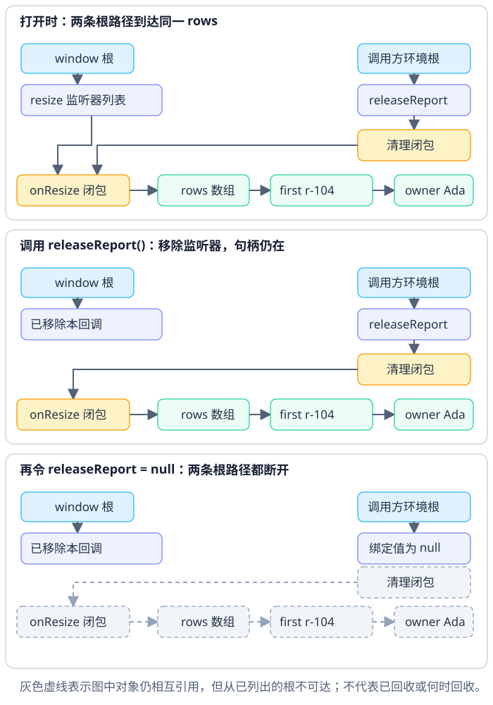

图中三个阶段对应三行代码：

1. **报表打开时。** `window` 的监听器列表和调用方的 `releaseReport` 各有一条路径到达 `onResize` 闭包，闭包再保留 `rows`、`first` 和嵌套的 `owner`。
2. **调用 `releaseReport()` 后。** 监听器列表里的回调被移除，第一条路径断开。但清理函数仍在 `releaseReport` 里，它捕获的 `onResize` 仍然可达，`rows` 和 `first` 也就仍然可达。
3. **再令 `releaseReport = null` 后。** 第二条路径也断开。图中这几个对象之间的引用还在，但从列出的根已经到不了它们。

第三步之后，如果没有别的所有者，这些对象就具备了回收条件。至于何时真的回收，程序观察不到，也不应依赖。

### 常见的保留路径和该由谁断开

除了上面的事件监听器，常见的保留路径还有：

- `setTimeout`、`setInterval`、订阅或没有结束的任务仍持有回调，回调闭包保留旧报表。
- 应用级 `Map` 缓存没有删除条目，强持有键和值。`Map` 的键语义见[数组、Map、Set 和普通对象怎样选，空位和去重有哪些坑？](#22.%20%E6%95%B0%E7%BB%84%E3%80%81Map%E3%80%81Set%20%E5%92%8C%E6%99%AE%E9%80%9A%E5%AF%B9%E8%B1%A1%E6%80%8E%E6%A0%B7%E9%80%89%EF%BC%8C%E7%A9%BA%E4%BD%8D%E5%92%8C%E5%8E%BB%E9%87%8D%E6%9C%89%E5%93%AA%E4%BA%9B%E5%9D%91%EF%BC%9F)。
- 已经从文档上移除、但仍能从根到达的 DOM 节点。只有节点和它自己的监听器之间相互引用，不足以证明泄漏。
- 调试器控制台、断点或堆分析工具本身暂时保留对象。

这些只是排查线索。必须沿实际对象的保留链确认，不能凭“用了闭包”或“数组很大”就断定泄漏。

找到路径后，由**拥有这份资源的生命周期**负责断开：注册监听器的报表在关闭时调用 `removeEventListener`（注销的写法见[一次点击怎样传播到处理器，处理器该怎样注册和清理？](#4.%20%E4%B8%80%E6%AC%A1%E7%82%B9%E5%87%BB%E6%80%8E%E6%A0%B7%E4%BC%A0%E6%92%AD%E5%88%B0%E5%A4%84%E7%90%86%E5%99%A8%EF%BC%8C%E5%A4%84%E7%90%86%E5%99%A8%E8%AF%A5%E6%80%8E%E6%A0%B7%E6%B3%A8%E5%86%8C%E5%92%8C%E6%B8%85%E7%90%86%EF%BC%9F)）；缓存的所有者删除条目；创建计时器的生命周期调用 `clearInterval` 或 `clearTimeout`。清理点要和真实的所有权一致，不要把后文的 `FinalizationRegistry` 当成释放按钮。

### 怎样用堆快照找到保留者？

怀疑“打开再关闭报表会留下对象”时，用两份 heap snapshot（堆快照）对比：

1. 打开报表，切到固定的筛选条件，正常关闭。等页面回到关闭且稳定的状态，取第一份快照作基线。
2. 按完全相同的顺序重复“打开、切筛选、关闭”数次，再回到同样的关闭状态，取第二份快照。
3. 两份快照处于相同的页面和应用状态，第二份里新增的对象才算残留候选。

> [!info] 实例：Chrome DevTools 与 Node.js 的快照工具
> Chrome DevTools 的 Memory 面板在取快照前会先执行一次 GC。在 Comparison（比较）视图里展开新增的对象，看属性 `id` 是否为 `"r-104"`，也可以从名字有辨识度的 `onResize` 回调查起。选中对象后看 Retainers（保留者）面板和到根的路径：本例应沿监听器列表、闭包捕获的 `rows`，或调用方仍持有的清理函数找到所有者。控制台输出和断点会暂时保留对象，取快照前要清空控制台、停用断点。
>
> Node.js 服务可以用 `v8.writeHeapSnapshot()` 生成 V8 堆快照。它会同步阻塞事件循环，采集时大约需要堆大小两倍的内存，在线上实例使用前要评估余量。这些工具属于运行时，不是 ECMAScript 语义。

### WeakMap：按对象身份附加数据，但不拥有键

报表界面要给某一行附加“已选中”这样的状态，又不想因为这份附加数据让行对象一直留在内存里。`WeakMap`（弱映射）就是为这个场景设计的：条目按键的身份查找，而这条关联本身不会让键继续存活。

再沿用[JavaScript 的值有哪些类型，“相等”又有几种？](#18.%20JavaScript%20%E7%9A%84%E5%80%BC%E6%9C%89%E5%93%AA%E4%BA%9B%E7%B1%BB%E5%9E%8B%EF%BC%8C%E2%80%9C%E7%9B%B8%E7%AD%89%E2%80%9D%E5%8F%88%E6%9C%89%E5%87%A0%E7%A7%8D%EF%BC%9F)里的 `retry`：重试请求返回的同一行，业务 id 也是 `r-104`、金额 120，但它是另一个对象。

```javascript
const first = { id: "r-104", amount: 0, owner: { id: "u-17", name: "Ada" } };
const retry = { id: "r-104", amount: 120, owner: { id: "u-17", name: "Ada" } };

const rowMetadata = new WeakMap();
rowMetadata.set(first, { selected: true, row: first });

console.log(rowMetadata.get(first).selected);     // true
console.log(rowMetadata.get(first).row === first); // true
console.log(rowMetadata.has(retry));              // false：业务 id 相同，对象身份不同
```

`WeakMap` 的规则可以归成三条：

- **只要别处还持有键，就能读到值。** 键一旦没有其他强引用，这个条目不会让它继续存活。
- **值对键的反向引用不会互相保活。** 上例的值通过 `row` 引用了 `first`。外部强引用全部断开后，这条反向引用不会让键和值彼此保住。但代码若把 `rowMetadata.get(first)` 的返回值存进普通变量，就能沿 `row` 回到键，这又是一条强引用。
- **它不替你断开其他路径。** 上一节忘记移除的监听器仍会让 `first` 存活，`WeakMap` 对此无能为力。

`WeakMap` 没有 `size`、键枚举和 `forEach`。回收时机不确定，如果允许枚举，程序就能观察到键何时被回收，而这正是语言刻意不暴露的。

所以它适合给别的代码拥有的对象（DOM 节点、类实例、行对象）附加私有元数据，对象的生命周期由外部所有者决定。如果需要列出、计数或集中清理缓存项，就用普通 `Map`，由它的所有者强持有对象并显式删除条目。

### 哪些值能作弱键？

对象是最常见的弱键。从 ECMAScript 2023 起，非注册的 `Symbol`（符号）也可以作弱键；用 `Symbol.for` 得到的注册 `Symbol` 不行。

区别在于身份能否被重新取得。每次调用 `Symbol("row metadata")` 都创建一个新符号，描述相同也是不同的身份；而 `Symbol.for("shared")` 总是从全局注册表取回同一个符号，它永远可以被重新拿到，弱持有它没有意义。

```javascript
const localSymbol = Symbol("row metadata");
rowMetadata.set(localSymbol, { source: "non-registered symbol" }); // 可以

const sharedSymbol = Symbol.for("shared");
console.log(rowMetadata.has(sharedSymbol)); // false
try {
  rowMetadata.set(sharedSymbol, {});
} catch (error) {
  console.log(error.name); // TypeError：注册 Symbol 不能作弱键
}
```

这条资格规则对 `WeakSet`、`WeakRef` 的目标和 `FinalizationRegistry` 的目标都适用。

### WeakSet：只标记成员身份

`WeakSet`（弱集合）按身份弱持有对象或非注册 `Symbol`，只有 `add`、`has`、`delete`，没有遍历和 `size`。它适合标记“别处拥有的这个对象已经处理过”：

```javascript
const processedRows = new WeakSet();

function processOnce(row) {
  if (processedRows.has(row)) return;
  processedRows.add(row);
  // 对这个对象身份执行一次处理
}

processOnce(first);
console.log(processedRows.has(first)); // true
console.log(processedRows.has(retry)); // false：仍按对象身份区分
```

这里 `first` 和 `retry` 被当成两行，因为区分依据是对象身份，不是 `id`。若要按业务 id 去重，应改用普通 `Map` 或 `Set`，以选定的值作键。

### WeakRef.deref 拿到的目标能活多久？

`WeakMap` 和 `WeakSet` 只能拿已有的键去查。`WeakRef`（弱引用）直接持有一个对目标的弱引用，目标可以是对象或非注册 `Symbol`。`deref()` 在目标还存活时返回它，否则返回 `undefined`。

返回了目标以后，它还能保证存活多久？规范维护一张临时保活列表（kept objects）：构造 `WeakRef` 时和 `deref()` 返回目标时，都把目标加进这张列表。浏览器在微任务检查点结束时清空它，而不是一遇到 `await` 就清空。因此可以依赖的窗口是：**当前这段同步执行期间，目标不会被回收**。宿主也许保留得更久，但代码不能依赖。

这个窗口带来两条用法：

- 先 `deref()`，检查结果不是 `undefined`，再在同一段同步代码里使用它。
- 如果跨 `await` 之后还要用目标，就把 `deref()` 的结果存进普通局部变量，让这条强引用跨过等待。

```javascript
const weakRow = new WeakRef(first);
const row = weakRow.deref();
if (row !== undefined) {
  rowMetadata.set(row, { selected: true });
  console.log(row.id); // r-104
}

function makePendingRowRef() {
  const pendingRow = { id: "r-105" };
  return new WeakRef(pendingRow);
}

async function readAfterRefresh(ref) {
  const row = ref.deref();
  if (row === undefined) return undefined;
  await new Promise(resolve => setTimeout(resolve, 0));
  return row.id; // row 是局部强引用，跨过了等待
}

readAfterRefresh(makePendingRowRef()).then(id => {
  console.log("after await =", id); // r-105
});
```

`makePendingRowRef()` 返回后，局部变量 `pendingRow` 已经离开作用域，但 `readAfterRefresh` 的首次 `deref()` 和 `new WeakRef(pendingRow)` 处在同一段同步执行里，目标仍在保活列表中，一定能拿到。如果传进来的是早已跨过任务边界的引用，首次读取就可能得到 `undefined`。函数把目标存进 `row` 后再等待计时器，所以等待之后仍能读到 `r-105`；如果只保留 `ref`、等待后再 `deref()`，结果可能是 `undefined`。

### FinalizationRegistry 能承诺什么？

`FinalizationRegistry`（最终化注册表）让程序在目标被回收之后**可能**收到一次回调。`register(target, heldValue, token)` 的三个参数受到不同的对待：

| 参数 | 注册表怎样持有 | 作用 |
| --- | --- | --- |
| `target` | 弱持有 | 被观察的对象或非注册 `Symbol` |
| `heldValue`（暂存值） | 注册有效期间强持有 | 回调运行时收到的唯一参数 |
| `token`（可选取消令牌） | 弱持有，须为对象或非注册 `Symbol` | 传给 `unregister(token)` 以提前取消 |

两条约束都来自“`heldValue` 被强持有”：

- `heldValue` 不能和 `target` 是同一个值，否则抛 `TypeError`。
- 如果 `heldValue` 的某个属性引用了 `target`，注册合法，但这条强引用会让目标一直存活，回调永远不会因为目标不可达而运行。

令牌被弱持有，调用方可以自己保存它用于取消，而不会通过注册表让目标保持存活。

```javascript
const registry = new FinalizationRegistry(heldValue => {
  console.log("eventual cleanup hint:", heldValue);
});

let temporaryRow = { id: "temporary" };
const unregisterToken = {};
registry.register(temporaryRow, "temporary row", unregisterToken);

try {
  registry.register(temporaryRow, temporaryRow);
} catch (error) {
  console.log(error.name); // TypeError：heldValue 不能与 target 相同
}
// registry.register(temporaryRow, { row: temporaryRow }); // 合法，但会保住目标

temporaryRow = null;
console.log(registry.unregister(unregisterToken)); // true：取消了这条注册
```

即使全部写对，对象何时回收、回调何时运行都没有保证：回调可能很久以后才运行，程序退出前也可能根本不运行。

### 什么时候不该用弱引用？

弱引用 API 只适合“没有它也不影响正确性”的工作：缓存提示、附加元数据、顺手的清理。

它们不适合关闭文件或网络连接、释放锁、写计费记录、更新 UI 状态，以及任何必须及时发生的动作。需要确定的结束时机时，由明确的所有者调用 `dispose`、`removeEventListener`、`clearInterval` 或对应的清理函数。回到报表的例子：`WeakMap` 能让“已选中”元数据不保住 r-104，但让 r-104 真正可回收的，是报表关闭时移除监听器、放弃清理句柄这两步。

### 从对象的生命周期到对象的形状

本章回答了“对象留多久”：可回收与否取决于从根出发的强引用路径；排查时用堆快照找保留者，由资源的所有者断开路径；弱集合和弱引用只保证自己不添加强路径，不负责清理，也不给出回收时机。

一直以来我们都假设 `first` 的字段就是代码里写的那样。数据实际来自网络或浏览器存储时，TypeScript 的类型能替我们保证这一点吗？下一章[TypeScript 能保证什么，外部数据又该怎样验证？](#34.%20TypeScript%20%E8%83%BD%E4%BF%9D%E8%AF%81%E4%BB%80%E4%B9%88%EF%BC%8C%E5%A4%96%E9%83%A8%E6%95%B0%E6%8D%AE%E5%8F%88%E8%AF%A5%E6%80%8E%E6%A0%B7%E9%AA%8C%E8%AF%81%EF%BC%9F)回答这个问题。

> [!info]- 来源
> - **追踪式 GC 与 V8 实现例子**（“回收看的是从根能否到达”）：V8 博客 “Trash talk: the Orinoco garbage collector”，2019-01-03，[Marking](https://v8.dev/blog/trash-talk#marking)（沿 root set 标记可达对象）、[Generational layout](https://v8.dev/blog/trash-talk#generational-layout) 与 [Orinoco](https://v8.dev/blog/trash-talk#orinoco)；后两节是 V8 的实现，不代表 ECMAScript 规定的算法。
> - **ECMAScript 不保证回收与最终化时机**（“回收看的是从根能否到达”“FinalizationRegistry 能承诺什么”）：ECMAScript 2026 §9.9 [Processing Model of WeakRef and FinalizationRegistry Targets](https://tc39.es/ecma262/2026/multipage/executable-code-and-execution-contexts.html#sec-weakref-processing-model)（含 §9.9.1 Objectives）。
> - **监听器列表与移除**（“报表关闭后，谁还保留着 r-104”）：WHATWG DOM Living Standard §2.7 [EventTarget](https://dom.spec.whatwg.org/#interface-eventtarget)：回调加入 event listener list，`removeEventListener` 按 type / callback / capture 移除。核验于 2026-11-12。
> - **堆快照方法**（“怎样用堆快照找到保留者”）：Chrome DevTools [Record heap snapshots](https://developer.chrome.com/docs/devtools/memory-problems/heap-snapshots) 的 Take a snapshot（取快照前执行 GC）、Comparison view、Retainers；[Memory terminology](https://developer.chrome.com/docs/devtools/memory-problems/get-started)（控制台与断点会保留对象，建议清空后再取快照）。访问于 2026-11-12。Node.js v26.13.1 [`v8.writeHeapSnapshot()`](https://nodejs.org/api/v8.html#v8writeheapsnapshotfilenameoptions)：同步阻塞、约两倍堆内存开销，读取于 2026-11-12。
> - **WeakMap / WeakSet 的弱键关系、无枚举、弱键资格**（“WeakMap”“哪些值能作弱键”“WeakSet”）：ECMAScript 2026 §24.3–24.4 [Keyed Collections](https://tc39.es/ecma262/2026/multipage/keyed-collections.html)、[`CanBeHeldWeakly`](https://tc39.es/ecma262/2026/multipage/executable-code-and-execution-contexts.html#sec-canbeheldweakly)；非注册 Symbol 的资格在 [ECMAScript 2023 §9.14](https://tc39.es/ecma262/2023/multipage/executable-code-and-execution-contexts.html#sec-canbeheldweakly) 已纳入。`Symbol()` 每次构造新身份、`Symbol.for` 查共享注册表：ECMAScript 2026 §20.4.1.1、§20.4.2.2 [Symbol](https://tc39.es/ecma262/2026/multipage/fundamental-objects.html#sec-symbol.for)。
> - **WeakRef 与临时保活列表**（“WeakRef.deref 拿到的目标能活多久”）：ECMAScript 2026 §26.1.1.1 [WeakRef target](https://tc39.es/ecma262/2026/multipage/managing-memory.html#sec-weak-ref-target)、§26.1.3.2 [`deref`](https://tc39.es/ecma262/2026/multipage/managing-memory.html#sec-weak-ref.prototype.deref)、§9.10 [`ClearKeptObjects`](https://tc39.es/ecma262/2026/multipage/executable-code-and-execution-contexts.html#sec-clearkeptobjects)、§9.11 [`AddToKeptObjects`](https://tc39.es/ecma262/2026/multipage/executable-code-and-execution-contexts.html#sec-addtokeptobjects)；浏览器在微任务检查点末清空 kept objects：WHATWG HTML §8.1.7.3 [perform a microtask checkpoint](https://html.spec.whatwg.org/multipage/webappapis.html#perform-a-microtask-checkpoint)，核验于 2026-11-12。
> - **FinalizationRegistry 的参数与取消**（“FinalizationRegistry 能承诺什么”）：ECMAScript 2026 §26.2.3.2–3 [register / unregister](https://tc39.es/ecma262/2026/multipage/managing-memory.html#sec-finalization-registry.prototype.register)、§9.12 [`CleanupFinalizationRegistry`](https://tc39.es/ecma262/2026/multipage/executable-code-and-execution-contexts.html#sec-cleanup-finalization-registry)。
> - **本地重放**：原稿在 Node.js v26.13.0 / V8 14.6.202.34-node.40（2026-11-12）运行弱键资格、同值 `heldValue` 异常和跨 `await` 局部强引用示例；本章示例在 Node.js v26.13.1 上重新运行，输出一致。这些运行不触发 GC，也不推断最终化时序。
## 34. TypeScript 能保证什么，外部数据又该怎样验证？

TypeScript 检查的是我们自己写的代码：参数传得对不对、属性名拼没拼错、联合类型的分支漏没漏。它的类型在编译成 JavaScript 时被擦除，因此不检查网络响应和浏览器存储里实际是什么。本章先说明这条边界，再给出外部数据进入应用的三步做法：解析、检查、重建；接着用手写解析器和 Zod 各实现一遍，最后用穷尽性检查守住数据进入应用之后的分支。

沿用主线一的报表页。本章关心报表 42 的接口响应：服务端返回当前查看者和行数据，其中一行是 r-104（标题 May，金额 `amount` 取重试后的 120，负责人 Ada）。本章把这一行的接口字段写成 `id`、`title`、`month`、`status`、`amount` 和 `ownerEmail`（`ada@example.com`），其中 `month`、`status`、`ownerEmail` 是本章新增的字段；同一份 JSON 也可能被缓存进浏览器存储，下次从那里读出。

### 编译后，类型还剩下什么？

TypeScript 的类型注解、接口和类型别名在输出 JavaScript 时全部删掉，运行时什么都不剩。由此得出四条容易被忽略的结论：

- **声明类型不会检查数据。** `const data: ReportData = await response.json()` 能通过编译，但运行时 `data` 就是服务器发来的任何东西。标准库把 `response.json()` 和 `JSON.parse` 的返回类型声明为 `any`，赋给什么类型都不报错。
- **`as` 是断言，不是转换。** `value as ReportRow` 只是告诉编译器“相信我”，运行时没有任何检查，值原样保留。
- **类型谓词是函数对编译器的承诺。** 返回类型写成 `value is X` 的函数，编译器在它返回 `true` 后把值当作 `X`，但不会验证函数体真的检查到位。
- **类型不检查授权。** 即使结构完全正确，也证明不了 `viewer.id` 是当前登录用户，或该用户有权看这份报表。这些判断只能由可信的服务端完成。

所以外部数据的可信度不能靠类型声明获得，只能靠运行时代码建立。

### 外部数据进入应用的三步

来自网络、浏览器存储、`postMessage`、URL 参数等程序外部的数据，都按同一套三步处理：

1. **解析。** 按数据格式把文本变成 JavaScript 值，例如 `JSON.parse`。语法错误在这一步失败。
2. **检查。** 在运行时逐项检查结构和取值：类型对不对、枚举值在不在允许范围、格式规则是否满足。结构错误在这一步失败。
3. **重建。** 只用检查过的字段构造新的应用对象。从这里开始，静态类型和运行时值才一致，后续代码可以依赖类型。

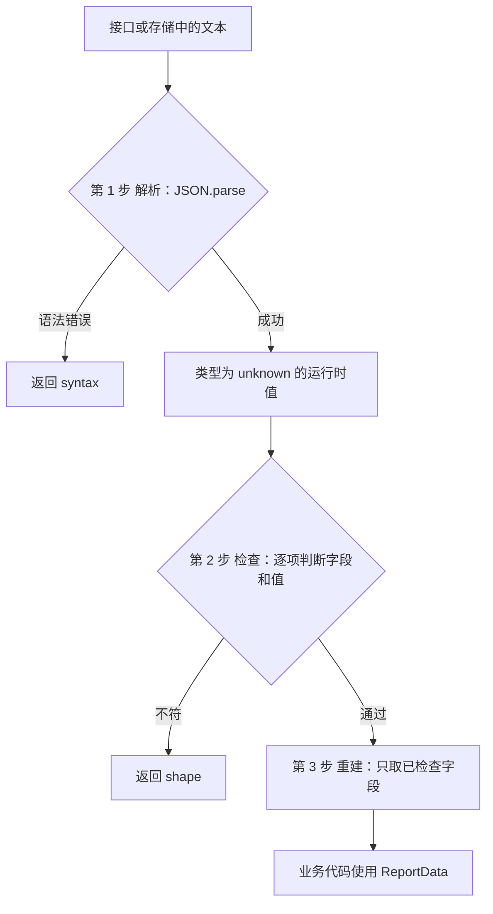

图里的 `syntax` 和 `shape` 是解析函数返回的失败原因。文本来自浏览器存储时还有第三种：`getItem` 返回 `null`（从没存过），在进入流程之前就返回 `missing`。

三步都是运行时代码。第 1 步之后把值标成 `unknown`，只改变编译器看到的类型，不对应任何运行时转换；到第 3 步构造出新对象，静态类型才有了运行时依据。

### unknown 和类型谓词怎样配合检查？

`unknown`（未知类型）可以接收任何值，但在缩窄到更具体的类型之前，编译器不允许读取它的属性。这正好逼着我们在第 2 步先检查再读取。

把检查封装成函数时，用 type predicate（类型谓词）把运行时的检查结果告诉编译器：

```typescript
function isRecord(value: unknown): value is Record<string, unknown> {
  return typeof value === "object" && value !== null && !Array.isArray(value);
}
```

`typeof`、`!== null`、`Array.isArray` 这几个条件在运行时真正执行；`value is Record<string, unknown>` 只是承诺。编译器据此放行 `isRecord(input)` 之后的属性访问，但不替函数证明承诺成立，所以函数体的布尔检查必须和谓词一致。

还有一个陷阱：标准库里 `Array.isArray` 的谓词会把值缩窄成 `any[]`。如果直接遍历，每个元素都是 `any`，检查就形同虚设。下面的解析器因此先把数组赋给 `unknown[]`，让每个元素仍要先检查再读取。

### 手写解析器怎样实现三步？

报表 42 的数据类型如下。`ParseResult` 把成功值和三种失败原因放进同一个可辨识联合：

```typescript
type Role = "admin" | "reader";
type ReportStatus = "open" | "published" | "archived";

type ReportRow = {
  id: string;
  title: string;
  month: string;
  status: ReportStatus;
  amount: number;
  ownerEmail: string;
};

type ReportData = {
  viewer: { id: string; role: Role };
  rows: ReportRow[];
};

type ParseResult<T> =
  | { ok: true; value: T }
  | { ok: false; reason: "syntax" | "shape" | "missing" };
```

解析器沿三步走。`parseRow` 负责一行的检查和重建，`parseReportData` 负责整体：

```typescript
const MONTH = /^\d{4}-(0[1-9]|1[0-2])$/;

function parseRow(candidate: unknown): ReportRow | undefined {
  if (
    !isRecord(candidate) ||
    typeof candidate.id !== "string" ||
    typeof candidate.title !== "string" ||
    typeof candidate.month !== "string" ||
    !MONTH.test(candidate.month) ||
    (candidate.status !== "open" &&
      candidate.status !== "published" &&
      candidate.status !== "archived") ||
    typeof candidate.amount !== "number" ||
    !Number.isFinite(candidate.amount) ||
    typeof candidate.ownerEmail !== "string"
  ) {
    return undefined;
  }
  // 重建：只取已检查的字段
  return {
    id: candidate.id,
    title: candidate.title,
    month: candidate.month,
    status: candidate.status,
    amount: candidate.amount,
    ownerEmail: candidate.ownerEmail,
  };
}

function parseReportData(text: string): ParseResult<ReportData> {
  let input: unknown;
  try {
    input = JSON.parse(text); // 1. 解析
  } catch {
    return { ok: false, reason: "syntax" };
  }

  if (                         // 2. 检查外层
    !isRecord(input) ||
    !isRecord(input.viewer) ||
    typeof input.viewer.id !== "string" ||
    (input.viewer.role !== "admin" && input.viewer.role !== "reader") ||
    !Array.isArray(input.rows)
  ) {
    return { ok: false, reason: "shape" };
  }

  const rows: unknown[] = input.rows; // 避开 Array.isArray 的 any[]
  const checkedRows: ReportRow[] = [];
  for (const candidate of rows) {
    const row = parseRow(candidate);
    if (row === undefined) return { ok: false, reason: "shape" };
    checkedRows.push(row);
  }

  return {                     // 3. 重建
    ok: true,
    value: {
      viewer: { id: input.viewer.id, role: input.viewer.role },
      rows: checkedRows,
    },
  };
}

function readStoredReport(storage: Storage): ParseResult<ReportData> {
  const text = storage.getItem("report-42");
  if (text === null) return { ok: false, reason: "missing" };
  return parseReportData(text);
}
```

用 r-104 这一行走一遍。输入里故意多带一个未声明的字段 `note`：

```typescript
const reportText = `{
  "viewer": { "id": "u-17", "role": "reader" },
  "rows": [
    {
      "id": "r-104", "title": "May", "month": "2026-05",
      "status": "open", "amount": 120,
      "ownerEmail": "ada@example.com", "note": "extra"
    }
  ]
}`;

const manualResult = parseReportData(reportText);
// { ok: true, value: { viewer: {...}, rows: [ { id: "r-104", ..., amount: 120, ... } ] } }
// 结果里没有 note。

parseReportData(reportText.replace("120", '"120"')); // { ok: false, reason: "shape" }
parseReportData("{");                                  // { ok: false, reason: "syntax" }
```

`amount` 换成字符串 `"120"` 后仍是合法 JSON，但运行时 `typeof` 检查不通过，得到 `shape`；字符串不会被悄悄转成数字。

### 手写解析器保证到哪里？

这个解析器的保证范围要说清楚：

- **格式规则只在运行时生效。** 它检查了月份符合 `YYYY-MM`、`amount` 是有限数值，但返回类型里两者仍是普通的 `string` 和 `number`。业务若还要求金额非负、状态来自配置清单，应把规则加进运行时检查，只改 TypeScript 类型没有用。
- **未声明的字段被丢弃。** 重建时只取已检查的字段，上例的 `note` 不会出现在结果里。
- **它不做授权判断。** 解析成功不能证明 `viewer.id` 是当前用户。
- **它不处理存储故障。** `readStoredReport` 只把缺失项变成 `missing`，不捕获访问存储时的异常：读取 `localStorage` 属性本身就可能因来源或浏览器策略抛出 `SecurityError`，`getItem` 的其他异常也会向上抛。调用方应按自己的降级策略处理，不要把存储故障误报成 JSON 语法错误。浏览器存储怎样选、读出的值怎样按本章的三步校验，见[浏览器能把状态存在哪里，标签页和窗口之间怎样互相通知？](#47.%20%E6%B5%8F%E8%A7%88%E5%99%A8%E8%83%BD%E6%8A%8A%E7%8A%B6%E6%80%81%E5%AD%98%E5%9C%A8%E5%93%AA%E9%87%8C%EF%BC%8C%E6%A0%87%E7%AD%BE%E9%A1%B5%E5%92%8C%E7%AA%97%E5%8F%A3%E4%B9%8B%E9%97%B4%E6%80%8E%E6%A0%B7%E4%BA%92%E7%9B%B8%E9%80%9A%E7%9F%A5%EF%BC%9F)。

### 实例：用 Zod 一次声明检查和类型

手写检查一长，字段路径和类型判断就大量重复，而且类型声明和检查代码可能各改各的。schema（结构模式）库让我们只声明一次结构，同时得到运行时检查和静态类型。下面用 Zod 4.6.7（截至 2026-11-17 的 npm 最新版）在同一个报表入口重写：

```typescript
import * as z from "zod"; // zod@4.6.7

const ReportRowSchema = z.strictObject({
  id: z.string(),
  title: z.string(),
  month: z.string().regex(/^\d{4}-(0[1-9]|1[0-2])$/),
  status: z.enum(["open", "published", "archived"]),
  amount: z.number(), // Zod 4 的 number 只接受有限数值
  ownerEmail: z.email(),
});

const ReportDataSchema = z.strictObject({
  viewer: z.strictObject({
    id: z.string(),
    role: z.enum(["admin", "reader"]),
  }),
  rows: z.array(ReportRowSchema),
});

type ReportDataFromSchema = z.infer<typeof ReportDataSchema>;

function parseReportDataWithZod(text: string): ParseResult<ReportDataFromSchema> {
  let input: unknown;
  try {
    input = JSON.parse(text);
  } catch {
    return { ok: false, reason: "syntax" };
  }

  const parsed = ReportDataSchema.safeParse(input);
  if (!parsed.success) {
    const firstIssue = parsed.error.issues[0];
    console.log(firstIssue?.path, firstIssue?.message);
    return { ok: false, reason: "shape" };
  }
  return { ok: true, value: parsed.data };
}
```

三步仍然一样：`JSON.parse` 负责语法；`safeParse` 在运行时检查字段和值；成功分支的 `parsed.data` 是 Zod 按 schema 构造的结果，类型是推导出的 `ReportDataFromSchema`。

失败时，`ZodError.issues` 是结构化的问题列表，每个问题的 `path` 用字段名和数组下标定位，而不是 JSON 文本的行列号。用前面的输入实际运行：

| 输入（在 r-104 一行上改动） | 第一个问题 | 结果 |
| --- | --- | --- |
| 去掉 `note`，其余不变 | 无 | `ok: true` |
| 去掉 `note`，`amount` 改成 `"120"` | path `["rows", 0, "amount"]`，期望 number、收到 string | `shape` |
| 保留 `note` | path `["rows", 0]`，未声明的键 `"note"` | `shape` |
| 去掉 `note`，`ownerEmail` 改成 `"ada"` | path `["rows", 0, "ownerEmail"]`，邮箱格式无效 | `shape` |

未声明键的问题只指到包含它的对象，具体键名写在消息里。包装函数只打印第一个问题，返回给调用方的只有 `reason: "shape"`。

两种实现接受的输入并不完全相同：

| 情况 | 手写解析器 | `z.strictObject` | `z.object`（默认） |
| --- | --- | --- | --- |
| 有未声明的键 | 重建时丢弃，通过 | 拒绝 | 去掉未知键，通过 |
| `ownerEmail` 不是邮箱格式 | 只要是字符串就通过 | 拒绝（因为用了 `z.email()`） | 同左 |
| `amount` 为 `NaN` 或无穷 | 拒绝（`Number.isFinite`） | 拒绝（Zod 4 的 `z.number()` 本身就拒绝） | 同左 |

拒不拒绝额外键、邮箱校验多严格，应按接口契约决定，而不是按库的默认值决定。

同样的思路也用于服务端：Python 服务可以用 Pydantic 模型检查请求，FastAPI 还能根据路由和模型生成 OpenAPI 契约，但实际响应是否符合契约仍要另外核验，见[HTTP API 如何描述实际运行的请求与响应契约](../../engineering-foundations/backend/http-api-contracts.md)。

### as 和 z.infer 为什么都不算验证？

`z.infer<typeof ReportDataSchema>` 只是从 schema 推出一个 TypeScript 类型，和手写的 `ReportData` 一样会被擦除。它让后续代码在编译期沿用同一份结构，本身不检查任何数据。

所以下面两种写法都跳过了第 2 步，虽然编译能通过，运行时拿到的仍是未经检查的外部值：

```typescript
const a = JSON.parse(text) as ReportData;
const b = JSON.parse(text) as z.infer<typeof ReportDataSchema>;
```

只有走过 `safeParse`（或手写检查）的成功分支，值才真正符合类型。

### 数据进入应用后，怎样让新增分支不被漏掉？

通过检查的数据进入应用后，还有另一类风险：类型定义改了，使用它的代码没跟上。调用端按角色分支处理时，可以在 `default` 分支把值赋给 `never`（不可能出现的类型），这叫 exhaustiveness checking（穷尽性检查）：

```typescript
function roleLabel(role: Role): string {
  switch (role) {
    case "admin":
      return "管理员";
    case "reader":
      return "只读用户";
    default: {
      const unhandled: never = role;
      throw new Error(`未处理的角色：${unhandled}`);
    }
  }
}

if (manualResult.ok) {
  console.log(roleLabel(manualResult.value.viewer.role)); // 只读用户
}
```

前两个分支处理完后，`role` 在 `default` 里被缩窄成 `never`，赋值合法。以后若把 `"editor"` 加进 `Role` 却忘了补分支，`role` 在这里就是 `"editor"`，赋给 `never` 会编译报错。这里的标签只用于显示，不是授权判断。

这道检查和运行时解析器守的是不同边界。只扩充 `Role` 和显示分支并不够：外部数据真的会出现 `editor` 时，还必须同步修改解析器（手写版的角色判断、Zod 版的 `z.enum`），否则 `editor` 会在第 2 步被拒绝。

### 已验证的数据交给界面之后

本章划出了 TypeScript 的保证范围：类型在编译期检查我们自己的代码，运行时全部擦除；外部数据要经过解析、检查、重建三步，才能让运行时值和静态类型一致；`as` 和 `z.infer` 都不做检查；穷尽性检查守住数据进入应用之后的分支。

主线三到这里结束：值、对象、函数、异步、模块和类型的规则都已就位。已验证的 `ReportData` 接下来会进入组件状态。用户点了排序按钮之后，React 怎样把这一次操作变成界面更新？这由主线四的[React 怎样把一次用户操作变成界面更新？](#37.%20React%20%E6%80%8E%E6%A0%B7%E6%8A%8A%E4%B8%80%E6%AC%A1%E7%94%A8%E6%88%B7%E6%93%8D%E4%BD%9C%E5%8F%98%E6%88%90%E7%95%8C%E9%9D%A2%E6%9B%B4%E6%96%B0%EF%BC%9F)接手。

想继续深入类型系统本身，可以读两条支线：[泛型和工具类型怎样从已有类型推出新类型？](#35.%20%E6%B3%9B%E5%9E%8B%E5%92%8C%E5%B7%A5%E5%85%B7%E7%B1%BB%E5%9E%8B%E6%80%8E%E6%A0%B7%E4%BB%8E%E5%B7%B2%E6%9C%89%E7%B1%BB%E5%9E%8B%E6%8E%A8%E5%87%BA%E6%96%B0%E7%B1%BB%E5%9E%8B%EF%BC%9F)和[TypeScript 的两种装饰器模式有什么不同？](#36.%20TypeScript%20%E7%9A%84%E4%B8%A4%E7%A7%8D%E8%A3%85%E9%A5%B0%E5%99%A8%E6%A8%A1%E5%BC%8F%E6%9C%89%E4%BB%80%E4%B9%88%E4%B8%8D%E5%90%8C%EF%BC%9F)。

> [!info]- 来源
> - **类型擦除**（“编译后，类型还剩下什么”）：TypeScript Handbook [Erased Types](https://www.typescriptlang.org/docs/handbook/2/basic-types.html#erased-types)；`as` 断言与类型兼容：[Type Assertions](https://www.typescriptlang.org/docs/handbook/2/everyday-types.html#type-assertions)、[A Note on Soundness](https://www.typescriptlang.org/docs/handbook/type-compatibility.html#a-note-on-soundness)。
> - **unknown、缩窄与类型谓词**（“unknown 和类型谓词怎样配合检查”）：TypeScript Handbook [Narrowing](https://www.typescriptlang.org/docs/handbook/2/narrowing.html)。
> - **穷尽性检查**（“数据进入应用后，怎样让新增分支不被漏掉”）：TypeScript Handbook [Exhaustiveness checking](https://www.typescriptlang.org/docs/handbook/2/narrowing.html#exhaustiveness-checking)。
> - **存储访问异常**（“手写解析器保证到哪里”）：HTML Standard [localStorage](https://html.spec.whatwg.org/multipage/webstorage.html#dom-localstorage)（属性访问可能抛 `SecurityError`）。核对日期 2026-11-12。
> - **Zod 4.6.7**（实例节、接受面对照）：[v4.6.7 发布记录](https://github.com/colinhacks/zod/releases/tag/v4.6.7)、[4.6.7 文档与源码](https://github.com/colinhacks/zod/tree/v4.6.7/packages/docs/content)、[对象 schema 与 strict keys](https://zod.dev/api?id=objects)、[`safeParse` 与 `z.infer`](https://zod.dev/basics)、[issue 路径](https://zod.dev/packages/core#issues)、[Zod 4 的格式 API 与 number 变化](https://zod.dev/v4)。原稿在隔离目录安装此版本、TypeScript 编译后于 Node v26.13.0 运行核对（2026-11-12）；本章改用 r-104 数据后，以 zod 4.6.7、TypeScript 5.7.2（`strict`、`noUncheckedIndexedAccess`）、Node v26.13.1 重新运行，对照表四行均为实测输出。
## 35. 泛型和工具类型怎样从已有类型推出新类型？

为每种数据各写一份函数，维护成本高；一律写成 `any`（任意类型），调用处又丢掉了字段信息。generic（泛型）让同一段逻辑在每次调用时保留具体类型；utility type（工具类型）则从已有类型推出新的形状，例如列表预览和局部更新。本章依次讲类型参数、`keyof` 与索引访问、泛型容器、常用工具类型、分配式条件类型，以及怎样给方法里的 `this` 提供类型。

本章是[TypeScript 能保证什么，外部数据又该怎样验证？](#34.%20TypeScript%20%E8%83%BD%E4%BF%9D%E8%AF%81%E4%BB%80%E4%B9%88%EF%BC%8C%E5%A4%96%E9%83%A8%E6%95%B0%E6%8D%AE%E5%8F%88%E8%AF%A5%E6%80%8E%E6%A0%B7%E9%AA%8C%E8%AF%81%EF%BC%9F)的支线，沿用那里报表页的行类型 `ReportRow` 和行数据 r-104。这里讲的一切都只作用于编译期：不会在运行时筛选字段、验证数据，也不会替方法绑定 `this`。

```typescript
type ReportStatus = "open" | "published" | "archived";

interface ReportRow {
  id: string;
  title: string;
  month: string;
  status: ReportStatus;
  amount: number;
  ownerEmail: string;
}

const row: ReportRow = {
  id: "r-104",
  title: "May",
  month: "2026-05",
  status: "open",
  amount: 120,
  ownerEmail: "ada@example.com",
};
```

### 取一个字段时，怎样保留它的类型？

type parameter（类型参数）相当于类型层面的变量：编译器可以从调用参数推断它，调用者也可以显式指定。

下面的 `getProperty` 用 `T` 代表整行的类型。`keyof T` 是 `T` 所有键名组成的联合类型；`K extends keyof T` 里的 `extends` 表示 constraint（约束），要求传入的键属于这一行已有的键；indexed access type（索引访问类型）`T[K]` 再取出所选键对应的值类型。

```typescript
function getProperty<T, K extends keyof T>(row: T, key: K): T[K] {
  return row[key];
}

const reportId = getProperty(row, "id");       // string
const reportAmount = getProperty(row, "amount"); // number

const statusOrAmountKey: "status" | "amount" =
  Math.random() < 0.5 ? "status" : "amount";
const statusOrAmount = getProperty(row, statusOrAmountKey); // ReportStatus | number

// getProperty(row, "owner"); // 编译错误："owner" 不是 ReportRow 的键
```

编译器对每次调用做三件事：从 `row` 推断 `T`，从传入的键推断 `K` 并检查它在 `keyof T` 内，再计算 `T[K]`：

| 调用 | 推断 | 返回类型 |
| --- | --- | --- |
| `getProperty(row, "id")` | `T = ReportRow`，`K = "id"` | `ReportRow["id"]`，即 `string` |
| `getProperty(row, "amount")` | `T = ReportRow`，`K = "amount"` | `ReportRow["amount"]`，即 `number` |
| `getProperty(row, statusOrAmountKey)` | `T = ReportRow`，`K = "status" \| "amount"` | `ReportStatus \| number` |

为键单独设类型参数 `K` 是关键。如果签名写成 `(row: T, key: keyof T): T[keyof T]`，即使传入字面量 `"id"`，返回类型也是所有字段值类型的联合，本例为 `string | number`。保留 `K` 之后，`T[K]` 只合并实际传入的那几个键对应的类型。

约束只保证编译器看到的键有效。运行时并不校验键，也不校验行数据本身。

### 怎样让分页和仓储接口复用于不同数据？

泛型也可以把类型关系保留在数据结构和一组操作里。报表页拿到 `ReportPage<ReportRow>`，下游仍知道 `rows` 里每一项都是报表行；同一个容器也能装别的数据，而不必退化成 `unknown[]` 或 `any[]`。

```typescript
type ReportPage<T> = {
  rows: T[];
  total: number;
  nextCursor: string | null;
};

interface Repository<T> {
  getById(id: string): T | undefined;
  getAll(): T[];
  save(item: T): void;
}

function firstRow<T>(page: ReportPage<T>): T | undefined {
  return page.rows[0];
}

const reports: ReportPage<ReportRow> = { rows: [row], total: 1, nextCursor: null };
const emptyPage: ReportPage<ReportRow> = { rows: [], total: 0, nextCursor: null };

const first = firstRow(reports);
if (first) first.amount.toFixed(2); // first.amount 仍是 number
console.log(firstRow(emptyPage));  // undefined：空页没有第一行
```

传入 `reports` 时，编译器从参数形状推断 `T = ReportRow`，所以 `first` 的类型是 `ReportRow | undefined`。`Repository<ReportRow>` 把同一个 `T` 代入每个操作：`getById` 返回 `ReportRow | undefined`，`getAll` 返回 `ReportRow[]`，`save` 接收 `ReportRow`。

泛型保留的是编译器掌握的关系。服务器是否真的返回 `ReportRow`，仍要在数据边界按三步检查。

### Pick、Partial、Record 改变了什么？

列表预览、局部更新、状态标签这些形状，都可以从 `ReportRow` 推出来，不必再手写一遍：

```typescript
type ReportPreview = Pick<ReportRow, "id" | "title" | "month" | "amount">;
type ReportPatch = Partial<Pick<ReportRow, "title" | "month">>;
type StatusLabels = Record<ReportStatus, string>;

const labels: StatusLabels = {
  open: "待审核",
  published: "已发布",
  archived: "已归档",
};
```

嵌套的工具类型由内向外读：`Pick` 先取出 `title` 和 `month`，`Partial` 再把它们变成可选，结果是 `{ title?: string; month?: string }`。

`StatusLabels` 要求 `ReportStatus` 的每个成员都有标签。以后给 `ReportStatus` 加上 `"scheduled"`，`labels` 会因缺少这个键而报错，提醒界面补上新状态的文字。状态标签和行类型共用同一个联合，两处定义就不会各改各的。

这些工具只改变类型，不碰对象：

```typescript
const input = { month: "2026-06", ownerEmail: "eve@example.com" };
const patch: ReportPatch = input;
console.log(Object.keys(patch)); // ["month", "ownerEmail"]：仍是同一个运行时对象
```

`input` 与 `ReportPatch` 有共同的键 `month`，所以可以赋值；多出的 `ownerEmail` 没有被删掉。有两种情况会被编译器拦下：

- 变量里只有 `ownerEmail`，和目标类型没有任何共同属性。目标类型的属性全部可选，TypeScript 称这种类型为 weak type，此时赋值报错。
- 直接把含 `ownerEmail` 的**新对象字面量**赋给 `ReportPatch`，会触发多余属性检查。

可见 `Pick` 只在类型上筛字段。列表展示如果真的只想带这几个字段，要在运行时构造新对象。

### 省略、null、undefined 有什么不同？

局部更新里，“没传这个字段”“传了 `null`”“传了 `undefined`”是三种状态，接口要先约定它们各自的含义。

- **省略。** `ReportPatch` 的字段可选，不写就是“不修改”。
- **`null`。** 开启 `strictNullChecks`（`strict` 已包含）后，`{ title: null }` 不能赋给 `ReportPatch`。只有接口约定 `null` 表示“清空该字段”这类业务操作时，才在属性类型里加 `| null`，并让运行时解析按这层含义处理。
- **`undefined`。** 开启 `exactOptionalPropertyTypes`（它要求同时开启 `strictNullChecks`）后，可选字段可以省略，但除非类型里写了 `undefined`，否则不能显式赋值为 `undefined`；不开启时编译器允许这样赋值。

无论这个开关怎样设置，读取 `patch.title` 都可能得到 `undefined`，因为属性本身可以不存在。

更新数据来自网络或存储时，运行时仍要按接口白名单检查字段，并区分省略、`null` 和具体值；本地按 `ReportPatch` 构造的对象则由编译器检查。

### 常用工具类型速查

| 需要 | 工具类型 | 结果与边界 |
| --- | --- | --- |
| 只声明所需字段 | `Pick<T, K>` / `Omit<T, K>` | 选取或排除键；不复制、不投影对象 |
| 部分更新，或补齐默认值后的完整配置 | `Partial<T>` / `Required<T>` | 属性变为可选或必需；运行时仍需合并、检查 |
| 只读视图 | `Readonly<T>` | 浅层禁止通过该类型给属性重新赋值；不冻结对象 |
| 一组键到值的映射 | `Record<K, V>` | 约束键和值的类型；动态输入仍须验证 |
| 从联合中筛选成员 | `Exclude<U, X>` / `Extract<U, X>` | 移除或保留可赋给 `X` 的成员 |
| 去掉 `null` 和 `undefined` | `NonNullable<T>` | 只改静态类型，不替值做空值检查 |
| 读取函数签名 | `Parameters<F>` / `ReturnType<F>` | 参数元组或返回类型；重载函数取最后一个签名 |
| 读取构造签名 | `ConstructorParameters<C>` / `InstanceType<C>` | 构造参数元组或实例类型 |
| 解开 Promise | `Awaited<T>` | 递归解包 Promise 及符合其 `then` 约定的类型；不等待运行时值 |

这些工具大多由 mapped type（映射类型）、conditional type（条件类型）和索引访问类型组合而成。其中 `Exclude`、`Extract` 依赖条件类型的一条特殊规则，下一节单独说明。

### 条件类型遇到联合，为什么会逐项筛选？

条件类型写作 `T extends X ? A : B`。如果 `extends` 左边是一个“裸”类型参数（没有包进数组、元组等结构），传入联合类型时，编译器把联合成员逐个代入，再把结果合成联合。这叫 distributive conditional type（分配式条件类型）。

```typescript
type WithoutArchived<T> = T extends "archived" ? never : T;
type VisibleStatus = WithoutArchived<ReportStatus>;
// "open" | "published" | never  →  "open" | "published"

type IsArchived<T> = T extends "archived" ? true : false;
type DistributedCheck = IsArchived<ReportStatus>;
// false | false | true  →  boolean

type IsWholeUnionArchived<T> = [T] extends ["archived"] ? true : false;
type WholeStatusCheck = IsWholeUnionArchived<ReportStatus>;
// 不分配，整个联合与 "archived" 比较  →  false
```

逐个看：

- `WithoutArchived` 对三个成员分别得到 `"open"`、`"published"`、`never`。`never` 没有任何值，在联合中被吸收，结果只剩前两个。内置的 `Exclude<ReportStatus, "archived">` 就是这样实现的，结果相同。
- `IsArchived` 和 `IsWholeUnionArchived` 的分支完全一样，区别只在 `T` 是否“裸”。裸 `T` 会分配，三个成员得到 `false`、`false`、`true`，合起来是 `boolean`。
- 把 `T` 包进元组 `[T]` 就不再分配，比较的是整个联合是否可赋给 `"archived"`，答案是 `false`。

需要“对整个联合作判断”时，用元组包一层；需要“逐个成员筛选”时，保持裸参数。

### 对象字面量方法里的 this 怎样获得类型？

前面的工具都在推导数据形状。另一类问题出在方法上：对象字面量里的方法默认不知道 `this` 指向什么。TypeScript 有两种办法在编译期提供这个信息，它们都不在运行时绑定 `this`；`this` 实际是什么，仍按[函数里的变量和 this 从哪来？](#24.%20%E5%87%BD%E6%95%B0%E9%87%8C%E7%9A%84%E5%8F%98%E9%87%8F%E5%92%8C%20this%20%E4%BB%8E%E5%93%AA%E6%9D%A5%EF%BC%9F)里的调用规则决定。

**`ThisType<T>`。** 它是一个标记接口。作为对象字面量的上下文类型时，其中的方法把 `this` 当作 `T`。它不添加属性，不改变对象，只在开启 `noImplicitThis`（`strict` 已包含）时生效。

```typescript
type ObjectDescriptor<Data, Methods> = {
  data: Data;
  methods: Methods & ThisType<Data & Methods>;
};

function makeObject<Data, Methods>(
  descriptor: ObjectDescriptor<Data, Methods>
): Data & Methods {
  return { ...descriptor.data, ...descriptor.methods };
}

const rowCounter = makeObject({
  data: { loadedRows: 0 },
  methods: {
    addLoadedRow() {
      this.loadedRows += 1; // this 有 loadedRows: number
    },
  },
});

rowCounter.addLoadedRow();
console.log(rowCounter.loadedRows); // 1
```

编译器从 `data` 推断 `Data = { loadedRows: number }`，从 `methods` 推断含 `addLoadedRow` 的 `Methods`，`ThisType<Data & Methods>` 再把两边的成员提供给方法体里的 `this`。运行时，`makeObject` 用对象展开合并两个对象，`rowCounter.addLoadedRow()` 这次成员调用提供了接收者，计数变为 1。

这个小例子只适用于数据和方法都是普通对象、所需成员都是可枚举自有属性的情况，因为对象展开不复制原型上的方法。`Data & Methods` 也不禁止两边有重名键：重名时后展开的 `methods` 覆盖 `data`，交叉类型却可能描述了冲突的字段。本例让两边键名不重叠。

**显式的 `this` 参数。** 在函数签名里声明接收者的类型：

```typescript
interface ReportViewer {
  name: string;
  describe(this: ReportViewer): string;
}

const viewer: ReportViewer = {
  name: "Ada",
  describe() {
    return `报表查看者：${this.name}`;
  },
};

console.log(viewer.describe()); // 报表查看者：Ada
```

`this: ReportViewer` 是编译期对**调用方式**的要求。两种办法的差别在方法被单独取出时显现：

- `const d = viewer.describe; d();` 编译报错，因为调用时缺少所需的 `this`。在严格模式（含 ES 模块）下运行，`this` 是 `undefined`，读 `this.name` 确实会抛 `TypeError`。
- `const add = rowCounter.addLoadedRow; add();` 能通过静态检查，因为 `ThisType` 只给方法体内部提供类型，不约束调用方；运行时 `this` 已经不对。

### 推出来的类型交回哪里

本支线给出了从已有类型推导新类型的工具：类型参数在调用之间保留关系，`keyof` 与 `T[K]` 让取字段保留字段类型，工具类型推出预览、补丁和标签映射，分配式条件类型逐项筛选联合，`ThisType` 和 `this` 参数在编译期描述接收者。

它们都只描述编译期关系。`ReportPatch` 这类数据来自网络或存储时，要回到[TypeScript 能保证什么，外部数据又该怎样验证？](#34.%20TypeScript%20%E8%83%BD%E4%BF%9D%E8%AF%81%E4%BB%80%E4%B9%88%EF%BC%8C%E5%A4%96%E9%83%A8%E6%95%B0%E6%8D%AE%E5%8F%88%E8%AF%A5%E6%80%8E%E6%A0%B7%E9%AA%8C%E8%AF%81%EF%BC%9F)的三步，在输入边界挑选并验证字段。装饰器怎样用这里的泛型参数保留被包装方法的签名，见[TypeScript 的两种装饰器模式有什么不同？](#36.%20TypeScript%20%E7%9A%84%E4%B8%A4%E7%A7%8D%E8%A3%85%E9%A5%B0%E5%99%A8%E6%A8%A1%E5%BC%8F%E6%9C%89%E4%BB%80%E4%B9%88%E4%B8%8D%E5%90%8C%EF%BC%9F)。

> [!info]- 来源
> - **类型参数、推断与约束**（“取一个字段时，怎样保留它的类型”“怎样让分页和仓储接口复用于不同数据”）：TypeScript Handbook [Generics](https://www.typescriptlang.org/docs/handbook/2/generics.html)；[Keyof Type Operator](https://www.typescriptlang.org/docs/handbook/2/keyof-types.html)；[Indexed Access Types](https://www.typescriptlang.org/docs/handbook/2/indexed-access-types.html)。
> - **工具类型与速查表**（“Pick、Partial、Record 改变了什么”“常用工具类型速查”）：[Utility Types](https://www.typescriptlang.org/docs/handbook/utility-types.html)；[Mapped Types](https://www.typescriptlang.org/docs/handbook/2/mapped-types.html)。
> - **省略、null、undefined**：[TSConfig `exactOptionalPropertyTypes`](https://www.typescriptlang.org/tsconfig/exactOptionalPropertyTypes.html)。
> - **分配式条件类型**：[Conditional Types](https://www.typescriptlang.org/docs/handbook/2/conditional-types.html)（Distributive Conditional Types 一节）。
> - **ThisType 与上下文类型**（“对象字面量方法里的 this 怎样获得类型”）：[Utility Types: ThisType](https://www.typescriptlang.org/docs/handbook/utility-types.html)、[Contextual Typing](https://www.typescriptlang.org/docs/handbook/type-inference.html#contextual-typing)。
>
> 来源核对日期：2026-11-12。原稿示例以 TypeScript 5.7.2 在 `strict`、`noUncheckedIndexedAccess` 下检查；本章改用 r-104 数据后以同一版本重新编译并运行，编译期错误用 `@ts-expect-error` 逐条确认，`exactOptionalPropertyTypes` 的开关差异单独验证。
## 36. TypeScript 的两种装饰器模式有什么不同？

报表服务常常要给多个方法加上日志、缓存或指标统计。decorator（装饰器）让这类横切逻辑只写一次，用 `@名称` 贴到类或类成员上：它在**类定义时**被调用，可以用返回值替换被装饰的定义。TypeScript 里同时存在两种装饰器模式，调用参数、可装饰的位置和元数据配置都不同，为一种模式写的装饰器不能直接拿到另一种模式的项目里用。本章只讨论方法装饰器，依次给出两种模式的写法，最后说明怎样判断一个项目用的是哪种。

本章是[TypeScript 能保证什么，外部数据又该怎样验证？](#34.%20TypeScript%20%E8%83%BD%E4%BF%9D%E8%AF%81%E4%BB%80%E4%B9%88%EF%BC%8C%E5%A4%96%E9%83%A8%E6%95%B0%E6%8D%AE%E5%8F%88%E8%AF%A5%E6%80%8E%E6%A0%B7%E9%AA%8C%E8%AF%81%EF%BC%9F)的支线。例子沿用主线一的报表页：一个 `ReportService` 的 `loadRows` 方法读取报表 42 的行。新版写法用到泛型参数保留签名，相关基础见[泛型和工具类型怎样从已有类型推出新类型？](#35.%20%E6%B3%9B%E5%9E%8B%E5%92%8C%E5%B7%A5%E5%85%B7%E7%B1%BB%E5%9E%8B%E6%80%8E%E6%A0%B7%E4%BB%8E%E5%B7%B2%E6%9C%89%E7%B1%BB%E5%9E%8B%E6%8E%A8%E5%87%BA%E6%96%B0%E7%B1%BB%E5%9E%8B%EF%BC%9F)。

### 两种模式由什么区分？

| 模式 | 何时生效 | 方法装饰器收到什么 | 能力边界 |
| --- | --- | --- | --- |
| 新版（TypeScript 5.0 起的默认） | 有效配置**没有**启用 `experimentalDecorators` | 原方法函数和一个上下文对象；可以返回替代方法 | 不能装饰参数，不能用 `emitDecoratorMetadata`；各类成员的调用约定不同，例如字段装饰器的第一个参数是 `undefined` |
| 旧版（legacy） | 有效配置设置 `experimentalDecorators: true` | 原型（静态方法则是构造函数）、属性键和属性描述符 | 可以用参数装饰器；框架要读 TypeScript 生成的设计期类型元数据时，按框架要求启用 `emitDecoratorMetadata` 并加载 `reflect-metadata` |

新版模式按 TC39 装饰器提案的调用约定实现，常被称为“标准装饰器”。但截至 2026-11-17，TC39 提案列表仍把装饰器列在 Stage 2.7，尚未进入正式标准。本章说的“新版”只用来区分 TypeScript 的两种模式，不表示装饰器已经是 ECMAScript 的正式特性。

### 新版方法装饰器怎样保留原方法的签名？

下面在新版模式下给 `loadRows` 加调用日志：

```typescript
function loggedMethod<This, Args extends unknown[], Return>(
  original: (this: This, ...args: Args) => Return,
  context: ClassMethodDecoratorContext<
    This,
    (this: This, ...args: Args) => Return
  >
) {
  const name = String(context.name);

  return function (this: This, ...args: Args): Return {
    console.log("报表方法调用：", name);
    return original.call(this, ...args);
  };
}

class ReportService {
  @loggedMethod
  async loadRows(reportId: string): Promise<string[]> {
    return [`报表 ${reportId}：r-104`];
  }
}

const service = new ReportService();
void service.loadRows("42").then(rows => console.log(rows));
// 先输出“报表方法调用： loadRows”
// Promise 完成后输出 ["报表 42：r-104"]
```

按时间顺序看发生了什么：

1. **执行 `class ReportService` 定义时**，`@loggedMethod` 被调用，收到当前的 `loadRows` 函数和方法上下文。它返回的包装函数被安装为 `ReportService.prototype.loadRows`。
2. **`new ReportService()` 时**什么都不打印，装饰器已经在第 1 步跑完了。
3. **调用 `service.loadRows("42")` 时**进入包装函数：先记日志，再用同一个 `this` 和参数调用原方法，把原方法的返回值（这里是 Promise）原样交回。

包装函数必须和原方法签名一致，否则调用方拿到的类型就变了。所以装饰器用三个泛型参数分别记住接收者类型 `This`、参数元组 `Args` 和返回类型 `Return`，包装函数用同样的三个参数声明自己。

### 旧版方法装饰器为什么不能沿用同一签名？

开启 `experimentalDecorators` 后，同样的日志需求要换一种写法。旧版方法装饰器收到的不是原方法和上下文，而是 `target`、属性键和属性描述符：

```typescript
function legacyLog(
  target: object,
  key: string | symbol,
  descriptor: PropertyDescriptor
) {
  const original = descriptor.value;
  descriptor.value = function (this: unknown, ...args: unknown[]) {
    console.log("旧版报表方法调用：", key);
    return original.apply(this, args);
  };
}

class LegacyReportService {
  @legacyLog
  loadRows(reportId: string): string {
    return `报表 ${reportId}：r-104`;
  }
}

console.log(new LegacyReportService().loadRows("42"));
// 依次输出“旧版报表方法调用： loadRows”和“报表 42：r-104”
```

这里装饰的是实例方法，所以 `target` 是类原型；`descriptor.value` 存放 `loadRows` 当前的函数。装饰器把包装函数写回 `descriptor.value`，TypeScript 生成的旧版辅助代码随后用更新过的描述符重新定义这个方法。

两种签名的参数个数和含义完全不同：把 `loggedMethod` 放进旧版项目，它会把原型当成原方法；反过来，`legacyLog` 在新版项目里收不到描述符。许多已有框架依赖旧版约定，还可能用到参数装饰器或 `emitDecoratorMetadata`，迁移前要先确认框架支持哪种模式。

### 怎样判断项目用的是哪种模式？

看**实际编译这个文件的项目配置**，而不是随手打开的某个 `tsconfig.json`：

- 用 `tsc` 时，运行 `tsc -p path/to/tsconfig.json --showConfig`，查看合并 `extends` 之后的有效值。TypeScript 5.0 起，有效配置里 `experimentalDecorators: true` 表示旧版，否则是新版。
- 多配置仓库要选实际参与构建的那份配置。
- 如果另一个构建器（而不是 `tsc`）负责转换装饰器，还要检查它的配置。

最终要以构建产物为准。源码里的 `@` 不一定原样出现在输出的 JavaScript 里：编译器可能把它改写成运行时辅助代码，也可能保留语法。保留时，目标运行时必须支持装饰器语法及其语义。

> [!example] 实测：TypeScript 5.7.2 的输出与 Node.js v26.13.1
> 用 TypeScript 5.7.2 按新版模式编译上面的 `ReportService`：
> - `target: ES2022` 的输出没有 `@`，改写成 `__esDecorate` 等辅助代码，在 Node.js v26.13.1 上按正文顺序输出。
> - `target: ESNext` 的输出原样保留 `@loggedMethod`，Node.js v26.13.1 加载时报 `SyntaxError: Invalid or unexpected token`。
>
> 同一份源码能否运行，取决于输出目标和运行时，而不是源码本身。

> [!info] 版本说明
> 示例以 TypeScript 5.7.2 分别在无 `experimentalDecorators` 的新版模式和 `experimentalDecorators: true` 的旧版模式下严格编译。截至 2026-11-17，npm 上 TypeScript 的最新版本是 7.0.2（Go 原生实现的编译器）；本章示例未在 7.x 上运行，升级时应重新核对装饰器配置和输出产物。

### 装饰器之外还要核对什么

本章区分了两种装饰器模式：新版收到原方法和上下文、返回替代方法；旧版收到原型、键和描述符、修改描述符。判断依据是有效配置里的 `experimentalDecorators`，最终证据是构建产物。

两个装饰器都只是在方法调用前后加日志，既不验证网络响应，也不证明调用者有权查看报表；外部数据的检查回到[TypeScript 能保证什么，外部数据又该怎样验证？](#34.%20TypeScript%20%E8%83%BD%E4%BF%9D%E8%AF%81%E4%BB%80%E4%B9%88%EF%BC%8C%E5%A4%96%E9%83%A8%E6%95%B0%E6%8D%AE%E5%8F%88%E8%AF%A5%E6%80%8E%E6%A0%B7%E9%AA%8C%E8%AF%81%EF%BC%9F)。决定装饰器怎样输出的那份构建配置，通常也决定输出的模块格式，它对运行时加载的影响见[import 写下后，谁负责找到、链接和执行文件？](#31.%20import%20%E5%86%99%E4%B8%8B%E5%90%8E%EF%BC%8C%E8%B0%81%E8%B4%9F%E8%B4%A3%E6%89%BE%E5%88%B0%E3%80%81%E9%93%BE%E6%8E%A5%E5%92%8C%E6%89%A7%E8%A1%8C%E6%96%87%E4%BB%B6%EF%BC%9F)。

> [!info]- 来源
> - **两种模式的差异、默认与配置**（“两种模式由什么区分”“新版方法装饰器”“旧版方法装饰器”）：[TypeScript 5.0 发布说明：Decorators](https://www.typescriptlang.org/docs/handbook/release-notes/typescript-5-0.html#decorators)（新版装饰器、与 `experimentalDecorators` 的差异、不支持参数装饰器与 `emitDecoratorMetadata`）；TSConfig [`experimentalDecorators`](https://www.typescriptlang.org/tsconfig/experimentalDecorators.html)、[`emitDecoratorMetadata`](https://www.typescriptlang.org/tsconfig/emitDecoratorMetadata.html)。
> - **提案阶段**（“两种模式由什么区分”）：[TC39 装饰器提案](https://github.com/tc39/proposal-decorators)、[TC39 提案阶段列表](https://github.com/tc39/proposals)，按 2026-11-17 核对为 Stage 2.7。
> - **编译与运行核对**（“怎样判断项目用的是哪种模式”的实测 callout）：原稿以 TypeScript 5.7.2 严格编译两种模式，`target: ES2022` 产物在 Node v26.13.0 运行；本章改用 `loadRows` 示例后以 TypeScript 5.7.2、Node v26.13.1 重新运行，并实测 `target: ESNext` 保留 `@` 且在该 Node 版本上报语法错误。TypeScript 最新版本 7.0.2 按 2026-11-17 的 npm 记录。
## 37. React 怎样把一次用户操作变成界面更新？

本章回答：用户点一下按钮，React 怎样从这次点击算出新界面、写进 DOM，再让请求结果落回正确的那一轮界面。读者已经知道浏览器怎样把点击派发给处理器、怎样在渲染机会里重算样式和布局；这里接手的是处理器调用 setter 之后，React 自己做的工作。

**案例。** 沿用主线一的报表页 `/reports/42?sort=recent#summary`：服务端按 `sort=recent` 给出 May、April 两行，页面上有“最近优先”和“最早优先”两个排序按钮，用 `aria-pressed` 标出当前选择。本章用 React 实现排序控件和列表，新增这些标识符：排序状态 `sort`（`"recent"` 或 `"oldest"`）、请求编号 `requestId`、最近一次成功结果 `lastSuccess`、最近一次失败 `lastFailure`，以及路由传入的数据层函数 `fetchReports(sort)`。用户点“最早优先”后，界面先用手头的两行在本地排成 April、May，再向服务端确认；若用户很快又点回“最近优先”，旧请求不能把新选择标成已确认。代码里的数据和接口都是教学用的合成示例；行为按 React 19.3 与 React DOM 19.3 核对。URL 和历史栈怎样跟着排序变化，见[地址变了，浏览器什么时候加载新文档？](#7.%20%E5%9C%B0%E5%9D%80%E5%8F%98%E4%BA%86%EF%BC%8C%E6%B5%8F%E8%A7%88%E5%99%A8%E4%BB%80%E4%B9%88%E6%97%B6%E5%80%99%E5%8A%A0%E8%BD%BD%E6%96%B0%E6%96%87%E6%A1%A3%EF%BC%8C%E7%95%8C%E9%9D%A2%E7%8A%B6%E6%80%81%E4%BD%95%E6%97%B6%E8%AF%A5%E5%86%99%E8%BF%9B%20URL%EF%BC%9F)。

### 一次点击走过哪几步

先看点击后没有再次切换的一轮。React 把工作分成几段，每段只做一件事：

| 阶段 | 谁在工作 | 本例这一轮做什么 |
| --- | --- | --- |
| 事件处理器 | 你的代码 | 排入 `sort="oldest"` 和 `requestId=1` 两个更新；处理器里读到的 `sort` 仍是 `"recent"`。 |
| render | React 调用组件 | 用新状态算出界面描述：从上次成功的两行派生 April、May，提示“等待请求 #1”。不发请求，不碰 DOM。 |
| commit | React 写宿主树 | 把按钮的 `aria-pressed`、两行的顺序和提示文字写进 DOM。 |
| paint | 浏览器 | 在之后的渲染机会里重算样式、布局并绘制，用户才看到新顺序。 |
| Effect | 你的代码，由 React 在 commit 后调用（不保证在 paint 之后） | 调用 `fetchReports("oldest")`。 |
| 响应回调 | 你的代码 | 把带编号 `1` 的成功或失败结果排入状态；React 再走一轮 render 和 commit，显示“已确认”或报错。 |

下面各节依次解释：处理器为什么读到旧值，render、commit 和 paint 为什么是三件事，React 靠什么把前后两次的行对上，副作用该放在哪一段，以及迟到的响应怎样不写错界面。

### 处理器读到的是这一轮的状态快照

React 每次调用组件，都给它一份当前状态的快照；事件处理器是在某一轮 render 里创建的函数，闭包里拿到的就是那一轮的值。setter（状态更新函数）不会原地改写这份快照，它只是向 React 排入一个更新，请求下一轮 render。所以本例的 `chooseSort` 在 `sort` 为 `"recent"` 时调用 `setSort("oldest")`，这个处理器接下来读到的 `sort` 还是 `"recent"`。

同一个处理器连续调用两次 `setCount(count + 1)`，两次都基于快照里的 `0` 排入 `1`，结果是 `1`。要让每一步基于队列里上一步的结果，就传 updater（更新函数）：

~~~tsx
const [count, setCount] = useState(0);

function addFromSnapshot() {
  setCount(count + 1); // 排入 0 + 1
  setCount(count + 1); // 仍排入 0 + 1，结果是 1
}

function addFromQueue() {
  setCount(n => n + 1); // 0 → 1
  setCount(n => n + 1); // 1 → 2，结果是 2
}
~~~

本例的 `setRequestId(id => id + 1)` 用 updater，让编号从队列里的待处理值继续递增。

React 用 `Object.is` 比较新旧状态。传给 setter 的值与当前状态是同一个引用时，React 可以跳过这个组件及其子树的重新渲染。原地修改对象再把它传回 setter 就会撞上这一点：例如 lodash 的 `_.merge(cached, patch)` 返回的就是被改过的 `cached` 本身，`setReports(_.merge(cached, patch))` 交给 React 的引用没变，界面可能不更新，而共享这个对象的缓存和其他组件却已经看到了改动。更新状态时要建立新对象；哪些方法原地修改、怎样复制，见[复制一个对象到底复制了什么？](#23.%20%E5%A4%8D%E5%88%B6%E4%B8%80%E4%B8%AA%E5%AF%B9%E8%B1%A1%E5%88%B0%E5%BA%95%E5%A4%8D%E5%88%B6%E4%BA%86%E4%BB%80%E4%B9%88%EF%BC%9F)。`Object.is` 本身的规则见[JavaScript 的值有哪些类型，“相等”又有几种？](#18.%20JavaScript%20%E7%9A%84%E5%80%BC%E6%9C%89%E5%93%AA%E4%BA%9B%E7%B1%BB%E5%9E%8B%EF%BC%8C%E2%80%9C%E7%9B%B8%E7%AD%89%E2%80%9D%E5%8F%88%E6%9C%89%E5%87%A0%E7%A7%8D%EF%BC%9F)。

### render、commit 和 paint 是三件事

**是否调用组件、是否改 DOM、浏览器是否重新绘制，是三个独立的问题。** React 负责前两段，浏览器负责第三段。

**render** 是计算。React 调用组件，把当前 props 和 state 变成 JSX 元素描述。JSX 是描述元素的语法，构建工具把它编译成 `react/jsx-runtime` 的调用（旧的经典转换编译成 `React.createElement`），转换方式不影响本章的阶段划分。并发特性下，一次尚未提交的 render 可能被暂停、重来或整个放弃，所以 render 必须是纯计算：不发请求，不写 URL，不改已有对象，也不手动改 React 管理的 DOM。

render 时 React 还要做 reconciliation（协调）：把新描述和上一次的描述逐个对应起来，算出哪些宿主节点要新建、移动、更新或删除。对应规则由树中位置、元素类型和 `key` 决定，见下一节。

**commit** 是写入。React 把协调出的必要改动应用到宿主树（浏览器里就是 DOM）。一个 setter 不等于一次 DOM 修改：新旧描述相同，React 就不改 DOM；本例排序改变，React 移动两行并更新按钮属性。

**paint** 是浏览器的事。commit 结束时 DOM 已经是新顺序，但用户看到它要等浏览器在之后的渲染机会里重算样式、布局并绘制。React 的 setter、render 次数和浏览器帧之间没有一一对应。浏览器怎样安排渲染机会，见[事件循环怎样安排任务、微任务和渲染？](#2.%20%E4%BA%8B%E4%BB%B6%E5%BE%AA%E7%8E%AF%E6%80%8E%E6%A0%B7%E5%AE%89%E6%8E%92%E4%BB%BB%E5%8A%A1%E3%80%81%E5%BE%AE%E4%BB%BB%E5%8A%A1%E5%92%8C%E6%B8%B2%E6%9F%93%EF%BC%9F)；DOM 改动后浏览器重做了哪些工作，见[DOM 改动后浏览器重做了什么？](#5.%20DOM%20%E6%94%B9%E5%8A%A8%E5%90%8E%E6%B5%8F%E8%A7%88%E5%99%A8%E9%87%8D%E5%81%9A%E4%BA%86%E4%BB%80%E4%B9%88%EF%BC%8C%E8%AF%BB%E5%87%A0%E4%BD%95%E5%80%BC%E4%B8%BA%E4%BB%80%E4%B9%88%E4%BC%9A%E5%8D%A1%E4%BD%8F%E8%84%9A%E6%9C%AC%EF%BC%9F)。

#### 批处理：同一批更新只走一轮

React 把同一批的多个状态更新合起来处理，只做一轮 render 和 commit，这叫 batching（批处理）。本例点击处理器同时排入 `sort` 和 `requestId`，React 不会先提交一个只改了排序的半成品，再提交一个只改了编号的版本。批处理不改变当前处理器的快照，也不意味着每次 commit 都单独绘制一帧。

> [!info] 版本差异：批处理的范围
> React 18 起，用 `createRoot` 创建的根会自动批处理所有更新，包括 Promise 回调、定时器和原生事件处理器里的更新。React 18 中仍用旧 `ReactDOM.render` 创建的根只在 React 事件处理器内批处理，换成 `createRoot` 才启用新行为。React 19 已移除 `ReactDOM.render`。

### key 决定状态属于谁

协调时，React 先按树中的位置和元素类型判断“这还是不是同一个组件”。位置相同、类型相同，组件就被保留，它的 state 和对应的 DOM 节点也跟着保留；类型变了或者组件从树里移除，state 就被销毁。列表里的兄弟节点位置会变，这时靠 `key` 标识身份：React 把新旧两组兄弟中 `key` 相同的元素看作同一个组件。

**用业务 ID 作 key。** 本例每一行都有服务端给的稳定 ID：May 是 `r-104`，April 是 `r-103`，列表写成 `<li key={report.id}>`。排序从 May、April 变成 April、May 时，两行的 ID 不变，React 就移动原有的两个节点，而不是在原位置上改写内容。`key` 只需在同一列表的兄弟之间唯一且稳定，不必全局唯一。

**用数组下标作 key 会让状态跟着位置走。** 设想每行有一个保存局部输入的子组件：May 行输入了“检查空名称”，April 行输入了“核对响应码”。现在在列表顶部插入一条草稿：

| key 方案 | 插入后位置 0 | 位置 1 | 位置 2 |
| --- | --- | --- | --- |
| 下标 `key={index}` | 草稿，却带着 May 的“检查空名称” | May，却带着 April 的“核对响应码” | April，输入为空 |
| 业务 ID `key={row.id}` | 草稿，输入为空 | May，“检查空名称” | April，“核对响应码” |

下标方案里，key `0` 在插入前后都存在，React 认为它还是原来那个组件，于是把 May 的局部状态交给了草稿。焦点和未受控输入框的值也会这样错位。新增的草稿行没有服务端 ID 时，在创建它的事件处理器里生成一次 ID（例如 `draft:${crypto.randomUUID()}`），之后一直使用；不要在 render 里每次生成新 ID，那样每轮都会让该行重新挂载。

**换 key 就是有意重置。** 同一位置上的组件换了 `key`，React 会销毁旧组件、挂载新组件，所有 state 从头初始化。这是丢弃一整块状态的标准做法：切换账户时写 `<ReportsPage key={accountId} … />`，旧账户的成功数据、等待状态和失败记录就不会留到新账户下。反过来，组件一旦被卸载（例如路由离开了整个列表），key 也保不住其中的状态，需要由更高层的所有者保存，见[一份界面状态该由谁持有？](#39.%20%E4%B8%80%E4%BB%BD%E7%95%8C%E9%9D%A2%E7%8A%B6%E6%80%81%E8%AF%A5%E7%94%B1%E8%B0%81%E6%8C%81%E6%9C%89%EF%BC%9F)。

> [!info]- 实例：ahooks `useDynamicList` 在开发 StrictMode 下的 key 漂移（ahooks v3.11.0，React 19.3.1 本地实测）
> `useDynamicList` 管理可增删的列表，文档把它的 `getKey(index)` 描述为可保持列表项身份的 key。但在 React 19.3.1 开发 StrictMode 下，初始化和 `insert(0, draft)` 都会让其内部 key ref 重复递增：插入前是 `[May:2, April:3]`，插入后是 `[Draft:5, May:4, April:2]`，May 和 April 的 key 都变了。这是该版本组合下的实测结果，不是 React 的 key 契约。维护依赖 `getKey` 的代码时，应在实际版本和 StrictMode 配置下测试插入、移动和重置；新代码直接用业务 ID 和一次生成的草稿 ID 更稳。同一 Hook 的 `merge(index, items)` 是在指定位置插入多项，不是 lodash 式的对象深合并；`sortList` 只剔除 `null` 和 `undefined`，保留 `0`、`false` 和空字符串。

### 事件、render、Effect 各放什么

三类工作各有位置：

- **由用户这次动作直接触发的一次性工作，放在事件处理器里。** 本例记录新的排序选择和请求编号。
- **能从 props 和 state 算出来的值，在 render 里算。** 本例从 `lastSuccess.reports` 和当前 `sort` 派生可见行。把派生结果再存进一份 state、用 Effect 去同步，会多一轮不必要的更新，还可能短暂显示不一致的中间态。
- **需要跟着已提交界面去同步外部系统的工作，放进 Effect。** 本例按已提交的排序向服务端读取数据。订阅、连接、计时器也属于这一类。

下面是组件的状态和处理器。类型定义、排序函数和首屏数据放在折叠块里；`initialReports` 代表路由已经取得并校验过的首屏数据。

> [!info]- 类型、排序函数与首屏数据
>
> ~~~tsx
> import { useEffect, useState } from "react";
>
> type SortOrder = "recent" | "oldest";
> type Report = { id: string; period: string; periodStart: string; title: string };
> type FetchReports = (sort: SortOrder) => Promise<Report[]>;
> type SuccessfulRequest = { requestId: number; sort: SortOrder; reports: Report[] };
> type FailedRequest = { requestId: number; sort: SortOrder };
>
> const initialReports: Report[] = [
>   { id: "r-104", period: "May", periodStart: "2026-05-01", title: "May report" },
>   { id: "r-103", period: "April", periodStart: "2026-04-01", title: "April report" }
> ];
>
> // periodStart 固定为 YYYY-MM-DD，可按字符串比较；period 只作显示标签。
> // 复制后排序，不改写上游数组。
> function sortReports(reports: Report[], sort: SortOrder): Report[] {
>   return [...reports].sort((a, b) => {
>     const order = a.periodStart.localeCompare(b.periodStart);
>     return sort === "recent" ? -order : order;
>   });
> }
> ~~~

~~~tsx
function ReportsPage({
  initialSort,
  initialReports,
  fetchReports
}: {
  initialSort: SortOrder;
  initialReports: Report[];
  fetchReports: FetchReports;
}) {
  const [sort, setSort] = useState(initialSort);
  const [requestId, setRequestId] = useState(0);
  const [lastSuccess, setLastSuccess] = useState<SuccessfulRequest>({
    requestId: 0,
    sort: initialSort,
    reports: initialReports
  });
  const [lastFailure, setLastFailure] = useState<FailedRequest | null>(null);

  function chooseSort(nextSort: SortOrder) {
    if (nextSort === sort) return;
    setSort(nextSort);
    setRequestId(id => id + 1);
  }
  // 下接 Effect、派生值和 JSX
~~~

处理器只排入新选择和新编号，既没有发请求，也没有直接挪动列表节点。路由以 `<ReportsPage initialSort="recent" initialReports={initialReports} fetchReports={fetchReports} />` 传入首屏输入；`useState` 只在首次挂载时读取这两个初始值，之后再改这两个 prop 不会重置状态，原因和处理办法见[一份界面状态该由谁持有？](#39.%20%E4%B8%80%E4%BB%BD%E7%95%8C%E9%9D%A2%E7%8A%B6%E6%80%81%E8%AF%A5%E7%94%B1%E8%B0%81%E6%8C%81%E6%9C%89%EF%BC%9F)。

### Effect 怎样跟随已提交的选择，又怎样拒绝过期结果

#### Effect 的生命周期

Effect 由“组件现在需要和外部系统保持一致”触发，而不是由某次点击触发。React 在 commit 之后运行它的 setup（建立）；依赖变化时，先用旧闭包运行上一次返回的 cleanup（清理），再用新值运行新的 setup；组件卸载时运行最后一次 cleanup。依赖数组要列出 setup 实际读取的所有响应式值，React 用 `Object.is` 逐个比较。

本例依赖 `sort`、`requestId` 和 `fetchReports`。`fetchReports` 在依赖里，所以路由要传入一个稳定的函数；若父组件每轮 render 都新建这个函数，Effect 会把它当作依赖变化而重新请求。`fetchReports` 内部若读取原始 JSON，应先在数据边界校验形状，而不是只靠 TypeScript 类型断言，见[TypeScript 能保证什么，外部数据又该怎样验证？](#34.%20TypeScript%20%E8%83%BD%E4%BF%9D%E8%AF%81%E4%BB%80%E4%B9%88%EF%BC%8C%E5%A4%96%E9%83%A8%E6%95%B0%E6%8D%AE%E5%8F%88%E8%AF%A5%E6%80%8E%E6%A0%B7%E9%AA%8C%E8%AF%81%EF%BC%9F)。

React 不保证 Effect 总在浏览器绘制之后运行：由点击等交互引起的 Effect 可能在 paint 之前运行，其他更新通常让浏览器先绘制。需要在绘制前测量或调整 DOM 时，用 `useLayoutEffect`；本例只是发请求，不依赖精确的帧时机。

#### 用请求编号和清理标记守住结果

一个 Effect 属于某一次已提交的选择。它把当时的 `requestId` 和 `sort` 附在结果上，再用局部变量 `ignore` 记录自己是否已被清理。首屏 `requestId=0` 已有路由数据，直接跳过。

~~~tsx
  useEffect(() => {
    if (requestId === 0) return;

    let ignore = false;
    const currentRequestId = requestId;

    fetchReports(sort).then(
      reports => {
        if (!ignore) setLastSuccess({ requestId: currentRequestId, sort, reports });
      },
      () => {
        if (!ignore) setLastFailure({ requestId: currentRequestId, sort });
      }
    );

    return () => {
      ignore = true;
    };
  }, [sort, requestId, fetchReports]);
~~~

两道守卫各管一件事。`ignore` 让已被清理的 Effect 不再写状态；结果上附带的编号保证：即使旧回调抢在 cleanup 之前运行，它也只能写入自己的编号，不能把后来的请求标成已确认。

现在走一遍快速反选。请求 `1`（oldest）还没结束，用户又点“最近优先”。处理器排入 `sort="recent"` 和 `requestId=2`；render 从当前 `lastSuccess` 派生 May、April，提示等待 `#2`；commit 写入 DOM；然后 React 先运行请求 `1` 那个 Effect 的 cleanup，再运行新 Effect 发出请求 `2`。请求 `1` 的回调可能在 cleanup 之前或之后运行。这里比较的是回调实际执行的时刻：Promise 早已完成，不代表排队的回调已经在 cleanup 前执行。

| 请求 1 的回调何时执行 | 回调做了什么 | 等待请求 2 时的界面 |
| --- | --- | --- |
| cleanup 之前 | `ignore` 还是 `false`，成功回调把响应写进 `lastSuccess`，但标记为 `requestId=1`。 | 用这份刚到的数据按 `recent` 排序显示；`lastSuccess.requestId` 是 1，不等于当前的 2，所以仍显示“等待请求 #2”。 |
| cleanup 之后 | `ignore` 已是 `true`，回调什么也不写。 | 保留原来的 `lastSuccess`，按 `recent` 排序；仍等待请求 2。 |

失败回调同理：cleanup 之前执行时，它只记下编号 `1` 的失败，不改 `lastSuccess`，也不能把请求 `2` 标成失败；cleanup 之后执行则被忽略。

cleanup 守卫的含义是“React 清理这个 Effect 后，不再采用它的结果”，不是取消网络请求，请求本身可能继续跑完。要真正停止传输，要把 `AbortSignal` 传给 `fetch` 并在 cleanup 里中止；即便如此，中止也不撤销服务端已经执行的副作用，见[取消、超时和并发上限各自停得住什么？](#28.%20%E5%8F%96%E6%B6%88%E3%80%81%E8%B6%85%E6%97%B6%E5%92%8C%E5%B9%B6%E5%8F%91%E4%B8%8A%E9%99%90%E5%90%84%E8%87%AA%E5%81%9C%E5%BE%97%E4%BD%8F%E4%BB%80%E4%B9%88%EF%BC%9F)。

请求编号只在同一个数据域里区分轮次，不隔离界面正在显示的数据。切换账户时只递增编号，`lastSuccess.reports` 里旧账户的行仍会在等待和失败时显示出来；应按上一节的做法用 `key={accountId}` 重新挂载。这里的“给每个异步结果附上它所属的身份，只让匹配当前身份的结果落到界面上”是前端处理乱序结果的共同原理。Redux 的 `meta.requestId`、编辑会话的提交编号、查询缓存的 query key 都是同一思路，汇总见[服务端数据怎样缓存、刷新和乐观更新，迟到的响应又归谁？](#42.%20%E6%9C%8D%E5%8A%A1%E7%AB%AF%E6%95%B0%E6%8D%AE%E6%80%8E%E6%A0%B7%E7%BC%93%E5%AD%98%E3%80%81%E5%88%B7%E6%96%B0%E5%92%8C%E4%B9%90%E8%A7%82%E6%9B%B4%E6%96%B0%EF%BC%8C%E8%BF%9F%E5%88%B0%E7%9A%84%E5%93%8D%E5%BA%94%E5%8F%88%E5%BD%92%E8%B0%81%EF%BC%9F)；生产应用需要缓存、去重、取消和重试时，通常交给路由数据层或查询库。

### 成功和失败分开存，界面才说得清

本例把最近一次成功的数据和最近一次失败分开存。这样当前请求失败时，列表仍有可显示的数据，提示又能说明这份数据还没被本次请求确认。每轮 render 从状态算出三个值：

~~~tsx
  const requestConfirmed =
    lastSuccess.requestId === requestId && lastSuccess.sort === sort;
  const requestFailed =
    lastFailure !== null &&
    lastFailure.requestId === requestId &&
    lastFailure.sort === sort;
  const visibleReports = sortReports(lastSuccess.reports, sort);
~~~

| 当前状态 | 提示 | 列表数据 |
| --- | --- | --- |
| 有与当前编号和排序匹配的失败 | `role="alert"`：当前请求失败 | 最近成功的数据，按当前选择排序 |
| 否则，成功结果与当前编号和排序匹配 | `role="status"`：服务端已确认 | 本次成功的数据 |
| 其余情况 | `role="status"`：等待当前请求 | 最近成功的数据，按当前选择排序 |

失败时界面保留同一数据域里最近成功的数据并按当前选择排序，但不会把它说成服务端刚确认的结果。首屏 `requestId=0` 时，`lastSuccess` 就是路由给的数据，三个条件里第二条成立。

> [!example]- 组件的 JSX 部分（接在上面的派生值之后）
>
> ~~~tsx
>   return (
>     <section>
>       <div role="group" aria-label="报表排序">
>         <button type="button" aria-pressed={sort === "recent"} onClick={() => chooseSort("recent")}>
>           最近优先
>         </button>
>         <button type="button" aria-pressed={sort === "oldest"} onClick={() => chooseSort("oldest")}>
>           最早优先
>         </button>
>       </div>
>
>       {requestFailed ? (
>         <p role="alert">
>           {`当前选择：${sort}；请求 #${requestId} 失败。仍显示上次成功（${lastSuccess.sort}）的数据，并按当前选择排序。`}
>         </p>
>       ) : requestConfirmed ? (
>         <p role="status">{`服务端已确认当前选择：${sort}（请求 #${requestId}）。`}</p>
>       ) : (
>         <p role="status">
>           {`当前选择：${sort}；等待请求 #${requestId}。下方是上次成功（${lastSuccess.sort}）的数据，已按当前选择排序。`}
>         </p>
>       )}
>
>       <ol>
>         {visibleReports.map(report => (
>           <li key={report.id}>{report.period} — {report.title}</li>
>         ))}
>       </ol>
>     </section>
>   );
> }
> ~~~

### StrictMode 在开发环境里故意多调用一次

根组件包在 `StrictMode`（严格模式）里时，React 在开发环境做两类额外调用，用来暴露不纯的代码：

- **组件函数、`useState` 初始化函数和 updater 各多调用一次**，结果丢弃其中一次。render 若有副作用（例如改了外部对象），重复调用会让问题显形。
- **每个 Effect 在首次挂载时多走一遍 setup → cleanup**，再正式 setup。cleanup 若没能撤销 setup 的工作（例如没退订、没清计时器），这一步会暴露出来。

生产环境不做这些额外调用。本例初次挂载时 `requestId=0` 直接返回，既不发请求也没有 cleanup；之后每次排序都会建立带 cleanup 的 Effect。首次加载时不可逆的动作（例如写入一条不该重复的记录）不应放在挂载 Effect 里，ahooks 的 `useMount` 这类封装也只是 Effect 的建立与清理，同样会被 StrictMode 多跑一遍。

### 长期回调怎样读到最新值

有时一个长期存在的回调（例如注册一次的事件监听或计时器）需要读到最新的 props 或 state，却不想因为值变了就重建它。常见做法是把最新值放进 ref，但写 ref 的时机决定读到的是什么。

> [!info] 实例：ahooks `useLatest` 与 `useMemoizedFn`（ahooks v3.11.0）
> `useLatest(value)` 返回一个 ref，实现是在每次 render 期间直接执行 `ref.current = value`。`useMemoizedFn(fn)` 返回一个身份稳定的包装函数，同样在 render 期间把新的 `fn` 写进内部 ref；它解决的是函数身份变化的问题，`useLatest` 解决的是读值的问题。

React 要求不要在 render 中读写 ref，原因就在 render 和 commit 的分离：并发渲染下，一次 render 可能被中断并最终放弃，而 render 期间写进 ref 的值已经留下了。回调随后读到的可能是一个从未提交到屏幕上的值。所以 `useLatest` 给的是“最近一次 render 的值”，不是“最近一次已提交的值”；`useMemoizedFn` 调用的也可能是被放弃那轮 render 的函数体。这个结论是从实现代码和 React 的渲染规则推出来的。

如果这段逻辑只在 Effect 里调用，React 19.2 起可以用 `useEffectEvent`：它返回的函数在调用时读取最新已提交的 props 和 state，又不必列进 Effect 依赖，不会让连接、订阅等 Effect 因此重建。它的边界很窄：只能在定义它的组件或自定义 Hook 里、由本地 Effect 或另一个 Effect Event 调用；不能当普通点击回调，不能传给子组件，也不能用来隐藏本该声明的依赖。它的函数身份每轮 render 都会变，不要放进依赖数组。事件处理器本来就在每轮 render 里重新创建，直接读当轮的快照即可，不需要这类工具。

### 类组件的生命周期对照

维护旧代码时会遇到 class component（类组件）。它的 `render()` 同样必须是纯计算。`componentDidMount` 和 `componentDidUpdate` 在 DOM 提交后运行，可用来同步外部系统；`componentWillUnmount` 负责清理；需要在 DOM 更新前读取布局快照（例如滚动位置）时用 `getSnapshotBeforeUpdate`，它的返回值作为第三个参数交给 `componentDidUpdate`。这些方法帮助判断代码处在哪个阶段，但不与函数组件的 Effect 一一对应：一个 Effect 把建立和清理写在一起，按依赖变化成对运行，而类组件要把同一件事拆到挂载、更新、卸载三个方法里自己对齐。React 仍支持类组件，新组件通常写成函数组件。错误边界目前仍只能用类组件实现，见[错误发生在哪里，决定了谁能接住它？](#46.%20%E9%94%99%E8%AF%AF%E5%8F%91%E7%94%9F%E5%9C%A8%E5%93%AA%E9%87%8C%EF%BC%8C%E5%86%B3%E5%AE%9A%E4%BA%86%E8%B0%81%E8%83%BD%E6%8E%A5%E4%BD%8F%E5%AE%83%EF%BC%9F)。

### sort 之外的状态该放在哪？

到这里，一次点击在 React 里的路径是完整的：处理器排入更新，render 从快照算出描述，协调按位置、类型和 `key` 把新旧描述对上，commit 写进 DOM，浏览器再绘制；Effect 在 commit 后跟随已提交的选择去同步外部系统，用身份标记拒绝过期结果。本章默认 `sort` 就放在 `ReportsPage` 里。可报表页里还有 URL、查询缓存、勾选的行和编辑抽屉里的草稿，这些状态分别该由谁持有、什么时候要上提或进 store，是[一份界面状态该由谁持有？](#39.%20%E4%B8%80%E4%BB%BD%E7%95%8C%E9%9D%A2%E7%8A%B6%E6%80%81%E8%AF%A5%E7%94%B1%E8%B0%81%E6%8C%81%E6%9C%89%EF%BC%9F)要回答的问题。若一次排序让输入变慢，见[昂贵更新时，怎样让输入保持即时？](#45.%20%E6%98%82%E8%B4%B5%E6%9B%B4%E6%96%B0%E6%97%B6%EF%BC%8C%E6%80%8E%E6%A0%B7%E8%AE%A9%E8%BE%93%E5%85%A5%E4%BF%9D%E6%8C%81%E5%8D%B3%E6%97%B6%EF%BC%9F)；若要测量和减少 render 工作，见[React 渲染慢时，先改什么？](#57.%20React%20%E6%B8%B2%E6%9F%93%E6%85%A2%E6%97%B6%EF%BC%8C%E5%85%88%E6%94%B9%E4%BB%80%E4%B9%88%EF%BC%9F)。

> [!info]- 来源
>
> - 状态快照、setter 请求下一轮 render、updater 按队列计算、`Object.is` 相同时跳过渲染（“处理器读到的是这一轮的状态快照”）：[State as a Snapshot](https://react.dev/learn/state-as-a-snapshot)、[Queueing a Series of State Updates](https://react.dev/learn/queueing-a-series-of-state-updates)、[`useState`](https://react.dev/reference/react/useState)，React 19.3 文档，核对 2026-11-12。
> - `_.merge` 原地修改并返回目标对象（同上节 lodash 例）：[Lodash 4.18.1 API 文档](https://github.com/lodash/lodash/blob/4.18.1/doc/README.md)，核对 2026-11-12。
> - render/commit 分工、render 纯净、组件调用不必对应 DOM 改动、浏览器绘制是之后的一步（“render、commit 和 paint 是三件事”）：[Render and Commit](https://react.dev/learn/render-and-commit)、[Keeping Components Pure](https://react.dev/learn/keeping-components-pure)，React 19.3 文档。
> - 并发 render 可中断、恢复、放弃并整树提交；自动批处理；`createRoot` 与旧 `ReactDOM.render` 的边界（“批处理”）：[React v18 — What Is Concurrent React?](https://react.dev/blog/2022/03/29/react-v18#what-is-concurrent-react)、[React v18 — Automatic Batching](https://react.dev/blog/2022/03/29/react-v18#new-feature-automatic-batching)、[How to Upgrade to React 18 — Client Rendering APIs](https://react.dev/blog/2022/03/08/react-18-upgrade-guide#updates-to-client-rendering-apis)，React 团队。
> - JSX 自动与经典转换：[Introducing the New JSX Transform](https://react.dev/blog/2020/09/22/introducing-the-new-jsx-transform)，React 团队，2020-09-22。
> - 位置、类型与 key 决定状态保留，换 key 重置状态（“key 决定状态属于谁”）：[Preserving and Resetting State](https://react.dev/learn/preserving-and-resetting-state)（含 Option 2: Resetting state with a key）、[Rendering Lists — Keeping list items in order with key](https://react.dev/learn/rendering-lists#keeping-list-items-in-order-with-key)，React 19.3 文档。
> - `useDynamicList` 的 key 契约、操作与 `sortList`（`useDynamicList` 实例）：[useDynamicList](https://ahooks.js.org/hooks/use-dynamic-list/)、[v3.11.0 源码](https://github.com/alibaba/hooks/blob/v3.11.0/packages/hooks/src/useDynamicList/index.ts)、[v3.11.0 release](https://github.com/alibaba/hooks/releases/tag/v3.11.0)；开发 StrictMode 下的 key 漂移是 2026-11-12 以 React 19.3.1、ahooks 3.11.0、jsdom 26.1.0 的本地重放结果，不作为通用 API 语义。
> - Effect 与事件的触发来源、依赖比较、cleanup 再 setup、Effect 相对 paint 的时序、忽略过期 fetch 结果的模式（“Effect 怎样跟随已提交的选择”）：[Synchronizing with Effects](https://react.dev/learn/synchronizing-with-effects)、[You Might Not Need an Effect](https://react.dev/learn/you-might-not-need-an-effect)、[`useEffect`](https://react.dev/reference/react/useEffect)、[`useLayoutEffect`](https://react.dev/reference/react/useLayoutEffect)，React 19.3 文档。
> - StrictMode 的开发期额外 render 与 Effect setup/cleanup（“StrictMode”）：[StrictMode](https://react.dev/reference/react/StrictMode)，React 19.3 文档；`useMount`/`useUnmount` 的用途：[useMount](https://ahooks.js.org/hooks/use-mount/)、[useUnmount](https://ahooks.js.org/hooks/use-unmount/)，核对 2026-11-06。
> - `useLatest`、`useMemoizedFn` 在 render 期写 ref（“长期回调怎样读到最新值”）：[v3.11.0 useLatest](https://github.com/alibaba/hooks/blob/v3.11.0/packages/hooks/src/useLatest/index.ts)、[v3.11.0 useMemoizedFn](https://github.com/alibaba/hooks/blob/v3.11.0/packages/hooks/src/useMemoizedFn/index.ts)；不在 render 中读写 ref：[`useRef` caveats](https://react.dev/reference/react/useRef#caveats)；Effect Event 读最新已提交值与调用边界：[`useEffectEvent`](https://react.dev/reference/react/useEffectEvent)、[React 19.2](https://react.dev/blog/2025/10/01/react-19-2)，核对 2026-11-12。
> - 类组件 `render`、mount/update/unmount 生命周期与 `getSnapshotBeforeUpdate`（“类组件的生命周期对照”）：[Component](https://react.dev/reference/react/Component)，React 19.3 文档。
> - 当前 React 文档版本：[Versions](https://react.dev/versions)，React 19.3，核对 2026-11-12。
## 38. 虚拟 DOM 到底声明了什么，框架该怎样选？

选前端框架时，常听到“虚拟 DOM 更快”或“编译器没有运行时所以更快”。本章回答两件事：虚拟 DOM 这类界面描述到底声明了什么、没声明什么；以及为什么框架要用真实产品路径上的约束和测量来选，而不是用这些标签。读者已经知道 React 怎样经过 render、协调和 commit 更新 DOM，以及 `key` 怎样决定列表项的身份。

**案例。** 沿用主线一的报表页 `/reports/42?sort=recent#summary` 和 May、April 两行。用户点“最早优先”后，路由取回按 oldest 排好的数据，列表要变成 April、May。本章的比较从“路由已经交付新数组”开始，只看框架怎样把它变成 DOM 更新，不把请求耗时算到虚拟 DOM 头上。React 部分按 React 19.3 核对，Vue 按当前 Vue 3 官方指南、Svelte 按 Svelte 5 文档核对（2026-11-13）。

### 界面描述不是 DOM 的副本

所有界面框架都要把应用状态变成浏览器里的节点，但中间产物不一样：

- **React** 的组件 render 产生 element（元素），是描述“这里应该有什么”的普通对象。
- **Vue** 的模板被编译成渲染函数，运行时产生 VNode（virtual node，虚拟节点），同样是交给渲染器的描述。
- **Svelte** 没有这类运行时描述。编译器把组件转换成 JavaScript 模块，模块里的更新代码在状态变化时直接操作 DOM。

element 和 VNode 都不是浏览器 DOM 的副本，也不是现成的 DOM 节点。所谓 virtual DOM（虚拟 DOM），说的是“开发者声明界面应该是什么样，框架负责把新旧描述对应起来、算出要改哪些节点”。它声明的是**结果**，没有声明**成本**：它不意味着更新一定更快，也不意味着每次更新都重建真实 DOM。组件被再次调用，结果和上次相同时可以完全不改 DOM；DOM 改了以后浏览器是否重算样式、布局、重新绘制，又是另一回事。React 这三段的区分见[React 怎样把一次用户操作变成界面更新？](#render%E3%80%81commit%20%E5%92%8C%20paint%20%E6%98%AF%E4%B8%89%E4%BB%B6%E4%BA%8B)。

### 同一次换序：三种框架怎样保住 May 的草稿

列表排序把两件事放在一起考验：数据顺序变了，条目身份没变。May 从第一位移到第二位，它的 `id` 仍是 `r-104`。三种框架都要求给列表项一个身份键，让它按身份而不是按位置对应前后两次输出。

为了单独观察身份，设一个小探针：页面、列表和每行组件都保持挂载，只替换路由交付的数组；每行有一个输入框，切换前 May 行输入了 `May draft`，焦点也在其中。排序用脚本触发，而不是鼠标点按钮，因为真实点击会先把焦点移到按钮上。新数组是 `[April, May]`。期望结果是：DOM 顺序变成 April、May，`May draft` 和焦点仍在 May 行的那个输入框里。

#### React：元素 key 把 May 对应到新位置

React 用新数组重新计算一组 element。`key={report.id}` 让协调器在同一个父列表下，把旧的 May 对应到新列表第二位的 May；组件类型没变，行内 state 仍属于 May，React 移动原有的 `<li>` 和 `<input>`，草稿和焦点都跟着走。

~~~jsx
reports.map(report => <ReportRow key={report.id} report={report} />)
~~~

把 `key` 换成数组下标，第一位上原属 May 的输入框会被 April 复用，草稿和焦点留在第一个位置。key 的完整规则（包括下标 key 错位的逐行推演）见[React 怎样把一次用户操作变成界面更新？](#key%20%E5%86%B3%E5%AE%9A%E7%8A%B6%E6%80%81%E5%B1%9E%E4%BA%8E%E8%B0%81)。

React 默认按普通优先级完成这次 render；只有触发更新的状态被显式标成 Transition 时，React 才可能中断这次 render 稍后重算，而且中断只发生在组件之间，不会打断正在运行的排序函数或点击处理器。路由是否把导航标成 Transition，由路由库决定。

#### Vue：依赖变化触发重新渲染，再按 key 移动旧行

组件上次渲染时读过响应式的 `reports`，响应式系统记下了这个依赖。`reports` 被替换后，组件重新渲染，模板生成新的 VNode 列表。模板编译器能提前标出静态部分和动态绑定（静态提升、patch flags），但列表顺序只有运行时才知道，仍要由渲染器协调。`v-for` 上的 `:key="report.id"` 让渲染器把旧的 May VNode 及其 DOM 对应到新数组的第二位，移动已有的行节点，输入框里仍是 `May draft`。

~~~vue
<li v-for="report in reports" :key="report.id">
  <ReportRow :report="report" />
</li>
~~~

没有 key 时，Vue 默认按位置原地更新（patch），输入状态就会和 May 的内容错开。Vue 还会把同一时刻的多次状态变化缓冲到下一个 tick 再统一更新 DOM。

#### Svelte：编译出更新点，运行时按键重排

Svelte 编译器把模板和对状态的引用转换成更新代码；收到新的 `reports` 数组时，受影响的模板块执行更新。若页面改为从本地数组自行排序，Svelte 5 的 `$derived` 会在读取状态时记录依赖，依赖变化后在下次读取时重算。编译器事先知道哪些绑定可能要更新，但不知道这次 `reports` 的值和顺序，所以列表仍要在运行时对应。

~~~svelte
{#each reports as report (report.id)}
  <ReportRow {report} />
{/each}
~~~

带键的 `#each` 块在运行时按 `report.id` 对应各行，把 May 块从第一位移到第二位，而不是在第一位上改写内容。Svelte 不经过 VNode 描述和协调，但结果相同：DOM 顺序变为 April、May，草稿仍属于 May。

#### 探针证明了什么

一个独立的 React 浏览器探针确认了稳定 ID 作 key 和下标作 key 的差异：前者让 May 的输入值、同一个 DOM 节点和焦点都跟着 May，后者把它们留在第一个位置。Vue 和 Svelte 的文档说明带 key 的列表会按身份复用和移动条目，但没有在这两个框架里实测焦点。产品验收应在选定版本的真实浏览器里检查重排后 May 的输入值、DOM 节点和 `document.activeElement`（当前活动元素）。

三种模型的结论是同一个：**列表身份由你提供的键决定，与有没有虚拟 DOM 无关。** 键也只在列表子树持续挂载时起作用；路由若卸载了整个列表，草稿要由更高层的所有者保存。

### 写进 DOM 之后，框架管不到什么

三种框架都只负责把变化写进 DOM。写入之后，浏览器仍要计算样式、布局、绘制和合成。小列表换序若伴随复杂样式，瓶颈可能在浏览器；巨大列表即使框架本身计算很少，也可能因为真的创建了成千上万个节点而变慢。框架的更新次数、组件函数调用次数、DOM 写入次数和用户看到新画面的时刻是四个不同的量，不能用其中一个推断整个页面的体验。

所以先在目标设备上测出时间花在哪，再看换框架能不能改变那一段：

| 时间主要花在 | 换渲染器能否改善 |
| --- | --- |
| 数据到达（请求、服务端查询、重复读取） | 不能；改渲染器不会缩短网络往返。 |
| 主线程计算（排序、筛选、格式化） | 通常不能；先优化算法、缓存，或移到 Web Worker。 |
| 组件 render 工作 | 可能；但先试同框架内的状态下移和 memo 边界。 |
| 节点很多、布局或滚动慢 | 不能直接改善；减少实际挂载的节点（分页、虚拟化），它会带来焦点、测量和滚动位置的管理成本。 |
| 首屏或交互时序（服务端输出、hydration、脚本到达） | 取决于框架配套的服务端渲染和交付能力，而不是有无虚拟 DOM。 |

从症状找到证据的完整方法见[用户觉得慢时，怎样从指标走到证据？](#55.%20%E7%94%A8%E6%88%B7%E8%A7%89%E5%BE%97%E6%85%A2%E6%97%B6%EF%BC%8C%E6%80%8E%E6%A0%B7%E4%BB%8E%E6%8C%87%E6%A0%87%E8%B5%B0%E5%88%B0%E8%AF%81%E6%8D%AE%EF%BC%9F)；React 侧的测量见[React 渲染慢时，先改什么？](#57.%20React%20%E6%B8%B2%E6%9F%93%E6%85%A2%E6%97%B6%EF%BC%8C%E5%85%88%E6%94%B9%E4%BB%80%E4%B9%88%EF%BC%9F)；节点数量问题见[长列表的成本在哪里，分页和虚拟化各省掉什么？](#58.%20%E9%95%BF%E5%88%97%E8%A1%A8%E7%9A%84%E6%88%90%E6%9C%AC%E5%9C%A8%E5%93%AA%E9%87%8C%EF%BC%8C%E5%88%86%E9%A1%B5%E5%92%8C%E8%99%9A%E6%8B%9F%E5%8C%96%E5%90%84%E7%9C%81%E6%8E%89%E4%BB%80%E4%B9%88%EF%BC%9F)。

导航时序同样与虚拟 DOM 无关。点“最早优先”后数据还在路上时，地址、屏幕上已提交的行和待定的导航目标可能暂时不一致；按 Back 时浏览器地址先变、屏幕后变。这些时点由路由库决定，见[路由怎样把 URL 变成已提交的数据和界面？](#40.%20%E8%B7%AF%E7%94%B1%E6%80%8E%E6%A0%B7%E6%8A%8A%20URL%20%E5%8F%98%E6%88%90%E5%B7%B2%E6%8F%90%E4%BA%A4%E7%9A%84%E6%95%B0%E6%8D%AE%E5%92%8C%E7%95%8C%E9%9D%A2%EF%BC%9F)。

### 选型：写下可验证的约束

把“虚拟 DOM 更快”“编译器没有运行时”换成可以逐条核对的约束：

| 约束 | 要核对的问题 |
| --- | --- |
| 首屏与服务端 | 报表是否必须在客户端脚本执行前就出现在 HTML 里？hydration 后要恢复哪些交互？ |
| 导航与数据 | `sort`、`#summary`、刷新、错误和 Back 是否恢复同一条状态链？请求和渲染由谁负责？ |
| 交互与无障碍 | 原生语义、键盘、焦点和列表状态在重排后是否仍然正确？ |
| 工程与团队 | 构建、测试、调试、升级、监控和部署能否在团队现有条件下长期维护？ |
| 已测瓶颈 | 耗时在网络、JavaScript 计算、DOM 数量还是浏览器布局绘制？候选方案能改变哪一段？ |

这些能力由框架、路由器、服务端适配器和应用代码共同提供，不能从“有没有虚拟 DOM”一个标签推出来。验证时把候选放进一条真实的产品切片（一条完整的用户操作路径）：从 `/reports/42?sort=recent#summary` 首次打开，点“最早优先”，等待数据，按 Back；同时检查键盘操作、焦点、加载和失败状态、直接刷新、深链接、部署产物和自动化测试。每个时点记录浏览器地址、待定的导航目标、已提交的排序和屏幕上的行：已提交排序必须与屏幕上的行一致，待定目标要明确提示，导航完成后三者重新对齐。Next.js App Router 对服务端组件、导航和数据另有约定，见[Next.js App Router 怎样把服务端渲染、缓存和客户端交互分开？](#41.%20Next.js%20App%20Router%20%E6%80%8E%E6%A0%B7%E6%8A%8A%E6%9C%8D%E5%8A%A1%E7%AB%AF%E6%B8%B2%E6%9F%93%E3%80%81%E7%BC%93%E5%AD%98%E5%92%8C%E5%AE%A2%E6%88%B7%E7%AB%AF%E4%BA%A4%E4%BA%92%E5%88%86%E5%BC%80%EF%BC%9F)。

#### 用同一组门槛淘汰和保留候选

> [!example] 一次合成评审
> 以下候选和核验结果是为演示决策过程设定的输入，不是跑过的跨框架测试。产品额外要求：两条报表在 JavaScript 执行前可见；刷新直达、键盘排序、Back 和 May 草稿全部通过。
>
> - **候选 A：只做客户端渲染的配置。** 响应 HTML 只有挂载容器，没有报表行。“脚本运行前必须看见报表”不能放宽，所以淘汰这种**交付配置**，而不是淘汰 React、Vue 或 Svelte 这个框架。
> - **候选 B：React 服务端渲染（SSR）配置及其 hydration、导航集成。** 假定直达、加载、键盘和排序回放全部通过，保留为交付候选，理由是它满足了硬门槛。
> - **候选 C：Vue 或 Svelte 的 SSR 配置。** 还没用团队实际的适配器和浏览器跑这组门槛，状态是“待验证”，不是“性能差”或“失败”。跑完同样的验收后，再比较维护成本或已测瓶颈。
>
> 在这组假设下选 B 交付、淘汰 A。这个结论不证明 React 比 Vue 或 Svelte 快。

之后若录制显示耗时主要在服务端请求，换渲染器也不会缩短等待；若在 DOM 布局，就针对节点数和样式优化。只有实测暴露了当前方案无法满足的约束，才构成迁移理由。老系统还要考虑已有组件、插件和服务端集成的迁移成本；新系统则应把路由、服务端数据、渲染模型和交付链路放在一起验证。某个候选只在微基准测试里胜出、却没改善这条真实路径时，它的性能优势还不成立。

### 选型看路径与瓶颈，不看标签

虚拟 DOM 声明的是“界面应该是什么”，框架负责把它落到 DOM；列表身份由键决定，DOM 写入之后的样式、布局和绘制成本由浏览器承担，导航时序由路由决定，三者都与有没有虚拟 DOM 无关。选框架时，用一条真实产品切片上的硬门槛淘汰交付配置，用实测瓶颈判断换方案能改变哪一段。

> [!info]- 来源
>
> - React element 不是 DOM 节点；render、commit 与浏览器绘制是不同阶段（“界面描述不是 DOM 的副本”）：[createElement](https://react.dev/reference/react/createElement)、[Render and Commit](https://react.dev/learn/render-and-commit)；React 当前主版本 19.3，版本页列出 19.3.0（2026-09-09）：[Versions](https://react.dev/versions)，核对 2026-11-13。
> - React key 以稳定身份匹配可移动条目、位置/类型/key 决定状态保留、显式 Transition 更新可中断（“React：元素 key”）：[Rendering Lists](https://react.dev/learn/rendering-lists)、[Preserving and Resetting State](https://react.dev/learn/preserving-and-resetting-state)、[startTransition](https://react.dev/reference/react/startTransition)，核对 2026-11-13。
> - Vue 模板编译为渲染函数、静态提升与 patch flags（“Vue”）：[Rendering Mechanism](https://vuejs.org/guide/extras/rendering-mechanism.html)；运行时依赖追踪：[Reactivity in Depth](https://vuejs.org/guide/extras/reactivity-in-depth.html)；DOM 更新缓冲到下一个 tick：[Reactivity Fundamentals — DOM Update Timing](https://vuejs.org/guide/essentials/reactivity-fundamentals.html)；缺 key 按位置 patch、有 key 复用并移动：[List Rendering — Maintaining State with key](https://vuejs.org/guide/essentials/list#maintaining-state-with-key)；大对象深层响应式的成本：[Performance — Reduce Reactivity Overhead for Large Immutable Structures](https://vuejs.org/guide/best-practices/performance.html)，Vue 当前官方指南，核对 2026-11-13。
> - Svelte 组件编译为 JavaScript 模块（“Svelte”）：[Overview](https://svelte.dev/docs/svelte/overview)、[svelte/compiler](https://svelte.dev/docs/svelte/svelte-compiler)；`$state`：[$state](https://svelte.dev/docs/svelte/%24state)；`$derived` 运行时追踪依赖、下次读取时重算：[$derived — Understanding dependencies](https://svelte.dev/docs/svelte/%24derived#understanding-dependencies)；`$effect` 的时序：[$effect](https://svelte.dev/docs/svelte/%24effect)；带键 each 块按身份插入、移动、删除：[keyed each blocks](https://svelte.dev/docs/svelte/each#keyed-each-blocks)，Svelte 5 文档，核对 2026-11-13。
> - React 稳定 ID key 与下标 key 的输入值、DOM 节点和焦点差异（“探针证明了什么”）：原章节独立 React 浏览器探针；Vue 与 Svelte 的焦点未实测。
> - URL 片段不随请求发给服务端（案例）：[RFC 3986 §3.5](https://www.rfc-editor.org/rfc/rfc3986#section-3.5)，核对 2026-11-13。
## 39. 一份界面状态该由谁持有？

本章回答：报表页上的每一份状态（排序、报表行、勾选的行、编辑草稿、行距偏好）该放在哪里，由谁负责更新和恢复，以及 React 用哪些组合手段把它交给需要它的组件。读者已经知道一次更新怎样经过 render 和 commit，以及 `key` 怎样决定组件状态的身份；这里决定的是状态放在树的哪一层，或者干脆放到 React 之外。

**案例。** 沿用主线一的报表页 `/reports/42?sort=recent#summary`，以及上一章的排序控件 `sort` 和 May、April 两行。本章新增：管理员可以勾选多行（已选 ID 集合）、打开一行的编辑抽屉（一次编辑会话），以及一个行距偏好 `density`（`"comfortable"` 或 `"compact"`）。所有代码按 React 19.3 核对，数据为教学用合成示例。

### 所有权表：每份状态只有一个所有者

所有者是负责更新一份状态、并在刷新、Back、请求完成时决定它该是什么的那一方。同一份数据有两个所有者，就会有两份可能互相矛盾的副本，迟早有一份是错的。报表页上的状态按所有者分成六类：

| 所有者 | 管什么 | 报表页里的例子 | 刷新、Back、分享时 | 什么时候选它 |
| --- | --- | --- | --- | --- |
| URL 与路由 | 决定“看哪一页、按什么条件看”的可序列化参数 | `sort`、筛选 `status`、页码 `page`；片段 `#summary` 只供浏览器定位，不进请求 | 复制地址、刷新、前进后退都能恢复；值读出后要校验 | 用户期望能分享、收藏、刷新后仍在、用 Back 回到的状态 |
| 服务端 | 数据的权威表示与版本 | 报表 42 的详情和它的 ETag | 不受客户端操作影响；每次读写由服务端按当前身份授权 | 一切业务数据的最终真相 |
| 查询缓存 | 服务端数据在客户端的副本，按查询键区分 | 当前排序和页码对应的行；按 ID 读取的详情 | 内存缓存随页面消失；按新鲜度策略复用或重取 | 读服务端数据时；同一批数据只选一个缓存所有者 |
| 全局 store | 纯客户端、被多个相距较远的组件读写、需要统一可追踪更新的状态 | 已选报表 ID（行、批量工具栏、导出预览都要读写） | 默认只活在本次运行；Back 不会自动改它；刷新后是否恢复取决于是否另做持久化 | 状态提升到共同祖先会穿过太多层，或需要统一的更新日志和中间件 |
| 编辑会话 | 一次编辑尝试的基线、草稿和提交状态 | 抽屉打开时的详情基线、匹配的 ETag、当前草稿、校验和提交状态 | 关闭抽屉、切换记录或账户时整体作废；列表刷新不重置草稿 | 用户正在改一份服务端数据、提交前不能让外部变化覆盖输入 |
| 组件 | 只影响一个组件或一小块子树的展示状态 | 弹层是否打开、输入框的即时文本、行距偏好（放在 Provider 组件里） | 组件卸载即消失 | 只有它自己或它的子树用 |

判断时依次问：

1. **它是不是服务端数据？** 是，真相在服务端，客户端只用查询缓存保存副本。不要再把同一批行复制进 Redux 或 Context，否则两份副本各自更新，迟早不一致。
2. **用户是否期望刷新、分享或 Back 后它还在？** 是，放进 URL。
3. **它是不是一次编辑尝试的一部分？** 是，放进编辑会话。草稿和服务端已确认的数据是两份状态：表格后台刷新可以换掉列表行，但不能改写用户正在输入的字段。
4. **剩下的纯客户端状态有几个使用者？** 一个组件用就留在组件里；相邻几个组件共用就提升到最近的共同父组件；页面上多处相距较远的部分都要读写，或需要统一、可追踪的更新，再考虑全局 store。

这张表是本领域其他章节引用的权威版本。查询缓存怎样以查询键区分结果、乱序响应怎样按身份归属，见[服务端数据怎样缓存、刷新和乐观更新，迟到的响应又归谁？](#42.%20%E6%9C%8D%E5%8A%A1%E7%AB%AF%E6%95%B0%E6%8D%AE%E6%80%8E%E6%A0%B7%E7%BC%93%E5%AD%98%E3%80%81%E5%88%B7%E6%96%B0%E5%92%8C%E4%B9%90%E8%A7%82%E6%9B%B4%E6%96%B0%EF%BC%8C%E8%BF%9F%E5%88%B0%E7%9A%84%E5%93%8D%E5%BA%94%E5%8F%88%E5%BD%92%E8%B0%81%EF%BC%9F)；编辑会话的完整协议见[编辑表单怎样在别人同时修改时安全保存？](#44.%20%E7%BC%96%E8%BE%91%E8%A1%A8%E5%8D%95%E6%80%8E%E6%A0%B7%E5%9C%A8%E5%88%AB%E4%BA%BA%E5%90%8C%E6%97%B6%E4%BF%AE%E6%94%B9%E6%97%B6%E5%AE%89%E5%85%A8%E4%BF%9D%E5%AD%98%EF%BC%9F)；URL 参数的设计、校验与默认值见[地址变了，浏览器什么时候加载新文档，界面状态何时该写进 URL？](#7.%20%E5%9C%B0%E5%9D%80%E5%8F%98%E4%BA%86%EF%BC%8C%E6%B5%8F%E8%A7%88%E5%99%A8%E4%BB%80%E4%B9%88%E6%97%B6%E5%80%99%E5%8A%A0%E8%BD%BD%E6%96%B0%E6%96%87%E6%A1%A3%EF%BC%8C%E7%95%8C%E9%9D%A2%E7%8A%B6%E6%80%81%E4%BD%95%E6%97%B6%E8%AF%A5%E5%86%99%E8%BF%9B%20URL%EF%BC%9F)；Redux store 的更新链见[Redux 怎样管理跨组件的客户端状态和异步请求？](#43.%20Redux%20%E6%80%8E%E6%A0%B7%E7%AE%A1%E7%90%86%E8%B7%A8%E7%BB%84%E4%BB%B6%E7%9A%84%E5%AE%A2%E6%88%B7%E7%AB%AF%E7%8A%B6%E6%80%81%E5%92%8C%E5%BC%82%E6%AD%A5%E8%AF%B7%E6%B1%82%EF%BC%9F)；浏览器存储能持久化什么，见[浏览器能把状态存在哪里？](#47.%20%E6%B5%8F%E8%A7%88%E5%99%A8%E8%83%BD%E6%8A%8A%E7%8A%B6%E6%80%81%E5%AD%98%E5%9C%A8%E5%93%AA%E9%87%8C%EF%BC%8C%E6%A0%87%E7%AD%BE%E9%A1%B5%E5%92%8C%E7%AA%97%E5%8F%A3%E4%B9%8B%E9%97%B4%E6%80%8E%E6%A0%B7%E4%BA%92%E7%9B%B8%E9%80%9A%E7%9F%A5%EF%BC%9F)。

两个容易混淆的边界：

- **已选 ID 要记住它属于哪个范围。** 勾选的是稳定 ID，所以翻页和排序后仍指向同一份报表；但筛选或账户变了，旧 ID 就不再属于当前表格，要清空。这个范围检查不能只挂在筛选按钮上，浏览器 Back 也会改筛选。
- **客户端持有的任何状态都不授予权限。** 勾选、URL 和缓存里的 ID 只表示用户的意图，服务端每次读写仍按当前身份授权。

本章剩下的部分讲表中最后一行：状态留在 React 组件里时，怎样放在合适的层、怎样交给需要它的组件。

### 状态提升：放在共同使用者之上的最近一层

排序 `sort` 同时决定两块界面：工具栏要标出选中的按钮，列表要按它排序。两个组件都需要同一份值，就把 state 放到它们最近的共同父组件 `ReportsPage`，由它持有并向下传：

~~~mermaid
flowchart TD
    P["ReportsPage<br/>持有 sort<br/>派生有序 rows"] -->|"sort 与回调"| T["ReportToolbar<br/>显示选中按钮"]
    P -->|"有序 reports"| L["ReportList<br/>按顺序显示行"]
    T -->|"点击调用 onSortChange"| P
~~~

数据向下，意图向上。工具栏不直接改列表，它接收 `sort` 和 `onSortChange`（就是父组件的 `setSort`），点击“最早优先”时调用回调。父组件下一轮 render 从 `oldest` 派生出 April、May，commit 后工具栏和列表一起更新。`ReportList` 只显示收到的有序数组，用报表 ID 作 `key`。

状态提得比需要的更高，只会让更新路径和职责变宽，不会带来性能好处。两个组件没有共享的状态，就不要上移。

> [!example]- 完整示例：排序状态、工具栏与列表
>
> ~~~tsx
> import { useState } from "react";
>
> type SortOrder = "recent" | "oldest";
> type Report = { id: string; period: string; periodStart: string; title: string };
>
> function sortReports(reports: Report[], sort: SortOrder): Report[] {
>   return [...reports].sort((a, b) => {
>     const order = a.periodStart.localeCompare(b.periodStart);
>     return sort === "recent" ? -order : order;
>   });
> }
>
> export function ReportsPage({ reports, initialSort }: { reports: Report[]; initialSort: SortOrder }) {
>   const [sort, setSort] = useState(initialSort);
>   const rows = sortReports(reports, sort);
>   return (
>     <main>
>       <ReportToolbar sort={sort} onSortChange={setSort} />
>       <ReportList reports={rows} />
>     </main>
>   );
> }
>
> function ReportToolbar({ sort, onSortChange }: { sort: SortOrder; onSortChange: (sort: SortOrder) => void }) {
>   return (
>     <div role="group" aria-label="报表排序">
>       <button type="button" aria-pressed={sort === "recent"} onClick={() => onSortChange("recent")}>
>         最近优先
>       </button>
>       <button type="button" aria-pressed={sort === "oldest"} onClick={() => onSortChange("oldest")}>
>         最早优先
>       </button>
>     </div>
>   );
> }
>
> function ReportList({ reports }: { reports: Report[] }) {
>   return (
>     <ol>
>       {reports.map(report => (
>         <li key={report.id}>{report.period} — {report.title}</li>
>       ))}
>     </ol>
>   );
> }
>
> const reports: Report[] = [
>   { id: "r-104", period: "May", periodStart: "2026-05-01", title: "May report" },
>   { id: "r-103", period: "April", periodStart: "2026-04-01", title: "April report" }
> ];
>
> export function ReportsDemo() {
>   return <ReportsPage reports={reports} initialSort="recent" />;
> }
> ~~~

### 初始值 prop 不会重置 state

`useState(initialSort)` 只在组件首次挂载时读取 `initialSort`。之后父组件把同一实例的 `initialSort` 从 `"recent"` 改成 `"oldest"`，按钮和列表仍停在“最近优先”、May 在前；只有调用 `setSort("oldest")` 才会排入更新。

完整的报表页里，排序的真正所有者是 URL：Back 之后路由拿到新的 `sort`，必须让界面跟上。有三种接法：

- **让 URL 直接持有，组件做受控组件。** 路由把已提交的 `sort` 作为普通 prop 传入，组件不再用 `useState` 复制一份。这是首选：只有一个所有者。
- **在收到新值时显式更新**组件自己的 state。
- **换 key 重新挂载**状态所有者，整个子树从新的初始值开始，见[React 怎样把一次用户操作变成界面更新？](#key%20%E5%86%B3%E5%AE%9A%E7%8A%B6%E6%80%81%E5%B1%9E%E4%BA%8E%E8%B0%81)。

把同一个值既作 prop 又复制进 state，再用 Effect 同步两者，是最容易出错的做法：两份副本之间总有一轮 render 不一致。

### Context：远距离读取同一份值

`sort` 只跨一层父子关系，用 props 传很自然。行距偏好不同：读它的按钮和列表中间隔着布局组件，逐层转发 props 会让中间组件接收自己不用的值。这时用 Context（上下文）。


图中的框表示组件包含关系。几个要点：

- **Context 对象不保存状态。** 持有 `density` 的是 `ReportViewProvider` 里的 `useState`；Context 只负责把 Provider 给出的值送到子树里。
- **`useContext` 读最近的 Provider。** 子树里再嵌一个同类 Provider，它下面的消费者就改读内层值。消费者上方没有 Provider 时读到 `createContext` 的默认值；本例默认值是 `null`，`useReportView` 遇到 `null` 就抛错，提醒调用方补上 Provider。
- **中间组件只转交 `children`。** `ReportsView` 把按钮和列表作为 children 交给 `ReportPanel`，`ReportPanel` 只把它们放进 `<section>`，不知道 `density` 的存在。

走一遍：初始 `density="comfortable"`，按钮显示“切换紧凑行距”，列表 `lineHeight` 为 1.8。点击调用 `setDensity("compact")`，Provider 给出新值，两个消费者都更新：按钮变成“恢复舒适行距”，列表 `lineHeight` 为 1.2。

**更新语义。** React 用 `Object.is` 比较 Provider 的新旧 `value`。本例每次 Provider render 都新建 `{ density, setDensity }` 对象，引用总在变，所以只要 Provider 重新 render（哪怕是因为别的状态变了、`density` 没变），所有消费者都会更新；把消费者包进 `memo` 也挡不住 Context 值的变化。确认这造成了可见成本后，再用 `useMemo` 稳定 `value`，或把常变和不常变的值拆进不同的 Context。

**适用面。** Context 适合主题、地区、行距这类“很多远处组件要读、很少变”的值。它只是传递通道：报表行放进 Context 并不会获得缓存、请求身份、新鲜度或取消语义，服务端数据仍归查询缓存。TypeScript 里给 Context 值建立类型边界的旧例见[归档中的 TypeScript Context 与自定义 Hook 示例](../../archive/front-end/0-1_Learning_Notes/react_typescript/typed-hooks-and-context.md)。

> [!info] 版本差异：Provider 写法
> React 19 可以直接用 `<ReportViewContext value={…}>` 作 Provider；React 18 及更早要写 `<ReportViewContext.Provider value={…}>`。

> [!example]- 完整示例：Provider、children 与两个消费者
>
> ~~~jsx
> import { createContext, useContext, useState } from "react";
>
> const ReportViewContext = createContext(null);
>
> function ReportViewProvider({ children }) {
>   const [density, setDensity] = useState("comfortable");
>   return (
>     <ReportViewContext value={{ density, setDensity }}>
>       {children}
>     </ReportViewContext>
>   );
> }
>
> function ReportPanel({ children }) {
>   return <section>{children}</section>;
> }
>
> function useReportView() {
>   const value = useContext(ReportViewContext);
>   if (value === null) {
>     throw new Error("useReportView 必须在 ReportViewProvider 内调用");
>   }
>   return value;
> }
>
> function DensityControl() {
>   const { density, setDensity } = useReportView();
>   const next = density === "compact" ? "comfortable" : "compact";
>   return (
>     <button type="button" onClick={() => setDensity(next)}>
>       {density === "compact" ? "恢复舒适行距" : "切换紧凑行距"}
>     </button>
>   );
> }
>
> function ReportRows({ reports }) {
>   const { density } = useReportView();
>   return (
>     <ol style={{ lineHeight: density === "compact" ? 1.2 : 1.8 }}>
>       {reports.map(report => <li key={report.id}>{report.title}</li>)}
>     </ol>
>   );
> }
>
> export function ReportsView({ reports }) {
>   return (
>     <ReportViewProvider>
>       <ReportPanel>
>         <DensityControl />
>         <ReportRows reports={reports} />
>       </ReportPanel>
>     </ReportViewProvider>
>   );
> }
> ~~~

### 自定义 Hook 复用行为，不共享状态

Context 让多个组件读**同一份**值。另一类需求是多个组件重复**同一种行为**，结果各自持有，例如都要监听窗口尺寸。这时写自定义 Hook：

~~~jsx
import { useEffect, useState } from "react";

export function useWindowSize() {
  const [size, setSize] = useState({ width: 0, height: 0 });

  useEffect(() => {
    function update() {
      setSize({ width: window.innerWidth, height: window.innerHeight });
    }
    window.addEventListener("resize", update);
    update();
    return () => window.removeEventListener("resize", update);
  }, []);

  return size;
}
~~~

每次调用 `useWindowSize()` 都创建自己的 `size` state 和自己的 `resize` 监听器。两个组件都调用它，在 700×900 的窗口里，它们各自从占位值 0×0 更新到 700×900；窗口变成 720×900 后，各自的监听器再更新各自的 state。输出相同只是因为都读了同一个 `window`，不是共用一份 state。卸载时每次调用都移除自己的监听器。

首次 render 返回 0×0，是因为 Effect 要等首次 commit 后才运行。服务端不运行 Effect，所以服务端渲染和客户端首轮 hydration 都看到同一个占位值，不会产生不匹配。

如果确实想让很多组件订阅**同一个**外部数据源，就明确订阅它，而不是指望同一个自定义 Hook 自动共享。React 为此提供 `useSyncExternalStore`：传入订阅函数和读取快照的函数，React 保证所有订阅者在同一次 render 里读到一致的值。

~~~jsx
import { useSyncExternalStore } from "react";

function subscribe(onChange) {
  window.addEventListener("resize", onChange);
  return () => window.removeEventListener("resize", onChange);
}

export function useWindowWidth() {
  // 第三个参数给服务端渲染和 hydration 用。
  return useSyncExternalStore(subscribe, () => window.innerWidth, () => 0);
}
~~~

`getSnapshot` 在数据没变时必须返回同一个值（`Object.is` 相等）。这里返回数字没有问题；若每次都返回新建的 `{ width, height }` 对象，React 会认为快照一直在变而不断重新渲染。

### Hook 的调用规则

大多数 Hook 必须在组件或自定义 Hook 的顶层、以固定顺序调用：不能放进条件、循环或嵌套函数。React 按调用顺序把每个 Hook 和它保存的状态对应起来，顺序一变，状态就会错配。

两个较新的 API 有自己的规则：

- **`use`** 可以在条件和循环里调用，用来读 Promise 或 Context；但它仍必须在组件或 Hook 里调用，不能放进 `try/catch`。读 Promise 时的等待与复用要求见[昂贵更新时，怎样让输入保持即时？](#45.%20%E6%98%82%E8%B4%B5%E6%9B%B4%E6%96%B0%E6%97%B6%EF%BC%8C%E6%80%8E%E6%A0%B7%E8%AE%A9%E8%BE%93%E5%85%A5%E4%BF%9D%E6%8C%81%E5%8D%B3%E6%97%B6%EF%BC%9F)。`useContext` 等普通 Hook 仍遵守固定顺序。
- **`useEffectEvent`** 是普通 Hook，在顶层创建；返回的 Effect Event 只能由同一组件或 Hook 里的 Effect（或另一个 Effect Event）调用，不能传给子组件或当点击回调。自定义 Hook 可以接收调用方传入的普通回调，用 `useEffectEvent(callback)` 包装后交给自己的 Effect 调用，这样回调变化不会让 Effect 重建。它解决什么问题见[React 怎样把一次用户操作变成界面更新？](#%E9%95%BF%E6%9C%9F%E5%9B%9E%E8%B0%83%E6%80%8E%E6%A0%B7%E8%AF%BB%E5%88%B0%E6%9C%80%E6%96%B0%E5%80%BC)。

> [!info] 版本：`use` 与 `useEffectEvent`
> `use` 自 React 19 提供；`useEffectEvent` 自 React 19.2 起为稳定 API。本章使用 React 19 要求的自动 JSX 转换。

### ref 与窄命令式接口

界面要随值变化时用 state。ref 持有不驱动界面的可变值，或者指向已提交的 DOM 节点。父组件偶尔需要让子组件做一个命令式动作（聚焦、滚动、播放），这时只暴露这个动作，不把内部节点整个交出去：

~~~tsx
import { useImperativeHandle, useRef, type Ref } from "react";

type SearchHandle = { focus(): void };

function ReportSearchInput({ ref }: { ref: Ref<SearchHandle> }) {
  const inputRef = useRef<HTMLInputElement>(null);
  useImperativeHandle(ref, () => ({
    focus() {
      inputRef.current?.focus();
    }
  }), []);
  return <input ref={inputRef} aria-label="搜索报表" />;
}

export function ReportFocusControl() {
  const searchRef = useRef<SearchHandle>(null);
  return (
    <>
      <ReportSearchInput ref={searchRef} />
      <button type="button" onClick={() => searchRef.current?.focus()}>聚焦搜索</button>
    </>
  );
}
~~~

输入节点始终由 `ReportSearchInput` 自己持有，父组件只能调用 `focus()`。调用者依赖的是子组件承诺的行为，子组件以后改内部结构也不影响它。

> [!info] 版本差异：把 ref 传给函数组件
> React 19 的函数组件可以把 `ref` 当普通 prop 接收；React 18 及更早要用 `forwardRef` 包装组件才能接收 ref。

### children、render prop 与 HOC

这三种都是“让调用方决定一部分内容”的组合方式：

- **children**：调用方提供内容，接收组件决定放在哪。前面的 `ReportPanel` 就是这样把按钮和列表放进 `<section>`。
- **render prop**（渲染属性）：组件接收一个返回 JSX 的函数，在需要时调用它。例如让 `ReportList` 接收 `renderRow`，调用方传 `renderRow={report => <strong>{report.title}</strong>}`，列表对每条报表调用一次，把结果放进对应行。
- **HOC**（higher-order component，高阶组件）：一个函数接收组件、返回包装后的新组件，常用来注入数据或行为。

复用带状态的逻辑，现在通常写自定义 Hook。但旧库里的 render prop 或 HOC 若接口稳定清楚，不必只为“改成 Hook”而重写。

### 条件渲染：`{n && <X/>}` 会渲染出 0

二选一用三元表达式，条件为真才渲染用逻辑与 `&&`，能提前返回时用 `if`。`&&` 有一个常见陷阱：

~~~tsx
{rows.length && <ReportList reports={rows} />}      // rows 为空时渲染出 "0"
{rows.length > 0 && <ReportList reports={rows} />}  // rows 为空时得到 false，什么也不渲染
~~~

`rows.length` 为 `0` 时，`0 && …` 的结果是数字 `0`，而 React 会把数字当文本渲染；`false`、`null`、`undefined` 才什么都不渲染。左侧写成明确的布尔表达式即可。

### 排序交给 URL 之后，路由要回答什么？

报表页的每份状态现在都有了唯一的所有者：排序和筛选归 URL，报表数据归服务端并由查询缓存保存副本，勾选的 ID 归 store，草稿归编辑会话，展示细节归组件。留在 React 里的状态，用提升、Context、自定义 Hook 和 ref 交给需要它的组件。所有权表的第一行把排序交给了 URL，接下来的问题是：路由怎样把一个新 URL 变成已提交的数据和界面，在数据到达前地址、屏幕和待定目标各是什么？这是[路由怎样把 URL 变成已提交的数据和界面？](#40.%20%E8%B7%AF%E7%94%B1%E6%80%8E%E6%A0%B7%E6%8A%8A%20URL%20%E5%8F%98%E6%88%90%E5%B7%B2%E6%8F%90%E4%BA%A4%E7%9A%84%E6%95%B0%E6%8D%AE%E5%92%8C%E7%95%8C%E9%9D%A2%EF%BC%9F)的内容。若一次交互的 render 成本已经测出来，见[React 渲染慢时，先改什么？](#57.%20React%20%E6%B8%B2%E6%9F%93%E6%85%A2%E6%97%B6%EF%BC%8C%E5%85%88%E6%94%B9%E4%BB%80%E4%B9%88%EF%BC%9F)；本章不把 memoization 当作组合规则。

> [!info]- 来源
>
> - 所有权表中 URL、查询缓存、Redux store、组件本地状态的分工，已选 ID 不随 Back 改变、store 默认不持久化（“所有权表”）：整理自本仓库原 Redux 章节与管理表格章节的案例分析；Redux 何时使用：[Redux FAQ — General: When should I use Redux?](https://redux.js.org/faq/general#when-should-i-use-redux)；查询缓存保存服务端状态：[TanStack Query — Does this replace client state?](https://tanstack.com/query/latest/docs/framework/react/guides/does-this-replace-client-state)，核对 2026-11-12。
> - props 传递、children、状态提升到共同祖先（“状态提升”）：[Passing Props to a Component](https://react.dev/learn/passing-props-to-a-component)（含 Passing JSX as children）、[Sharing State Between Components](https://react.dev/learn/sharing-state-between-components)，React 19.3 文档。
> - `useState` 初始值只在首次 render 使用（“初始值 prop 不会重置 state”）：[useState — Parameters / Returns](https://react.dev/reference/react/useState#returns)；换 key 重置：[Preserving and Resetting State](https://react.dev/learn/preserving-and-resetting-state)，React 19.3 文档。
> - Context 的默认值、最近 Provider、`Object.is` 比较 value、React 19 Provider 新写法与旧 `.Provider`（“Context”）：[Passing Data Deeply with Context](https://react.dev/learn/passing-data-deeply-with-context)、[createContext](https://react.dev/reference/react/createContext)、[useContext](https://react.dev/reference/react/useContext)，React 19.3 文档。
> - 自定义 Hook 复用行为而非状态、Hook 调用规则（“自定义 Hook”“Hook 的调用规则”）：[Reusing Logic with Custom Hooks](https://react.dev/learn/reusing-logic-with-custom-hooks)、[Rules of Hooks](https://react.dev/reference/rules/rules-of-hooks)；订阅外部 store 与快照缓存要求：[useSyncExternalStore](https://react.dev/reference/react/useSyncExternalStore)，React 19.3 文档。
> - `use` 可在条件和循环中调用、不能在 `try/catch` 中：[use](https://react.dev/reference/react/use)；`useEffectEvent` 的定义与调用范围、在自定义 Hook 中使用：[useEffectEvent](https://react.dev/reference/react/useEffectEvent)（Caveats、Using Effect Events in custom Hooks）、[React 19.2](https://react.dev/blog/2025/10/01/react-19-2)；自动 JSX 转换要求：[React 19 Upgrade Guide — New JSX Transform is now required](https://react.dev/blog/2024/04/25/react-19-upgrade-guide#new-jsx-transform-is-now-required)。
> - ref 与命令式 handle，React 19 ref 作 prop、旧版 `forwardRef`（“ref 与窄命令式接口”）：[useRef](https://react.dev/reference/react/useRef)、[useImperativeHandle](https://react.dev/reference/react/useImperativeHandle)、[forwardRef](https://react.dev/reference/react/forwardRef)，React 19.3 文档。
> - render prop 与 HOC（“children、render prop 与 HOC”）：[Render Props](https://legacy.reactjs.org/docs/render-props.html)、[Higher-Order Components](https://legacy.reactjs.org/docs/higher-order-components.html)，React 旧版官方文档。
> - 逻辑与条件渲染与数字 0（“条件渲染”）：[Conditional Rendering — Logical AND operator](https://react.dev/learn/conditional-rendering#logical-and-operator)，React 19.3 文档。
> - 切换按钮的 `aria-pressed`：[WAI-ARIA APG — Button Pattern](https://www.w3.org/WAI/ARIA/apg/patterns/button/)，核对 2026-11-12。
> - 当前 React 文档版本：[Versions](https://react.dev/versions)，React 19.3，核对 2026-11-12。
## 40. 路由怎样把 URL 变成已提交的数据和界面？

地址栏里的 URL 已经说明“用户想看哪份报表、按什么顺序”。路由器要做的是三件事：按路径匹配页面，按参数读取数据，等数据就绪后把新地址和新界面一起**提交**。本章回答这三步各自怎样工作，尤其是“正在前往的地址”和“已经提交的地址”为什么必须分开读。读者需要知道 URL 的 path、query、fragment 各自管什么，以及 `pushState` 和 `popstate` 怎样改写会话历史，这两点由[浏览器导航与 URL 状态](#7.%20%E5%9C%B0%E5%9D%80%E5%8F%98%E4%BA%86%EF%BC%8C%E6%B5%8F%E8%A7%88%E5%99%A8%E4%BB%80%E4%B9%88%E6%97%B6%E5%80%99%E5%8A%A0%E8%BD%BD%E6%96%B0%E6%96%87%E6%A1%A3%EF%BC%8C%E7%95%8C%E9%9D%A2%E7%8A%B6%E6%80%81%E4%BD%95%E6%97%B6%E8%AF%A5%E5%86%99%E8%BF%9B%20URL%EF%BC%9F)讲清。

### 案例：报表页的排序切换

沿用主线一的报表页：用户打开 `/reports/42?sort=recent#summary`，报表 42 显示 May、April 两行；点“最早优先”后应显示 April、May，并新增一条历史项；按 Back 后回到“最近优先”和 May、April。本章新增的标识符只有两个：路由模式 `/reports/:reportId`，以及浏览器访问的同源行数据接口 `GET /api/reports/42/rows?sort=…`，它返回 `{ id, period, title }` 组成的数组。

URL 的三段在这里分工明确：

- path `/reports/42` 选中报表页路由，并把 `reportId="42"` 交给数据读取；
- query `sort=recent` 是读取的输入，决定服务端返回的行序；
- fragment `#summary` 只供浏览器定位到 `id="summary"` 的标题，不随 HTTP 请求发出，也不进入数据读取。

排序只存在 URL 里。读取函数从本次导航的 URL 取 `sort`，组件用读取结果渲染。如果再用 React state 另存一份排序，刷新、直接打开链接和 Back 都可能让两份值分叉。URL 状态该怎样校验、设默认值和规范化，见[浏览器导航与 URL 状态](#7.%20%E5%9C%B0%E5%9D%80%E5%8F%98%E4%BA%86%EF%BC%8C%E6%B5%8F%E8%A7%88%E5%99%A8%E4%BB%80%E4%B9%88%E6%97%B6%E5%80%99%E5%8A%A0%E8%BD%BD%E6%96%B0%E6%96%87%E6%A1%A3%EF%BC%8C%E7%95%8C%E9%9D%A2%E7%8A%B6%E6%80%81%E4%BD%95%E6%97%B6%E8%AF%A5%E5%86%99%E8%BF%9B%20URL%EF%BC%9F)；一份状态该归谁，见[界面状态的所有权](#39.%20%E4%B8%80%E4%BB%BD%E7%95%8C%E9%9D%A2%E7%8A%B6%E6%80%81%E8%AF%A5%E7%94%B1%E8%B0%81%E6%8C%81%E6%9C%89%EF%BC%9F)。

### 路由器怎样匹配、加载和提交

一次客户端导航从“用户点了一个指向新 URL 的控件”开始，到“新 URL 和新数据一起成为当前页面”结束。中间是三步：

1. **匹配**：路由器拿目标 URL 的 pathname 对照路由表，`/reports/42` 命中 `/reports/:reportId`，得到参数 `{ reportId: "42" }`。
2. **加载**：路由器调用该路由的 loader（数据加载函数），传入一个代表本次导航的 `Request`：`request.url` 是目标的完整 URL（含 origin、path 和 query，不含 fragment），`request.signal` 是一个会在导航被放弃时中止的 `AbortSignal`。
3. **提交**：loader 成功后，路由器把目标位置、loader 的返回值和匹配结果一起写成“已提交状态”，组件据此重新渲染；loader 抛错时，提交的是目标位置和这份错误。

报表页的 loader 只做四件事：

1. 从 `request.url` 解析 `sort`，只接受 `recent` 和 `oldest`；其他值抛出 400，而不是把任意字符串转发给服务端。
2. 用 `params.reportId` 和 `sort` 构造 `/api/reports/42/rows?sort=…`，把 `request.signal` 传给 `fetch`。
3. 检查 HTTP 状态（`fetch` 履行不代表成功，见 [Promise 与 async 函数](#27.%20Promise%20%E5%92%8C%20async%20%E5%87%BD%E6%95%B0%E6%80%8E%E6%A0%B7%E4%BC%A0%E9%80%92%E5%80%BC%E5%92%8C%E5%A4%B1%E8%B4%A5%EF%BC%9F)），再在运行时校验返回的行（见 [TypeScript 能保证什么](#34.%20TypeScript%20%E8%83%BD%E4%BF%9D%E8%AF%81%E4%BB%80%E4%B9%88%EF%BC%8C%E5%A4%96%E9%83%A8%E6%95%B0%E6%8D%AE%E5%8F%88%E8%AF%A5%E6%80%8E%E6%A0%B7%E9%AA%8C%E8%AF%81%EF%BC%9F)）。接口 404 时抛出“报表不存在”，不要让它显示成“加载失败”。
4. 返回 `{ sort, rows }`。组件只从已提交的 loader 数据读取这两项。

这里的结构校验只证明 JSON 符合页面需要的字段，不是身份、授权或数据完整性的边界；那些仍由服务端负责。

> [!info] 实例：React Router v8.5.1 的三种模式（核对于 2026-11-13）
> React Router 是同一产品的三层接口。**Declarative Mode（声明式模式）** 只做路径匹配、`Link` 和程序化导航；**Data Mode（数据模式）** 在此之上提供 `loader`、`action`、导航等待状态和路由错误边界，用 `createBrowserRouter` 建路由器、`<RouterProvider>` 挂载；**Framework Mode（框架模式）** 再加 Route Module API、类型生成、代码拆分，以及 SPA、SSR 和静态预渲染策略，其路由模块可以有在服务端运行的 loader。本章示例是独立的 Data Mode，loader 在浏览器里运行。Next.js App Router 有自己的文件路由和服务端组件约定（见 [Next.js App Router](#41.%20Next.js%20App%20Router%20%E6%80%8E%E6%A0%B7%E6%8A%8A%E6%9C%8D%E5%8A%A1%E7%AB%AF%E6%B8%B2%E6%9F%93%E3%80%81%E7%BC%93%E5%AD%98%E5%92%8C%E5%AE%A2%E6%88%B7%E7%AB%AF%E4%BA%A4%E4%BA%92%E5%88%86%E5%BC%80%EF%BC%9F)），两者的 loader、执行位置和导航 API 不能互换。v8.5.1 要求 `react` 与 `react-dom` 不低于 19.2.7。

### 已提交的导航与待定的导航

点“最早优先”之后、loader 返回之前，页面上同时存在两个位置：用户要去的 oldest，和屏幕上仍在显示的 recent。路由器把它们放在两个不同的读取口：

- `useLoaderData()`（以及 `useLocation()`）读的是**已提交**状态：当前屏幕上那份数据和它对应的位置。
- `useNavigation()` 读的是**待定**导航：`state` 为 `"loading"` 或 `"submitting"` 时，`navigation.location` 是正在前往的目标；空闲时 `state` 为 `"idle"`，`location` 为 `undefined`。

两者回答的是不同问题。“列表该显示哪几行”只能看已提交数据；“该不该提示正在切换、切到哪里”看待定导航。把 `navigation.location` 里的 `sort=oldest` 提前当成当前排序，界面就会把 recent 的行标成 oldest。


地址栏何时变化，取决于导航类型。PUSH（新增历史项，点击链接或调用 `navigate` 的默认行为）由路由器发起：它先等 loader，成功或失败后才调用 `history.pushState` 写入新历史项，所以等待期间地址栏仍是旧地址。POP（在已有历史项之间移动，即 Back/Forward）由浏览器发起：浏览器先移动历史指针、改地址栏，再派发 `popstate`，路由器这时才开始运行 loader，所以地址栏先变，已提交数据后变。

下表假设首次加载成功，且用户等 oldest 导航结束后才按 Back。表中 recent / oldest 指完整地址中的 `sort` 值，path 始终是 `/reports/42`，fragment 始终是 `#summary`。

| 时点 | 地址栏与历史 | `useLoaderData()` 与屏幕 | `useNavigation()` |
|---|---|---|---|
| 首次打开，loader 等待中 | recent；初始文档的历史项 | 还没有已提交数据，显示 `HydrateFallback` | `idle`（不反映首次读取） |
| 首次加载完成 | recent | recent；May → April | `idle` |
| 点“最早优先”（PUSH），loader 等待中 | 仍为 recent；目标历史项尚未写入 | 仍为 recent；May → April，并提示“正在切换到最早顺序…” | `loading`，`location` 为 oldest |
| oldest loader 成功 | 提交 oldest，新增历史项 | oldest；April → May | `idle` |
| oldest loader 失败（另一分支） | 仍提交 oldest 地址和历史项 | 路由 `ErrorBoundary` 替换列表 | `idle` |
| 成功后按 Back（POP），loader 等待中 | 浏览器已回到 recent 历史项 | 仍为 oldest；April → May，并提示正在加载 | `loading`，`location` 为 recent |
| POP 的 loader 成功 | recent | recent；May → April | `idle` |

最后一行按旧 URL **重新读取**，得到的是服务端此刻的数据，不保证与首次访问时那份相同。URL 记住的是读取条件，不是数据快照。

#### 页面里另起的请求也要跟已提交值走

有时 loader 只负责解析参数，列表由组件里的请求 Hook 或查询缓存去读。这时组件必须用 `useLoaderData()` 里已提交的 `sort` 作为请求输入，不能用 `navigation.location` 里的待定值，否则请求会在路由提交前就切到新排序，Back 时也会与地址栏对不上。

只改 query 的导航不会卸载页面组件：路由匹配没变，React 复用同一个组件实例，组件本地的 state 会保留。设报表页另有一个只存在组件 state 里、300 ms 防抖后才生效的搜索框（防抖语义见[包装函数](#25.%20%E6%80%8E%E6%A0%B7%E5%8C%85%E8%A3%85%E4%B8%80%E4%B8%AA%E5%87%BD%E6%95%B0%E8%80%8C%E4%B8%8D%E5%BC%84%E4%B8%A2%E5%8F%82%E6%95%B0%E3%80%81this%20%E5%92%8C%E7%BB%93%E6%9E%9C%EF%BC%9F)）。用户在空搜索框输入 `Ops`，紧接着点“最早优先”，且路由在 300 ms 内提交了 oldest：

1. 页面挂载时按已提交值请求 `(recent, "")`；
2. oldest 提交后，组件收到新的 `sort`，请求 `(oldest, "")`；
3. 300 ms 到期，搜索值稳定为 `Ops`，请求 `(oldest, "Ops")`；
4. 按 Back，搜索词不在 URL 里，仍是 `Ops`，POP 提交 recent 后请求 `(recent, "Ops")`，而不是 `(recent, "")`。

若路由比防抖慢，第 2、3 步会对调。决定请求参数的永远是“当时已提交的排序”和“当时已稳定的搜索词”。同一份列表只应由一个读取者负责：loader、查询缓存或请求 Hook 三者择一，不要叠加。

### 首次加载：HydrateFallback

直接打开 `/reports/42?sort=recent#summary` 时，还没有任何已提交的 loader 数据，`useNavigation()` 也不描述这次初始读取。Data Mode 用路由对象上的 `HydrateFallback` 填这段空白。本例的 fallback 与正式页面渲染同样的 `<main>` 和 `<h1 id="summary">`，于是首次 URL 里的 `#summary` 在 loader 等待期间就有定位目标；之后的导航由 `useNavigation()` 提示，旧列表留在屏幕上。

### 片段导航与滚动恢复

fragment 不进 loader，但片段变化会不会重新运行 loader，有专门的规则。在 v8.5.1 中，如果 pathname 和 query 都不变，导航只是从无片段变为有片段，或把一个非空片段换成另一个非空片段，并且没有显式要求重验证（revalidation，重新运行 loader），路由器直接提交新位置，不运行 loader。**移除**已有片段（如从 `#rows` 回到无片段）不走这条快速路径，按默认规则重验证，本例会再读一次同一排序。query 变化默认会让相关 loader 重验证。

`Link` 或 `navigate` 的 `defaultShouldRevalidate` 可以改变这个默认值；路由若定义了 `shouldRevalidate`，它收到默认值后作最终决定。调整这些规则时，要确认不会跳过真正影响结果的 `sort`。嵌套路由时，每个匹配路由各有自己的默认判定，不能从“只改了排序”推断其他 loader 都不会运行。

根组件挂载 `<ScrollRestoration />` 后，它管理普通 GET 导航的窗口滚动：有保存位置就恢复；没有就尝试滚到目标 fragment 指向的元素；再没有就回到顶部。位置按每次 location 的 `key` 存在 `sessionStorage` 里，所以按 Back 能恢复之前在 recent 页面的滚动位置；若尚无保存位置，`#summary` 提供定位目标。它只管理窗口滚动，自定义滚动容器由应用自己负责。`preventScrollReset` 只阻止“无法恢复时回到顶部”，不关闭 Back/Forward 的位置恢复。

### 导航被打断：取消与过期结果

若 oldest 的 loader 还没返回，用户又发起了另一次导航，路由器放弃前一次，转而处理新目标。被放弃的导航有两层后果：

- 传给 `fetch` 的 `request.signal` 发出 abort，浏览器停止这次客户端请求；
- 即使那份结果仍然返回，路由器也会丢弃它，不让过期导航覆盖较新的界面。

第二层是“按身份认领结果”的一个实例：结果属于发起它的那次导航，导航已不是当前导航，结果就作废。这种模式在前端各层的共同原理见[异步结果按身份归属](#%E5%BC%82%E6%AD%A5%E7%BB%93%E6%9E%9C%E6%8C%89%E8%BA%AB%E4%BB%BD%E5%BD%92%E5%B1%9E)。第一层只停得住客户端：请求若已抵达服务器，服务器可能继续处理，取消客户端读取也不能代替服务端写操作的幂等、权限或事务约束，见[取消与超时停得住什么](#28.%20%E5%8F%96%E6%B6%88%E3%80%81%E8%B6%85%E6%97%B6%E5%92%8C%E5%B9%B6%E5%8F%91%E4%B8%8A%E9%99%90%E5%90%84%E8%87%AA%E5%81%9C%E5%BE%97%E4%BD%8F%E4%BB%80%E4%B9%88%EF%BC%9F)。

### loader 失败：路由错误边界与重验证

loader 抛出的状态数据或异常，交给最近匹配路由的 `ErrorBoundary`。它也接住该路由组件树里的渲染错误；按钮事件处理器或计时器里随后产生的 Promise 拒绝不归它管，要在触发处处理。各类错误该由哪一层接住，见 [React 错误边界](#46.%20%E9%94%99%E8%AF%AF%E5%8F%91%E7%94%9F%E5%9C%A8%E5%93%AA%E9%87%8C%EF%BC%8C%E5%86%B3%E5%AE%9A%E4%BA%86%E8%B0%81%E8%83%BD%E6%8E%A5%E4%BD%8F%E5%AE%83%EF%BC%9F)。

本例的边界区分三种失败：

| 失败 | 来源 | 显示 | 是否给“重新加载” |
|---|---|---|---|
| `sort=other` | loader 自己抛出带 `unsupported-sort` 标记的 400 | “不支持这个排序方式。” | 否：重读结果不会变 |
| 报表 42 不存在 | 接口 404，loader 转成 `not-found` | “报表不存在。” | 否 |
| 接口 5xx、网络失败、行结构错误 | 非成功状态或非路由异常 | “报表暂时无法显示。” | 是 |

“重新加载”借用了 `useRevalidator()`。它本来用于页面之外的原因触发重读，例如窗口重新聚焦或轮询；这里用它实现一个明确的重试按钮。正常的写入不需要手动刷新：通过路由 `action`、`<Form>`、`useFetcher` 或 `useSubmit` 提交成功后，路由器会自动重验证页面数据。

### 客户端导航、整页导航与渲染策略

应用内的 `Link` 用客户端路由切换页面，同时保留 `<a href>` 的链接语义（可复制、可在新标签打开）。外部 URL、下载，或明确要浏览器请求另一份完整文档时，用普通 `<a>`，或给路由链接加 `reloadDocument`。链接默认新增历史项，`replace` 改为替换当前项。`useNavigate()` 适合事件后的程序化跳转，例如本例的排序按钮或保存成功后的跳转。不要在路由器之外自己调用 `history.pushState()`，否则路由器和应用会争夺历史状态。

客户端导航保留当前文档，服务器不会重新发送整份 HTML。因此部署时，直接打开或刷新 `/reports/42` 必须由站点入口返回应用文档，而 `/api/reports/42/rows` 仍要交给 API，不能被同一个 HTML 回退规则吞掉。

SPA（单页应用）与 MPA（多页应用）说的是页面之间怎样导航；SSR（服务端渲染）与静态预渲染说的是初始文档怎样产生。这是两个维度，可以组合。若爬虫或不执行 JavaScript 的读者需要直接看到内容，先要让初始 HTML 包含它；后续点击仍可以走客户端导航。需要共享布局、在导航间保留上下文时，客户端导航更容易做到。

部署环境不能提供路径回退时，可以改用 Data Mode 的 `createHashRouter`，loader 和错误边界照旧；代价是应用路径进入 fragment，地址形式改变，`#summary` 也不能再单独作页面锚点。测试或非浏览器环境可用 `createMemoryRouter`，它以内存历史运行并保留数据路由能力。`HashRouter` 和 `MemoryRouter` 属于 Declarative Mode，直接替换会失去 loader。

### 识别旧版路由代码

维护旧项目时，先看它实际安装的主版本，再按对应文档处理，不要把旧 API 混进当前的 route object。

`react-router-dom@6.3.0` 的声明式写法用 `BrowserRouter` 提供历史上下文，`Routes` 选择匹配分支，`Route` 的 `element` 指定元素：

~~~jsx
import { BrowserRouter, Routes, Route } from "react-router-dom";

<BrowserRouter>
  <Routes>
    <Route path="reports" element={<ReportsLayout />}>
      <Route path=":reportId" element={<ReportPage />} />
    </Route>
  </Routes>
</BrowserRouter>
~~~

访问 `/reports/42` 时，布局里的 `Outlet` 显示 `ReportPage`，`useParams()` 得到字符串 `reportId="42"`；`Link`、`useNavigate()`、`useLocation()` 分别负责链接导航、程序化导航和读取位置。6.3.0 的这套写法没有 loader，数据读取由应用自己负责。

更早的 v5 代码里，`component={Post}`、`withRouter` 和 `match.params` 属于旧的路由上下文；旧版 `StaticRouter` 的固定 location 服务端匹配，也不能当作当前 Framework Mode 的服务端入口。

### 完整实现

运行时需挂载一次 `App`，同源 `GET /api/reports/:reportId/rows?sort=…` 返回 `{ id, period, title }` 数组。

> [!example]- React Router v8.5.1 Data Mode：loader、待定提示、错误边界与滚动恢复
>
> ~~~tsx
> import {
>   createBrowserRouter,
>   data,
>   isRouteErrorResponse,
>   Outlet,
>   ScrollRestoration,
>   useLoaderData,
>   useNavigate,
>   useNavigation,
>   useParams,
>   useRevalidator,
>   useRouteError,
>   type LoaderFunctionArgs
> } from "react-router";
> import { RouterProvider } from "react-router/dom";
>
> type SortOrder = "recent" | "oldest";
> type Row = { id: string; period: string; title: string };
>
> function isRow(value: unknown): value is Row {
>   if (typeof value !== "object" || value === null) return false;
>   const row = value as Record<string, unknown>;
>   return typeof row.id === "string" &&
>     typeof row.period === "string" &&
>     typeof row.title === "string";
> }
>
> function parseRows(value: unknown): Row[] {
>   if (!Array.isArray(value)) {
>     throw data("行数据服务返回的不是列表", { status: 502 });
>   }
>   return (value as unknown[]).map(row => {
>     if (!isRow(row)) throw data("行数据服务返回了无效行", { status: 502 });
>     return row;
>   });
> }
>
> async function reportLoader({ request, params }: LoaderFunctionArgs) {
>   const pageUrl = new URL(request.url);
>   const rawSort = pageUrl.searchParams.get("sort") ?? "recent";
>   if (rawSort !== "recent" && rawSort !== "oldest") {
>     throw data({ kind: "unsupported-sort" }, { status: 400 });
>   }
>   const sort: SortOrder = rawSort;
>   const reportId = params.reportId ?? "";
>
>   const apiUrl = new URL(
>     `/api/reports/${encodeURIComponent(reportId)}/rows`,
>     pageUrl.origin
>   );
>   apiUrl.searchParams.set("sort", sort);
>   const response = await fetch(apiUrl, { signal: request.signal });
>   if (response.status === 404) {
>     throw data({ kind: "not-found" }, { status: 404 });
>   }
>   if (!response.ok) {
>     throw data("行数据读取失败", { status: response.status });
>   }
>   const payload: unknown = await response.json();
>   return { sort, rows: parseRows(payload) };
> }
>
> function Root() {
>   return (
>     <>
>       <Outlet />
>       <ScrollRestoration />
>     </>
>   );
> }
>
> function ReportPage() {
>   const { sort, rows } = useLoaderData<typeof reportLoader>();
>   const { reportId = "" } = useParams();
>   const navigation = useNavigation();
>   const navigate = useNavigate();
>   const loading = navigation.state !== "idle";
>   const pendingSort = navigation.location
>     ? new URLSearchParams(navigation.location.search).get("sort")
>     : null;
>   const go = (next: SortOrder) =>
>     navigate(`/reports/${encodeURIComponent(reportId)}?sort=${next}#summary`);
>
>   return (
>     <main>
>       <h1 id="summary">报表 {reportId}</h1>
>       <div role="group" aria-label="行排序">
>         <button type="button" aria-pressed={sort === "recent"}
>           onClick={() => go("recent")}>Most recent</button>
>         <button type="button" aria-pressed={sort === "oldest"}
>           onClick={() => go("oldest")}>Oldest first</button>
>       </div>
>       {loading && (
>         <p role="status">
>           {pendingSort === "oldest" ? "正在切换到最早顺序…" : "正在加载所选排序…"}
>         </p>
>       )}
>       <ol aria-label="报表行" aria-busy={loading}>
>         {rows.map(row => (
>           <li key={row.id}>{row.period} — {row.title}</li>
>         ))}
>       </ol>
>     </main>
>   );
> }
>
> function ReportHydrateFallback() {
>   return (
>     <main>
>       <h1 id="summary">报表</h1>
>       <p role="status">正在首次读取报表…</p>
>     </main>
>   );
> }
>
> function errorKind(error: unknown) {
>   if (!isRouteErrorResponse(error)) return "unexpected";
>   const body = error.data as { kind?: unknown } | null;
>   if (error.status === 400 && body?.kind === "unsupported-sort") return "unsupported-sort";
>   if (error.status === 404 && body?.kind === "not-found") return "not-found";
>   return error.status >= 500 ? "retryable" : "client";
> }
>
> function ReportErrorBoundary() {
>   const error = useRouteError();
>   const revalidator = useRevalidator();
>   const kind = errorKind(error);
>   const message =
>     kind === "unsupported-sort" ? "不支持这个排序方式。" :
>     kind === "not-found" ? "报表不存在。" :
>     "报表暂时无法显示。";
>
>   return (
>     <section>
>       <p role="alert">{message}</p>
>       {(kind === "retryable" || kind === "unexpected") && (
>         <button
>           type="button"
>           onClick={() => { void revalidator.revalidate(); }}
>           disabled={revalidator.state !== "idle"}
>         >
>           重新加载
>         </button>
>       )}
>     </section>
>   );
> }
>
> const router = createBrowserRouter([
>   {
>     path: "/",
>     Component: Root,
>     children: [
>       {
>         path: "reports/:reportId",
>         loader: reportLoader,
>         Component: ReportPage,
>         HydrateFallback: ReportHydrateFallback,
>         ErrorBoundary: ReportErrorBoundary
>       },
>       { path: "*", Component: () => <h1>页面不存在</h1> }
>     ]
>   }
> ]);
>
> export function App() {
>   return <RouterProvider router={router} />;
> }
> ~~~

### 本章交出了什么

路由把 URL 变成两份状态：已提交的位置与数据决定屏幕显示，待定导航只决定等待提示；PUSH 在 loader 结算后才改地址，POP 先改地址再读数据。被放弃的导航结果按身份作废。下一章[服务端数据的缓存与乐观更新](#42.%20%E6%9C%8D%E5%8A%A1%E7%AB%AF%E6%95%B0%E6%8D%AE%E6%80%8E%E6%A0%B7%E7%BC%93%E5%AD%98%E3%80%81%E5%88%B7%E6%96%B0%E5%92%8C%E4%B9%90%E8%A7%82%E6%9B%B4%E6%96%B0%EF%BC%8C%E8%BF%9F%E5%88%B0%E7%9A%84%E5%93%8D%E5%BA%94%E5%8F%88%E5%BD%92%E8%B0%81%EF%BC%9F)接手这份已提交的 `sort`：当行数据交给查询缓存而不是 loader 管理时，缓存怎样用 query key 标识每份结果，迟到的响应又怎样只落到它所属的那一格。

> [!info]- 来源
> 版本与日期：React Router v8.5.1（Changelog 标为 2026-10-27 发布），核对于 2026-11-12 至 2026-11-13。
> - 三种模式及能力范围（实例 callout）：[Picking a Mode](https://raw.githubusercontent.com/remix-run/react-router/refs/tags/react-router@8.5.1/docs/start/modes.md)；Framework Mode 服务端 loader 与 clientLoader：[Framework Data Loading](https://raw.githubusercontent.com/remix-run/react-router/refs/tags/react-router@8.5.1/docs/start/framework/data-loading.md)；版本与发布日期：[React Router Changelog](https://reactrouter.com/changelog)。
> - 路由对象、loader、query 变化时的默认重验证（“路由器怎样匹配、加载和提交”“片段导航与滚动恢复”）：[Route Object](https://raw.githubusercontent.com/remix-run/react-router/refs/tags/react-router@8.5.1/docs/start/data/route-object.md)、[Data Loading](https://raw.githubusercontent.com/remix-run/react-router/refs/tags/react-router@8.5.1/docs/start/data/data-loading.md)。
> - 已提交与待定状态的读取口（“已提交的导航与待定的导航”）：[createBrowserRouter](https://raw.githubusercontent.com/remix-run/react-router/refs/tags/react-router@8.5.1/docs/api/data-routers/createBrowserRouter.md)、[useLoaderData](https://raw.githubusercontent.com/remix-run/react-router/refs/tags/react-router@8.5.1/docs/api/hooks/useLoaderData.md)、[useNavigation](https://raw.githubusercontent.com/remix-run/react-router/refs/tags/react-router@8.5.1/docs/api/hooks/useNavigation.md)、[Pending UI](https://reactrouter.com/start/data/pending-ui)。
> - PUSH 在导航完成后才写入历史项：[v8.5.1 `completeNavigation`](https://github.com/remix-run/react-router/blob/react-router%408.5.1/packages/react-router/lib/router/router.ts#L1613-L1619)；POP 时浏览器先更新地址：[HTML Standard 历史条目应用算法](https://html.spec.whatwg.org/multipage/browsing-the-web.html#update-document-for-history-step-application)，核对于 2026-11-12。
> - 页面内请求跟随已提交 `sort`、搜索词保留与请求序列（“页面里另起的请求也要跟已提交值走”）：以等价的合成报表列表在 Node 26.13.0、React 19.3.1、React Router 8.5.1、ahooks 3.11.0、jsdom 26.1.0 下隔离重放 PUSH/Back 时序，2026-11-12；服务为模拟 Promise。
> - `HydrateFallback` 与路由属性：[createBrowserRouter](https://reactrouter.com/api/data-routers/createBrowserRouter)、[Route](https://reactrouter.com/api/components/Route)。
> - 片段变化的 loader 快速路径与默认重验证判定：[v8.5.1 路由器实现](https://github.com/remix-run/react-router/blob/react-router%408.5.1/packages/react-router/lib/router/router.ts#L7126)；覆盖方式：[Revalidation Optimization](https://raw.githubusercontent.com/remix-run/react-router/refs/tags/react-router@8.5.1/docs/how-to/optimize-revalidation.md)。
> - 滚动恢复与 fragment 定位：[Link](https://raw.githubusercontent.com/remix-run/react-router/refs/tags/react-router@8.5.1/docs/api/components/Link.md)、[ScrollRestoration](https://raw.githubusercontent.com/remix-run/react-router/refs/tags/react-router@8.5.1/docs/api/components/ScrollRestoration.md)；hash 定位、位置保存与恢复流程另核对了[同版本实现](https://github.com/remix-run/react-router/blob/react-router%408.5.1/packages/react-router/lib/dom/lib.tsx)。
> - 导航取消、过期结果丢弃与服务端可能继续处理（“导航被打断”）：[Race Conditions](https://raw.githubusercontent.com/remix-run/react-router/refs/tags/react-router@8.5.1/docs/explanation/race-conditions.md)。
> - 路由错误边界：[Error Boundaries](https://raw.githubusercontent.com/remix-run/react-router/refs/tags/react-router@8.5.1/docs/how-to/error-boundary.md)；显式重读与 action 后自动重验证：[useRevalidator](https://raw.githubusercontent.com/remix-run/react-router/refs/tags/react-router@8.5.1/docs/api/hooks/useRevalidator.md)、[Actions](https://raw.githubusercontent.com/remix-run/react-router/refs/tags/react-router@8.5.1/docs/start/data/actions.md)。
> - 保留数据路由能力的 hash 与内存路由器：[createHashRouter](https://reactrouter.com/api/data-routers/createHashRouter)、[createMemoryRouter](https://reactrouter.com/api/data-routers/createMemoryRouter)。
> - 旧版声明式路由（“识别旧版路由代码”）：[React Router v6.3.0 API](https://raw.githubusercontent.com/remix-run/react-router/v6.3.0/docs/api.md)。
## 41. Next.js App Router 怎样把服务端渲染、缓存和客户端交互分开？

前几章的路由和数据读取都在浏览器里发生。Next.js App Router 把一部分工作移到服务端：页面默认在服务端渲染、在服务端取数，只把需要交互的部分作为客户端代码发给浏览器。本章是一个综合实例，沿报表页从文件路由走到首屏、排序、Back 和失败重试，回答四个问题：哪段代码在哪一侧运行；首屏怎样从服务端结果变成可交互的页面；哪些等待可以分块显示；缓存存在哪一层。读者需要知道[路由怎样把 URL 变成已提交的数据](#40.%20%E8%B7%AF%E7%94%B1%E6%80%8E%E6%A0%B7%E6%8A%8A%20URL%20%E5%8F%98%E6%88%90%E5%B7%B2%E6%8F%90%E4%BA%A4%E7%9A%84%E6%95%B0%E6%8D%AE%E5%92%8C%E7%95%8C%E9%9D%A2%EF%BC%9F)，以及 React 的 render/commit 与 key 身份（见 [React 更新模型](#37.%20React%20%E6%80%8E%E6%A0%B7%E6%8A%8A%E4%B8%80%E6%AC%A1%E7%94%A8%E6%88%B7%E6%93%8D%E4%BD%9C%E5%8F%98%E6%88%90%E7%95%8C%E9%9D%A2%E6%9B%B4%E6%96%B0%EF%BC%9F)）。

主例采用 Next.js 16.4.6 App Router，按官方建议同时开启 Cache Components（组件缓存）与 Partial Prefetching（部分预取），核对于 2026-11-12。

### 案例：服务端读取报表 42

沿用主线一的报表页：用户打开 `/reports/42?sort=recent#summary`，先看到摘要和 May、April 两行，再点“最早优先”换成 April、May，并在搜索框里按标题筛选。本章新增一个外部报表服务（下文称上游），只由 Next 服务端访问；浏览器不直接调用它。上游的合成接口如下（`reports.example.test` 仅作示意，运行时要换成可达的服务）：

| 上游请求 | 上游响应 | 页面呈现 |
|---|---|---|
| `GET /api/reports/42/rows?sort=recent` | May → April | May、April |
| `GET /api/reports/42/rows?sort=oldest` | April → May | April、May |
| `GET /api/reports/42/summary` | `{ "rowCount": 2 }` | “行数：2” |

行数据的形状：

~~~json
[
  { "id": "r-104", "period": "2026-05", "title": "May report" },
  { "id": "r-103", "period": "2026-04", "title": "April report" }
]
~~~

### 文件约定把路径落到页面与布局

App Router 用 `app/` 下的特殊文件组成路由：

- `app/reports/[reportId]/page.tsx` 对应 `/reports/:reportId`；方括号是动态段，`42` 通过 `params` 交给页面。
- `layout.tsx` 给一组子路由提供共享外壳，共享段在客户端导航时可以保留。从零搭建至少需要根 `app/layout.tsx`。
- `app/api/reports/route.ts` 这样的 Route Handler（路由处理器）是独立的 HTTP 端点：按方法导出 `GET`、`POST` 等函数，返回 Web `Response`，不生成页面。
- 同一段下的 `loading.tsx` 和 `error.tsx` 分别是该段的等待边界和错误边界，不是端点（见后文）。

Cache Components 要求 Node.js runtime，不支持 Edge，也不支持路由段里的 `runtime` 导出。托管平台可以把 Node.js 服务打包成 serverless function（无服务器函数）；运行时与托管形态是两个独立的选择。

### params 与 searchParams 都是 Promise

Next.js 16 中，页面收到的 `params` 和 `searchParams` 都是 Promise，要 `await` 或用 React `use` 解包。`searchParams` 解包后是普通对象，不是 `URLSearchParams`：`?sort=recent` 得到字符串，重复的 `?sort=recent&sort=oldest` 得到字符串数组。

`searchParams` 代表**这次请求**的查询串，所以读它的组件必须等这次请求到来才能渲染。共享 layout 不接收 `searchParams`，因为 layout 可能跨不同查询被复用。客户端组件也能用 `useSearchParams` 读查询，但在静态渲染的页面里调用它，外层要有 `Suspense` 边界。本例不在客户端读查询，而是让 Suspense 里的服务端子组件解析参数，只把展示字段传给客户端。

参数校验是应用自己的契约，框架不会替你做。本例规定：只有值为单个字符串 `oldest` 时用最早顺序，缺失、`recent`、其他非法值和重复值（数组）都回退到 `recent`。[路由章](#40.%20%E8%B7%AF%E7%94%B1%E6%80%8E%E6%A0%B7%E6%8A%8A%20URL%20%E5%8F%98%E6%88%90%E5%B7%B2%E6%8F%90%E4%BA%A4%E7%9A%84%E6%95%B0%E6%8D%AE%E5%92%8C%E7%95%8C%E9%9D%A2%EF%BC%9F)的 React Router 例子选择了另一种契约，对非法值返回 400；两种都合理，关键是写清楚。

URL 三段在这里跨越不同边界：path `/reports/42` 决定匹配的页面和 `reportId`，query `sort=recent` 决定服务端排序，fragment `#summary` 留在浏览器，用来定位 `id="summary"` 的标题，不随 HTTP 请求发出。

### 服务端组件与客户端组件的分界线

layout 和 page 默认是 Server Component（服务端组件）：可以在服务端读数据库、非公开环境变量或后端 API，这些模块不会因此进入浏览器的 JavaScript。组件需要本地 state、事件处理器、Effect 或浏览器 API 时，才在**最小的交互子树**的文件顶部写 `"use client"`，它就成为 Client Component（客户端组件）。

这条指令划分的是 module graph（模块图）：该文件直接和间接导入的运行时模块都进入客户端模块图，不必在每个子组件重复标记。反方向不行：客户端模块不能导入并执行需要服务端能力的组件。但服务端可以把一个**已经渲染好的** Server Component 作为 `children` 交给 Client Component。

服务端传给客户端组件的 props 必须满足 React 的可序列化规则，而且会原样进入发往浏览器的载荷。可序列化不等于保密：只传标题、期间、ID 这类展示字段，不传凭证或内部记录；普通回调和数据库连接也不能作为 props。以 `NEXT_PUBLIC_` 开头的环境变量会编进客户端 bundle，服务端密钥不能用这个前缀命名。

本例的分界：读取上游、校验响应、决定排序都在服务端；只有搜索框和本地过滤是客户端组件 `ReportSearch`。

### 首屏：RSC payload → HTML → hydration

首次打开文档时，服务端结果经过三种表示才变成可交互的页面：

1. **RSC payload（React Server Component Payload，服务端组件载荷）。** Server Component 先渲染成一份载荷，里面有服务端组件的渲染结果、Client Component 的位置占位与 JavaScript 文件引用，以及传给客户端组件的 props。
2. **初始 HTML。** Next.js 用这份载荷加上 Client Component 生成 HTML。这一步是 SSR（服务端渲染），给首次文档可显示的标记，不会因此把 Server Component 的代码发给浏览器。
3. **hydration（水合）。** 浏览器先显示不可交互的 HTML，再用载荷对齐两侧的组件树，最后运行客户端 JavaScript，把事件处理器接上去。

流式页面可以逐区完成，数据交付和水合交错进行；下图画的是一个交互区域从“看得见”到“能操作”的条件。

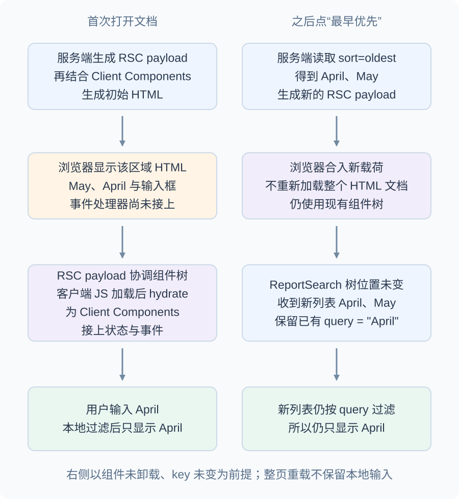

图的右栏是后续导航：用户先在搜索框输入 `April`，再点“最早优先”。客户端导航不重新下载整份 HTML，而是请求新的 RSC payload 合进现有组件树。`ReportSearch` 若仍在同一树位置，就保留本地的 `query = "April"`，并继续过滤新列表；它若被卸载、key 改变或整页重载，没写进 URL 的 `query` 不会恢复。

服务器的第一次渲染和浏览器的第一次渲染必须得到同样的结果，否则会出现 hydration mismatch（水合不匹配）。时间、随机数、地区设置和浏览器专属值都是常见来源：需要浏览器值时，先渲染稳定的占位，再在首次提交后的 Effect 里读取。这类问题的更多处理见[紧急更新与延后更新](#45.%20%E6%98%82%E8%B4%B5%E6%9B%B4%E6%96%B0%E6%97%B6%EF%BC%8C%E6%80%8E%E6%A0%B7%E8%AE%A9%E8%BE%93%E5%85%A5%E4%BF%9D%E6%8C%81%E5%8D%B3%E6%97%B6%EF%BC%9F)。

### 用 Suspense 分块等待

页面里有三件事要等：本次请求的参数、摘要、行列表。它们彼此独立，没必要互相等。本例的嵌套方式是：

1. 外层 `ReportPage` 立即返回标题 `<h1 id="summary">`，并把**尚未解包**的 `params`、`searchParams` Promise 交给 Suspense 里的 `ReportContent`；参数没到时显示“正在读取排序…”。
2. `ReportContent` 解包参数、决定 `sort`，然后**同时**启动 `getRows("42", sort)` 和 `getSummary("42")`，各自把 Promise 交给一个局部 Suspense。
3. 摘要先完成就先显示“行数：2”，不必等列表；列表完成后，把 May、April 的展示字段作为 props 交给 `ReportSearch`。


嵌套顺序有实质作用。如果 Page 在返回 JSX **之前**就 `await searchParams`，Page 自己创建的 Suspense 此时还不存在，保护不了这次等待；这时必须有外部的祖先边界（例如同段的 `loading.tsx`）。本例把读取放进子组件，标题就成了可以先返回的静态外壳。

Suspense 只处理等待，读取失败会向错误边界传播。实际哪个 fallback 先被看到，取决于完成顺序和传输是否被缓冲；边界存在不意味着每次都能看见它。

这条数据链路与 React Router 的浏览器 loader 不同：这里是 Next 服务端访问外部上游，不是浏览器访问同源 `/api/...`。两种路由器的数据加载位置和导航协议不能互换。

> [!example]- 实现：静态标题、请求参数与两个独立等待区
>
> ~~~tsx
> // app/reports/[reportId]/page.tsx
> import { Suspense } from "react";
> import Link from "next/link";
> import { ReportSearch } from "./report-search";
>
> type SortOrder = "recent" | "oldest";
> type Row = { id: string; period: string; title: string };
> type Summary = { rowCount: number };
> type PageProps = {
>   params: Promise<{ reportId: string }>;
>   searchParams: Promise<{ sort?: string | string[] }>;
> };
>
> const UPSTREAM = "https://reports.example.test";
>
> function isRow(value: unknown): value is Row {
>   if (typeof value !== "object" || value === null) return false;
>   const row = value as Record<string, unknown>;
>   return typeof row.id === "string" && typeof row.period === "string" &&
>     typeof row.title === "string";
> }
>
> function parseRows(value: unknown): Row[] {
>   if (!Array.isArray(value)) throw new Error("Invalid rows response");
>   return (value as unknown[]).map(row => {
>     if (!isRow(row)) throw new Error("Invalid row");
>     return { id: row.id, period: row.period, title: row.title }; // 只投影展示字段
>   });
> }
>
> function parseSummary(value: unknown): Summary {
>   const s = value as Record<string, unknown> | null;
>   if (typeof s !== "object" || s === null || typeof s.rowCount !== "number" ||
>       !Number.isSafeInteger(s.rowCount) || s.rowCount < 0) {
>     throw new Error("Invalid summary response");
>   }
>   return { rowCount: s.rowCount };
> }
>
> async function getRows(reportId: string, sort: SortOrder): Promise<Row[]> {
>   const response = await fetch(
>     `${UPSTREAM}/api/reports/${encodeURIComponent(reportId)}/rows?sort=${sort}`,
>     { cache: "no-store" }
>   );
>   if (!response.ok) throw new Error("Could not load rows");
>   return parseRows(await response.json());
> }
>
> async function getSummary(reportId: string): Promise<Summary> {
>   const response = await fetch(
>     `${UPSTREAM}/api/reports/${encodeURIComponent(reportId)}/summary`,
>     { cache: "no-store" }
>   );
>   if (!response.ok) throw new Error("Could not load summary");
>   return parseSummary(await response.json());
> }
>
> export default function ReportPage({ params, searchParams }: PageProps) {
>   return (
>     <main>
>       <h1 id="summary">报表摘要</h1>
>       <Suspense fallback={<p role="status">正在读取排序…</p>}>
>         <ReportContent params={params} searchParams={searchParams} />
>       </Suspense>
>     </main>
>   );
> }
>
> async function ReportContent({ params, searchParams }: PageProps) {
>   const { reportId } = await params;
>   const { sort: rawSort } = await searchParams;
>   const sort: SortOrder = rawSort === "oldest" ? "oldest" : "recent";
>   const rowsPromise = getRows(reportId, sort);       // 两个请求同时启动
>   const summaryPromise = getSummary(reportId);
>   const href = (s: SortOrder) => `/reports/${encodeURIComponent(reportId)}?sort=${s}#summary`;
>
>   return (
>     <>
>       <nav aria-label="行排序">
>         <Link href={href("oldest")} aria-current={sort === "oldest" ? "page" : undefined}>
>           最早优先
>         </Link>
>         {" · "}
>         <Link href={href("recent")} aria-current={sort === "recent" ? "page" : undefined}>
>           最近优先
>         </Link>
>       </nav>
>       <Suspense fallback={<p role="status">正在取得摘要…</p>}>
>         <ReportSummary promise={summaryPromise} />
>       </Suspense>
>       <Suspense fallback={<p role="status">正在取得报表行…</p>}>
>         <ReportRows promise={rowsPromise} />
>       </Suspense>
>     </>
>   );
> }
>
> async function ReportSummary({ promise }: { promise: Promise<Summary> }) {
>   const summary = await promise;
>   return <p>行数：{summary.rowCount}</p>;
> }
>
> async function ReportRows({ promise }: { promise: Promise<Row[]> }) {
>   return <ReportSearch rows={await promise} />;
> }
> ~~~
>
> ~~~tsx
> // app/reports/[reportId]/report-search.tsx
> "use client";
>
> import { useState } from "react";
>
> type Row = { id: string; period: string; title: string };
>
> export function ReportSearch({ rows }: { rows: Row[] }) {
>   const [query, setQuery] = useState("");
>   const visible = rows.filter(row => row.title.toLowerCase().includes(query.toLowerCase()));
>   return (
>     <section>
>       <label>
>         搜索报表行
>         <input value={query} onChange={event => setQuery(event.target.value)} />
>       </label>
>       <ol aria-label="报表行">
>         {visible.map(row => <li key={row.id}>{row.period} — {row.title}</li>)}
>       </ol>
>     </section>
>   );
> }
> ~~~
>
> 排序控件用 `<Link>` 而不是主线一的 `aria-pressed` 按钮：切换排序就是切换地址，Link 保留链接语义，并让 Next 能预取目标。

示例在服务边界把 `response.json()` 当作 `unknown`，逐行检查并投影成只含展示字段的 DTO（Data Transfer Object，数据传输对象），避免把上游行里可能存在的内部字段带进 RSC payload；摘要的 `rowCount` 也必须是非负安全整数（见 [TypeScript 能保证什么](#34.%20TypeScript%20%E8%83%BD%E4%BF%9D%E8%AF%81%E4%BB%80%E4%B9%88%EF%BC%8C%E5%A4%96%E9%83%A8%E6%95%B0%E6%8D%AE%E5%8F%88%E8%AF%A5%E6%80%8E%E6%A0%B7%E9%AA%8C%E8%AF%81%EF%BC%9F)）。本例没有身份提供者，省略了鉴权接线；真实读取要先验证会话，再确认用户有权看报表 42。数据量大、需要分页，或过滤受权限影响时，把条件写进 URL，由服务端按条件查询，而不是把全部行发给浏览器再本地过滤。

### 缓存存在哪一层

“页面变快了”可能来自几层完全不同的缓存，它们存的东西、失效方式和陈旧风险都不同：

| 层 | 存什么 | 本例怎样配置 |
|---|---|---|
| fetch 响应 | 某次 `fetch` 的响应，键依据请求信息 | 两次上游请求都用 `cache: "no-store"`，实际执行时不读写 Next 的持久数据缓存；`force-cache` 才显式保存 |
| 函数或组件结果 | `use cache` 标记的取数函数或组件的返回值；输入和捕获的可序列化值参与缓存键 | 未使用。允许陈旧一段时间的数据可以用它，并用 `cacheLife` 写明生命周期 |
| 浏览器里的 RSC 页面载荷 | 客户端路由器保存的已访问路由结果 | 框架管理；Back 可能直接复用，也可能重新请求 |

Cache Components 的作用是让静态外壳先返回，把只有本次请求才知道的数据留在等待边界里；它并没有把所有数据自动变成跨请求可复用。`fetch` 的 `force-cache` 在开启 Cache Components 后仍然有效，但它缓存的是 fetch 响应，与 `use cache` 的函数/组件结果缓存是两回事。与身份有关的数据，还要把权限范围纳入缓存设计，不能把一个用户的结果共享给另一个用户。

`no-store` 约束的只是那次 fetch，不能迫使每次 Link 或 Back 都重跑服务端。选择缓存时要说清：缓存的是哪一层、能陈旧多久、变更后怎样失效；不能因为页面变快就推断数据仍然正确。浏览器自身的 HTTP 缓存语义是另一层，见[哈希发布与缓存](#51.%20%E5%8F%91%E5%B8%83%E6%96%B0%E7%89%88%E6%9C%AC%E6%97%B6%EF%BC%8C%E6%80%8E%E6%A0%B7%E8%AE%A9%E7%BC%93%E5%AD%98%E5%92%8C%E8%BF%98%E5%BC%80%E7%9D%80%E7%9A%84%E6%97%A7%E9%A1%B5%E9%9D%A2%E9%83%BD%E4%B8%8D%E5%87%BA%E9%94%99%EF%BC%9F)。

> [!info] 实例：Next.js 16.4.6 的缓存配置与旧模型识别
> ~~~ts
> // next.config.ts
> import type { NextConfig } from "next";
> const nextConfig: NextConfig = { cacheComponents: true, partialPrefetching: true };
> export default nextConfig;
> ~~~
> 官方要求开启 `cacheComponents` 时显式设置 `partialPrefetching`，不设会输出警告，因为 Cache Components 的首个版本不含部分预取；只有迁移更早采用 Cache Components 的应用时才暂设为 `false`。官方计划在下一个大版本默认启用二者并移除这两个选项。维护未开启 Cache Components 的旧项目时，按上一缓存模型理解：动态页面的默认 fetch 在请求时执行，静态页面可能在构建时读取；`dynamic`、`revalidate` 等路由段选项不能原样套到新模型。开发模式的 HMR（Hot Module Replacement，热模块替换）可能复用部分 `no-store` 结果，实际缓存契约要在生产运行中检验。

### 等待与失败各有自己的边界

`app/reports/[reportId]/loading.tsx` 会自动在该段的 Page 及其后代外建立一个 Suspense 边界，子树没准备好时显示整段的等待壳。它不包住同目录的 `layout.tsx`，也不捕获读取失败；layout 自己若要等未缓存的数据，需要在对应位置另设等待边界。本例 Page 能立即返回标题，并把等待放进更小的边界，所以段级 loading 是否真的可见取决于导航和完成时序。

`app/reports/[reportId]/error.tsx` 必须是 Client Component，它捕获本段 Page 和子段的错误，但不捕获同段 `layout.tsx` 抛出的错误，那会交给更上一级的边界；根 `layout.tsx` 失败时由 `app/global-error.tsx` 接手，它要自己包含 `html` 与 `body`。本例故意让请求失败和不合约的响应抛出异常，以演示段级边界：摘要请求一失败，整个报表页段都换成 fallback，而不只是摘要那一小块。产品若把上游 503 视作可预期状态，也可以在数据组件里捕获它，呈现局部失败，不把整段判为异常。哪类错误该由哪个边界接住，见 [React 错误边界](#46.%20%E9%94%99%E8%AF%AF%E5%8F%91%E7%94%9F%E5%9C%A8%E5%93%AA%E9%87%8C%EF%BC%8C%E5%86%B3%E5%AE%9A%E4%BA%86%E8%B0%81%E8%83%BD%E6%8E%A5%E4%BD%8F%E5%AE%83%EF%BC%9F)。

> [!example]- 段级等待壳与错误边界（`retry` 自 Next.js 16.3 起稳定）
> ~~~tsx
> // app/reports/[reportId]/loading.tsx
> export default function Loading() {
>   return <p role="status">正在打开报表…</p>;
> }
> ~~~
>
> ~~~tsx
> // app/reports/[reportId]/error.tsx
> "use client";
> import { useEffect } from "react";
>
> export default function ReportError({ error, retry }: { error: unknown; retry: () => void }) {
>   useEffect(() => { console.error(error); }, [error]);
>   return (
>     <section>
>       <p role="alert">报表暂时无法显示。</p>
>       <button type="button" onClick={() => retry()}>重新读取</button>
>     </section>
>   );
> }
> ~~~

`retry()` 重新读取并渲染边界内的子树。URL 仍是 `sort=oldest` 时，重试沿同一个查询值重新渲染，成功后列表恢复为 April、May，不会悄悄改回 recent。服务端组件的错误传到客户端时，不要把原始的私密错误消息展示给用户；生产环境可以用 `error.digest` 关联服务端日志，用户只看到通用提示。

### Server Action 不是私有接口

若之后要加“标记已读”这样的变更，可以用 Server Action（服务端动作）处理表单：它是一个用 `"use server"` 标记的 Server Function（服务端函数），客户端通过 POST 调用。它在网络上就是一个可以被直接请求的端点，按钮隐藏了、action ID 不好猜，都不能让它变成私有接口。每次调用都要重新认证调用者、授权这次操作、校验输入。需要给其他消费者提供独立 HTTP API 时，用 Route Handler。

### 排序、Back 与取消

点“最早优先”时，`<Link>` 做客户端过渡。Partial Prefetching 可以预取可复用的外壳和等待状态，需要当前请求数据的部分仍由导航时的新载荷补全：服务器按 `oldest` 取得 April、May，浏览器把新载荷合进现有组件树。期间看到旧内容还是等待界面，取决于预取到了什么和完成时序，不能从一次点击推出固定的 URL 更新时点。这一点与 React Router Data Mode“PUSH 等 loader 结算后才改地址”的确定规则不同。

Back 把地址恢复成 `sort=recent`，但可能复用客户端已有的路由结果，也可能重新请求载荷；不能断言一定发生了上游读取，也不保证恢复某个旧数据快照。数据没变时顺序仍是 May、April；URL 固定的只是排序条件。

服务端组件没有 React Router loader 那样的 `request.signal`。切换路由不等于 Next 已经取消了服务器端的 fetch 或数据库操作。只有客户端自己创建的 fetch，才能用客户端 `AbortController` 在组件清理时取消等待；服务端的工作要靠请求超时、幂等性和一致性约束兜底（见[取消与超时停得住什么](#28.%20%E5%8F%96%E6%B6%88%E3%80%81%E8%B6%85%E6%97%B6%E5%92%8C%E5%B9%B6%E5%8F%91%E4%B8%8A%E9%99%90%E5%90%84%E8%87%AA%E5%81%9C%E5%BE%97%E4%BD%8F%E4%BB%80%E4%B9%88%EF%BC%9F)）。

这份主例的等价版本（路径为 `/reports`、不含动态段）在隔离的生产运行中检查过：Next.js 16.4.6、React 19.3.1、Node 26.13.0、Chrome 157，本地合成上游。排序、Back 和输入保留都符合上文；列表延迟 700 ms 时摘要先出现、列表仍显示等待；摘要第一次失败后，重试仍按当前的 `oldest` 读取。真实的身份授权和不同托管链路仍由应用接线决定。

### 识别旧版 Pages Router 代码

同一项目可以逐段从 Pages Router 迁移到 App Router，但每段代码都必须明确属于哪种路由器，不要把两套 API 拼进同一个文件。`next/router`、`router.query` 和 Pages Router 的数据函数不适用于 `app/` 下的页面；App Router 的客户端导航用 `next/link`，客户端代码里的程序化导航用 `next/navigation` 的 `useRouter`。

> [!info]- 维护 Pages Router 时的对照与再生规则
>
> | 需求 | Pages Router | App Router |
> |---|---|---|
> | 动态路径参数 | `next/router` 的 `router.query` | 页面收到 Promise `params`，`await` 后读取 |
> | 查询参数 | `router.query`；自动静态优化时首屏可能暂为空，客户端代码要在 Effect 里等 `router.isReady` | 页面收到 Promise `searchParams`，读取请求时的 URL |
> | 服务端数据 | `getServerSideProps` 按请求读；`getStaticProps` 读静态数据；动态路径用 `getStaticPaths` 列出构建路径 | 默认由 Server Component 读取；本例等待边界里的 `no-store` fetch 执行时取新数据 |
> | 刷新静态结果 | `getStaticProps` 的 `revalidate`，即 ISR（Incremental Static Regeneration，增量静态再生） | 按当前 App Router 缓存配置 |
> | API 端点 | `pages/api` 的默认处理器 | `app/**/route.ts` 按 HTTP 方法导出 |
>
> `revalidate: 60` 不是后台每分钟定时重建：构建出的页面先被缓存，60 秒后遇到的第一个请求仍拿到旧页并触发后台生成，生成成功后，之后的请求才拿到新页。对构建时未列出的动态路径，`getStaticPaths` 的 `fallback: false` 直接 404；`fallback: true` 在普通浏览器首次直达时先给 fallback 并在后台生成，但爬虫以及经 `next/link` 或 `next/router` 的客户端导航按 blocking 行为等待；`"blocking"` 对首次访问也等生成完成再返回。

### 本章交出了什么

App Router 把一次页面请求分成三条线：服务端组件读数据、决定排序、只投影展示字段；RSC payload 先生成 HTML 再经 hydration 接上客户端交互；Suspense 让参数、摘要和列表各自等待，错误交给段级边界。缓存分 fetch 响应、函数/组件结果和浏览器路由载荷三层，各自说明存什么、能陈旧多久。主线四的状态与异步规则在这里同样适用：URL 只记住条件，迟到的工作要按身份处理，服务端的工作不随客户端导航自动取消。

> [!info]- 来源
> 版本：Next.js 16.4.6（[v16.4.6 release](https://github.com/vercel/next.js/releases/tag/v16.4.6)，2026-11-09 发布），官方文档核对于 2026-11-12。
> - 文件约定、动态段、layout/page 共享、Route Handler 的方法导出（“文件约定把路径落到页面与布局”）：[Project Structure](https://nextjs.org/docs/app/getting-started/project-structure)、[Dynamic Segments](https://nextjs.org/docs/app/api-reference/file-conventions/dynamic-routes)、[Route Handler](https://nextjs.org/docs/app/api-reference/file-conventions/route)。
> - `params` 与 `searchParams` 的 Promise 形状、重复查询参数变数组、共享 layout 不接收 `searchParams`（“params 与 searchParams 都是 Promise”）：[page.js — Props](https://nextjs.org/docs/app/api-reference/file-conventions/page#props)；运行时 API 置于 Suspense 之下与参数 Promise 下传：[Uncached data was accessed outside of Suspense](https://nextjs.org/docs/messages/blocking-route#params-and-searchparams)。
> - `"use client"` 模块边界、children 插槽、序列化 props，以及 RSC payload → HTML → hydrate 的顺序（“分界线”“首屏”）：[Server and Client Components — How they work](https://nextjs.org/docs/app/getting-started/server-and-client-components#how-do-server-and-client-components-work-in-nextjs)；水合一致性与 Effect 只在客户端运行：[React hydrateRoot](https://react.dev/reference/react-dom/client/hydrateRoot)、[React useEffect](https://react.dev/reference/react/useEffect)。
> - `<Link>` 客户端导航、部分预取、loading fallback 与后续 RSC 载荷（“排序、Back 与取消”）：[Linking and Navigating](https://nextjs.org/docs/app/getting-started/linking-and-navigating#prefetching)。
> - `cacheComponents` 要求 Node.js runtime、不支持段 `runtime` 导出，16.0 稳定；须显式设置 `partialPrefetching`，下一大版本将默认启用；`use cache`（“缓存存在哪一层”及实例 callout）：[cacheComponents](https://nextjs.org/docs/app/api-reference/config/next-config-js/cacheComponents)、[Caching — Enabling Cache Components](https://nextjs.org/docs/app/getting-started/caching#enabling-cache-components)、[`use cache`](https://nextjs.org/docs/app/api-reference/directives/use-cache)。
> - 上一缓存模型与新模型的 fetch 响应缓存 / 函数组件结果缓存，启用新模型后显式 fetch 缓存仍有效：[Caching and Revalidating (Previous Model)](https://nextjs.org/docs/app/guides/caching-without-cache-components)、[Migrating to Cache Components](https://nextjs.org/docs/app/guides/migrating-to-cache-components)、[fetch — options.cache](https://nextjs.org/docs/app/api-reference/functions/fetch#optionscache)。
> - `loading.tsx` 包围 Page 与后代但不包同目录 layout；`error.tsx` 的捕获范围、`retry`（16.3.0 起稳定）与全局错误边界（“等待与失败各有自己的边界”）：[loading.js — Behavior](https://nextjs.org/docs/app/api-reference/file-conventions/loading#behavior)、[error.js — retry / Global Error](https://nextjs.org/docs/app/api-reference/file-conventions/error#retry)。
> - Server Functions 使用 POST、可被直接请求，每次调用都要校验输入、认证并授权（“Server Action 不是私有接口”）：[Mutating Data](https://nextjs.org/docs/app/getting-started/mutating-data#what-are-server-functions)、[Data Security — Validating Client Input](https://nextjs.org/docs/app/guides/data-security#validating-client-input)、[Authentication and Authorization](https://nextjs.org/docs/app/guides/data-security#authentication-and-authorization)。
> - Pages Router 的 `getServerSideProps`、`getStaticProps`、`getStaticPaths` fallback 与 ISR 时序、`router.isReady`（“识别旧版 Pages Router 代码”）：[getServerSideProps](https://nextjs.org/docs/pages/building-your-application/data-fetching/get-server-side-props)、[getStaticProps](https://nextjs.org/docs/pages/api-reference/functions/get-static-props)、[getStaticPaths](https://nextjs.org/docs/pages/api-reference/functions/get-static-paths#fallback-true)、[Incremental Static Regeneration](https://nextjs.org/docs/pages/guides/incremental-static-regeneration)、[Pages Router useRouter](https://nextjs.org/docs/pages/api-reference/functions/use-router)。
> - 主例等价版本的生产运行检查（Next.js 16.4.6、React 19.3.1、Node 26.13.0、Chrome 157，本地合成上游）为 2026-11-12 的本地运行结果。
## 42. 服务端数据怎样缓存、刷新和乐观更新，迟到的响应又归谁？

报表的行数据归服务端所有，浏览器里只有它的副本。副本会过期，会被乱序到达的响应改写，用户的修改还要在服务器确认之前就显示出来。本章回答四个问题：客户端怎样标识每一份副本；一个迟到的异步结果凭什么决定自己该落在哪里；什么时候重新读取；乐观更新怎样在失败和并发读取下仍然正确。读者手上已有上一章的结论：路由给出已提交的 `sort`，见[路由与 loader](#40.%20%E8%B7%AF%E7%94%B1%E6%80%8E%E6%A0%B7%E6%8A%8A%20URL%20%E5%8F%98%E6%88%90%E5%B7%B2%E6%8F%90%E4%BA%A4%E7%9A%84%E6%95%B0%E6%8D%AE%E5%92%8C%E7%95%8C%E9%9D%A2%EF%BC%9F)。

### 案例：同一份报表、两个排序、两个账户

沿用主线一的报表页 `/reports/42?sort=recent#summary`，报表 42 的两行 May、April 的行 ID 分别是 `r-104`、`r-103`。本章新增三点：当前账户 `acct-a`；行数据由查询缓存而不是 loader 读取；每行有“标为已审阅”按钮，把该行的 `reviewed` 写成 `true`。

用户依次做这些事：先看 recent（May、April），切到 oldest（April、May），在 oldest 下把 April 标为已审阅，最后切换到账户 `acct-b`。我们要保证三件事：每个排序显示自己那份服务端结果；April 的已审阅状态在保存期间立即可见、失败后撤去、成功后与服务器一致；`acct-a` 的行永远不会出现在 `acct-b` 下。

示例用 TanStack Query v5（官方 v5 Latest 文档，核对于 2026-11-12；相关章节的本地复现版本为 5.107.1）。机制本身不依赖这个库，本章末尾另给 ahooks 的对应实例。

### 查询键就是结果的身份

查询缓存把一次读取描述成两样东西：`queryFn`（查询函数）负责取数，`queryKey`（查询键）标识这次取数的**结果**。规则只有一条：凡是会改变 `queryFn` 返回值的输入，都要进键。本例的行数据取决于账户、报表和排序：

~~~ts
["reports", "acct-a", "42", "rows", "recent"]
~~~

同一账户、同一报表的各排序共享前缀 `["reports", "acct-a", "42", "rows"]`，失效时可以一次刷新该报表的全部排序；账户级前缀 `["reports", "acct-a"]` 用于退出登录时整体移除。若再加筛选、搜索词或页码，它们也要进键。fragment `#summary` 不随请求发送、不改变结果，所以不进键；只有应用明确把某个片段转成请求参数时，转换后的值才属于查询输入。

| 阶段 | 当前键 | 列表与提示 |
|---|---|---|
| 初始路由 | `…/rows/recent` | 路由随页面交付的 May、April 作为这个键的初始数据，直接显示 |
| 点“最早优先” | 路由提交 `sort=oldest`，键变为 `…/rows/oldest` | 若该键无缓存：把同账户、同一完整行集合的路由行在本地排成 April、May，标明“正在等待服务端确认”，行内操作禁用 |
| oldest 响应到达 | 只写 `…/rows/oldest` | 列表换成该键的服务端数据。较早的 recent 请求即使此后才完成，也只写进 recent 的键 |
| 切换到 `acct-b` | `["reports", "acct-b", "42", "rows", sort]` | 没有 B 的缓存或路由行时，显示等待或空状态；绝不把 A 的行当成 B 的结果 |

第二行的本地重排有严格前提：行的成员完全相同，只是顺序不同。只要账户、筛选、搜索词或页码改变了集合，旧集合重排后就不能冒充当前结果，切换期间只能显示当前键的缓存或等待状态。

### 异步结果按身份归属

上表最后两行用到了一条贯穿整个前端的规则。它值得单独说清，因为几乎每一层都会重新遇到它。

**问题。** 一个异步操作在 t₀ 发起、在 t₁ 返回。到 t₁ 时，界面可能已经换了排序、换了账户、关掉了抽屉、发起了更新的请求。响应本身不知道这些。如果代码在 t₁ 时“把结果写进当前界面”，那么只要两次请求的返回顺序和发起顺序不同，旧结果就会覆盖新界面。网络、缓存、服务器负载都不保证顺序，所以这不是边角情况。

**原理。** 每个异步结果都要带着它所属的身份回来，并只落到这个身份对应的位置：

1. **身份在发起时铸造，随结果一起回来。** 它存在闭包、请求变量或 action 的 `meta` 里；结果到达时不要回头读“现在的”props 或 state 来推断它属于谁。
2. **身份覆盖所有会改变结果的输入，以及结果所属的作用域。** 排序、筛选、页码是输入；账户、编辑会话是作用域。少一项，两份不同的结果就会共用一个身份。
3. **到达时与唯一的当前所有者比较。** “最后到达的赢”和“最后发起的赢”都不是判断依据，判断依据只有“这份结果的身份是否仍是当前身份”。
4. **落点有两种。** 按身份分格存储时，每份结果都写进自己的格，旧结果不浪费，只是不显示（查询缓存）；只有一个槽位时，身份不匹配的结果直接丢弃（Effect、Redux 预览、编辑抽屉）。
5. **认领与取消是两件事。** 取消尽量省掉客户端工作，但不保证结果不回来，也不撤销服务端已发生的事（见[取消与超时停得住什么](#28.%20%E5%8F%96%E6%B6%88%E3%80%81%E8%B6%85%E6%97%B6%E5%92%8C%E5%B9%B6%E5%8F%91%E4%B8%8A%E9%99%90%E5%90%84%E8%87%AA%E5%81%9C%E5%BE%97%E4%BD%8F%E4%BB%80%E4%B9%88%EF%BC%9F)）；按身份认领才保证界面正确。两者通常一起用。
6. **写入的回执不能丢弃。** 读取结果过期了可以扔掉；写入的回执说明服务器状态已经改变，必须按发起时捕获的身份更新对应的缓存，只有“要不要改当前界面”才看它是否仍属于当前会话。

下表是本书各处的实例。它们的身份长得不一样，机制相同：

| 场景 | 身份是什么 | 当前所有者在哪里 | 不匹配时 | 详见 |
|---|---|---|---|---|
| Effect 里手写请求 | 每次 Effect setup 一份：cleanup 置位的 `ignore` 标志或请求序号 | 最近一次 setup 的闭包 | 丢弃 | [React 更新模型](#37.%20React%20%E6%80%8E%E6%A0%B7%E6%8A%8A%E4%B8%80%E6%AC%A1%E7%94%A8%E6%88%B7%E6%93%8D%E4%BD%9C%E5%8F%98%E6%88%90%E7%95%8C%E9%9D%A2%E6%9B%B4%E6%96%B0%EF%BC%9F) |
| 页面处理器里的请求 | 递增的请求序号，配合中止 | 组件持有的最新序号 | 丢弃，并中止旧请求 | [失败该由哪一层处理](#30.%20%E4%B8%80%E6%AC%A1%E5%A4%B1%E8%B4%A5%E8%AF%A5%E7%94%B1%E5%93%AA%E4%B8%80%E5%B1%82%E5%A4%84%E7%90%86%EF%BC%9F) |
| 防抖搜索、请求 Hook | 请求代次（generation），每次输入或参数变化加 1 | ref 里的最新代次 | 丢弃 | [包装函数](#25.%20%E6%80%8E%E6%A0%B7%E5%8C%85%E8%A3%85%E4%B8%80%E4%B8%AA%E5%87%BD%E6%95%B0%E8%80%8C%E4%B8%8D%E5%BC%84%E4%B8%A2%E5%8F%82%E6%95%B0%E3%80%81this%20%E5%92%8C%E7%BB%93%E6%9E%9C%EF%BC%9F)；ahooks 实例见本章末 |
| 路由导航 | 每次导航本身 | 路由器的当前导航 | 丢弃，并 abort `request.signal` | [路由与 loader](#40.%20%E8%B7%AF%E7%94%B1%E6%80%8E%E6%A0%B7%E6%8A%8A%20URL%20%E5%8F%98%E6%88%90%E5%B7%B2%E6%8F%90%E4%BA%A4%E7%9A%84%E6%95%B0%E6%8D%AE%E5%92%8C%E7%95%8C%E9%9D%A2%EF%BC%9F) |
| 查询缓存 | query key：输入本身就是身份 | 每个键一格 | 写进自己的格，不显示 | 本章 |
| mutation 回执 | 提交时的 variables（账户、排序、行 ID） | 变量所指的那个键 | 仍更新那个键；不改其他键 | 本章 |
| Redux 异步请求 | `createAsyncThunk` 的 `meta.requestId` | state 里的 `currentRequestId` | 丢弃 | [Redux 与异步工作流](#43.%20Redux%20%E6%80%8E%E6%A0%B7%E7%AE%A1%E7%90%86%E8%B7%A8%E7%BB%84%E4%BB%B6%E7%9A%84%E5%AE%A2%E6%88%B7%E7%AB%AF%E7%8A%B6%E6%80%81%E5%92%8C%E5%BC%82%E6%AD%A5%E8%AF%B7%E6%B1%82%EF%BC%9F) |
| 编辑抽屉的打开 | open intent：`sessionId + accountId + reportId` | 当前打开意图 | 只写自己的详情缓存，不初始化抽屉 | [编辑会话与条件写入](#44.%20%E7%BC%96%E8%BE%91%E8%A1%A8%E5%8D%95%E6%80%8E%E6%A0%B7%E5%9C%A8%E5%88%AB%E4%BA%BA%E5%90%8C%E6%97%B6%E4%BF%AE%E6%94%B9%E6%97%B6%E5%AE%89%E5%85%A8%E4%BF%9D%E5%AD%98%EF%BC%9F) |
| 字段异步校验 | validation ticket：`sessionId + clientId + generation + snapshot` | 每个字段的最新 ticket | 返回 stale，不改字段错误 | 同上 |
| 保存尝试 | `sessionId + submitId` | 当前会话的 attempt owner | 只更新缓存，不改当前表单 | 同上 |

最常见的两种错误都来自违反第 1 条：一是在响应到达时读当前 props 决定写到哪里，二是用数组下标或“当前第几行”当身份。另一种错误是用值相等代替身份：两份结果碰巧相等，并不说明它们来自同一次请求或同一次写入。

### 首屏数据、占位与新鲜度

**`initialData`（初始数据）** 把路由交付的行写进对应键的缓存，只用于 `initialAccountId`、`initialSort` 对应的那个键，其他排序和账户不使用它。缓存需要知道这批数据是什么时候生成的：若路由给出了生成时间，就以毫秒时间戳传给 `initialDataUpdatedAt`，否则客户端会把初始化的时刻当作数据时间，从而高估它的新鲜度。

**`placeholderData`（占位数据）** 不写入缓存，查询结果带 `isPlaceholderData` 标记。它常用来在切换键时暂留上一个键的行。用之前先确认上一个键的账户就是当前账户，在界面上标明这些行尚未得到新条件的确认，并禁止在占位行上操作；绝不能拿其他账户的数据作占位。本例主线不用它，而是在成员完全相同的同账户行上做本地重排。

**`staleTime`（新鲜期）** 只决定客户端在多长时间内不按“过期”策略自动重取。本例设 30 秒，意思是 30 秒内挂载、窗口重新聚焦或网络恢复都不会触发后台重取；它不表示服务器数据 30 秒内不变，手动失效仍可强制重读。若用户切到 oldest 再按 Back，路由把 `sort` 恢复成 recent，键随之切回 recent 的缓存，是否后台重取由它是否已过期决定。

### 用 status 和 data 一起决定显示

查询结果有两个独立的维度。`status` 描述数据：`pending`（还没有任何数据）、`success`、`error`；`fetchStatus` 描述 `queryFn` 是否正在运行：`fetching`、`paused`（等网络）、`idle`。只看 `status` 判断不了有没有可显示的数据：后台刷新失败时 `status` 是 `error`，同一个键却仍保留上次成功的 `data`。

本例用普通 `useQuery`，没有开 `throwOnError`，失败留在返回值里。改成抛错或 Suspense 查询后，失败走错误边界，见 [React 错误边界](#46.%20%E9%94%99%E8%AF%AF%E5%8F%91%E7%94%9F%E5%9C%A8%E5%93%AA%E9%87%8C%EF%BC%8C%E5%86%B3%E5%AE%9A%E4%BA%86%E8%B0%81%E8%83%BD%E6%8E%A5%E4%BD%8F%E5%AE%83%EF%BC%9F)。

| 查询状态 | 判断 | 显示 |
|---|---|---|
| 新键尚无缓存 | `status: pending`，通常 `fetching`；断网时 `paused` | 有同账户的路由行就本地重排并标明未确认，否则显示等待；禁止行操作 |
| 已有缓存，后台刷新中 | `success` + `fetching` | 保留行，加轻量的“正在更新”提示 |
| 成功但没有行 | `success`，`data` 为 `[]` | “此报表没有匹配的行”；这是空结果，不是错误 |
| 首次读取失败 | `error`，`data` 为空 | 有同账户路由行就显示它并说明“确认失败”；否则显示错误；都给重试 |
| 后台刷新失败 | `error`，`data` 仍在 | 保留上次成功的行，说明“刷新失败” |
| 旧键的请求在切换后完成 | 结果属于旧键 | 旧结果留在自己的格里，不显示在当前键下 |

### 乐观更新：在界面层叠加待处理的值

假设 `acct-a/oldest` 已显示服务端确认的行，用户点 April 行的“标为已审阅”。点击事件把 `{ accountId: "acct-a", sort: "oldest", id: "r-103", reviewed: true }` 交给 mutation（服务端变更）。保存期间，TanStack Query 暴露这份待处理的 variables；组件按账户、排序和行 ID 找到 April，把它的 `reviewed` 暂时显示为 `true`。查询缓存里仍是上次服务端确认的行。这种只在界面层叠加待处理值、不改缓存的做法，下文称为 overlay（界面覆盖层）。


上图是失败分支里的一个时刻：保存仍在等待时，窗口重新获得焦点，触发了一次焦点重取，把服务端最新的行写进缓存；这时 May 的标题已被别人改过。overlay 不碰缓存，所以 May 的新标题和 April 的待处理值能同时显示。接下来保存请求失败，`onSettled` 发起的校准重取也失败：

| 时点 | `acct-a/oldest` 的缓存；匹配的待处理变量 | 界面 |
|---|---|---|
| 焦点重取到达，保存仍在等待 | April `reviewed=false`，May 是新标题；变量为 April `reviewed=true` | April 显示 `true`；May 显示新标题 |
| 保存失败，`onSettled` 重取中 | 缓存不变；mutation 仍算 pending | 同上 |
| `onSettled` 重取结束（也失败） | 缓存保留焦点重取的结果；变量解除 | overlay 消失，April 回到 `false`；May 新标题仍在 |

成功分支更简单：`onSuccess` 用这次提交的 variables（而不是可能已切换的组件 props）找到原来的键，把服务器返回的 April 行写进去；`onSettled` 让该报表的整个行前缀失效。联网且查询活跃时，匹配的活跃查询立即重取；非活跃的排序只标为失效，等下次使用时再读。`onSettled` 返回的 Promise 完成前，mutation 仍处于 pending，所以 overlay 会一直盖到校准读取结束，不会在“保存成功、校准未到”的间隙闪回旧值。

### 整表快照回滚为什么会丢数据

另一种常见做法是在 `onMutate` 里直接改缓存，并保存整表快照：

~~~tsx
onMutate: async (change, context) => {
  const key = rowKeys.list(change.accountId, change.reportId, change.sort);
  await context.client.cancelQueries({ queryKey: key, exact: true });
  const previous = context.client.getQueryData<Row[]>(key);
  context.client.setQueryData<Row[]>(key, rows =>
    rows?.map(row => row.id === change.id ? { ...row, reviewed: change.reviewed } : row));
  return { key, previous };
},
onError: (_error, _change, snapshot, context) => {
  if (snapshot?.previous !== undefined) {
    context.client.setQueryData(snapshot.key, snapshot.previous);
  }
},
~~~

它只在“保存期间没有任何其他写入碰这个键”时可靠。`cancelQueries` 只取消调用那一刻已在途的读取，不是锁；新鲜期过后的焦点重取、轮询或手动 `refetch` 仍会在保存期间写缓存。一次本地回放正好踩中这一点：把时钟推进 31 秒（超过 30 秒的 `staleTime`）后触发焦点重取，读取先把服务端 April 的 `false` 和 May 的新标题写进缓存，盖掉了乐观写入的 `true`；随后保存失败，旧快照把整张表恢复成保存前的样子，May 的新标题就此丢失。快照代表的是“某一刻的整张表”，而回滚时它已不是权威值。

overlay 不会出这个问题，因为它从不把待处理的值写进共享缓存，也不需要回滚。缓存法的好处是其他读者（例如另一个显示同一行的组件）也能看到乐观值；选它时要保证同一个键在保存期间没有并行写入。

### 同时只允许一次保存

本例用同一个 mutation key 加共享的 QueryClient 实现一道全局门闩：`useIsMutating({ mutationKey })` 禁用所有行的按钮；`submit` 在启动前再用 `client.isMutating({ mutationKey })` 检查一次，挡住绕过按钮的调用入口（例如键盘快捷键或测试代码）；封装的 Hook 只暴露 `submit` 和状态，不暴露可以绕过门闩的原始 `mutate`。

若产品允许多行并发提交，`useMutationState` 会返回多份 pending variables。这时必须按账户、排序、行 ID 过滤，同一行有多份时，按 `submittedAt` 或明确的冲突策略决定显示哪一份。本例刻意不开放这种并发。

### 保存成功之后，读取仍可能更旧

上面的成功路径假设：保存之后发起的校准读取能看到刚才的写入。这叫 read-your-writes（读己之写），它是服务端读取契约的一部分，客户端无法自行保证。若这次读取落到落后的副本上，它会把刚确认的新行换回旧值，而且客户端看到的只是“一次正常的成功读取”。

修复只能在契约层：让校准读取到达权威数据源，或让服务端返回修订号，客户端拒绝低于已确认修订的结果。延长 overlay 不能修复读取契约。写入后怎样按版本核对缓存，下一章用 ETag 给出完整做法。

### 取消停在哪一层

取消分三层，每层只停得住自己那一段：

1. **查询状态。** `queryFn` 若读取了 TanStack Query 提供的 `signal`，查询过时或不再被观察时会被取消，查询状态回退。若根本不读 `signal`，切换键后请求通常照常完成，并写进它自己的旧键。
2. **传输。** 网络适配器要把 `signal` 继续传给 `fetch`，浏览器才会中止底层请求。适配器忽略它时，请求仍会完成，但已取消的查询不会接收结果。
3. **服务端。** 无论前两层做了什么，请求一旦到达服务器，服务器都可能继续执行。客户端取消读取只是节省工作，不是授权或写入回滚。

这三层的通用语义见[取消与超时停得住什么](#28.%20%E5%8F%96%E6%B6%88%E3%80%81%E8%B6%85%E6%97%B6%E5%92%8C%E5%B9%B6%E5%8F%91%E4%B8%8A%E9%99%90%E5%90%84%E8%87%AA%E5%81%9C%E5%BE%97%E4%BD%8F%E4%BB%80%E4%B9%88%EF%BC%9F)。

### 缓存生命周期与账户隔离

查询缓存和页面上任何“已确认”的数据，都只是服务端状态的副本，不是授权来源。账户隔离要分三处做：

- **键。** 账户进键，组件读到的缓存自然按账户隔开。
- **组件身份。** 路由组件以 `accountId` 作 React key，切换账户时整个页面重建，组件本地 state 和 overlay 不会带到新账户。
- **生命周期。** 退出登录或权限范围变化时，若旧账户的数据不该留在客户端，要按账户前缀显式移除缓存（`removeQueries`），而不只是失效。

同一份行若另有详情键，也要按账户更新或失效，不能只修当前列表。任何账户对不上的备用显示，都不应临时展示旧账户的行。

### 实例：TanStack Query v5 的报表行组件

下面的组件只接收路由解析出的 `accountId`、`reportId`、已提交的 `sort`、与之匹配的初始行和排序回调；`pushState`、`popstate` 由路由负责（见[路由与 loader](#40.%20%E8%B7%AF%E7%94%B1%E6%80%8E%E6%A0%B7%E6%8A%8A%20URL%20%E5%8F%98%E6%88%90%E5%B7%B2%E6%8F%90%E4%BA%A4%E7%9A%84%E6%95%B0%E6%8D%AE%E5%92%8C%E7%95%8C%E9%9D%A2%EF%BC%9F)），`QueryClient` 由祖先的 `<QueryClientProvider>` 提供。`fetchRows` 与 `saveReviewed` 是应用的网络适配器：它们检查 HTTP 状态，把 JSON 当作 `unknown` 做运行时校验（见 [TypeScript 能保证什么](#34.%20TypeScript%20%E8%83%BD%E4%BF%9D%E8%AF%81%E4%BB%80%E4%B9%88%EF%BC%8C%E5%A4%96%E9%83%A8%E6%95%B0%E6%8D%AE%E5%8F%88%E8%AF%A5%E6%80%8E%E6%A0%B7%E9%AA%8C%E8%AF%81%EF%BC%9F)），并确认保存回执的 `saved.id` 等于提交的 `id`，不匹配按错误处理，不能交给 `onSuccess` 改另一行。账户由已授权的请求资源范围绑定。

> [!example]- 报表行查询与 overlay 乐观更新（TanStack Query v5）
>
> ~~~tsx
> import {
>   useIsMutating, useMutation, useMutationState, useQuery, useQueryClient
> } from "@tanstack/react-query";
>
> type SortOrder = "recent" | "oldest";
> type Row = {
>   id: string;
>   period: string;
>   periodStart: string; // 规范化的 YYYY-MM-DD，可按字典序排序
>   title: string;
>   reviewed: boolean;
> };
>
> const rowKeys = {
>   account: (accountId: string) => ["reports", accountId] as const,
>   lists: (accountId: string, reportId: string) =>
>     [...rowKeys.account(accountId), reportId, "rows"] as const,
>   list: (accountId: string, reportId: string, sort: SortOrder) =>
>     [...rowKeys.lists(accountId, reportId), sort] as const,
>   markReviewed: () => ["reports", "mark-reviewed"] as const
> };
>
> type MarkReviewed = {
>   accountId: string; reportId: string; sort: SortOrder; id: string; reviewed: boolean;
> };
>
> declare function fetchRows(
>   accountId: string, reportId: string, sort: SortOrder, signal: AbortSignal
> ): Promise<Row[]>;
> declare function saveReviewed(
>   accountId: string, reportId: string, id: string, reviewed: boolean
> ): Promise<Row>;
>
> function sortRows(rows: Row[], sort: SortOrder) {
>   return [...rows].sort((a, b) => {
>     const order = a.periodStart.localeCompare(b.periodStart);
>     return sort === "recent" ? -order : order;
>   });
> }
>
> type ReportRowsProps = {
>   accountId: string;            // 当前已登录/选中的账户
>   reportId: string;             // 路由参数
>   sort: SortOrder;              // 已提交的排序
>   onSortChange: (sort: SortOrder) => void;
>   initialAccountId: string;     // 路由行所属的账户与排序
>   initialSort: SortOrder;
>   initialRows: Row[];
>   initialRowsUpdatedAt: number | undefined;
> };
>
> function useRows(p: ReportRowsProps) {
>   const routeRowsMatchKey = p.accountId === p.initialAccountId && p.sort === p.initialSort;
>   return useQuery({
>     queryKey: rowKeys.list(p.accountId, p.reportId, p.sort),
>     queryFn: ({ signal }) => fetchRows(p.accountId, p.reportId, p.sort, signal),
>     initialData: routeRowsMatchKey ? p.initialRows : undefined,
>     initialDataUpdatedAt: routeRowsMatchKey ? p.initialRowsUpdatedAt : undefined,
>     staleTime: 30_000
>   });
> }
>
> function useMarkReviewed() {
>   const client = useQueryClient();
>   const mutation = useMutation({
>     mutationKey: rowKeys.markReviewed(),
>     mutationFn: (c: MarkReviewed) => saveReviewed(c.accountId, c.reportId, c.id, c.reviewed),
>     // 用提交时的 variables 定位键，不读组件当前 props。
>     onSuccess: (saved, c, _onMutateResult, context) => {
>       context.client.setQueryData<Row[]>(
>         rowKeys.list(c.accountId, c.reportId, c.sort),
>         rows => rows?.map(row => (row.id === saved.id ? saved : row))
>       );
>     },
>     // 返回 Promise：校准重取结束前 mutation 仍为 pending，overlay 不会闪回。
>     onSettled: (_data, _error, c, _onMutateResult, context) =>
>       context.client.invalidateQueries({ queryKey: rowKeys.lists(c.accountId, c.reportId) })
>   });
>
>   function submit(change: MarkReviewed) {
>     // 提交级门闩：其他入口也必须经过这里。
>     if (client.isMutating({ mutationKey: rowKeys.markReviewed() }) > 0) return;
>     mutation.mutate(change);
>   }
>   return { isError: mutation.isError, isPending: mutation.isPending, submit };
> }
>
> export function ReportRowsRoute(props: ReportRowsProps) {
>   // 换账户就换组件身份，本地 state 与 overlay 不跨账户。
>   return <ReportRows key={props.accountId} {...props} />;
> }
>
> function ReportRows(props: ReportRowsProps) {
>   const { accountId, reportId, sort, onSortChange, initialAccountId, initialRows } = props;
>   const query = useRows(props);
>   const update = useMarkReviewed();
>   const saving = useIsMutating({ mutationKey: rowKeys.markReviewed() }) > 0;
>   const hasRouteRowsForAccount = accountId === initialAccountId;
>   const confirmedRows =
>     query.data ?? (hasRouteRowsForAccount ? sortRows(initialRows, sort) : []);
>   const pending = useMutationState<MarkReviewed>({
>     filters: { mutationKey: rowKeys.markReviewed(), status: "pending" },
>     select: m => m.state.variables as MarkReviewed
>   });
>   const visibleRows = confirmedRows.map(row => {
>     const change = pending.find(c =>
>       c.accountId === accountId && c.reportId === reportId &&
>       c.sort === sort && c.id === row.id);
>     return change ? { ...row, reviewed: change.reviewed } : row;
>   });
>
>   return (
>     <section>
>       <div role="group" aria-label="行排序">
>         <button type="button" aria-pressed={sort === "recent"}
>           onClick={() => onSortChange("recent")}>Most recent</button>
>         <button type="button" aria-pressed={sort === "oldest"}
>           onClick={() => onSortChange("oldest")}>Oldest first</button>
>       </div>
>       {query.isPending && (
>         <p role="status">
>           {hasRouteRowsForAccount ? "正在等待服务端确认当前排序…" : "正在读取当前账户的报表…"}
>         </p>
>       )}
>       {query.isFetching && !query.isPending && <p role="status">正在更新…</p>}
>       {query.isError && (
>         <div>
>           <p role="alert">
>             {query.data === undefined
>               ? hasRouteRowsForAccount
>                 ? "确认失败；仍显示同账户的路由行。"
>                 : "读取失败；尚无当前账户的数据。"
>               : "刷新失败；仍显示上次成功的结果。"}
>           </p>
>           <button type="button" onClick={() => query.refetch()}>重试读取</button>
>         </div>
>       )}
>       {update.isError && <p role="alert">保存失败；已撤去待处理显示，可再次提交。</p>}
>       {update.isPending && <p role="status">正在保存…</p>}
>       <ol aria-busy={query.isFetching}>
>         {visibleRows.map(row => (
>           <li key={row.id}>
>             {row.period} — {row.title}
>             <span>{row.reviewed ? "已审阅" : "未审阅"}</span>
>             <button
>               type="button"
>               disabled={!query.data || query.isPlaceholderData || row.reviewed || saving}
>               onClick={() => update.submit({ accountId, reportId, sort, id: row.id, reviewed: true })}
>             >
>               标为已审阅
>             </button>
>           </li>
>         ))}
>       </ol>
>     </section>
>   );
> }
> ~~~

### 实例：ahooks v3.11 的请求 Hook

ahooks（阿里巴巴开源的 React Hooks 库，按 v3.11.0 核对，2026-11-12 时仍是 latest release）提供另一组请求工具。它们管理的是**组件本地的请求状态**，不是跨组件共享的缓存，也不自动取得传输控制权。读同一份行数据时，loader、TanStack Query 和 ahooks 只选一个。

#### useRequest：代次判断过期，cancel 只是忽略

`useRequest(service, options)` 默认在首次渲染后自动请求；`refreshDeps` 里的值变化时，用最新的服务函数再请求一次；等新结果期间，`data` 保留上次成功的值。报表页把已提交的 `sort` 和防抖后的搜索词放进 `refreshDeps`，请求序列就是[路由章给出的那一串](#%E9%A1%B5%E9%9D%A2%E9%87%8C%E5%8F%A6%E8%B5%B7%E7%9A%84%E8%AF%B7%E6%B1%82%E4%B9%9F%E8%A6%81%E8%B7%9F%E5%B7%B2%E6%8F%90%E4%BA%A4%E5%80%BC%E8%B5%B0)。`data` 在新结果到达前仍是旧条件的结果，不代表它已经符合新条件。

它判断过期的方式正是“按身份归属”的单槽版本：每次发起请求，Hook 递增内部的请求代次（count）。v3.11.0 的 `Fetch.runAsync` 在服务 Promise 结算**之后**才比较代次；已过期的请求以 `CancelledError` 拒绝，`run` 会在内部吞掉这个错误。

| 返回值 | 契约 |
|---|---|
| `data / error / loading / params` | 保留的数据、最近记录的错误、当前等待状态、最近一次传给 `run` 的参数；这几项可能来自不同请求 |
| `run` | 启动服务，返回 `void`；失败走 `onError` 等回调 |
| `runAsync` | 启动服务并返回 Promise；调用方要处理失败，被取消的调用也会拒绝 |
| `refresh / refreshAsync` | 用最近一次参数重新请求 |
| `mutate` | 只改 Hook 当前展示的数据；不写服务端，也不同步其他数据所有者 |
| `cancel` | 立即忽略当前请求的结果并结束 `loading`；不是 `AbortController` |

`cancel()` 有两个容易误解的边界。`runAsync` 返回的 Promise 仍要等原服务 Promise 结算后才拒绝，服务 Promise 若永不结算，它也一直 pending；`cancel()` 也不撤销已经发出的网络请求。要停止传输，服务函数本身得接收 `AbortSignal` 并交给 `fetch`。

其他契约：`ready: false` 会阻止请求，手动调用 `run` 也绕不过去；`manual: true` 时要调用 `run` 或 `runAsync` 才请求。服务通过闭包读取 `sort` 时，自动请求不会把它作为参数传给 `run`，所以 `params` 里没有它。v3.11.0 还有 `defaultParams`、`onBefore` / `onSuccess` / `onError` / `onFinally`，以及适合可安全重放读取的 `retryCount` / `retryInterval`。

> [!info] 从 ahooks v2 迁移时的名称变化
> v2 的 `debounceInterval` / `throttleInterval` 在 v3 改名为 `debounceWait` / `throttleWait`；v2 的 `pagination`、`loadMore` 请求选项由 `usePagination`、`useInfiniteScroll` 取代；原来的 `formatResult` 转换要移到服务层。升级前先核对实际依赖版本，不要混用两代选项。

#### usePagination：current 来自最近一次调用

`usePagination` 的服务函数接收 `{ current, pageSize }`，返回解析为 `{ total, list }` 的 Promise；`refreshDeps` 变化时页码重置为 1 并重新请求。下表假设报表 42 的行数增长到 45 行，每页 20 行（合成数据）：

| 操作 | 服务收到的参数 | 返回行数 | `current` 与总数 |
|---|---|---:|---|
| 打开 recent | `(recent, 1, 20)` | 20 | 1，共 45 |
| 下一页 | `(recent, 2, 20)` | 20 | 2，共 45 |
| 再下一页 | `(recent, 3, 20)` | 5 | 3，已到末页（3 × 20 ≥ 45） |
| 排序切到 oldest | `(oldest, 1, 20)` | 20 | 重置为 1，共 45 |

`pagination.current` 按最近一次**调用**的参数计算，不是按最近一次**成功**。所以第 2 页失败时，`data` 仍可能是第 1 页的行，而 `current` 已是 2；界面要把两者分开说：“第 2 页读取失败；下方仍是最近一次成功结果”，并用 `refresh()` 重试当前页。首次请求失败时没有任何行。若 URL 是页码的来源，分页控件也要从 URL 读、通过导航写；只把 URL 页码传进服务函数，不会让 Hook 自己的 `current` 跟着路由走。

~~~tsx
const { data, loading, error, refresh, pagination } = usePagination(
  ({ current, pageSize }) => fetchRowPage({ reportId, sort, current, pageSize }),
  { defaultPageSize: 20, refreshDeps: [reportId, sort] }
);
const lastPage = !data || pagination.current * pagination.pageSize >= data.total;
// “下一页”在 loading、error 或 lastPage 时禁用；错误时用 refresh() 重试当前页。
~~~

#### useInfiniteScroll：游标属于排序

游标续页不按页码跳转，而是每次接着上一段往下取。`useInfiniteScroll` 把已累计的数据交回服务函数，服务从中取出游标（cursor，指向下一段起点的标记）获取下一段，Hook 把新行接到已有行后面。游标是某个排序专属的：用 recent 的游标去续 oldest，会得到一段属于错误序列的行。

本例让父组件以已提交的 `sort` 作子组件的 React key，切换排序时挂载一个空的新 Hook 实例，旧排序的累计数据和游标随旧组件一起丢弃；代价是切换时旧行暂时消失。若产品必须保留旧行，就要同时记录这些行属于哪个排序，并在新首页成功前禁止用旧游标续页。

~~~tsx
type RowPage = { list: Row[]; nextCursor: string | null };

function SortedRowFeed({ reportId, sort }: { reportId: string; sort: SortOrder }) {
  return <RowFeed key={sort} reportId={reportId} sort={sort} />;
}

function RowFeed({ reportId, sort }: { reportId: string; sort: SortOrder }) {
  const { data, loading, loadingMore, error, noMore, loadMore, reload } = useInfiniteScroll(
    (current?: RowPage) =>
      fetchNextRowPage({ reportId, sort, cursor: current?.nextCursor ?? null }),
    { isNoMore: current => current != null && current.nextCursor === null }
  );
  // 有 data 时失败按钮调用 loadMore（重试同一游标），没有 data 时调用 reload（重试首页）。
  // ...
}
~~~

下表假设 recent 和 oldest 各有两页（合成数据），展示首页失败和续页失败各该重试哪一段：

| 操作 | 服务输入 → 返回 | 累计 `data.list` | 界面与下一步 |
|---|---|---|---|
| 首次读取 recent | `(recent, null) → [May], recent:page-2` | `[May]` | 可加载下一页 |
| 加载 recent 下一页 | `(recent, recent:page-2) → [April], null` | `[May, April]` | `noMore` 为真 |
| 提交 oldest；key 更换后首页失败 | `(oldest, null) → error` | 空 | 只有“重试首页”；旧 recent 游标已随旧组件丢弃 |
| 重试 oldest 首页 | `reload() → (oldest, null) → [April], oldest:page-2` | `[April]` | 可加载下一页 |
| oldest 续页失败 | `(oldest, oldest:page-2) → error` | `[April]` | 保留首页；“重试这一页”再用同一游标 |
| 续页重试成功 | `(oldest, oldest:page-2) → [May], null` | `[April, May]` | `noMore` 为真 |

改成滚动自动续页时，可另传滚动容器 `target` 与 `threshold`；首屏太短、没填满容器时，Hook 可能自动继续取下一页。若自动滚动和按钮同时存在，两者可能撞上同一个在途游标，应在服务边界合并相同的 `(sort, cursor)` 请求。v3.11.0 修复了空页导致连续自动请求的问题，但仍要处理空列表、错误和没有下一页这三种状态。

### 本章交出了什么

读路径到此完整：查询键给每份服务端副本一个身份，异步结果只落到自己身份对应的格或槽里；`status` 与 `data` 一起决定显示；乐观更新用 overlay 叠在缓存之上，失败无需回滚，成功后按 variables 写回原键并校准；取消只停得住它所在的那一层。还没回答的是写路径：用户在一个抽屉里编辑多个字段、保存要过异步校验、别人可能同时改了同一份报表时，客户端怎样不覆盖别人的修改，也不把迟到的回执写进新打开的表单。下一章[编辑会话与条件写入](#44.%20%E7%BC%96%E8%BE%91%E8%A1%A8%E5%8D%95%E6%80%8E%E6%A0%B7%E5%9C%A8%E5%88%AB%E4%BA%BA%E5%90%8C%E6%97%B6%E4%BF%AE%E6%94%B9%E6%97%B6%E5%AE%89%E5%85%A8%E4%BF%9D%E5%AD%98%EF%BC%9F)接着回答。

> [!info]- 来源
> TanStack Query 按官方 v5 Latest 文档核对于 2026-11-12；React 按 19.3 文档；ahooks 按 v3.11.0 源码与文档核对于 2026-11-12。
> - 查询键应包含会改变 `queryFn` 结果的变量（“查询键就是结果的身份”）：[Query Keys](https://tanstack.com/query/latest/docs/framework/react/guides/query-keys)。fragment 不作为请求目标发送：[RFC 3986 §3.5](https://www.rfc-editor.org/rfc/rfc3986#section-3.5)。
> - “异步结果按身份归属”汇总的各实例：Effect cleanup 防止过期读取写回：[Synchronizing with Effects](https://react.dev/learn/synchronizing-with-effects)；`createAsyncThunk` 的 `meta.requestId`：[createAsyncThunk](https://redux-toolkit.js.org/api/createAsyncThunk)；ahooks 请求代次：[v3.11.0 Fetch.ts](https://github.com/alibaba/hooks/blob/v3.11.0/packages/hooks/src/useRequest/src/Fetch.ts) L61–65、L90–114、L142–154；路由导航取消见 [React Router Race Conditions（v8.5.1）](https://raw.githubusercontent.com/remix-run/react-router/refs/tags/react-router@8.5.1/docs/explanation/race-conditions.md)。原理归纳是本书的综合。
> - `initialData` 写入缓存、`initialDataUpdatedAt`；`placeholderData` 不进缓存并带 `isPlaceholderData`：[Initial Query Data](https://tanstack.com/query/latest/docs/framework/react/guides/initial-query-data)、[Placeholder Query Data](https://tanstack.com/query/latest/docs/framework/react/guides/placeholder-query-data)。
> - `staleTime` 与过期查询的自动重取入口、按前缀失效：[Important Defaults](https://tanstack.com/query/latest/docs/framework/react/guides/important-defaults)、[Query Invalidation](https://tanstack.com/query/latest/docs/framework/react/guides/query-invalidation)；`invalidateQueries` 默认立即重取活跃查询、非活跃查询等下次使用：[QueryClient.invalidateQueries](https://tanstack.com/query/latest/docs/framework/react/reference/classes/QueryClient#invalidatequeries)。
> - `status` 与 `fetchStatus` 分离、`throwOnError`（“用 status 和 data 一起决定显示”）：[Queries](https://tanstack.com/query/latest/docs/framework/react/guides/queries)、[useQuery](https://tanstack.com/query/latest/docs/framework/react/reference/functions/useQuery)。
> - overlay 与缓存乐观更新两条受支持路径、多笔 pending variables 与 `submittedAt`；mutation 回调收到 variables，`onSettled` 返回的 Promise 会被等待（“乐观更新”“整表快照回滚”“同时只允许一次保存”）：[Optimistic Updates](https://tanstack.com/query/latest/docs/framework/react/guides/optimistic-updates)、[useMutation](https://tanstack.com/query/latest/docs/framework/react/reference/functions/useMutation)。31 秒焦点重取覆盖乐观值、快照回滚丢失新标题的时序，是对等价合成列表的本地回放结果。
> - `queryFn` 的 `AbortSignal`、取消回退查询状态、服务器不一定停止（“取消停在哪一层”）：[Query Functions](https://tanstack.com/query/latest/docs/framework/react/guides/query-functions)、[Query Cancellation](https://tanstack.com/query/latest/docs/framework/react/guides/query-cancellation)。
> - `QueryClientProvider` 与按前缀移除缓存（“缓存生命周期与账户隔离”）：[QueryClientProvider](https://tanstack.com/query/latest/docs/framework/react/reference/functions/QueryClientProvider)、[QueryClient](https://tanstack.com/query/latest/docs/framework/react/reference/classes/QueryClient)。
> - ahooks `useRequest` 自动执行、手动控制与状态：[useRequest](https://ahooks.js.org/hooks/use-request/)；`ready` 阻止调用：[v3.11.0 useAutoRunPlugin](https://github.com/alibaba/hooks/blob/v3.11.0/packages/hooks/src/useRequest/src/plugins/useAutoRunPlugin.ts) L34–41；选项类型：[v3.11.0 types.ts](https://github.com/alibaba/hooks/blob/v3.11.0/packages/hooks/src/useRequest/src/types.ts)；v2→v3 迁移：[upgrade guide](https://ahooks.js.org/guide/upgrade/)（2026-11-06）；版本：[v3.11.0 release](https://github.com/alibaba/hooks/releases/tag/v3.11.0)（2026-10-27 发布，含空页连续请求修复）。
> - `usePagination` 响应形状、页码与 `refreshDeps`：[usePagination](https://ahooks.js.org/hooks/use-pagination/)、[v3.11.0 实现](https://github.com/alibaba/hooks/blob/v3.11.0/packages/hooks/src/usePagination/index.ts) L32–45、L57–67；`useInfiniteScroll` 累积、游标、`loadMore` 与 `reload()`：[useInfiniteScroll](https://ahooks.js.org/hooks/use-infinite-scroll/)、[v3.11.0 实现](https://github.com/alibaba/hooks/blob/v3.11.0/packages/hooks/src/useInfiniteScroll/index.tsx) L29–30、L46–70、L94–100、L115–118。分页重置、续页同游标重试、短首屏自动加载与按钮并用可重复请求同一游标：2026-11-06 / 2026-11-12 以等价合成列表在 React 19.3.1、ahooks 3.11.0 下隔离重放，服务为模拟 Promise，不涵盖真实 HTTP 或滚动。
> - 以 key 重置子组件状态：[Preserving and Resetting State](https://react.dev/learn/preserving-and-resetting-state#option-2-resetting-state-with-a-key)。
## 43. Redux 怎样管理跨组件的客户端状态和异步请求？

当一份纯客户端状态要被页面上相距很远的几个组件同时读写，而且希望每次变化都可追踪时，可以把它放进 Redux 的 store（状态容器）。本章沿一次“勾选行 → 请求导出预览 → 显示结果”的操作，说明 Redux 的更新链、异步请求放在哪里、怎样不让迟到的响应覆盖较新的选择，以及组件怎样订阅才不会多余渲染。读者需要知道一份状态该归谁（见[界面状态的所有权](#39.%20%E4%B8%80%E4%BB%BD%E7%95%8C%E9%9D%A2%E7%8A%B6%E6%80%81%E8%AF%A5%E7%94%B1%E8%B0%81%E6%8C%81%E6%9C%89%EF%BC%9F)），以及“异步结果按身份归属”的原理（见[服务端数据的缓存与乐观更新](#%E5%BC%82%E6%AD%A5%E7%BB%93%E6%9E%9C%E6%8C%89%E8%BA%AB%E4%BB%BD%E5%BD%92%E5%B1%9E)）。

示例按 Redux Toolkit 2.14.0 与 React-Redux 9.3.1 核对（2026-11-12 时两者均为 npm latest）。

### 案例：勾选报表行，预览导出范围

沿用主线一的报表页 `/reports/42?sort=recent#summary`。排序归 URL，May、April 两行归服务器、由查询缓存保存副本（见[路由与 loader](#40.%20%E8%B7%AF%E7%94%B1%E6%80%8E%E6%A0%B7%E6%8A%8A%20URL%20%E5%8F%98%E6%88%90%E5%B7%B2%E6%8F%90%E4%BA%A4%E7%9A%84%E6%95%B0%E6%8D%AE%E5%92%8C%E7%95%8C%E9%9D%A2%EF%BC%9F) 和上一章）。本章新增的是一份纯客户端状态：用户勾选了哪些行，以及针对这组勾选的导出预览。两行的行 ID 沿用主线一：May 是 `r-104`，April 是 `r-103`。

勾选框在每一行里，批量操作栏在表格上方，预览结果显示在页面另一侧；三处都要读写同一份状态。预览接口 `POST /api/reports/42/export-preview` 只估算行数和字节数，不创建文件或作业。接口、ID 和返回值都是合成示例。

### 哪些状态进 Redux

先按所有权把这页的状态分开：

- **排序** 在 URL：分享、刷新和 Back 都恢复它。Back 不会改动 Redux 里的勾选。
- **报表行** 归服务器，查询缓存保存副本，键里含 `sort`。不要把同一批行再复制进 Redux：两个缓存所有者会各自过期、各自更新，迟早不一致。Redux 应用若要缓存服务器数据，官方方案是 RTK Query；本例已用 TanStack Query，就只用它。
- **已选行 ID** 进 Redux：行、工具栏都读同一组稳定 ID，排序或列表位置变了也仍指向同一行。
- **预览状态与结果** 进同一个 slice（状态切片）：工具栏和预览区共用，而且勾选一变，预览就要在同一次更新里作废。
- **弹层开关** 这类只影响一个组件的值，留在组件本地。

只有一个组件用的值留在组件里；两个相邻组件共享时，先考虑提升到最近的共同父组件。多个相距较远的部分共享、并且需要统一可追踪的更新时，再评估 Redux。若预览结果可以按选择集合缓存复用，查询缓存可能更合适；本例只保留“当前选择”的一份预览，所以用 slice 演示。

store 默认只在本次运行期间保存勾选；本例没有把勾选写进 URL，也没有持久化，刷新后就清空。

### action 怎样经过 store 变成新状态

勾选框派发的是一个事实：“某一行被勾选或取消勾选”。Redux 的 action（动作）就是描述这个事实的普通对象，`payload`（载荷）携带所需的值；reducer（归约函数）根据当前 state 和 action 同步算出下一份 state；store 保存结果并通知订阅者。

设开始时 `selectedIds=[]`。点 April 行派发：

~~~js
{ type: "rowSelection/rowToggled", payload: "r-103" }
~~~

reducer 算出 `selectedIds=["r-103"]`，并在同一次计算里把旧预览清空；store 通知订阅者，各组件的 selector（选择器）重新检查：April 行的 selector 得到 `true`，工具栏读到新的数组引用。行 ID 不随排序改变，所以不要用数组下标代替它。

Redux Toolkit 的 `createSlice` 把初始状态、reducers 和自动生成的 action creator 放在一起。reducer 里可以写 `push`、`splice` 这种看似原地修改的代码：Immer 把它们记录为对 draft（草稿副本）的修改，再产出新的不可变 state，并没有改动 store 已发布的对象。reducer 只计算状态，不能在里面发请求、启动计时器或取消请求。

### 异步工作插在 dispatch 的路径上

reducer 不能发请求，异步工作就要放在 `dispatch` 之前。普通 action 先经过已配置的 middleware（中间件），再交给核心 `dispatch`，然后根 reducer 同步计算新状态。中间件包裹 `dispatch`，可以观察 action、扩展 `dispatch` 能接受的输入，或在 action 到达 reducer 前后执行副作用。

thunk middleware 让 `dispatch` 能接受一个函数。这个函数（thunk）在 reducer 之外运行，可以读 `getState`、派发普通 action、等待异步操作；store 本身仍然只根据普通 action 同步更新。`configureStore` 默认加入 thunk、开发期检查和 Redux DevTools 集成；添加自定义中间件时用 `getDefaultMiddleware().concat(...)` 保留默认项。

DevTools 能看到所有派发过的 action 和 state，所以不要把凭证放进去，也不要把 `AbortController`、Promise 这类运行时对象存进 Redux state。

`createAsyncThunk` 为常见的请求生命周期生成 action：正常启动时先派发 `pending`，再调用 payload creator（载荷函数）执行请求，完成后派发 `fulfilled` 或 `rejected`。slice 用 `extraReducers` 响应它们。这套生命周期是 `createAsyncThunk` 提供的，手写的普通 thunk 不会自动派发。若工作需要响应**后续**的 action 或状态变化，再评估 listener middleware；普通按钮触发的请求不必手写异步中间件。

### 用 requestId 守住唯一的预览槽

预览请求携带发起那一刻的 ID 快照。用户先勾 May、点预览，第一份请求体是 `["r-104"]`；接着又勾 April，reducer 立即清空旧预览；再点预览，第二份请求体是 `["r-104","r-103"]`。两份响应的返回顺序不确定，第一份可能更晚到。reducer 不能只看“收到了成功”，还要确认这份结果仍属于当前请求。

这是“按身份归属”的单槽版本。身份是 `createAsyncThunk` 为每次调用在客户端生成的 `requestId`，随生命周期 action 的 `meta` 传给 reducer；它不进 HTTP 请求，也不需要服务器回传。

~~~mermaid
flowchart TD
    CLICK["工具栏派发预览 thunk"] --> PENDING["createAsyncThunk 先派发 pending"]
    PENDING --> SAVE["reducer 记录<br/>preview.currentRequestId = meta.requestId"]
    SAVE --> POST["payload creator 再发 POST<br/>body 只有 rowIds 快照"]
    POST --> DONE["fulfilled / rejected<br/>meta.requestId 随 action 回来"]
    DONE --> CHECK{"与 preview.currentRequestId<br/>相等？"}
    CHECK -->|是| APPLY["fulfilled → ready<br/>rejected → error 或 idle"]
    CHECK -->|否| IGNORE["忽略过期结果"]
~~~

`pending` 把新 ID 写进 `currentRequestId`；勾选变化把它清成 `null`；结果到达时只有 ID 相等才生效。所以过期请求即使没被取消、晚些才成功或失败，也覆盖不了当前预览。

> [!example] 两份预览按请求身份接收，不按返回先后接收
> `req-1`、`req-2` 是便于跟踪的标签，实际 ID 由 thunk 生成；`4096`、`1024` 字节是合成值。
>
> | 操作或返回 | `selectedIds` | 预览状态 |
> |---|---|---|
> | 初始 | `[]` | `idle`；`currentRequestId = null` |
> | 勾 May，启动 `req-1` | `["r-104"]` | `pending`；当前 ID `req-1`；请求体 `{"rowIds":["r-104"]}` |
> | 勾 April | `["r-104","r-103"]` | `idle`；旧预览与当前 ID 清为 `null` |
> | 启动 `req-2` | `["r-104","r-103"]` | `pending`；当前 ID `req-2`；请求体 `{"rowIds":["r-104","r-103"]}` |
> | `req-2` 先返回 `{rowCount: 2, estimatedBytes: 4096}` | `["r-104","r-103"]` | ID 匹配，转为 `ready`；当前 ID 清为 `null` |
> | `req-1` 后返回 `{rowCount: 1, estimatedBytes: 1024}` | `["r-104","r-103"]` | `req-1` ≠ `null`，忽略；预览仍是 `req-2` 的结果 |
>
> 按 Back 只恢复 `sort` 和对应的行查询；勾选不在 URL 里，`["r-104","r-103"]` 不随 Back 改变。

本例只有一个预览槽。若要同时保留多个并发预览或导出作业，就按请求 ID 或服务端作业 ID 分格存储，而不是共用一个槽。

服务器仍须按当前调用者和租户范围逐个授权这些行 ID，客户端勾选不能代替[服务端资源权限检查](../../engineering-foundations/security/web-security-and-authentication.md)。响应 JSON 先当作 `unknown`，在运行时校验 `rowCount`、`estimatedBytes` 是非负安全整数（见 [TypeScript 能保证什么](#34.%20TypeScript%20%E8%83%BD%E4%BF%9D%E8%AF%81%E4%BB%80%E4%B9%88%EF%BC%8C%E5%A4%96%E9%83%A8%E6%95%B0%E6%8D%AE%E5%8F%88%E8%AF%A5%E6%80%8E%E6%A0%B7%E9%AA%8C%E8%AF%81%EF%BC%9F)）。

### 取消与错误

**取消。** requestId 判断结果归属，取消尽量停止客户端的工作，两者不是一回事。`dispatch(thunk)` 返回的 Promise 带一个 `.abort()` 方法，调用它会触发 payload creator 收到的 `signal`；本例把 `signal` 传给了 `fetch`。当前请求被取消时，reducer 把预览恢复成 `idle`、保留勾选；若它早已被新选择或新请求取代，取消产生的旧 `rejected` 同样因 ID 不匹配而被忽略。本例的工具栏没有保存这个 Promise，要接入取消就得保存它并在合适时机调用 `.abort()`。客户端中止读取不保证服务器已停止处理，见[取消与超时停得住什么](#28.%20%E5%8F%96%E6%B6%88%E3%80%81%E8%B6%85%E6%97%B6%E5%92%8C%E5%B9%B6%E5%8F%91%E4%B8%8A%E9%99%90%E5%90%84%E8%87%AA%E5%81%9C%E5%BE%97%E4%BD%8F%E4%BB%80%E4%B9%88%EF%BC%9F)。

**错误。** HTTP 错误状态、无效 JSON 和结构不符的响应都变成 `rejected`。payload creator 把它们统一转成固定文案“无法计算导出预览，请稍后重试”，不把解析器的原始 `SyntaxError` 或响应片段放进 action、state、界面或 DevTools；只有 `signal.aborted` 时原样抛出，让取消仍可识别（`meta.aborted`）。若服务器定义了结构化错误载荷，先按运行时 schema 校验，再用 `rejectWithValue` 只保存允许展示的字段。

`dispatch(thunk)` 返回的 Promise 总以 `fulfilled` 或 `rejected` action 结束，不会自己抛错。调用方需要在失败时进入 `catch`，就调用 `.unwrap()`。本例的预览区直接由 Redux state 驱动，工具栏不必等待这个 Promise。

**没有乐观更新，也不需要补偿。** 勾选 action 记录的是已经发生的本地操作，预览出错不会把 ID 回滚。预览接口没有远端写入，所以可以用同一组勾选直接重试。若按钮改成“创建导出作业”，情况就变了：网络超时不能证明服务器没有创建作业，那是有外部效果的命令，需要接口提供幂等键、作业 ID 或核对流程（见[超时后怎样查清外部写入的结果](../../ai-engineering/runs/external-writes-and-reconciliation.md)），不能照搬只读预览的重试结论。

### 接进 React：类型化 Hook 与 selector 引用

把 reducer 映射传给 `configureStore`，它组合出根 reducer；根状态类型和 dispatch 类型再从 store 推导。React-Redux 自 9.1.0 起提供 `.withTypes()`，让带类型的 Hook 复用这两个类型。应用根节点用 `<Provider store={store}>` 提供 store。`hooks.ts` 只导入 store 的**类型**，不产生反向的运行时依赖：

~~~ts
// app/store.ts
import { configureStore } from "@reduxjs/toolkit";
import { rowSelectionReducer } from "../features/row-selection/rowSelectionSlice";

export const store = configureStore({ reducer: { rowSelection: rowSelectionReducer } });
export type RootState = ReturnType<typeof store.getState>;
export type AppDispatch = typeof store.dispatch;

// app/hooks.ts
import { useDispatch, useSelector } from "react-redux";
import type { AppDispatch, RootState } from "./store";

export const useAppDispatch = useDispatch.withTypes<AppDispatch>();
export const useAppSelector = useSelector.withTypes<RootState>();
~~~

store 通知订阅者后，`useSelector` 先看根 state 快照：`Object.is` 判断快照没变，就复用上次的 selector 结果，不重新运行；快照变了才重新计算，并默认用 `===` 比较新旧结果，不相等才让组件重新渲染。行组件的 selector 返回布尔值 `selectedIds.includes(row.id)`：与这一行无关的 action 不会改变它，该行就不会因 store 通知而重新渲染。

不要在 selector 里每次临时拼一个对象，例如 `state => ({ selected: …, status: … })`。字段值即使没变，新对象的引用每次都不同，任何一次 Redux 更新都会被判为“结果变了”。要合并多个值，可以分别调用 Hook、用记忆化 selector，或确认浅比较合适后传入 `shallowEqual`。selector 应是纯函数。以上只描述 store 通知引发的检查：组件仍可能因父组件更新而渲染，selector 也可能在渲染时或开发期检查中运行。是否值得继续优化，用测量决定，见 [React 渲染优化](#57.%20React%20%E6%B8%B2%E6%9F%93%E6%85%A2%E6%97%B6%EF%BC%8C%E5%85%88%E6%94%B9%E4%BB%80%E4%B9%88%EF%BC%9F)。

### 完整实现

> [!example]- Slice、异步预览请求与组件接线
>
> ~~~ts
> // features/row-selection/rowSelectionSlice.ts
> import { createAsyncThunk, createSlice, type PayloadAction } from "@reduxjs/toolkit";
>
> type Preview = { rowCount: number; estimatedBytes: number };
> type PreviewState = {
>   status: "idle" | "pending" | "ready" | "error";
>   currentRequestId: string | null;
>   result: Preview | null;
>   error: string | null;
> };
> type RowSelectionState = { selectedIds: string[]; preview: PreviewState };
>
> const isRecord = (v: unknown): v is Record<string, unknown> =>
>   typeof v === "object" && v !== null && !Array.isArray(v);
> const isCount = (v: unknown): v is number =>
>   typeof v === "number" && Number.isSafeInteger(v) && v >= 0;
>
> function parsePreview(value: unknown): Preview {
>   if (!isRecord(value) || !isCount(value.rowCount) || !isCount(value.estimatedBytes)) {
>     throw new Error("报表服务返回了无效的导出预览");
>   }
>   return { rowCount: value.rowCount, estimatedBytes: value.estimatedBytes };
> }
>
> const previewFailedMessage = "无法计算导出预览，请稍后重试";
>
> export const loadExportPreview = createAsyncThunk<
>   Preview,
>   { reportId: string; rowIds: string[] },
>   { rejectValue: string }
> >("rowSelection/loadExportPreview", async ({ reportId, rowIds }, { signal, rejectWithValue }) => {
>   try {
>     const response = await fetch(`/api/reports/${encodeURIComponent(reportId)}/export-preview`, {
>       method: "POST",
>       headers: { "Content-Type": "application/json" },
>       body: JSON.stringify({ rowIds }),
>       signal,
>     });
>     if (!response.ok) return rejectWithValue(previewFailedMessage);
>     const payload: unknown = await response.json();
>     return parsePreview(payload);
>   } catch (error) {
>     if (signal.aborted) throw error;          // 保留可识别的取消
>     return rejectWithValue(previewFailedMessage); // 其他错误统一成固定文案
>   }
> });
>
> const emptyPreview = (): PreviewState =>
>   ({ status: "idle", currentRequestId: null, result: null, error: null });
>
> const rowSelectionSlice = createSlice({
>   name: "rowSelection",
>   initialState: { selectedIds: [], preview: emptyPreview() } as RowSelectionState,
>   reducers: {
>     rowToggled(state, action: PayloadAction<string>) {
>       const index = state.selectedIds.indexOf(action.payload);
>       if (index === -1) state.selectedIds.push(action.payload);
>       else state.selectedIds.splice(index, 1);
>       state.preview = emptyPreview();       // 旧结果不再代表当前集合
>     },
>     selectionCleared(state) {
>       state.selectedIds = [];
>       state.preview = emptyPreview();
>     },
>   },
>   extraReducers: builder => {
>     builder
>       .addCase(loadExportPreview.pending, (state, action) => {
>         state.preview = {
>           status: "pending", currentRequestId: action.meta.requestId, result: null, error: null,
>         };
>       })
>       .addCase(loadExportPreview.fulfilled, (state, action) => {
>         if (state.preview.currentRequestId !== action.meta.requestId) return;
>         state.preview = { status: "ready", currentRequestId: null, result: action.payload, error: null };
>       })
>       .addCase(loadExportPreview.rejected, (state, action) => {
>         if (state.preview.currentRequestId !== action.meta.requestId) return;
>         const aborted = action.meta.aborted;
>         state.preview = {
>           status: aborted ? "idle" : "error",
>           currentRequestId: null,
>           result: null,
>           error: aborted ? null : action.payload ?? previewFailedMessage,
>         };
>       });
>   },
> });
>
> export const { rowToggled, selectionCleared } = rowSelectionSlice.actions;
> export const rowSelectionReducer = rowSelectionSlice.reducer;
> ~~~
>
> ~~~tsx
> // features/row-selection/components.tsx
> import { useAppDispatch, useAppSelector } from "../../app/hooks";
> import { loadExportPreview, rowToggled } from "./rowSelectionSlice";
>
> type Row = { id: string; period: string; title: string };
>
> export function ReportRow({ row }: { row: Row }) {
>   const selected = useAppSelector(s => s.rowSelection.selectedIds.includes(row.id));
>   const dispatch = useAppDispatch();
>   return (
>     <li>
>       <label>
>         <input type="checkbox" checked={selected} onChange={() => dispatch(rowToggled(row.id))} />
>         {row.period} — {row.title}
>       </label>
>     </li>
>   );
> }
>
> export function ExportPreviewToolbar({ reportId }: { reportId: string }) {
>   const selectedIds = useAppSelector(s => s.rowSelection.selectedIds);
>   const status = useAppSelector(s => s.rowSelection.preview.status);
>   const dispatch = useAppDispatch();
>   return (
>     <button
>       type="button"
>       disabled={selectedIds.length === 0 || status === "pending"}
>       onClick={() => void dispatch(loadExportPreview({ reportId, rowIds: [...selectedIds] }))}
>     >
>       预览导出范围
>     </button>
>   );
> }
>
> export function ExportPreviewPanel() {
>   const preview = useAppSelector(s => s.rowSelection.preview);
>   if (preview.status === "pending") return <p role="status">正在计算导出范围…</p>;
>   if (preview.status === "error") return <p role="alert">{preview.error}</p>;
>   if (preview.status === "ready" && preview.result) {
>     return <p role="status">{preview.result.rowCount} 行，约 {preview.result.estimatedBytes} 字节</p>;
>   }
>   return <p>尚无当前选择的预览</p>;
> }
> ~~~

### 本章交出了什么

Redux 管的是跨组件共享的纯客户端状态：action 描述事实，reducer 同步算出新状态，异步工作由 thunk 放在 dispatch 之前；`createAsyncThunk` 的 `meta.requestId` 让唯一的预览槽只接收当前请求的结果，取消和错误各自转成明确的状态，服务器数据留给查询缓存。同一个勾选集合在[编辑会话与条件写入](#44.%20%E7%BC%96%E8%BE%91%E8%A1%A8%E5%8D%95%E6%80%8E%E6%A0%B7%E5%9C%A8%E5%88%AB%E4%BA%BA%E5%90%8C%E6%97%B6%E4%BF%AE%E6%94%B9%E6%97%B6%E5%AE%89%E5%85%A8%E4%BF%9D%E5%AD%98%EF%BC%9F)里继续使用：那里要回答，选择跨页、跨筛选时何时作废，以及基于选择打开的编辑抽屉怎样安全保存。

> [!info]- 来源
> 版本按 npm 包登记与官方文档核对，2026-11-12。
> - store 默认项与 reducer 合并（“异步工作插在 dispatch 的路径上”）：[Redux Toolkit `configureStore` — Purpose and Behavior](https://redux-toolkit.js.org/api/configureStore#purpose-and-behavior)；[npm Redux Toolkit 版本列表](https://www.npmjs.com/package/@reduxjs/toolkit?activeTab=versions) 将 2.14.0 标为 latest。
> - slice 与 Immer 不可变更新（“action 怎样经过 store 变成新状态”）：[`createSlice`](https://redux-toolkit.js.org/api/createSlice)、[Writing Reducers with Immer](https://redux-toolkit.js.org/usage/immer-reducers)。
> - 生命周期 action、`requestId`、`signal`、`.abort()`、`meta.aborted`、`rejectWithValue`、`.unwrap()`（“用 requestId 守住唯一的预览槽”“取消与错误”）：[`createAsyncThunk`](https://redux-toolkit.js.org/api/createAsyncThunk)。“只接收仍匹配当前请求 ID 的结果”是应用层的归属选择。
> - thunk、RTK Query、listener middleware 的选用（“哪些状态进 Redux”“异步工作插在 dispatch 的路径上”）：[Asynchronous Logic and Data Fetching](https://redux-toolkit.js.org/usage/usage-guide#asynchronous-logic-and-data-fetching)。
> - 类型化 Hook（“接进 React”）：[Usage with TypeScript](https://redux-toolkit.js.org/usage/usage-with-typescript#getting-the-dispatch-type)、[React-Redux TypeScript 使用说明](https://react-redux.js.org/using-react-redux/usage-with-typescript)；[npm React-Redux 版本列表](https://www.npmjs.com/package/react-redux?activeTab=versions) 将 9.3.1 标为 latest。
> - selector 默认 `===` 比较、新对象触发更新及三种处理方式：[React-Redux Hooks — Equality Comparisons and Updates](https://react-redux.js.org/api/hooks#equality-comparisons-and-updates)；同快照复用的 `Object.is` 检查：[React 19.3.1 `useSyncExternalStoreWithSelector`](https://github.com/react/react/blob/v19.3.1/packages/use-sync-external-store/src/useSyncExternalStoreWithSelector.js)、[React-Redux 9.3.1 `useSelector`](https://github.com/reduxjs/react-redux/blob/v9.3.1/src/hooks/useSelector.ts)。
## 44. 编辑表单怎样在别人同时修改时安全保存？

上一章解决了读路径：每份服务端副本有身份，迟到的读取结果只落到自己的格里，见[服务端数据的缓存与乐观更新](#42.%20%E6%9C%8D%E5%8A%A1%E7%AB%AF%E6%95%B0%E6%8D%AE%E6%80%8E%E6%A0%B7%E7%BC%93%E5%AD%98%E3%80%81%E5%88%B7%E6%96%B0%E5%92%8C%E4%B9%90%E8%A7%82%E6%9B%B4%E6%96%B0%EF%BC%8C%E8%BF%9F%E5%88%B0%E7%9A%84%E5%93%8D%E5%BA%94%E5%8F%88%E5%BD%92%E8%B0%81%EF%BC%9F)。本章是它之下的写路径。用户打开一个编辑抽屉，填多个字段，等异步校验，再保存；同一时刻，表格在刷新，旧校验在返回，另一位管理员可能先保存了同一份报表。本章回答：表单怎样只接收属于自己的结果，怎样只发送用户改过的字段，以及服务器说“你基于的版本已经过时”时怎样让用户安全地合并。

### 案例：从报表列表打开报表 42 的编辑抽屉

沿用主线一的报表页：报表 42 就是 `/reports/42` 那份报表。本章从报表**列表**进入它。管理员在合成账户 `acct-a` 打开 `/reports?sort=recent&status=published&page=1#summary`；每页两行，已发布第 1 页是报表 `17`、`42`，第 2 页是 `61`。管理员勾选 `42`，翻到第 2 页，再从工具栏的“已选 1 项”打开编辑抽屉。账户、地址、字段和响应都是合成数据。

报表 42 的详情和它的强 ETag（entity tag，实体标签）`"report-42-v7"` 一起返回：

~~~json
{"id":42,"title":"Monthly summary","delivery":{"channel":"email","recipients":["reader@example.test"]},"note":"Draft"}
~~~

抽屉有两步：第 1 步编辑通知方式 `delivery.channel` 和收件人 `delivery.recipients`，第 2 步编辑备注 `note` 并确认。`title` 在表单里只读，用来演示服务端同时改了别的字段时怎样比较。保存使用 [HTTP API 条件更新契约](../../engineering-foundations/backend/http-api-contracts.md#%E5%A6%82%E4%BD%95%E7%94%A8%E6%9D%A1%E4%BB%B6%20PATCH%20%E9%98%B2%E6%AD%A2%E8%A6%86%E7%9B%96%E5%88%AB%E4%BA%BA%E6%9B%B4%E6%96%B0%EF%BC%9F)里的 JSON Merge Patch、`If-Match`、强 ETag 和 `412` 约定。客户端的选择、URL 和缓存都不授予任何权限，每次读写仍由服务端按当前身份授权。

示例的本地验证组合是 React 19.3.1、React Router 8.5.1 Declarative Mode（组件用 `useSearchParams` 读查询、`useNavigate` 写地址，不用 loader）、TanStack Query 5.107.1。

### 本章用到的身份

上一章说明了异步结果为什么要按身份归属。编辑流程里有好几种身份，各管一段：

| 名称 | 由什么组成 | 何时生成 | 守住什么 |
|---|---|---|---|
| 选择范围（selection scope） | `accountId + status` | 用户点选时记录 | 已选 ID 只在这个范围内可操作 |
| 打开意图（open intent） | `sessionId + accountId + reportId` | 点“编辑”、发 GET **之前** | 只有它的详情响应能把抽屉变成可编辑 |
| 编辑会话（session） | 每次打开新建的 `sessionId` | 详情校验通过时 | 草稿、基线、字段状态都属于它 |
| 基线（baseline） | GET 返回的规范表示 | 同上 | 补丁从“基线 → 草稿”的差异算出 |
| ETag | 与基线同一响应返回的强版本标签 | 同上 | 写入的前提条件：服务器仍是这个版本 |
| 校验票据（ticket） | `sessionId + clientId + generation + snapshot` | 每次发起异步校验 | 只有最新票据的响应能改字段错误 |
| 代次（generation） | 每个字段的计数器 | 重新校验或作废时加 1 | 让更早的票据失效 |
| 尝试所有者（attempt owner） | `kind`（`step` 或 `save`）+ `sessionId` | 点“继续”或“保存”时同步取得 | 一个会话同时只有一次校验或保存在进行 |
| 提交 ID（submitId） | 每次保存尝试新建 | 点“保存”时 | 迟到的回执只有仍匹配才改当前表单 |

### 每份状态归谁

各类状态的通用归属规则见[界面状态的所有权](#39.%20%E4%B8%80%E4%BB%BD%E7%95%8C%E9%9D%A2%E7%8A%B6%E6%80%81%E8%AF%A5%E7%94%B1%E8%B0%81%E6%8C%81%E6%9C%89%EF%BC%9F)。在这个案例里，它们落成五份互不覆盖的状态：

- **`sort`、`status`、`page`** 在 URL 里，可复制、刷新、由历史恢复。改筛选时页码重置为 1；解析后校验允许值，无效值回退到默认或替换成规范地址。
- **当前页的行** 归服务器，查询缓存按键 `["reports", accountId, "list", { sort, status, page }]` 保存副本。列表摘要不是编辑基线。
- **已选报表 ID** 在 Redux 的 `reportSelection.selectedIds` 里（slice 写法同 [Redux 与异步工作流](#43.%20Redux%20%E6%80%8E%E6%A0%B7%E7%AE%A1%E7%90%86%E8%B7%A8%E7%BB%84%E4%BB%B6%E7%9A%84%E5%AE%A2%E6%88%B7%E7%AB%AF%E7%8A%B6%E6%80%81%E5%92%8C%E5%BC%82%E6%AD%A5%E8%AF%B7%E6%B1%82%EF%BC%9F)），表格路由另记它的选择范围。
- **编辑会话** 在编辑器本地：`sessionId`、基线、ETag、草稿、字段校验状态、提交阶段。列表响应不会重置草稿。
- **详情的权威表示和版本** 在服务器，查询缓存按 `["reports", accountId, "detail", reportId]` 保存已确认的副本。

分开存，表格排序或后台刷新才能改行而不动输入，编辑器也不会把未提交的草稿伪装成服务器已确认的数据。

### 选择怎样跨页保留，又在何时作废

列表从已提交的 URL 读参数，组成查询键，再按 `report.id` 渲染行：


用户点选 `42` 时，行把数值 ID 转成稳定字符串，派发 `reportToggled("42")`，并把当前 `{ accountId, status }` 记为选择范围。翻页只改 `page`、切换列表键；行以 `report.id` 作 React key，不用页内下标，所以分页和排序都不会把选择挪到另一条记录。


| 用户操作 | 地址与列表键 | 已选 ID |
|---|---|---|
| 首次打开已发布报表 | `…status=published&page=1`；键含 `acct-a / recent / published / 1` | `[]` |
| 点选第 1 页的 42 | 不变 | `["42"]` |
| 翻到第 2 页 | `page=2`；该页结果 `[61]` | `["42"]`，工具栏仍显示已选 1 项 |
| 切换排序 | `sort` 改变、页码回到 1 | `["42"]`，仍指同一报表 |
| 筛选改为 `open` | `status=open&page=1` | `[]`，并提示已清除 |
| 在 `open` 下选 81，再按 Back 回 `published` | URL 与键回到历史项所指的筛选页 | 范围守卫立即隐藏并清空 `["81"]`；Forward 回 `open` 也仍是 `[]` |

“改筛选就清空选择”是本例的产品政策：旧筛选里看不见的 ID 不应悄悄跟着新筛选执行批量操作。清空不能只挂在筛选按钮的事件上，因为 Back/Forward 和切换账户也会改变范围，而它们不经过按钮。所以表格在每次渲染时比较“已提交地址的范围”和“选择记录的范围”：不一致时，这次渲染就把可操作 ID 当作空集，再在 layout effect 里清空 Redux 并记下新范围。这样旧 ID 连在 effect 执行前的那一帧也不可用。首次挂载同样先建立范围，清掉无法证明归属的旧 ID。

URL 不编码选择，所以 Back/Forward 恢复的是地址和查询键，不恢复选择。若产品要求跨筛选保留，就要把它定义成独立的“已选对象集合”，批量操作前再次展示范围并重新验证。

### 打开意图守住抽屉

工具栏只从当前范围内的已选集合取 ID。切换记录前先处理未保存的草稿：留下、保存或明确丢弃。然后，在发 GET **之前**创建打开意图 `{ sessionId, accountId, reportId }`，立即把抽屉置为 loading。

先后打开报表 A 和 B 时，即使 A 的 GET 晚于 B 返回，也只有仍匹配当前意图的响应能把抽屉从 loading 变为可编辑。关闭、切账户或改开另一条记录都会同步作废旧意图；旧响应最多写进自己 account/ID 的详情缓存，不能初始化新抽屉。

加载、错误和重试是抽屉自己的三种状态。GET 失败、JSON 结构错误、返回的 ID 与请求不符、ETag 不是强标签时，都不建立可编辑基线，仍匹配的抽屉显示固定提示和“重试 / 关闭”。重试沿用当前意图，并重新核验响应；用户期间若关掉或改开了另一条，重试结果同样因意图不匹配而作废。

这次 GET 要拿到**当前**版本，所以有两个细节：

- **先清掉同键的旧读取。** 先取消并等待同一详情键上的旧请求结束，再发新请求。这一步不能省：即使设了 `staleTime: 0`，TanStack Query 仍会把同键的新读取并入在途的旧请求，一条更早开始的读取就会被当成当前值。
- **要求 HTTP 缓存重新验证。** 请求用 Fetch 的 `cache: "no-cache"`：HTTP 缓存里有对应响应就发条件请求，没有就发普通请求，然后更新缓存。它不同于完全跳过缓存的 `no-store`（两者的语义见[哈希发布与缓存](#51.%20%E5%8F%91%E5%B8%83%E6%96%B0%E7%89%88%E6%9C%AC%E6%97%B6%EF%BC%8C%E6%80%8E%E6%A0%B7%E8%AE%A9%E7%BC%93%E5%AD%98%E5%92%8C%E8%BF%98%E5%BC%80%E7%9D%80%E7%9A%84%E6%97%A7%E9%A1%B5%E9%9D%A2%E9%83%BD%E4%B8%8D%E5%87%BA%E9%94%99%EF%BC%9F)）。本例假定 Service Worker 不会把它替换成旧的本地响应。

还有一个跨挂载周期的协调：若同一账户/报表还有旧 PATCH 没结算（包括它的缓存回调），新的打开意图先显示等待，不发详情 GET；等旧 mutation 完全结算、再确认意图仍有效，才开始读取。否则旧成功回调“取消同键 GET”时，会把新抽屉刚发出的读取一起取消。这份协调状态不能随旧编辑器卸载而消失。不同详情键互不影响。

### 一次编辑会话由五件东西组成

详情校验通过后，编辑器新建会话：

1. **基线**：GET 返回的规范表示，保存一份用于比较。
2. **ETag**：与基线同一响应返回的强版本，例如 `"report-42-v7"`；提交时与基线一起作为前提。
3. **草稿**：从基线复制出来的用户输入。键入只改草稿，列表查询的更新不会覆盖它。
4. **字段状态**：同步错误、异步校验票据与结果、dirty 标记、服务器返回的字段错误。
5. **会话身份**：每次打开新建的 `sessionId`。表单子树用它作 React `key`，切换记录或重新打开时整棵表单状态重建；不能用“当前页第 0 行”作会话身份（key 与状态身份见 [React 更新模型](#37.%20React%20%E6%80%8E%E6%A0%B7%E6%8A%8A%E4%B8%80%E6%AC%A1%E7%94%A8%E6%88%B7%E6%93%8D%E4%BD%9C%E5%8F%98%E6%88%90%E7%95%8C%E9%9D%A2%E6%9B%B4%E6%96%B0%EF%BC%9F)）。

两步共用这一份会话、基线和草稿，切换步骤不重置。第 2 步的“返回”回到第 1 步，草稿和基线不变；“保存”从任何一步都对整份草稿做最终校验，收件人有错就回第 1 步，备注等字段有错就回第 2 步。草稿有改动时，离开前让用户保存、继续编辑或明确丢弃。

### 联动字段与动态行

`delivery.channel` 为 `email` 时显示收件人，且至少要有一个有效地址；为 `download` 时隐藏收件人。未保存的会话可以暂存隐藏的输入，但序列化器只提交当前模式允许的字段。本例 API 还约定：服务器规范化 `download` 表示时删除 `recipients`。成功后从服务端的规范表示重建草稿，已被服务端移除的字段就不会因为本地暂存而复活。

收件人在 API 里是字符串数组，表单里每一行另有一个只存在于客户端的 `clientId`。它在添加时生成一次，行移动、删除或显示错误时继续用作 React `key` 和焦点关联；它不是邮箱，也不是服务器 ID，不进请求。

### 异步校验用票据认领结果

校验分两层。同步检查看字段是否适合当前模式，例如 email 至少一条地址；异步检查调用可用性接口。客户端的检查只为及时反馈，服务端校验才是最终裁决。

每次异步请求发一张票据，绑定 `sessionId + clientId + generation + snapshot`。快照包含 trim 后的地址和 `organizationId` 等依赖。输入值或依赖变化时，在同一事件里用新快照立即发起新校验、替换旧票据，不等失焦或提交才发现变化；切到 download、删除行或关闭会话时作废票据（代次加 1 并删除）。只有会话、代次、快照都仍匹配的响应能改写字段错误。

| 事件 | `recipient-1` 当前的票据 | 可接受的响应 |
|---|---|---|
| 输入旧地址并请求校验 | `edit-A / recipient-1 / gen=1 / old@example.test / org-a` | 只有 gen 1 且快照匹配的结果 |
| 改成新地址；第二次请求先返回 | `edit-A / recipient-1 / gen=2 / reader@example.test / org-a` | gen 2 更新当前错误；gen 1 更晚返回也被忽略 |
| 切到 download | 收件人隐藏；作废把代次推到 3 并删除票据 | 请求 1、2 都不能改写隐藏字段的错误 |
| 切回 email | 以当前草稿值发起 gen 4 | 只接受这次快照 |
| 关闭并重开 | `edit-B / recipient-1`，即使 `clientId` 相同 | `edit-A` 的 Promise 不能写进新会话 |

每个校验返回四种明确结果之一：`valid`、`invalid`（含字段和所在步骤）、`unavailable`（网络失败，显示“暂时无法验证”，保留草稿、允许重试，绝不当作通过）、`stale`（票据已过期）。不要用 `undefined` 同时表示“通过”“失败”和“过期”；接口返回 `ok:false` 却没有可用消息时，显示固定提示“该地址未通过校验”，空字符串也不能被当作“清除错误”。

### 一次只能有一个尝试所有者

“继续”要校验第 1 步，“保存”要校验整份草稿，两者都会为同一收件人行发票据。如果允许它们并行，同一行会同时有两张票据，保存也可能抢在步骤校验之前推进。所以会话里有一个闩锁（下文代码中的 `formAttemptGate`），任一时刻只有一个尝试所有者：

- 点“继续”时，**同步**取得 `kind="step"`；点“保存”时，同步取得 `kind="save"`。已有所有者时，后来者立即得到 busy，不运行校验也不发请求。同步取得是为了在 React 重渲染之前挡住双击。
- 持有期间，界面禁用两步内的输入、继续/返回、保存、校验重试、切换记录和关闭；同时，这些入口的事件处理器自己也要检查闩锁，不能只依赖按钮的 `disabled`。
- 所有者一直持有到结果已提交到界面状态（步骤已推进或错误已显示）才释放。`await` 之后再次核对所有者、会话和快照，只有仍归属的结果能推进步骤或显示错误。
- 步骤校验出错时留在第 1 步，把错误关联到字段并聚焦第一个错误控件（错误提示的写法见[可访问的表单](#10.%20%E8%A1%A8%E5%8D%95%E6%8E%A7%E4%BB%B6%E6%80%8E%E6%A0%B7%E5%91%BD%E5%90%8D%E3%80%81%E6%8F%90%E4%BA%A4%E5%92%8C%E6%A0%A1%E9%AA%8C%EF%BC%8C%E6%89%8D%E5%AF%B9%E6%89%80%E6%9C%89%E4%BA%BA%E5%8F%AF%E7%94%A8%EF%BC%9F)）。

关闭抽屉不一定经过关闭按钮：浏览器历史变化、切换账户、父组件卸载都可能直接拆掉它。关闭处理器因此必须按所有者类型收尾：取消 step 尝试，或在 save 仍处于 validating 时取消它并作废它的票据；然后作废打开意图和当前 `sessionId`。处于 saving 时不能释放写入所有者去启动别的尝试，只能断开旧会话的界面归属，这不是回滚。

### 从校验到写入：validating → saving

保存分两个阶段，共用同一个所有者：

1. **validating。** 取得 save 所有者后，立即冻结一份不可变快照：`sessionId`、`submitId`、`accountId`、`reportId`、基线、ETag、`organizationId` 和草稿。此时还没有 mutation，TanStack 的 `isPending` 仍为 false，由表单自己的 validating 状态负责显示和锁定。异步校验只读这份快照，不再读可编辑的表单。用户可以点“取消本次保存”：它同步清除所有者、作废票据、恢复编辑，之后返回的校验只能是 stale，不会触发 PATCH；它不承诺取消网络请求。
2. **saving。** 全部校验通过后，再核对一次所有者、`sessionId`、`submitId`。仍属于当前会话，才从**同一份快照、同一份基线**生成补丁，以同一个 ETag 发 PATCH。之后 mutation 的 pending 状态驱动“正在保存…”。invalid 时跳到第一个错误所在的步骤；unavailable 时不发 PATCH，保留输入并提示重试。

#### 补丁只写改过的字段

JSON Merge Patch（`application/merge-patch+json`）的规则决定了补丁怎样写：省略成员表示不改；`null` 表示删除；空字符串是一个普通值；数组整体替换，不做元素级合并。所以：

- 切到下载模式发 `{"delivery":{"channel":"download"}}`，不触及 `recipients`，由服务端规则移除它；
- 显式删除备注发 `{"note":null}`；
- 邮件模式下改了收件人，发送完整的新数组。

本例用户新增了 `analyst@example.test`，把备注改为 “Send after review”。基线是 v7：

~~~http
PATCH /api/accounts/acct-a/reports/42 HTTP/1.1
Content-Type: application/merge-patch+json
If-Match: "report-42-v7"

{"delivery":{"recipients":["reader@example.test","analyst@example.test"]},"note":"Send after review"}
~~~

PATCH 的目标 URL 用快照里冻结的账户构造，不从可能已切换的当前账户读。若服务器当前仍是 v7 且字段通过校验，它返回规范表示和新强标签：

~~~http
HTTP/1.1 200 OK
Content-Type: application/json
ETag: "report-42-v8"

{"id":42,"title":"Monthly summary","delivery":{"channel":"email","recipients":["reader@example.test","analyst@example.test"]},"note":"Send after review"}
~~~

这个 mutation 关闭自动重试（`retry: false`），以免把结果不明的写入悄悄重放。`sessionId` 和 `submitId` 只在客户端标识这次提交，用于判断迟到回执是否仍属于当前界面；它们不进 HTTP 正文，也不替代 ETag、授权或服务端幂等键。编辑器不对 PATCH 做乐观替换：它展示本地草稿和明确的 pending 状态，直到服务器确认。

| 返回 | 会话与界面 | 下一步 |
|---|---|---|
| `200`，正文和新强 ETag 可验证 | 按下一节核对缓存 | 失效该账户的列表查询；仍是当前尝试且当前表示与回执一致，才重建草稿 |
| `422` + 可识别的 Problem Details | 保留基线、ETag 和输入，把稳定的字段错误放回对应控件 | 修正后重新校验、提交；不要把响应原文或解析异常栈直接给用户看 |
| `412 Precondition Failed` | 不更新基线或 ETag，保留完整草稿和字段状态 | mutation 结算后重读当前表示，进入三方比较（见下文） |
| 网络中断、`5xx`、成功响应正文无法验证 | 保留草稿和原基线，说明“写入结果未确认” | 见[结果不明的写入](#%E7%BB%93%E6%9E%9C%E4%B8%8D%E6%98%8E%E7%9A%84%E5%86%99%E5%85%A5) |

### 成功回执后先核对缓存

拿到 v8 回执时，详情缓存里可能已经不是 v7 了：别的读取可能已把 v8 写进来，也可能已经读到了别人更新的 v9。若无条件用回执覆盖缓存，晚到的 v8 就会盖掉已知的 v9。所以成功回调先取消并等待该详情键的在途读取，再按缓存里的 ETag 分三种情况：

1. **缓存仍等于本次 `If-Match` 的基线（v7）**：用回执 v8 更新缓存。
2. **缓存已等于回执的 ETag（v8）**：同一版本已确认，复用缓存，不必重读。
3. **缓存是别的 ETag（如 v9）或为空**：保留已知值，不让回执覆盖，发一次重新验证的读取确定当前表示。

ETag 是不透明的标签，只比较相等，不按字符串推断新旧；图中的 v7、v8、v9 只是帮助追踪案例的后缀。


核对之后才决定当前表单怎么办。只有回执仍属于当前会话和提交尝试（`sessionId`、`submitId` 都匹配），且确认的当前表示的 ETag 等于回执的 ETag，才从规范表示重建草稿。当前表示是别的版本时，保留草稿进入复核；没有已知表示且重读失败时，提示“写入已确认，当前版本无法重读”；已知不同版本但重读失败时，保留旧草稿，并说明这份已知版本是最后观测值、尚未重新确认，不把编辑器静默重置到较旧的 v8。旧尝试的回执只更新它捕获的账户/报表的缓存，不动当前表单。

成功回调用 mutation variables 里的账户、报表和提交身份，而不是组件当前的 props。列表前缀失效后，活跃列表查询按配置重取；若服务端把报表从 published 改成了 open，校准后的列表会按服务端集合移走这一行。

上述“取消同键旧读取再重读”的做法，前提是编辑器是这个详情键唯一的读取者。若应用另有焦点重取、轮询或组件级详情查询，就要让它们共用同一个协调器，或者用独立的核对请求并显式决定是否写缓存。

### 412：三份值比较后由用户确认

这是与上一节并列的另一条分支。编辑器读的是 v7，用户新增收件人 A、把备注改成 “Send after review”。与此同时，另一位管理员先把 title 改成 “Monthly summary — May”、note 改成 “Reviewed”，服务器版本变成 v8。我们的 PATCH 带 `If-Match: "report-42-v7"`，收到 412，服务器没有应用这次补丁。

客户端等 mutation 结算后，取消并等待同一详情键的旧 GET，再以 `cache: "no-cache"` 发新 GET，读到 v8 的表示和 ETag。它不把缓存里的 v7、也不把更早开始的读取当成冲突基线。下表用 R 表示 reader@example.test，A 表示 analyst@example.test：

| 字段 | v7 基线 / 本地草稿 / v8 当前值 | 用户确认 |
|---|---|---|
| title | Monthly summary / 未改 / Monthly summary — May | 采用服务端标题 |
| delivery 组 | email + [R] / email + [R, A] / email + [R] | 保留 email 模式和本地新增的 A；该组重新校验收件人 |
| note | Draft / Send after review / Reviewed | 用户选择服务端的 Reviewed |

`delivery.channel` 和 `recipients` 是联动字段组，不能无条件逐字段拼接。若 v8 已改成 download 并移除了 recipients，而本地新增了 A，逐字段套用会把地址隐藏或丢掉。这时把整个 delivery 组标为冲突，同时展示服务端的下载模式和本地的邮件草稿，让用户明确选择：保留 download 并丢弃收件人，或切回 email 并保留收件人。确认后按最终模式重新跑同步和异步校验，再生成条件补丁。

按上表的选择，以 v8 为新基线构造新草稿：title 和 note 用服务端值，delivery 保留 email 与 [R, A]。与 v8 比较后，唯一的差异是收件人数组，所以补丁里没有 title 和 note：

~~~http
PATCH /api/accounts/acct-a/reports/42 HTTP/1.1
Content-Type: application/merge-patch+json
If-Match: "report-42-v8"

{"delivery":{"recipients":["reader@example.test","analyst@example.test"]}}
~~~

若 v8 期间没有再变化，服务器返回 v9：

~~~http
HTTP/1.1 200 OK
Content-Type: application/json
ETag: "report-42-v9"

{"id":42,"title":"Monthly summary — May","delivery":{"channel":"email","recipients":["reader@example.test","analyst@example.test"]},"note":"Reviewed"}
~~~

这次成功仍按上一节的三种情况核对缓存。若读取或用户确认之后资源又变了，新的 412 重新走一遍比较和确认；客户端从不静默换 ETag 重发。`If-Match` 用强比较，条件不满足时服务器不执行该方法。

### 结果不明的写入

网络中断、`5xx`，或者 `200` 的正文无法通过校验，都意味着客户端**不知道**写入有没有发生。已发出的 PATCH 即使在客户端中止，服务器也可能已经完成了它，所以不能把 Abort 当作回滚，也不能断定“写入没发生”然后盲目重发。

客户端能做的是：保留草稿和原基线，告诉用户“写入结果未确认”；等客户端请求结算后，发一次重新验证的 GET 核对当前资源。核对也有边界：若服务端仍可能处理那条断开的写请求，GET 的结果和那次写入孰先孰后，要由 API 的回执或一致性契约确定；即使读到的值和草稿一样，也不能证明是这次写入造成的。同理，若更早一次尝试的回执丢失，后来的 412 也不能证明那次写入一定没发生。

“结果不明”之后怎样查清、何时允许用同一个幂等键重放，是一套通用的外部写入状态机，见[超时后怎样查清外部写入的结果](../../ai-engineering/runs/external-writes-and-reconciliation.md)。

### 代码：意图、票据、闩锁与补丁

下面的片段只展示上文的关键纯逻辑。HTTP 授权、原子 `If-Match` 检查、错误契约和版本并发由服务器实现。`getReport`、`validateDetailAndStrongETag`、`isCurrentAttempt`、`rebaseEditor` 等是应用代码。

> [!example]- 打开意图、成功回执核对、校验票据、尝试闩锁与补丁生成
>
> ~~~ts
> // ---- 选择范围守卫（表格渲染时）----
> const selectionIsCurrent =
>   selectionScope?.accountId === accountId && selectionScope?.status === status;
> const activeIds = selectionIsCurrent ? selectedIds : [];   // 本次渲染就不可用
> useLayoutEffect(() => {
>   if (!selectionIsCurrent) {
>     dispatch(selectionCleared());
>     setSelectionScope({ accountId, status });
>   }
> }, [accountId, status, selectionIsCurrent, dispatch]);
>
> // ---- 读取当前详情：先清同键旧读取，再要求 HTTP 重新验证 ----
> const detailKey = (v: { accountId: string; reportId: string }) =>
>   ["reports", v.accountId, "detail", v.reportId] as const;
>
> async function readCurrentDetail(v: { accountId: string; reportId: string }) {
>   const key = detailKey(v);
>   await queryClient.cancelQueries({ queryKey: key, exact: true });
>   return queryClient.fetchQuery({
>     queryKey: key,
>     queryFn: async ({ signal }) => validateDetailAndStrongETag(
>       await getReport(v.reportId, { accountId: v.accountId, signal, cache: "no-cache" }),
>       v.reportId),
>     staleTime: 0,
>   });
> }
>
> // ---- 打开意图 ----
> type OpenIntent = { sessionId: string; accountId: string; reportId: string };
>
> async function loadOpenIntent(intent: OpenIntent) {   // 调用方已等同键旧 PATCH 结算
>   setDrawer({ kind: "loading", intent });
>   try {
>     const saved = await readCurrentDetail(intent);
>     if (!sameIntent(activeOpen.current, intent)) return;      // 旧意图：只留在缓存
>     setDrawer({ kind: "editing", session: makeSession(intent, saved) });
>   } catch {
>     if (sameIntent(activeOpen.current, intent)) {
>       setDrawer({ kind: "error", intent, message: "详情无法读取或验证；可重试或关闭" });
>     }
>   }
> }
>
> function closeDrawer() {          // 历史变化、切账户、卸载也必须走这里
>   if (submitPhase.current === "validating") saveCoordinator.cancelValidation();
>   if (activeSessionId.current) {
>     formAttemptGate.cancelStep(activeSessionId.current);
>     invalidateSessionTickets(activeSessionId.current);
>   }
>   activeSessionId.current = null;
>   activeOpen.current = null;
>   setDrawer({ kind: "closed" });
> }
>
> // ---- 成功回执：按缓存 ETag 三分 ----
> type PatchVars = {
>   sessionId: string; submitId: string; accountId: string;
>   reportId: string; etag: string; patch: Patch;
> };
>
> async function onPatchSuccess(saved: Detail, vars: PatchVars) {
>   const key = detailKey(vars);
>   await queryClient.cancelQueries({ queryKey: key, exact: true });
>   const cached = queryClient.getQueryData<Detail>(key);
>   let latest = cached;
>   let revalidationFailed = false;
>   if (cached?.etag === vars.etag) {                 // 1. 仍是基线：写入回执
>     queryClient.setQueryData(key, saved);
>     latest = saved;
>   } else if (cached?.etag !== saved.etag) {         // 3. 别的版本或空：重读
>     try { latest = await readCurrentDetail(vars); } catch { revalidationFailed = true; }
>   }                                                 // 2. 已等于回执：复用
>   void queryClient.invalidateQueries({ queryKey: ["reports", vars.accountId, "list"] });
>   if (!isCurrentAttempt(vars)) return;              // 旧尝试：不动当前表单
>   if (latest && latest.etag !== saved.etag) showSavedButChangedReview(saved, latest, { revalidationFailed });
>   else if (latest) rebaseEditor(saved);
>   else showSavedButCurrentUnconfirmed(saved);
> }
>
> // ---- 校验票据 ----
> type Recipient = { clientId: string; value: string };
> type Ticket = { sessionId: string; clientId: string; generation: number; snapshot: string };
> type Outcome =
>   | { kind: "valid" } | { kind: "invalid"; message: string }
>   | { kind: "unavailable"; message: string } | { kind: "stale" };
>
> const latestTicket = new Map<string, Ticket>();
> const generation = new Map<string, number>();
> const keyOf = (sessionId: string, clientId: string) => `${sessionId}:${clientId}`;
>
> async function validateRecipient(
>   sessionId: string, row: Recipient, organizationId: string,
>   check: (i: { value: string; organizationId: string }) => Promise<{ ok: boolean; message?: string }>,
>   showIssue: (message: string | undefined) => void,
> ): Promise<Outcome> {
>   const key = keyOf(sessionId, row.clientId);
>   const value = row.value.trim();
>   const snapshot = JSON.stringify({ value, organizationId });
>   const ticket = { sessionId, clientId: row.clientId, generation: (generation.get(key) ?? 0) + 1, snapshot };
>   generation.set(key, ticket.generation);
>   latestTicket.set(key, ticket);
>   const stillCurrent = () => {
>     const t = latestTicket.get(key);
>     return t?.generation === ticket.generation && t.snapshot === snapshot;
>   };
>   try {
>     const result = await check({ value, organizationId });
>     if (!stillCurrent()) return { kind: "stale" };
>     if (result.ok) { showIssue(undefined); return { kind: "valid" }; }
>     const message = result.message?.trim() || "该地址未通过校验";
>     showIssue(message);
>     return { kind: "invalid", message };
>   } catch {
>     if (!stillCurrent()) return { kind: "stale" };
>     const message = "暂时无法验证；保留当前草稿";
>     showIssue(message);
>     return { kind: "unavailable", message };
>   }
> }
>
> function invalidate(sessionId: string, clientId: string, showIssue: (m: string | undefined) => void) {
>   const key = keyOf(sessionId, clientId);
>   generation.set(key, (generation.get(key) ?? 0) + 1);
>   latestTicket.delete(key);
>   showIssue(undefined);
> }
>
> // ---- 会话级尝试闩锁：Continue、Save、Retry 共用 ----
> type FormAttempt = { token: object; sessionId: string; kind: "step" | "save" };
>
> function createFormAttemptGate() {
>   let active: FormAttempt | null = null;
>   return {
>     begin(a: FormAttempt) { if (active) return false; active = a; return true; },
>     owns(a: FormAttempt) { return active === a; },
>     release(a: FormAttempt) { if (active === a) active = null; },
>     cancelStep(sessionId: string) {
>       if (active?.kind === "step" && active.sessionId === sessionId) active = null;
>     },
>     busy() { return active !== null; },
>   };
> }
>
> async function runStepAttempt(gate, sessionId, snapshot, isCurrent, validate, commit) {
>   const attempt: FormAttempt = { token: {}, sessionId, kind: "step" };
>   if (!gate.begin(attempt)) return { kind: "busy" };        // 同步取得
>   try {
>     const outcome = await validate(structuredClone(snapshot));
>     if (!gate.owns(attempt) || !isCurrent(sessionId, snapshot) || outcome.kind === "stale") {
>       return { kind: "stale" };
>     }
>     commit(outcome);                                       // 先提交结果，再释放
>     return { kind: "checked", outcome };
>   } finally {
>     gate.release(attempt);
>   }
> }
>
> function createSaveCoordinator(gate, currentSessionId, validateSnapshot, mutate, invalidateSnapshot) {
>   let active: { token: object; phase: "validating" | "saving"; owner: FormAttempt; snapshot: SaveInput } | null = null;
>   return {
>     async submit(input: SaveInput) {
>       const token = {};
>       const snapshot = structuredClone(input);             // 冻结：基线、ETag、草稿、账户
>       const owner: FormAttempt = { token, sessionId: snapshot.sessionId, kind: "save" };
>       if (active || !gate.begin(owner)) return { kind: "busy" };
>       active = { token, phase: "validating", owner, snapshot };
>       const stillMine = () =>
>         active?.token === token && gate.owns(owner) && currentSessionId() === snapshot.sessionId;
>       try {
>         const validation = await validateSnapshot(snapshot);
>         if (!stillMine()) return { kind: "stale" };
>         if (validation.kind !== "valid") return validation;
>         active.phase = "saving";
>         const saved = await mutate({ ...snapshot, patch: makePatch(snapshot.baseline, snapshot.draft) });
>         return stillMine() ? { kind: "saved", saved } : { kind: "stale" };
>       } finally {
>         if (active?.token === token) active = null;
>         gate.release(owner);
>       }
>     },
>     cancelValidation() {                                   // 只在 validating 阶段有效
>       if (active?.phase !== "validating") return false;
>       const { snapshot, owner } = active;
>       active = null;
>       gate.release(owner);
>       invalidateSnapshot(snapshot);
>       return true;
>     },
>   };
> }
>
> // ---- 补丁与重建 ----
> type Report = {
>   id: number; title: string;
>   delivery: { channel: "email" | "download"; recipients?: string[] }; note?: string;
> };
> type Draft = { channel: "email" | "download"; recipients: Recipient[]; note?: string };
> type Patch = {
>   delivery?: { channel?: "email" | "download"; recipients?: string[] }; note?: string | null;
> };
>
> function makePatch(baseline: Report, draft: Draft): Patch {
>   const patch: Patch = {};
>   const delivery: NonNullable<Patch["delivery"]> = {};
>   if (draft.channel !== baseline.delivery.channel) delivery.channel = draft.channel;
>   if (draft.channel === "email") {                        // 隐藏的收件人不序列化
>     const recipients = draft.recipients.map(row => row.value.trim());
>     if (JSON.stringify(recipients) !== JSON.stringify(baseline.delivery.recipients ?? [])) {
>       delivery.recipients = recipients;                    // 数组整体替换
>     }
>   }
>   if (Object.keys(delivery).length) patch.delivery = delivery;
>   if (draft.note !== baseline.note) patch.note = draft.note ?? null;   // null = 删除
>   return patch;
> }
>
> function draftFromServer(saved: Report, newClientId: () => string): Draft {
>   return {
>     channel: saved.delivery.channel,
>     recipients: (saved.delivery.recipients ?? []).map(value => ({ clientId: newClientId(), value })),
>     ...(saved.note === undefined ? {} : { note: saved.note }),
>   };
> }
> ~~~

同一套生命周期也适用于独立的详情路由：它不依赖表格入口，只要新建会话、读取当前详情与 ETag，再沿用同样的草稿、校验和条件提交规则。换用表单库时，库里的 dirty、error、reset 状态同样要按会话和结果归属来处理。

### 本章交出了什么

一次安全的编辑由四道守卫串起来：打开意图决定哪次读取能建立会话；票据决定哪次校验能改字段；尝试所有者保证一个会话同时只有一次校验或保存，并从同一份快照生成最小补丁；ETag 让服务器拒绝基于旧版本的写入，412 之后由用户在三份值之间确认。成功回执先按 ETag 核对缓存，结果不明的写入只做只读核对。主线四接下来离开“谁的结果”，转向“结果多贵”：当一次更新的渲染很昂贵时，怎样让输入仍然即时，见[紧急更新与延后更新](#45.%20%E6%98%82%E8%B4%B5%E6%9B%B4%E6%96%B0%E6%97%B6%EF%BC%8C%E6%80%8E%E6%A0%B7%E8%AE%A9%E8%BE%93%E5%85%A5%E4%BF%9D%E6%8C%81%E5%8D%B3%E6%97%B6%EF%BC%9F)。

> [!info]- 来源
> - 路由模式、查询参数与导航（“案例”“选择怎样跨页保留”）：[React Router: Picking a Mode](https://reactrouter.com/start/modes)、[`useSearchParams`](https://reactrouter.com/api/hooks/useSearchParams)、[`useNavigate`](https://reactrouter.com/api/hooks/useNavigate)；截至 2026-11-13 官方文档为 v8.5.1，示例用 Declarative Mode。
> - 查询键、pending/error/fetching、取消、mutation 缓存更新与失效（“打开意图”“成功回执后先核对缓存”）：[Query Keys](https://tanstack.com/query/latest/docs/framework/react/guides/query-keys)、[Queries](https://tanstack.com/query/latest/docs/framework/react/guides/queries)、[Query Cancellation](https://tanstack.com/query/latest/docs/framework/react/guides/query-cancellation)、[`useMutation`](https://tanstack.com/query/latest/docs/framework/react/reference/functions/useMutation)、[Updates from Mutation Responses](https://tanstack.com/query/latest/docs/framework/react/guides/updates-from-mutation-responses)、[Query Invalidation](https://tanstack.com/query/latest/docs/framework/react/guides/query-invalidation)；截至 2026-11-13 为 v5 Latest，本地复现版本 `@tanstack/react-query` 5.107.1。
> - Fetch 的 `no-cache` 模式（有缓存响应时发条件请求、否则普通请求，并更新缓存）：[Fetch Standard §2.2.5 Requests](https://fetch.spec.whatwg.org/#concept-request-cache-mode)，Living Standard 截至 2026-10-19。
> - 会话状态与 key 重置（“一次编辑会话由五件东西组成”）：[Preserving and Resetting State](https://react.dev/learn/preserving-and-resetting-state)。
> - 强 `If-Match` 比较与 `412`（“412：三份值比较”）：[RFC 9110 §13.1.1](https://www.rfc-editor.org/rfc/rfc9110.html#section-13.1.1)；Merge Patch 的 `null` 删除与数组整体替换（“补丁只写改过的字段”）：[RFC 7396](https://www.rfc-editor.org/rfc/rfc7396.html)。字段形状、下载模式规范化和错误映射是本合成 API 的约定。
> - 选择 slice 的 Redux 版本：Redux Toolkit 2.14.0、React Redux 9.3.1，见 [Redux 与异步工作流](#43.%20Redux%20%E6%80%8E%E6%A0%B7%E7%AE%A1%E7%90%86%E8%B7%A8%E7%BB%84%E4%BB%B6%E7%9A%84%E5%AE%A2%E6%88%B7%E7%AB%AF%E7%8A%B6%E6%80%81%E5%92%8C%E5%BC%82%E6%AD%A5%E8%AF%B7%E6%B1%82%EF%BC%9F)。
## 45. 昂贵更新时，怎样让输入保持即时？

本章回答：当一次状态更新会触发昂贵的 render 时，怎样让输入框、按钮这类直接反馈先到，让结果列表或新视图稍后跟上，以及在等待代码或数据时是保留旧界面还是显示加载提示。读者已经知道一次更新怎样经过 render 和 commit；这里要区分的是 React 给不同更新安排的优先级。

**案例。** 沿用主线一的报表页，行数据已经取到。本章跟踪两个场景：一是用户在新增的搜索框里输入标题，结果列表 `ReportResults` 按搜索词 `query` 过滤；二是用户点新增的“查看摘要”按钮，切换到一个按需加载的摘要模块 `ReportSummary`。行为按 React 19.3 与 React DOM 19.3 核对。

先说清本章所有 API 的共同边界：**它们只调整 React 安排 render 工作的优先级。** 它们不会把 JavaScript 挪到另一个线程，不设置固定的毫秒延迟，也不能打断一段正在运行的同步函数。

### 紧急更新与可延后的更新

用户打字时，输入框必须立刻显示新字符，这是 urgent update（紧急更新）。结果列表晚一点更新，用户能接受。React 能把这两类工作分开：先提交紧急的部分，再在后台计算可延后的部分；后台 render 进行中若有新的紧急更新到来，React 可以放弃这轮计算，按最新输入重来。

React 能中断的只是组件和组件之间的 render 工作。一个组件内部的 `reports.filter(...)` 是一段同步 JavaScript，运行到结束前主线程不能处理新输入，React 也插不进去。

### useDeferredValue：输入先提交，结果后跟上

搜索框的 `query` 是紧急状态，直接由 `onChange` 更新。`useDeferredValue(query)` 返回一个“落后一步”的副本 `deferredQuery`，把它而不是 `query` 交给结果列表。`isStale = query !== deferredQuery` 表示列表还没跟上输入，用来显示陈旧提示。

假设初始搜索词为空，列表显示 May、April。用户一次把搜索框填成 `apr`（例如粘贴）：

| 次序 | 发生什么 |
| --- | --- |
| 1. 输入事件 | 处理器排入 `query="apr"`。 |
| 2. 紧急 render 与 commit | render 得到 `query="apr"`、`deferredQuery=""`、`isStale=true`。提交后输入框显示 `apr`，陈旧提示出现；`ReportResults` 的 props 没变，这一轮跳过它，列表 DOM 仍是 May、April。 |
| 3. 后台 render | React 用 `deferredQuery="apr"` 计算新列表，屏幕上仍是已提交的旧列表。期间若用户又输入，这轮可被放弃，按最新值重来。 |
| 4. 后台 commit | 采用这一轮后，列表提交为 April，`isStale` 变回 `false`，提示消失。 |

这是 React 的提交次序，不承诺每一步都单独绘制成一帧；后台工作很快完成时，用户可能只看到最终列表。

> [!example]- 完整示例：输入状态与结果列表
>
> ~~~tsx
> import { memo, useDeferredValue, useState } from "react";
>
> type FilterReport = { id: string; title: string };
>
> export function ReportFilter({ reports }: { reports: FilterReport[] }) {
>   const [query, setQuery] = useState("");
>   const deferredQuery = useDeferredValue(query);
>   const isStale = query !== deferredQuery;
>
>   return (
>     <section>
>       <label>
>         搜索报表
>         <input value={query} onChange={event => setQuery(event.currentTarget.value)} />
>       </label>
>       {isStale && <p role="status">列表仍对应旧的搜索词，正在更新。</p>}
>       <div aria-busy={isStale}>
>         <ReportResults reports={reports} query={deferredQuery} />
>       </div>
>     </section>
>   );
> }
>
> const ReportResults = memo(function ReportResults({
>   reports,
>   query
> }: {
>   reports: FilterReport[];
>   query: string;
> }) {
>   const visible = reports.filter(report =>
>     report.title.toLowerCase().includes(query.toLowerCase())
>   );
>   return (
>     <ol>
>       {visible.map(report => <li key={report.id}>{report.title}</li>)}
>     </ol>
>   );
> });
> ~~~

两个前提决定这个方案是否成立：

- **输入状态必须保持紧急。** 如果把 `setQuery` 本身包进 Transition，`useDeferredValue` 会直接返回新值，不再多安排一轮延后 render，输入框也失去即时响应。
- **结果组件必须能在紧急那一轮被跳过**，下一节解释。

### memo 边界决定能否跳过旧列表

第 2 步能跳过 `ReportResults`，靠的是 `memo`（记忆化组件）：它按浅比较检查 props，`reports` 和 `query` 都没变就跳过这次 render。没有这道边界，紧急 render 会用旧的 `deferredQuery` 把整个列表重算一遍，输入照样变慢。

浅比较比的是引用。`reports` 必须在输入期间保持同一个数组、也不被原地修改；父组件若每次 render 都传一个新数组，`memo` 就会认为 props 变了。`memo` 是性能优化，不是正确性保证。项目配置了 React Compiler（React 编译器）并核对过编译结果时，编译器可能自动建立同样的跳过边界；本例显式写 `memo`，让因果关系在没有编译器时也看得见。怎样测量和建立 memo 边界，见[React 渲染慢时，先改什么？](#57.%20React%20%E6%B8%B2%E6%9F%93%E6%85%A2%E6%97%B6%EF%BC%8C%E5%85%88%E6%94%B9%E4%BB%80%E4%B9%88%EF%BC%9F)。

### deferred 不是 debounce

`useDeferredValue` 和 debounce（防抖）解决不同的问题：

- **它不等待固定时长。** React 在紧急更新之后立即开始后台 render，有新输入就中断重来；没有“停止输入 300 ms 后再算”这回事。
- **它不减少网络请求。** 若结果来自远端搜索，每个 `deferredQuery` 值仍可能触发一次请求；请求频率要由明确的请求策略或查询层控制，debounce 的语义见[怎样包装一个函数而不弄丢参数、this 和结果？](#25.%20%E6%80%8E%E6%A0%B7%E5%8C%85%E8%A3%85%E4%B8%80%E4%B8%AA%E5%87%BD%E6%95%B0%E8%80%8C%E4%B8%8D%E5%BC%84%E4%B8%A2%E5%8F%82%E6%95%B0%E3%80%81this%20%E5%92%8C%E7%BB%93%E6%9E%9C%EF%BC%9F)。
- **它不缩短同步计算。** 全量过滤本身若已是长任务，React 也无法在中途让出。这时要先缩小数据、改进算法、把工作拆成能在小块之间让出主线程的片段，或放进 Web Worker（网页工作线程），见[用户觉得慢时，怎样从指标走到证据？](#55.%20%E7%94%A8%E6%88%B7%E8%A7%89%E5%BE%97%E6%85%A2%E6%97%B6%EF%BC%8C%E6%80%8E%E6%A0%B7%E4%BB%8E%E6%8C%87%E6%A0%87%E8%B5%B0%E5%88%B0%E8%AF%81%E6%8D%AE%EF%BC%9F)。只有成本来自许多结果组件的 render 时，跳过旧查询的子树才有帮助。

### useTransition：把一次界面切换标为非紧急

第二个场景独立于搜索：搜索框为空，列表按“最早优先”显示 April、May；用户点“查看摘要”，而摘要模块的代码可能还没下载。

`useTransition` 返回 `[isPending, startTransition]`。`startTransition(fn)` 会**立即同步**调用 `fn`，并把 `fn` 里排入的状态更新标为 Transition（过渡更新）。它标记的是更新的优先级，不会推迟处理器的执行。`isPending` 在这次 Transition 完成前为 `true`，可用来给出轻量的等待反馈。Transition 可被更紧急的更新打断，所以不能用它更新受控文本输入的值。

~~~tsx
const ReportSummary = lazy(() => import("./ReportSummary.js"));

function openSummary() {
  startTransition(() => {
    setView("summary");
  });
}
~~~

### Suspense 在等什么，等待时显示什么

`<Suspense fallback={…}>` 包住一块子树。子树里的组件在 render 时发现所需资源还没就绪，就 suspend（挂起），由最近的 Suspense 边界决定等待期间显示什么。能让边界进入等待的资源有：

- `lazy` 加载的组件代码；
- 通过 `use(promise)` 读取的 Promise；
- 集成了 Suspense 的数据框架或数据库（例如下面的 TanStack `useSuspenseQuery`）；
- 带 `precedence` 属性的样式表。

写在 `useEffect` 或事件处理器里的普通 `fetch` 不会触发边界，它需要自己的加载状态。

“资源还没就绪”不等于“把已有页面换成加载提示”。同一个边界在等摘要模块时，显示什么取决于它是否已经有内容，以及这次更新是不是 Transition：

| 开始等待时 | 等待期间显示 | 模块就绪后 |
| --- | --- | --- |
| 已显示列表，点击用 Transition 更新 `view` | 保留 April、May；`isPending` 为真，可提示“正在准备摘要” | 重试 render，提交摘要“当前共有 2 条报表” |
| 对照：同一次点击用普通（紧急）更新 `view` | fallback 替换掉列表 | 重试 render，提交摘要 |
| 首次挂载就直接渲染摘要 | fallback，因为没有旧内容可保留 | 首次提交摘要 |

模块很快加载完时，用户可能根本看不到任何等待提示。

模块加载失败时，由最近的错误边界显示错误，见[错误发生在哪里，决定了谁能接住它？](#46.%20%E9%94%99%E8%AF%AF%E5%8F%91%E7%94%9F%E5%9C%A8%E5%93%AA%E9%87%8C%EF%BC%8C%E5%86%B3%E5%AE%9A%E4%BA%86%E8%B0%81%E8%83%BD%E6%8E%A5%E4%BD%8F%E5%AE%83%EF%BC%9F)。注意 `lazy` 会缓存它的 loader Promise：同一个 `lazy` 声明失败后，仅仅重置错误边界不会再次调用 loader。可以提供刷新页面的恢复入口，让新页面重新请求模块；前提是发布资源或网络已经恢复。

> [!example]- 完整示例：切换摘要与懒加载模块
>
> ~~~tsx
> // ReportWorkspace.tsx
> import { lazy, Suspense, useState, useTransition } from "react";
>
> type WorkspaceReport = { id: string; title: string };
>
> const ReportSummary = lazy(() => import("./ReportSummary.js"));
>
> export function ReportWorkspace({ reports }: { reports: WorkspaceReport[] }) {
>   const [view, setView] = useState<"rows" | "summary">("rows");
>   const [isPending, startTransition] = useTransition();
>
>   function openSummary() {
>     startTransition(() => {
>       setView("summary");
>     });
>   }
>
>   return (
>     <main>
>       <button type="button" onClick={openSummary}>查看摘要</button>
>       {isPending && <span role="status">正在准备摘要视图…</span>}
>       <Suspense fallback={<p>正在加载摘要模块…</p>}>
>         {view === "summary" ? (
>           <ReportSummary reports={reports} />
>         ) : (
>           <ol>
>             {reports.map(report => <li key={report.id}>{report.title}</li>)}
>           </ol>
>         )}
>       </Suspense>
>     </main>
>   );
> }
>
> // ReportSummary.tsx
> export default function ReportSummary({ reports }: { reports: { id: string; title: string }[] }) {
>   return (
>     <section>
>       <h2>报表摘要</h2>
>       <p>当前共有 {reports.length} 条报表。</p>
>     </section>
>   );
> }
> ~~~

### use(promise) 必须复用同一个 Promise

React 19 的 `use(promise)` 在 render 中读取 Promise：pending 时挂起，交给最近的 Suspense；履行后返回值；拒绝时交给最近的错误边界。

关键要求是：**多次 render 之间传入的必须是同一个 Promise 对象。** 组件 render 时若写 `use(fetchSummary())`，每轮 render 都拿到一个新的 pending Promise，组件会反复挂起，React 也会对这种未缓存的 Promise 发出警告。Promise 应来自 render 之外，例如由服务端组件创建后传下来，或由支持 Suspense 的数据框架缓存。这条要求只针对交给 `use` 的 Promise；`lazy` 和带 `precedence` 的样式表由 React 自己管理。

### 异步 Action：等待期间保持 isPending

摘要显示后，用户可能要刷新摘要数据。React 19 的 `startTransition` 可以接收 async 函数，称为 Action（动作）；Action 等待期间 `isPending` 一直为 `true`。

> [!warning] await 之后的更新要再包一次
> React 目前不会自动把 `await` 之后排入的状态更新算进同一个 Transition。成功或失败后写状态时，要再用一次 `startTransition` 包住，否则这些更新按普通优先级处理。

一次刷新的流程是：等待期间保留当前摘要文字并显示“正在刷新”；成功后在新的 `startTransition` 里写入新摘要并清除错误；失败时只写错误，保留已有摘要。

Transition 只管 render 优先级，不保证自定义异步请求的完成顺序。下面的示例在 pending 时禁用按钮，避免这个唯一入口重复发请求；若界面允许上一轮结束前再次触发，请求可能乱序返回，仍要用请求编号、取消或数据层的排序规则拒绝旧结果，见[服务端数据怎样缓存、刷新和乐观更新，迟到的响应又归谁？](#42.%20%E6%9C%8D%E5%8A%A1%E7%AB%AF%E6%95%B0%E6%8D%AE%E6%80%8E%E6%A0%B7%E7%BC%93%E5%AD%98%E3%80%81%E5%88%B7%E6%96%B0%E5%92%8C%E4%B9%90%E8%A7%82%E6%9B%B4%E6%96%B0%EF%BC%8C%E8%BF%9F%E5%88%B0%E7%9A%84%E5%93%8D%E5%BA%94%E5%8F%88%E5%BD%92%E8%B0%81%EF%BC%9F)。`useActionState`、`<form>` Action 和 Server Functions 会在各自的工作流里管理请求顺序。

> [!example]- 完整示例：异步刷新、等待与失败
>
> ~~~tsx
> import { useState, useTransition } from "react";
>
> export function SummaryRefresh({ fetchSummary }: { fetchSummary: () => Promise<string> }) {
>   const [summary, setSummary] = useState("尚未加载摘要");
>   const [error, setError] = useState<string | null>(null);
>   const [isPending, startTransition] = useTransition();
>
>   function refresh() {
>     startTransition(async () => {
>       try {
>         const next = await fetchSummary();
>         startTransition(() => {
>           setSummary(next);
>           setError(null);
>         });
>       } catch {
>         startTransition(() => setError("摘要读取失败。"));
>       }
>     });
>   }
>
>   return (
>     <section>
>       <button type="button" onClick={refresh} disabled={isPending}>刷新摘要</button>
>       {isPending && <p role="status">正在刷新摘要…</p>}
>       {error && <p role="alert">{error}</p>}
>       <div aria-busy={isPending}>
>         <p>{summary}</p>
>       </div>
>     </section>
>   );
> }
> ~~~

### 实例：TanStack Query 的 Suspense 读取（v5）

TanStack Query v5（要求 React 18 及以上）用专门的 Hook 接入 Suspense：`useSuspenseQuery`、`useSuspenseInfiniteQuery` 等。v4 的 `useQuery({ suspense: true })` 布尔开关在 v5 已移除，不要照搬旧代码。普通 `useQuery` 的 pending 状态不会让 Suspense 边界显示 fallback，它把加载状态作为返回值交给组件。

`useSuspenseQuery` 初次加载失败时把错误抛给错误边界；已有缓存而后台刷新失败时，默认继续显示缓存数据。重试需要错误边界重置配合查询层的恢复机制，交接方式见[错误发生在哪里，决定了谁能接住它？](#46.%20%E9%94%99%E8%AF%AF%E5%8F%91%E7%94%9F%E5%9C%A8%E5%93%AA%E9%87%8C%EF%BC%8C%E5%86%B3%E5%AE%9A%E4%BA%86%E8%B0%81%E8%83%BD%E6%8E%A5%E4%BD%8F%E5%AE%83%EF%BC%9F)。

### hydration：客户端首轮必须和服务端 HTML 一致

本章的例子在一个空挂载点上用 `createRoot` 创建界面。如果服务端已经输出了 React 生成的 HTML，就改用 `hydrateRoot` 接管：React 不重建 DOM，而是把已有节点和客户端首轮 render 的结果对应起来，并挂上事件处理。前提是客户端首轮 render 必须和服务端 HTML 一致。

不一致时：

- **文本内容或 DOM 结构不匹配**，hydration 失败，React 改为在客户端重新渲染。不匹配发生在某个 Suspense 边界内时，从最近的边界开始重建；没有边界时重建整个根。
- **属性值不匹配**，React 不保证修补，页面可能保留服务端给出的错误属性。

所以客户端首轮不要读服务端没有的东西（`window` 尺寸、`Date.now()`、浏览器存储），这类值放进 Effect 在挂载后读取，或用 `useSyncExternalStore` 的服务端快照参数提供一致的初始值。

> [!info] 版本差异：根入口与并发特性
> `useDeferredValue` 和 `useTransition` 自 React 18 提供，React 19 加入异步 Action。React 18 中 `ReactDOM.render` 仍可用但已弃用，它按 React 17 的旧模式运行，不启用并发特性；React 19 已移除这个 API，客户端入口是 `createRoot`（新渲染）或 `hydrateRoot`（接管服务端 HTML）。

### 何时选哪个

| 你要的效果 | 用什么 | 不能指望它 |
| --- | --- | --- |
| 输入即时，依赖它的昂贵子树稍后跟上 | `useDeferredValue` + 子树的 `memo` 边界 | 减少请求次数、缩短同步计算 |
| 一次按钮切换不要阻塞其他交互，等待时保留旧界面 | `useTransition` | 控制受控文本输入；保证异步请求顺序 |
| 等代码或数据时，为一块区域指定等待界面 | `<Suspense>` + `lazy` / `use(promise)` / Suspense 数据 Hook | 发现 Effect 里的普通 `fetch` |
| 一次异步操作期间持续显示 pending | async Action（React 19） | 自动把 `await` 后的更新算进 Transition |
| 限制远端搜索请求频率 | debounce 或查询层策略 | 让输入框更即时 |
| 同步计算本身就是长任务 | 分块让出主线程、Web Worker | 由 React 优先级 API 解决 |

### 等待之外，失败交给谁？

本章把一次昂贵更新拆成两部分：紧急的输入和按钮反馈先提交，延后的列表和视图在后台计算；Suspense 决定等待代码和数据时是保留旧界面还是显示 fallback。等待之外的另一种结局是失败：模块加载失败、`use` 读到被拒绝的 Promise、render 抛错。哪些失败会交给错误边界，边界放在哪、重试按钮到底重试了什么，是[错误发生在哪里，决定了谁能接住它？](#46.%20%E9%94%99%E8%AF%AF%E5%8F%91%E7%94%9F%E5%9C%A8%E5%93%AA%E9%87%8C%EF%BC%8C%E5%86%B3%E5%AE%9A%E4%BA%86%E8%B0%81%E8%83%BD%E6%8E%A5%E4%BD%8F%E5%AE%83%EF%BC%9F)要回答的问题。若问题来自同时挂载过多结果行，见[长列表的成本在哪里，分页和虚拟化各省掉什么？](#58.%20%E9%95%BF%E5%88%97%E8%A1%A8%E7%9A%84%E6%88%90%E6%9C%AC%E5%9C%A8%E5%93%AA%E9%87%8C%EF%BC%8C%E5%88%86%E9%A1%B5%E5%92%8C%E8%99%9A%E6%8B%9F%E5%8C%96%E5%90%84%E7%9C%81%E6%8E%89%E4%BB%80%E4%B9%88%EF%BC%9F)。

> [!info]- 来源
>
> - `useDeferredValue` 初次直接返回当前值；更新时先用旧值、再可中断地后台 render 新值；在 Transition 内直接返回新值；不设固定延迟、不减少请求（“useDeferredValue”“deferred 不是 debounce”）：[useDeferredValue](https://react.dev/reference/react/useDeferredValue)，React 19.3。
> - `memo` 按 props 浅比较跳过 render；React Compiler 可自动应用等价优化（“memo 边界”）：[memo](https://react.dev/reference/react/memo)、[React Compiler](https://react.dev/learn/react-compiler)，React 19.3。
> - Transition 立即调用回调、可中断、不能控制文本输入；Action 跨 `await` 的更新需再包 `startTransition`；自定义异步工作可能乱序；`useActionState` 与 form Action 管理顺序（“useTransition”“异步 Action”）：[useTransition](https://react.dev/reference/react/useTransition)、[useActionState](https://react.dev/reference/react/useActionState)，React 19.3。
> - 什么能激活 Suspense 边界；已显示内容在 Transition 中被保留；Effect/事件处理器里的普通 fetch 不触发边界（“Suspense 在等什么”）：[Suspense — What activates a Suspense boundary](https://react.dev/reference/react/Suspense#what-activates-a-suspense-boundary)，React 19.3。
> - `lazy` 缓存 loader Promise，同一声明失败后重置错误边界不会再次调用 loader：[lazy](https://react.dev/reference/react/lazy)，React 19.3；整页刷新后发出第二次模块请求由原章节隔离回放实测。
> - `use(promise)` 的挂起、拒绝与 Promise 复用要求（“use(promise)”）：[use — Reading a promise with use vs fetching in an Effect](https://react.dev/reference/react/use#reading-a-promise-with-use-vs-fetching-in-an-effect)，React 19.3。
> - TanStack Query v5 专用 Suspense Hook、移除 `suspense: true`、错误边界与后台刷新错误（“TanStack Query 实例”）：[Suspense](https://tanstack.com/query/latest/docs/framework/react/guides/suspense)、[useSuspenseQuery](https://tanstack.com/query/latest/docs/framework/react/reference/useSuspenseQuery)、[Migrating to v5](https://tanstack.com/query/latest/docs/framework/react/guides/migrating-to-v5)，TanStack 官方文档，核对 2026-11-12。
> - `hydrateRoot` 要求首轮一致；文本/结构不匹配时按最近 Suspense 边界或整个根重建，属性不保证修补（“hydration”）：[hydrateRoot — Caveats](https://react.dev/reference/react-dom/client/hydrateRoot#caveats)、[React error 418](https://react.dev/errors/418)、[React 18 Upgrade Guide — Other Breaking Changes](https://react.dev/blog/2022/03/08/react-18-upgrade-guide#other-breaking-changes)；原章节对 text、boundary、root、attribute 四种情况做了独立回放。
> - React 18 的 `createRoot` 与并发特性、旧 `ReactDOM.render` 的行为；React 19 移除 `ReactDOM.render`（“版本差异”）：[React 18 Upgrade Guide](https://react.dev/blog/2022/03/08/react-18-upgrade-guide)、[React v18](https://react.dev/blog/2022/03/29/react-v18)、[React 19 Upgrade Guide](https://react.dev/blog/2024/04/25/react-19-upgrade-guide)，React 团队。
> - render 与 commit 的区分；`aria-busy` 标记仍在更新的区域：[Render and Commit](https://react.dev/learn/render-and-commit)，React 19.3；[WAI-ARIA 1.2 `aria-busy`](https://www.w3.org/TR/wai-aria-1.2/#aria-busy)，W3C。
> - 当前 React 文档版本：[Versions](https://react.dev/versions)，React 19.3，核对 2026-11-12。
## 46. 错误发生在哪里，决定了谁能接住它？

本章回答：React 应用里的一次失败，什么时候会被错误边界接住、换成局部的备用界面，什么时候必须由抛出它的那段代码自己处理；以及边界该放多大、“重试”按钮实际重试了什么。读者已经知道 render、commit 和 Effect 的分工，也知道 Suspense 怎样表示“还在等待”；这里处理“已经失败”。

[一次失败该由哪一层处理？](#30.%20%E4%B8%80%E6%AC%A1%E5%A4%B1%E8%B4%A5%E8%AF%A5%E7%94%B1%E5%93%AA%E4%B8%80%E5%B1%82%E5%A4%84%E7%90%86%EF%BC%9F)给出了三个问题：哪个操作失败、哪一层还有足够的上下文、这一层选择恢复还是继续传播。错误边界是其中 UI 层的一个答案：它知道“这块界面坏了，换成什么给用户看”，但不知道请求为什么失败、数据该怎样修。

**案例。** 沿用主线一的报表页。用户已选“最早优先”，父组件把排好序的 April、May 交给列表组件 `ReportsList`。本章新增一个错误边界 `ReportBoundary` 包住列表，排序工具栏留在边界外。行为按 React 19.3 核对。

### 错误边界是什么

Error Boundary（错误边界）是一个包住子树的组件：子树出错时，它改为显示 fallback（备用界面）。React 内置的边界只能写成类组件，靠两个方法：

- `static getDerivedStateFromError(error)` 根据错误返回新状态，让下一次 render 显示 fallback；
- `componentDidCatch(error, info)` 在 commit 阶段运行，用来记录错误和 `info.componentStack`（组件栈）。

排查时注意：React 开发构建会把已被边界接住的错误继续报告到 `window`，全局 `error` 监听器因此也能看到它；这不代表边界没有接手。生产构建里，被边界接住的错误不会冒泡到 `window`。全局错误事件本身只是诊断信号，见[一次失败该由哪一层处理？](#30.%20%E4%B8%80%E6%AC%A1%E5%A4%B1%E8%B4%A5%E8%AF%A5%E7%94%B1%E5%93%AA%E4%B8%80%E5%B1%82%E5%A4%84%E7%90%86%EF%BC%9F)。

页面其他部分用函数组件写时，在子树外包一个类边界即可，也可以用现成的边界库。

### 哪些失败会交给边界

关键在于失败发生时，是不是 React 正在调用你的代码。React 调用组件、生命周期和 Effect 时同步抛出的错误，它能接住；代码自己启动、之后才失败的异步工作，已经离开了 React 的那次调用，必须自己处理。下表按 React 19.3 列出各类失败的去向：

| 失败发生在哪里 | 去向 |
| --- | --- |
| 子组件的构造、render 或类组件生命周期中同步抛错 | 最近的边界显示 fallback。错误发生在边界自身的 render 或生命周期里时，交给更外层的边界。 |
| `useEffect` / `useLayoutEffect` 的 setup 或 cleanup 同步抛错 | 由最近的、仍挂载的边界接住。内层边界随子树一起卸载时，仍挂载的外层边界接住；没有仍挂载的祖先边界时，没有地方显示 fallback。 |
| `useTransition()` 返回的 `startTransition` 中，Action 同步抛错或返回的 Promise 被拒绝 | 交给包住调用 `useTransition()` 的那个组件的边界。Action 里另行启动、既没 `return` 也没 `await` 的 Promise，它的拒绝不算这个 Action 的。 |
| 从 `react` 直接导入的独立 `startTransition` 回调抛错或返回被拒绝的 Promise | 不交给边界，进入全局错误报告。它只用来标记更新，和 Hook 返回的同名函数是两回事。 |
| `use(promise)` 在 render 中读到被拒绝的 Promise | 最近的边界。Promise pending 时归 Suspense 管。 |
| 普通事件处理器、定时器、Effect 里启动的 Promise 后来被拒绝 | 边界接不住。处理器里用 `try/catch`，异步任务显式处理拒绝，或把错误写进状态再由界面显示。 |
| `useEffect` 里的普通请求失败 | 边界接不住，也不会变成 Suspense 挂起。把失败和重试放进请求状态。 |
| 服务端渲染期间抛错 | 类错误边界不捕获服务端错误，由服务端渲染管线处理。流式 SSR 可由最近的 `Suspense` 输出 fallback，客户端随后重试渲染；重试仍出错时，才可能由客户端的边界接住。 |

React 文档把错误边界的用途描述为捕获子树的渲染错误，明确排除事件处理器、一般异步代码、服务端渲染和边界自身的错误。Effect 需要单独说明：普通 `useEffect` 通常在绘制之后才运行，但 setup 和 cleanup 仍由 React 调用，其中同步抛出的错误会被捕获；Effect 启动的 Promise 之后才被拒绝，就已经不在这次调用里了。表中关于 Effect 和“仍挂载的边界”的结论按 React 19.3.0 的浏览器回放核对；`useTransition` 是文档列出的异步例外，独立导入的 `startTransition` 没有这条路径，按 19.3.0 实现核对。

#### 为什么 try/catch 包住 JSX 接不住

在父组件里写 `try { return <ReportsList reports={reports} /> } catch { … }` 不能代替边界。这一行只是创建一个元素描述；`ReportsList` 要等 React 稍后 render 这棵树时才被调用，那时早已离开了这个 `try` 块。

### 边界放在用户能理解、能恢复的位置

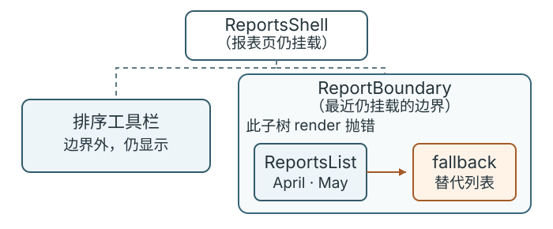

图中虚线是组件树的父子关系，橙色箭头表示列表出错后被 fallback 替换。列表 render 抛错时，最近仍挂载的 `ReportBoundary` 用 fallback 替换列表，边界外的排序工具栏照常显示。

粒度按“用户能理解、能恢复的区域”来定：

- **整页包一个边界**，列表一出错，工具栏、导航也一起消失，用户连换个排序都做不到。
- **每一行包一个边界**，可能留下许多零散的错误框，用户难以判断列表是否完整。
- **一块功能区域一个边界**（这里是报表列表），出错时其余区域可用，用户也知道是哪块坏了。

> [!example]- 完整示例：类边界与报表区域
>
> ~~~jsx
> import { Component } from "react";
>
> class ReportBoundary extends Component {
>   state = { hasError: false };
>
>   static getDerivedStateFromError() {
>     return { hasError: true };
>   }
>
>   componentDidCatch(error, info) {
>     console.error("报表区域渲染失败", error, info.componentStack);
>   }
>
>   render() {
>     if (this.state.hasError) {
>       return (
>         <section>
>           <p role="alert">报表列表暂时无法显示。</p>
>           <button type="button" onClick={() => this.setState({ hasError: false })}>
>             重新渲染列表
>           </button>
>         </section>
>       );
>     }
>     return this.props.children;
>   }
> }
>
> function ReportsShell({ accountId, reports }) {
>   return (
>     <main>
>       <p>当前排序：最早优先</p>
>       <ReportBoundary key={accountId}>
>         <ReportsList reports={reports} />
>       </ReportBoundary>
>     </main>
>   );
> }
>
> function ReportsList({ reports }) {
>   return (
>     <ol>
>       {reports.map(report => <li key={report.id}>{report.title}</li>)}
>     </ol>
>   );
> }
>
> const initialReports = [
>   { id: "r-103", title: "April report" },
>   { id: "r-104", title: "May report" }
> ];
>
> function App() {
>   return <ReportsShell accountId="acct-a" reports={initialReports} />;
> }
> ~~~
>
> 工具栏固定显示“当前排序：最早优先”，只代表边界外仍留在页面上的区域；示例省略 URL 和排序逻辑，父组件直接传入排好的 April、May。

#### 用 key 让边界随数据域重置

`<ReportBoundary key={accountId}>` 让切换账户时边界和列表子树整个重新创建，边界里的失败状态不会带到新账户。换 key 重置状态的规则见[React 怎样把一次用户操作变成界面更新？](#key%20%E5%86%B3%E5%AE%9A%E7%8A%B6%E6%80%81%E5%B1%9E%E4%BA%8E%E8%B0%81)。它只重置 React 子树的身份，不隔离查询缓存，也不校验数据；多个账户共用查询缓存时，查询键同样必须包含账户，见[服务端数据怎样缓存、刷新和乐观更新，迟到的响应又归谁？](#42.%20%E6%9C%8D%E5%8A%A1%E7%AB%AF%E6%95%B0%E6%8D%AE%E6%80%8E%E6%A0%B7%E7%BC%93%E5%AD%98%E3%80%81%E5%88%B7%E6%96%B0%E5%92%8C%E4%B9%90%E8%A7%82%E6%9B%B4%E6%96%B0%EF%BC%8C%E8%BF%9F%E5%88%B0%E7%9A%84%E5%93%8D%E5%BA%94%E5%8F%88%E5%BD%92%E8%B0%81%EF%BC%9F)。

### “重试”按钮到底重试了什么

fallback 里的“重新渲染列表”只是把边界的 `hasError` 设回 `false`，让 React 再试一次渲染子树。它不修复数据，也不重新发请求。跟着一组输入走一遍：

1. 起始调用用账户 `acct-a` 和 `initialReports` 显示 April、May。
2. 父组件为同一账户传入 `reports = [null]`。列表 render 这条记录、读取 `report.id` 时抛出 `TypeError`，边界显示 fallback，工具栏仍在。
3. 输入不变时点“重新渲染列表”：子树再次 render，再次抛错，回到 fallback。
4. 父组件改传有效的行：边界的 `hasError` 仍为 `true`，继续显示 fallback；要等用户再点一次重试，列表才恢复。
5. 若同时换成新的账户 ID 并传入有效行：`key` 变了，边界直接重建，不需要点重试。

所以真正的恢复顺序是：先由持有数据的一方修复输入、重新读取或离开出错的路由，再重置或重新挂载边界。这里人为注入的 render `TypeError` 只用来演示边界；真实的 API 响应应该在数据边界做运行时校验，校验失败作为数据状态处理，不要等它在 render 里炸开，见[TypeScript 能保证什么，外部数据又该怎样验证？](#34.%20TypeScript%20%E8%83%BD%E4%BF%9D%E8%AF%81%E4%BB%80%E4%B9%88%EF%BC%8C%E5%A4%96%E9%83%A8%E6%95%B0%E6%8D%AE%E5%8F%88%E8%AF%A5%E6%80%8E%E6%A0%B7%E9%AA%8C%E8%AF%81%EF%BC%9F)。

### 查询错误怎样交给边界（TanStack Query v5 实例）

报表数据常由 TanStack Query 读取，它的失败默认**不走**错误边界。v5 的普通 `useQuery` 把失败作为结果状态交给组件，组件读 `isError`、`error`、`data` 自己决定怎样报错和重试。这条路径下不必再套一层错误边界。

要让查询错误进边界，有三种方式：配置 `throwOnError`；改用 `useSuspenseQuery`；或在 render 里自己抛出查询错误。`useSuspenseQuery` 也不是“任何失败都丢弃数据”：没有缓存数据时，错误交给边界；已有缓存而后台刷新失败时，默认继续显示缓存。

用边界承接查询错误、并在 fallback 里提供重试时，要用 TanStack 的 `QueryErrorResetBoundary`（或 `useQueryErrorResetBoundary`）把查询的错误重置和边界的重置连起来。只把 React 边界的 `hasError` 清掉，查询仍处于错误状态，子树一 render 又会抛同一个错误。

### Suspense fallback 不是错误 fallback

两者表达的状态不同：

- **Suspense 的 fallback** 表示资源还没就绪、仍在等待。首次挂载，或不保留旧内容的更新，会切到它。
- **错误边界的 fallback** 表示子树已经失败。

`use(promise)` 把两者连在一起：Promise pending 时挂起，交给 Suspense；被拒绝时抛出，交给错误边界。所以一块用 `use` 读取数据的区域通常两种边界都要有，错误边界一般包在 Suspense 外面。写在 `useEffect` 或点击处理器里的普通 `fetch` 两者都不会触发。

更新包在 Transition 里时，若新内容暂时挂起，React 可以继续显示已提交的旧内容，而不立即换成 Suspense fallback；但 Transition 不会把旧数据变成新请求的结果。等待时保留什么，见[昂贵更新时，怎样让输入保持即时？](#45.%20%E6%98%82%E8%B4%B5%E6%9B%B4%E6%96%B0%E6%97%B6%EF%BC%8C%E6%80%8E%E6%A0%B7%E8%AE%A9%E8%BE%93%E5%85%A5%E4%BF%9D%E6%8C%81%E5%8D%B3%E6%97%B6%EF%BC%9F)。

### 内存之外，状态还能存在哪？

现在可以按失败发生的位置判断去向：React 调用代码时的同步错误、Hook 返回的 Transition 里的 Action 失败、`use` 读到的拒绝，交给最近仍挂载的边界；事件处理器、定时器和自行启动的 Promise 由各自的代码处理；查询失败默认作为数据状态。边界按可恢复的功能区域放置，用 `key` 随数据域重置，重试之前先修好输入。到这里，报表页的状态都活在当前页面的内存里，刷新就没了，另一个标签页也看不到。浏览器能把哪些状态存下来、标签页和窗口之间怎样互相通知，是[浏览器能把状态存在哪里，标签页和窗口之间怎样互相通知？](#47.%20%E6%B5%8F%E8%A7%88%E5%99%A8%E8%83%BD%E6%8A%8A%E7%8A%B6%E6%80%81%E5%AD%98%E5%9C%A8%E5%93%AA%E9%87%8C%EF%BC%8C%E6%A0%87%E7%AD%BE%E9%A1%B5%E5%92%8C%E7%AA%97%E5%8F%A3%E4%B9%8B%E9%97%B4%E6%80%8E%E6%A0%B7%E4%BA%92%E7%9B%B8%E9%80%9A%E7%9F%A5%EF%BC%9F)的问题。

> [!info]- 来源
>
> - 类边界的 `getDerivedStateFromError`、`componentDidCatch`（含开发构建把已接住的错误报告到 `window`、生产构建不冒泡）、粒度建议，以及事件处理器、一般异步代码、服务端渲染和边界自身错误的排除范围（“错误边界是什么”“哪些失败会交给边界”“边界放在哪”）：[Component — Catching rendering errors with an Error Boundary](https://react.dev/reference/react/Component#catching-rendering-errors-with-an-error-boundary)，React 19.3。
> - `useTransition()` 返回的 `startTransition` 把 Action 的同步抛错或返回的 Promise 拒绝交给最近边界（分类表第 3 行）：[useTransition — Displaying an error to users with an error boundary](https://react.dev/reference/react/useTransition#displaying-an-error-to-users-with-an-error-boundary)，React 19.3；独立导入的 `startTransition` 走全局错误报告（第 4 行）：[React 19.3.0 `ReactStartTransition.js`](https://github.com/react/react/blob/v19.3.0/packages/react/src/ReactStartTransition.js)。
> - `use(promise)` pending 进入 Suspense、拒绝进入错误边界、Promise 应复用（第 5 行，“Suspense fallback 不是错误 fallback”）：[use](https://react.dev/reference/react/use)，React 19.3。
> - Effect setup 由 React 在 commit 后调用、cleanup 在依赖变化或卸载时运行、普通 `useEffect` 可能在绘制后运行（第 2 行）：[useEffect](https://react.dev/reference/react/useEffect)，React 19.3；Effect 同步错误由仍挂载的最近边界接住，按原章节 React 19.3.0 浏览器回放核对，核对 2026-11-12。
> - 流式 SSR 中服务端错误由最近 `Suspense` 输出 fallback、客户端重试（第 8 行）：[Suspense — Providing a fallback for server errors and client-only content](https://react.dev/reference/react/Suspense#providing-a-fallback-for-server-errors-and-client-only-content)，React 19.3。
> - 换 key 重置子树状态（“用 key 让边界随数据域重置”）：[Preserving and Resetting State](https://react.dev/learn/preserving-and-resetting-state)，React 19.3。
> - `useQuery` 的 `throwOnError` 与错误作为状态（“查询错误怎样交给边界”）：[useQuery](https://tanstack.com/query/latest/docs/framework/react/reference/useQuery)；`useSuspenseQuery` 无数据时进边界、有缓存时后台刷新错误的规则、`QueryErrorResetBoundary`：[Suspense guide](https://tanstack.com/query/latest/docs/framework/react/guides/suspense)、[QueryErrorResetBoundary](https://tanstack.com/query/latest/docs/framework/react/reference/QueryErrorResetBoundary)，TanStack Query v5，核对 2026-11-12。
> - Suspense 不侦测 Effect/事件处理器里的普通请求；Transition 中再次挂起时保留已显示内容（“Suspense fallback 不是错误 fallback”）：[Suspense — What activates a Suspense boundary](https://react.dev/reference/react/Suspense#what-activates-a-suspense-boundary)，React 19.3。
## 47. 浏览器能把状态存在哪里，标签页和窗口之间怎样互相通知？

本章讲浏览器提供的存储与跨上下文通信原语：每种原语存什么、谁能看见、什么时候会失败，以及一个页面怎样让另一个页面知道“状态变了”。某份状态该归 URL、缓存、组件还是服务端，由[状态所有权表](#39.%20%E4%B8%80%E4%BB%BD%E7%95%8C%E9%9D%A2%E7%8A%B6%E6%80%81%E8%AF%A5%E7%94%B1%E8%B0%81%E6%8C%81%E6%9C%89%EF%BC%9F)决定；本章只处理已经决定放进浏览器、或需要在浏览器上下文之间传递的那部分。结论是：本地存储只保存本机的偏好和草稿；任何“变了”的消息都只是通知，收到后要向权威来源重新读取。

**案例。** 沿用主线一的报表页 `/reports/42?sort=recent#summary`。本章新增三样东西，都是教学用合成数据：

- 一项本地偏好“紧凑列”，存在 `localStorage` 的键 `reports:compact-columns` 下，取值是字符串 `"true"` 或 `"false"`；
- 服务端报表快照 `{ id: 42, version: 9, status: "running", event_cursor: "103" }`，其中版本号只增不减，`event_cursor` 是事件流的续读位置，下一章才用到；
- 同一用户开了两个标签页 A、B，都显示版本 9。用户在 B 里点“重新生成”，服务端提交成功，返回版本 11、状态 `ready`（中间的版本 10 可能来自别处的更新）。

### 浏览器提供了哪些存储与通信原语？

按所有权表，报表页里落到浏览器的只有几类：“紧凑列”这类小型偏好进 `localStorage`，本标签页未提交的筛选草稿进 `sessionStorage`，登录会话由服务端设置的 Cookie 承载，报表本身仍归服务端。页面之间互相提醒，则要用下表后半部分的通信原语。

| 原语 | 谁能看见 | 形态 | 主要边界 |
|---|---|---|---|
| `localStorage` | 同一 storage key (存储键) 下的所有页面，通常跨标签页和重载保留 | 同步字符串键值 | 无事务、无锁、无过期；用户代理可清除或限制 |
| `sessionStorage` | 同一来源、同一顶层浏览上下文（通常是一个标签页） | 同步字符串键值 | 另一个标签页有自己的一份 |
| IndexedDB (索引数据库) | 同一存储键 | 异步请求，结构化记录 | `readwrite` 事务内的改动原子提交 |
| `HttpOnly` Cookie | 浏览器按 Cookie 规则随请求发送，脚本读不到 | 由服务端设置 | 需要服务端防 CSRF |
| `storage` 事件 | 共享同一存储区的其他文档 | 写入后的变化通知 | 写入者自己收不到；不重放历史 |
| `BroadcastChannel` | 同一存储键、同一频道名的活动上下文 | 结构化克隆的广播消息 | 不保存历史；发送方收不到 |
| `SharedWorker` | 满足复用条件的页面，经各自的 `MessagePort` 连接 | worker 内存中的协调者 | 内存不是持久状态；没有通用的对端关闭事件 |
| `window.postMessage()` | 指定的另一个窗口或 iframe，可以跨源 | 定向消息 | 发送方限定目标来源，接收方校验来源、窗口和数据 |
| SSE、Fetch 流、WebSocket | 浏览器页面与服务端 | 服务端推送或双向消息 | 补发、去重和恢复要靠应用协议 |

前四行是存储，后五行是通信。下面先讲存储，再讲通信；两部分在“[收到通知后，向权威核实](#%E6%94%B6%E5%88%B0%E9%80%9A%E7%9F%A5%E5%90%8E%EF%BC%8C%E5%90%91%E6%9D%83%E5%A8%81%E6%A0%B8%E5%AE%9E)”一节汇合。

### Web Storage：同步的字符串键值表

Web Storage (网页存储) 指 `localStorage` 和 `sessionStorage`。两者接口相同：`getItem`、`setItem`、`removeItem`、`clear`。它们有三个共同特点，决定了适用范围：

- **同步。** 每次读写都在当前 JavaScript 执行中完成，会阻塞主线程。
- **只存字符串。** `setItem(key, true)` 存进去的是 `"true"`，存一个对象会变成 `"[object Object]"`；结构化数据要自己 `JSON.stringify`。
- **没有条目过期，也没有多键事务。** 两个键要么各写各的，要么都不写，做不到“一起成功”。

小型、可重建的偏好适合这里；结构化的大记录，或多个键必须一起提交的数据，改用 IndexedDB。

#### localStorage 和 sessionStorage 的作用域

`localStorage` 不按 URL 路径区分页面：同一来源下 `/reports/42` 和 `/settings` 通常读写同一个存储区。但“同源就共享”并不总成立。存储按 storage key 划分，它目前以来源为主，浏览器可能再按顶层站点分区：同一来源的页面嵌在不同网站里时，可能拿到不同的存储区，也可能被禁止访问。

`sessionStorage` 再按顶层浏览上下文隔离。同一标签页里导航到另一个来源，新来源读写自己的存储区；回到原来源或重载后，原来的值还在。另一个标签页则有自己独立的一份。关闭标签页通常结束这份会话存储；浏览器恢复已关闭的标签页时是否连同值一起恢复，取决于用户代理，所以它不能保存需要跨会话保留的数据。用带 `opener` 的方式打开同源新窗口时，新窗口一开始可能拿到一份 `sessionStorage` 副本，之后两边各改各的，这只是初始复制，不是持续共享。

规范建议每个存储端点（`localStorage`、`sessionStorage` 各算一个）配额 5 MiB；这只是建议值，浏览器策略仍可能让读取不可用或写入失败。`navigator.storage.estimate()` 返回的是整个 local storage shelf（本地存储架）的近似用量和配额，不是 `localStorage` 还剩多少空间。

#### 读写会失败

Web Storage 有两个真实的异常分支：

- 取 `window.localStorage` 或 `window.sessionStorage` 这个对象本身就可能抛 `SecurityError`，例如策略禁止访问或文档是不透明来源。
- `setItem()` 存不下新值时抛 `QuotaExceededError`，存储区保持原值。

失败时不能假定值已写入。合理的做法是在当前页面的内存里保留用户的选择，让界面照常生效，同时告诉用户“这项偏好没有保存”。

#### setItem 不是跨标签页的锁

假设 A、B 都从同一个键读到计数 `4`，各自加一后先后写回 `5`。应用执行了两次加一，最终值却是 `5`。下一节的 `storage` 事件只是事后通知，不能把这段读—改—写变成原子操作。需要协调更新时，有两条路：把读取、计算和写入放进覆盖这些记录的同一个 IndexedDB `readwrite` 事务，失败时整体回滚；或者设计明确的跨上下文协议，例如让唯一的协调者执行写入。

### storage 事件只说明“存储发生过变化”

一次成功的 `localStorage.setItem()` 会在返回之前做两件事：先更新存储区，再为共享这个存储区的**其他**文档各排一个 `storage` 事件任务。这些文档在之后的任务里才运行处理器；写入者自己收不到事件。下图拆开了 B 的一次写入：

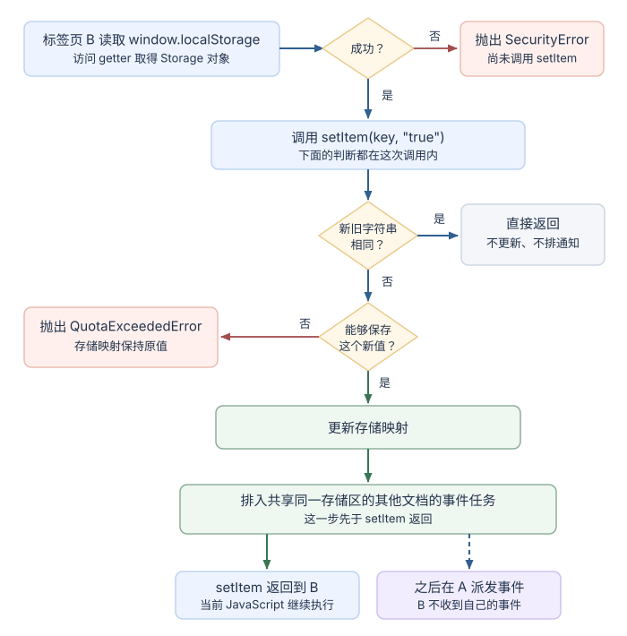

图里还有两个不发事件的分支：新字符串与旧值相同时，`setItem()` 直接返回，既不更新也不通知；配额不够时抛异常，同样没有通知。`removeItem()` 和 `clear()` 只在真的删掉数据时才通知，`clear()` 的事件 `key` 为 `null`。事件的 `storageArea` 是接收文档自己的 `Storage` 对象，指向刚才变化的存储区；A 应拿它和自己的 `window.localStorage` 比较，A、B 并不共享同一个 JavaScript 对象。

这条通知有两个限制，决定了接收方的写法：

1. **不重放历史。** A 刚打开或刚重载时，之前发生过的写入不会再通知一次，所以 A 必须主动读一次当前值。顺序是先注册监听器、再读取，这样两步之间发生的写入也不会漏掉。
2. **`newValue` 只描述触发这次事件的那一次写入。** 同一个键之后可能又被改过，处理器重新 `getItem()` 才能拿到当前值。

> [!example] 两个标签页怎样保存并同步“紧凑列”
> 两个标签页都能访问同一个 `localStorage` 存储区。`applyCompactColumns` 和几个提示函数代表页面已有的界面更新。初始化读取失败时显示存储不可用；B 写入失败时仍在当前页面应用选择，只提示“未保存”。
>
> 标签页 A：
>
> ~~~javascript
> const compactKey = "reports:compact-columns";
>
> window.addEventListener("storage", event => {
>   try {
>     if (event.storageArea !== window.localStorage) return;
>     if (event.key !== compactKey && event.key !== null) return;
>     applyCompactColumns(window.localStorage.getItem(compactKey) === "true");
>   } catch {
>     showPreferenceStorageUnavailable();
>   }
> });
>
> try {
>   applyCompactColumns(window.localStorage.getItem(compactKey) === "true");
> } catch {
>   showPreferenceStorageUnavailable();
> }
> ~~~
>
> 标签页 B：
>
> ~~~javascript
> const compactKey = "reports:compact-columns";
>
> try {
>   applyCompactColumns(localStorage.getItem(compactKey) === "true");
> } catch {
>   showPreferenceStorageUnavailable();
> }
>
> function chooseCompactColumns(enabled) {
>   applyCompactColumns(enabled);
>   try {
>     localStorage.setItem(compactKey, String(enabled));
>     showPreferenceSaved();
>   } catch {
>     showPreferenceNotSaved();
>   }
> }
>
> chooseCompactColumns(true);
> ~~~
>
> B 把值从 `"false"` 改成 `"true"` 后，A 在后续任务里收到事件，重读得到 `"true"`，应用紧凑列。若 B 再次写 `"true"`，值没变，A 不会收到任何事件。

### 读回来的值是不可信输入

`getItem()` 只保证返回字符串或 `null`。值可能来自旧版本代码、用户手动修改、浏览器扩展，或同源下另一段脚本。TypeScript 里写 `JSON.parse(raw) as Prefs` 只改变编译期类型，运行时什么也不检查；为什么类型声明管不到运行时，见[TypeScript 保证什么，运行时还要校验什么](#34.%20TypeScript%20%E8%83%BD%E4%BF%9D%E8%AF%81%E4%BB%80%E4%B9%88%EF%BC%8C%E5%A4%96%E9%83%A8%E6%95%B0%E6%8D%AE%E5%8F%88%E8%AF%A5%E6%80%8E%E6%A0%B7%E9%AA%8C%E8%AF%81%EF%BC%9F)。

> [!example] 实例：带格式版本的偏好读写
> 偏好变多后，可以把它们存成一个 JSON 对象，并带上格式版本 `v`，方便以后迁移。读取时逐字段校验，任何不符合的值都回到默认值，而不是让页面带着坏数据运行。
>
> ~~~javascript
> const prefsKey = "reports:prefs";
> const defaultPrefs = { compact: false };
>
> function readPrefs() {
>   const raw = localStorage.getItem(prefsKey); // 可能抛 SecurityError，按上一节处理
>   if (raw === null) return defaultPrefs;
>   let data;
>   try {
>     data = JSON.parse(raw);
>   } catch {
>     return defaultPrefs; // 不是 JSON：旧格式或被改坏
>   }
>   if (data === null || typeof data !== "object" ||
>       data.v !== 1 || typeof data.compact !== "boolean") {
>     return defaultPrefs;
>   }
>   return { compact: data.compact };
> }
>
> function writePrefs(prefs) {
>   localStorage.setItem(prefsKey, JSON.stringify({ v: 1, compact: prefs.compact }));
> }
> ~~~
>
> 存进去的 `{"v":1,"compact":"yes"}` 会因为 `compact` 不是布尔值而回到 `{ compact: false }`；存进去的 `"[object Object]"`（有人直接 `setItem` 了一个对象）会在 `JSON.parse` 处失败，同样回到默认值。

### 登录会话为什么不放 Web Storage？

Web Storage 里的内容，当前页面上任何脚本都能读。页面一旦出现 cross-site scripting (跨站脚本攻击，XSS)，存在那里的 bearer token (持有者令牌) 也可能被读走。服务端设置的 `HttpOnly` Cookie 不向页面脚本开放，这是会话标识通常放在 Cookie 里的原因。代价是浏览器会按规则自动附带它，于是服务端必须防护 Cross-Site Request Forgery (跨站请求伪造，CSRF)。

浏览器决定是否附带 Cookie，看的是这几个属性：

- **host-only 或 `Domain`、`Path`：** 决定哪些主机名和路径能收到它。Cookie 不按端口隔离，同一主机不同端口的服务会收到同一份 Cookie。
- **`Secure`：** 只在安全连接上发送。
- **`SameSite`：** 控制跨站请求是否附带；当前 IETF Cookie 文稿要求 `SameSite=None` 必须同时带 `Secure`。
- **`HttpOnly`：** 不让脚本通过 `document.cookie` 读到。

换一个存储位置本身不完成认证或授权。Cookie、XSS 和 CSRF 的服务端防护见[Web 安全与认证](../../engineering-foundations/security/web-security-and-authentication.md)。

### 收到通知后，向权威核实

存储讲完了，接下来是页面之间的通信。`storage` 事件、`BroadcastChannel` 消息、`SharedWorker` 转发、跨源 `postMessage`，以及服务端推来的变更提示，形式各不相同，但接收方都要遵守同一条规则：**通知只说明“某份状态可能变了”，它本身不是新状态，也不证明某个业务步骤已经完成。** 接收方按下面五步处理：

1. **校验通知本身。** 检查消息类型、资源 ID，版本号是否为非负安全整数。不认识的消息直接丢弃。
2. **只把更新的版本当作新目标。** 版本不高于当前显示版本的通知直接忽略；更高的版本只记作“待确认版本”，不直接改画面。
3. **向权威来源读取。** 本地偏好的权威是存储区里的当前值，所以重新 `getItem()`；报表的权威是服务端，所以重新请求快照。
4. **只单调推进。** 读回的结果版本更高才渲染；读取失败就保留最后一次有效的画面，不回退，也不把错误画成业务失败。
5. **假定通知会丢。** 通知通道都不补发历史，所以在初始化、从缓存恢复、重新连接之后都主动读一次；并且先装监听器再读，避免漏掉两步之间的变化。

上一节的 `storage` 示例已经是这五步的最小形态：处理器不信 `newValue`，而是重读当前值；页面启动时也主动读一次。本章其余各节和[下一章的流式恢复](#48.%20%E6%9C%8D%E5%8A%A1%E7%AB%AF%E6%8C%81%E7%BB%AD%E6%8E%A8%E9%80%81%E6%97%B6%EF%BC%8C%E7%95%8C%E9%9D%A2%E6%80%8E%E6%A0%B7%E5%90%88%E5%B9%B6%E6%9B%B4%E6%96%B0%E5%B9%B6%E4%BB%8E%E6%96%AD%E7%BA%BF%E6%81%A2%E5%A4%8D%EF%BC%9F)都按这五步展开。多个读取请求并发时，迟到的结果归谁，属于[异步结果按身份归属](#42.%20%E6%9C%8D%E5%8A%A1%E7%AB%AF%E6%95%B0%E6%8D%AE%E6%80%8E%E6%A0%B7%E7%BC%93%E5%AD%98%E3%80%81%E5%88%B7%E6%96%B0%E5%92%8C%E4%B9%90%E8%A7%82%E6%9B%B4%E6%96%B0%EF%BC%8C%E8%BF%9F%E5%88%B0%E7%9A%84%E5%93%8D%E5%BA%94%E5%8F%88%E5%BD%92%E8%B0%81%EF%BC%9F)的问题，下面会用到它的一个实例。

### BroadcastChannel：同一浏览器里的临时广播

`new BroadcastChannel("reports")` 按频道名和存储键找到可以接收的活动上下文。几条语义决定了它只能当通知用：

- **发送方收不到自己的消息。**
- **存储键可能包含顶层站点。** 同一来源的页面嵌在不同网站下时会被分区隔开，同源不保证能互通。
- **对象按 structured clone (结构化克隆) 序列化**，每个接收方得到自己的副本。
- **不保存历史。** 刚打开、已关闭或当时不符合条件的页面，收不到之前的消息。
- **发送不等待处理。** `postMessage()` 序列化消息，为每个接收方排一个 message task (消息任务) 后就返回；接收方的处理器在各自的事件循环里运行。

#### 两个版本游标：当前显示版本与待确认版本

下图把案例拆成步骤。A 先接好频道并向服务端对账；B 只在服务端确认提交成功后才广播；A 在自己的后续任务里校验提示，再取回权威快照。

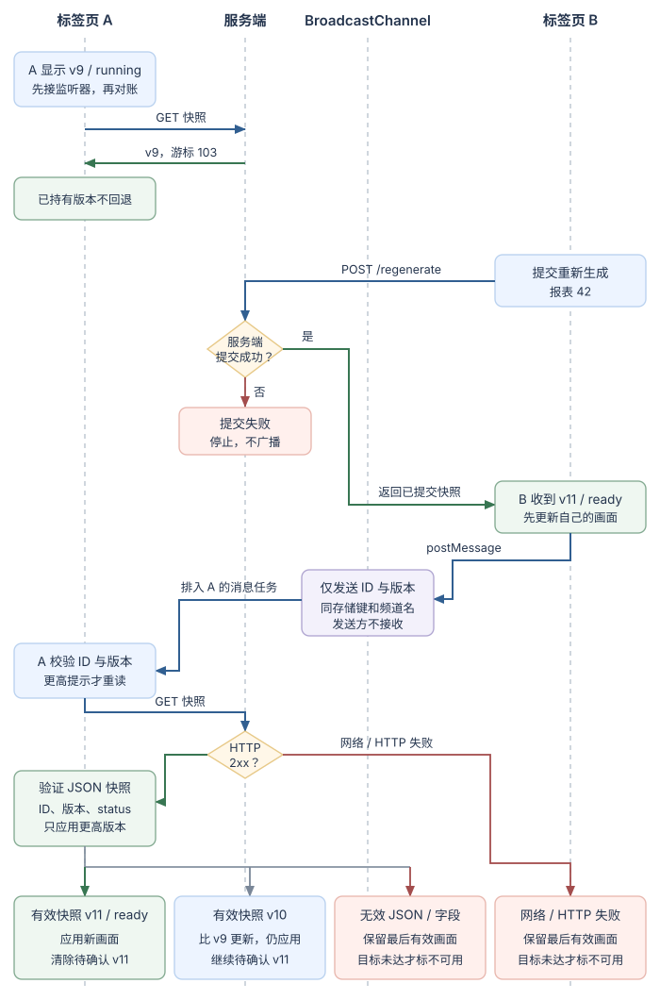

逐步看：

1. A、B 初始化时都先装监听器，再 GET 快照，得到版本 9。
2. B 的重新生成请求成功，响应里是版本 11、状态 `ready`。B 先更新自己的画面，再广播 `{ type: "report:changed", reportId: 42, version: 11 }`。消息里只有 ID 和版本，没有报表内容。
3. A 收到提示，校验通过，11 高于当前的 9，于是把**待确认版本**提高到 11，并调用与初始化相同的快照函数。
4. 快照 GET 返回什么，决定 A 的下一步：
   - 返回有效的 v11：渲染 v11，待确认版本已达到，清除“待刷新”提示。
   - 返回有效的 v10（例如读到了一个稍旧的副本）：v10 比 v9 新，照样渲染；但待确认版本仍是 11，继续等待。
   - 网络错误、非 2xx、缺字段：保留 v9 画面，提示“v11 暂时取不到”。

A 因此要分开记两个数：`currentVersion` 是已经显示的版本，`pendingVersion` 是通知承诺过、还没核实到的版本。只有拿到不低于 `pendingVersion` 的有效快照，才算追平。读取失败后不无限重试，而是等下一条提示、页面恢复、重载或用户手动重试时再对账；单纯切回这个标签页不会触发对账。

#### 序列化失败与并发的快照请求

消息无法结构化克隆时，发送方的 `postMessage()` 同步抛 `DataCloneError`；接收方无法反序列化时会收到 `messageerror` 事件。本例收到 `messageerror` 就提示协议异常，并强制重读一次快照。

一个页面可能先后发出几个快照请求，它们的完成顺序不确定。代码用两条规则防止迟到的结果搞乱界面：

- **每个有效响应只能把版本向前推。** 晚到的 v10 不会覆盖已显示的 v11。
- **只有最近发出的请求能设置提示，失败分支重新比较实时状态。** `refreshRequestId` 标出最近一次请求。若另一个请求已经应用了 v11，较晚失败的重复请求会清除旧提示，不会把已确认的 v11 标成不可用；只有当前仍是 v9、待确认 v11、且最新请求失败时，才显示“v11 暂不可用”。

#### 提交结果不明时不广播

B 只在服务端确认提交后才广播。本例的合成 API 约定：非 2xx 表示没有提交，B 显示错误、不广播。请求断线或成功响应体解析失败时，提交结果未知：B 不能报告失败，也不能盲目重试，而是显示“结果待确认”并 GET 对账。怎样让重试不重复提交（幂等键、操作状态查询），见[编辑表单怎样在别人同时修改时安全保存？](#%E7%BB%93%E6%9E%9C%E4%B8%8D%E6%98%8E%E7%9A%84%E5%86%99%E5%85%A5)。

反过来，即使 B 的广播失败，服务端已提交的 v11 依然有效，A 会在下一次对账时取回它。

> [!example]- 可选实现：广播提示触发可恢复的重读
> 片段用于已经显示版本 9 的 A 和 B，两页运行同一段代码；只有 B 在重新生成请求成功后调用 `announceCommittedSnapshot`。`renderReport`、`showRefreshUnavailable` 等界面函数由页面提供，测试时可用记录调用的替身代替。`showRefreshUnavailable(version)` 表示该版本目标尚未核实；不带参数表示初次或恢复读取失败、当前没有可确认的新目标。
>
> ~~~javascript
> const reportId = 42;
> let currentVersion = 9;
> let pendingVersion = currentVersion;
> let channel = null;
> let refreshRequestId = 0;
>
> function isReportSnapshot(value, id) {
>   return value !== null &&
>     typeof value === "object" &&
>     value.id === id &&
>     Number.isSafeInteger(value.version) &&
>     value.version >= 0 &&
>     typeof value.status === "string";
> }
>
> function receiveReportHint(message) {
>   if (!message ||
>       message.type !== "report:changed" ||
>       message.reportId !== reportId ||
>       !Number.isSafeInteger(message.version) ||
>       message.version < 0) return;
>   if (message.version <= currentVersion) return;
>
>   pendingVersion = Math.max(pendingVersion, message.version);
>   void reloadReportFromServer(reportId, pendingVersion);
> }
>
> async function reloadReportFromServer(
>   id,
>   minimumVersion = currentVersion,
>   { requireFreshRead = false } = {}
> ) {
>   const requestId = ++refreshRequestId;
>   const versionAtStart = currentVersion;
>   pendingVersion = Math.max(pendingVersion, minimumVersion);
>   try {
>     const response = await fetch("/api/reports/" + id, { cache: "no-store" });
>     if (!response.ok) throw new Error("Snapshot request failed");
>     const snapshot = await response.json();
>     if (!isReportSnapshot(snapshot, id)) throw new Error("Invalid snapshot");
>
>     if (snapshot.version > currentVersion) {
>       currentVersion = snapshot.version;
>       renderReport(snapshot);
>     }
>     if (currentVersion >= pendingVersion) {
>       pendingVersion = currentVersion;
>       clearRefreshMessage();
>     } else if (requestId === refreshRequestId) {
>       showRefreshPending(pendingVersion);
>     }
>   } catch {
>     if (requestId !== refreshRequestId) return;
>     if (currentVersion >= pendingVersion) {
>       pendingVersion = currentVersion;
>       clearRefreshMessage();
>       if (requireFreshRead && currentVersion === versionAtStart) {
>         showRefreshUnavailable();
>       }
>     } else {
>       showRefreshUnavailable(pendingVersion);
>     }
>   }
> }
>
> function connectReportChannel() {
>   channel?.close();
>   try {
>     channel = new BroadcastChannel("reports");
>     channel.addEventListener("message", event => receiveReportHint(event.data));
>     channel.addEventListener("messageerror", () => {
>       showMessageDecodeError();
>       void reloadReportFromServer(reportId, currentVersion, { requireFreshRead: true });
>     });
>   } catch {
>     channel = null;
>     showCrossTabSyncUnavailable();
>   }
>   void reloadReportFromServer(reportId, currentVersion, { requireFreshRead: true });
> }
>
> function closeReportChannel() {
>   channel?.close();
>   channel = null;
> }
>
> function announceCommittedSnapshot(committed) {
>   if (!isReportSnapshot(committed, reportId)) {
>     showRegenerationOutcomeUnknown();
>     void reloadReportFromServer(reportId, currentVersion, { requireFreshRead: true });
>     return;
>   }
>   if (committed.version > currentVersion) {
>     currentVersion = committed.version;
>     renderReport(committed);
>   }
>   pendingVersion = Math.max(pendingVersion, currentVersion);
>   if (currentVersion >= pendingVersion) {
>     pendingVersion = currentVersion;
>     clearRefreshMessage();
>   }
>   try {
>     if (!channel) throw new Error("Channel is unavailable");
>     channel.postMessage({
>       type: "report:changed",
>       reportId,
>       version: committed.version
>     });
>   } catch {
>     showOtherTabsMayBeStale();
>   }
> }
>
> async function regenerateReport() {
>   let response;
>   try {
>     response = await fetch("/api/reports/42/regenerate", { method: "POST" });
>   } catch {
>     showRegenerationOutcomeUnknown();
>     void reloadReportFromServer(reportId, currentVersion, { requireFreshRead: true });
>     return;
>   }
>   if (!response.ok) {
>     showRegenerationError();
>     return;
>   }
>   try {
>     announceCommittedSnapshot(await response.json());
>   } catch {
>     showRegenerationOutcomeUnknown();
>     void reloadReportFromServer(reportId, currentVersion, { requireFreshRead: true });
>   }
> }
>
> connectReportChannel();
> window.addEventListener("pagehide", closeReportChannel);
> window.addEventListener("pageshow", event => {
>   if (event.persisted) connectReportChannel();
> });
> ~~~
>
> 初次连接、BFCache 恢复和结果未知后的强制对账都带 `requireFreshRead`：即使没有更高的目标版本，读取失败也显示通用的不可用提示。

### 页面离开和返回时，关闭通道并重新对账

上面代码的最后三行处理页面生命周期。页面进入 back-forward cache (前进/后退缓存，BFCache) 时，`pagehide` 事件的 `persisted` 为真；用户回到这个历史页面时，`pageshow` 的 `persisted` 也为真。页面在缓存里期间收不到任何消息，所以离开时关闭频道，恢复时重建频道并按第 5 步主动读一次快照。

`pagehide` 只是尽力而为的清理时机，不能证明页面已经退出。浏览器可能冻结或直接丢弃后台页面，丢弃时脚本没有机会运行清理代码；重新加载时会走初始化路径，同样会主动读取。具体的冻结与丢弃策略由用户代理决定。

### SharedWorker：多个页面需要一个协调者时

`BroadcastChannel` 不保留消息。如果通知要在刷新后仍可读，可以写进 `localStorage` 并靠 `storage` 事件传播，但这仍然没有事务或锁。如果页面要共享一个内存里的协调者，或者共用一条服务端连接，就用 `SharedWorker` (共享工作线程)。

浏览器判断能否复用已有的 worker 时，比较调用者的存储键、脚本 URL、名字和相关选项；所以“同源页面共用一个 worker”的说法漏掉了存储分区和构造参数两个条件。worker 与每个页面通过一个 `MessagePort` (消息端口) 收发消息；它可以维护已连接端口的集合，转发 `report:changed` 提示，但它不是报表数据的权威，收到转发的页面仍按五步向服务端核实。

使用时有三个要点：

- **启动时序要握手。** worker 处理 `connect` 是一个异步任务，页面拿到端口时，worker 可能还没把它加入转发集合。下面的实现让 worker 先登记端口、装监听、启动端口，再发 `worker:ready`；页面收到 ready 后才做初始对账。握手前发生的提交，页面只暂存该报表最新的一条提示，ready 后再转发。
- **没有通用的对端关闭事件。** 端口接口只定义了 `message` 和 `messageerror`。正常 `pagehide` 时页面发注销消息并关闭端口；崩溃或资源回收可能跳过这一步。必须及时清除失联端口时，可以按业务需要加心跳或租约。
- **内存不是持久状态。** worker 的端口集合和页面端口只活在各自的生命周期里。BFCache 恢复时重连；重载自然重新初始化。

worker 方案和上一节的 `BroadcastChannel` 是二选一的传输方式：保留共享的快照函数，换掉初始化和生命周期监听，不要同时连两条通道。SharedWorker API 不可用、构造器抛错，或 worker、端口发出 `error`/`messageerror` 时，页面退回普通快照 GET，并提示其他页面可能暂时收不到通知。若 worker 静默、始终不发 ready，本例没有设超时，也不会自动退回 GET。

> [!example]- 可选实现：SharedWorker 内存中继
> worker 独立运行，所以在 worker 里也要校验报表 ID 和版本字段；生产代码还应按报表权限过滤哪些端口能收到哪些记录。页面侧复用上一节的 `isReportSnapshot`、`receiveReportHint` 与 `reloadReportFromServer`。
>
> worker（`/report-worker.js`）：
>
> ~~~javascript
> const ports = new Set();
>
> function validReportHint(data) {
>   return data !== null &&
>     typeof data === "object" &&
>     data.type === "report:changed" &&
>     data.reportId === 42 &&
>     Number.isSafeInteger(data.version) &&
>     data.version >= 0;
> }
>
> function dropPort(port) {
>   ports.delete(port);
>   port.close();
> }
>
> self.addEventListener("connect", event => {
>   const port = event.ports[0];
>   ports.add(port);
>   port.addEventListener("message", ({ data }) => {
>     if (data?.type === "report:disconnect" && data.reportId === 42) {
>       dropPort(port);
>       return;
>     }
>     if (!validReportHint(data)) return;
>     for (const peer of ports) {
>       if (peer !== port) peer.postMessage(data);
>     }
>   });
>   port.addEventListener("messageerror", () => dropPort(port));
>   port.start();
>   port.postMessage({ type: "worker:ready" });
> });
> ~~~
>
> 页面：
>
> ~~~javascript
> let reportPort = null;
> let reportWorkerReady = false;
> let queuedWorkerHint = null;
>
> function connectReportWorker() {
>   if (typeof SharedWorker === "undefined") {
>     showWorkerUnavailable();
>     void reloadReportFromServer(reportId, currentVersion, { requireFreshRead: true });
>     return;
>   }
>   let worker;
>   try {
>     worker = new SharedWorker("/report-worker.js", { name: "reports" });
>   } catch {
>     showWorkerUnavailable();
>     void reloadReportFromServer(reportId, currentVersion, { requireFreshRead: true });
>     return;
>   }
>   reportWorkerReady = false;
>   worker.onerror = () => {
>     showWorkerUnavailable();
>     void reloadReportFromServer(reportId, currentVersion, { requireFreshRead: true });
>   };
>   const port = worker.port;
>   reportPort = port;
>   port.addEventListener("message", event => {
>     if (reportPort !== port) return;
>     const message = event.data;
>     if (message?.type === "worker:ready") {
>       reportWorkerReady = true;
>       if (queuedWorkerHint) {
>         try {
>           port.postMessage(queuedWorkerHint);
>           queuedWorkerHint = null;
>         } catch {
>           showOtherTabsMayBeStale();
>         }
>       }
>       void reloadReportFromServer(reportId, currentVersion, { requireFreshRead: true });
>       return;
>     }
>     if (reportWorkerReady) receiveReportHint(message);
>   });
>   port.addEventListener("messageerror", () => {
>     showMessageDecodeError();
>     void reloadReportFromServer(reportId, currentVersion, { requireFreshRead: true });
>   });
>   port.start();
> }
>
> function disconnectReportWorker() {
>   const port = reportPort;
>   reportPort = null;
>   reportWorkerReady = false;
>   if (!port) return;
>   port.postMessage({ type: "report:disconnect", reportId: 42 });
>   port.close();
> }
>
> function announceThroughWorker(snapshot) {
>   if (!isReportSnapshot(snapshot, reportId)) return;
>   if (snapshot.version > currentVersion) {
>     currentVersion = snapshot.version;
>     renderReport(snapshot);
>   }
>   pendingVersion = Math.max(pendingVersion, currentVersion);
>   if (currentVersion >= pendingVersion) {
>     pendingVersion = currentVersion;
>     clearRefreshMessage();
>   }
>   const hint = {
>     type: "report:changed",
>     reportId,
>     version: snapshot.version
>   };
>   if (!reportPort) {
>     showOtherTabsMayBeStale();
>     return;
>   }
>   if (!reportWorkerReady) {
>     if (!queuedWorkerHint || hint.version > queuedWorkerHint.version) {
>       queuedWorkerHint = hint;
>     }
>     return;
>   }
>   try {
>     reportPort.postMessage(hint);
>   } catch {
>     showOtherTabsMayBeStale();
>   }
> }
>
> connectReportWorker();
> window.addEventListener("pagehide", disconnectReportWorker);
> window.addEventListener("pageshow", event => {
>   if (event.persisted) connectReportWorker();
> });
> ~~~
>
> B 的 POST 仍按上一节处理 HTTP 失败、断线和解析错误；收到成功响应体后先用 `isReportSnapshot` 验证，有效才交给 `announceThroughWorker`，无效则显示结果待确认并 GET 对账。

### 跨源窗口：postMessage 的三道校验与握手

前面的机制都只在同一个存储分区内有效。如果报表以 iframe 嵌在另一个来源的页面里，同源策略不允许两边直接读对方的页面对象；互相合作的父页和 iframe 可以用 `window.postMessage(data, targetOrigin)` 交换有限的消息。安全靠三道校验，第一道在发送方，后两道在接收方：

1. **发送方限定 `targetOrigin`。** 浏览器只按协议、主机名和端口比较目标窗口的来源，写了路径也会被忽略；目标窗口已导航到别的来源时，消息被丢弃。不要用 `"*"` 发送不该公开的数据。
2. **接收方检查 `event.origin` 和 `event.source`。** 来源要等于预期的精确来源，发送窗口要是预期的那个窗口（例如 `frame.contentWindow` 或 `window.parent`）。
3. **接收方校验数据。** 只认允许的消息类型和字段。可信来源的页面也可能有 XSS，所以消息只能触发有限动作，不能当作授权凭证。

还有一个时序问题：父页的消息可能早于子页的监听器到达。解决办法是握手。父页先装监听器、再设 iframe 的 `src`；子页先装监听器、再发 `ready`；父页收到来自该 iframe 的 `ready` 后才发命令。本例只交换报表 ID 和动作名，子页仍通过自己的服务端会话请求它有权访问的数据。

> [!example] 父页与报表 iframe 握手
> `https://app.example` 与 `https://reports.example` 是合成来源，部署时换成实际允许的精确来源。父页的容器 `#report-slot` 已存在。
>
> ~~~javascript
> // 父页：https://app.example
> const childOrigin = "https://reports.example";
> const frame = document.createElement("iframe");
>
> window.addEventListener("message", event => {
>   if (event.origin !== childOrigin || event.source !== frame.contentWindow) return;
>   if (!event.data ||
>       event.data.type !== "ready" ||
>       event.data.reportId !== 42) return;
>   frame.contentWindow.postMessage(
>     { type: "refresh", reportId: 42 },
>     childOrigin
>   );
> });
>
> frame.src = childOrigin + "/embed/reports/42";
> document.querySelector("#report-slot").append(frame);
> ~~~
>
> ~~~javascript
> // 子页：https://reports.example
> const parentOrigin = "https://app.example";
>
> window.addEventListener("message", event => {
>   if (event.origin !== parentOrigin || event.source !== window.parent) return;
>   if (!event.data ||
>       event.data.type !== "refresh" ||
>       event.data.reportId !== 42) return;
>   refreshEmbeddedReport();
> });
>
> window.parent.postMessage(
>   { type: "ready", reportId: 42 },
>   parentOrigin
> );
> ~~~
>
> 子页收到 `refresh` 后调用 `refreshEmbeddedReport()`，它按五步向服务端取快照，而不是信任消息里的任何数据。数据不能结构化克隆时，发送方得到 `DataCloneError`。

### 更新来自服务端时，换用推送通道

频道和 worker 只在当前浏览器的上下文之间转发。更新若来自服务端，或要同步到别的设备，就必须经过服务端通信，各页面再按自己的权限核实状态。

| 通道 | 方向与形态 | 断线后的恢复由谁负责 |
|---|---|---|
| Server-Sent Events (服务器发送事件，SSE) | 服务端到页面的文本事件流，浏览器接口是 `EventSource` | 浏览器通常自动重连并带 `Last-Event-ID`；能否补发取决于服务端是否保留历史；HTTP 204 让它停止重连 |
| Fetch 响应流 | 响应体是 `ReadableStream`，请求方法、请求头和正文可自定义 | 应用自己读字节、组帧、取消、重试和续读 |
| WebSocket | 握手后双向发送消息 | 应用协议定义重连、事件 ID、确认、去重和补发 |

WebSocket 适合与服务端双向通信，但不是同一浏览器里两个标签页互相提醒的默认方案。它的握手与 Fetch 流程集成，却使用 WebSocket 专有的握手模式，不是普通 Fetch 的 Cross-Origin Resource Sharing (跨来源资源共享，CORS) 授权。服务端可以用握手请求的 `Origin` 限制浏览器来源，但非浏览器客户端能伪造这个头，所以它不是身份认证；仍要验证用户身份、逐条检查操作权限，并规定断线重放、确认与去重。通道选型的完整比较见[何时选择轮询、SSE、流式 Fetch 或 WebSocket](../../engineering-foundations/networking/real-time-web-updates.md)。

### 下一步：推送事件怎样接上快照

到这里，同一浏览器里的页面已经能按“通知 → 校验 → 向权威读取 → 单调推进”跟上报表版本：A 从 v9 走到 v11，中途读到 v10 也不会误报追平。B 广播的版本 11 只是一个版本号，不能替代事件流的游标。快照里还有一个没用上的 `event_cursor: "103"`：服务端持续推送报表事件时，页面怎样从 103 之后接着读、断线后怎样不丢也不重，由[服务端持续推送时，界面怎样合并更新并从断线恢复](#48.%20%E6%9C%8D%E5%8A%A1%E7%AB%AF%E6%8C%81%E7%BB%AD%E6%8E%A8%E9%80%81%E6%97%B6%EF%BC%8C%E7%95%8C%E9%9D%A2%E6%80%8E%E6%A0%B7%E5%90%88%E5%B9%B6%E6%9B%B4%E6%96%B0%E5%B9%B6%E4%BB%8E%E6%96%AD%E7%BA%BF%E6%81%A2%E5%A4%8D%EF%BC%9F)接手。

> [!info]- 来源
> - Web Storage 接口、`localStorage`/`sessionStorage` 的来源与顶层浏览上下文作用域、`opener` 初始复制、同值写入不发事件、`SecurityError`/`QuotaExceededError`、`storage` 事件任务与 `storageArea`、读—改—写不加锁（“Web Storage：同步的字符串键值表”“storage 事件只说明‘存储发生过变化’”）：[WHATWG HTML Standard，Web Storage §§12.1–12.2.4](https://html.spec.whatwg.org/multipage/webstorage.html)，Living Standard 更新于 2026-11-11；2026-11-12 核对。
> - 两种 Web Storage 端点各自建议 5 MiB；存储键当前按来源定义、第三方存储分区模型仍在演进；`navigator.storage.estimate()` 返回 local storage shelf 的近似用量与配额（“localStorage 和 sessionStorage 的作用域”）：[WHATWG Storage Standard §§4.1–4.2、6、8](https://storage.spec.whatwg.org/)，Living Standard 更新于 2026-10-19；2026-11-12 核对。
> - 用户代理可限制第三方文档访问 `localStorage`；Chrome 115+ 按顶层站点分区第三方存储，WebKit 按第一方网站分区第三方 `localStorage` 与 IndexedDB（同上节）：[WHATWG HTML Standard §12.3.1](https://html.spec.whatwg.org/multipage/webstorage.html#user-tracking)、[Chrome Storage Partitioning](https://privacysandbox.google.com/cookies/storage-partitioning)、[WebKit Tracking Prevention](https://webkit.org/tracking-prevention/#partitioned-third-party-storage)，2026-11-12 核对。
> - IndexedDB `readwrite` 事务的作用域、原子提交与失败回滚（“setItem 不是跨标签页的锁”）：[Indexed Database API 3.0 §2.7.1](https://www.w3.org/TR/2026/WD-IndexedDB-3-20261030/)，W3C Working Draft 2026-10-30；2026-11-12 核对。
> - Cookie 的 host-only/`Domain`、`Path`、`Secure`、`HttpOnly` 与发送规则，§8.5 说明 Cookie 不按端口隔离（“登录会话为什么不放 Web Storage？”）：[RFC 6265 §§4.1.2.3–4.1.2.6、5.1.3–5.1.4、5.3–5.4、8.5](https://www.rfc-editor.org/rfc/rfc6265.html)，2011-04。
> - `SameSite=None` 须同时带 `Secure`（同上节）：[draft-ietf-httpbis-rfc6265bis-22 §§4.1.2.7、5.7](https://datatracker.ietf.org/doc/html/draft-ietf-httpbis-rfc6265bis-22)；2026-11-12 核对时 Datatracker 仍标记 RFC Editor “Final Approval Pending”，因此按文稿表述。
> - `BroadcastChannel` 的接收条件（存储键、频道名、活动上下文）、发送方排除、消息任务与序列化错误；跨窗口 `postMessage` 的目标来源比较、丢弃规则与安全校验；`MessagePort` 的事件与关闭（“BroadcastChannel”“跨源窗口”“SharedWorker”各节）：[WHATWG HTML Standard，Web Messaging §§9.3、9.4.4、9.5](https://html.spec.whatwg.org/multipage/web-messaging.html)，Living Standard 更新于 2026-11-12；2026-11-12 核对。
> - 结构化克隆副本与 `DataCloneError`（“序列化失败与并发的快照请求”）：[WHATWG HTML Standard，Structured data §2.7](https://html.spec.whatwg.org/multipage/structured-data.html)，2026-11-12 核对。
> - SharedWorker 连接、复用条件与 worker 生命周期（“SharedWorker”）：[WHATWG HTML Standard，Web Workers §§10.1.3.3、10.2.3、10.2.6.4](https://html.spec.whatwg.org/multipage/workers.html)，Living Standard 更新于 2026-11-12；2026-11-12 核对。
> - `pageshow`/`pagehide` 的 `persisted` 与历史缓存复用（“页面离开和返回时”）：[WHATWG HTML Standard §7.2.7.6](https://html.spec.whatwg.org/multipage/nav-history-apis.html#the-pagetransitionevent-interface)，2026-11-12 核对；后台页面可能被冻结或丢弃、丢弃时不运行脚本：[Chrome Page Lifecycle API](https://developer.chrome.com/docs/web-platform/page-lifecycle-api)，最后更新 2026-10-16；2026-11-12 核对。
> - Fetch 响应体流与 `websocket` 请求模式（“更新来自服务端时”）：[WHATWG Fetch Standard §§2.2.5、5.3、5.6](https://fetch.spec.whatwg.org/)，Living Standard 更新于 2026-10-19；SSE 重连与 `Last-Event-ID`：[WHATWG HTML Standard §§9.2.2–9.2.5](https://html.spec.whatwg.org/multipage/server-sent-events.html)；WebSocket 握手与 Fetch 集成：[WHATWG WebSockets Standard §§2.1–2.2](https://websockets.spec.whatwg.org/)；浏览器来源检查与非浏览器客户端可伪造 `Origin`：[RFC 6455 §§4.2.1、10.1–10.2](https://www.rfc-editor.org/rfc/rfc6455.html)。均于 2026-11-12 核对。服务端保留历史并按 ID 重放是应用协议的条件。
## 48. 服务端持续推送时，界面怎样合并更新并从断线恢复？

本章回答：服务端不断推送更新时，页面怎样把每条更新合并进已有画面，连接断开后又怎样从正确的位置接着读，既不漏也不重。读者手上已有[上一章](#47.%20%E6%B5%8F%E8%A7%88%E5%99%A8%E8%83%BD%E6%8A%8A%E7%8A%B6%E6%80%81%E5%AD%98%E5%9C%A8%E5%93%AA%E9%87%8C%EF%BC%8C%E6%A0%87%E7%AD%BE%E9%A1%B5%E5%92%8C%E7%AA%97%E5%8F%A3%E4%B9%8B%E9%97%B4%E6%80%8E%E6%A0%B7%E4%BA%92%E7%9B%B8%E9%80%9A%E7%9F%A5%EF%BC%9F)的规则：任何通知都要向权威核实、只单调推进。这里的权威是“快照 + 游标”：快照给出某一时刻的完整状态，游标指出从事件日志的哪里接着读。传输方式怎样选、SSE 线格式的完整定义，见[何时选择轮询、SSE、流式 Fetch 或 WebSocket](../../engineering-foundations/networking/real-time-web-updates.md)；本章只讲页面侧的责任。

**案例。** 沿用主线一的报表页和上一章的报表 42 快照，所有 ID 和响应都是教学用合成数据。页面先取得快照 `id=42, version=9, status=running, progress=0, event_cursor="103"`，然后用 Server-Sent Events (服务器发送事件，SSE) 订阅进度。连接在收到事件 104 之后中断，浏览器自动重连，服务端接着发送事件 105，报表变为 `ready`。页面要做到三件事：断线期间保留最后一份有效状态；正确合并后续更新；把“连接是否正常”和“报表运行到哪一步”分开显示。本章最后换用一个独立的 NDJSON 作业例子，讲页面自己读字节流时多出来的责任。

### 三种编号各回答什么问题？

案例里有三种容易混淆的编号，它们回答不同的问题，不能互相比较：

| 编号 | 本例取值 | 回答的问题 | 由谁推进 |
|---|---|---|---|
| 资源 ID | 快照的 `id=42`、事件里的 `report_id=42` | 这是哪张报表？ | 不变 |
| 版本 | `version=9`，之后 10、11 | 页面手上是报表的哪一版？只增不减 | 服务端每次改报表时 |
| 游标 | 快照的 `event_cursor="103"`，SSE 帧的 `id: 104`、`id: 105` | 从事件日志的哪里接着读？ | 服务端每追加一条事件时 |

版本描述状态修订，游标描述日志位置。两者各自递增，本例里数字恰好接近，并没有换算关系。上一章 B 广播的“版本 11”属于版本这一列，不能拿来当续读位置。事件号 104 也与主线一报表行 `r-104` 无关。

### 快照和游标必须来自同一个一致性点

页面先读快照，再从快照里的游标之后订阅事件。这一步成立的前提是：**服务端在同一个一致性点读出快照和游标**，也就是说，快照恰好包含了日志里直到 103 为止的所有事件。如果服务端分两次读取（先读报表状态，再读日志最新位置），两次之间写入的事件既不在快照里，也不在游标之后，就会被漏掉。这是应用 API 的约定，浏览器不提供任何保证。

```http
GET /api/reports/42 HTTP/1.1

HTTP/1.1 200 OK
Cache-Control: no-store
Content-Type: application/json

{"id":42,"version":9,"status":"running","progress":0,"event_cursor":"103"}
```

页面请求快照时用 `fetch(url, { cache: "no-store" })`，服务端也以 `Cache-Control: no-store` 返回，避免 HTTP 缓存交回一份带陈旧游标的旧快照。游标本身不是凭证：服务端每次 GET 和订阅都要认证、授权，并规定游标保留多久。

### 连接状态和报表状态分开显示

页面同时维护两种状态，来源不同：

- **报表状态**只来自服务端快照或已校验的事件：`running`、`ready`、`failed`、`canceled`。
- **连接状态**来自 `EventSource.readyState` 和页面自己的恢复动作。`readyState` 有三个值：`CONNECTING`（尚未连上或正在重连）、`OPEN`（连接已开）、`CLOSED`（不再连接，可能是页面调用了 `close()`，也可能是致命错误）。

网络断开时，页面还有最后一份有效快照，可以标出“可能过时”，但不能把报表改成 `failed`。两种状态组合起来，页面这样显示：

| 报表状态 | 连接状态 | 页面显示 |
|---|---|---|
| `running` | `OPEN` | “已连接”和最近已校验的进度；`OPEN` 不说明回放已经追平 |
| `running` | `CONNECTING` | 首次显示“正在连接”；断线后显示“正在重连，已有进度可能过时” |
| `ready` | `OPEN`，或页面主动关闭后的 `CLOSED` | 服务端终态；本例随后关闭订阅 |
| `failed` 或 `canceled` | 任意 | 服务端终态；网络错误永远不会生成这两个结果 |
| `running` | 意外 `CLOSED` | 浏览器不再自动重连；应用按有限策略重取快照，或提示恢复失败 |
| `running` | 旧连接已关闭、快照 GET 进行中 | 保留最后有效进度，连接显示关闭，另显示“正在恢复快照” |

`EventSource` 的 `error` 事件不能一概当成失败。事件触发后看 `readyState`：回到 `CONNECTING` 表示浏览器还会重连；变成 `CLOSED` 表示它已停止重试。`error` 事件也不把 HTTP 状态码和响应正文交给页面。服务端可以用 HTTP `204 No Content` 让 `EventSource` 停止重连，但浏览器只是不再重连，不会替页面重取快照；恢复快照是应用的事。

### 一次完整的续读：从游标 103 到事件 105

先看首次订阅。原生 `EventSource` 首次连接时不能设置任意请求头或请求正文，所以本例的服务端 API 约定用查询参数 `after` 传入快照游标：

```http
GET /api/reports/42/events?after=103 HTTP/1.1
Accept: text/event-stream

HTTP/1.1 200 OK
Content-Type: text/event-stream

id: 104
event: report.updated
data: {"report_id":42,"version":10,"status":"running","progress":80}

```

服务端从 103 之后回放历史，再接到同一条日志的实时尾部。页面收到 `id: 104` 的事件，校验后把画面更新到版本 10、进度 80：


然后连接在 104 之后中断。页面保留已收到的 v10，连接状态变为 `CONNECTING`。浏览器重连**同一个** URL，并自动附上它解析到的最后一个 SSE `id`：

```http
GET /api/reports/42/events?after=103 HTTP/1.1
Accept: text/event-stream
Last-Event-ID: 104

HTTP/1.1 200 OK
Content-Type: text/event-stream

id: 105
event: report.updated
data: {"report_id":42,"version":11,"status":"ready","progress":100}

```

URL 里仍是 `after=103`，请求头却是 `Last-Event-ID: 104`。本例服务端约定：请求头有效时优先用它，没有请求头才用 `after`。于是服务端从 104 之后续读，发出 105。事件 105 把画面整体更新为 v11、`ready`，页面显示完成并关闭订阅：


`event_cursor` 只来自首次快照或恢复快照；之后读到哪一条，由 `EventSource` 自己记录，页面不必每收到一帧就改写订阅 URL。分工上，浏览器负责解析 `text/event-stream` 帧；页面仍要 `JSON.parse` 事件数据，检查报表 ID、字段类型和版本，再更新界面。为什么网络数据要逐字段检查，见[TypeScript 保证什么，运行时还要校验什么](#34.%20TypeScript%20%E8%83%BD%E4%BF%9D%E8%AF%81%E4%BB%80%E4%B9%88%EF%BC%8C%E5%A4%96%E9%83%A8%E6%95%B0%E6%8D%AE%E5%8F%88%E8%AF%A5%E6%80%8E%E6%A0%B7%E9%AA%8C%E8%AF%81%EF%BC%9F)。

#### Last-Event-ID 只是解析位置，不是确认

按标准，浏览器先更新 `EventSource` 的 last-event-ID，再排队派发 JavaScript 事件。所以这个值只说明“浏览器解析到了哪里”，不是 acknowledgment (确认，ACK)：它不证明应用已经渲染、写入本地存储或完成了某个副作用。服务端可以用 `retry:` 字段给出重连等待的毫秒数，但网络和浏览器实现仍会影响实际恢复时间，页面不应假定固定间隔。

本例只需要最新的报表视图，所以够用：即使某条事件解析了却没来得及渲染，下一条完整视图或一次快照恢复都能把画面校正过来。如果每条事件都代表必须完成的副作用，`Last-Event-ID` 可能比应用真正完成的位置更靠后；这时要持久记录连续的应用层 ACK、按事件 ID 幂等处理，并处理 ACK 与副作用之间的崩溃窗口，见[断线后，客户端要重建状态还是补齐每条事件](../../engineering-foundations/networking/real-time-web-updates.md#%E6%96%AD%E7%BA%BF%E5%90%8E%EF%BC%8C%E5%AE%A2%E6%88%B7%E7%AB%AF%E8%A6%81%E9%87%8D%E5%BB%BA%E7%8A%B6%E6%80%81%E8%BF%98%E6%98%AF%E8%A1%A5%E9%BD%90%E6%AF%8F%E6%9D%A1%E4%BA%8B%E4%BB%B6%EF%BC%9F)。

### 合并更新：完整视图按版本覆盖，patch 必须连续

页面按 `version` 合并报表视图，不按 SSE `id`。规则取决于事件携带什么：

- **完整视图**（本例）：每条 `report.updated` 都带页面需要的全部字段。收到更高版本就整体替换；版本相同或更低的是重复或乱序，直接忽略，画面不回退。
- **依赖前序状态的 patch**：只能接受下一个连续版本，即 `update.version === report.version + 1`。在 v10 之后直接收到 v12 时，不能把 v12 的 patch 套在 v10 上，而要从权威快照重建。

### 续读接不上时：reset 事件与有界恢复

#### SSE 的派发规则与 reset 事件

续读能否补齐，取决于服务端是否还保留游标之后的事件。游标过期（日志已不保留该位置）时，服务端需要告诉页面“接不上了”。先看几条 SSE 派发规则：

- `event` 字段决定由哪个命名监听器接收，缺省是 `message`；`data` 字段构成 `event.data`。
- 空行结束一条事件。没有 `data` 字段的事件不会被派发；而显式写出的 `data:` 即使值为空，也会派发为 `event.data === ""`。

所以服务端可以发送 `event: reset\ndata: {}\n\n`，用显式的 `data:` 保证事件一定被派发。`reset` 是本例服务端与页面约定的事件名，不是浏览器的内建状态。页面收到它时，关闭旧的 `EventSource`，重新取一份快照与游标一致的响应：快照已是 v11、`ready` 就显示终态并停止；仍是 `running` 就用新游标重新订阅。页面自己发现坏 JSON 或无效字段时，也走同一条恢复路径。

#### 三类信号通向不同分支


图里三列对应三类信号：

1. **`error` 且仍是 `CONNECTING`：** 浏览器在续连原对象。页面保留最后有效画面，显示“正在重连”，不新建对象，也不消耗恢复预算。
2. **内容接不上：** 收到 `reset`、坏 JSON、无效字段，或 patch 出现版本缺口。页面关闭旧流，进入应用恢复。
3. **`error` 且已是 `CLOSED`：** 例如服务端返回了 204，浏览器不再重连。页面同样进入应用恢复。

应用恢复是**有界**的：本例自动恢复最多一次，只有在之后收到并应用了一条更新版本的有效事件，才重置这次预算。预算允许时，页面显示“正在恢复快照”并发出 GET；GET 结束后无论成败都清除该提示。新快照通过字段和版本校验前，保留旧画面。GET 失败或快照无效、过旧时，旧流已关、没有新流，页面显示“恢复不可用”，只等用户显式重试。预算的作用是防止服务端持续返回坏数据时，页面陷入“恢复—失败—恢复”的无限循环。

> [!example]- 代码：从首次快照到有界恢复的 EventSource 接收器
> `progress` 是 0–100 的百分比。`readSnapshot()` 把扁平 JSON 规范化成 `{ report, event_cursor }`。本例事件是完整视图，较高版本覆盖旧版；改成 patch 时，把比较条件换成 `update.version === report.version + 1`，缺号就恢复快照。
>
> ~~~javascript
> const statuses = new Set(["running", "ready", "failed", "canceled"]);
> const terminal = new Set(["ready", "failed", "canceled"]);
> let report;
> let source;
> let connectionState = "closed";
> let recoveryBusy = false;
> let recoveryAttempts = 0;
> let recoveryUnavailable = false;
>
> function setConnectionState(next) {
>   if (connectionState === next) return;
>   connectionState = next;
>   showConnectionState(next);
> }
>
> function validView(value, expectedId = 42) {
>   return value && value.id === expectedId &&
>     Number.isSafeInteger(value.version) && value.version >= 0 &&
>     statuses.has(value.status) && Number.isFinite(value.progress) &&
>     value.progress >= 0 && value.progress <= 100;
> }
>
> async function readSnapshot() {
>   const response = await fetch("/api/reports/42", { cache: "no-store" });
>   if (!response.ok) throw new Error("Snapshot HTTP " + response.status);
>   const body = await response.json();
>   if (!validView(body) || typeof body.event_cursor !== "string") {
>     throw new Error("Invalid snapshot or cursor");
>   }
>   return { report: body, event_cursor: body.event_cursor }; // 扁平响应来自同一一致性点
> }
>
> function closeCurrent(current) {
>   if (source !== current) return;
>   source = undefined;
>   current.close();
>   setConnectionState("closed");
> }
>
> function applyView(next) {
>   if (!validView(next) || (report && next.id !== report.id) ||
>       (report && next.version < report.version)) {
>     throw new Error("Invalid or older report view");
>   }
>   report = { id: next.id, version: next.version, status: next.status, progress: next.progress };
>   renderReport(report);
> }
>
> function subscribe(eventCursor) {
>   setConnectionState("connecting");
>   const current = new EventSource(
>     "/api/reports/42/events?after=" + encodeURIComponent(eventCursor),
>   );
>   source = current;
>   current.addEventListener("open", () => {
>     if (source === current) setConnectionState("connected");
>   });
>   current.addEventListener("report.updated", event => {
>     if (source !== current) return; // 忽略旧 EventSource 留下的任务
>     let update;
>     try {
>       update = JSON.parse(event.data);
>     } catch {
>       recoverFrom(current, "invalid JSON");
>       return;
>     }
>     if (!update || update.report_id !== report.id ||
>         !Number.isSafeInteger(update.version) || update.version < 0 || !statuses.has(update.status) ||
>         !Number.isFinite(update.progress) || update.progress < 0 || update.progress > 100) {
>       recoverFrom(current, "invalid event fields");
>       return;
>     }
>     if (update.version <= report.version) return; // 旧版本或重复视图不回退状态
>     try {
>       applyView({ id: report.id, version: update.version, status: update.status, progress: update.progress });
>     } catch {
>       recoverFrom(current, "invalid or older view");
>       return;
>     }
>     recoveryAttempts = 0; // 只在确实应用了较新、有效视图后重置预算
>     recoveryUnavailable = false;
>     if (terminal.has(report.status)) closeCurrent(current);
>   });
>   current.addEventListener("reset", () => recoverFrom(current, "server reset"));
>   current.addEventListener("error", () => {
>     if (source !== current || terminal.has(report.status)) return;
>     if (current.readyState === EventSource.CONNECTING) {
>       setConnectionState("reconnecting");
>     } else if (current.readyState === EventSource.CLOSED) {
>       recoverFrom(current, "event source closed");
>     }
>   });
> }
>
> function recoverFrom(current, reason) {
>   if (source !== current || recoveryBusy || terminal.has(report.status)) return;
>   closeCurrent(current);
>   void refreshSnapshotAndResume(reason);
> }
>
> async function refreshSnapshotAndResume(reason) {
>   if (recoveryBusy) return;
>   if (recoveryAttempts >= 1) {
>     recoveryUnavailable = true;
>     setConnectionState("closed");
>     showRefreshUnavailable(reason);
>     return;
>   }
>   recoveryAttempts += 1;
>   recoveryBusy = true;
>   showRefreshProgress(reason); // 通过预算检查后、真正发出快照 GET 前才显示
>   let nextCursor;
>   try {
>     const body = await readSnapshot();
>     if (report && body.report.version < report.version) {
>       throw new Error("Snapshot is older than the displayed view");
>     }
>     applyView(body.report);
>     recoveryUnavailable = false;
>     if (terminal.has(report.status)) {
>       setConnectionState("closed");
>     } else {
>       nextCursor = body.event_cursor;
>     }
>   } catch {
>     recoveryUnavailable = true;
>     setConnectionState("closed");
>     showRefreshUnavailable(reason); // 保留最后一份有效 report
>   } finally {
>     recoveryBusy = false;
>     clearRefreshProgress(); // GET 已成功或失败；恢复后的新流有自己的连接状态
>   }
>   if (nextCursor !== undefined) subscribe(nextCursor);
> }
>
> async function start() {
>   try {
>     const body = await readSnapshot();
>     applyView(body.report);
>     if (!terminal.has(report.status)) subscribe(body.event_cursor);
>   } catch {
>     showInitialUnavailable();
>   }
> }
>
> function retryAfterUserAction() {
>   if (!recoveryUnavailable || source || recoveryBusy || !report || terminal.has(report.status)) return;
>   recoveryUnavailable = false;
>   recoveryAttempts = 0;
>   void refreshSnapshotAndResume("user retry");
> }
>
> void start();
> ~~~
>
> `renderReport`、`showConnectionState` 和几个提示函数由应用提供。恢复提示共用一个区域：`showRefreshProgress` 用进度替换不可用提示，`showRefreshUnavailable` 用错误替换进度，`clearRefreshProgress` 只清除仍在显示的进度、不擦掉错误。所以手动重试成功会清掉旧错误，失败则显示新的不可用提示。`retryAfterUserAction()` 只在“恢复不可用”时生效，并要求没有活动流、没有进行中的恢复、报表未到终态，因此重复点击不会另建一个无人跟踪的 `EventSource`。每个监听器先检查 `source === current`，旧对象关闭后残留的任务不会改动新状态，这是[异步结果按身份归属](#42.%20%E6%9C%8D%E5%8A%A1%E7%AB%AF%E6%95%B0%E6%8D%AE%E6%80%8E%E6%A0%B7%E7%BC%93%E5%AD%98%E3%80%81%E5%88%B7%E6%96%B0%E5%92%8C%E4%B9%90%E8%A7%82%E6%9B%B4%E6%96%B0%EF%BC%8C%E8%BF%9F%E5%88%B0%E7%9A%84%E5%93%8D%E5%BA%94%E5%8F%88%E5%BD%92%E8%B0%81%EF%BC%9F)在连接对象上的一个实例。

### Fetch 流和 SSE 有什么不同？

`EventSource` 只能发 GET、只能设置 URL 和 `withCredentials`。API 若需要 `Authorization` 请求头、请求正文或 POST，就要改用 Fetch 响应流，代价是许多浏览器替你做的事要自己做：

| 需求 | `EventSource`（SSE） | Fetch 响应流 |
|---|---|---|
| 请求形状 | 只能 GET，不能设置任意请求头或正文 | 方法、请求头、正文与 `AbortSignal` 都可自定义 |
| 帧边界 | 浏览器解析 `text/event-stream` 并派发事件 | `reader.read()` 返回任意字节块，应用自己解码和组帧 |
| 断线恢复 | 可恢复的断开会自动重连并维护 `Last-Event-ID`；到 `CLOSED` 不再重连；服务端仍须支持可续读的游标 | 没有自动续读；应用按自己的作业 ID 和序号重连、去重与补缺 |
| 本例用途 | 订阅报表状态变化 | 提交带授权字段或正文的作业，读取自定义响应协议 |

### 自己读字节流：NDJSON 解析器的边界

下面切换到一个独立的合成案例，因为报表 42 的 SSE 接口用不到自定义字节流。它是一个 newline-delimited JSON (按行分隔的 JSON，NDJSON) 作业协议：客户端用幂等键提交作业，得到稳定的 `runId`（本例 `run-7`）；`seq` 是该作业私有日志里的应用游标，它既不是 SSE 的 `id`，也不是报表 `version`。续读时带上已接受的最后一个 `seq`，服务端重放的旧序号直接丢弃，跳号则拒绝。作业的最终状态以状态查询接口为准。

```text
POST /api/runs
Idempotency-Key: submit-7f2a
{"prompt":"Summarize the public release notes"}

202 Accepted
{"runId":"run-7","status":"queued"}

GET /api/runs/run-7/events?after=0

200 OK
Content-Type: application/x-ndjson

{"type":"delta","seq":1,"text":"The release adds "}
{"type":"delta","seq":2,"text":"a search filter."}
{"type":"complete","seq":3,"runId":"run-7"}
```

若流在 `seq: 1` 之后断开，客户端保留已应用的文本和长度，用同一 `runId` 请求 `after=1`；重放的 1 被忽略，下一帧从 2 接上。

#### 从字节到记录要过三道关

`reader.read()` 给出的字节块可以在任意位置切开，一块不一定恰好是一条记录。把它变成可以应用的事件，要依次过三道关：

1. **字节 → 字符。** UTF-8 把“好”编码成三个字节 `E5 A5 BD`，网络可能先给 `E5`、下一次才给 `A5 BD`。单独一个 `E5` 解不出字符，增量 `TextDecoder`（`decode(chunk, { stream: true })`）会暂存它，等字节齐了才输出“好”。设置 `fatal: true` 时，无效的 UTF-8 直接报错，而不是悄悄变成替换字符。
2. **字符 → 完整行。** 解出字符后仍不能立刻 `JSON.parse`，要缓冲到换行符。NDJSON 允许 LF 或 CRLF 结尾，而 CRLF 本身也可能被切在两块之间。
3. **行 → 已应用事件。** 解析 JSON，校验字段和序号：重复的忽略，缺号的拒绝。只有整帧应用成功后，游标才前进。

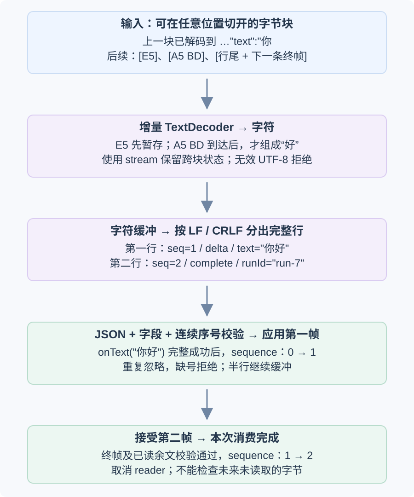

图里用一个更小的输入：`run-7` 只有两帧，`seq=1` 输出“你好”，`seq=2` 宣告完成。第一帧完整应用后，游标从 0 到 1；第二帧通过校验后，本次消费结束。如果只收到“你好”就断流，页面保留文本并报告本地读取失败，不能猜测服务端已经完成。

#### 解析器还要守住的边界

- **读到 EOF 不等于完成。** 只有收到终帧（`complete` 或 `error`）才算结束；没有终帧的 EOF 保留部分文本，但标记为失败。
- **大小有上限。** 本例把单帧限制为 8,192 个 UTF-16 代码单元、可见输出限制为 64 Ki 个代码单元，超出就失败，防止恶意或失控的服务端撑爆内存。
- **媒体类型精确匹配。** 只接受 `application/x-ndjson`（可带参数），`application/x-ndjsonx` 这类后缀变体在接受任何帧之前就被拒绝。
- **终帧之后不应再有数据。** 同一读取块里若在终帧后还缓冲着已解码内容，解析器拒绝转入终态；它也会 flush fatal `TextDecoder`，避免本次 `read()` 尾部未完成的 UTF-8 字节藏在解码器状态里。接受终帧后解析器取消 reader，不再读未来的网络数据，所以它无法证明服务端之后没再发东西；服务端协议仍要规定终帧后关闭流。
- **回调返回才推进游标。** `onText` 成功返回，表示整帧文本已经应用，此后才推进 `sequence` 和输出长度。回调若先应用一部分再失败，就无法确定安全的续读点。解析器不能强行打断一个任意的 Promise，所以回调必须有界，并自己响应传入的取消信号。

> [!example]- 代码：NDJSON 作业解析器
> 运行环境是 Node 的 Web Streams 与 `Response` API，这是合成协议模型，不是浏览器端到端测试。续读时把 `afterSequence` 和 `currentOutputChars` 传入，即可从已应用的位置接上。
>
> ~~~javascript
> const MAX_FRAME_CHARS = 8 * 1024;
> const MAX_OUTPUT_CHARS = 64 * 1024;
> const DECODE_SLICE_BYTES = 4 * 1024;
>
> function readWithSignal(reader, signal) {
>   if (!signal) return reader.read();
>   const abortReason = () => signal.reason ?? new DOMException("Aborted", "AbortError");
>   if (signal.aborted) return Promise.reject(abortReason());
>
>   return new Promise((resolve, reject) => {
>     const onAbort = () => reject(abortReason());
>     signal.addEventListener("abort", onAbort, { once: true });
>     reader.read().then(resolve, reject).finally(() => {
>       signal.removeEventListener("abort", onAbort);
>     });
>   });
> }
>
> async function consumeRun(response, {
>   runId,
>   signal,
>   afterSequence = 0,
>   currentOutputChars = 0,
>   onState = () => {},
>   onText = async () => {},
> } = {}) {
>   let state = "idle";
>   let sequence = afterSequence;
>   let outputChars = currentOutputChars;
>   let carry = "";
>   let terminal = false;
>   let errorCode;
>   let detail;
>   let reader;
>   const decoder = new TextDecoder("utf-8", { fatal: true });
>
>   const transition = next => {
>     const allowed = {
>       idle: ["connecting", "canceled"],
>       connecting: ["streaming", "completed", "failed", "canceled"],
>       streaming: ["connecting", "completed", "failed", "canceled"],
>     };
>     if (state === next) return;
>     if (!allowed[state]?.includes(next)) {
>       throw new Error("Invalid view-state transition: " + state + " -> " + next);
>     }
>     state = next;
>     onState(state);
>   };
>
>   const result = () => ({ state, sequence, outputChars, errorCode, detail });
>
>   async function acceptLine(line, hasBufferedDataAfterFrame = false) {
>     signal?.throwIfAborted();
>     if (terminal) throw new Error("Frame received after a terminal frame");
>     if (!line) throw new Error("Empty frame");
>     if (line.length > MAX_FRAME_CHARS) throw new Error("Frame exceeds the size limit");
>
>     let event;
>     try {
>       event = JSON.parse(line);
>     } catch {
>       throw new Error("Malformed JSON frame");
>     }
>
>     if (!event || Array.isArray(event) || typeof event !== "object") {
>       throw new Error("Frame must be a JSON object");
>     }
>     if (!Number.isSafeInteger(event.seq) || event.seq < 1) {
>       throw new Error("Frame has an invalid sequence number");
>     }
>     if (event.seq <= sequence) return; // replayed event already applied
>     if (event.seq !== sequence + 1) throw new Error("Event sequence gap");
>     if (typeof event.type !== "string") throw new Error("Frame has no event type");
>
>     if (event.type === "delta") {
>       if (typeof event.text !== "string") throw new Error("Delta text must be a string");
>       if (outputChars + event.text.length > MAX_OUTPUT_CHARS) {
>         throw new Error("Output exceeds the display limit");
>       }
>       if (state === "connecting") transition("streaming");
>       await onText(event.text, signal);
>       // onText 成功返回表示这一整帧已经应用；这才是可续读的位置。
>       sequence = event.seq;
>       outputChars += event.text.length;
>       signal?.throwIfAborted();
>       return;
>     }
>
>     if (event.type === "complete") {
>       if (event.runId !== runId) throw new Error("Terminal frame has the wrong runId");
>       if (hasBufferedDataAfterFrame) throw new Error("Frame buffered after terminal frame");
>       decoder.decode(); // flush fatal UTF-8 state so an incomplete byte in this read cannot hide after the terminal line
>       sequence = event.seq;
>       terminal = true;
>       transition("completed");
>       return;
>     }
>
>     if (event.type === "error") {
>       if (typeof event.code !== "string" || !event.code) {
>         throw new Error("Error frame has no error code");
>       }
>       if (hasBufferedDataAfterFrame) throw new Error("Frame buffered after terminal frame");
>       decoder.decode(); // 检查当前已读字节中的未完成 UTF-8 序列；后续网络块仍由终态协议结束
>       sequence = event.seq;
>       errorCode = event.code;
>       terminal = true;
>       transition("failed");
>       return;
>     }
>
>     throw new Error("Unknown event type");
>   }
>
>   async function feedText(text, moreBytesInRead = false) {
>     carry += text;
>     let newline;
>     while ((newline = carry.indexOf("\n")) !== -1) {
>       let line = carry.slice(0, newline);
>       carry = carry.slice(newline + 1);
>       if (line.endsWith("\r")) line = line.slice(0, -1);
>       const hasBufferedDataAfterFrame = carry.length > 0 || moreBytesInRead;
>       await acceptLine(line, hasBufferedDataAfterFrame);
>       if (terminal) return;
>     }
>     // A trailing CR may be the first half of a CRLF split across reads; measure it after the next byte decides the delimiter.
>     const pendingLineChars = carry.length - Number(carry.endsWith("\r"));
>     if (pendingLineChars > MAX_FRAME_CHARS) throw new Error("Frame exceeds the size limit");
>   }
>
>   transition("connecting");
>   try {
>     if (!response.body) throw new Error("Response has no body");
>     reader = response.body.getReader();
>     if (!response.ok) throw new Error("HTTP " + response.status);
>     const contentType = response.headers.get("content-type");
>     const mediaType = contentType?.split(";", 1)[0].trim().toLowerCase();
>     if (mediaType !== "application/x-ndjson") {
>       throw new Error("Unexpected response content type");
>     }
>
>     while (true) {
>       const { done, value } = await readWithSignal(reader, signal);
>       if (done) {
>         await feedText(decoder.decode());
>         if (terminal) return result();
>         if (carry.length) throw new Error("EOF inside an unterminated frame");
>         throw new Error("EOF before a terminal frame");
>       }
>
>       for (let offset = 0; offset < value.byteLength; offset += DECODE_SLICE_BYTES) {
>         const end = Math.min(offset + DECODE_SLICE_BYTES, value.byteLength);
>         const part = value.subarray(offset, end);
>         await feedText(decoder.decode(part, { stream: true }), end < value.byteLength);
>         if (terminal) return result();
>       }
>     }
>   } catch (error) {
>     detail = error instanceof Error ? error.message : String(error);
>     if (signal?.aborted && signal.reason?.name === "TimeoutError") {
>       transition("failed");
>     } else if (signal?.aborted) {
>       transition("canceled");
>     } else {
>       transition("failed");
>     }
>     return result();
>   } finally {
>     if (reader) {
>       try {
>         await reader.cancel();
>       } catch {
>         // Preserve the parse, read, timeout, or abort result.
>       }
>       reader.releaseLock();
>     }
>   }
> }
> ~~~

> [!example]- 测试：16 组分块与失败场景
> 把这段接在上面的解析器后面，存成一个 `.mjs` 文件运行。2026-11-26 在 Node 26.13.1 上重跑，16 组全部通过（原稿 2026-11-16 在 Node 22 上同样通过）。覆盖：UTF-8 与帧跨块、合并帧、服务端错误帧、坏 JSON、提前 EOF、突然断线、超时、本地中止、回调与中止竞争、终帧后的缓冲帧、重放与跳号、最大帧长加跨块 CRLF、媒体类型精确匹配、流未关闭时收到终帧，以及终帧后未完成的 UTF-8 字节。
>
> ~~~javascript
> import assert from "node:assert/strict";
>
> const encoder = new TextEncoder();
> const asBytes = text => encoder.encode(text);
>
> function responseFrom(chunks, {
>   open = false,
>   status = 200,
>   contentType = "application/x-ndjson; charset=utf-8",
> } = {}) {
>   const body = new ReadableStream({
>     start(controller) {
>       for (const chunk of chunks) controller.enqueue(chunk);
>       if (!open) controller.close();
>     },
>   });
>   return new Response(body, {
>     status,
>     headers: { "content-type": contentType },
>   });
> }
>
> function responseDisconnectAfter(chunk) {
>   let sent = false;
>   const body = new ReadableStream({
>     pull(controller) {
>       if (!sent) {
>         sent = true;
>         controller.enqueue(chunk);
>       } else {
>         controller.error(new Error("Connection dropped"));
>       }
>     },
>   }, { highWaterMark: 0 });
>   return new Response(body, {
>     headers: { "content-type": "application/x-ndjson; charset=utf-8" },
>   });
> }
>
> async function check(name, response, expectedState, expectedText = "", options = {}) {
>   const states = [];
>   let text = "";
>   const result = await consumeRun(response, {
>     runId: "run-7",
>     ...options,
>     onState: state => states.push(state),
>     onText: chunk => { text += chunk; },
>   });
>   assert.equal(result.state, expectedState, name);
>   assert.equal(text, expectedText, name + " partial text");
>   return { result, states };
> }
>
> // Split one multibyte character and one record across reads; the final read
> // also contains a coalesced complete record.
> const multibyte = asBytes("好");
> const normal = await check(
>   "split UTF-8 and coalesced frames",
>   responseFrom([
>     asBytes('{"type":"delta","seq":1,"text":"你'),
>     multibyte.slice(0, 1),
>     multibyte.slice(1),
>     asBytes('"}\n{"type":"complete","seq":2,"runId":"run-7"}\n'),
>   ]),
>   "completed",
>   "你好",
> );
> assert.deepEqual(normal.states, ["connecting", "streaming", "completed"]);
> console.log("PASS normal, multibyte split, frame split, and coalesced frames");
>
> const serverError = await check(
>   "server error frame",
>   responseFrom([asBytes('{"type":"error","seq":1,"code":"MODEL_UNAVAILABLE"}\n')]),
>   "failed",
> );
> assert.equal(serverError.result.errorCode, "MODEL_UNAVAILABLE");
> console.log("PASS terminal server-error frame");
>
> const malformed = await check(
>   "malformed JSON",
>   responseFrom([asBytes("{not-"), asBytes("json}\n")]),
>   "failed",
> );
> assert.match(malformed.result.detail, /Malformed JSON/);
> console.log("PASS malformed frame split across reads");
>
> const prematureEof = await check(
>   "premature EOF",
>   responseFrom([asBytes('{"type":"delta","seq":1,"text":"partial"}\n')]),
>   "failed",
>   "partial",
> );
> assert.match(prematureEof.result.detail, /EOF before a terminal frame/);
> console.log("PASS EOF preserves partial text but does not complete");
>
> const disconnected = await check(
>   "abrupt disconnect",
>   responseDisconnectAfter(asBytes('{"type":"delta","seq":1,"text":"partial"}\n')),
>   "failed",
>   "partial",
> );
> assert.match(disconnected.result.detail, /Connection dropped/);
> console.log("PASS abrupt disconnect preserves partial text but does not complete");
>
> const timeoutController = new AbortController();
> const timeoutTimer = setTimeout(() => {
>   timeoutController.abort(new DOMException("Deadline exceeded", "TimeoutError"));
> }, 5);
> const timeout = await check(
>   "timeout",
>   responseFrom([], { open: true }),
>   "failed",
>   "",
>   { signal: timeoutController.signal },
> );
> clearTimeout(timeoutTimer);
> assert.match(timeout.result.detail, /Deadline exceeded/);
> console.log("PASS timeout remains a failure, not completion");
>
> const stopController = new AbortController();
> const stopTimer = setTimeout(() => {
>   stopController.abort(new DOMException("Stopped by user", "AbortError"));
> }, 5);
> const stopped = await check(
>   "explicit abort after partial text",
>   responseFrom([asBytes('{"type":"delta","seq":1,"text":"partial"}\n')], { open: true }),
>   "canceled",
>   "partial",
>   { signal: stopController.signal },
> );
> clearTimeout(stopTimer);
> assert.match(stopped.result.detail, /Stopped by user/);
> console.log("PASS explicit abort keeps partial text and marks only the local view canceled");
>
> const bufferedRaceController = new AbortController();
> const bufferedRaceStates = [];
> let bufferedRaceText = "";
> const bufferedRace = await consumeRun(responseFrom([
>   asBytes('{"type":"delta","seq":1,"text":"partial"}\n{"type":"complete","seq":2,"runId":"run-7"}\n'),
> ]), {
>   runId: "run-7",
>   signal: bufferedRaceController.signal,
>   onState: state => bufferedRaceStates.push(state),
>   onText: async chunk => {
>     bufferedRaceText += chunk;
>     await Promise.resolve();
>     bufferedRaceController.abort(new DOMException("Stopped while rendering", "AbortError"));
>   },
> });
> assert.equal(bufferedRace.state, "canceled");
> assert.equal(bufferedRace.sequence, 1);
> assert.equal(bufferedRace.outputChars, "partial".length);
> assert.equal(bufferedRaceText, "partial");
> assert.deepEqual(bufferedRaceStates, ["connecting", "streaming", "canceled"]);
> assert.match(bufferedRace.detail, /Stopped while rendering/);
> console.log("PASS abort after text callback returns prevents a buffered terminal frame");
>
> const trailingTerminal = await check(
>   "frame buffered after terminal",
>   responseFrom([asBytes(
>     '{"type":"complete","seq":1,"runId":"run-7"}\n{"type":"delta","seq":2,"text":"late"}\n',
>   )]),
>   "failed",
> );
> assert.match(trailingTerminal.result.detail, /Frame buffered after terminal/);
> console.log("PASS reject a frame already buffered after a terminal record");
>
> const replayedSequence = await check(
>   "duplicate sequence ignored",
>   responseFrom([asBytes(
>     '{"type":"delta","seq":1,"text":"once"}\n' +
>     '{"type":"delta","seq":1,"text":"duplicate"}\n' +
>     '{"type":"complete","seq":2,"runId":"run-7"}\n',
>   )]),
>   "completed",
>   "once",
> );
> assert.equal(replayedSequence.result.sequence, 2);
> console.log("PASS duplicate sequence is not applied twice");
>
> const sequenceGap = await check(
>   "sequence gap",
>   responseFrom([asBytes(
>     '{"type":"delta","seq":1,"text":"partial"}\n' +
>     '{"type":"complete","seq":3,"runId":"run-7"}\n',
>   )]),
>   "failed",
>   "partial",
> );
> assert.equal(sequenceGap.result.sequence, 1);
> assert.match(sequenceGap.result.detail, /Event sequence gap/);
> console.log("PASS sequence gap fails the local consumer without advancing its cursor");
>
> const terminalPrefix = '{"type":"complete","seq":1,"runId":"run-7","padding":"';
> const terminalSuffix = '"}';
> const maxLengthTerminal = terminalPrefix + "x".repeat(
>   MAX_FRAME_CHARS - terminalPrefix.length - terminalSuffix.length,
> ) + terminalSuffix;
> assert.equal(maxLengthTerminal.length, MAX_FRAME_CHARS);
> const splitCrlfLimit = await check(
>   "maximum-size frame with CRLF split across reads",
>   responseFrom([asBytes(maxLengthTerminal + "\r"), asBytes("\n")]),
>   "completed",
> );
> assert.equal(splitCrlfLimit.result.sequence, 1);
> console.log("PASS an 8192-code-unit JSON line followed by split CRLF stays within the frame limit");
>
> const sameChunkCrlfLimit = await check(
>   "maximum-size frame with CRLF in one read",
>   responseFrom([asBytes(maxLengthTerminal + "\r\n")]),
>   "completed",
> );
> assert.equal(sameChunkCrlfLimit.result.sequence, 1);
> console.log("PASS the same 8192-code-unit line also accepts CRLF in one read");
>
> const invalidMediaType = await check(
>   "NDJSON media type with a suffix is rejected",
>   responseFrom([asBytes('{"type":"complete","seq":1,"runId":"run-7"}\n')], {
>     contentType: "application/x-ndjsonx",
>   }),
>   "failed",
> );
> assert.match(invalidMediaType.result.detail, /content type/);
> assert.equal(invalidMediaType.result.sequence, 0);
> console.log("PASS application/x-ndjsonx is rejected before any frame is accepted");
>
> const terminalLineBytes = asBytes('{"type":"complete","seq":1,"runId":"run-7"}\n');
> const openTerminal = await check(
>   "terminal frame completes before an open stream reaches EOF",
>   responseFrom([terminalLineBytes], { open: true }),
>   "completed",
> );
> assert.equal(openTerminal.result.sequence, 1);
> console.log("PASS a terminal frame with a real LF completes while the stream remains open");
>
> const terminalWithPendingUtf8 = new Uint8Array(terminalLineBytes.length + 1);
> terminalWithPendingUtf8.set(terminalLineBytes);
> terminalWithPendingUtf8[terminalLineBytes.length] = 0xf0; // first byte of a four-byte UTF-8 sequence
> const pendingUtf8AfterTerminal = await check(
>   "incomplete UTF-8 byte after terminal in the same read",
>   responseFrom([terminalWithPendingUtf8], { open: true }),
>   "failed",
> );
> assert.equal(pendingUtf8AfterTerminal.result.sequence, 0);
> assert.match(pendingUtf8AfterTerminal.result.detail, /encoded data|encoding/i);
> console.log("PASS a pending UTF-8 lead byte in the same read prevents terminal success");
> ~~~

`consumeRun()` 返回的 `state` 是这次页面消费的本地结果，不是后台作业的权威状态。本地超时、断线或解析失败会得到 `failed`，但服务端上的作业可能仍在运行，甚至已经完成，要查询状态接口才能确认。收到协议里的 `error` 终帧会记下 `errorCode` 并停止消费，但其他本地 `failed` 都不能当成服务端终态。

#### 本地停止只结束本地通道

`AbortController.abort()`、取消 reader、关闭 `EventSource`，都只结束当前页面对这条响应的读取，不证明服务端工作已经停止。取消信号能停住什么、停不住什么，见[取消、超时和并发上限各自停得住什么](#28.%20%E5%8F%96%E6%B6%88%E3%80%81%E8%B6%85%E6%97%B6%E5%92%8C%E5%B9%B6%E5%8F%91%E4%B8%8A%E9%99%90%E5%90%84%E8%87%AA%E5%81%9C%E5%BE%97%E4%BD%8F%E4%BB%80%E4%B9%88%EF%BC%9F)。产品若允许取消作业，就要另发取消请求，并查询权威状态，直到服务端报告终态。

### 背压、按帧更新与状态播报

解析器每帧都 `await onText(...)`，回调没返回就不读下一块，这本身就形成了背压 (backpressure，消费较慢时让上游减速)：页面不再拉取时，数据停在流和网络层的缓冲里，不会无限堆进应用自己的队列。暂停读取能限制本地缓冲，却不能让服务端停止生成。若回调只是把 DOM 写入排进一个队列，就应在队列保持较小时再读下一块。

渲染也要有界：

- **按帧合并。** 同一帧里到达的文本增量先合并，用 `requestAnimationFrame` 每帧更新一次 DOM，而不是每个 token 都刷新。rAF 只负责合并可见更新，不提供任何恢复保证。
- **限制长输出。** 输出很长时限制缓冲，或只渲染可见窗口。
- **路由卸载时释放资源。** 释放 reader 和事件源；有用但不完整的文本保留下来，并标为部分结果。
- **注意分发顺序。** 收到的状态若先交给本地 reducer 或事件总线，再分发到多个视图，监听器重入可能改变处理顺序，见[同步事件总线在分发途中增删监听器会怎样](#26.%20%E5%90%8C%E6%AD%A5%E4%BA%8B%E4%BB%B6%E6%80%BB%E7%BA%BF%E5%9C%A8%E5%88%86%E5%8F%91%E9%80%94%E4%B8%AD%E5%A2%9E%E5%88%A0%E7%9B%91%E5%90%AC%E5%99%A8%E4%BC%9A%E6%80%8E%E6%A0%B7%EF%BC%9F)。

状态区域可以用 `role="status"` 播报连接、完成或失败。它隐含 polite live region (礼貌的实时区域) 语义，屏幕阅读器会在不打断用户的时机朗读；不要把逐字增长的正文放进去逐 token 播报。

### 主线四到这里收束

本章把上一章的“通知后核实”推到服务端推送：快照与游标在同一一致性点读出；页面按版本合并完整视图、按连续序号应用 patch；连接状态与业务状态分开；续读接不上时有界地回到快照；自己读字节流时，从字节到字符、到行、到事件逐层校验，游标只在应用成功后前进。至此，主线四的问题“界面状态归谁，异步结果怎样按身份落到对的界面上”已经从组件、路由、缓存、编辑会话一直讲到跨页面和服务端推送。

推送的若是持久 AI 运行的事件，事件到达后怎样把运行 ID、序号、工具调用和不完整的 Markdown 安全地投影到聊天界面，见支线[AI 聊天界面怎样应用重放事件、安全渲染 Markdown，并处理停止与重试](#49.%20AI%20%E8%81%8A%E5%A4%A9%E7%95%8C%E9%9D%A2%E6%80%8E%E6%A0%B7%E5%BA%94%E7%94%A8%E9%87%8D%E6%94%BE%E4%BA%8B%E4%BB%B6%E3%80%81%E5%AE%89%E5%85%A8%E6%B8%B2%E6%9F%93%20Markdown%EF%BC%8C%E5%B9%B6%E5%A4%84%E7%90%86%E5%81%9C%E6%AD%A2%E4%B8%8E%E9%87%8D%E8%AF%95%EF%BC%9F)。主线五从另一端接手：这些代码怎样构建、测试、发布，并测出页面慢在哪里，从[构建器怎样把源码变成可部署的文件](#50.%20%E6%9E%84%E5%BB%BA%E5%99%A8%E6%80%8E%E6%A0%B7%E6%8A%8A%E6%BA%90%E7%A0%81%E5%8F%98%E6%88%90%E5%8F%AF%E9%83%A8%E7%BD%B2%E7%9A%84%E6%96%87%E4%BB%B6%EF%BC%9F)开始。

> [!info]- 来源
> - SSE 字段解析与空行分发、显式空 `data:` 也会派发、命名事件、`readyState` 三值、204 停止重连、last-event-ID 先于事件派发更新、`Last-Event-ID` 请求头与 `retry:`（“连接状态和报表状态分开显示”“一次完整的续读”“续读接不上时”）：[WHATWG HTML Living Standard，Server-sent events §§9.2.2–9.2.6](https://html.spec.whatwg.org/multipage/server-sent-events.html)，2026-11-12 更新并核对。`after` 参数、优先采用 `Last-Event-ID`、`reset` 事件与报表 42 的快照/事件是本例应用约定，沿用[实时更新协议案例](../../engineering-foundations/networking/real-time-web-updates.md)。
> - Fetch 请求缓存模式 `cache: "no-store"` 不使用 HTTP 缓存（“快照和游标必须来自同一个一致性点”）：[WHATWG Fetch Standard §5.4 Request](https://fetch.spec.whatwg.org/#request-class)，2026-10-19 版本；2026-11-12 核对。
> - Fetch 响应状态与 `Response.body` 流（“Fetch 流和 SSE 有什么不同？”）：[WHATWG Fetch Standard §5.3 Response](https://fetch.spec.whatwg.org/#response-class)；`getReader()`、读取、取消与释放 reader、内部队列与背压（“NDJSON 解析器的边界”“背压”）：[WHATWG Streams Standard §§4.2、4.3.3、4.4、4.9.3](https://streams.spec.whatwg.org/)，2026-11-12 核对。
> - NDJSON 的 UTF-8、LF/CRLF 分隔与建议媒体类型（“从字节到记录要过三道关”）：[NDJSON Specification 1.0.0 §§3.1–3.3](https://github.com/ndjson/ndjson-spec)，2014-10-19。8,192 帧上限、64 Ki 输出上限、`seq`、`runId` 与终帧是本例教学协议扩展，不由 NDJSON 定义。
> - 增量 UTF-8 解码与 `TextDecoder` 的 `stream`/`fatal` 及 flush（同上）：[WHATWG Encoding Standard §7.2](https://encoding.spec.whatwg.org/#interface-textdecoder)，2026-10-19 版本；2026-11-12 核对。“好”= `E5 A5 BD` 于 2026-11-26 用 Node 复核。
> - `AbortController` 与 `AbortSignal` 的语义（“本地停止只结束本地通道”）：[WHATWG DOM Standard §3 Aborting ongoing activities](https://dom.spec.whatwg.org/#aborting-ongoing-activities)，2026-11-12 核对。
> - `role="status"` 的 polite live region 语义（“背压、按帧更新与状态播报”）：[W3C WAI-ARIA 1.2，status role](https://www.w3.org/TR/wai-aria-1.2/#status)，2026-11-12 核对。
> - NDJSON 解析器与 16 组测试为本笔记自带代码：原稿 2026-11-16 在 Node 22 运行通过；2026-11-26 在 Node 26.13.1 重跑，16 组 PASS。
## 49. AI 聊天界面怎样应用重放事件、安全渲染 Markdown，并处理停止与重试？

本章是[服务端持续推送时，界面怎样合并更新并从断线恢复](#48.%20%E6%9C%8D%E5%8A%A1%E7%AB%AF%E6%8C%81%E7%BB%AD%E6%8E%A8%E9%80%81%E6%97%B6%EF%BC%8C%E7%95%8C%E9%9D%A2%E6%80%8E%E6%A0%B7%E5%90%88%E5%B9%B6%E6%9B%B4%E6%96%B0%E5%B9%B6%E4%BB%8E%E6%96%AD%E7%BA%BF%E6%81%A2%E5%A4%8D%EF%BC%9F)的支线：推送的不再是报表进度，而是一次持久 AI 运行的事件。读者已经知道快照与游标、按序号续读、连接状态与业务状态分开；本章回答三个前端独有的问题：重放的事件怎样更新已有的消息和工具卡而不重复；逐段到达的 Markdown 怎样安全地变成 HTML；用户点“停止”“继续”“重试”时，客户端该发什么请求、显示什么。运行在服务端怎样排队、审批、对账，属于 AI 工程领域的[运行恢复](../../ai-engineering/runs/run-identity-and-authoritative-state.md)主线；本章只在需要时说明它交给浏览器什么。

### 案例：先审核再建单的一轮聊天

开发者在聊天界面里输入：“解释 build 42 的失败并准备缺陷单；提交前让我审核。”运行服务鉴权后创建持久运行 `run-r42-7`。模型先调用只读工具 `read_build_log`（工具调用 ID `c1`），查到 `unit-tests` 中的测试 `reject_empty_name` 预期返回 HTTP `400`、实际返回 `200`，测试进程退出码为 `1`。运行据此生成解释和一份保存在服务端的缺陷单草稿，然后停在 `awaiting_approval`（等待审核）。审核人批准这份未改动的草稿后，同一运行才调用写工具 `create_issue`（`c2`）。建单请求超时，运行进入 `effect_unknown`（结果未知），经只读对账确认工单 `ISSUE-842` 已存在，最后完成。运行 ID、序号、工具调用 ID 和工单号都是教学用合成值。

客户端根据事件还原出的界面状态叫作 projection (投影)。下表是客户端依次收到的事件，后文都按序号引用：

| 序号与事件 | 客户端投影 | 此时不能误报什么 |
|---|---|---|
| `seq=1`：`run.status` → `running` | 本轮显示“正在检查” | 不能称为已完成 |
| `seq=2`：`assistant.delta` | 助手气泡出现“正在读取 build 42 日志” | 证据还没到，不能先写根因 |
| `seq=3`：`tool.started(c1)` | 建立“读取构建日志”卡片，状态为进行中 | 重放不能再建第二张卡 |
| `seq=4`：`tool.completed(c1)` | 同一张卡显示 `reject_empty_name` 预期 400、实际 200、退出码 1 | 工具摘要是数据，不是指令 |
| `seq=5`：`assistant.delta` | 同一气泡解释观测结果，说明正在准备草稿 | 草稿仍在生成 |
| `seq=6`：`run.status` → `awaiting_approval` | 显示已保存的仓库、标题、正文、证据摘要和审核入口 | 工单尚未创建 |
| `seq=7`：`run.status` → `running` | 审核人批准后，同一轮恢复 | `runId` 不变，序号接续 |
| `seq=8`：`tool.started(c2)` | 建立“创建缺陷单”卡片 | `c2` 不是远端去重键 |
| `seq=9–10`：`tool.effect_unknown(c2)`、`run.status` → `effect_unknown` | 卡片与运行都显示“提交结果待对账” | 超时不等于失败，也不等于未创建 |
| `seq=11`：`tool.completed(c2)` | 同一张 `c2` 卡显示经对账确认的 `ISSUE-842` | 不新建运行或第二张卡 |
| `seq=12–13`：`assistant.delta`、`run.status` → `completed` | 同一气泡告知工单已存在，本轮结束 | 只有运行服务确认后才显示完成 |

### 四类标识各管什么？

这些事件字段是本例应用自己约定的格式，不是 Server-Sent Events (服务器发送事件，SSE)、Fetch 或 Model Context Protocol (模型上下文协议，MCP) 自带的。四类标识各管一件事：

| 标识 | 本例取值 | 管什么 | 不能拿来做什么 |
|---|---|---|---|
| `runId` | `run-r42-7` | 一次持久运行；断线、审批、对账前后不变 | 不是凭证，不授权任何操作 |
| `seq` | 1 至 13 | 该运行中客户端可见事件的顺序，用于续读和去重 | 只在同一 `runId` 内有意义 |
| `toolCallId` | `c1`、`c2` | 把模型发出的工具请求与结果配对，也是工具卡的身份 | 不是远端写操作的去重键 |
| 幂等键 | `run-r42-7:create-issue:v1` | 让远端系统识别“同一次建单” | 由运行服务使用，客户端不拼装 |

SSE 连接 ID、MCP 底层 JSON-RPC (基于 JSON 的远程过程调用) 消息的请求 ID，与这四类标识用途不同，不能互相替代。若一个运行会产生多条助手消息，事件里还要有稳定的 `messageId`，见下文“[气泡和工具卡的 key](#%E6%B0%94%E6%B3%A1%E5%92%8C%E5%B7%A5%E5%85%B7%E5%8D%A1%E7%9A%84%20key)”。

### 怎样应用重放事件而不重复消息或工具卡？

投影规则建立在一个前提上：**同一个 `lastSeq` 总代表同一段已应用的事件前缀**。`lastSeq` 是投影已应用的最后一个序号。收到一条通过校验的事件后，只有三种结果：

- **`seq === lastSeq + 1`：** 正好是下一条，应用它并推进 `lastSeq`。
- **`seq <= lastSeq`：** 重放的旧事件，忽略，投影不变。
- **`seq > lastSeq + 1`：** 跳号。先向同一个 `runId` 补读缺失的事件；服务端已不保留这段历史时，取一份内容与游标一致的新快照。补齐前，已有文本和卡片保持不变。

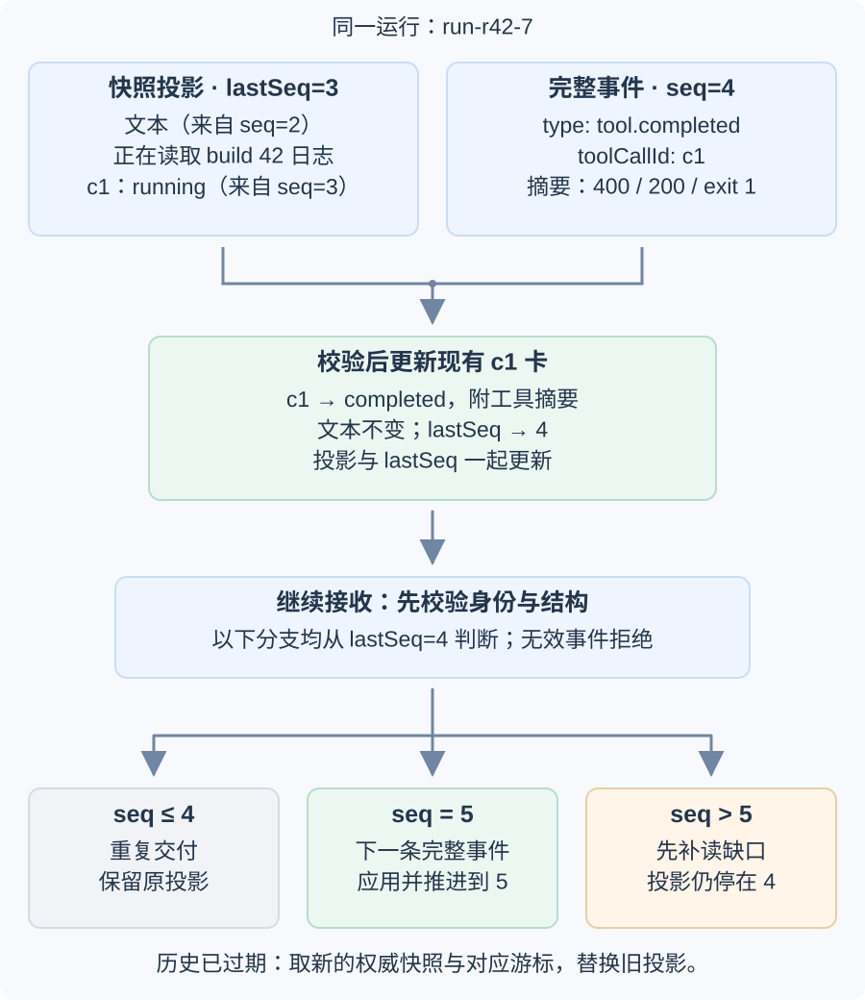

#### 三种恢复起点

**界面还在，续读。** 浏览器断线前已处理到 `seq=10`，`c2` 卡显示“提交结果待对账”。只要服务端还保留后续事件，重连时就用原运行 ID 请求 `events?after=10`：第 11 条把 `ISSUE-842` 填进原来的 `c2` 卡，第 12 条补上答复，第 13 条把本轮标为完成。服务端若重发 `seq=8` 到 `seq=11`，它们都落进“忽略”分支，`seq=12` 才继续追加。

**界面丢了或游标过期，取一致快照。** 换了新窗口，或服务端返回 `reset`、提示事件保留期已过时，取一份完整的界面快照：当前文本、工具卡、运行状态和对应的 `lastSeq`；仍在等待审批时，还要带上待审草稿的完整预览与版本摘要。内容和序号必须来自同一次一致读取，客户端才能整体替换旧投影，再从这个序号往后读。服务端也可以在同一响应里返回当前用户有权查看的运行记录，用来呈现审批、取消和建单结果。

一致性可以检查。上图的快照 `lastSeq=3` 应当包含 `seq=2` 写入的文本“正在读取 build 42 日志”，以及 `seq=3` 建立的、仍在进行中的 `c1` 卡；这样接下来的 `seq=4` 才能找到 `c1` 并更新它。若快照声称 `lastSeq=3` 却缺少 `c1` 卡，它与对应的事件前缀不一致，客户端应拒绝它，重新获取内容与游标匹配的快照。

**两者都没有，只显示已查证的状态。** 服务端保留整段历史时，可以从 `seq=1` 重建一个空白窗口。若本地没有可续读的界面，服务端又给不出完整快照或历史，就只能展示查到的运行状态；即使知道最新序号，也补不回中间的文本和工具卡。

#### 逐字段校验事件

网络收到的 JSON 一律先当作类型未知的数据，逐项检查：是不是对象、身份和序号是否有效、事件类型是否认识、该类型必需的字段是否齐全。TypeScript 的类型声明不在运行时校验网络数据，见[TypeScript 保证什么，运行时还要校验什么](#34.%20TypeScript%20%E8%83%BD%E4%BF%9D%E8%AF%81%E4%BB%80%E4%B9%88%EF%BC%8C%E5%A4%96%E9%83%A8%E6%95%B0%E6%8D%AE%E5%8F%88%E8%AF%A5%E6%80%8E%E6%A0%B7%E9%AA%8C%E8%AF%81%EF%BC%9F)。下面的代码只处理单条事件，拒绝未知事件类型，重复和跳号都原样返回旧投影；快照响应同样要按 schema (数据结构约束) 校验运行 ID、非负游标和完整内容，这里从略。生产环境的 schema 还应限制正文大小、工具名称和允许的状态转换。

> [!example]- 代码：校验事件并按运行游标投影
> ~~~javascript
> const RUN_STATUSES = new Set([
>   "running", "awaiting_approval", "effect_unknown", "completed",
>   "failed", "rejected", "cancel_requested", "canceled"
> ]);
> const TOOL_NAMES = new Set(["read_build_log", "create_issue"]);
>
> function isRecord(value) {
>   return value !== null && typeof value === "object" && !Array.isArray(value);
> }
>
> function validateRunEvent(raw) {
>   if (!isRecord(raw) || typeof raw.runId !== "string" ||
>       !Number.isSafeInteger(raw.seq) || raw.seq < 1) {
>     throw new Error("Invalid event identity");
>   }
>   switch (raw.type) {
>     case "assistant.delta":
>       if (typeof raw.text !== "string") throw new Error("Invalid text delta");
>       break;
>     case "tool.started":
>       if (typeof raw.toolCallId !== "string" || !raw.toolCallId ||
>           !TOOL_NAMES.has(raw.toolName)) throw new Error("Invalid tool start");
>       break;
>     case "tool.effect_unknown":
>       if (typeof raw.toolCallId !== "string" || !raw.toolCallId) {
>         throw new Error("Invalid unknown effect");
>       }
>       break;
>     case "tool.completed":
>       if (typeof raw.toolCallId !== "string" || !raw.toolCallId ||
>           typeof raw.summary !== "string") throw new Error("Invalid tool result");
>       break;
>     case "run.status":
>       if (!RUN_STATUSES.has(raw.status)) throw new Error("Invalid run status");
>       if (raw.status === "awaiting_approval" &&
>           (!isRecord(raw.approvalDraft) ||
>            typeof raw.approvalDraft.repositoryId !== "string" ||
>            typeof raw.approvalDraft.title !== "string" ||
>            typeof raw.approvalDraft.body !== "string" ||
>            typeof raw.approvalDraft.evidenceSummary !== "string" ||
>            typeof raw.approvalDraft.payloadHash !== "string")) {
>         throw new Error("Missing persisted approval draft");
>       }
>       break;
>     default:
>       throw new Error("Unknown event type");
>   }
>   return raw;
> }
>
> function applyRunEvent(view, raw) {
>   const event = validateRunEvent(raw);
>   if (event.runId !== view.runId) throw new Error("Wrong run");
>   if (event.seq <= view.lastSeq) return { kind: "ignore", view };
>   if (event.seq !== view.lastSeq + 1) return { kind: "catch-up", view };
>
>   const next = { ...view, lastSeq: event.seq, tools: new Map(view.tools) };
>   switch (event.type) {
>     case "assistant.delta":
>       next.assistantText += event.text;
>       break;
>     case "tool.started": {
>       const prior = next.tools.get(event.toolCallId);
>       if (prior && prior.name !== event.toolName) throw new Error("Tool ID reused");
>       if (!prior) next.tools.set(event.toolCallId, {
>         name: event.toolName, status: "running"
>       });
>       break;
>     }
>     case "tool.effect_unknown": {
>       const prior = next.tools.get(event.toolCallId);
>       if (!prior || prior.status === "completed") throw new Error("Unknown tool card");
>       next.tools.set(event.toolCallId, { ...prior, status: "effect_unknown" });
>       break;
>     }
>     case "tool.completed": {
>       const prior = next.tools.get(event.toolCallId);
>       if (!prior || prior.status === "completed") throw new Error("No pending tool card");
>       next.tools.set(event.toolCallId, {
>         ...prior, status: "completed", summary: event.summary
>       });
>       break;
>     }
>     case "run.status":
>       next.runStatus = event.status;
>       if (event.status === "awaiting_approval") {
>         next.approvalDraft = event.approvalDraft;
>       }
>       break;
>   }
>   return { kind: "applied", view: next };
> }
>
> const snapshotAt3 = {
>   runId: "run-r42-7",
>   lastSeq: 3,
>   assistantText: "正在读取 build 42 日志",
>   tools: new Map([["c1", { name: "read_build_log", status: "running" }]]),
>   runStatus: "running"
> };
> const seq4 = {
>   runId: "run-r42-7", seq: 4, type: "tool.completed", toolCallId: "c1",
>   summary: "reject_empty_name: expected HTTP 400, actual HTTP 200, exit 1"
> };
> const after4 = applyRunEvent(snapshotAt3, seq4);
> const duplicate4 = applyRunEvent(after4.view, seq4);
> const seq5 = {
>   runId: "run-r42-7", seq: 5, type: "assistant.delta",
>   text: "；reject_empty_name 预期 HTTP 400，实际返回 HTTP 200，导致 unit-tests 失败（退出码 1）。正在准备缺陷单草稿。"
> };
> const seq6 = {
>   runId: "run-r42-7", seq: 6, type: "run.status",
>   status: "awaiting_approval",
>   approvalDraft: {
>     repositoryId: "build-service",
>     title: "Build 42: reject_empty_name returned HTTP 200",
>     body: "The unit-tests check for reject_empty_name expected HTTP 400 but returned HTTP 200 (process exit 1).",
>     evidenceSummary: "Build 42 / unit-tests / reject_empty_name: expected HTTP 400; actual HTTP 200; exit 1.",
>     payloadHash: "synthetic-build-42-draft-v1"
>   }
> };
> const gap6 = applyRunEvent(after4.view, seq6);
> const after5 = applyRunEvent(gap6.view, seq5);
> const after6 = applyRunEvent(after5.view, seq6);
> const seq7 = { runId: "run-r42-7", seq: 7, type: "run.status", status: "running" };
> const after7 = applyRunEvent(after6.view, seq7);
> globalThis.projectionDemo = { snapshotAt3, after4, duplicate4, seq5, seq6, seq7, gap6, after5, after6, after7 };
> ~~~

代码末尾的演示从 `lastSeq=3` 的快照出发，依次走过各个分支（2026-11-26 在 Node 26.13.1 重跑，结果如下）：

- `after4`：`seq=4` 更新已有的 `c1` 卡，状态变为 `completed` 并附上摘要，`lastSeq` 变为 4。
- `duplicate4`：同一个 `seq=4` 再到一次，返回 `ignore`，不重复追加，`lastSeq` 仍是 4。
- `gap6`：在 `lastSeq=4` 时先收到 `seq=6`，返回 `catch-up`，投影不变。
- `after5`、`after6`：补上 `seq=5` 后文本追加、`lastSeq` 为 5；再应用同一条 `seq=6`，投影进入 `awaiting_approval` 并保存草稿。
- `after7`：`seq=7` 让运行回到 `running`。草稿作为历史仍在投影里，界面按 `runStatus` 隐藏审批入口。

#### 气泡和工具卡的 key

投影里的每个元素要有稳定的身份，React 才能在重放和更新时复用同一个组件，而不是销毁重建或把状态挂到错的元素上；key 怎样决定组件身份，见[React 怎样把一次用户操作变成界面更新](#37.%20React%20%E6%80%8E%E6%A0%B7%E6%8A%8A%E4%B8%80%E6%AC%A1%E7%94%A8%E6%88%B7%E6%93%8D%E4%BD%9C%E5%8F%98%E6%88%90%E7%95%8C%E9%9D%A2%E6%9B%B4%E6%96%B0%EF%BC%9F)。本例的取法：

- 每个运行只有一个助手气泡时，气泡 key 用 `runId`；一个运行可能产生多条消息时，事件和快照里要有稳定的 `messageId`，key 改为 `(runId, messageId)`。
- 工具卡的 key 始终用 `(runId, toolCallId)`。不要用数组下标或随机值：下标会在插入时错位，随机值会让每次渲染都重建卡片。

### 不完整的 Markdown 怎样安全显示？

事件能按序应用之后，下一个问题是怎样显示累积起来的文本。一条回答分散在多个 `assistant.delta` 里，危险内容可能恰好被切开。下面三个分片之间不插入任何字符：第二段以 `java` 结尾，第三段以 `script:` 开头，单看哪一段都不像危险链接，拼起来链接目标却是 `javascript:alert(1)`。

~~~javascript
const chunks = [
  "日志显示为：\n\n```text\n<not executed>\n",
  "```\n\n[打开链接](java",
  "script:alert(1))"
];
let accumulated = "";
const frames = [];
for (const chunk of chunks) {
  accumulated += chunk;
  frames.push(accumulated);
}
~~~

所以规则是：**每次更新界面，都把同一条消息到目前为止的完整 Markdown 重新解析，并在交给 HTML sink 之前净化**，而不是逐片转换后拼接 HTML。HTML sink 指把字符串当作 HTML 写进页面的接口，例如 `innerHTML`。第二帧里的 `[打开链接](java` 还不是完整链接，解析器把它当作普通文字；到第三帧才成为链接，这时整条消息重新走一遍净化。


每一帧都走同一条路径：

1. **拼出完整消息。**
2. **Markdown 解析器把它转成 HTML。** 解析器只管语法，输出未经净化。
3. **HTML 净化器按允许列表保留元素和属性。** 本例允许段落、标题、强调、列表、引用、代码块和普通链接；不允许图片、表单控件、样式、脚本和新窗口属性。
4. **链接策略检查每个链接最终解析到的 URL。** 不允许的只去掉 `href`，保留链接文字。
5. **结果交给 HTML sink。**

另一条是纯文本路径：工具摘要，以及净化器无法工作时的原始 Markdown，都用 `textContent` 显示字面文本，不解析为 HTML。如果产品不需要富文本，直接把助手内容也作为纯文本显示最简单。

#### 链接策略：按最终 URL 判断，而不是看字符串前缀

链接在净化后的 DOM 里读取，再用浏览器的 `URL` 解析器算出最终目标，按写法分别检查：

- 包含用户名或密码的 URL 一律拒绝；
- `/docs/guide` 这样的站内根路径，必须解析回当前 origin；
- `//other.example/path`（协议相对地址）不在允许的写法内；
- 片段 `#...` 只能指向当前文档；
- 绝对链接只允许 HTTP(S)。

这比用字符串前缀判断“看起来像站内路径”可靠。不允许的 URL 只移除 `<a>` 的 `href`：上面拼出的“打开链接”仍然可读，但不能点击。这套允许范围是本例组件的选择，不代表所有产品都该开放相同的标签或协议。

#### 实例：Marked 18.2.0 与 DOMPurify 3.4.17

> [!example]- 代码：最小显示策略
> ~~~javascript
> const chatPolicy = {
>   ALLOWED_TAGS: [
>     "a", "p", "br", "em", "strong", "del", "code", "pre",
>     "blockquote", "ul", "ol", "li", "h1", "h2", "h3", "h4",
>     "h5", "h6", "hr"
>   ],
>   ALLOWED_ATTR: ["href"],
>   ALLOW_DATA_ATTR: false,
>   ALLOW_ARIA_ATTR: false
> };
>
> function allowedHref(raw) {
>   if (typeof raw !== "string" || raw.trim() !== raw || raw === "") return null;
>   try {
>     const resolved = new URL(raw, window.location.href);
>     if (resolved.username || resolved.password) return null;
>     if (raw.startsWith("/") && !raw.startsWith("//") &&
>         resolved.origin === window.location.origin) return resolved.href;
>     if (raw.startsWith("#") && resolved.origin === window.location.origin &&
>         resolved.pathname === window.location.pathname &&
>         resolved.search === window.location.search) return resolved.href;
>     if (/^https?:\/\//i.test(raw) &&
>         (resolved.protocol === "http:" || resolved.protocol === "https:")) return resolved.href;
>   } catch {
>     return null;
>   }
>   return null;
> }
>
> function safeMarkdown(source) {
>   const generated = marked.parse(source, { async: false });
>   if (typeof generated !== "string") throw new Error("Expected synchronous HTML");
>   const sanitized = DOMPurify.sanitize(generated, chatPolicy);
>   const template = document.createElement("template");
>   template.innerHTML = sanitized;
>   template.content.querySelectorAll("a[href]").forEach((link) => {
>     const href = allowedHref(link.getAttribute("href"));
>     if (href) link.setAttribute("href", href);
>     else link.removeAttribute("href");
>   });
>   return template.innerHTML;
> }
> window.safeMarkdown = safeMarkdown;
> ~~~

两个库的分工：Marked 只解析 Markdown，README 明确警告它不净化输出；DOMPurify 负责净化，并允许用 `ALLOWED_TAGS`、`ALLOWED_ATTR` 替换默认的允许列表。本例列出的范围比 DOMPurify 自带的宽泛 HTML 配置更窄。

有三个使用条件会改变结论：

- **先确认运行环境受支持。** 按 DOMPurify 3.4.17 的 README，在它不支持的旧浏览器上，库不做净化，原样返回输入。所以组件先检查 `DOMPurify.isSupported`：为真才调用 `safeMarkdown` 走 HTML 路径；为假就用 `textContent` 或 React 的普通文本子节点显示原始 Markdown。不能先调用净化函数，再把原样返回的字符串当成安全 HTML。
- **React 的 `dangerouslySetInnerHTML` 就是 HTML sink。** 它把字符串直接交给 DOM 的 `innerHTML`，只能接收上面净化后的结果。
- **净化之后再改 DOM，就要再净化一次。** 若结果还要交给语法高亮器、插件或其他会改写 DOM 的库，最终输出必须按同一策略再净化。

> [!info] 复核结果（2026-11-26）
> 用 Node 26.13.1、jsdom 31.0.1、Marked 18.2.0、DOMPurify 3.4.17 重跑上面的三帧输入：第三帧 Marked 的原始输出是 `<a href="javascript:alert(1)">打开链接</a>`，经 `safeMarkdown` 后变成没有 `href` 的 `<a>打开链接</a>`；代码块内的 `<not executed>` 保持为转义文本，`class="language-text"` 因不在允许属性内被去掉。在这个环境里，`javascript:` 地址已被 DOMPurify 的默认 URI 检查移除，链接策略是第二层，额外挡住了 `//other.example/path` 和带用户名密码的地址；`/docs/guide` 和 `#sec` 被解析为当前 origin 下的绝对地址。Markdown 图片 `` 和原始 HTML `` 都没有进入输出。原稿另在 Chromium 131.0.6778.33 中拦截渲染请求，确认这些图片元素不会发出远程请求。以上只覆盖这组输入和版本，不是跨浏览器保证。

### 工具结果和卡片状态为什么不能照单全收？

工具返回的内容与模型输出一样不可信。`c1` 的只读摘要经过校验后，`step`、`failed_test`、`expected`、`actual`、`exit_status` 等字段都写成文本节点，例如 `summary.textContent = tool.summary`，不走 HTML 路径。工具摘要里即使出现“忽略之前的指令”或一段 HTML，它在界面上也只是字面文字；这类内容对模型的影响由应用的权限关卡处理，见[为什么提示注入防不住“模型听话”，应用该在哪里拦](../../ai-engineering/actions/prompt-injection-as-permission-confusion.md)。

卡片显示什么状态，只看运行事件（`tool.started`、`tool.effect_unknown`、`tool.completed`），而不看工具返回正文里的 HTML 或 “success” 字样。渲染本身不执行任何工具请求；校验并执行工具调用是运行服务的责任，见[模型“调用工具”时实际发生了什么，工具契约该怎样设计](../../ai-engineering/actions/tool-calls-are-requests.md)。同样，界面上的成功图标不等于服务端已确认操作：`c2` 只有在收到经对账的 `seq=11` 后才显示 `ISSUE-842`。

### 停止、继续和重试分别改变什么？

前面处理的是显示；用户还会对运行本身做操作。客户端要把三层状态分开展示：

- **连接状态：** 事件通道是否打开。传输层重连只恢复事件投递。
- **运行状态：** `running`、`awaiting_approval`、`effect_unknown`、`completed` 等，只来自运行服务。
- **审批与副作用状态：** 草稿是否获批、建单是否确认。

`EventSource` 连着，不代表后台运行还在进行；连接断了，也不代表运行停了。每个操作都要向运行服务发经过鉴权的请求，再按服务端状态更新界面。服务端那一侧怎样处理断线、取消和外部写入，AI 工程领域用一个退款案例讲同一套状态机：[用户断线、取消或要回答一个问题时，同一次运行怎样继续](../../ai-engineering/runs/disconnect-cancel-and-user-input.md)，以及[退款请求超时后，怎样查清结果而不重复扣款](../../ai-engineering/runs/external-writes-and-reconciliation.md)。

#### 继续：批准一个确切的草稿版本

`seq=6` 带来服务端已保存的完整待审草稿：目标仓库、标题、正文、证据摘要和 `payloadHash`。`payloadHash` 标识这一版草稿；运行服务在账本里为目标和全部获批字段记一份摘要（退款案例里叫 `plan_digest`），它与识别原始用户请求的 `request_digest` 不同。代码里的 `"synthetic-build-42-draft-v1"` 只是教学占位，不是真的摘要。审核预览必须展示将要提交的全部目标和参数，因为摘要还原不了正文，也证明不了审核人看过什么。


客户端这一侧的流程：

1. **提交 `runId` 和 `payloadHash`，不在点击时重新拼装写入内容。** `payloadHash` 只标识版本，不是身份或授权凭据。
2. **界面上的审批入口只是显示。** 客户端按投影状态、草稿版本和已知权限决定是否显示按钮，但这些字段不授予批准权。服务端受理时按权威记录核对：运行仍在 `awaiting_approval`，哈希与当前草稿一致，审批人此刻仍有权限；并用条件事务保证一个决定只被消费一次，重复、过期或针对旧版本的决定都不会再次入队。
3. **`seq=7` 要等后台真正接手。** 批准事务写入决定、`queued` 状态和唤醒记录；worker 领取运行后，客户端才收到 `seq=7` 的 `running`。事件表只列客户端可见的进度，省略了排队和领取，见[请求受理后，怎样保证任务最终被执行且不被两个 worker 同时推进](../../ai-engineering/runs/accepting-queuing-and-claiming-runs.md)。
4. **恢复的仍是 `run-r42-7`，序号接续。** 真正发出建单请求前，运行服务还会再核对一次版本、租约、写权限和取消状态，并用稳定键 `run-r42-7:create-issue:v1` 调用远端。批准过一次，不代表以后任何时候都能直接发送。

`seq=7` 之后草稿仍作为历史留在投影里。草稿若被改动，就是一个新版本，必须重新审核。

#### 重试：结果未知时先对账，不重发

建单请求超时，远端可能已经建好了工单，只是回执没回来。这时保留原来的 `c2` 卡和运行的 `effect_unknown` 状态，等运行服务按原操作身份只读对账：查到 `ISSUE-842` 后，用 `seq=11` 更新原卡片，再由 `seq=12–13` 显示最终结果。

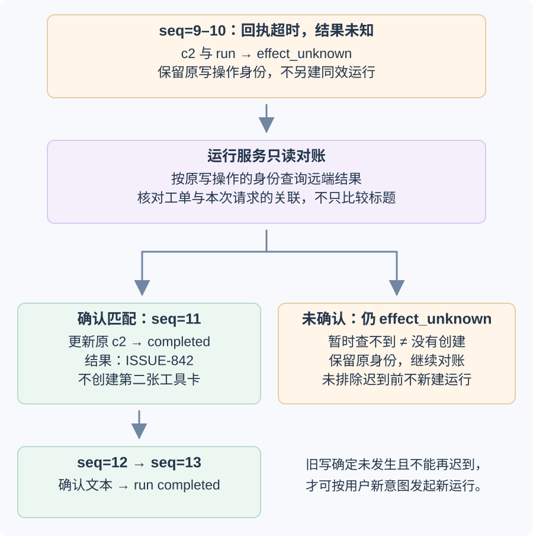

暂时查不到记录，不能证明旧请求以后不会到达。结果仍未知时，界面不提供“再提交一次”，也不另建一个做同样事情的运行。只有远端接口的约定能确认旧写入没有发生、已发出的请求也不可能迟到，并且用户仍想再试时，才为新尝试创建新的 `runId`；旧运行和旧卡片留作审计。

#### 停止：取消请求，不是关闭连接

`AbortController.abort()` 按 Fetch 的 abort 算法结束这次 fetch 调用或响应体读取；关闭 `EventSource` 或 Fetch 的 reader，结束的也只是当前的事件通道。这些客户端操作不会替应用写入持久的取消状态，也证明不了服务端任务已停止或副作用已回滚，见[取消、超时和并发上限各自停得住什么](#28.%20%E5%8F%96%E6%B6%88%E3%80%81%E8%B6%85%E6%97%B6%E5%92%8C%E5%B9%B6%E5%8F%91%E4%B8%8A%E9%99%90%E5%90%84%E8%87%AA%E5%81%9C%E5%BE%97%E4%BD%8F%E4%BB%80%E4%B9%88%EF%BC%9F)。

所以“停止”按钮调用运行服务的取消操作，再查询权威状态。发出取消请求后仍可能收到事件，界面保留已应用的内容，继续按服务端状态更新。取消确认前显示“正在取消”。如果用户点停止时，运行已经为建单登记了发送意图，服务端会进入 `cancel_requested` 并继续对账；在外部结果确认之前，界面不能显示“取消成功”。

| 用户操作 | 客户端做什么 | 运行身份与显示 |
|---|---|---|
| 重连 | 用最后已应用的 `seq` 续读；重放忽略，缺口补齐或重取一致快照 | 仍是 `run-r42-7`；保留已有文本和卡片 |
| 停止 | 调用运行服务的取消操作，查询权威状态 | 仍是 `run-r42-7`；确认前显示“正在取消”；已有发送意图时等对账结果 |
| 继续 | 批准未变化的持久草稿版本，恢复暂停的运行 | `runId` 与序号延续；草稿变了必须重新审核 |
| 重试 | 仅在旧操作确定未发生且不能迟到后，按用户意图创建新运行 | 新请求用新 `runId`；旧运行和旧卡片留作审计 |

没有审批和外部写入的普通问答，同样适用本章的快照、序号、key 和 Markdown 规则，只是用不到后两种操作。

### 本章产出

聊天界面现在有了一套完整的投影规则：按 `(runId, seq)` 应用事件，重放忽略、缺口补齐、过期时整体换成一致快照；按 `(runId, toolCallId)` 和 `(runId, messageId)` 给元素稳定身份；每次都对完整 Markdown 重新解析、净化并检查链接，工具结果只当文本；停止、继续、重试各自发给运行服务一个明确请求，并等服务端状态确认后才改变显示。服务端怎样保证这些事件和状态本身可信，回到 AI 工程领域的[一次 AI 运行断线或崩溃后，凭什么恢复](../../ai-engineering/runs/run-identity-and-authoritative-state.md)。

> [!info]- 来源
> - 快照与事件游标的一致性、续读与重连规则（“怎样应用重放事件而不重复消息或工具卡？”）：沿用[服务端持续推送时，界面怎样合并更新并从断线恢复](#48.%20%E6%9C%8D%E5%8A%A1%E7%AB%AF%E6%8C%81%E7%BB%AD%E6%8E%A8%E9%80%81%E6%97%B6%EF%BC%8C%E7%95%8C%E9%9D%A2%E6%80%8E%E6%A0%B7%E5%90%88%E5%B9%B6%E6%9B%B4%E6%96%B0%E5%B9%B6%E4%BB%8E%E6%96%AD%E7%BA%BF%E6%81%A2%E5%A4%8D%EF%BC%9F)的应用层约定；本章换用独立的 AI 运行 ID 与事件序号。
> - MCP 请求 ID 与应用事件序号的区别（“四类标识各管什么？”）：[MCP 2026-07-28 规范](https://modelcontextprotocol.io/specification/2026-07-28) 的 Overview/Base Protocol 说明 MCP 使用 JSON-RPC 2.0；[JSON-RPC 2.0 §4 Request Object](https://www.jsonrpc.org/specification#request_object) 说明请求与响应 ID 用于关联二者。它们不定义应用层的运行序号。
> - 权威运行记录、审批消费、发送意图、`effect_unknown` 对账与取消的状态转移（“停止、继续和重试分别改变什么？”）：[用户断线、取消或要回答一个问题时，同一次运行怎样继续](../../ai-engineering/runs/disconnect-cancel-and-user-input.md)、[退款请求超时后，怎样查清结果而不重复扣款](../../ai-engineering/runs/external-writes-and-reconciliation.md)、[一次 AI 运行断线或崩溃后，凭什么恢复](../../ai-engineering/runs/run-identity-and-authoritative-state.md)（`plan_digest` 与 `request_digest` 的区分见其标识符表）。本章的 `run-r42-7`、`c1/c2`、`run-r42-7:create-issue:v1`、`ISSUE-842` 与原 AI 应用架构章的建单案例一致。
> - Marked 输出未净化（“实例：Marked 18.2.0 与 DOMPurify 3.4.17”）：[Marked 18.2.0 npm README](https://www.npmjs.com/package/marked/v/18.2.0) 的 “Warning” 与 Browser/Node 使用段，2026-11-12 核对。
> - DOMPurify 的 `sanitize`、可配置 `ALLOWED_TAGS`/`ALLOWED_ATTR`、旧浏览器不支持时原样返回（同上节）：[DOMPurify 3.4.17 README](https://github.com/cure53/DOMPurify/blob/3.4.17/README.md) 的 Basic Usage、HTML profile、configuration 与 legacy browser 各段；[3.4.17 release](https://github.com/cure53/DOMPurify/releases/tag/3.4.17)，2026-11-12 核对。
> - `dangerouslySetInnerHTML` 把字符串交给 `innerHTML`，不可信数据进入 raw HTML sink 有 XSS 风险（同上节）：[React DOM 常见组件文档，Dangerously setting the inner HTML](https://react.dev/reference/react-dom/components/common#dangerously-setting-the-inner-html)，2026-11-12 核对。
> - 工具摘要用 `textContent` 显示字面文本（“工具结果和卡片状态为什么不能照单全收？”）：[WHATWG DOM Standard，`textContent`](https://dom.spec.whatwg.org/#dom-node-textcontent)；校验与赋值逻辑是本章示例。
> - 传输取消与运行取消的区别（“停止：取消请求，不是关闭连接”）：[WHATWG DOM Standard §3 Aborting ongoing activities](https://dom.spec.whatwg.org/#aborting-ongoing-activities) 说明 signal 的取消语义由接受它的 API 定义；[Fetch Standard，abort fetch call](https://fetch.spec.whatwg.org/#abort-fetch) 处理 fetch 调用和请求/响应体。2026-11-12 核对。
> - 实测：原稿用 Node.js 26.13.0、Marked 18.2.0、DOMPurify 3.4.17 与 Chromium 131.0.6778.33 运行了完整投影序列、重复/缺口分支和浏览器渲染请求拦截；2026-11-26 用 Node 26.13.1（投影演示）与 jsdom 31.0.1 + Marked 18.2.0 + DOMPurify 3.4.17（三帧 Markdown 与链接样例）复核。测试使用模拟事件，不代表生产服务或跨浏览器保证。
## 50. 构建器怎样把源码变成可部署的文件？

浏览器只按 URL 请求 HTML、JavaScript、CSS 和图片，不认识 `.ts`、Sass，也不会去 `node_modules` 里找包。构建器负责从入口出发找齐依赖、删掉没用的代码、分块、写出带哈希的文件，并把源码里的导入改写成浏览器能请求的 URL。本章跟着报表页的一份小源码走完这条路；读者需要知道 ESM 的 `import`、`export` 和动态 `import()` 在语言层的含义，见[import 写下后，谁负责找到、链接和执行文件？](#31.%20import%20%E5%86%99%E4%B8%8B%E5%90%8E%EF%BC%8C%E8%B0%81%E8%B4%9F%E8%B4%A3%E6%89%BE%E5%88%B0%E3%80%81%E9%93%BE%E6%8E%A5%E5%92%8C%E6%89%A7%E8%A1%8C%E6%96%87%E4%BB%B6%EF%BC%9F)。

### 报表页的源码要经过哪五个阶段？

沿用主线一的报表页，这里只看它的前端源码。它是一个合成的小项目，部署在 `/reports/` 路径下。文中出现的生成文件名和请求结果，来自 Node.js 26.13.0、Vite 8.3.5、Webpack 5.109.0 与固定配置的实测 fixture；它们是这些版本和配置的输出，不是工具的默认文件名，也不是稳定 API。

- `index.html` 用 `<script type="module" src="./src/main.ts">` 引入入口脚本。
- `main.ts` 从 `rows.ts` 导入 `formatRow`，并静态导入 `report.css`。
- `report.css` 用 `url('./report.svg')` 引用一个图标；本例关闭小资源内联，图标会输出为独立文件。
- 用户点“编辑”打开编辑抽屉时，点击处理器才调用 `import("./editor.ts")`。


`main.ts` 对 `formatRow` 的导入是值导入，会保留到输出中；`rows.ts` 里的 `Column` 只用于类型标注，类型擦除后不进入 JavaScript。`report.svg` 要等构建器处理 `report.css` 时，才由 CSS 解析器从 `url()` 中发现。

构建器从入口出发扩展这张图，再把图变成文件：

1. **确定入口。** `package.json` 里的脚本只负责启动构建命令，不是模块图的入口。Vite 默认从项目根目录的 `index.html` 开始；本例给 Webpack 显式设置 `entry: "./index.html"`。
2. **递归发现依赖。** 对每个请求，resolver（模块解析器）先从导入方出发定位到实际资源：相对请求 `./rows.ts` 从导入方所在目录查找，包名则按安装位置和包元数据解析。匹配的 loader（加载器）或内置处理器读取并转换这份资源，构建器再从转换结果里找出静态导入、动态导入和资源引用，把没处理过的目标加入队列，直到队列清空。
3. **优化并分块。** 队列清空，模块图才完整。tree shaking（摇树优化）删除能证明没被使用的代码；code splitting（代码分割）决定哪些模块进初始 chunk（代码分块），哪些进异步 chunk。最终有几个文件，取决于入口、动态导入和 Webpack `optimization.splitChunks` 这类分组规则。
4. **生成文件并改写引用。** 构建器写出 HTML、JavaScript、CSS 和资源文件，把源码请求改写成生成文件之间的引用，还可以按配置输出 manifest，记录源入口到输出文件的映射。文件名里的哈希随内容和引用关系变化，它怎样支撑缓存和发布见[发布新版本时，怎样让缓存和还开着的旧页面都不出错？](#51.%20%E5%8F%91%E5%B8%83%E6%96%B0%E7%89%88%E6%9C%AC%E6%97%B6%EF%BC%8C%E6%80%8E%E6%A0%B7%E8%AE%A9%E7%BC%93%E5%AD%98%E5%92%8C%E8%BF%98%E5%BC%80%E7%9D%80%E7%9A%84%E6%97%A7%E9%A1%B5%E9%9D%A2%E9%83%BD%E4%B8%8D%E5%87%BA%E9%94%99%EF%BC%9F)。
5. **部署并运行。** 整套产物要放到与 public path（公开路径）相符的位置。浏览器先按 HTML 请求初始 JS 和 CSS，CSS 再引用图标；执行到动态导入时才请求编辑器的 chunk。

构建时发现的关系和浏览器运行时的请求是两件事：

| 源码或入口 | 构建时发现的关系 | 浏览器何时请求生成文件 |
|---|---|---|
| `index.html` | Vite 默认入口；Webpack 显式指定 | 取得页面 HTML 时 |
| `src/main.ts` | HTML 的 module script 引入 | 页面启动时加载生成的初始 JS |
| `src/rows.ts`、`src/report.css` | `main.ts` 静态导入 | 跟随初始 JS 与 CSS 加载 |
| `src/report.svg` | CSS 解析发现的 `url()` | 取得 CSS 后请求；或被内联成 data URL |
| `src/editor.ts` | 点击处理器里的动态 `import()` | 本例第一次打开编辑抽屉时 |

### 动态 import() 为什么在构建期就是一条异步边？

`import("./editor.ts")` 写在点击处理器里，但构建器读源码时就看见了这个语法。它会提前找到并转换 `editor.ts`，把它放进单独的异步 chunk，再把这处调用改写成对生成文件的请求。点击处理器只决定运行时何时调用它。

所以编辑器代码在构建时已经确定，在运行时按需取回。没有预加载时，浏览器要等第一次调用才请求这个 chunk；模块加载成功后，同一页面再次调用会复用已加载的模块，不再请求。两种构建器改写的方式不同：

- Vite 产物直接请求改写后的 ESM 地址，本例入口脚本里是 `await import("./editor-x2UHusWa.js")`，相对入口脚本自己的 URL 解析。
- Webpack 产物把调用改成 chunk ID，由运行时用 chunk ID、文件名映射和 `output.publicPath` 拼出 URL。

这条边也是发布时的风险来源：入口脚本里写死了编辑器 chunk 的文件名，旧页面第一次打开编辑抽屉时，请求的仍是旧文件名。下一章从这里接手。

### tree shaking 能删掉什么，barrel 和 sideEffects 怎样影响它？

tree shaking 是 bundler（打包器）删除未使用导出或整个模块的优化，不是 ESM 在运行时提供的保证。静态 `import`、`export` 让工具能分析依赖关系和被引用的名字；但一个模块即使导出没人用，执行它也可能有 side effect（副作用），例如注册事件监听器、修改全局对象、注入 CSS。工具必须证明删掉它不会改变行为，才能删。

本例在 `rows.ts` 里另放了一个从未被导入的导出 `unusedChart`，里面带一段可搜索的哨兵字符串。生产输出中找不到这段字符串，说明它已被删除。

Webpack 文档把这件事拆成两种优化：

- **按导出删（`usedExports`）。** 标记哪些导出没被使用，再由代码压缩器删除对应语句。压缩器要逐条语句判断有没有副作用，这很难做准；而且按规范，模块里的副作用必须求值，所以这一层跳不过整个模块及其依赖。
- **按模块跳过（`sideEffects`）。** 包在 `package.json` 里声明哪些文件没有副作用。若一个被声明为无副作用的模块，没有任何导出被直接使用，打包器可以跳过它和它下面的整棵依赖子树。这一层效果大得多。

barrel（聚合导出模块）是只用 `export ... from` 转发其他模块接口的文件，用来把一个目录要公开的名字集中到一个入口：

~~~javascript
// reports/index.mjs（barrel）
export { ReportTable } from "./ReportTable.mjs";
export { ReportToolbar } from "./ReportToolbar.mjs";

// reports/ReportTable.mjs
export class ReportTable {}

// reports/ReportToolbar.mjs
export class ReportToolbar {}

// ReportsPage.mjs
import { ReportTable, ReportToolbar } from "./reports/index.mjs";
console.log(JSON.stringify([ReportTable.name, ReportToolbar.name]));
~~~

barrel 只转发名字，不改变模块的加载方式。静态重导出让 barrel 依赖它转发的所有模块：页面只用 `ReportTable` 时，`ReportToolbar.mjs` 仍在待分析的图里。它能不能被删，取决于打包器能否确认那个模块没有副作用；包里有正确的 `sideEffects` 声明时，未被使用的转发目标可以整体跳过，否则它可能留在产物里。所以 barrel 本身不保证减包。另外三点要注意：

- 导出列表要有意挑选，避免把内部模块意外公开。
- 目录内的模块若又经 barrel 互相导入，依赖图可能成环；同目录实现通常直接导入具体文件。
- 多个 `export *` 导出同名、但指向不同绑定时，这个名字有歧义；指向同一绑定则没有歧义。显式重导出或改名能让接口意图更清楚。

`sideEffects` 标错的后果是功能缺失，而不是包变大。本例的 `import "./report.css"` 只为副作用导入，没有使用任何导出；若项目声明 `"sideEffects": false`，生产构建可能删掉这份样式。同理，一个靠执行来注册快捷键监听器的模块会被删掉，监听器就不会注册。Webpack 指南给出的写法是把有副作用的文件列出来，不含 `/` 的模式如 `*.css` 按 `**/*.css` 匹配：

~~~json
{
  "name": "reports-app",
  "sideEffects": ["./src/register-shortcuts.js", "*.css"]
}
~~~

这里的 `register-shortcuts.js` 是为说明而假设的文件。这些分析规则来自 Webpack；其他打包器怎样分析导出和副作用，以它们各自的文档和配置为准。打包输出可能是 ESM、浏览器经典脚本或 CJS，最终仍由对应宿主按自己的规则加载。

### 哪些输入决定一次构建能否复现？

要复现一份构建，至少要固定 Node.js、包管理器、锁文件和构建器的版本。`package.json` 的 `packageManager` 字段记录项目采用的包管理器及版本，但不会安装 Node.js；Node 版本仍要由版本文件、CI 镜像或运行环境固定。锁文件复用依赖解析结果，却固定不了操作系统、环境变量、系统工具，或构建脚本读取的任意外部输入。

Node.js 25 起，发行包不再附带 Corepack。如果项目靠 Corepack 按 `packageManager` 字段代理 `pnpm`、`yarn` 等命令，需要按当前 Corepack 文档单独安装它，或按所选包管理器的官方方式固定版本。例如 `build` 脚本写成 `vite build`，本地和 CI 都用同一版本的 pnpm 执行 `pnpm build`。相同的工具和锁文件减少依赖解析差异，但仍要检查实际生成的路径和部署结果。

### 生成文件的 URL 怎样解析，为什么 HTML 不能随便挪位置？

生成的引用有两种写法，解析基准不同：

- **相对 URL** 相对它所在的文件解析：HTML 里的 `src`、`href` 相对文档 URL，CSS 里的 `url()` 相对样式表 URL，ESM 里的 `import()` 相对模块脚本 URL。
- **运行时拼出的 URL** 由构建器注入的代码在执行时组合，例如 Webpack 用 `output.publicPath` 加文件名。

所以 HTML 的部署 URL、它内部的相对引用和服务器的挂载位置必须互相吻合。挪动 HTML 而不改引用，请求就会落到别的路径。

> [!example] Webpack 5.109 fixture：HTML 位置决定请求落点
> 本例 Webpack 把生成的 HTML 也输出到 `assets/` 目录，页面实际 URL 是 `/reports/assets/index-5248e5cf.html`。其中脚本 `../assets/__html_68cecd12_0-7cc84df8.js` 和样式 `../assets/__html_68cecd12_0-efdbfebc.css` 相对这个 URL 解析：所在目录是 `/reports/assets/`，`..` 回到 `/reports/`，再接 `assets/…`，请求落在 `/reports/assets/` 下；CSS 再引用 `/reports/assets/report-b1d5801f.svg`。
>
> 把同一份 HTML 原样放到 `/reports/index.html`，所在目录变成 `/reports/`，`..` 回到 `/`，两个引用解析成 `/assets/…`，本例请求返回 404。
>
> 编辑器 chunk 走另一条路：运行时使用 `output.publicPath: "/reports/"`，点击后才请求 `/reports/assets/354-b92eb80e.js`。构建统计（stats）还列出一个 `assets/main-fa829d06.js`，但生成的 HTML 没有引用它，浏览器也没有请求它。检查页面加载时，要沿 HTML、CSS 和脚本里的实际引用追踪，不要把构建输出的每个文件都当成一定会被请求。

Vite 用 `base` 配置把引用改写成带公开路径的绝对 URL，见后文的 Vite 一节。

### Webpack 的 loader 怎样逐个转换模块？

loader 本质上是一个函数：接收一个模块的源码文本，返回转换结果。前面第 2 阶段里，每个请求解析到实际资源后，由匹配的 loader 转换，Webpack 再从转换结果中发现后续依赖。下面这个 loader 只做字符串替换，不理解 JavaScript 结构；需要按语法节点改写代码时，应改用 AST（abstract syntax tree，抽象语法树）转换器：

~~~javascript
export default function replaceReportTitle(source) {
  return source.replaceAll("__REPORT_TITLE__", "Monthly Reports");
}
~~~

同一条规则可以串联多个 loader，执行顺序分两轮：

1. **pitch 阶段从左到右。** 若 loader 定义了 pitch 函数，Webpack 先按 `use` 数组从左到右调用它们。
2. **normal 阶段从右到左。** 然后按从右到左的顺序调用各 loader 的常规函数，前一个的输出是后一个的输入。

某个 pitch 一旦返回结果，就跳过它自己及右侧所有 loader 尚未执行的部分，把返回值直接交给左侧 loader 的常规函数，再继续向左。例如 `use: [a, b, c]` 正常顺序是 `a.pitch → b.pitch → c.pitch → c → b → a`；若 `b.pitch` 返回结果，顺序变成 `a.pitch → b.pitch → a`。

下面的 Sass 配置因此先运行 `sass-loader` 把 Sass 编译成 CSS，再交给 `postcss-loader`：

~~~javascript
module: {
  rules: [
    {
      test: /\.s[ac]ss$/i,
      type: "css/auto",
      use: ["postcss-loader", "sass-loader"]
    }
  ]
}
~~~

`type: "css/auto"` 把编译出的 CSS 交给 Webpack 原生的 CSS 模块处理。只有每一步确有职责时才串联 loader：Sass、Less、Stylus、PostCSS 仍需要各自的 loader，普通 CSS 已有原生处理，不要只因沿用旧配置再加一个。图片、字体、媒体与文本资源可用 Asset Modules（资源模块）处理，它在许多项目里替代了旧的 `file-loader`、`url-loader` 和 `raw-loader`；图标最终是独立文件还是 data URL，取决于工具版本、资源大小和内联配置。

构建成功不等于类型正确。Webpack 原生 TypeScript 擦除、`ts-loader` 的 `transpileOnly: true` 和 Vite 的转译都只删除类型，不做类型检查，需要另设 `tsc --noEmit` 之类的检查步骤；`ts-loader@9.6.2` 默认会做类型检查。

> [!info] 实例：Webpack 5.109 原生 CSS、HTML 与 TypeScript 的 `auto`
> Webpack 5.109.0 中，原生 CSS 和原生 HTML 的开关默认都是 `auto`。`auto` 不是逐个文件在原生处理和旧 loader 之间自由切换：配置里只要有接管这类文件的旧规则，原生处理可能在整个编译中关闭。迁移时要同时构建一个应由原生能力处理的文件和一个应走旧规则的文件，确认两者的实际行为。没有冲突配置时，原生 CSS 能处理常见 CSS、`@import`、`url()` 和 CSS Modules；原生 HTML 能按入口和模块图生成页面引用，依赖模板功能的旧页面要逐项迁移。
>
> 原生 TypeScript 类型擦除在 5.107.0 加入，5.109.0 默认 `experiments.typescript: "auto"`。它只删除类型标注，不处理 TSX、enum 这类需要额外代码转换的语法。它依赖 Node 的 `module.stripTypeScriptTypes` API：22 系列从 22.13.0 起提供，23 系列从 23.2.0 起提供；Node 22.6.0 加入的只是命令行选项 `--experimental-strip-types`，没有这个 API。`auto` 会检测这个 API 是否存在，以及配置里是否已有处理 TypeScript 的 loader 规则。

> [!info]- Webpack 5.109 `auto` 的判定细节
> CSS 和 HTML 的 `auto` 在配置层先用 `/file.css`、`/file.module.css`、`/file.html` 等合成路径探测。`test`、`resource` 或 `include` 任一条件都可能计入；`exclude` 不参与这项宽松探测。正则中明确引用扩展名的模式也会计入：例如 `/source\.css$/` 即使不匹配 `/file.css`，仍可关闭这一编译的原生 CSS。只有显式 `type` 或未设 `enforce` 的普通 `loader`/`use` 才算接管；`pre`、`post` loader 不触发关闭。若 `auto` 保持启用，真实模块只有在默认原生类型仍被选中、已应用 loader、且没有 `matchResource` 显式重定类型时，才沿旧路径退让给 loader 产物。
>
> 使用默认 `resolve.extensions` 时，显式 `experiments.html: true` 会把 `.html` 排在 JavaScript 扩展名前，目录入口可优先解析为 `index.html`；`auto` 则把 `.html` 放在 JavaScript 后。自定义扩展名顺序时按实际配置判断。

### plugin 怎样处理整次构建，DefinePlugin 为什么不能放密钥？

loader 一次只转换一个模块。plugin（插件）挂在编译器和编译过程的钩子上，处理整次构建共享的状态或产物。要新增产物，应在 `compilation.hooks.processAssets` 中选择合适的 stage。下面的统计插件在 `done` 钩子里把 JSON 写到执行命令时的当前目录；它不会自动进 `dist/`，也不属于 Webpack 管理的 asset（产物）：

~~~javascript
import { writeFileSync } from "node:fs";

class BuildStatsPlugin {
  apply(compiler) {
    compiler.hooks.done.tap("BuildStatsPlugin", stats => {
      const json = stats.toJson({ assets: true, modules: false });
      writeFileSync("build-stats.json", JSON.stringify(json, null, 2));
    });
  }
}
~~~

`DefinePlugin` 在构建时把代码中的表达式替换成常量。替换后的值写进客户端 bundle，任何能打开页面的人都能读到，所以不能放密钥。

> [!info]- 实例：Webpack 5.109 的 processAssets、emit 与旧插件迁移
> `processAssets` 的 stage 决定生成或读取资源的时点。`ADDITIONAL` 位于代码压缩、source map 和传输压缩之前，适合新增自有文件。到 `SUMMARIZE` 才新增文件时，`OPTIMIZE_SIZE` 已经过去，Webpack 不会重跑整个阶段；但订阅了 `additionalAssets` 的处理器仍可单独处理后续新增资源。5.109 的默认 JavaScript minimizer 就使用这种订阅，所以不能只凭新增阶段断言文件不会被压缩，还要看处理器的匹配条件。
>
> 全部 `processAssets` 阶段完成并封存资源后，Webpack 才调用 `emit`，随后写入配置的 output filesystem。后注册的 emit tap 能看到较早 tap 的改动，但它新增的文件已错过先前的 stage；`afterEmit` 已在输出之后，修改不会回写刚才的文件。5.109 默认 `backCompat: true`，此时写封存的 `Compilation.assets` 会警告；关闭兼容模式后该对象被冻结。
>
> `HtmlWebpackPlugin` 当前 README 标记为弃用；原生 HTML 可覆盖常见页面产物，模板插件的定制行为要逐项核对。CSS、HTML 的内置压缩从 5.110.0 开始。`CompressionWebpackPlugin` 已弃用，压缩 generator 迁入 `minimizer-webpack-plugin`，迁移选项从 `minimizer-webpack-plugin@5.11.0` 起提供；生成 `.gz`、`.br` 文件不代表服务器已按内容协商返回相应的 `Content-Encoding`。5.109 默认 JavaScript 压缩仍用 Terser，`terser-webpack-plugin` 从自身 5.6.0 起更名为 `minimizer-webpack-plugin`。覆盖 `optimization.minimizer` 时，要保留默认项就写上 `"..."`。更多历史选项见[归档的 Webpack 插件对照表](../../archive/front-end/Deprecated_Interview_Notes/webpack-plugin-history.md)。

### Vite 的开发服务器为什么不能代替生产构建检查？

Vite 的开发和生产走两条路。按 Vite 8.3.5 文档，开发服务器按浏览器请求逐个提供转换后的原生 ESM，并用 Rolldown 预打包第三方依赖；`vite build` 则由 Rolldown 一次性生成静态的 HTML、JS、CSS 和资源文件。两条路在分块、目标浏览器、公开路径和服务器行为上都可能不同，开发环境能跑通不代表生产产物没问题。HMR（Hot Module Replacement，热模块替换）只属于开发期：服务器通知文件变化，浏览器端运行时取回更新后的模块并调用其注册的接受回调，当前模块边界处理不了时才整页刷新。它与生产发布无关。

本例把页面挂在 `/reports/`，并打开 manifest、关闭小 SVG 内联：

~~~javascript
import { defineConfig } from "vite";

export default defineConfig({
  base: "/reports/",
  build: { manifest: true, assetsInlineLimit: 0 }
});
~~~

`base` 让 HTML、CSS `url()` 和 JS 导入的资源引用都带上公开路径。生成的 HTML 指向初始脚本和样式，CSS 再指向 SVG：

~~~html
<script type="module" src="/reports/assets/index-gRN8M4PG.js"></script>
<link rel="stylesheet" href="/reports/assets/index-QsJV6IX7.css">
~~~

~~~css
background: url(/reports/assets/report-D2wE4vR2.svg);
~~~

入口脚本里的动态导入改写成 `await import("./editor-x2UHusWa.js")`。脚本从 `/reports/assets/` 加载，浏览器因此请求 `/reports/assets/editor-x2UHusWa.js`，而不是源码 `editor.ts`。用无界面 Chromium 首次打开页面时没有请求编辑器；点击后该 URL 返回 200。本例把这次构建记为 v41。

Vite 默认不生成 manifest。本例打开它来核对映射：`"index.html"` 一项记录了 `dynamicImports: ["src/editor.ts"]`，`"src/editor.ts"` 一项的 `file` 是 `"assets/editor-x2UHusWa.js"`。`file` 值相对输出目录，不带 `/reports/` 前缀。浏览器只按 HTML、CSS 和 JS 里的引用请求文件，不读 manifest；需要它的是服务端渲染或后端集成工具。

另外几点也不能靠“构建成功”证明：

- 恢复默认内联阈值后，本例的小 SVG 会变成 CSS 里的 data URL，不再单独请求。
- `base` 必须与静态站点的挂载路径一致。`vite preview` 只用于本地预览生产构建，不是生产服务器；上线前要在实际部署 URL 下检查 HTML、初始脚本和样式、异步 chunk、图像、缓存头、压缩和路由回退。
- Vite 用 Oxc 转译 TypeScript，只删类型，不做类型检查。
- Vite 8.3.5 的 `build.target` 默认面向固定日期（2026-01-01）的 Baseline Widely Available 浏览器范围：Chrome/Edge 111、Firefox 114、Safari 16.4。它只决定语法转换到什么程度，不补运行时 API，`tsconfig.json` 的 `target` 也不能代替它。支持更早的浏览器要另配 polyfill（兼容补丁）并在目标环境验证，见[用一个新 API 之前，怎样确认运行时真的支持？](#32.%20%E7%94%A8%E4%B8%80%E4%B8%AA%E6%96%B0%20API%20%E4%B9%8B%E5%89%8D%EF%BC%8C%E6%80%8E%E6%A0%B7%E7%A1%AE%E8%AE%A4%E8%BF%90%E8%A1%8C%E6%97%B6%E7%9C%9F%E7%9A%84%E6%94%AF%E6%8C%81%EF%BC%9F)。

### source map 怎样把报错映回源码，又会暴露什么？

生产代码经过转换和压缩，报错的行列号对应生成文件，很难读懂。source map（源映射）记录生成代码位置与原始源码位置的对应关系，调试器或错误收集工具据此把位置映回源码；映射本身不能还原出原始文件，除非它附带了源码文本。几个选择各影响一件事：精确到行还是列影响定位精度；是否使用 loader 提供的映射影响能映回多早的源码；映射内嵌还是外置、是否附带源码文本，影响构建成本和对外暴露的信息。

| Webpack `devtool` 例子 | 主要含义 | 适用边界 |
|---|---|---|
| `eval-source-map` | 逐模块用 `eval` 关联完整映射 | 开发定位精度高；官方把初次构建速度列为 slowest |
| `cheap-source-map` | 行级映射，忽略 loader 提供的映射 | 不支持列级断点；可能停在转换后的行 |
| `cheap-module-source-map` | 使用 loader 映射后简化到行级 | 能映回更早的源码，但没有列位置 |
| `source-map` | 外置完整映射，bundle 写引用 | 可恢复行列；要检查 `.map` 是否可公开请求 |
| `hidden-source-map` | 外置映射，bundle 不写 `sourceMappingURL` | 可把 `.map` 单独上传到私有错误工具；隐藏引用不等于访问控制 |
| `nosources-source-map` | 不内嵌 `sourcesContent` | 仍可能泄露文件名和映射关系 |

`cheap-` 只保留行级位置。`module-` 只在 cheap 组合里表示使用 loader 映射；完整的 `source-map` 本身就会使用可用的 loader 映射。Webpack 5.105 起 `devtool` 也可以写成数组，每项用 `type` 指定作用对象：`"javascript"`、`"css"` 或 `"all"`；`all` 只指 JavaScript 与 CSS，不含图像、字体等资源。当前完整语法还有 `-debugids`，5.112.0 加入 `-scopes`；组合顺序与可用性按锁定版本核对。旧预设的详细映射见[Webpack source map 预设对照](../../archive/front-end/Deprecated_Interview_Notes/webpack-source-map-presets.md)。

source map 不是权限边界。`.map` URL 只要仍由服务器公开提供，去掉 bundle 里的引用也挡不住知道路径的人；`nosources` 只去掉源码文本，目录和文件名仍可能暴露。发布时要分别检查输出文件、服务器静态资源规则和错误收集工具的访问权限。

### 这套文件上线后，旧页面还会请求什么？

构建器交出的是一组互相引用的文件：一份入口 HTML、带哈希文件名的初始 JS 和 CSS、只在首次打开编辑抽屉时才请求的编辑器 chunk，以及可选的 manifest。入口脚本里写死了编辑器 chunk 的文件名。下一章接着问：发布 v42 后，已经开着的 v41 页面第一次打开编辑抽屉，请求的仍是 v41 的 chunk；缓存头和发布顺序要怎样安排，它才拿得到 200 而不是 404？见[发布新版本时，怎样让缓存和还开着的旧页面都不出错？](#51.%20%E5%8F%91%E5%B8%83%E6%96%B0%E7%89%88%E6%9C%AC%E6%97%B6%EF%BC%8C%E6%80%8E%E6%A0%B7%E8%AE%A9%E7%BC%93%E5%AD%98%E5%92%8C%E8%BF%98%E5%BC%80%E7%9D%80%E7%9A%84%E6%97%A7%E9%A1%B5%E9%9D%A2%E9%83%BD%E4%B8%8D%E5%87%BA%E9%94%99%EF%BC%9F)。

> [!info]- 来源
> - **五个阶段、依赖发现与异步边（Webpack）：** [NormalModule.js](https://github.com/webpack/webpack/blob/v5.109.0/lib/NormalModule.js#L1576-L1650)、[Compilation.js](https://github.com/webpack/webpack/blob/v5.109.0/lib/Compilation.js#L1766-L1810)、[ImportParserPlugin.js](https://github.com/webpack/webpack/blob/v5.109.0/lib/dependencies/ImportParserPlugin.js#L580-L620)：转换后解析依赖、`import()` 形成异步边；[JsonpChunkLoadingRuntimeModule.js](https://github.com/webpack/webpack/blob/v5.109.0/lib/web/JsonpChunkLoadingRuntimeModule.js#L135-L196)：运行时组合 public path 与文件名。均为 Webpack v5.109.0 源码。
> - **tree shaking、`usedExports` 与 `sideEffects`、barrel 跳过子树、`*.css` 模式与 CSS 误删：** [Webpack Guides: Tree Shaking](https://webpack.js.org/guides/tree-shaking)，“Mark the file as side-effect-free”与“Clarifying tree shaking and sideEffects”节，核对于 2026-11-26。barrel 的转发语义与 `export *` 歧义：[ECMAScript 2026 §16 Scripts and Modules](https://tc39.es/ecma262/2026/multipage/ecmascript-language-scripts-and-modules.html)，§16.2.1.7 导出解析。
> - **可复现构建：** [Node.js 25.0.0 发布说明](https://nodejs.org/en/blog/release/v25.0.0) 与 [Corepack 文档](https://nodejs.org/download/release/v25.8.0/docs/api/corepack.html)：Corepack 从 Node 25 起不随发行包提供；[Corepack `packageManager` 字段](https://github.com/nodejs/corepack#when-authoring-packages)。核对于 2026-11-12。
> - **HTML 相对引用与发布路径（Webpack 实例）：** [原生 HTML](https://webpack.js.org/guides/native-html/)、[输出管理](https://webpack.js.org/guides/output-management/)。fixture 中的 HTML 路径与 chunk 文件名为 Node.js 26.13.0 + Webpack 5.109.0 实测。
> - **loader 顺序与 pitch、Asset Modules、ts-loader：** [Loaders](https://webpack.js.org/concepts/loaders/)（pitch/normal 次序）；[Asset Modules](https://webpack.js.org/guides/asset-modules/)；[ts-loader `transpileOnly`](https://github.com/TypeStrong/ts-loader#transpileonly)。
> - **Webpack 5.109 原生 CSS/HTML/TypeScript 的 `auto`：** [defaults.js](https://github.com/webpack/webpack/blob/v5.109.0/lib/config/defaults.js#L649-L686)（合成路径探测与 TypeScript 默认）；[RuleSetCompiler.js](https://github.com/webpack/webpack/blob/v5.109.0/lib/rules/RuleSetCompiler.js#L473-L578)（宽松规则探测与扩展名正则）；[implicitTypeLoaderFallback.js](https://github.com/webpack/webpack/blob/v5.109.0/lib/util/implicitTypeLoaderFallback.js#L13-L51)（逐模块退让条件）；[TypeScriptPlugin.js](https://github.com/webpack/webpack/blob/v5.109.0/lib/typescript/TypeScriptPlugin.js#L119-L134)（Node API 探测）；[experiments.typescript](https://webpack.js.org/configuration/experiments/#experimentstypescript)、[HTML 作为默认入口](https://webpack.js.org/configuration/experiments/#html-as-the-default-entry)（扩展名顺序）。Node API 版本边界：[Node.js 22.6.0 发布说明](https://nodejs.org/en/blog/release/v22.6.0)、[`module.stripTypeScriptTypes()`](https://nodejs.org/download/release/v22.13.0/docs/api/module.html#modulestriptypescripttypescode-options)、[22.13.0](https://nodejs.org/en/blog/release/v22.13.0)、[23.2.0](https://nodejs.org/en/blog/release/v23.2.0) 发布说明。
> - **plugin、processAssets、emit 与压缩插件迁移：** [processAssets 与 additionalAssets](https://webpack.js.org/api/compilation-hooks/#processassets)；[minimizer-webpack-plugin v5.6.1 源码](https://github.com/webpack/minimizer-webpack-plugin/blob/v5.6.1/src/index.js)（`OPTIMIZE_SIZE` 订阅 `additionalAssets: true`）；[Compiler.js](https://github.com/webpack/webpack/blob/v5.109.0/lib/Compiler.js#L1081-L1106)、[Compilation.js](https://github.com/webpack/webpack/blob/v5.109.0/lib/Compilation.js#L3806-L3834)、[defaults.js backCompat](https://github.com/webpack/webpack/blob/v5.109.0/lib/config/defaults.js#L622-L623)（emit、资源封存与兼容模式）；[HtmlWebpackPlugin README](https://github.com/jantimon/html-webpack-plugin#readme)、[CompressionWebpackPlugin README 与迁移](https://github.com/webpack/compression-webpack-plugin#migrating)（弃用标记、`minimizer-webpack-plugin@5.11.0`）；[Terser minimizer 5.6.0 发布](https://github.com/webpack/minimizer-webpack-plugin/releases/tag/v5.6.0)（包名变更）。
> - **Vite 开发与构建、base、manifest、内联、target：** Vite 8.3.5 固定版本文档 [build](https://github.com/vitejs/vite/blob/v8.3.5/docs/guide/build.md)、[assets](https://github.com/vitejs/vite/blob/v8.3.5/docs/guide/assets.md)、[features](https://github.com/vitejs/vite/blob/v8.3.5/docs/guide/features.md)（Oxc 只转译）、[HMR API](https://github.com/vitejs/vite/blob/v8.3.5/docs/guide/api-hmr.md)、[build options](https://github.com/vitejs/vite/blob/v8.3.5/docs/config/build-options.md)、[backend integration（manifest）](https://github.com/vitejs/vite/blob/v8.3.5/docs/guide/backend-integration.md)、[生产动态导入辅助逻辑](https://github.com/vitejs/vite/blob/v8.3.5/packages/vite/src/node/plugins/importAnalysisBuild.ts#L314-L344)。v41 文件名与请求为 Node.js 26.13.0 + Vite 8.3.5 fixture 实测。
> - **source map：** [Webpack devtool](https://webpack.js.org/configuration/devtool/)（预设表）；[Webpack 5.105 数组配置](https://webpack.js.org/blog/2026-02-03-webpack-5-105/)；[Webpack 5.112 `-scopes`](https://webpack.js.org/blog/2026-10-13-webpack-5-112/)。
## 51. 发布新版本时，怎样让缓存和还开着的旧页面都不出错？

上一章的构建器交出了一组互相引用的文件：入口 HTML、带哈希的初始 JS 和 CSS、首次打开编辑抽屉才请求的编辑器 chunk。本章回答这组文件上线时的两个问题：浏览器和 CDN 怎样缓存它们，才能既少下载又不拿到旧内容；发布新版本时，按什么顺序上传、切换和删除，才能让还开着的旧页面继续工作。读者手上有[构建器怎样把源码变成可部署的文件？](#50.%20%E6%9E%84%E5%BB%BA%E5%99%A8%E6%80%8E%E6%A0%B7%E6%8A%8A%E6%BA%90%E7%A0%81%E5%8F%98%E6%88%90%E5%8F%AF%E9%83%A8%E7%BD%B2%E7%9A%84%E6%96%87%E4%BB%B6%EF%BC%9F)里的 v41 产物。

### 发布 v42 时，谁还在用 v41？

沿用上一章的报表页 fixture（Node.js 26.13.0、Vite 8.3.5，部署在 `/reports/` 下）。v41 和 v42 是两次独立构建，源码唯一的差别是编辑器里的一段文字。

切换到 v42 的那一刻，至少有三类客户端还可能引用 v41 的文件：

- **已打开的 v41 标签页。** 它的入口脚本早已加载，里面写死了 v41 编辑器 chunk 的文件名；用户第一次打开编辑抽屉时，才会去请求这个文件。
- **CDN 边缘节点。** 源站切换后，边缘节点可能在短时间内仍返回旧 HTML。
- **旧的 Service Worker。** 它可能继续控制旧页面，并从自己的缓存里提供 v41 的文件。

所以发布要同时解决两件事：每个 URL 的缓存规则，以及新旧文件在服务器上共存多久。先看缓存规则。

### HTTP 缓存怎样决定能不能复用一份响应？

浏览器或 CDN 收到请求时，按三个问题决定能否用存储的响应代替网络：

1. **能不能存。** `Cache-Control: no-store` 要求缓存不存储这次响应；其他响应按状态码和指令判断。
2. **缓存键是否匹配。** 缓存通常按请求方法和目标 URL 区分响应，响应里的 `Vary` 再列出影响表示的请求字段，例如语言或编码偏好。
3. **是否仍新鲜。** `max-age=N` 表示响应的年龄（自源站生成以来的时间）小于 N 秒时新鲜。新鲜的响应可以直接复用，不联系服务器。

响应不再新鲜时，缓存可以发条件请求验证：响应带过 `ETag`（实体标签）时，缓存发 `If-None-Match`；服务器回 `304 Not Modified` 表示内容没变，缓存复用已存的正文；内容变了就回 `200 OK` 和新正文。验证器和新鲜时间管不同的事：`ETag` 只在需要验证时使用，不会让仍新鲜的响应提前去验证。

几个常被混淆的指令：

| 指令 | 含义 | 常见误解 |
|---|---|---|
| `max-age=31536000` | 一年（365 × 24 × 3600 秒）内新鲜，可直接复用 | 以为过期就绝不能用；有些指令或配置允许使用特定的过期响应 |
| `immutable` | 响应在新鲜期内不会变化，浏览器无需重新验证，用户普通刷新时也不必发条件请求 | 以为它能让内容永不过期；它只在新鲜期内生效 |
| `no-cache` | 可以存，但每次复用前都要先向服务器验证 | 以为是“不要缓存” |
| `no-store` | 不要存储这次响应 | 以为能单独保证隐私 |

由此得到前端静态资源的两种做法：

- **内容不同就用不同 URL。** 构建器把内容摘要放进文件名，例如 `/reports/assets/editor-x2UHusWa.js`。同一个 URL 永远对应同一份内容，于是可以给很长的新鲜时间并加 `immutable`：

  ~~~http
  HTTP/1.1 200 OK
  Content-Type: text/javascript
  Cache-Control: public, max-age=31536000, immutable
  ~~~

- **同一个 URL 的内容会变**，例如入口 HTML。用 `no-cache` 加 `ETag`，让缓存保留正文，但每次复用前都问服务器；或给较短的 `max-age`，限制旧内容最多被直接复用多久，到期后再用 `ETag` 验证。

报表 API 这类带用户数据的响应，还涉及 `private`、授权撤销与缓存的关系，见[浏览器请求如何到达 HTTP 响应？](../../engineering-foundations/networking/http-protocols-and-websockets.md)的缓存一节。本章只处理公开的静态资源。

### 编辑器改了一行字，为什么入口脚本的文件名也变了？

编辑器内容变了，它的文件名哈希随之改变。入口脚本里写着编辑器的生成文件名，所以即使 `main.ts` 源码一字未改，生成的入口 JS 内容也变了，入口文件名同样改变。这就是哈希级联：一个文件的新名字，会沿“被谁引用”一路传到入口。没有变化、也不引用变化文件的 CSS 和 SVG 保持原名。

| 浏览器请求（`base` 为 `/reports/`） | v41 | v42 |
|---|---|---|
| 新页面从 HTML 取得的入口 JS | `/reports/assets/index-gRN8M4PG.js` | `/reports/assets/index-ClYpL0PO.js` |
| 首次打开编辑抽屉时的编辑器 chunk | `/reports/assets/editor-x2UHusWa.js` | `/reports/assets/editor-BLsXx8VX.js` |
| 初始 CSS | `/reports/assets/index-QsJV6IX7.css` | 相同 |
| CSS 图标 | `/reports/assets/report-D2wE4vR2.svg` | 相同 |

哈希还受图中引用关系和其他构建输入影响，不能只凭某个源文件或最终 JS 的字节自行推算。级联的好处是：用户升级到 v42 时，只需重新下载入口和编辑器两个文件，CSS 和图标继续命中缓存。代价是：v41 和 v42 的入口引用不同的编辑器文件，两者在服务器上必须同时存在一段时间。

### 发布时先上传什么、后切换什么，旧文件留多久？

发布 v42 的顺序：

1. 把整套入口 JS、样式、图像和异步 chunk 写入目标存储，确认它们都能从对应 URL 读取。
2. 最后才切换源站上的 HTML 或 release 指针。
3. 旧版本文件继续保留。

切换只保证指针本身原子更新。CDN 边缘可能还在返回旧 HTML，已打开的旧页面也还在运行。因此有两条硬规则：不要改写同一个哈希 URL 下的内容；只要还可能有旧 HTML、旧标签页或旧 Service Worker 引用某个文件，就不要删除它。

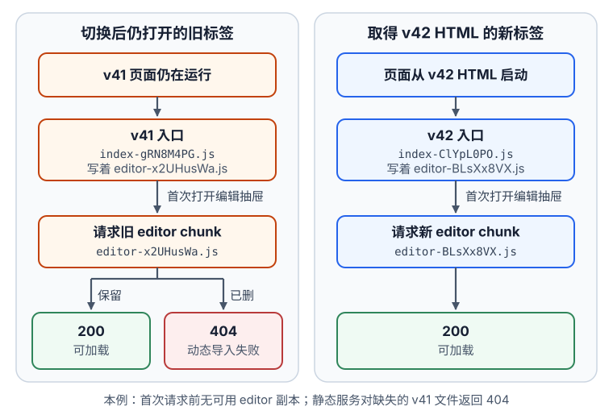

图中的 200 和 404 来自实际浏览器测试。v41 标签页已加载入口、还没打开编辑抽屉时发布 v42：保留旧 chunk，首次点击请求旧 URL，返回 200；提前删掉旧 chunk，这次请求返回 404，动态导入失败。若该页面已经加载过编辑器，再次调用会复用已加载的模块，不再请求；浏览器缓存或 Service Worker 里有可用副本时，也可能不走网络。但这些只是可能，不能代替保留旧文件。

### 缺失的 chunk 为什么会“返回 200 却加载失败”？

单页应用的服务器常把找不到的路径回退成 `index.html`，好让 `/reports/42` 这类前端路由直接打开。若这条回退规则也覆盖了 `/reports/assets/`，旧页面请求一个已删除的 chunk 时，网络面板显示 200，拿到的却是 HTML；动态导入仍会失败，因为响应不是 JavaScript。排查时看到 200 不要就此放过，要看响应类型和正文。让资源目录下缺失的文件返回 404，错误才会直接暴露出来。

动态 chunk 加载失败时，应用要先判断是不是可恢复的新旧版本错配，再决定怎样处理：

- 不要把所有导入错误都当成版本错配；网络中断、脚本本身抛错是别的问题。
- 若判断为版本错配，先保留用户未保存的草稿（编辑抽屉里的内容见[编辑表单怎样在别人同时修改时安全保存？](#44.%20%E7%BC%96%E8%BE%91%E8%A1%A8%E5%8D%95%E6%80%8E%E6%A0%B7%E5%9C%A8%E5%88%AB%E4%BA%BA%E5%90%8C%E6%97%B6%E4%BF%AE%E6%94%B9%E6%97%B6%E5%AE%89%E5%85%A8%E4%BF%9D%E5%AD%98%EF%BC%9F)），再提示用户保存后自己选择刷新。
- 不要自动无限重载。若新 HTML 仍因缓存拿不到，重载只会重复失败。

> [!info] 实例：Vite 的 `vite:preloadError`（核对 Vite 8.3 文档，2026-11-26）
> Vite 在动态导入加载失败时派发 `vite:preloadError` 事件，`event.payload` 是原始导入错误；调用 `event.preventDefault()` 后，这个错误不再抛出。文档的例子是在监听器里刷新页面，并特别提醒：入口 HTML 要设 `Cache-Control: no-cache`，否则刷新后仍会引用旧文件。支持可重试模块加载的浏览器允许应用在暂时的网络或 HTTP 错误后重新尝试原来的动态导入；较旧的浏览器会把失败结果记在模块映射里，只能整页重载。把上面的判断规则放进这个监听器：先确认是版本错配、保住草稿，再交给用户决定。

### 每类文件该设什么缓存，Service Worker 为什么要另算？

HTTP 缓存和 Service Worker 的 Cache Storage 是两套机制，要分开设置：

| 资源 | 缓存边界 |
|---|---|
| 可变 HTML 或当前 release 指针 | `Cache-Control: no-cache`，复用前重新验证；或较短的新鲜时间 |
| 带哈希的脚本、CSS 与图片 | 只有同一路径永不改写内容时，才适合长 `max-age` 加 `immutable` |
| 构建 manifest | 浏览器通常不请求；服务端读取时按版本保存，或与入口一同重新验证 |
| Service Worker Cache Storage | 独立于 HTTP 缓存，不读 `Cache-Control`；按版本保留旧页面仍需要的文件 |

### 回滚为什么也要成套进行？

回滚是把指针指回 v41，同样要成套：入口 HTML 和服务端会读取的 manifest 一起指回去。已经打开的 v42 页面仍可能需要 v42 的文件，所以回滚后也不能立即删除 v42。

旧版本文件的保留时长，要覆盖三样东西：仍可能被提供的 HTML（包括 CDN 边缘上的副本）、用户仍开着的页面、可能继续控制旧页面的 Service Worker。后端 API 能否同时兼容新旧页面，是另一项要单独检查的发布条件。本章止于静态资源；构建一次、逐环境验证、渐进放量和服务端回滚见[如何晋级并回滚已验证的报表服务产物？](../../engineering-foundations/infrastructure/application-deployment-and-ci-cd.md)。

### 例子：图集和独立图标，缓存粒度差在哪里？

哈希 URL 让缓存以“文件”为单位失效，所以把几个资源合进一个文件，就把它们的失效绑在了一起。CSS sprite（雪碧图）是现成的例子：多个小图标排进一张图集，用 `background-position` 露出其中一格。图集怎样裁切、图标形式怎样选，见[图标该用行内 SVG、外部图片、雪碧图还是图标字体？](#52.%20%E5%9B%BE%E6%A0%87%E8%AF%A5%E7%94%A8%E8%A1%8C%E5%86%85%20SVG%E3%80%81%E5%A4%96%E9%83%A8%E5%9B%BE%E7%89%87%E3%80%81%E9%9B%AA%E7%A2%A7%E5%9B%BE%E8%BF%98%E6%98%AF%E5%9B%BE%E6%A0%87%E5%AD%97%E4%BD%93%EF%BC%9F)；这里只看缓存。

设报表详情页 `/reports/42` 为 A，用整组 8 个状态图标；报表列表页为 B，只用第 1 个。这次发布只改了第 7 个图标。

- **图集按内容摘要命名。** 改一格就生成新的整张图集 URL，A、B 都指向它。同一浏览器缓存上下文里，先打开的页面下载完整新图集，后打开的页面复用这份新鲜响应。B 只露出一格，也要下载整张图集。
- **每个图标是独立的哈希文件。** B 引用的第 1 个图标 URL 没变，继续命中缓存；A 只需取得改名后的第 7 个，其余 7 个沿用原 URL。

是否命中还取决于缓存分区、响应新鲜度和缓存是否仍保留该对象。图集减少的是“多个图标一起用”时的请求数；它不能把一张图拆成可单独缓存的格子。

下面的本地对照只回答“请求哪些文件、缓存能否复用”，不是任何站点的速度结论。条件：Chromium 157.0.8103.51、本机 Node HTTP/1.1 服务、8 个极小的合成 SVG、`Cache-Control: public, max-age=86400, immutable`；冷缓存每次新建干净的浏览器上下文，热重载在原上下文进行。

| 报表页加载的图标资源 | 冷缓存请求数 | `encodedBodySize` 合计 | `transferSize` 合计 | 同一上下文热重载 |
|---|---:|---:|---:|---|
| 8 个独立 `16 × 16` SVG | 8 | 1,780 | 4,180 | 0 个新请求，`transferSize` 为 0 |
| 含 8 个图形的单张 SVG 图集 | 1 | 1,383 | 1,683 | 0 个新请求，`transferSize` 为 0 |
| 只取 1 个独立 SVG | 1 | 210 | 510 | 0 个新请求，`transferSize` 为 0 |
| 只用图集中的 1 格 | 1 | 1,383 | 1,683 | 0 个新请求，`transferSize` 为 0 |

字节来自 PerformanceResourceTiming（资源计时 API）。`encodedBodySize` 是响应正文的编码大小；网络响应的 `transferSize` 按规范等于编码正文大小加一个 300 字节的响应头估值，所以 8 个独立文件是 `1,780 + 8 × 300 = 4,180`，图集是 `1,383 + 300 = 1,683`。本地缓存命中且无需网络验证时为 0；经网络验证后复用则记 300。这个值不是实际 HTTP 头、TLS 或链路字节的精确账单，表里也不含 HTML、CSS、连接、压缩和 CDN。

结论只有资源粒度：页面用全组时，图集少 7 个请求；只用一格时，单个独立 SVG 比图集少传 `1,683 − 510 = 1,173` 个 `transferSize` 字节。

### HTTP/2 与 HTTP/3 下，“少一个请求”还值多少？

HTTP/1.1 时代，合并文件的主要理由是减少连接和排队。HTTP/2 让多个资源流在同一条 TCP 连接上交错传输，请求数不再等于新建连接数；但 TCP 丢失字节时，仍可能暂时挡住同一连接上所有流的后续数据。HTTP/3 用 QUIC 流承载请求，单个流受阻时其他流可以继续推进，但这些流仍共享连接级的拥塞控制和流量控制。协议细节见[浏览器请求如何到达 HTTP 响应？](../../engineering-foundations/networking/http-protocols-and-websockets.md)。

所以不能只凭“文件更少”断言合并更快。独立资源仍有各自的请求处理和响应头；合并则把未用部分的字节、变更频率和缓存失效绑在一起。若一组资源在多数页面一起出现、且一起更新，可以测合并；若路由只取其中少数、或它们经常独立更新，独立资源只请求当前需要的 URL，未变部分继续命中缓存。

### 发布之前，怎样证明这些文件真的能用？

到这里，发布规则已经确定：哈希资源长缓存加 `immutable`，入口 HTML 每次验证；先传全套、后切指针，旧文件保留到没有 HTML、页面和 Service Worker 再引用它；缺失文件返回 404 而不是 HTML，chunk 失败时保住草稿、让用户选择刷新。这些规则是否真的落实，要靠测试在实际部署 URL 下证明，例如旧页面首次打开编辑抽屉时请求是否成功。下一章讨论这类证明该放在哪一层：[前端测试该在哪一层证明什么？](#53.%20%E5%89%8D%E7%AB%AF%E6%B5%8B%E8%AF%95%E8%AF%A5%E5%9C%A8%E5%93%AA%E4%B8%80%E5%B1%82%E8%AF%81%E6%98%8E%E4%BB%80%E4%B9%88%EF%BC%9F)。

> [!info]- 来源
> - **缓存三问、新鲜度与 `max-age`、`ETag` 验证、`no-cache` 与 `no-store`：** [IETF RFC 9111, HTTP Caching](https://www.rfc-editor.org/rfc/rfc9111.html)，§§2、4.2（缓存键与新鲜度）、4.3（验证）、5.2（`Cache-Control` 指令），2022-06，核对于 2026-11-12。
> - **`immutable`（新鲜期内包括刷新时不发条件请求）：** [IETF RFC 8246](https://www.rfc-editor.org/rfc/rfc8246.html)，§§2–3，2017-09。哈希 URL 更新策略：[MDN HTTP Caching，Cache busting](https://developer.mozilla.org/en-US/docs/Web/HTTP/Guides/Caching#cache_busting)，访问于 2026-11-12。
> - **Service Worker Cache Storage 独立于 HTTP 缓存：** [W3C Service Workers](https://www.w3.org/TR/service-workers/)，Cache 对象节。
> - **哈希级联、v41/v42 文件名、200/404 与缺失 chunk 回退 HTML：** Node.js 26.13.0 + Vite 8.3.5 合成 fixture 的本地静态服务与无界面 Chromium 实测；文件名是版本与配置结果，不是稳定 API。生产动态导入改写：[Vite 8.3.5 importAnalysisBuild.ts](https://github.com/vitejs/vite/blob/v8.3.5/packages/vite/src/node/plugins/importAnalysisBuild.ts#L314-L344)。
> - **`vite:preloadError`、HTML 需 `no-cache`、可重试模块加载与旧浏览器缓存失败：** [Vite Building for Production，Load Error Handling](https://vite.dev/guide/build#load-error-handling)，文档版本 v8.3.7，核对于 2026-11-26。
> - **图集与独立图的缓存粒度对照：** Chromium 157.0.8103.51 本地实测，条件见正文。`transferSize`、`encodedBodySize`、300 字节估值与无网络缓存命中为 0：[W3C Resource Timing，2026-11-02 CRD，§3.3](https://www.w3.org/TR/2026/CRD-resource-timing-20261102/#dom-performanceresourcetiming-transfersize)。
> - **HTTP/2 多路复用与 TCP 队头阻塞：** [IETF RFC 9113](https://www.rfc-editor.org/rfc/rfc9113.html)，§§1.2、5，2022-06；**HTTP/3 的 QUIC 流与连接级拥塞控制：** [IETF RFC 9114](https://www.rfc-editor.org/rfc/rfc9114.html)，§§1.2、2，2022-06；**QUIC 流级与连接级流量控制：** [IETF RFC 9000](https://www.rfc-editor.org/rfc/rfc9000.html)，§4，2021-05。核对于 2026-11-12。
## 52. 图标该用行内 SVG、外部图片、雪碧图还是图标字体？

图标的四种常见载体是 inline SVG（行内 SVG）、作为 `` 的独立 SVG 文件、CSS Sprite（CSS 雪碧图）和 icon font（图标字体）。没有哪一种单凭“文件更少”或“矢量更清晰”胜出。本章按三个问题比较它们：图标在控件里是否承担名称，图形是否要随页面样式变色，一组图标按什么单位缓存和更新。读者需要会写基本的 HTML 按钮和 CSS 选择器。

沿用主线一的报表页 `/reports/42`。本章给它加三类图标：

- 工具栏“添加筛选条件”按钮的加号图标，要随主题、焦点和禁用状态换色；
- “编辑报表”按钮的铅笔图标，外形和颜色固定，多个页面复用；
- 一组 8 个小型状态图标（例如“等待处理”），多个报表页共用，不同页面取用的数量不同。

### 图标在控件里承担名称吗？

先决定图标对辅助技术意味着什么，再选载体，因为四种载体提供名称的方式不同。

控件的可访问名称来自控件内的可见文字、图片的替代文本，或显式关联的名称（如 `aria-label`）。紧挨着控件、但不在控件里的孤立文字，不会自动成为它的名称。

- **按钮里已有可见文字。** 图标只是装饰，应从辅助技术的呈现中隐藏：SVG 和字体字形写 `aria-hidden="true"`，`` 写 `alt=""`。
- **没有文字的图标按钮。** 名称要放在按钮上，例如 `<button aria-label="编辑报表">`，不能让图案本身成为唯一的说明。
- **图标自己承载信息。** 例如一个只靠图形表示“失败”的状态标记，就需要 `` 和有意义的 `alt`，或旁边的状态文字。

`alt` 按用途写的完整规则见[图片和音视频该怎样写语义、定地址、选文件和定加载时机？](#6.%20%E5%9B%BE%E7%89%87%E5%92%8C%E9%9F%B3%E8%A7%86%E9%A2%91%E8%AF%A5%E6%80%8E%E6%A0%B7%E5%86%99%E8%AF%AD%E4%B9%89%E3%80%81%E5%AE%9A%E5%9C%B0%E5%9D%80%E3%80%81%E9%80%89%E6%96%87%E4%BB%B6%E5%92%8C%E5%AE%9A%E5%8A%A0%E8%BD%BD%E6%97%B6%E6%9C%BA%EF%BC%9F)。

### 要跟随按钮状态变色：行内 SVG

“添加筛选条件”的加号要随按钮状态换色。行内 SVG 的路径就在宿主文档里，能直接被页面 CSS 选中；让形状的 `fill` 使用 `currentColor`（当前文字颜色），它就沿用按钮的 `color`：

~~~html
<button type="button" class="report-action">
  <svg class="report-action__icon" viewBox="0 0 16 16" aria-hidden="true">
    <path d="M7 2h2v5h5v2H9v5H7V9H2V7h5z" fill="currentColor" />
  </svg>
  <span>添加筛选条件</span>
</button>
~~~

~~~css
.report-action { color: #24547d; }
.report-action:disabled { color: #8a8a8a; }
.report-action__icon { width: 1em; height: 1em; }
~~~

按钮禁用时 `color` 变灰，加号跟着变灰，不用再写一份图标样式。`1em` 让图标随按钮字号缩放。主线一报表页里 `Oldest first` 按钮的箭头也是这种写法：`stroke="currentColor"` 跟随按钮颜色，`aria-hidden="true"` 让名称只来自按钮文字。

代价是传输方式：行内 SVG 的标记和所在 HTML 一起下载，没有一个可供其他页面单独请求和缓存的 URL。每个用到它的页面都要再带一份标记。

### 外形固定、多页复用：外部 SVG 图片

“编辑报表”的铅笔外形固定，多个页面重复使用。把它存成独立 SVG，用 `` 引用同一个 URL，浏览器就能按 URL 缓存、跨页面复用：

~~~html
<button type="button">
  
  <span>编辑报表</span>
</button>
~~~

按钮已有可见文字，所以 `alt=""`。

代价是样式隔离：作为图片载入的外部 SVG 是一份独立文档，宿主页面的 CSS 选不到它里面的路径，它内部的 `currentColor` 也不会继承按钮的颜色。要换色，只能换一个文件。

### 一组小图总是一起出现：CSS Sprite

当多个小图总在同一组页面里一起出现，可以把它们排进一张 sprite sheet（精灵图集），让一个固定尺寸的盒子只露出目标区域。

本章的合成图集是 `64 × 32px`，每格 `16 × 16px`，4 列 2 行，共 8 格。坐标 `x`、`y` 是每格左上角的位置，以图集左上角为原点，单位 CSS px。右侧的小盒子大小固定，移动的是它背后的整张背景图：


> [!example] 第 7 格的偏移
> 第 7 格是第二行第三列。列从 0 起数，第三列的左边是 `2 × 16 = 32`；第二行的上边是 `1 × 16 = 16`，所以左上角在 `(32, 16)`。
>
> 把背景向左移 32、向上移 16，这一格就落进 `16 × 16px` 的视窗。`background-position` 的正值表示向右下移，所以写成 `-32px -16px`。

~~~css
.report-status__pending-icon {
  display: inline-block;
  width: 16px;
  height: 16px;
  background-image: url("/assets/report-icons.4f2a.svg");
  background-repeat: no-repeat;
  background-position: -32px -16px;
}
~~~

~~~html
<span class="report-status__pending-icon" aria-hidden="true"></span>
<span>等待处理</span>
~~~

这是“等待处理”状态旁的装饰图标。背景图不提供替代文本，名称由状态文字承担；如果图标本身承载信息，就要改用 ``。

雪碧图带来两种耦合：

- **坐标耦合。** 每个引用都写死了偏移。图集布局一变，所有引用这些坐标的页面都可能要改。图标多时，应在构建阶段从源图和布局配置同时生成图集与坐标，不要手写偏移。
- **缓存耦合。** 图集是一个文件、一个 URL。只改第 7 格，整张图集也会换新 URL，所有页面都要重新下载整张图；一个只露出 1 格的页面，没有可复用的缓存时也要下载全部 8 格的字节。

后一点决定了雪碧图是否值得用。它减少的是“多个图标被同一页面一起使用”时的请求数，不会把图集拆成可单独缓存的格子。哈希 URL 怎样缓存、一次只改一格时详情页和列表页各要重新下载什么，以及 HTTP/2、HTTP/3 下“少一个请求”还值多少，在[发布新版本时，怎样让缓存和还开着的旧页面都不出错？](#51.%20%E5%8F%91%E5%B8%83%E6%96%B0%E7%89%88%E6%9C%AC%E6%97%B6%EF%BC%8C%E6%80%8E%E6%A0%B7%E8%AE%A9%E7%BC%93%E5%AD%98%E5%92%8C%E8%BF%98%E5%BC%80%E7%9D%80%E7%9A%84%E6%97%A7%E9%A1%B5%E9%9D%A2%E9%83%BD%E4%B8%8D%E5%87%BA%E9%94%99%EF%BC%9F)里用这组 8 个图标做了对照实测。

### 已有一套图标字体：保住名称和后备

若站点已经维护一套图标字体，字形同样能用 CSS 控制颜色和尺寸。图标通常放在 Unicode 私用区码点上，例如 `U+E900`。这些码点只对配套字体有意义：字体载入失败时，字形可能缺失，或显示成替代符号。所以字形只当装饰，名称交给按钮文字：

~~~css
@font-face {
  font-family: "report-icons";
  src: url("/assets/report-icons.woff2") format("woff2");
}

.icon {
  font-family: "report-icons";
  font-size: 1.25rem;
  line-height: 1;
}
~~~

~~~html
<button type="button">
  <span class="icon" aria-hidden="true">&#xe900;</span>
  <span>编辑报表</span>
</button>
~~~

`aria-hidden="true"` 把私用区字符从辅助技术的呈现中隐藏，否则读屏可能读出无意义的字符。按钮文字仍提供名称。用字体并不会自动解决无文字按钮的名称问题，那种按钮照样需要 `aria-label`。

新系统若只为几个小图标引入一整套字体，就多了一个字体资源和一份字形映射要维护，字体文件还可能带入当前页面用不到的字形。已有字体是否继续用，取决于它是否已被页面加载、是否跨页面共享，以及能否按实际用到的字形子集构建。

### 怎样选？

| 需求 | 优先选择 | 代价 | 选错的信号 |
|---|---|---|---|
| 颜色或描边随控件状态、主题变化 | 行内 SVG + `currentColor` | 每个页面都内嵌一份标记，没有独立 URL 可缓存 | 同一图标在很多页面重复内嵌，HTML 明显变大 |
| 外形固定，多页面复用，各图标独立更新 | 外部 SVG `` | 每个图标一个请求；页面 CSS 不能改它的颜色 | 为了换色复制出多份几乎相同的文件 |
| 一组图标总在大多数页面一起出现，更新节奏相同 | CSS Sprite（先测再用） | 坐标与缓存都按整张图集耦合 | 多数页面只用一两格，或经常只改一格 |
| 已有并已加载的图标字体 | 继续用，字形 `aria-hidden`，名称给文字 | 字体加载失败时字形缺失；字体可能含未用字形 | 只为几个图标新引入整套字体 |

无论选哪种，名称规则不变：有可见文字时图标隐藏，无文字时名称放在控件上。

### 下一步接手什么？

本章为报表页的三类图标各定了载体：加号用行内 SVG 跟随按钮颜色，铅笔用可缓存的外部 SVG，状态图标是否合成图集取决于页面怎样取用和更新它们。

剩下的问题是缓存：这些文件发布后怎样命名才能长期缓存，又在更新时让旧页面不出错？这由[发布新版本时，怎样让缓存和还开着的旧页面都不出错？](#51.%20%E5%8F%91%E5%B8%83%E6%96%B0%E7%89%88%E6%9C%AC%E6%97%B6%EF%BC%8C%E6%80%8E%E6%A0%B7%E8%AE%A9%E7%BC%93%E5%AD%98%E5%92%8C%E8%BF%98%E5%BC%80%E7%9D%80%E7%9A%84%E6%97%A7%E9%A1%B5%E9%9D%A2%E9%83%BD%E4%B8%8D%E5%87%BA%E9%94%99%EF%BC%9F)回答。

> [!info]- 来源
> - 外部 SVG 作为图片是独立文档，不继承宿主属性：W3C [SVG 2，Embedded content](https://www.w3.org/TR/SVG/embedded.html)；`` 替代文本：[WHATWG HTML Living Standard，Images](https://html.spec.whatwg.org/multipage/images.html#the-img-element)，核对于 2026-11-12。支持“外形固定、多页复用：外部 SVG 图片”。
> - `currentColor` 的计算与使用：[W3C CSS Color Module Level 4，2026-10-07 CRD，§4.4](https://www.w3.org/TR/2026/CRD-css-color-4-20261007/#valdef-color-currentcolor)；SVG 的 `color` 为 `fill` 提供 `currentColor`、行内 SVG 接受 HTML 文档的继承值：[W3C SVG 2，§§13.2–13.3](https://www.w3.org/TR/SVG/single-page.html#ColorProperty)，核对于 2026-11-12。支持“要跟随按钮状态变色：行内 SVG”。
> - `background-position` 的定位语法：[W3C CSS Backgrounds and Borders Module Level 3](https://www.w3.org/TR/css-backgrounds-3/#the-background-position)，核对于 2026-11-12。图集为 4 列 × 2 行、每格 16px 的合成数据，偏移按该几何直接计算。
> - 隐藏装饰内容与控件名称：[W3C WAI-ARIA 1.2，`aria-hidden`](https://www.w3.org/TR/wai-aria-1.2/#aria-hidden)；背景图不提供替代文本、功能图片的名称：[WAI Images Tutorial](https://www.w3.org/WAI/tutorials/images/)，核对于 2026-11-12。支持“图标在控件里承担名称吗？”与图标字体一节。
## 53. 前端测试该在哪一层证明什么？

一项前端功能是否正确，往往要同时证明几件性质不同的事：数据转换对不对，组件在等待、成功、失败时显示什么，真实浏览器里地址和历史是否按预期变化，以及将要发布的那份构建产物能不能跑起来。本章说明每件事该由哪一层测试证明、断言该怎么写才真正证明了它，以及每种断言证明不了什么。读者手上有报表页的行为约定，以及前两章讲的构建与发布流程。

### 要证明的结论

沿用[主线一的报表页](#1.%20%E6%89%93%E5%BC%80%E4%B8%80%E4%B8%AA%20URL%20%E5%90%8E%EF%BC%8C%E9%A1%B5%E9%9D%A2%E6%80%8E%E6%A0%B7%E5%8F%98%E5%BE%97%E5%8F%AF%E8%A7%81%E5%8F%88%E5%8F%AF%E4%BA%A4%E4%BA%92%EF%BC%9F)。本章要证明的是排序这条流程：

1. 用户打开 `/reports/42?sort=recent#summary`，`ol#reports` 里是 May、April 两行（业务 ID `r-104`、`r-103`），“最近优先”（`Most recent`）按钮处于按下状态（`aria-pressed="true"`）。
2. 点击“最早优先”（`Oldest first`）后，地址变成 `/reports/42?sort=oldest#summary` 并新增一条历史记录，列表变为 April、May，“最早优先”变为按下状态。
3. 按 Back，地址回到 `sort=recent`，列表恢复 May、April。

本章新增一个标识符：页面向同源的 `GET /api/reports/42?sort=…` 读取按该顺序排好的行，每行形如 `{ id: "r-104", label: "May report" }`。

“点击事件触发了”或“组件内部 state 等于 `oldest`”都不足以证明这条流程可用。测试要验证的是用户看到的结果、真实的地址与历史，以及请求边界上发生了什么。

### 按风险选测试边界

| 测试边界 | 适合证明 | 报表排序中的例子 |
|---|---|---|
| 单元测试 | 不涉及 DOM 的纯转换与解析 | 非法的 `sort` 值被拒绝；接口字段正确映射成行数据 |
| 组件集成测试 | 组件、Hook、可访问控件和请求边界一起工作 | 点“最早优先”后显示等待状态并保留旧行；成功后行序变为 April、May；失败时出现错误提示 |
| 浏览器端到端测试 | 浏览器历史、真实 URL、路由、资源加载和服务组合 | 从 recent 点“最早优先”，确认 URL 和行序，再按 Back 恢复 recent |

分工的原则是让每种风险落在能真实复现它的最低一层：

- 单元测试保持纯粹，不碰 DOM 和网络。
- 请求与组件状态的关系放在组件测试里，用可控的 Mock 制造等待、成功和失败。
- 浏览器 Back、片段锚点、生产资源路径这类风险只有真实浏览器能覆盖。组件测试没有真实的会话历史，不能替代 Back 测试。

把风险对应到可证明边界的通用方法见[怎样用测试边界验证一次报表服务改动？](../../engineering-foundations/testing/software-testing-strategy.md)；本章只讲前端特有的边界。

### 组件测试：按用户能找到的角色和名称查询

组件测试常用 React Testing Library（RTL）。它的查询函数名本身就是一份契约，说明“现在应该有几个、要不要等”：

| 查询 | 没有匹配 | 多个匹配 | 适合 |
|---|---|---|---|
| `getByRole` | 立即抛错 | 抛错 | 断言元素此刻存在且唯一 |
| `queryByRole` | 返回 `null` | 抛错 | 断言元素不存在 |
| `findByRole` | 返回的 Promise 在超时后拒绝 | Promise 拒绝 | 等待一个异步出现的唯一元素 |

每种都有 `getAllBy…`、`queryAllBy…`、`findAllBy…` 的复数版本，用于本来就有多个匹配的场合，例如列表项。

**优先按角色和可访问名称查询。** `getByRole("button", { name: "Oldest first" })` 找的是用户和辅助技术看到的那个按钮：它的可访问名称来自按钮里的文字，`aria-hidden` 的箭头图标不参与。角色查询还能带状态，例如 `{ name: "Oldest first", pressed: true }` 直接断言按下状态。这样写的测试不依赖组件内部 state、CSS class 或 Hook 调用次数，重构实现时不会无故失败，而按钮名字或角色真被改坏时一定失败。

其余几条约定：

- **用户操作用 `user-event`。** 它按真实用户的事件序列执行点击和键盘输入，比直接派发单个事件更接近浏览器行为。
- **等待可见结果，不固定睡眠。** 异步数据出现时等可见的行或状态提示；等待和重试的细节、`act` 边界和假时钟见下一章[异步代码和外部依赖怎样测才可信？](#54.%20%E5%BC%82%E6%AD%A5%E4%BB%A3%E7%A0%81%E5%92%8C%E5%A4%96%E9%83%A8%E4%BE%9D%E8%B5%96%E6%80%8E%E6%A0%B7%E6%B5%8B%E6%89%8D%E5%8F%AF%E4%BF%A1%EF%BC%9F)。
- **Hook 契约用 `renderHook`。** 作为复用接口发布的 Hook 可以单独测；只被一个组件使用的 Hook，直接测那个组件更能表达用户行为。
- **快照只记录稳定的小结构。** 大快照说不清用户需要看到什么，排序和错误行为应写有含义的断言。

### 浏览器测试：走一遍真实的 URL 与 Back

端到端测试用 Playwright 驱动真实浏览器。下面的测试只依赖报表页对外的契约，不关心页面用路由库的 loader（见[路由怎样把 URL 变成已提交的数据和界面？](#40.%20%E8%B7%AF%E7%94%B1%E6%80%8E%E6%A0%B7%E6%8A%8A%20URL%20%E5%8F%98%E6%88%90%E5%B7%B2%E6%8F%90%E4%BA%A4%E7%9A%84%E6%95%B0%E6%8D%AE%E5%92%8C%E7%95%8C%E9%9D%A2%EF%BC%9F)）还是手写 `pushState` 实现：

- Playwright 的 `baseURL` 只给站点 origin（如 `http://localhost:4173`），测试自己拼出 `/reports/42?…` 这样的完整路径。
- 页面从当前 URL 读取唯一的 `sort` 值，请求 `GET /api/reports/42?sort=…`，按响应顺序把每行的 `label` 渲染进 `ol#reports`。
- “最早优先”把地址改为 `sort=oldest` 并新增历史记录；Back 恢复 recent 地址并重新显示 recent 的数据。

测试为 recent 和 oldest 两种响应各准备一组**只属于该响应的行文字**：`label` 带 `Recent API:` 或 `Oldest API:` 前缀。先不看代码，三步的预期是：

| 用户步骤 | 地址中的排序 | “最早优先”按下 | 应看到的列表 |
| --- | --- | --- | --- |
| 打开报表 | `sort=recent` | 否 | May、April，行文字带 `Recent API:` |
| 点击“最早优先” | `sort=oldest` | 是 | April、May，行文字带 `Oldest API:` |
| 按 Back | `sort=recent` | 否 | 恢复 May、April 及 `Recent API:` 前缀 |

三个地址都保留 `#summary`。

> [!example]- 完整 Playwright 测试
>
> 项目配置需要设置 `baseURL`，并在 `use` 中设置 `serviceWorkers: "block"`（原因见下文“page.route 拦得到什么”）。报表页只有 `ol#reports` 一个列表，所以直接按 `list` 角色定位；页面有多个列表时，应给它一个可访问名称再按名称查询。
>
> ~~~ts
> import { expect, test } from "@playwright/test";
>
> type Sort = "recent" | "oldest";
>
> const rowsBySort: Record<Sort, { id: string; label: string }[]> = {
>   recent: [
>     { id: "r-104", label: "Recent API: May report" },
>     { id: "r-103", label: "Recent API: April report" }
>   ],
>   oldest: [
>     { id: "r-103", label: "Oldest API: April report" },
>     { id: "r-104", label: "Oldest API: May report" }
>   ]
> };
>
> test("sorts the report and restores the previous URL with Back", async ({ page }) => {
>   const baseURL = test.info().project.use.baseURL;
>   if (typeof baseURL !== "string") {
>     throw new Error("This test requires a configured Playwright baseURL.");
>   }
>   const appOrigin = new URL(baseURL).origin;
>   const reportURL = (sort: Sort) => {
>     const url = new URL("/reports/42", baseURL);
>     url.searchParams.set("sort", sort);
>     url.hash = "summary";
>     return url.href;
>   };
>   const servedSorts = new Set<Sort>();
>
>   await page.route(
>     url => url.origin === appOrigin && url.pathname === "/api/reports/42",
>     async route => {
>       expect(route.request().method()).toBe("GET");
>       const sorts = new URL(route.request().url()).searchParams.getAll("sort");
>       expect(sorts).toHaveLength(1);
>       const sort = sorts[0];
>       if (sort !== "recent" && sort !== "oldest") {
>         throw new Error(`Unexpected sort value: ${sort ?? "(missing)"}`);
>       }
>       servedSorts.add(sort);
>       await route.fulfill({ json: rowsBySort[sort] });
>     }
>   );
>
>   const rows = page.getByRole("list").getByRole("listitem");
>   const oldestButton = page.getByRole("button", { name: "Oldest first" });
>
>   await page.goto(reportURL("recent"));
>   await expect(rows).toHaveText(["Recent API: May report", "Recent API: April report"]);
>   await expect(oldestButton).toHaveAttribute("aria-pressed", "false");
>
>   await oldestButton.click();
>   await expect(page).toHaveURL(reportURL("oldest"));
>   await expect(oldestButton).toHaveAttribute("aria-pressed", "true");
>   await expect(rows).toHaveText(["Oldest API: April report", "Oldest API: May report"]);
>
>   await page.goBack();
>   await expect(page).toHaveURL(reportURL("recent"));
>   await expect(oldestButton).toHaveAttribute("aria-pressed", "false");
>   await expect(rows).toHaveText(["Recent API: May report", "Recent API: April report"]);
>
>   expect([...servedSorts].sort()).toEqual(["oldest", "recent"]);
> });
> ~~~

### 怎样证明页面真的用了拦截返回的数据

拦截请求再断言页面，有一个容易漏掉的缺口：页面发了 oldest 请求，却丢弃响应，只把 recent 的旧行在客户端倒序排列。行序照样是 April、May，只检查行序的测试会通过。

上面的测试用三道检查堵住这个缺口：

1. **按响应独有的标记断言。** oldest 响应的行文字都带 `Oldest API:`。上面那种错误实现在第二步仍显示 `Recent API:`，断言失败。这一步证明页面**消费**了对应的响应，而不只是**发出**了请求。
2. **精确限定被拦截的请求。** 路由谓词同时匹配 origin 和 pathname，处理函数再要求方法是 `GET`、`sort` 恰好出现一次且取值合法；不合约定的请求让测试失败，而不是被悄悄放过。
3. **记录整个流程收到的排序值。** `servedSorts` 最后必须同时包含 recent 和 oldest。测试不规定请求发生在点击前后的哪个时刻，也不规定总次数，因为预取或 Back 时重新请求都是合法实现；它只要求两种排序都确实经过了拦截。

> [!info] 实跑记录（Playwright 1.65.0，Chrome 158.0.8127.89，2026-11-26）
> 上面的测试对一个按本节契约实现的最小页面实跑通过。把页面改成“发 oldest 请求但只倒序 recent 行”后，测试在第二步的行文本断言处失败。

### page.route 拦得到什么

`page.route` 只能拦截**这个浏览器页面**发出的请求，几条边界决定了 Mock 测试能证明的范围：

- **Service Worker 接管的请求拦不到。** 应用若注册了 Service Worker，请求可能由它处理而不经过 `page.route`。本例要求在 Playwright 配置里设置 `serviceWorkers: "block"`。
- **服务端发出的请求拦不到。** 例如 Next.js Server Component 在服务器进程里发出的上游 `fetch` 不经过浏览器，要为它配置测试用的上游服务。
- **启用路由会禁用 HTTP 缓存。** 所以这类测试不能证明浏览器缓存行为；缓存语义见[发布新版本时，怎样让缓存和还开着的旧页面都不出错？](#51.%20%E5%8F%91%E5%B8%83%E6%96%B0%E7%89%88%E6%9C%AC%E6%97%B6%EF%BC%8C%E6%80%8E%E6%A0%B7%E8%AE%A9%E7%BC%93%E5%AD%98%E5%92%8C%E8%BF%98%E5%BC%80%E7%9D%80%E7%9A%84%E6%97%A7%E9%A1%B5%E9%9D%A2%E9%83%BD%E4%B8%8D%E5%87%BA%E9%94%99%EF%BC%9F)。
- **Mock 替换的部分不在证明范围内。** 可以把 `page.route` 换成测试服务或 Mock Service Worker，但不要在同一个测试里一边 Mock 掉页面依赖的实现，一边声称覆盖了真实路由或真实 API。

### URL 和 DOM 断言证明不了什么

每种断言只证明它观察到的那一层：

- **`toHaveURL` 只证明地址栏里的地址。** `#summary` 指向摘要标题 `h1#summary`，它留在地址里，但片段不会发给服务端（URL 各分量的分工见[地址变了，浏览器什么时候加载新文档，界面状态何时该写进 URL？](#7.%20%E5%9C%B0%E5%9D%80%E5%8F%98%E4%BA%86%EF%BC%8C%E6%B5%8F%E8%A7%88%E5%99%A8%E4%BB%80%E4%B9%88%E6%97%B6%E5%80%99%E5%8A%A0%E8%BD%BD%E6%96%B0%E6%96%87%E6%A1%A3%EF%BC%8C%E7%95%8C%E9%9D%A2%E7%8A%B6%E6%80%81%E4%BD%95%E6%97%B6%E8%AF%A5%E5%86%99%E8%BF%9B%20URL%EF%BC%9F)），所以 API 只能按查询参数读取排序。URL 断言也不证明页面滚到了这个标题；页面若有滚动契约，要单独断言锚点与视口位置。
- **角色查询不证明读屏实际播报。** `getByRole` 按 DOM 计算出的角色和可访问名称匹配，说明无障碍树里有这个按钮，不说明某款屏幕阅读器会怎样读它。
- **Mock 响应不证明真实服务。** 拦截测试证明的是“给定这种响应，页面行为正确”；真实 API 的契约要由服务端测试或接真实上游的测试证明。

### 交付检查：测将要发布的那份产物

开发服务器主要验证开发链路，不会完整覆盖打包后的资源地址、代码分块（chunk）加载和部署路径。常用的交付检查顺序是：

~~~text
typecheck -> unit/component tests -> production build
  -> serve that build -> critical browser journey
  -> promote the same artifact
~~~

几个要点：

- **在构建产物上跑关键旅程。** 用接近生产的服务器启动刚生成的产物，冷开一个深链或刷新页面，确认实际的 chunk 能加载并执行，再走一遍上面的排序流程。本例用本地服务器提供产物，并 Mock 了 API，所以只覆盖这种配置下的前端资源与行为。
- **部署配置不同就另测。** 目标环境若使用另一个 base 路径、不同的单页应用（SPA）回退规则、真实 API 代理或 Service Worker，要在相应的 base 路径和服务器配置下再冷开深链和刷新，并按发布风险决定是否接真实 API。
- **跨版本再测一次发布。** 先打开 v41 页面，部署 v42，再在旧页面里首次打开编辑抽屉：旧 chunk 应返回 200 且内容是 JavaScript；请求资源目录下不存在的文件应得到 404，而不是回退的 HTML。这一步检验上一章的发布顺序和回退规则是否真的落实。
- **晋级同一份产物。** 发布时晋级通过检查的那一份构建产物，而不是重新构建；重新构建可能部署出另一份代码。
- **Source map 绑定版本、受控上传。** `.map` 文件若仍随产物发布在公开路径上，只隐藏 `sourceMappingURL` 注释并不能阻止外部直接请求它；source map 的语义与暴露面见[构建器怎样把源码变成可部署的文件？](#50.%20%E6%9E%84%E5%BB%BA%E5%99%A8%E6%80%8E%E6%A0%B7%E6%8A%8A%E6%BA%90%E7%A0%81%E5%8F%98%E6%88%90%E5%8F%AF%E9%83%A8%E7%BD%B2%E7%9A%84%E6%96%87%E4%BB%B6%EF%BC%9F)。

> [!info] Vite 的本地预览（Vite 8.3.8，核对于 2026-11-12）
> `vite preview` 可以在本地预览刚构建的 `dist`，适合做上面的冷开检查，但官方不把它定位为生产服务器。

产物晋级、运行时配置和发布门禁的通用做法见[如何晋级并回滚已验证的报表服务产物？](../../engineering-foundations/infrastructure/application-deployment-and-ci-cd.md)。

### 分好层之后，组件层的异步断言怎样写

到这里，排序流程的每一项结论都有了归属：纯转换归单元测试，Back 与真实 URL 归浏览器测试，发布前在构建产物上复跑关键旅程。剩下最容易写错的是组件层：等待状态要在请求还没返回时断言，成功和失败要由测试控制何时发生，Mock 要停在真正的依赖边界上。这些在[异步代码和外部依赖怎样测才可信？](#54.%20%E5%BC%82%E6%AD%A5%E4%BB%A3%E7%A0%81%E5%92%8C%E5%A4%96%E9%83%A8%E4%BE%9D%E8%B5%96%E6%80%8E%E6%A0%B7%E6%B5%8B%E6%89%8D%E5%8F%AF%E4%BF%A1%EF%BC%9F)里展开。

> [!info]- 来源
> - 测试边界与按角色查询（“组件测试”一节）：React Testing Library 16.3.3（[npm](https://www.npmjs.com/package/@testing-library/react)）；查询变体的契约与 `pressed` 等状态选项：[ByRole](https://testing-library.com/docs/queries/byrole/)、[About Queries](https://testing-library.com/docs/queries/about/)；`findBy` 的等待：[Async Methods](https://testing-library.com/docs/dom-testing-library/api-async/)；`renderHook` 与 `act`：[API](https://testing-library.com/docs/react-testing-library/api/)，核对于 2026-11-12。
> - `user-event` 的用户交互模型：user-event 14.6.10（[npm](https://www.npmjs.com/package/@testing-library/user-event)），[Introduction](https://testing-library.com/docs/user-event/intro/)，核对于 2026-11-12。
> - 路由 loader 提供页面数据（“浏览器测试”一节提到的实现方式之一）：React Router 8.5.1，[Data Loading](https://reactrouter.com/start/data/data-loading)，核对于 2026-11-12。
> - Playwright 断言、URL 谓词路由、`route.fulfill`、路由禁用 HTTP 缓存、Service Worker 边界与 `serviceWorkers` 配置（“浏览器测试”“page.route 拦得到什么”两节）：Playwright 1.65.0（[npm](https://www.npmjs.com/package/@playwright/test)），[Assertions](https://playwright.dev/docs/test-assertions)、[Page route](https://playwright.dev/docs/api/class-page#page-route)、[Network](https://playwright.dev/docs/network)、[Configuration (use)](https://playwright.dev/docs/test-use-options)，核对于 2026-11-12。
> - 用测试服务器启动构建产物：[Playwright webServer](https://playwright.dev/docs/test-webserver)，核对于 2026-11-12。
> - `vite preview` 用于本地预览、不是生产服务器：Vite 8.3.8（[npm](https://www.npmjs.com/package/vite)），[Vite CLI](https://vite.dev/guide/cli.html#vite-preview)、[Static deployment](https://vite.dev/guide/static-deploy.html)，核对于 2026-11-12。
## 54. 异步代码和外部依赖怎样测才可信？

异步测试最常见的失败方式不是报错，而是“假通过”：测试在请求返回前就结束了，断言根本没跑；或者 Mock 替换得太深，测的只是自己设置的返回值。本章说明一个异步组件测试要满足哪些条件才算证明了结论：测试被发现并等到断言执行，运行环境具备 DOM，时间由测试控制，React 更新提交后再观察，Mock 停在真实依赖边界，断言和清理各选对语义。具体实例用 Jest 30.5 与 React Testing Library（RTL）16.3；上一章已经说明组件测试负责证明什么，以及 RTL 查询的契约。

### 要证明的三个结果

沿用[主线一的报表页](#1.%20%E6%89%93%E5%BC%80%E4%B8%80%E4%B8%AA%20URL%20%E5%90%8E%EF%BC%8C%E9%A1%B5%E9%9D%A2%E6%80%8E%E6%A0%B7%E5%8F%98%E5%BE%97%E5%8F%AF%E8%A7%81%E5%8F%88%E5%8F%AF%E4%BA%A4%E4%BA%92%EF%BC%9F)。上一章把排序的等待、成功和失败交给组件测试；本章新增两个标识符：组件 `ReportPanel`，以及它通过 prop 接收的数据函数 `loadReports(sort)`。组件渲染主线一的两个排序按钮（`Most recent`、`Oldest first`）和 `ol#reports` 列表，行数据沿用 `r-104`（May report）与 `r-103`（April report）。用户点“最早优先”（`Oldest first`）后，界面契约拆成三个可观察结果：

1. **等待中**：出现 `role="status"` 的等待提示，May、April 旧行仍在。
2. **成功**：行序变为 April、May，等待提示消失，`Oldest first` 变为按下状态（`aria-pressed="true"`）。
3. **失败**：出现 `role="alert"` 的错误提示，旧行保留，等待提示消失。

只断言 `loadReports` 被调用过，三项都没有覆盖。真实地址和 Back 不在本章范围内，它们由浏览器测试证明（见[前端测试该在哪一层证明什么？](#53.%20%E5%89%8D%E7%AB%AF%E6%B5%8B%E8%AF%95%E8%AF%A5%E5%9C%A8%E5%93%AA%E4%B8%80%E5%B1%82%E8%AF%81%E6%98%8E%E4%BB%80%E4%B9%88%EF%BC%9F)）。

### 测试文件要先被发现

测试运行器先按配置找到测试文件，再载入并执行其中注册的用例。文件没被发现，里面的 `test()` 永远不会跑，也不会报错。

> [!info] Jest 30.5 的发现规则
> 默认配置下，`ReportPanel.test.tsx`、`ReportPanel.spec.tsx` 或 `__tests__/ReportPanel.tsx` 都会被收集；放在别处的普通组件文件 `ReportPanel.tsx`，不会因为里面写了 `test()` 就成为测试文件。
>
> 项目可以用 `testMatch`（glob 模式）或 `testRegex`（正则）改变规则，两者不能同时设置；根目录、忽略规则和命令行筛选也会影响实际运行集合。找不到测试时，先用 `jest --listTests` 看实际收集到的列表。

被发现只说明路径符合条件。TSX 文件还需要转换器和 DOM 环境才能执行，见下文“运行环境”。

### 测试必须等到断言执行完

异步测试要明确告诉运行器“什么时候算完”，这叫 completion protocol (完成协议)。Jest 支持两种：

- **返回 Promise**：`async` 测试函数返回的 Promise，或测试中 `return` 的 Promise，运行器会等它结算。
- **`done` 回调**：测试函数声明 `done` 参数，运行器等到它被调用。

同一个测试里不要混用两种。启动了异步工作却既不 `await` 也不 `return`，测试函数会在断言执行前就返回，表现为通过。

两条容易写错的断言：

- `expect(p).resolves` / `.rejects` 自身也返回 Promise，必须 `await` 或 `return`，否则同样不会被等待。
- `toThrow` 只检查同步调用抛错。异步拒绝要写成 `await expect(loadReports("oldest")).rejects.toThrow("unavailable")`。

### 运行环境：DOM 和 JSX 不是默认就有的

组件测试运行在 Node 里，浏览器的 DOM 要由测试环境模拟，JSX 要由转换器编译。这些前提不满足时，测试要么报错，要么在不知情的情况下少了一步清理。

> [!info] 本章实例的环境前提（Jest 30.5.2、jest-environment-jsdom 30.5.2）
> - **DOM**：Jest 默认的 `node` 环境没有 DOM。要单独安装 `jest-environment-jsdom`，并设置 `testEnvironment: "jsdom"`。
> - **TSX**：要配置 TypeScript/JSX 转换器。本例用 Babel 的 `@babel/preset-react` 自动 JSX 运行时（automatic runtime），所以组件文件不需要导入 `React`；若用传统运行时（classic runtime），生成 `React.createElement` 的模块必须导入 `React`。
> - **自动清理**：RTL 会在检测到全局 `afterEach` 时自动注册 `cleanup`，卸载上一个测试渲染的组件。这依赖 Jest 默认的 `injectGlobals: true`；测试代码里的 `expect`、`jest`、`test` 等则从 `@jest/globals` 显式导入。关掉全局注入时，要自己在 `afterEach` 里调用 `cleanup`。

### 假时钟：由测试决定请求何时返回

要断言“等待中”，测试必须在请求还没返回时观察界面；要断言“成功”，又必须让它返回。fake timers (假时钟) 把 `setTimeout` 等计时器换成由测试推进的版本，于是可以把报表服务模拟成“300 ms 后返回”，并精确控制这 300 ms 何时流过。

页面仍然走正常的 Promise 与 React 更新路径，测试只控制时间。成功用例的步骤是：

| 测试操作 | 被测组件发生什么 | 此时断言什么 |
| --- | --- | --- |
| 渲染组件 | 显示 recent 的旧行 | 以 May、April 为基线 |
| 点击“最早优先”，暂不推进时间 | `loadReports("oldest")` 返回尚未兑现的 Promise，组件进入 loading | 调用参数为 `"oldest"`；等待提示出现；May、April 仍在 |
| 在 `act` 中推进 300 ms | 计时器兑现 Promise，处理函数继续执行，React 提交新行并结束 loading | April、May 出现；等待提示消失；“最早优先”按下 |

失败用例让 `loadReports` 直接拒绝，等错误提示出现后检查旧行仍在、没有等待提示、“最早优先”未按下。

> [!example]- 完整组件与测试代码（2026-11-26 用 Jest 30.5.2、RTL 16.3.3、user-event 14.6.10、jest-dom 7.0.1、React 19.3.1 实跑通过）
>
> ~~~tsx
> import { useState } from "react";
> import { act, render, screen, within } from "@testing-library/react";
> import userEvent from "@testing-library/user-event";
> import "@testing-library/jest-dom/jest-globals";
> import { afterEach, beforeEach, expect, jest, test } from "@jest/globals";
>
> type SortOrder = "recent" | "oldest";
> type Report = { id: string; label: string };
> type LoadReports = (sort: SortOrder) => Promise<Report[]>;
>
> const recentRows: Report[] = [
>   { id: "r-104", label: "May report" },
>   { id: "r-103", label: "April report" }
> ];
> const oldestRows = [...recentRows].reverse();
>
> function ReportPanel({ loadReports }: { loadReports: LoadReports }) {
>   const [sort, setSort] = useState<SortOrder>("recent");
>   const [rows, setRows] = useState(recentRows);
>   const [loading, setLoading] = useState(false);
>   const [error, setError] = useState(false);
>
>   async function showSort(next: SortOrder) {
>     setLoading(true);
>     setError(false);
>     try {
>       setRows(await loadReports(next));
>       setSort(next);
>     } catch {
>       setError(true);
>     } finally {
>       setLoading(false);
>     }
>   }
>
>   return (
>     <section>
>       <button
>         type="button"
>         aria-pressed={sort === "recent"}
>         disabled={loading}
>         onClick={() => void showSort("recent")}
>       >
>         Most recent
>       </button>
>       <button
>         type="button"
>         aria-pressed={sort === "oldest"}
>         disabled={loading}
>         onClick={() => void showSort("oldest")}
>       >
>         Oldest first
>       </button>
>       {loading && <p role="status">Loading reports…</p>}
>       {error && <p role="alert">Could not load reports.</p>}
>       <ol id="reports" aria-busy={loading}>
>         {rows.map(report => (
>           <li key={report.id}>{report.label}</li>
>         ))}
>       </ol>
>     </section>
>   );
> }
>
> const rowsText = () =>
>   within(screen.getByRole("list"))
>     .getAllByRole("listitem")
>     .map(row => row.textContent);
>
> beforeEach(() => {
>   jest.useFakeTimers();
> });
>
> afterEach(() => {
>   jest.runOnlyPendingTimers();
>   jest.useRealTimers();
> });
>
> test("keeps the old rows while pending, then shows the oldest order", async () => {
>   const loadReports = jest.fn<LoadReports>(
>     sort =>
>       new Promise(resolve => {
>         setTimeout(() => resolve(sort === "oldest" ? oldestRows : recentRows), 300);
>       })
>   );
>   const user = userEvent.setup({ advanceTimers: jest.advanceTimersByTime });
>
>   render(<ReportPanel loadReports={loadReports} />);
>   await user.click(screen.getByRole("button", { name: "Oldest first" }));
>
>   expect(loadReports).toHaveBeenCalledWith("oldest");
>   expect(screen.getByRole("status")).toBeInTheDocument();
>   expect(rowsText()).toEqual(["May report", "April report"]);
>
>   await act(async () => {
>     await jest.advanceTimersByTimeAsync(300);
>   });
>
>   expect(screen.queryByRole("status")).not.toBeInTheDocument();
>   expect(rowsText()).toEqual(["April report", "May report"]);
>   expect(
>     screen.getByRole("button", { name: "Oldest first", pressed: true })
>   ).toBeInTheDocument();
> });
>
> test("shows an alert and keeps the old rows when loading rejects", async () => {
>   const loadReports = jest
>     .fn<LoadReports>()
>     .mockRejectedValue(new Error("service unavailable"));
>   const user = userEvent.setup({ advanceTimers: jest.advanceTimersByTime });
>
>   render(<ReportPanel loadReports={loadReports} />);
>   await user.click(screen.getByRole("button", { name: "Oldest first" }));
>
>   expect(await screen.findByRole("alert")).toHaveTextContent("Could not load reports.");
>   expect(rowsText()).toEqual(["May report", "April report"]);
>   expect(screen.queryByRole("status")).not.toBeInTheDocument();
>   expect(
>     screen.getByRole("button", { name: "Oldest first", pressed: false })
>   ).toBeInTheDocument();
> });
> ~~~

使用假时钟有四条规则：

- **把推进函数交给 `user-event`。** `user-event` 在点击和输入过程中也会安排计时任务；启用假时钟后，它自己的等待也要靠推进，所以 `userEvent.setup` 要传入 `advanceTimers: jest.advanceTimersByTime`。不要用 `delay: null` 绕过。
- **推进时用异步版本。** 计时器回调兑现 Promise 后，后续的 `then` 回调和 `await` 续跑在微任务里执行（时机见[事件循环怎样安排任务、微任务和渲染？](#2.%20%E4%BA%8B%E4%BB%B6%E5%BE%AA%E7%8E%AF%E6%80%8E%E6%A0%B7%E5%AE%89%E6%8E%92%E4%BB%BB%E5%8A%A1%E3%80%81%E5%BE%AE%E4%BB%BB%E5%8A%A1%E5%92%8C%E6%B8%B2%E6%9F%93%EF%BC%9F)）。`jest.advanceTimersByTimeAsync` 会让已排入的 Promise 回调有机会在推进过程中执行；同步的 `advanceTimersByTime` 不会等它们。异步计时器 API 只在现代假时钟下可用，旧式（legacy）假时钟不支持。
- **只为需要计时的场景设计延迟。** 只需立即完成的服务 Mock 用 `mockResolvedValue` 即可；要验证防抖或加载延迟时，才让 Mock Promise 由明确的计时器兑现。
- **每个测试结束先清掉待执行计时器，再恢复真实时钟。** 示例在 `afterEach` 里先 `runOnlyPendingTimers` 再 `useRealTimers`，避免组件或第三方库留下的计时任务泄漏到下一个测试或清理代码里。

### act：等 React 把更新提交到 DOM

推进 300 ms 只让计时器兑现了 Promise。处理函数随后调用 `setRows`、`setSort`、`setLoading(false)`，React 还要把这些更新渲染并提交到 DOM（render 与 commit 两段见[React 怎样把一次用户操作变成界面更新？](#37.%20React%20%E6%80%8E%E6%A0%B7%E6%8A%8A%E4%B8%80%E6%AC%A1%E7%94%A8%E6%88%B7%E6%93%8D%E4%BD%9C%E5%8F%98%E6%88%90%E7%95%8C%E9%9D%A2%E6%9B%B4%E6%96%B0%EF%BC%9F)）。`act` 的作用就是把一段会触发 React 更新的代码包起来，等这些更新全部处理完再返回。示例把推进时间放进 `await act(async () => …)`，之后的同步查询才观察得到 April、May 和消失的等待提示。

RTL 的 `render` 和 `user-event` 的操作已经替一般交互处理了 `act` 边界，所以点击不需要再包一层。只有从这些工具之外触发更新时，例如推进假时钟、直接调用会改状态的回调，才需要显式包在 `act` 里。

**等待异步出现的元素用 `findBy`，等待整条断言成立用 `waitFor`。** 失败用例里错误提示要等 Promise 拒绝后才出现，所以用 `await screen.findByRole("alert")`。如果需要反复重试的是一整条断言，用 `waitFor`，它有两条约束：

- 回调在条件未满足时必须**抛出**断言错误；返回 `false` 不会触发重试。
- 不要把点击等副作用放进回调，因为回调会被重复执行。

固定睡眠一秒既慢，又不说明在等什么，不要用。

**本例只定义了一次一个请求。** 按钮在 `loading` 时禁用，所以不会出现两个请求同时在途。产品若允许连续切换或重试，还要另测请求乱序返回时，迟到的旧响应不会覆盖新结果；按身份丢弃过期结果的机制见[服务端数据怎样缓存、刷新和乐观更新，迟到的响应又归谁？](#42.%20%E6%9C%8D%E5%8A%A1%E7%AB%AF%E6%95%B0%E6%8D%AE%E6%80%8E%E6%A0%B7%E7%BC%93%E5%AD%98%E3%80%81%E5%88%B7%E6%96%B0%E5%92%8C%E4%B9%90%E8%A7%82%E6%9B%B4%E6%96%B0%EF%BC%8C%E8%BF%9F%E5%88%B0%E7%9A%84%E5%93%8D%E5%BA%94%E5%8F%88%E5%BD%92%E8%B0%81%EF%BC%9F)。

### Mock 停在真实依赖边界

Mock 的价值在于替换一个**不受控的外部依赖**（网络、时钟、存储），让被测代码的其余部分照常运行。替换得越深，测试证明的就越少。本例把 `loadReports` 作为 prop 注入，Mock 恰好停在组件与数据服务的边界：组件的状态管理、渲染和可访问标记都是真实代码。

使用 Jest Mock 时要分清几件事：

- **`jest.fn` 记录的是调用，不是结果的含义。** 它记录参数、`this`、返回值。`mock.results[0].value` 是 Mock 返回的那个 Promise 对象，不是它之后兑现的报表数组。示例最后断言的是 Promise 结算后用户实际看到的行序，而不是复述自己设置的返回值。
- **`jest.spyOn(object, method)` 默认仍执行原实现。** 要替换行为，需再调用 `mockReturnValue` / `mockImplementation`；测试后用 `mockRestore` 恢复原方法。
- **模块 Mock 的生效顺序取决于模块系统。** 被测模块在加载时就绑定了它导入的依赖，所以 Mock 必须在被测模块加载前登记。

> [!info] Jest 30.5 中的模块 Mock 顺序
> 在 Babel 把代码转换成 CommonJS 的配置下，`babel-jest` 会把 `jest.mock(...)` 调用提升到所有导入之前，所以写在文件中间也能生效。这是该转换器的行为，不是所有转换器的通用规则。
>
> 原生 ESM 中静态 `import` 总是先于模块体执行（ESM 的加载与链接见[import 写下后，谁负责找到、链接和执行文件？](#31.%20import%20%E5%86%99%E4%B8%8B%E5%90%8E%EF%BC%8C%E8%B0%81%E8%B4%9F%E8%B4%A3%E6%89%BE%E5%88%B0%E3%80%81%E9%93%BE%E6%8E%A5%E5%92%8C%E6%89%A7%E8%A1%8C%E6%96%87%E4%BB%B6%EF%BC%9F)），无法提升。做法是先用 `unstable_mockModule` 登记工厂函数，再用动态 `import()` 加载被测模块：
>
> ~~~javascript
> import { jest } from "@jest/globals";
>
> jest.unstable_mockModule("./report-api.js", () => ({
>   fetchReports: jest.fn()
> }));
>
> const { reportsLoader } = await import("./reports-loader.js");
> ~~~
>
> 这里 `reports-loader.js` 静态导入了 `./report-api.js` 的 `fetchReports`，动态导入发生在登记之后，所以它拿到的是 Mock。几个前提：Jest 的 ESM 支持整体仍标为实验性，`unstable_mockModule` 带 unstable 前缀；要关闭转换或让转换器输出 ESM，并用 Node 的 `--experimental-vm-modules` 启动 Jest；文件要用 `.mjs` 或在 `package.json` 里设 `"type": "module"`。Jest 30.5.2 对 Node 24.9+ 上可同步求值的 ESM 图也支持 automock 和手写 Mock；含顶层 `await` 或异步解析器/转换器的图，按当前 ESM 文档选方法。2026-11-26 在 Node 26.13.1 上实跑过上面的登记顺序。

### 断言按数据结构和观察方式选

| 断言 | 适合检查 |
|---|---|
| `toBe(value)` | 原始值或同一引用，按 `Object.is` 比较（三种相等规则见[JavaScript 的值有哪些类型，“相等”又有几种？](#18.%20JavaScript%20%E7%9A%84%E5%80%BC%E6%9C%89%E5%93%AA%E4%BA%9B%E7%B1%BB%E5%9E%8B%EF%BC%8C%E2%80%9C%E7%9B%B8%E7%AD%89%E2%80%9D%E5%8F%88%E6%9C%89%E5%87%A0%E7%A7%8D%EF%BC%9F)） |
| `toEqual(value)` | 数组和对象的递归值相等 |
| `toStrictEqual(value)` | 在 `toEqual` 之上，还区分缺失属性与值为 `undefined` 的属性等结构差异 |
| `toHaveBeenCalledWith(...args)` | Mock 在调用边界实际收到的参数 |
| `toThrow(error)` | 同步抛错；要传入函数本身，而不是已经执行的结果 |

示例比较行文本用 `toEqual`，因为每次查询得到的都是新数组，`toBe` 永远不会相等。

### 三种 Mock 清理不等价

Jest 提供三个全局清理方法，名字相近，清掉的东西不同：

| 方法 | 调用记录 | Mock 实现 | 被 `spyOn` / `replaceProperty` 改过的对象属性 |
|---|---|---|---|
| `jest.clearAllMocks()` | 清空（`calls`、`instances`、`contexts`、`results`） | 保留，包括一次性返回值设置 | 不恢复 |
| `jest.resetAllMocks()` | 清空 | 换成返回 `undefined` 的空函数 | 不恢复，属性仍指向 Mock |
| `jest.restoreAllMocks()` | 见下 | 见下 | 恢复为原方法或原值 |

`restoreAllMocks` 只对 `jest.spyOn` 和 `jest.replaceProperty` 生效。独立的 `jest.fn()` 和手动赋值上去的 Mock 不会自动还原，要自己恢复。另外，之前保存在变量里的 spy 仍是 Mock 引用；对象属性恢复成原方法后，不要再通过这个变量的调用记录推断原方法是否被调用。

清理的作用域也要配对：`beforeAll` / `afterAll` 管整组测试共享的资源；`beforeEach` / `afterEach` 逐个测试建立和恢复假时钟、spy 与 DOM。目标是不让一个用例的调用记录、待执行计时器或渲染结果泄漏到另一个用例。

### 覆盖率只说明代码执行过

Jest 的 `--coverage` 报告哪些行和分支执行过。执行过不等于被验证过：一个点击“最早优先”并推进时间、却不写任何断言的测试，同样能让成功分支全部算作“已覆盖”。May、April 的顺序、失败后旧行保留、Back 恢复地址，这些结论只能由对应的断言证明。覆盖率适合找出完全没有测试经过的分支，不适合当作正确性的证据。

### 测试证明了对，下一步证明够快

到这里，排序流程的正确性已经由三层测试和构建产物检查覆盖。正确之外，用户还会抱怨“慢”：点击排序后要等多久才看到新行，这段时间花在网络、主线程计算还是渲染上？[用户觉得慢时，怎样从指标走到证据？](#55.%20%E7%94%A8%E6%88%B7%E8%A7%89%E5%BE%97%E6%85%A2%E6%97%B6%EF%BC%8C%E6%80%8E%E6%A0%B7%E4%BB%8E%E6%8C%87%E6%A0%87%E8%B5%B0%E5%88%B0%E8%AF%81%E6%8D%AE%EF%BC%9F)从性能指标出发，用 50,000 行排序实验回答这个问题。

> [!info]- 来源
> - 测试文件发现、`testMatch` 与 `testRegex` 互斥、路径过滤（“测试文件要先被发现”）：[Jest Configuration — testMatch](https://jestjs.io/docs/configuration#testmatch-arraystring)；实际收集结果：[Jest CLI — listTests](https://jestjs.io/docs/cli#--listtests)，Jest 30.5 文档，核对于 2026-11-13。
> - 版本：[Jest](https://www.npmjs.com/package/jest) 30.5.2（发布于 2026-09-18，[release](https://github.com/jestjs/jest/releases/tag/v30.5.2)）、[jest-environment-jsdom](https://www.npmjs.com/package/jest-environment-jsdom) 30.5.2、[React Testing Library](https://www.npmjs.com/package/@testing-library/react) 16.3.3、[user-event](https://www.npmjs.com/package/@testing-library/user-event) 14.6.10、[jest-dom](https://www.npmjs.com/package/@testing-library/jest-dom) 7.0.1，npm registry，核对于 2026-11-12。
> - Promise 测试与 `done` 回调、`resolves`/`rejects`、显式导入全局、测试环境配置（“完成协议”“运行环境”）：[Globals](https://jestjs.io/docs/api)、[Configuring Jest](https://jestjs.io/docs/configuration)，Jest 30.5，核对于 2026-11-12。
> - 自动 JSX 运行时与 RTL 自动 cleanup 的前提：[Babel preset-react runtime](https://babeljs.io/docs/babel-preset-react#runtime)、[Jest `injectGlobals`](https://jestjs.io/docs/configuration#injectglobals-boolean)、[RTL cleanup](https://testing-library.com/docs/react-testing-library/api/#cleanup)，核对于 2026-11-12。
> - 现代与旧式假时钟、`advanceTimersByTimeAsync` 让 Promise 回调先执行、`runOnlyPendingTimers`（“假时钟”）：[Timer Mocks](https://jestjs.io/docs/timer-mocks)、[Jest Object API](https://jestjs.io/docs/jest-object)，Jest 30.5，核对于 2026-11-12。
> - 假时钟下 `user-event` 的 `advanceTimers` 选项：[user-event Options](https://testing-library.com/docs/user-event/options/)，v14.6.10；`findBy` 与 `waitFor` 的重试条件：[Async Methods](https://testing-library.com/docs/dom-testing-library/api-async/)；`act` 与自动 cleanup：[React Testing Library API](https://testing-library.com/docs/react-testing-library/api/)，核对于 2026-11-12。
> - `mock.results`、`spyOn`、`mockClear`/`mockReset`/`mockRestore` 及对应全局方法（“Mock 停在真实依赖边界”“三种 Mock 清理不等价”）：[Mock Functions](https://jestjs.io/docs/mock-function-api)、[Jest Object API](https://jestjs.io/docs/jest-object)，Jest 30.5，核对于 2026-11-26。
> - `babel-jest` 提升 `jest.mock`、ESM 静态导入与 `unstable_mockModule`、Node 24.9+ automock 边界：[Manual Mocks](https://jestjs.io/docs/manual-mocks)、[ECMAScript Modules](https://jestjs.io/docs/ecmascript-modules)，Jest 30.5，核对于 2026-11-12。
> - 断言语义（`toBe` 用 `Object.is`、`toStrictEqual` 的额外检查）：[Expect](https://jestjs.io/docs/expect)，Jest 30.5，核对于 2026-11-26。
## 55. 用户觉得慢时，怎样从指标走到证据？

“页面开得慢”和“点了没反应”是两种不同的慢，要用不同的指标和不同的录制去查。本章先讲三项核心指标各量什么、按什么口径统计，再讲怎样用现场数据选出要复现的动作、用实验室录制把一次慢交互拆成三段，最后用一个 50,000 行排序实验走完“定位、修复、复测”。读者需要知道事件循环怎样安排任务和渲染，见[事件循环怎样安排任务、微任务和渲染？](#2.%20%E4%BA%8B%E4%BB%B6%E5%BE%AA%E7%8E%AF%E6%80%8E%E6%A0%B7%E5%AE%89%E6%8E%92%E4%BB%BB%E5%8A%A1%E3%80%81%E5%BE%AE%E4%BB%BB%E5%8A%A1%E5%92%8C%E6%B8%B2%E6%9F%93%EF%BC%9F)。

### 报表页上的两句抱怨，各指向哪条路径？

沿用主线一的报表页 `/reports/42?sort=recent#summary`。用户打开它，等报表首屏出现，再点“最早优先”，把 May → April 排成 April → May。有人说“页面开得慢”，这是加载路径；有人说“点击没反应”，这是交互路径。

排查分三步：先用现场数据确定用户在哪条路径、哪组设备上遇到问题；再在受控环境里录制，拆出浏览器把时间花在哪一段；最后用相同输入和动作验证修复。

为了复现排序问题，本章后半把两行示意报表扩成 **50,000 条合成记录**，仍执行同一次“最早优先”。这个规模只为暴露重复的日期解析，不是浏览器门槛，也不是任何站点的实际数据；后文的报表数字都来自这组合成数据或合成仪表板。

### 三项核心指标各量用户的哪种感受？

Core Web Vitals（核心网页指标）是三项衡量真实用户体验的稳定指标：

| 指标 | 量什么 | 良好 | 需改进 | 差 |
|---|---|---:|---:|---:|
| Largest Contentful Paint（最大内容绘制，LCP） | 视口里最大的合格图片、文字块或视频何时绘制，近似主要内容何时可见 | ≤ 2.5 秒 | ≤ 4 秒 | > 4 秒 |
| Interaction to Next Paint（交互到下一次绘制，INP） | 点击、触屏或按键开始后，浏览器多久才能呈现下一帧 | ≤ 200 毫秒 | ≤ 500 毫秒 | > 500 毫秒 |
| Cumulative Layout Shift（累积布局偏移，CLS） | 页面内容意外移动有多严重 | ≤ 0.1 | ≤ 0.25 | > 0.25 |

三项指标各答一个问题，互不替代。LCP 良好不说明排序点击也快。INP 截止于浏览器能呈现下一帧，不等待网络请求或业务工作完成，所以 INP 良好也不说明异步数据返回得快。也因为 INP 量到下一帧为止，想让“正在排序”的提示先出现在屏幕上，只在同一个回调里先改文字、再做同步排序并不够：浏览器要等回调结束才有机会绘制。要在同步工作前让出主线程，或把排序改成异步工作。

### 阈值按什么口径统计？

阈值评价的是现场访问的分布，不是单次访问的保证，也不能单独指出根因。口径有四点：

- **p75，并分设备。** 看现场样本的第 75 百分位，移动端和桌面端分开检查。p75 达标表示至少四分之三的该组样本不高于目标，其余访问仍可能更慢。
- **INP 只统计有交互的访问。** 纯阅读或只滚动的访问可能没有 INP 值，不能把缺失当成 0 毫秒。
- **INP 取一次访问中最慢的交互。** 点击、触屏和按键都算；交互很多时，每 50 次忽略其中最慢的一次，避免个别异常值决定整次访问。
- **CLS 取分数最大的会话窗口，不是全程累加。** session window（会话窗口）内连续偏移的间隔小于 1 秒，整个窗口最长 5 秒。离散的点击、触屏或按键之后 500 毫秒内的偏移按“近期输入”排除；连续滚动不适用这条规则，较晚的异步位移仍可能计入。

### 现场数据和实验室数据各回答什么？

field data（现场数据）来自真实访问，包含用户设备、网络、缓存和操作路径的差异，回答“多少用户、在哪里遇到问题”。lab data（实验室数据）在指定环境里运行，适合重复动作、检查主线程和比较改动，回答“这项改动在这个环境里有没有效”。一次实验室录制的数字不是用户分布。

现场数据有两个常见来源：

- **RUM（Real User Monitoring，真实用户监测）。** 自己采集，可以保留页面路径、查询参数、版本、设备组、操作类型，并把 INP 归因到具体按钮。它还能按版本分组，在同一时间比较灰度版和对照版。
- **CrUX（Chrome User Experience Report，Chrome 用户体验报告）。** 适合看公开页面或整个来源的总体分布，但维度少：它去掉查询参数和片段，`/reports/42?sort=recent#summary` 归到 `/reports/42`；CrUX API 可按页面或来源、设备类型查询，日常结果是 28 天滚动汇总，没有应用部署版本这一维度。相邻窗口互相重叠，不能当作精确的发布前后对照。

> [!example] 合成仪表板：从分布选出要复现的动作
> 假设一个纯教学用的 RUM 仪表板显示：`/reports/42?sort=recent` 的移动端 INP p75 为 430 毫秒，桌面端为 170 毫秒；LCP 和 CLS 的 p75 都在良好范围内。430 毫秒落在“需改进”区间（高于 200、至多 500），170 毫秒良好。它只说明移动端的交互响应值得调查，不能证明排序就是根因。若 RUM 已把慢 INP 归因到“最早优先”这次点击，复现路径就选定了：移动端设备组、这个页面、这个按钮。

比较版本效果时，优先用同一时间的灰度/对照分组；只能前后比较时，至少选时长和星期分布相近的窗口，并检查设备、操作和加载状态的组成有没有变。

实验室里，Chrome DevTools（Chrome 开发者工具）的 Performance 面板可以单独录制导航或一次运行时点击：Interactions 轨道标出这次交互的三段延迟，Main 轨道显示对应的 JavaScript 调用、框架工作和浏览器任务。只跑一次 Lighthouse 页面加载、没有执行点击，就没有观察到这次排序交互。

Lighthouse 报告的 TBT（Total Blocking Time，总阻塞时间）只是线索。它把 FCP（First Contentful Paint，首次内容绘制）之后一段窗口内、每个超过 50 毫秒的主线程长任务中超出 50 毫秒的部分相加；默认页面加载窗口通常到 TTI（Time to Interactive，可交互时间）为止。例如窗口内有 120 毫秒和 70 毫秒两个长任务，TBT 是 `70 + 20 = 90` 毫秒。它提示“用户此时点击可能要等”，但不知道真实用户何时点击，所以不能替代现场 INP。

### 一次慢交互怎样拆成三段？

INP 不是某个事件处理器的耗时。一次触屏点击会产生 `pointerdown`、`pointerup`、`click` 等多个 Event Timing（事件计时）条目，浏览器用同一个 `interactionId` 把它们关联起来，交互延迟取这些条目里最长的 `duration`。

不要把最早条目的起点到最晚条目的终点当成交互时长。例如一次长按：`pointerdown` 用了 80 毫秒；按下后约 288 毫秒手指抬起，`pointerup` 和 `click` 各用 40 毫秒。交互延迟是 80 毫秒；跨条目的包络 `288 + 40 = 328` 毫秒把手指按住的时间也算进去了。

最长条目再分成三段，每段指向不同的排查方向：

| 阶段 | 起止点 | 排查方向 |
|---|---|---|
| input delay（输入延迟） | 输入发生，到事件处理开始 | 此前的长任务、脚本执行或其他主线程占用 |
| processing duration（处理时长） | 事件处理开始，到处理结束 | 排序、筛选、组件计算、同步布局读取或监听器工作 |
| presentation delay（呈现延迟） | 处理结束，到下一帧可呈现 | 后续主线程任务、样式计算、布局、绘制和帧提交 |

> [!example] 合成时间线：同步布局算在哪一段
> 输入在 0 ms 发生，回调到 90 ms 才开始；回调在 105 ms 读取布局信息，触发 85 ms 的同步布局（105 → 190 ms）；回调在 195 ms 返回，下一帧在 230 ms 可呈现。三段分别是 `90 / 105 / 35 ms`，合计 230 ms。那 85 ms 布局发生在回调内部，所以属于处理时长；若布局在回调返回之后才发生，它才落入呈现延迟。这是阶段分类的示例，不是测量结果。
>
> 

回调、微任务和下一次渲染机会的先后，见[事件循环怎样安排任务、微任务和渲染？](#2.%20%E4%BA%8B%E4%BB%B6%E5%BE%AA%E7%8E%AF%E6%80%8E%E6%A0%B7%E5%AE%89%E6%8E%92%E4%BB%BB%E5%8A%A1%E3%80%81%E5%BE%AE%E4%BB%BB%E5%8A%A1%E5%92%8C%E6%B8%B2%E6%9F%93%EF%BC%9F)。处理器里读几何值为什么会触发同步布局、怎样把读写分批，见[DOM 改动后浏览器重做了什么，读几何值为什么会卡住脚本？](#5.%20DOM%20%E6%94%B9%E5%8A%A8%E5%90%8E%E6%B5%8F%E8%A7%88%E5%99%A8%E9%87%8D%E5%81%9A%E4%BA%86%E4%BB%80%E4%B9%88%EF%BC%8C%E8%AF%BB%E5%87%A0%E4%BD%95%E5%80%BC%E4%B8%BA%E4%BB%80%E4%B9%88%E4%BC%9A%E5%8D%A1%E4%BD%8F%E8%84%9A%E6%9C%AC%EF%BC%9F)。

> [!info] 实例：web-vitals 库怎样把三段对到同一帧（读取主分支实现，核对于 2026-11-13）
> 多个条目可能落在不同的帧。web-vitals 按估算呈现时点 `startTime + duration` 分组，相差不超过 8 毫秒的条目视为同一帧的候选；输入延迟和处理时长取这个帧组的处理边界，再按最长条目的起点和时长夹取。最长时长并列且起点相同时，库会保留这些并列条目参与归因，但不会把不同帧之间的等待并入处理时间。事件时长按约 8 毫秒的粒度量化，所以三段是定位主导阶段的估计值，不要按小数位理解成精确帧时间。

### 从症状到证据，先看哪一段？

| 用户反馈 | 先看哪段证据 | 证据支持时，再检查什么 |
|---|---|---|
| 主要内容迟迟不出现 | 本次实际的 LCP 元素；首字节、资源发现、下载、绘制四段 | LCP 图片是否发现太晚或被延迟加载；服务器响应或关键资源是否迟到（见下一节） |
| 点击后很久才开始处理 | 输入延迟，以及点击之前的 Main 轨道 | 阻塞任务来自应用脚本、第三方脚本还是先前的交互；若是路由脚本的解析和执行，检查[构建分块](#50.%20%E6%9E%84%E5%BB%BA%E5%99%A8%E6%80%8E%E6%A0%B7%E6%8A%8A%E6%BA%90%E7%A0%81%E5%8F%98%E6%88%90%E5%8F%AF%E9%83%A8%E7%BD%B2%E7%9A%84%E6%96%87%E4%BB%B6%EF%BC%9F) |
| 回调开始后列表迟迟不变 | 处理时长、事件调用栈、React render/commit | 排序、筛选、重复解析或框架计算是否占主导；React 占主导时见[React 渲染慢时，先改什么？](#57.%20React%20%E6%B8%B2%E6%9F%93%E6%85%A2%E6%97%B6%EF%BC%8C%E5%85%88%E6%94%B9%E4%BB%80%E4%B9%88%EF%BC%9F) |
| 回调已结束，下一帧仍迟 | 呈现延迟，以及其后的样式、布局、绘制轨迹 | 是否有实际可避免的 DOM、样式或同步布局工作 |
| 图片或异步内容出现时页面跳动 | Layout shifts 轨道和偏移发生的时刻 | 内容空间是否预留；偏移是否由用户操作触发、是否真属意外 |
| 按钮已看见但点不动 | 主线程是否阻塞、按钮处理器何时注册 | 可见时点与脚本就绪是否错开，见[打开一个 URL 后，页面怎样变得可见又可交互？](#1.%20%E6%89%93%E5%BC%80%E4%B8%80%E4%B8%AA%20URL%20%E5%90%8E%EF%BC%8C%E9%A1%B5%E9%9D%A2%E6%80%8E%E6%A0%B7%E5%8F%98%E5%BE%97%E5%8F%AF%E8%A7%81%E5%8F%88%E5%8F%AF%E4%BA%A4%E4%BA%92%EF%BC%9F) |

用这张表时有三条纪律：

- **录对动作。** 对“开得慢”录制导航，看 LCP 候选和资源瀑布；对“点击没反应”在相同页面状态下真的去点按钮。不要用导航总耗时推断点击成本，也不要因为按钮已绘制就假定处理器已可用。
- **看到 Layout 或 Paint 不等于找到缺陷。** 沿调用关系找出真正占时的那段工作。
- **一次轨迹只解释当前条件。** 它对应当前浏览器、设备模拟、缓存和数据；要说明多少用户受影响，回到相同设备组的现场分布。

报表行数变多时，网络传输、客户端筛选和排序、同时挂载的行与 DOM 布局是三类成本，要分开测；它们各由什么手段处理，见[长列表的成本在哪里，分页和虚拟化各省掉什么？](#58.%20%E9%95%BF%E5%88%97%E8%A1%A8%E7%9A%84%E6%88%90%E6%9C%AC%E5%9C%A8%E5%93%AA%E9%87%8C%EF%BC%8C%E5%88%86%E9%A1%B5%E5%92%8C%E8%99%9A%E6%8B%9F%E5%8C%96%E5%90%84%E7%9C%81%E6%8E%89%E4%BB%80%E4%B9%88%EF%BC%9F)。

### 主要内容迟到时，怎样沿 LCP 分段处理？

先确认本次视口里被选为 LCP 的元素，再把时间拆成四段：首字节、资源发现等待、资源下载、元素绘制延迟。视口和内容不同，最大候选也可能不同；候选是文字时，资源发现和下载两段可以为零。

按占时的那段处置：

- **图片是 LCP 时，不要对它延迟加载。** 给图片声明宽高主要是预留布局空间、降低位移，不会普遍缩短 LCP。图片的加载时机与优先级见[图片和音视频该怎样写语义、定地址、选文件和定加载时机？](#6.%20%E5%9B%BE%E7%89%87%E5%92%8C%E9%9F%B3%E8%A7%86%E9%A2%91%E8%AF%A5%E6%80%8E%E6%A0%B7%E5%86%99%E8%AF%AD%E4%B9%89%E3%80%81%E5%AE%9A%E5%9C%B0%E5%9D%80%E3%80%81%E9%80%89%E6%96%87%E4%BB%B6%E5%92%8C%E5%AE%9A%E5%8A%A0%E8%BD%BD%E6%97%B6%E6%9C%BA%EF%BC%9F)。
- **非关键资源争抢关键路径时，才推迟它们。** 要以轨迹为证据，不要预先推迟一切。
- **资源发现晚源于 CSS 阻塞时，** 内联首屏必需的少量 CSS 可能减少等待，代价是 HTML 变大，内联样式也不能像独立 CSS 文件那样单独缓存。
- **服务端渲染或静态输出** 能让内容更早进入 HTML，但不自动保证 LCP 或交互良好。

首字节和资源下载两段受缓存影响，静态资源的缓存规则见[发布新版本时，怎样让缓存和还开着的旧页面都不出错？](#51.%20%E5%8F%91%E5%B8%83%E6%96%B0%E7%89%88%E6%9C%AC%E6%97%B6%EF%BC%8C%E6%80%8E%E6%A0%B7%E8%AE%A9%E7%BC%93%E5%AD%98%E5%92%8C%E8%BF%98%E5%BC%80%E7%9D%80%E7%9A%84%E6%97%A7%E9%A1%B5%E9%9D%A2%E9%83%BD%E4%B8%8D%E5%87%BA%E9%94%99%EF%BC%9F)。

### 加载过程中的里程碑各自不能证明什么？

这些时间点可以补充导航诊断，但没有一个单独代表“页面已可用”：

| 时间点 | 可用于观察 | 不能单独证明 |
|---|---|---|
| TTFB（Time to First Byte，首字节时间） | 导航开始到收到第一个响应字节，含重定向、连接、服务器处理 | HTML 已接收完、应用已执行或内容已绘制 |
| FCP | 第一次有文本、图片等内容绘制 | 主要内容已出现，或按钮已能响应 |
| `DOMContentLoaded`（DCL） | HTML 解析结束、defer 脚本执行完 | 图片等资源已加载，或应用的异步初始化、请求已完成 |
| `load` | 会延迟该事件的文档资源已加载完 | 用户何时看到有用内容，或交互何时有反馈 |

DCL 和 `load` 各自等待什么、模块脚本的顶层 `await` 和后续请求为什么可以在 DCL 之后继续，见[打开一个 URL 后，页面怎样变得可见又可交互？](#1.%20%E6%89%93%E5%BC%80%E4%B8%80%E4%B8%AA%20URL%20%E5%90%8E%EF%BC%8C%E9%A1%B5%E9%9D%A2%E6%80%8E%E6%A0%B7%E5%8F%98%E5%BE%97%E5%8F%AF%E8%A7%81%E5%8F%88%E5%8F%AF%E4%BA%A4%E4%BA%92%EF%BC%9F)。First Input Delay（首次输入延迟，FID）曾是核心指标，已由 INP 取代；FCP、TTFB、TBT 仍可在各自范围内作诊断信号。用这些里程碑回答导航阶段的问题，再回到真实 LCP 元素和资源时序，不要把 DCL 或 `load` 当成体验终点。

### 50,000 行排序实验：慢在哪里，怎样修？

回到交互路径。受控复现从同一组 50,000 条合成记录开始，每条的 `createdAt` 是带 `Z` 的 UTC ISO 8601 字符串。首屏显示按日期从新到旧的 50 行；点“最早优先”后，处理器复制数组、按日期升序排序，再生成前 50 行的 HTML 字符串并用 `innerHTML` 同步写入。只写 50 行，是为了不把大量 DOM 的成本混进排序计算。

Performance 的主线程轨迹把时间集中在排序处理器里。原来的比较器每次比较都对两边各调用一次 `Date.parse`，这一次点击内共调用 1,293,094 次。

修法是把解析移出比较器：数据准备时把每条记录复制一份并加上毫秒字段，只解析一次；点击时只比较数值。

~~~javascript
const normalized = source.map(report => ({
  ...report,
  createdAtMs: Date.parse(report.createdAt)
}));

const oldestFirst = normalized
  .slice()
  .sort((a, b) => a.createdAtMs - b.createdAtMs);
~~~

`Date.parse` 对这些 UTC 时间返回自 Unix 纪元起的毫秒数，2026 年 4 月 1 日的值小于 5 月 1 日，升序比较器 `a.createdAtMs - b.createdAtMs` 因此返回负数，把 4 月排在前面。`slice()` 让排序作用在副本上，避免 `sort()` 改写原数组。预处理不是免费的：它多存一个数值字段，并把解析成本移到初始化阶段。若日期本来就是数值、只排序一次，或初始化变成了新瓶颈，它未必划算；按真实访问顺序决定由哪个阶段承担成本。

在这个浏览器和节流条件下（条件见下一节），结果如下：

| 同一排序交互 | 优化前 | 优化后 |
|---|---:|---:|
| 交互延迟 p75（同一 `interactionId` 最长 `duration`） | 832 毫秒 | 128 毫秒 |
| 监听器入口到结果记录的同步工作 p75 | 766.2 毫秒 | 70.6 毫秒 |
| 其中：数组复制与排序 p75 | 764.8 毫秒 | 69.2 毫秒 |
| 其中：生成 50 行标记并同步写入 DOM p75 | 1.7 毫秒 | 1.4 毫秒 |
| 点击内的 `Date.parse` 次数 | 1,293,094 次 | 0 次 |
| 数据准备（复制记录并解析日期）p75 | 无此阶段 | 34.9 毫秒 |

九次测量的 p75 按最近秩法取第 `⌈0.75 × 9⌉ = ⌈6.75⌉ = 7` 个排序结果。这是重复单击同一操作的实验室摘要，不是真实访问的 INP。各行分别取 p75，不能相加成交互 p75。“生成 50 行”一项在 `innerHTML` 赋值返回时结束计时，不含之后的样式计算、布局和绘制；DevTools 里那些 Layout、PrePaint、Paint 出现在回调之后，属于呈现延迟。

三段拆分取恰好落在交互 p75 的那次原始样本：优化前是 `1 / 762.3 / 68.7 ms`，合计 832 ms；优化后是 `1.5 / 76 / 50.5 ms`，合计 128 ms。下降几乎都在处理时长，与 `Date.parse` 调用次数和主线程轨迹相互印证。

修复还要证明顺序没变。独立复算比较了修复前后全部 50,000 个 ID 的排序位置，结果完全一致，排序后前三个 ID 是 `18771, 37492, 6263`。这只覆盖这组固定输入；其他日期格式、无效值和同一时刻的并列，生产代码要按产品规则另行处理。

### 怎样复测，才能分别回答“修好了吗”和“用户受益了吗”？

受控比较固定了浏览器、视口、4 倍 CPU 节流、50,000 条输入和同一点击动作；每个版本先预热 2 次，再交替测量 9 次。Event Timing 原始条目全部保留，可以从每次记录重算最长条目和帧组三段；计时器分别记录数组复制与排序、标记生成与 DOM 写入、数据准备。这样的结果回答：“在这个 Chromium 和节流条件下，这项修复是否缩短了这个动作？”4 倍节流不是任何一种真实手机的性能画像，这组实验也没有测网络、导航、完整报表渲染、LCP 或 CLS。

部署后用前面的版本对照规则，查看相同页面、相同移动/桌面分组的现场 INP，确认慢交互确实减少，同时检查排序正确性和回退路径。实验室结果和现场结果分别报告：前者证明可复现环境里的变化，后者判断用户分布是否改善。若处理时长已经降下来、端到端 INP 仍高，就按新的轨迹转查输入延迟或呈现延迟，不要继续优化已不占主导的排序。

### 算法已合理、计算仍占主线程时，还能做什么？

若输入规模和算法都已合理，纯计算仍是主线程上的长任务，有两类手段：

- **分块并让出主线程。** 把工作切成小段，段与段之间让出，让输入和渲染有机会插进来。总工作量不变，只是不再一次占满。让出的方式与时机见[事件循环怎样安排任务、微任务和渲染？](#2.%20%E4%BA%8B%E4%BB%B6%E5%BE%AA%E7%8E%AF%E6%80%8E%E6%A0%B7%E5%AE%89%E6%8E%92%E4%BB%BB%E5%8A%A1%E3%80%81%E5%BE%AE%E4%BB%BB%E5%8A%A1%E5%92%8C%E6%B8%B2%E6%9F%93%EF%BC%9F)。
- **移到 Web Worker（网页工作线程）。** 把不依赖 DOM 的计算放到另一个线程，主线程空出来处理界面。Worker 不减少计算量；`postMessage()` 传对象通常要结构化复制，消息传递和结果提交的时间也要计入。结构化复制复制什么、`ArrayBuffer` 怎样转移，见[复制一个对象到底复制了什么？](#23.%20%E5%A4%8D%E5%88%B6%E4%B8%80%E4%B8%AA%E5%AF%B9%E8%B1%A1%E5%88%B0%E5%BA%95%E5%A4%8D%E5%88%B6%E4%BA%86%E4%BB%80%E4%B9%88%EF%BC%9F)。

排序例子已经用预处理消除了重复解析，应先复测这个更简单的改动，再决定是否值得引入额外线程。

### 处理时长降下来之后，下一步查哪里？

本章交出一条从抱怨到证据的路线：按指标口径确认哪组用户、哪条路径慢；在实验室把慢交互拆成输入延迟、处理时长和呈现延迟；按症状表找到占主导的那段，修复后用同口径复测，再回现场分布确认。

处理时长里若是 React 的 render 和 commit 占主导，下一章接着问：怎样确认是哪些组件在重复工作，先改状态位置还是先加缓存？见[React 渲染慢时，先改什么？](#57.%20React%20%E6%B8%B2%E6%9F%93%E6%85%A2%E6%97%B6%EF%BC%8C%E5%85%88%E6%94%B9%E4%BB%80%E4%B9%88%EF%BC%9F)。若成本随同时挂载的行数增长，见[长列表的成本在哪里，分页和虚拟化各省掉什么？](#58.%20%E9%95%BF%E5%88%97%E8%A1%A8%E7%9A%84%E6%88%90%E6%9C%AC%E5%9C%A8%E5%93%AA%E9%87%8C%EF%BC%8C%E5%88%86%E9%A1%B5%E5%92%8C%E8%99%9A%E6%8B%9F%E5%8C%96%E5%90%84%E7%9C%81%E6%8E%89%E4%BB%80%E4%B9%88%EF%BC%9F)。

> [!info]- 来源（核对于 2026-11-13）
> - **三项核心指标、阈值、移动/桌面分组 p75：** [web.dev: Web Vitals](https://web.dev/articles/vitals)，2024-10-31 更新；阈值方法：[Defining the Core Web Vitals metrics thresholds](https://web.dev/articles/defining-core-web-vitals-thresholds)。
> - **LCP 候选与 2.5 秒目标：** [web.dev: LCP](https://web.dev/articles/lcp)，2025-09-04 更新；**CLS 会话窗口、1 秒间隔、5 秒上限、近期输入排除：** [web.dev: CLS](https://web.dev/articles/cls)。
> - **INP 的交互汇总、每 50 次忽略最慢一次、交互条目与三阶段：** [web.dev: INP](https://web.dev/articles/inp)，2025-09-02 更新，“What is INP?”与“What's in an interaction?”节；实验室应跟随现场数据选动作：[web.dev: Optimize INP](https://web.dev/articles/optimize-inp)，2025-09-02 更新。
> - **现场与实验室数据差异、TBT 观察不到用户何时交互：** [web.dev: Why lab and field data can be different](https://web.dev/articles/lab-and-field-data-differences)，INP 与 TBT 节；**TBT 计算：** [web.dev: TBT](https://web.dev/articles/tbt)，2025-10-15 更新。
> - **CrUX 去掉查询参数和片段：** [CrUX methodology](https://developer.chrome.com/docs/crux/methodology#page)；**CrUX API 的页面/来源、设备类型与 28 天滚动采集期：** [CrUX API](https://developer.chrome.com/docs/crux/api#collection-period)。
> - **DevTools 的 Main、Interactions、Layout shifts 轨道：** [Performance features reference](https://developer.chrome.com/docs/devtools/performance/reference)。
> - **`interactionId` 与 Event Timing 条目：** [W3C Event Timing API](https://www.w3.org/TR/2026/WD-event-timing-20261013/)，Working Draft，2026-10-13（工作草案，不是 Recommendation）。
> - **最长条目、8 毫秒帧组与并列处理（web-vitals 实例）：** [InteractionManager.ts](https://github.com/GoogleChrome/web-vitals/blob/main/src/lib/InteractionManager.ts)、[attribution/onINP.ts](https://github.com/GoogleChrome/web-vitals/blob/main/src/attribution/onINP.ts)，主分支。本章的实验脚本只复现“最长条目 + 同帧分组”这段测量，不是该库的完整 INP 实现。
> - **LCP 四段拆分、图片不延迟加载、尺寸与优先级：** [web.dev: Optimize LCP](https://web.dev/articles/optimize-lcp)，2025-03-31 更新，LCP breakdown 与图片优先级节。
> - **FCP、TTFB 与导航时间戳：** [web.dev: FCP](https://web.dev/articles/fcp)；[web.dev: TTFB](https://web.dev/articles/ttfb)，2025-11-18 更新；[W3C Navigation Timing Level 2](https://www.w3.org/TR/navigation-timing-2/)，Working Draft，2026-11-02。**DCL 与 `load`：** [WHATWG HTML，The end](https://html.spec.whatwg.org/multipage/parsing.html#the-end)，2026-11-12。**FID 由 INP 接替：** [web.dev: FID](https://web.dev/articles/fid)。
> - **让出主线程与 Web Worker：** [web.dev: Use web workers to run JavaScript off the browser's main thread](https://web.dev/articles/off-main-thread)。
> - **50,000 行排序实验：** 本地 Chromium、4 倍 CPU 节流、合成数据实测，协议见正文；合成仪表板数字为教学假设。
## 56. 页面离开时，分析事件怎样尽力送出，又能确认什么？

analytics event（分析事件）记录页面的使用情况，例如打开报表、改变排序。它通常不影响报表本身是否正确，可以容忍少量丢失。难点在离页那一刻：事件还在页面内存里，页面却要被销毁。本章回答三件事：采集什么、积压多少；离页时用哪个时机和哪条通道发出去；每个阶段观察到的信号能证明什么、不能证明什么。

沿用主线一的报表页。合成运行如下：用户打开 `/reports/42?sort=recent#summary`，点一次“最早优先”把排序改成 oldest（地址随之变为 `?sort=oldest#summary`），然后在 10 秒定时器触发前点击普通链接 `<a href="/help">帮助</a>`，进入另一个完整文档。页面只采集两种事件 `report_opened` 和 `sort_changed`，加上预先登记的页面代号 `report_detail`。本章的数字上限（200、50、10 秒、8 KiB）是教学选择；浏览器实测来自 Chromium `157.0.8103.51` 的本地 HTTP 页面与 Node 服务器，只说明该环境下的行为，不是跨浏览器的送达保证。

### 先限定采集什么、积压多少

发送之前，先用允许列表卡住内容：

- **事件名与页面代号**只接受登记过的值：`report_opened`、`sort_changed`；`report_list`、`report_detail`。
- **每条事件只有四个字段**：事件 ID、名称、页面代号、时间戳。搜索框原文、完整 URL、用户令牌和身份字段都不进入载荷。
- **事件 ID 在入队时生成**，用 `crypto.randomUUID()` 得到 UUID（通用唯一标识符）v4，原样放进载荷供服务端去重。这个 API 只在安全上下文（HTTPS 或本机 loopback）中可用。
- **用户退出可选采集时**，停止新入队，并清空内存里尚未发送的事件。已经交给浏览器的请求无法由这个开关撤回。

再给积压量设上界：

| 规则 | 值 | 作用 |
|---|---|---|
| 队列上限 | 200 条 | 满了丢最旧的一条，内存有界 |
| 分批门槛 | 50 条 | 积累到这个数就安排一次分批发送 |
| 定时发送 | 每 10 秒 | 不满 50 条也定期送出一批 |
| 每批请求体上限 | 8 KiB（UTF-8 编码后） | 只限条数限不住字节数，单独限制 |

每条事件字段固定、长度有界，所以任何一条单独成批都远小于 8 KiB。以后若加入自由文本字段，要重新检查字节上限，并决定超大的单条怎样处理。

案例里的队列这样变化：

| 时点 | 页面内存队列 | 接下来 |
|---|---|---|
| 打开 `/reports/42?sort=recent#summary` | `report_opened` | 尚未离开页面 |
| 点“最早优先” | `report_opened`、`sort_changed` | 载荷只有事件名，不含排序值；两条仍在内存 |
| 10 秒定时器前点“帮助” | 同上 | 文档变为 `hidden`，取出一批尝试发送 |

### 离页时，哪个事件还靠得住？

`visibilitychange` 变为 `hidden` 是离页前最该用的时机，但要清楚它的含义：

- **`hidden` 不等于离开。** 它只表示页面变得不可见；切换标签页、应用进入后台时也会出现。在移动端，它往往是最后一个能可靠观察到的生命周期状态，进程之后可能被系统直接结束。
- **单页应用的路由切换通常不触发它。** 同一文档内改路由，文档仍然可见。产品若要在路由边界提交队列，应由路由层显式调用队列模块的分批函数，不能指望生命周期事件代劳。
- **`pagehide` 表示当前历史条目不再显示。** 它的 `persisted` 为 `true` 时，页面可能进入 back-forward cache（往返缓存，BFCache），之后还会恢复。它也不是所有后台或关闭场景都能观察到的信号。页面生命周期与 BFCache 的完整说明见[浏览器能把状态存在哪里，标签页和窗口之间怎样互相通知？](#47.%20%E6%B5%8F%E8%A7%88%E5%99%A8%E8%83%BD%E6%8A%8A%E7%8A%B6%E6%80%81%E5%AD%98%E5%9C%A8%E5%93%AA%E9%87%8C%EF%BC%8C%E6%A0%87%E7%AD%BE%E9%A1%B5%E5%92%8C%E7%AA%97%E5%8F%A3%E4%B9%8B%E9%97%B4%E6%80%8E%E6%A0%B7%E4%BA%92%E7%9B%B8%E9%80%9A%E7%9F%A5%EF%BC%9F)。
- **不要用 `unload` 作最后的发送钩子。** 移动端进程被系统结束时，脚本可能根本没有机会运行。

本例的 `hidden` 处理器每次只尝试发送一批。队列里剩下的事件可能来不及发：达到 50 条门槛后安排的后续任务，在页面离开后未必还有机会运行。

### 用哪条通道发出去？

普通 Fetch 请求不带 `keepalive`；文档销毁时，尚未完成的普通请求可以被终止。离页发送要用能越过页面销毁的通道，有两条：

**Beacon API（信标接口）的 `navigator.sendBeacon()`** 是非阻塞的尽力传输：

- 自动使用 `keepalive`；
- 返回 `true` 只表示浏览器接受了排队；
- 没有响应回调，也不允许调用者自定义请求头；
- 规范要求浏览器在文档 `visibilityState` 变为 `hidden` 时安排已排队的信标请求立即传输，但浏览器进程之后仍可能被终止。

**Fetch API 加 `keepalive: true`**，让请求在发起页面的环境销毁后继续处理。它的 Promise 可能拿到服务器响应，但页面已经离开，不能靠这个回调确认记录结果；`keepalive` 也不保证请求到达服务器。

本例先用 Beacon；接口不存在或返回 `false` 时，再改用 keepalive Fetch。

#### 两条通道共享 64 KiB 在途额度

Beacon 与 keepalive Fetch 的请求共享同一个 fetch group（Fetch 组）的在途请求体额度。Fetch 标准在 `contentLength + inflightKeepaliveBytes` 超过 64 KiB（65,536 字节）时拒绝请求；`inflightKeepaliveBytes` 计入所有尚未完成的 keepalive 请求，不只是当前这一批。

> [!example] 8 KiB 为什么只是余量
> 一批 8 KiB 是 8,192 字节，约占额度的 `8,192 ÷ 65,536 = 1/8`。如果页面同时还有其他 keepalive 请求在途，例如已占用 60,000 字节，那么 `8,192 + 60,000 = 68,192 > 65,536`，这一批照样被拒。
>
> 此时从 Beacon 回退到 Fetch 也没用：两者共享同一份额度。

#### 取消了的请求，服务端可能已经读到正文

本地延迟响应测试中，导航发生后：普通 Fetch 的正文已经到达服务端，但响应连接随后被关闭；keepalive Fetch 则一直等到了延迟的 `204` 响应。所以“页面这边请求被取消”既不代表服务端没收到，也不代表它收到了。

### 把规则写成代码

`takeBatchBody()` 按顺序取事件，直到再加一条就会超过 50 条或 8 KiB。它在调用发送 API 之前就把取出的事件移出内存队列；发送被拒绝或网络失败后，这些事件也不会放回。下面的合成运行假设用户已允许可选采集；生产页面应按实际同意状态调用 `setCollectionEnabled`，不要固定开启。

> [!example]- 实现：同一事件 ID、大小限制与尽力发送
> 运行条件：安全上下文，`/analytics` 与页面同源。复现离页分支时，在 10 秒定时器触发前点击会加载新文档的普通链接；只在单页应用内改路由不会触发这里的 `hidden` 处理器。
>
> ~~~javascript
> const MAX_PENDING = 200;
> const BATCH_SIZE = 50;
> const MAX_BATCH_BYTES = 8 * 1024;
> const allowedNames = new Set([
>   "report_opened",
>   "sort_changed",
> ]);
> const allowedScreens = new Set([
>   "report_list",
>   "report_detail",
> ]);
> const queue = [];
> const encoder = new TextEncoder();
> let collectionEnabled = false;
> let flushScheduled = false;
>
> function setCollectionEnabled(enabled) {
>   collectionEnabled = enabled;
>   if (!enabled) queue.length = 0;
> }
>
> function takeBatchBody() {
>   const batch = [];
>   let body = "[]";
>   while (queue.length && batch.length < BATCH_SIZE) {
>     const candidate = [...batch, queue[0]];
>     const candidateBody = JSON.stringify(candidate);
>     if (encoder.encode(candidateBody).byteLength > MAX_BATCH_BYTES) break;
>     batch.push(queue.shift());
>     body = candidateBody;
>   }
>   return batch.length ? body : null;
> }
>
> function flushOneBatch() {
>   const body = takeBatchBody();
>   if (body === null) return;
>   const payload = new Blob([body], { type: "application/json" });
>   // 同源端点。true 只表示浏览器接受了排队，不是服务器确认。
>   if (navigator.sendBeacon?.("/analytics", payload)) return;
>   // Beacon 不可用或拒绝时尝试 Fetch；两者共用 keepalive 在途字节额度。
>   void fetch("/analytics", {
>     method: "POST",
>     body: payload,
>     keepalive: true,
>     credentials: "same-origin",
>   }).catch(() => {});
> }
>
> function scheduleFlush() {
>   if (flushScheduled) return;
>   flushScheduled = true;
>   setTimeout(() => {
>     flushScheduled = false;
>     flushOneBatch();
>     if (queue.length >= BATCH_SIZE) scheduleFlush();
>   }, 0);
> }
>
> function trackEvent(name, screen) {
>   if (
>     !collectionEnabled ||
>     !allowedNames.has(name) ||
>     !allowedScreens.has(screen)
>   ) return;
>   if (queue.length === MAX_PENDING) queue.shift();
>   queue.push({
>     id: crypto.randomUUID(),
>     name,
>     screen,
>     ts: Date.now(),
>   });
>   if (queue.length >= BATCH_SIZE) scheduleFlush();
> }
>
> setInterval(flushOneBatch, 10_000);
> document.addEventListener("visibilitychange", () => {
>   if (document.visibilityState === "hidden") flushOneBatch();
> });
>
> setCollectionEnabled(true);
> trackEvent("report_opened", "report_detail");
> trackEvent("sort_changed", "report_detail");
> ~~~

案例走完：点“帮助”后文档变为 `hidden`，`flushOneBatch()` 取出两条事件（远低于 50 条和 8 KiB），队列清空，`sendBeacon()` 返回 `true`，函数返回。从这一刻起，页面再也得不到关于这批事件的任何消息。

### 请求里还带了哪些载荷之外的信息？

载荷里没有身份和完整 URL，不等于请求里没有。

**凭证。** 端点放在同源 `/analytics`，认证边界才清楚：

- Beacon 规范的凭证模式是 `include`，同源请求会带上适用的 Cookie。实测的同源请求携带了合成 Cookie `report_session=synthetic`。
- Fetch 样例显式写 `credentials: "same-origin"`，这也是 Fetch 的默认值。
- 不要把身份令牌放进事件正文。

**跨源端点。** 若把端点改成跨源地址，JSON Blob 带来的 `Content-Type: application/json` 不在 CORS 安全列表里。预检缓存没有匹配项时，浏览器先发一个不带凭证的 `OPTIONS` 预检，成功后才发实际的 Beacon POST。实际 Beacon 的凭证模式固定为 `include`，服务端要按规范回应允许的来源、凭证与请求头。Fetch 跨源要带凭证，需显式设 `credentials: "include"`，并满足 CORS 与 Cookie 的站点策略。

**`Referer`。** 浏览器可能自动带上来源页地址。没有设置 `Referrer-Policy` 时，同源请求的 `Referer` 可以含完整路径和查询串，本例点“帮助”时文档地址已是 `sort=oldest`，`Referer` 就是 `https://reports.example/reports/42?sort=oldest` 这类值（片段不发送）；实测的同源合成请求确实带上了来源页的路径与查询参数。若路径或查询串可能含敏感值：

- 在文档响应头设置 `Referrer-Policy: strict-origin`（只发 origin）或 `no-referrer`（不发）；
- `sendBeacon()` 不能单独改请求头，只能靠文档或站点策略控制；
- Fetch 可以逐次设置 `referrerPolicy`，但两条发送路径应遵守同一策略。

### 每个阶段能证明什么？

把事件交给浏览器不等于服务器已记录。从入队到落库，每一步观察到的信号证明范围不同：

| 观察到的阶段 | 能证明什么 | 不能证明什么 |
|---|---|---|
| 事件进入 JavaScript 内存队列 | 本页面暂存了事件 | 页面销毁后还能恢复 |
| `sendBeacon()` 返回 `true` | 浏览器接受了排队 | 网络请求完成，或服务器已处理 |
| 服务端日志出现请求 | 请求到达了这个服务端入口 | 事件已写入耐久存储或业务事务已提交 |
| 服务端按事件 ID 去重并提交 | 服务端按自己的事务契约记录了事件 | 浏览器知道这个结果（Beacon 没有响应回调） |

两次实测把表里的两条缝隙变得具体：

- **排队之后仍会丢。** `sendBeacon()` 返回 `true` 后，测试拦截并中止了网络请求，服务端没有收到任何记录。样例在发送前已把这批事件移出队列，所以 Beacon 返回 `false` 而 Fetch 又因额度或网络失败被拒时，事件也不会回到队列。
- **重复要靠服务端去重。** 应用代码主动调用两次 Beacon，浏览器接受了两次，服务端看到两个请求和两行原始事件；按事件 ID 去重后，唯一事件数才是 1。浏览器不会按正文里的 ID 替应用去重。这个实验说明重复提交需要服务端处理，不表示一次调用会被浏览器自动重发。

当前样例不重试：它可能丢失事件，但不会自己制造无限重试流。`setCollectionEnabled(false)` 只能清空本地队列，撤不回已经交给浏览器的批次。

### 什么时候这套尽力发送不够用？

本章交出的是一条“尽力送出”的通道：内容和积压量有界，离页时在 `hidden` 上用 Beacon 或 keepalive Fetch 发一批，并清楚每个信号只证明到哪一步。它适合可丢失的分析遥测。

数据丢失不可接受时，问题就变成可靠投递：需要持久化的发件箱、重试和服务器确认。重试必须沿用入队时生成的同一个事件 ID；服务端为事件 ID 预先建立唯一约束，在写入事务中按这个键去重或幂等写入。幂等键怎样定义、重试怎样受控，见[请求超时后如何确认结果并安全重试？](../../engineering-foundations/reliability/api-reliability-and-async-delivery.md)。不能丢的业务消息与这种可丢弃的遥测不同，断线后怎样恢复见[服务端持续推送时，界面怎样合并更新并从断线恢复？](#48.%20%E6%9C%8D%E5%8A%A1%E7%AB%AF%E6%8C%81%E7%BB%AD%E6%8E%A8%E9%80%81%E6%97%B6%EF%BC%8C%E7%95%8C%E9%9D%A2%E6%80%8E%E6%A0%B7%E5%90%88%E5%B9%B6%E6%9B%B4%E6%96%B0%E5%B9%B6%E4%BB%8E%E6%96%AD%E7%BA%BF%E6%81%A2%E5%A4%8D%EF%BC%9F)。

> [!info]- 来源
> - `sendBeacon()` 返回值只表示成功排队、无响应回调、自动 `keepalive`，并在 `visibilityState` 变为 `hidden` 时安排传输：[W3C Beacon API](https://www.w3.org/TR/beacon/)，§3.1、§3.2，2026-11-12 核对。支持“用哪条通道发出去？”。
> - Beacon 凭证模式 `include`、`Blob` 的 `Content-Type` 与 CORS 模式选择：[W3C Beacon API](https://www.w3.org/TR/beacon/)，§3.2；跨源预检 `OPTIONS` 与预检缓存：[WHATWG Fetch Standard](https://fetch.spec.whatwg.org/)，§§3.3.2、4.8–4.10，2026-11-12 核对。支持“请求里还带了哪些载荷之外的信息？”。
> - keepalive 在途字节累计规则与 64 KiB 上限：[WHATWG Fetch Standard](https://fetch.spec.whatwg.org/)，“HTTP-network-or-cache fetch”中对 `inflightKeepaliveBytes` 的检查，2026-11-12 核对。
> - 文档 Fetch 组销毁时终止未完成且未设 `keepalive` 的请求，keepalive 请求可在环境销毁后继续：[WHATWG Fetch Standard](https://fetch.spec.whatwg.org/)，§2.2.5、§2.4；文档销毁步骤：[WHATWG HTML Standard](https://html.spec.whatwg.org/multipage/document-lifecycle.html)，§7.5.10，2026-11-12 核对。
> - `visibilityState` 与页面可见性：[WHATWG HTML Standard，Page visibility](https://html.spec.whatwg.org/multipage/interaction.html#page-visibility)；`pagehide` 与文档生命周期顺序：[WHATWG HTML Standard，Document lifecycle](https://html.spec.whatwg.org/multipage/document-lifecycle.html)，2026-11-12 核对。
> - `hidden` 往往是移动端最后可靠观察到的状态、`pagehide` 可能伴随进入 BFCache、`unload` 不可靠：[Chrome for Developers，Page Lifecycle API](https://developer.chrome.com/docs/web-platform/page-lifecycle-api)，Developer recommendations for each state 与 Events，2026-11-12 核对。支持“离页时，哪个事件还靠得住？”。
> - `crypto.randomUUID()` 生成 v4 UUID 且仅在安全上下文可用：[MDN，Crypto.randomUUID()](https://developer.mozilla.org/en-US/docs/Web/API/Crypto/randomUUID)，2026-11-12 核对。
> - Fetch credentials 默认值与跨源凭证的 CORS 要求：[MDN，Using the Fetch API](https://developer.mozilla.org/en-US/docs/Web/API/Fetch_API/Using_Fetch)，“Including credentials”，2026-11-12 核对。
> - 同源请求的 `Referer` 可含路径与查询串，`strict-origin` 只发 origin，`no-referrer` 不发：[W3C Referrer Policy](https://www.w3.org/TR/referrer-policy/)，§§3.4–3.5、8.3，2026-11-12 核对。
> - 实测（代码分支、导航期间生命周期顺序、Beacon 回退、在途额度、主动重复提交、网络拦截、普通与 keepalive Fetch 的延迟响应、凭证与 `Referer` 在默认策略和 `strict-origin` 下的请求头）：Chromium `157.0.8103.51`，本地 HTTP 页面与 Node 服务器，合成两事件在离页时成批 POST（实测时第二个事件名为 `filter_applied`，本章为对齐案例改称 `sort_changed`，字段形状不变）。观察仅限该本地环境。
## 57. React 渲染慢时，先改什么？

上一章的症状表把一次慢交互定位到了“处理时长”；若轨迹显示其中主要是 React 的工作，本章回答接下来先查什么、先改什么。顺序是：用浏览器 Performance 确认 React 工作占主导，再用 React Profiler 找到重复工作的组件；优先把状态挪到用它的组件，其次才是 `useMemo`、`useCallback`、`memo` 这类缓存；每一项改动都由复测决定留不留。读者需要知道 React 怎样把状态变化变成 render、commit 和浏览器绘制，见[React 怎样把一次用户操作变成界面更新？](#37.%20React%20%E6%80%8E%E6%A0%B7%E6%8A%8A%E4%B8%80%E6%AC%A1%E7%94%A8%E6%88%B7%E6%93%8D%E4%BD%9C%E5%8F%98%E6%88%90%E7%95%8C%E9%9D%A2%E6%9B%B4%E6%96%B0%EF%BC%9F)。

### 打开说明面板时，React 做了哪些工作？

沿用主线一的报表页：服务端给 May、April 两行，点“最早优先”后 `sort=oldest`，可见顺序变成 April、May；排序状态怎样写进 URL、怎样随前进后退恢复，见[地址变了，浏览器什么时候加载新文档，界面状态何时该写进 URL？](#7.%20%E5%9C%B0%E5%9D%80%E5%8F%98%E4%BA%86%EF%BC%8C%E6%B5%8F%E8%A7%88%E5%99%A8%E4%BB%80%E4%B9%88%E6%97%B6%E5%80%99%E5%8A%A0%E8%BD%BD%E6%96%B0%E6%96%87%E6%A1%A3%EF%BC%8C%E7%95%8C%E9%9D%A2%E7%8A%B6%E6%80%81%E4%BD%95%E6%97%B6%E8%AF%A5%E5%86%99%E8%BF%9B%20URL%EF%BC%9F)。本章新增两样东西：一个“显示说明”按钮，打开的说明面板只改变面板自己；以及每行一个“标为已读”按钮，切换该行的 `reviewed`。

问题是：打开说明面板这个动作和报表数据无关，为什么录制里看到整张列表的行组件都重新执行了？

先回顾一句 React 的更新模型：render（渲染）是 React 调用组件函数，算出下一份界面描述；commit（提交）才把必要的变化写进 DOM。组件运行了，DOM 不一定变；DOM 变了，浏览器还要做样式、布局和绘制。所以“行组件重新执行”是成本，但未必是用户等待的主要部分，要先测。

### 先用浏览器 Performance 定位，什么时候再开 React Profiler？

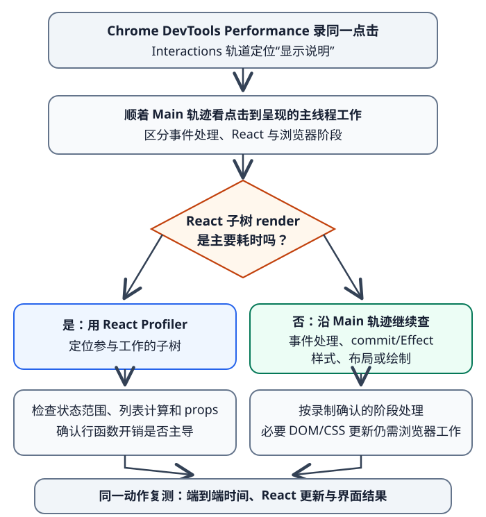

1. **在浏览器里录基线。** 用同一 URL、同一组报表、同一交互和目标设备，在 Chrome DevTools 的 Performance 面板录一次。Interactions 轨道定位“显示说明”这次点击及其三段延迟；Main 轨道显示时间花在事件处理、React 工作、commit 与 Effect，还是样式、布局和绘制。
2. **React 子树的 render 占主导时，再开 Profiler。** React Developer Tools（React 开发者工具）的 Profiler（性能分析器）面板能看出这次提交里哪些组件参与了 render。代码里的 `<Profiler>` API 可以给指定子树记录 `phase`、`actualDuration` 和 `baseDuration`：
   - `actualDuration`：这次已提交的更新中，该子树实际花在 render 上的时间。
   - `baseDuration`：按各组件最近一次耗时估算、完全不跳过时整棵子树的成本。两者差距大，说明跳过已经生效。
3. **注意测量本身的条件。** Profiler 有额外开销；普通生产构建不记录 `<Profiler>` 计时，要测接近线上的代码，需改用 React 提供的 profiling 构建。开发构建的耗时也不能当成生产时延。

render 次数或控制台日志只能提示“谁可能运行过”，不能单独证明交互变快。

### render 不占主导时，时间去了哪里？

不要从“React render 很短”直接推断瓶颈只在布局或绘制。还要依次看：

- **点击处理器本身。** 处理器里的同步计算可能比 render 更重。
- **commit 与 layout Effect。** `useLayoutEffect` 及其中触发的状态更新，在浏览器重绘前处理；其中测量 DOM 的操作可能把同步布局带进这次交互。
- **其余 Effect。** 普通 `useEffect` 通常在绘制后运行；但由点击这类交互引起时，React 也可能在绘制前运行它。
- **浏览器的样式、布局和绘制。** 阶段边界见[用户觉得慢时，怎样从指标走到证据？](#55.%20%E7%94%A8%E6%88%B7%E8%A7%89%E5%BE%97%E6%85%A2%E6%97%B6%EF%BC%8C%E6%80%8E%E6%A0%B7%E4%BB%8E%E6%8C%87%E6%A0%87%E8%B5%B0%E5%88%B0%E8%AF%81%E6%8D%AE%EF%BC%9F)，读写几何值引起的同步布局见[DOM 改动后浏览器重做了什么，读几何值为什么会卡住脚本？](#5.%20DOM%20%E6%94%B9%E5%8A%A8%E5%90%8E%E6%B5%8F%E8%A7%88%E5%99%A8%E9%87%8D%E5%81%9A%E4%BA%86%E4%BB%80%E4%B9%88%EF%BC%8C%E8%AF%BB%E5%87%A0%E4%BD%95%E5%80%BC%E4%B8%BA%E4%BB%80%E4%B9%88%E4%BC%9A%E5%8D%A1%E4%BD%8F%E8%84%9A%E6%9C%AC%EF%BC%9F)。

React Performance tracks（React 性能轨道）把 React 的工作直接画在浏览器 Performance 时间线上，分出 render、commit（含 layout Effect）和其余 Effect，便于和 Main 轨道对齐。这些轨道只在开发构建和 profiling 构建中出现，也有额外开销。

### 第一选择：把状态移进用它的组件

假设录制显示：说明面板的开关状态 `helpOpen` 放在列表的父组件 `ReportBoard` 里，打开面板让 `ReportBoard` 重新 render，进而让每一行重新执行。

最直接的修法通常不是加缓存，而是把这份状态挪到唯一用它的组件里：

~~~jsx
import { useState } from "react";

function HelpPanel() {
  const [open, setOpen] = useState(false);
  return (
    <section>
      <button type="button" onClick={() => setOpen(value => !value)}>
        {open ? "隐藏说明" : "显示说明"}
      </button>
      {open && <p>说明面板</p>}
    </section>
  );
}
~~~

`ReportBoard` 同时渲染 `<HelpPanel />` 和报表列表，`open` 由 `HelpPanel` 自己持有。点击时只有 `HelpPanel` 这棵子树更新，兄弟列表不受影响，不需要任何缓存。一份状态该由谁持有、何时上提或下移，见[一份界面状态该由谁持有？](#39.%20%E4%B8%80%E4%BB%BD%E7%95%8C%E9%9D%A2%E7%8A%B6%E6%80%81%E8%AF%A5%E7%94%B1%E8%B0%81%E6%8C%81%E6%9C%89%EF%BC%9F)。

### useMemo、useCallback 和 memo 各管哪一段？

状态下移做不到时（例如父组件确实要用这份状态），才考虑手工缓存。下面故意把 `helpOpen` 留在 `ReportBoard`，并加入搜索框 `query`，用来看三种缓存各自作用在哪一段。这是分析依赖身份的教学代码，不是“先给每个组件加缓存”的建议；它也没有实现排序和 URL，只隔离说明面板、搜索词和 `reviewed` 三种更新。

起点状态：`reports` 是下面两个对象，`query` 为空，`helpOpen=false`。

| `id` | `title` | `reviewed` |
|---|---|---|
| `r-104` | `May report` | `false` |
| `r-103` | `April report` | `false` |

> [!example]- 带手工缓存的 ReportBoard
> ~~~jsx
> import { memo, useCallback, useMemo, useState } from "react";
>
> function filterReports(reports, query) {
>   const normalizedQuery = query.toLowerCase();
>   return reports.filter(report =>
>     report.title.toLowerCase().includes(normalizedQuery)
>   );
> }
>
> function replaceReviewed(reports, id) {
>   return reports.map(report =>
>     report.id === id
>       ? { ...report, reviewed: !report.reviewed }
>       : report
>   );
> }
>
> function ReportBoard({ initialReports }) {
>   const [reports, setReports] = useState(initialReports);
>   const [query, setQuery] = useState("");
>   const [helpOpen, setHelpOpen] = useState(false);
>
>   const visible = useMemo(
>     () => filterReports(reports, query),
>     [reports, query]
>   );
>   const toggleReviewed = useCallback((id) => {
>     setReports(current => replaceReviewed(current, id));
>   }, []);
>
>   return (
>     <>
>       <input
>         aria-label="筛选报表"
>         value={query}
>         onChange={event => setQuery(event.target.value)}
>       />
>       <button type="button" onClick={() => setHelpOpen(open => !open)}>
>         {helpOpen ? "隐藏说明" : "显示说明"}
>       </button>
>       {helpOpen && <p>说明面板</p>}
>       <ol id="reports">
>         {visible.map(report => (
>           <ReportRow
>             key={report.id}
>             report={report}
>             onToggle={toggleReviewed}
>           />
>         ))}
>       </ol>
>     </>
>   );
> }
>
> const ReportRow = memo(function ReportRow({ report, onToggle }) {
>   return (
>     <li>
>       {report.title}
>       <button type="button" onClick={() => onToggle(report.id)}>
>         {report.reviewed ? "已读" : "标为已读"}
>       </button>
>     </li>
>   );
> });
> ~~~

三种 API 各管一段：

- **`useMemo` 管计算。** 首次 render 照常筛选；之后只有 `reports` 或 `query` 按 `Object.is` 比较发生变化，才重跑 `filterReports`，否则返回上次的 `visible`。
- **`useCallback` 管函数身份。** 依赖不变时返回同一个函数引用，不会替你执行函数。这里依赖可以为空，是因为回调只调用 updater 形式的 `setReports`，不读取某一轮的 `reports` 快照。
- **`memo` 管跳过子组件。** `memo(ReportRow)` 默认对每个 prop（属性）用 `Object.is` 比较；`report` 和 `onToggle` 都与上次相同，就跳过这一行的组件函数。

下表每一行都从同一起点独立重放（两行都挂载），不是连续操作：

| 操作 | 状态与引用怎样变化 | 行组件会怎样 |
|---|---|---|
| 初次显示 | 执行筛选，创建 `visible`；第一次创建 `toggleReviewed` | 两行首次 render |
| 打开说明面板 | 只改 `helpOpen`；缓存仍在时，`useMemo` 返回原 `visible`，`useCallback` 返回原函数 | `ReportBoard` 和 `visible.map` 仍执行；两行 props 不变，被 `memo` 跳过 |
| 输入 `apr` | `query` 变了，筛选重新扫描全部 `reports`，`visible` 只剩 April | May 行离开树；April 的对象和回调没变，被跳过 |
| 把 May 标为已读 | 不可变更新生成新 `reports` 数组和新 May 对象；April 对象保持原引用 | 筛选重算；May 行 props 变了，重新 render；April 仍被跳过 |

作为对照，不加任何缓存时打开说明面板，`ReportBoard`、筛选和两行函数都会重新执行，但行的 DOM 不必改变。

几条容易误判的边界：

- **少了 `memo`，稳定的值不会自己阻止子组件 render。** `useMemo`、`useCallback` 只让 props 稳定，跳过与否由 `memo` 决定。
- **`memo` 只看父组件传入的 props。** 行自己的 state 或它读取的 Context 变化，仍会让它 render。
- **行接收的是单个 `report` 对象，不是 `visible` 数组。** 即使 `useMemo` 的缓存被丢弃、重新生成了数组，只要数组里的行对象引用没变，行的 props 仍然相同。
- **`useMemo` 不能让一次新的全量筛选变成常数时间。** 筛选词变了，每条记录仍要检查一遍。
- **`key` 不是跳过 render 的工具。** 稳定的 `key` 让 React 在排序、插入、删除中认出同一行，保留它的状态；排序后 props 不变的 memo 行可以跳过函数，但 React 仍要协调并移动 DOM 节点。key 与状态身份见[React 怎样把一次用户操作变成界面更新？](#37.%20React%20%E6%80%8E%E6%A0%B7%E6%8A%8A%E4%B8%80%E6%AC%A1%E7%94%A8%E6%88%B7%E6%93%8D%E4%BD%9C%E5%8F%98%E6%88%90%E7%95%8C%E9%9D%A2%E6%9B%B4%E6%96%B0%EF%BC%9F)。

### 为什么这些比较都依赖不可变更新？

`memo`、`useMemo` 都用 `Object.is` 判断“变没变”，比的是引用，不是内容。要让 React 看见 May 的变化，必须生成新数组和新 May 对象，同时保留未变的 April 对象，如上例的 `replaceReviewed`。若原地改写 `report.reviewed`，引用不变，`memo` 会跳过本该更新的行；若每次都新建所有行对象，引用全变，`memo` 又一行也跳不过。哪些复制操作原地修改对象、哪些生成新引用，见[复制一个对象到底复制了什么？](#23.%20%E5%A4%8D%E5%88%B6%E4%B8%80%E4%B8%AA%E5%AF%B9%E8%B1%A1%E5%88%B0%E5%BA%95%E5%A4%8D%E5%88%B6%E4%BA%86%E4%BB%80%E4%B9%88%EF%BC%9F)。

`reviewed` 在这里只是本地状态。真实写入服务端还要处理请求身份、确认和失败，见[服务端数据怎样缓存、刷新和乐观更新，迟到的响应又归谁？](#42.%20%E6%9C%8D%E5%8A%A1%E7%AB%AF%E6%95%B0%E6%8D%AE%E6%80%8E%E6%A0%B7%E7%BC%93%E5%AD%98%E3%80%81%E5%88%B7%E6%96%B0%E5%92%8C%E4%B9%90%E8%A7%82%E6%9B%B4%E6%96%B0%EF%BC%8C%E8%BF%9F%E5%88%B0%E7%9A%84%E5%93%8D%E5%BA%94%E5%8F%88%E5%BD%92%E8%B0%81%EF%BC%9F)。

两个相邻的选择也会改变工作量：

- **隐藏还是卸载说明面板。** 用 CSS 隐藏，组件留在 React 树中，state 和 Effect 都还在；条件移除会卸载组件并运行 cleanup（清理），再次显示时创建新实例。按交互和生命周期需求选，不只看性能。
- **Fragment（片段）** 能省掉纯包装用的 DOM 节点，但有没有性能收益仍要测。

### 实例：React Compiler 怎样改变手工 memo 的默认做法？

> [!info] 版本
> React Compiler v1.0（2025-10-07 稳定）；React 官方文档版本 19.3（npm `v19.3.0`，2026-09-09）。核对于 2026-11-12。

React Compiler（React 编译器）是可选的构建期优化。项目要在构建链里配置它，具体文件和组件还要被编译器识别。启用后，它在组件和 Hook 内自动记忆化可复用的子树和计算；上例“打开说明面板”那一行，Compiler 生效时也可能自动建立等价的缓存。新代码通常不必先手写 `memo`、`useMemo`、`useCallback`。

它有几条边界：

- **装了不等于生效。** 先确认项目已接入、构建覆盖了这个文件，再用 Profiler 看结果；只看到插件或版本号不够。
- **只优化组件和 Hook。** 它不会把任意工具函数变成跨组件共享的缓存。同一个昂贵纯函数在多个独立组件里分别调用，不会自然共用一次结果；需要共享缓存时，按实际调用和数据所有权另行设计。
- **手工 API 留给剩下的情况。** 未启用 Compiler、某模块未被覆盖，或 Profiler 显示一个稳定边界仍反复做昂贵工作时，才手写。确有意图的手工 memo 可以保留，但不要只为“更安全”再叠一层。

手工缓存还有两条语义约束。React 在特定情况下会丢弃 `useMemo`、`useCallback` 的缓存，例如初次挂载期间发生 Suspense；需要语义上持久的值时，用 state 或 ref。自定义 `memo` 比较函数必须保证函数行为和可见输出等价，否则可能保留旧闭包。

### 优化留不留，由什么决定？

按同一交互复测，从点击到界面呈现，并沿 Performance 轨迹比较原先占时的阶段：

- 拆分状态或加入 `memo` 后，确认可见界面仍正确，且目标 render 成本或点击到呈现的时间稳定、可重复地改善。
- 启用 Compiler 后，比较编译前后的同一操作。Compiler 是否覆盖只解释优化从哪来，不单独决定缓存去留。
- 没有可重复的收益，或维护成本超过收益，就移除手工缓存再复测。已有的手工缓存可能影响 Compiler 的编译结果，移除后要重新验证界面行为和性能，不能仅凭启用了 Compiler 就批量删除。

Profiler 有开销，最终判断要回到目标构建和目标设备上的浏览器 Performance 轨迹。

### 成本随挂载行数增长时，下一步是什么？

本章的结论是：先用浏览器轨迹确认 React 工作占主导，再用 Profiler 找到组件；先下移状态，再按需缓存，靠不可变更新让引用比较可信；每项改动由复测决定去留。

若测量显示成本随同时挂载的行数增长，无论来自 React 创建和更新行，还是 DOM、样式和布局，下一章接着问：要不要让视口外的行不进入 DOM，代价是什么？见[长列表的成本在哪里，分页和虚拟化各省掉什么？](#58.%20%E9%95%BF%E5%88%97%E8%A1%A8%E7%9A%84%E6%88%90%E6%9C%AC%E5%9C%A8%E5%93%AA%E9%87%8C%EF%BC%8C%E5%88%86%E9%A1%B5%E5%92%8C%E8%99%9A%E6%8B%9F%E5%8C%96%E5%90%84%E7%9C%81%E6%8E%89%E4%BB%80%E4%B9%88%EF%BC%9F)。若主要耗时在挑选窗口之前的全量筛选，虚拟化不一定能缩短那段计算。

> [!info]- 来源（React 19.3；React Compiler v1.0；核对于 2026-11-12）
> - **版本：** [React Versions](https://react.dev/versions)、[React 19.3 发布](https://react.dev/blog/2026/09/09/react-19-3)（npm `v19.3.0`，2026-09-09）。
> - **render 与 commit、render 不必导致 DOM 变化：** [Render and Commit](https://react.dev/learn/render-and-commit)。
> - **Interactions 与 Main 轨道：** [Chrome DevTools Performance features reference](https://developer.chrome.com/docs/devtools/performance/reference#view-interactions)。
> - **React Performance tracks 的 Update、Render、Commit（含 layout Effects）与剩余 Effects；仅开发/profiling 构建：** [React Performance tracks](https://react.dev/reference/dev-tools/react-performance-tracks#renders)。**`useLayoutEffect` 在重绘前执行：** [useLayoutEffect](https://react.dev/reference/react/useLayoutEffect)。**交互引起的 Effect 可能在绘制前运行：** [useEffect](https://react.dev/reference/react/useEffect)。
> - **Profiler 面板：** [React Developer Tools](https://react.dev/learn/react-developer-tools)；**`<Profiler>` 回调、`actualDuration`、`baseDuration` 与生产 profiling 开销：** [Profiler](https://react.dev/reference/react/Profiler)。
> - **`memo` 用 `Object.is` 比较 props、自身 state 或 Context 变化仍会 render：** [memo](https://react.dev/reference/react/memo)；**`useMemo` 依赖比较与缓存可被丢弃（如初次挂载时 Suspense）：** [useMemo](https://react.dev/reference/react/useMemo)；**`useCallback` 只返回稳定引用：** [useCallback](https://react.dev/reference/react/useCallback)。
> - **条件移除重置 state、卸载时 cleanup、Fragment 不加包装 DOM：** [Preserving and Resetting State](https://react.dev/learn/preserving-and-resetting-state)、[useEffect](https://react.dev/reference/react/useEffect)、[Fragment](https://react.dev/reference/react/Fragment)。
> - **React Compiler 可选、稳定、作用于组件与 Hook，不共享任意函数缓存，先 profile 后加复杂度：** [React Compiler Introduction](https://react.dev/learn/react-compiler/introduction)，v1.0，2025-10-07。
## 58. 长列表的成本在哪里，分页和虚拟化各省掉什么？

一份长列表慢，可能慢在下载、慢在客户端计算，也可能慢在同时挂载的节点太多；分页和虚拟化各只处理其中一部分。本章先拆开这三类成本，再讲跨请求分页怎样保持顺序、固定行高的虚拟窗口怎样从滚动位置算出来、变高行怎样跟上实际尺寸，最后讲虚拟化给键盘和读屏用户带来的代价。读者手上有上一章的测量方法：[用户觉得慢时，怎样从指标走到证据？](#55.%20%E7%94%A8%E6%88%B7%E8%A7%89%E5%BE%97%E6%85%A2%E6%97%B6%EF%BC%8C%E6%80%8E%E6%A0%B7%E4%BB%8E%E6%8C%87%E6%A0%87%E8%B5%B0%E5%88%B0%E8%AF%81%E6%8D%AE%EF%BC%9F)，以及 React 的 key 与状态身份：[React 怎样把一次用户操作变成界面更新？](#37.%20React%20%E6%80%8E%E6%A0%B7%E6%8A%8A%E4%B8%80%E6%AC%A1%E7%94%A8%E6%88%B7%E6%93%8D%E4%BD%9C%E5%8F%98%E6%88%90%E7%95%8C%E9%9D%A2%E6%9B%B4%E6%96%B0%EF%BC%9F)。

### 50,000 行都要能浏览时，成本落在哪里？

沿用报表页，以及性能诊断时用过的 50,000 条合成记录。那次排序实验只把前 50 行写进列表，所以那次慢交互与 DOM 规模无关。现在需求变了：用户要能翻看全部历史报表。50,000 只是演算规模，不是启用虚拟滚动的门槛；能否承受全量处理，取决于设备、行的复杂度、数据形状和交互，要分别测量。

把全部记录交给页面，至少带来三类成本：

1. **传输。** 从服务端拿来多少字节。
2. **客户端计算与内存。** 为筛选、排序和转换跑多少 JavaScript，保留多少数据对象。客户端筛选 50,000 条就要检查 50,000 条：每条的判定成本近似固定时，一次扫描随记录数 `n` 线性增长，记作 `O(n)`。
3. **挂载。** React 和浏览器同时要处理多少组件、DOM 节点、样式和布局。

先问用户到底要看什么。只看总数或月度趋势时，服务端聚合直接返回结果；要搜索、排序、翻页时，服务端按条件处理后只发当前页；只有用户确实要连续浏览已加载的数据时，才轮到虚拟滚动处理挂载窗口。

每种手段只省掉一类成本：

| 同一任务录制确认的主要成本 | 优先处理方向 | 要计入的代价或边界 |
|---|---|---|
| 传输了用户尚不需要的记录 | 服务端过滤、排序、分页或按需请求；只需统计时返回聚合 | 加载、错误、重试、结束状态和排序一致性 |
| 客户端全量变换或查询占主线程 | 改算法、缩小输入、分块，或把纯计算交给 Web Worker | Worker 不减少计算量；对象消息通常要结构化复制，传递也要计时（见上一章最后一节） |
| React 组件函数反复执行 | 先按[React 渲染慢时，先改什么？](#57.%20React%20%E6%B8%B2%E6%9F%93%E6%85%A2%E6%97%B6%EF%BC%8C%E5%85%88%E6%94%B9%E4%BB%80%E4%B9%88%EF%BC%9F)检查状态位置和 `memo` 边界；成本主要随挂载行数增长时，再评估虚拟化 | 缓存跳过重复计算，虚拟化减少参与工作的行，两者作用不同 |
| 大量已挂载节点让样式、布局或呈现变慢 | 虚拟化当前可视窗口 | 测量、滚动、焦点、键盘、读屏、打印和页内查找都更复杂 |

把行从 DOM 移走，不会减少那次 `O(n)` 扫描，也不会撤销已下载的数据或释放它们占的 JavaScript 内存。

### 跨请求分页怎样保证不重不漏？

分页先要有确定的顺序。把报表页的 `sort=recent` 交给服务端时，定义为按 `createdAt` 降序，时间相同时再按唯一的 `report.id` 升序打破并列。只按可能重复的时间排序时，并列报表在两次请求之间的先后不确定，页边界会落在不同位置。

即使顺序确定，用 `OFFSET` 翻页仍会在数据变化时出错。用页大小为 2 的小例子看：原顺序为 `A, B, C, D`，第一页是 `A, B`。

- 下一次请求前，头部插入 `X`，新顺序是 `X, A, B, C, D`。`OFFSET 2` 返回 `B, C`，`B` 重复了。
- 若改为头部的 `A` 被删除，剩下 `B, C, D`。`OFFSET 2` 只返回 `D`，`C` 被跳过。

keyset pagination（键集分页）不数“跳过几行”，而是从上一页最后一行的位置接着取。它的游标记录页尾那行的完整排序键，这里是 `(createdAt, id)`；服务端按同一排序定义取“排在它之后”的行。排序方向已由查询参数固定时，不必再编码进游标。上面的例子里，第一页尾是 `B`，下一页从 `B` 之后取，插入 `X` 或删除 `A` 都不影响结果。

键集分页解决的是页边界漂移，不会冻结整个数据集：两次请求之间新增到后面的行仍会出现。需要一致的历史浏览时，还要由服务端定义快照或版本边界。分页减少的是单次传输；客户端已经收到全量数据后再虚拟化，不会追溯减少之前的流量。

### 固定行高时，怎样从滚动位置算出挂载窗口？

virtualization（虚拟化）只把视口附近的行放进 DOM，用一个占位元素保持整条列表的滚动高度。先看行高固定的模型，约定如下：行号从 0 开始；区间写成半开区间 `[start, end)`，右端不包含；每行的重复步长为 40px（有行间距时也计入步长）；滚动窗口高 480px；上下各多渲染 4 行的 overscan（预渲染缓冲）。

在 `scrollTop = 4000px` 时：

- 第一个可见行是 `4000 / 40 = 100`；视口底部在 `4000 + 480 = 4480px`，即第 112 行的起点。可见区间 `[100, 112)`，共 12 行。
- 加上前后各 4 行缓冲，挂载区间 `[96, 116)`，共 20 行。
- 挂载窗口的顶端偏移 `offsetY = 96 × 40 = 3840px`。
- 整条列表的占位高度 `50,000 × 40 = 2,000,000px`，让滚动条仍代表完整列表。


图右侧展开 `scrollTop = 4000px` 时的 20 行挂载窗口，左侧只标出它在完整列表里的位置，两侧都不按 2,000,000px 的比例绘制。

下面的函数只计算窗口。输入约定：`totalRows` 是非负整数，`rowHeight` 和视口高度是有限正数，`scrollTop` 是有限数，`overscan` 是非负整数；滚动容器还没测到正高度时先不计算。

~~~javascript
const items = Array.from({ length: 50_000 }, (_, id) => ({ id }));

function getWindow(totalRows, scrollTop, viewportHeight, rowHeight, overscan = 4) {
  const totalHeight = totalRows * rowHeight;
  const maxScrollTop = Math.max(0, totalHeight - viewportHeight);
  const offset = Math.min(Math.max(scrollTop, 0), maxScrollTop);
  const firstVisible = Math.floor(offset / rowHeight);
  const start = Math.max(0, firstVisible - overscan);
  const end = Math.min(
    totalRows,
    Math.ceil((offset + viewportHeight) / rowHeight) + overscan
  );
  return { start, end, offsetY: start * rowHeight, totalHeight };
}

const range = getWindow(items.length, 4_000, 480, 40);
// { start: 96, end: 116, offsetY: 3840, totalHeight: 2000000 }
const mountedItems = items.slice(range.start, range.end);
~~~

组件把 `mountedItems` 放进一个从 `range.offsetY` 开始定位的容器，外层占位区高度设为 `range.totalHeight`。边界都由夹取处理：靠近开头时 `start` 不小于 0，靠近结尾时 `end` 不超过 `totalRows`，列表比视口短时最大滚动位置为 0。实际的视口高度和容器位置要从浏览器测量，不能把示例常数写死。

滚动容器的 `scroll` 事件更新 `scrollTop` 后，组件重新计算窗口并重绘，挂载和卸载在这时发生：

| `scrollTop` | 可见区间 | 挂载区间 | `offsetY` | 与上次相比 |
|---:|---|---|---:|---|
| 4000px | `[100, 112)` | `[96, 116)` | 3840px | 初始窗口，挂载 20 行 |
| 4040px | `[101, 113)` | `[97, 117)` | 3880px | 卸载第 96 行，挂载第 116 行；第 97–115 行留着 |

窗口滚动只改变“挂载哪些下标”，不改变 `items` 本身。虚拟化也可以与分页或增量请求组合，但请求下一页、维护 API 游标和处理失败，是另一条独立的数据加载流程。

### 行被卸载后，它的状态和身份怎样保住？

上表里第 96 行滚出窗口就被卸载，它的组件局部 state 随之结束。这带来三条要求：

- **key 用业务 ID。** `report.id` 跨排序和翻页都稳定且唯一。窗口内的索引不是报表身份：排序或滚动后用 index 作 key，可能把旧行的状态交给另一份报表。key 怎样决定状态归属，见[React 怎样把一次用户操作变成界面更新？](#37.%20React%20%E6%80%8E%E6%A0%B7%E6%8A%8A%E4%B8%80%E6%AC%A1%E7%94%A8%E6%88%B7%E6%93%8D%E4%BD%9C%E5%8F%98%E6%88%90%E7%95%8C%E9%9D%A2%E6%9B%B4%E6%96%B0%EF%BC%9F)。
- **要跨出窗口保留的状态放到列表外。** “已选中”、编辑草稿这类状态按报表 ID 存在列表组件之外，行重新挂载时再按 ID 取回。
- **恢复阅读位置按 ID，不按像素。** 离开页面后要回到原处时，保存可见的第一行 ID 和该行内的滚动偏移，回来后定位到那一行。

### 行高不固定时，窗口怎样跟上实际尺寸？

报表标题可能换行，说明行可能展开，字体或图片也可能在挂载后改变高度。这时只能先按估计高度累加出各行的起点；行挂载后，虚拟器测得实际高度，再更新它之后各行的起点和总高度。

沿用 `scrollTop = 4000px` 的算例：视口上方的第 96 行原估 40px，实测 52px，多出 12px。第 100 行的内容坐标从 4000px 移到 4012px。若滚动位置仍是 4000px，第 100 行在屏幕上会下移 12px，用户看到内容跳了一下；若实现以第 100 行为锚点、把 `scrollTop` 补偿到 4012px，它就留在视口原位。

所以动态尺寸的虚拟器要有三样东西：初始估计、实际测量和滚动锚定策略。要在目标浏览器里检查展开行、异步内容和视口尺寸变化。

> [!info] 实例：TanStack Virtual v3（核对官方 latest 文档，2026-11-12）
> `estimateSize` 提供初始估计，`measureElement` 取得挂载行的实际尺寸，`getTotalSize` 给出占位总高度，`overscan` 设缓冲行数，`getItemKey` 指定行身份。视口上方的行实测尺寸与估计不同时，实例属性 `shouldAdjustScrollPositionOnItemSizeChange` 控制是否校正滚动位置；默认只在没有反向滚动时校正。文档地址是 `/latest`，具体行为按项目安装的版本核对。

> [!info] 实例：ahooks `useVirtualList`（v3.11.0）
> v3.11.0 返回 `[visibleRows, scrollTo]`，每项带 `data` 和源数组里的 `index`；用 `containerTarget`、`wrapperTarget` 指定滚动容器和内层包装；`itemHeight` 可以是固定数值，或按行计算的函数，必须与实际布局相符。源数组每次 render 都换引用时，计算可见范围的 Effect 会再运行一次并写入新的可见列表 state，带来额外 render；内容没变时保持引用稳定，或用 `useMemo` 记住它。
>
> 归档的 ahooks v2.6 返回对象 `{ list, containerProps, wrapperProps, scrollTo }`；它的 `itemHeight` 函数按源索引给出高度，没有单独的 `estimateSize` 参数。不要混用两个版本的写法。

### 虚拟化让键盘和读屏用户付出什么代价？

窗口外的行不在 DOM 里，依赖 DOM 的焦点、键盘导航和辅助技术都会受影响。

**焦点会丢。** 键盘焦点落在某行的按钮上，下一次滚动把该行卸载，焦点就没了。交互列表要按报表 ID 跟踪活动项，保证它一直挂载，或在卸载前按控件模式转移、稍后恢复焦点。对用方向键导航的虚拟 `grid`（网格），目标单元格在窗口外时，先算出目标行的 ID 或索引、滚动到包含它的窗口，等目标行挂载后再把焦点移过去。

**角色不能随手加。** 数据看起来像列表，不等于该用 `role="listbox"`。listbox 是用来选择选项的复合控件，不适合在每个选项里放按钮、复选框这类独立控件；listbox、grid 这些复合控件还各自要求一套方向键和焦点行为。

**先考虑不虚拟化。** 只需展示和浏览报表时，带正确表头的原生 `<table>` 加服务端分页通常更容易用；表格结构见[页面结构怎样让所有人都能读懂和操作？](#9.%20%E9%A1%B5%E9%9D%A2%E7%BB%93%E6%9E%84%E6%80%8E%E6%A0%B7%E8%AE%A9%E6%89%80%E6%9C%89%E4%BA%BA%E9%83%BD%E8%83%BD%E8%AF%BB%E6%87%82%E5%92%8C%E6%93%8D%E4%BD%9C%EF%BC%9F)。单页表格只呈现当前页，要搜索或打印全量结果，还需要应用级的搜索或导出。只有当测量确认挂载行数带来主要成本、且用户需求能接受只挂载部分节点时，才承担虚拟表格的复杂度。

**用 ARIA 报告完整位置。** 只渲染集合的一部分时，WAI-ARIA 让当前挂载的每一项声明自己在完整集合里的位置：

- `table`、`grid`、`treegrid` 用 `aria-rowcount` 和 `aria-rowindex`。行位置相对完整表格从 1 开始，`aria-rowcount` 包含表头行；总行数未知时写 `aria-rowcount="-1"`。
- 适用的 `listitem`、`treeitem` 用 `aria-setsize` 和 `aria-posinset`，位置也从 1 开始；总数未知时 `aria-setsize="-1"`。

> [!example] 50,000 行表格的 ARIA 位置
> 假设虚拟化的是一张带一行表头的表格。50,000 条数据加表头，完整表格有 50,001 行，表格写 `aria-rowcount="50001"`。表头行是 `aria-rowindex="1"`，数组下标为 `i` 的数据行是第 `i + 2` 行。挂载窗口 `[96, 116)` 的首条数据（下标 96）写 `aria-rowindex="98"`，末条（下标 115）写 `aria-rowindex="117"`。每一条当前挂载的行都要标出它在完整表格中的位置，表头行也不例外。

这些属性只描述位置和总数，不会把未挂载的行放回 DOM，也补不上错误的角色、缺失的表头或不完整的键盘模型。最终要在目标浏览器和屏幕阅读器里验证读序、焦点、滚动、加载、空结果和总数未知时的表达。

### 决定虚拟化之后，怎样证明它值得？

本章交出一张成本对照：分页和聚合省传输，改算法和 Worker 处理计算，虚拟化只省挂载；以及固定行高的窗口公式、变高行的锚定要求，和虚拟化对焦点、角色、ARIA 位置的代价。

是否保留虚拟化，回到[用户觉得慢时，怎样从指标走到证据？](#55.%20%E7%94%A8%E6%88%B7%E8%A7%89%E5%BE%97%E6%85%A2%E6%97%B6%EF%BC%8C%E6%80%8E%E6%A0%B7%E4%BB%8E%E6%8C%87%E6%A0%87%E8%B5%B0%E5%88%B0%E8%AF%81%E6%8D%AE%EF%BC%9F)的复测协议：同一 URL、设备、数据和滚动交互，比较挂载节点、布局和呈现成本，分别记录 React 计算与浏览器呈现，再看端到端交互。即使布局耗时不变，减少原本占主导的 React 工作也可能有收益；若 React 计算仍是瓶颈，回到[React 渲染慢时，先改什么？](#57.%20React%20%E6%B8%B2%E6%9F%93%E6%85%A2%E6%97%B6%EF%BC%8C%E5%85%88%E6%94%B9%E4%BB%80%E4%B9%88%EF%BC%9F)继续定位。

至此，主线五的问题“前端代码怎样构建、测试、发布，并测出慢在哪里”走完了一轮：构建器把源码变成带哈希的文件，发布规则让缓存和旧页面都不出错，测试在合适的层证明报表页行为正确，性能诊断从现场指标走到可复测的证据，再按证据决定是改 React 的状态与缓存，还是减少传输、计算或挂载。

> [!info]- 来源（核对于 2026-11-12）
> - **三类成本、固定行高公式与窗口数值：** 本章基于合成状态的推演，数值已按公式复算；50,000 行不是库或浏览器规定的阈值。render 与 commit 边界：[React Render and Commit](https://react.dev/learn/render-and-commit)，React 19.3。
> - **分页需唯一排序、`OFFSET` 先跳过前序行：** [PostgreSQL 18, Sorting Rows (`ORDER BY`)](https://www.postgresql.org/docs/18/queries-order.html)（后续排序项在前项相等时决定顺序）；[`LIMIT` and `OFFSET`](https://www.postgresql.org/docs/18/queries-limit.html)（分页查询要用能约束到唯一顺序的 `ORDER BY`）。插入或删除导致页边界移动是基于该规则的跨请求推演，不是 PostgreSQL 特有的承诺。
> - **Worker 结构化复制与 transfer：** [WHATWG HTML, Web Workers](https://html.spec.whatwg.org/multipage/workers.html)、[Safe passing of structured data](https://html.spec.whatwg.org/multipage/structured-data.html#structured-cloning)。
> - **TanStack Virtual 实例：** [Virtualizer API](https://tanstack.com/virtual/latest/docs/api/virtualizer)，v3 latest 文档：`count`、`estimateSize`、`overscan`、`getItemKey`、`measureElement`、`getTotalSize`、`shouldAdjustScrollPositionOnItemSizeChange`（实例属性，默认未反向滚动时校正）。
> - **ahooks `useVirtualList` 实例：** [useVirtualList 文档](https://ahooks.js.org/hooks/use-virtual-list/)、[v3.11.0 实现](https://github.com/alibaba/hooks/blob/v3.11.0/packages/hooks/src/useVirtualList/index.ts)；v2.6.0 结果形状：[v2.6.0 源码](https://github.com/alibaba/hooks/blob/v2.6.0/packages/hooks/src/useVirtualList/index.ts)。
> - **`aria-rowcount` 含表头、每个挂载行（含表头）用 `aria-rowindex` 标 1 起位置、未知为 -1：** [WAI-ARIA 1.2, `aria-rowindex`/`aria-rowcount`](https://www.w3.org/TR/wai-aria-1.2/#aria-rowindex)，W3C Recommendation，2023-06-06；[APG Grid and Table Properties](https://www.w3.org/WAI/ARIA/apg/practices/grid-and-table-properties/#using-aria-rowcount-and-aria-rowindex)。
> - **`aria-setsize`/`aria-posinset`：** [WAI-ARIA 1.2, `aria-setsize`](https://www.w3.org/TR/wai-aria-1.2/#aria-setsize)、[`aria-posinset`](https://www.w3.org/TR/wai-aria-1.2/#aria-posinset)。
> - **grid 需作者管理内部焦点：** [APG Grid Pattern](https://www.w3.org/WAI/ARIA/apg/patterns/grid/)；**listbox 用于选择、不支持选项内的链接、按钮或复选框：** [APG Listbox Pattern](https://www.w3.org/WAI/ARIA/apg/patterns/listbox/)。
