# Frontend

> Generated from the [frontend reading map](../../frontend/index.md). Edit the map and its linked source notes. Internal section links use Obsidian heading fragments; source notes remain standard Markdown.

## 1. 浏览器如何把 URL 变成第一帧？

案例背景：用户打开 Uniform Resource Locator (URL，统一资源定位符)`https://example.test/reports?sort=recent#summary`，需要看到最近报表；随后点击“最早优先”，期望列表更新。先沿初次导航走到可见页面，再从同一页跟进点击。

~~~mermaid
flowchart TD
    A[输入报表 URL] --> B[导航取得 HTML 响应]
    B --> C[逐步解析 HTML<br/>建立 DOM 并发现资源]
    C --> D[已有可显示内容<br/>当前渲染所需 CSS 就绪]
    C --> E[HTML 解析结束、模块图就绪<br/>样式不再阻塞脚本]
    D --> F[渲染机会：样式、布局、绘制<br/>栅格化与合成后显示首帧]
    E --> G[reports.js 模块求值<br/>注册筛选处理器]
    F --> H[画面可见且处理器已就绪]
    G --> H
    H --> I[点击最早优先<br/>更新 URL、选中态与行顺序]
    I --> J[后续渲染机会显示新顺序]
~~~

这张图跟踪两种不同的就绪条件：浏览器已有足够的超文本标记语言（HyperText Markup Language，HTML）和当前可显示内容所需的层叠样式表（Cascading Style Sheets，CSS）规则，可以先给出一帧；`/reports.js` 的模块依赖下载完成、HTML 解析结束且阻塞它的样式表处理完后，才注册点击处理器。两条线可以交叠推进：HTML 流还在解析时，浏览器就能获取 CSS、模块及图片；图片也可在 Document Object Model (DOM，文档对象模型) 构建和布局工作继续时下载、解码。图表示这条报表路线上的依赖，不表示所有浏览器必有同一组线程或逐步流水线。下文的成功点击假设发生在两个条件汇合之后；若用户在静态首帧出现、监听器尚未注册时就点按钮，这份 HTML 没有原生提交或其他后备动作，因此不会排序。模块或依赖获取失败、注册前脚本报错，也可能留下可见却不能筛选的页面。

### 先确定浏览器要打开什么

地址栏文本先被判定为搜索词还是 URL；这里已给出 URL，因此例子从跨文档导航开始。浏览器拆分 URL：`https`、主机和端口共同确定 origin（源）；`/reports` 与 `?sort=recent` 是请求所针对的资源，`#summary` 是文档内的位置标识，不会发给服务器。`sort=recent` 因而可以影响服务端返回的初始行序，片段则在文档中定位到 `id="summary"` 的标题。

若活动且匹配的 Service Worker（服务工作线程）正在控制此导航，它的 fetch 事件处理器（fetch handler）可以返回合成响应，也可以自己继续取网络资源；这可以让页面不必重新向源站取 HTML。Hypertext Transfer Protocol (HTTP，超文本传输协议) 响应缓存若有新鲜且匹配的响应，可以直接复用；若响应需要验证，浏览器会带条件请求确认它是否仍有效。需要走网络时，浏览器可以复用一条适用于这次请求的活动连接；若需新建连接，且系统没有可用的主机地址记录，才需要查询 Domain Name System (DNS，域名系统)。对本例的新 HTTPS 连接，浏览器按 Transport Layer Security (TLS，传输层安全协议) 验证服务端证书并保护传输，然后发送请求。若中间响应要求重定向，浏览器按 `Location` 继续导航；如果目标改变了主机或协议，后续连接条件也可能改变。实际发送的请求路径和返回的资源最终由这条导航链决定。

取得最终 HTML 响应后，浏览器不必等整个响应体下载完才开始工作。HTML 字节可以持续交给 parser（解析器）；解析器按到达的内容逐步建出新 `Document` 的 DOM，并发现外部样式表、模块和图片。完整 HTTP、DNS 与连接建立过程见[HTTP、DNS 与连接建立](../../engineering-foundations/networking/http-protocols-and-websockets.md)。

`#summary` 指向当前文档里的位置。后续应用也能用 History API 改变当前 URL，而不获取该 URL 对应的新文档。浏览器后退时，浏览器可能直接恢复符合条件的既有页面状态（back/forward cache，前进/后退缓存）；这与从 HTTP 缓存重新使用响应不是一回事。见[每次 URL 变化都会加载新文档吗？](#2.%20%E6%AF%8F%E6%AC%A1%20URL%20%E5%8F%98%E5%8C%96%E9%83%BD%E4%BC%9A%E5%8A%A0%E8%BD%BD%E6%96%B0%E6%96%87%E6%A1%A3%E5%90%97%EF%BC%9F)和[HTTP、DNS 与连接建立](../../engineering-foundations/networking/http-protocols-and-websockets.md)。

### 响应到达时，解析和资源获取可以交叠

假设 `/reports` 返回如下 HTML。服务端已经把报表标题和初始行放进响应，浏览器可在客户端代码完成之前显示它们。

~~~html
<!doctype html>
<link rel="stylesheet" href="/reports.css">
<script type="module" src="/reports.js"></script>
<main>
  <h1 id="summary">Recent reports</h1>
  
  <div id="sort-controls">
    <button type="button" data-sort="recent" aria-pressed="true"><span>Most recent</span></button>
    <button type="button" data-sort="oldest" aria-pressed="false"><svg aria-hidden="true"></svg><span>Oldest first</span></button>
  </div>
  <ol id="reports"><li data-id="may">May report</li><li data-id="april">April report</li></ol>
</main>
~~~

浏览器可随着响应体到达开始解析，不必等完整文件。HTML parser 建立 DOM，并发现样式表、模块脚本和图片；这些独立资源可以在解析继续时并行获取，一些浏览器还会用预扫描提前发现资源。适用于当前环境的外部样式表可能阻止首次渲染。这里的普通模块脚本及其依赖在解析期间下载，但模块不会像未标记的经典同步脚本那样卡住 parser；模块要等 HTML 解析结束、依赖就绪，并且阻塞脚本的样式表不再等待，才开始求值。模块图下载就绪与处理器注册是不同的时点。JavaScript 引擎执行 `/reports.js`；渲染引擎负责把 DOM/CSS 转成可显示内容，浏览器将二者接在同一页面生命周期里。Chromium 常见组合是 V8 与 Blink，Firefox 使用 SpiderMonkey 与 Gecko，Safari 使用 JavaScriptCore 与 WebKit；这些名称说明不同组件的职责，不规定它们必须用同一进程或线程安排。具体脚本依赖关系见[脚本如何影响 HTML 解析与文档就绪？](#3.%20%E8%84%9A%E6%9C%AC%E5%A6%82%E4%BD%95%E5%BD%B1%E5%93%8D%20HTML%20%E8%A7%A3%E6%9E%90%E4%B8%8E%E6%96%87%E6%A1%A3%E5%B0%B1%E7%BB%AA%EF%BC%9F)。

**这段 HTML 中 `<main>` 的 DOM 子树**

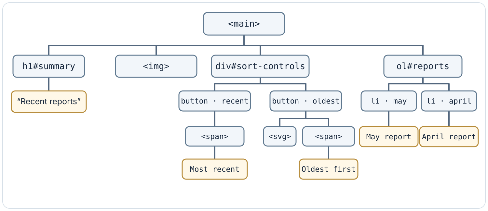

#### DOM 与 CSS 怎样变成布局用的几何？

`/reports.css` 到达后，CSS parser（CSS 解析器）会将文本解析成样式表及规则；对网页脚本可见的 CSS Object Model (CSSOM，CSS 对象模型) 用 `CSSStyleSheet`、`CSSRule` 等对象表示这些内容。CSS 规则仍不是 DOM 节点；渲染时浏览器让选择器匹配 DOM，再按级联与继承挑出适用声明。引擎内部用于匹配规则的数据结构可以各自不同。

DOM 记录节点和文本如何嵌套；CSS 规则描述这些节点怎样呈现。浏览器将两者结合，按级联和继承为元素解析 computed style（计算样式），例如标题的字号、行高和颜色。计算样式不等于最终几何：像 `width: auto` 这样的值还要结合可用空间、字体度量和相邻内容，布局算法才能算出 used value（使用值）和位置。

CSS 的 `display` 等规则会从 DOM 生成用于布局的盒结构，但二者不是一对一：`display: none` 的元素不生成盒；一个文本节点若换行，可能对应多个空间片段。布局继续根据父容器约束和前面内容的尺寸，确定每个盒或片段的宽高、坐标与顺序。Blink 将其中一种布局结果组织为 fragment tree（片段树）；Gecko 使用 frame tree（帧树），而且一个节点可能对应多个 frame。共同要点是这些中间结构携带布局结果，不是 DOM 原样的复制品。

**从节点与规则到布局片段**

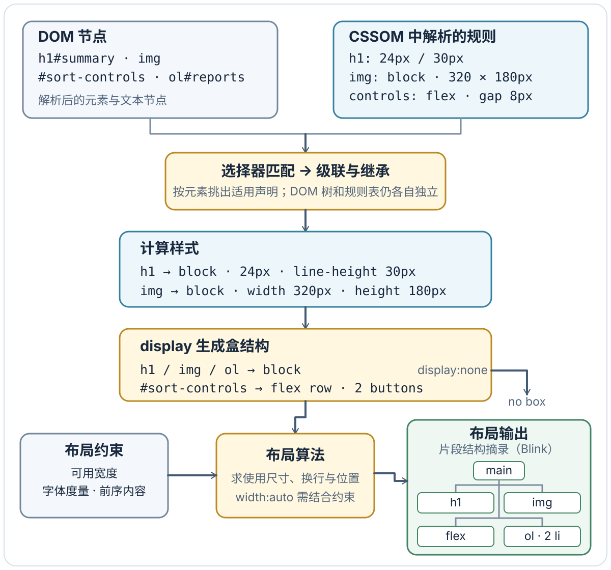

案例没有提供 `/reports.css`，所以接下来的 CSS 只定义一份可复算的局部教学布局，不代表真实站点样式。为消除浏览器默认样式对坐标的影响，这份规则显式清掉 `h1` 的上外边距、图片的 inline baseline 行盒间隙、按钮默认内边距和列表缩进；全局使用 `border-box`，按钮声明的宽高因此包含边框。

```css
*, *::before, *::after { box-sizing: border-box; }
html, body { display: block; margin: 0; padding: 0; }
body { font: 16px Arial, sans-serif; }
main { display: block; width: 100%; padding: 24px; }
h1 { display: block; margin: 0 0 12px; font-size: 24px; line-height: 30px; font-weight: 700; }
img { display: block; width: 320px; height: 180px; margin: 0 0 12px; }
#sort-controls { display: flex; gap: 8px; margin: 0 0 12px; }
button { display: inline-flex; width: 128px; height: 36px; margin: 0; padding: 0; border: 1px solid; font: inherit; }
button svg { display: block; width: 16px; height: 16px; flex: none; }
#reports { display: block; margin: 0; padding: 0; list-style: none; }
#reports li { display: block; height: 34px; margin: 0; padding: 0; line-height: 34px; }
```

在本机 headless Chrome `157.0.8103.50` 中，把上方 `<main>` 子树放入测量页并应用这段 CSS；图片用本地 `data:` 占位替代外部文件，只核对布局几何，不访问站点。测得 `innerWidth=720 CSS px`、`innerHeight=433 CSS px`、`devicePixelRatio=1`。关键 `getBoundingClientRect()` 结果如下；坐标以视口左上为原点，单位均为 CSS px。

| 元素 | x, y | width × height | 推出的边缘 |
|---|---:|---:|---:|
| `main` | `0, 0` | `720 × 398` | 内容盒起点 `(24, 24)`，宽 `672` |
| `h1#summary` | `24, 24` | `672 × 30` | 下边 `54` |
| `img` | `24, 66` | `320 × 180` | 下边 `246` |
| `#sort-controls` | `24, 258` | `672 × 36` | 下边 `294`；按钮实际覆盖 `x=24…152`、`160…288` |
| `ol#reports` | `24, 306` | `672 × 68` | 下边 `374` |
| May 行 / April 行 | `24, 306` / `24, 340` | each `672 × 34` | 行边界 `306–340`、`340–374` |

可复算的纵向链是 `24 + 30 + 12 + 180 + 12 + 36 + 12 = 306`：标题、图片、按钮组是向下排列的块；只有两个按钮在 flex 行内横排。图片设为块级后，`img` 的盒直接高 `180px`，不会再受 inline 基线间隙影响；`ol` 的上下 margin 与 padding 均为零，第一行从实测的 `y=306` 开始。指定图片尺寸后，即使实际图片字节尚未解码，布局也可先按 `320×180px` 留位；晚到的字体则可能改变文字宽度并让后续内容重排。

**同一页面的实测盒位置**

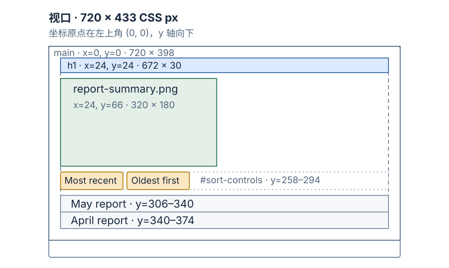

#### 布局结果怎样变成可以显示的像素？

布局给出了盒子与文字片段的几何，却没有画出字形或按钮背景。绘制阶段按 CSS 绘制顺序把这些几何、颜色、图片等内容转成有顺序的绘制项；一个元素可能产生多个绘制项，例如背景和文字是不同的项。图片若尚未下载或解码，它的框可以已经参与布局，但对应图像内容要等资源可用。

下面按 Chromium 的 RenderingNG 公开实现串起中间表示。Pre-paint 计算 transform、clip、effect、scroll 属性树，并标记失效的显示项或 GPU 图块。Paint 消费这份属性状态，按绘制顺序生成 display items（显示项），再把共享同一属性状态的显示项分组为 paint chunks（绘制块）。Commit 把显示列表和属性树交给合成器；layerize 再按可独立合成的视觉关系，把绘制块组织成一层或多层。接着可见空间被分成相邻 tile 区域；栅格任务为某个矩形 tile 处理覆盖到它的绘制项，互不依赖的区域可以并行栅格。同一个绘制项也可能跨过多个 tile，例如这张图的图片框横跨格子边界，各区域只需得到对应的像素部分。长页面可以复用已栅格的 tile，并在滚动时补画刚进入视口的空间范围。激活阶段产生描述 tile 摆放与视觉效果的 compositor frame（合成帧）。Viz 再把可见表面的合成帧汇总为全局合成帧，由 GPU 执行 Draw 绘出屏幕像素；下图只放大报表表面的空间关系。

**绘制块、连续 tile 区域与本页合成帧描述的画面**

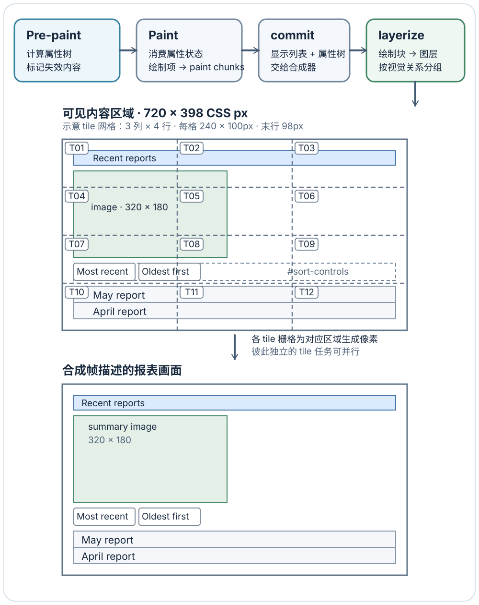

图中的 `3×4` 网格只是说明空间划分的教学假设，单格为连续的 `240×100 CSS px` 矩形，最下排高 `98px`；不是对 Chromium 实际 tile 尺寸或 layer 数量的断言。为聚焦空间关系，图把可见内容投影到一个示意 layer surface；真实 layerize 可能把绘制块组织成一层或多层。上图网格取实测 `main` 外框 `720×398 CSS px`，完整位于 `720×433 CSS px` 的视口内，余下 `35px` 是页面下方空白，所以十二格都在当前画面范围内。真实引擎会按 viewport、失效范围、图层属性和设备条件选择需要更新的 tile；同一绘制项可以贡献给它覆盖到的多个 tile，空间范围决定 tile 输入，而不是把一条显示列表任意拆成不相邻的片段。网格线与控制盒虚线只是定位参考，不是页面边框；合成帧描述的画面省略这些参考线，但保留同一个标题、图片、按钮和 May、April 两行。

这些阶段和中间结构是 Chromium 的实现例，不是网页标准规定的固定线程流水线。Firefox 的公开实现说明也从 DOM/CSS 得到布局 frame，再产生 WebRender 显示列表、场景和帧，具体表示与进程安排不同。某些变化（例如只需合成器处理的滚动或视觉动画）可以跳过重新布局和绘制；报表列表顺序变化则会改变 DOM 和内容位置，浏览器需要在后续渲染机会更新受影响的布局或绘制工作。HTML 解析、资源获取与图像解码可以交叠；同一流式内容里后面的块位置仍依赖前面内容的布局结果，因此不能把整页简化成互不相关的并行方框。

### 从首帧交接到筛选更新

首帧可能先于 `load` 事件和客户端代码可交互的时点出现。比如 HTML 已显示报表，但模块脚本尚未完成下载、运行或注册点击处理器。此刻初始 HTML 已有 `sort=recent` 对应的顺序：按钮 `aria-pressed` 为 `true/false`，列表是 May 在前、April 在后。若报表由 React 服务端输出，hydration（客户端水合）还要在已有 DOM 上运行客户端代码并接入组件行为，见[Next.js 中的 hydration 与流式渲染](#%E6%9C%8D%E5%8A%A1%E7%AB%AF%E4%B8%8E%E5%AE%A2%E6%88%B7%E7%AB%AF%E7%BB%84%E4%BB%B6%E5%9C%A8%E5%93%AA%E6%9D%A1%E7%BA%BF%E4%BA%A4%E6%8E%A5)。若点击没有反馈，先确认处理器何时可用；若处理器已经注册，则查看事件是否被主线程上其他工作挡住。

当用户点击“最早优先”，`/reports.js` 的处理器先用 History API（例如 `history.pushState`）把当前 URL 从 `https://example.test/reports?sort=recent#summary` 改为 `https://example.test/reports?sort=oldest#summary`。`pushState` 会新增一条同文档 history entry 并更新地址栏；它本身既不请求新 HTML，也不按查询参数替报表排序。随后仍由这个 click handler 分别把两个按钮的 `aria-pressed` 改为 `false/true`，并将列表节点顺序改成 April、May。DOM 改动立即生效；浏览器会在后续渲染机会按需重新计算样式、布局或绘制，再把新的像素送去合成。异步处理器与画面更新之间的关系见[浏览器 JavaScript 何时运行，画面何时更新？](#5.%20%E6%B5%8F%E8%A7%88%E5%99%A8%20JavaScript%20%E4%BD%95%E6%97%B6%E8%BF%90%E8%A1%8C%EF%BC%8C%E7%94%BB%E9%9D%A2%E4%BD%95%E6%97%B6%E6%9B%B4%E6%96%B0%EF%BC%9F)，点击如何到达处理器见[DOM 事件如何传播，何时适合事件委托？](#4.%20%E6%B5%8F%E8%A7%88%E5%99%A8%E6%80%8E%E6%A0%B7%E6%9F%A5%E8%AF%A2%E3%80%81%E6%9B%B4%E6%96%B0%20DOM%20%E5%B9%B6%E5%93%8D%E5%BA%94%E7%94%A8%E6%88%B7%E8%BE%93%E5%85%A5%EF%BC%9F)，更新后可能需要的布局和绘制见[为什么一次 DOM 改动会增加布局或绘制工作？](#12.%20%E4%B8%BA%E4%BB%80%E4%B9%88%E4%B8%80%E6%AC%A1%20DOM%20%E6%94%B9%E5%8A%A8%E4%BC%9A%E5%A2%9E%E5%8A%A0%E5%B8%83%E5%B1%80%E6%88%96%E7%BB%98%E5%88%B6%E5%B7%A5%E4%BD%9C%EF%BC%9F)。

| 现象 | 优先检查的阶段 |
|---|---|
| 首个 HTML 字节迟迟不到 | 重定向、缓存命中、连接建立、服务端响应和网络瀑布 |
| HTML 已到，主要内容仍迟 | 关键 CSS/脚本的阻塞关系、Largest Contentful Paint（最大内容绘制，LCP）资源发现与渲染时机 |
| 页面可见，筛选点击没有反馈 | 首先确认 `/reports.js` 已求值且按钮处理器已注册；再查主线程阻塞、处理器运行时间和后续渲染工作 |
| 内容出现后位置跳动 | 图片或字体的尺寸和到达时机、后插入内容及布局偏移记录 |

先沿测得的依赖关系定位，再决定要改请求、脚本、布局还是绘制。相同的“首屏慢”现象可能来自服务器响应、资源发现或内容渲染，单独改 CSS 选择器无法同时解释这些原因。见[如何测量并诊断网页性能问题？](#13.%20%E5%A6%82%E4%BD%95%E6%B5%8B%E9%87%8F%E5%B9%B6%E8%AF%8A%E6%96%AD%E7%BD%91%E9%A1%B5%E6%80%A7%E8%83%BD%E9%97%AE%E9%A2%98%EF%BC%9F)。

> [!info]- 来源
> - **URL、片段、History API 与导航请求。** [RFC 3986 §3.5 Fragment](https://www.rfc-editor.org/rfc/rfc3986.html#section-3.5) 说明片段用于标识主资源中的次级内容；[HTML Standard §7.2.5，History interface](https://html.spec.whatwg.org/multipage/nav-history-apis.html#the-history-interface) 规定 `pushState` 添加 history entry 并更新其 URL，Living Standard，核对日期：2026-11-11；[WHATWG Fetch Standard，HTTP-network-or-cache fetch 与 URL 处理](https://fetch.spec.whatwg.org/#http-network-or-cache-fetch)，Living Standard，核对日期：2026-11-11；[WHATWG URL Standard，origin](https://url.spec.whatwg.org/#origin)，核对日期：2026-11-11。
> - **缓存、重定向、DNS 与 HTTPS。** [RFC 9111 §4.2 新鲜度](https://www.rfc-editor.org/rfc/rfc9111.html#section-4.2) 与 [§4.3 验证](https://www.rfc-editor.org/rfc/rfc9111.html#section-4.3) 支持新鲜缓存复用与验证；[RFC 9110 §15.4](https://www.rfc-editor.org/rfc/rfc9110.html#section-15.4) 定义重定向响应；[RFC 1034 §§3.1–3.2](https://www.rfc-editor.org/rfc/rfc1034.html#section-3.1) 与 [RFC 1035](https://www.rfc-editor.org/rfc/rfc1035.html) 描述域名解析；[RFC 9113 §9.1.1](https://www.rfc-editor.org/rfc/rfc9113.html#section-9.1.1) 说明 HTTP/2 的连接复用；[RFC 8446 §§2、4.4.2–4.4.3](https://www.rfc-editor.org/rfc/rfc8446.html#section-4.4.3) 描述 TLS 1.3 握手、证书认证和安全属性。活动 Service Worker 的 fetch 处理见 [Service Workers Editor’s Draft（2026-10-29），Handle Fetch 算法](https://w3c.github.io/ServiceWorker/#handle-fetch)。核对日期：2026-11-11。
> - **HTML、资源与脚本时机。** [WHATWG HTML，Parsing HTML documents](https://html.spec.whatwg.org/multipage/parsing.html) 与 [Speculative HTML parsing](https://html.spec.whatwg.org/multipage/parsing.html#speculative-html-parsing) 说明渐进解析及实现可采用的推测式资源发现；[Scripting，script processing model](https://html.spec.whatwg.org/multipage/scripting.html#script-processing-model) 规定模块及其依赖的获取和求值时机。Living Standard，核对日期：2026-11-11。
> - **从样式表到布局结构。** [CSS Syntax Level 3 §8.1，W3C Candidate Recommendation Draft（2026-10-01）](https://www.w3.org/TR/css-syntax-3/#style-rules) 说明样式表中的规则如何解析；[CSS Object Model §6.1、§6.4，W3C Working Draft（2021-08-26）](https://www.w3.org/TR/cssom-1/#css-rules) 定义 `CSSStyleSheet` 与规则对象；[CSS Cascading and Inheritance Level 5 §§4.4–4.5](https://www.w3.org/TR/css-cascade-5/#computed-values) 区分 computed value 与 used value；[CSS Display Level 3 §2.5](https://www.w3.org/TR/css-display-3/#box-generation) 说明元素与 CSS 盒并非一一对应及 `display:none` / `display:contents` 的盒生成边界。CSS Cascading and Inheritance Level 5 为 W3C Candidate Recommendation Snapshot（2022-01-13），CSS Display Level 3 为 W3C Candidate Recommendation Draft（2026-06-05）；核对日期：2026-11-11。
> - **脚本引擎与渲染引擎的例子。** [V8](https://v8.dev/)，[JavaScriptCore](https://docs.webkit.org/Deep%20Dive/JSC/JavaScriptCore.html)，[SpiderMonkey](https://firefox-source-docs.mozilla.org/js/) 描述 JavaScript 实现；[Blink](https://www.chromium.org/blink/)，[WebKit](https://webkit.org/)，[Gecko](https://firefox-source-docs.mozilla.org/overview/gecko.html) 描述渲染引擎。核对日期：2026-11-11。
> - **从布局、绘制块到 tile 合成的实现例子。** [Chromium RenderingNG architecture，Rendering pipeline structure，stages 2–12（style 至 draw；尤其 pre-paint、paint、commit、layerize、raster、activate、aggregate）](https://developer.chrome.com/docs/chromium/renderingng-architecture#rendering-pipeline-structure)；[Chromium RenderingNG data structures，The immutable fragment tree、Property trees、Display lists and paint chunks、Compositor frames: surfaces, render surfaces and GPU texture tiles §§Tiles、Quads and surfaces](https://developer.chrome.com/docs/chromium/renderingng-data-structures)；[Firefox Rendering Overview，Frame Tree、Display List 与 WebRender](https://firefox-source-docs.mozilla.org/gfx/RenderingOverview.html) 和 [Gecko Layout Overview，frame tree 与片段](https://firefox-source-docs.mozilla.org/layout/LayoutOverview.html)。这些是公开引擎实现说明，不是统一浏览器线程规范；核对日期：2026-11-11。
>
> 查看[前端专题索引](../../frontend/index.md)中相关章节。
## 2. 每次 URL 变化都会加载新文档吗？

案例背景：用户先打开 `https://example.test/reports?sort=recent#summary`，随后点“最早优先”并可能按浏览器后退。要让这三个时点显示正确的报表，先判断浏览器是在换文档、跳转片段，还是只更新当前文档的历史地址。

### URL 分量怎样对应到浏览器导航？

以本例地址为例，`https:` 是 scheme (方案)，`example.test` 是 host (主机)，`/reports` 是 path (路径)，`?sort=recent` 是 query (查询)，`#summary` 是 fragment (片段)。本例 HTTPS 地址的 origin (源) 由 scheme、host 和 port 标识。不是所有 URL 都有 `//authority`：`mailto:reports@example.test` 就没有 HTTP(S) 式主机与路径结构。

`location.href` 读取完整 URL，赋值会导航；`protocol` 带结尾冒号，`host` 包含非默认端口，`hostname` 不含端口，`port` 是非默认端口或空字符串，`pathname` 是路径，`search` 保留开头的 `?`，`hash` 保留开头的 `#`。用 `URL` 和 `URLSearchParams` 解析，不要手动切分字符串；查询参数缺失时 `get()` 返回 `null`，已存在的值是字符串，例如 `"2026"` 不是数字。`getAll()` 可读同名多值，`set()` 替换同名值，`append()` 则追加一项；序列化时按 URL 查询参数规则编码。

浏览器历史栈可以包含不同 origin（源）的文档，因此 `history.back()`、`forward()` 和 `go()` 可能遍历到跨源页面。`history.go(n)` 按偏移量移动历史项：正数向前、负数向后、零会重新载入当前页；超出范围则不动作。History API 对 `pushState()` / `replaceState()` 新 URL 的同源要求，不等于浏览器只能在同源历史项之间后退。

### 用 URL 参数表达排序状态

本例只接受 `sort=recent` 和 `sort=oldest`；`sortFromUrl()` 将缺失或未知值按 `recent` 渲染，直到用户选择另一种排序才写入 URL。写回时从 `location.href` 解析现有地址，再更新 `sort`，所以路径、其他查询参数的值和 `#summary` 片段仍在；`URLSearchParams` 会重新序列化查询，空格可能从 `%20` 写成 `+`。查询参数来自地址栏或外部链接，必须按业务允许值校验，也不要把口令或访问令牌放进 URL。

| 操作 | 当前地址、文档与历史的结果 |
|---|---|
| 打开另一个地址：`<a>`、设置 `location.href`、调用 `location.assign()` | 通常加载另一个 `Document` 并留下新历史项；若目标含 fragment，且目标与当前 URL 除 fragment 外相同，则沿用当前 `Document` 并定位片段 |
| `location.replace(url)` | 替换当前历史项；是否沿用当前 `Document` 适用上一行的片段条件 |
| `location.reload()` | 重新加载当前文档，即使地址不变；不增加历史项，资源仍可能来自缓存 |
| `pushState(...)` | 保留当前 `Document` 并新增一项历史状态；调用本身不请求新文档 |
| `replaceState(...)` | 保留当前 `Document` 并修改当前历史项；调用本身不请求新文档 |

History API 的目标 URL 必须符合当前文档可改写 URL 的规则。对本例的 HTTPS 页面，可以改路径、查询和片段；scheme、username、password、host、port 要保持相同。`pushState()` 和 `replaceState()` 都不会发起该地址的网络请求，也不会因调用本身派发 `popstate` 或 `hashchange`。应用若要显示与新 URL 对应的内容，仍须自己同步界面；目标是别的服务器资源时，应正常导航或显式发出请求。

### 让排序状态跟随地址栏与前进后退

报表页面初始地址是 `/reports?sort=recent#summary`。浏览器用收到的 HTML 创建 `Document`，其中已有 `h1#summary`、两个排序按钮以及 May、April 两行；下面 HTML 示例中的普通模块脚本由 `<script type="module" src="/reports.js"></script>` 引用。本例把行数据放进客户端 `records` 数组，让 `renderReports()` 每次从 URL 状态重建行。若数据由服务器提供，更新 URL 后还需按该状态请求新结果，并处理加载、错误和过期响应。

~~~html
<!-- /reports?sort=recent 的服务端 HTML 初始状态 -->
<!-- 页面 head 中的客户端模块引用 -->
<script type="module" src="/reports.js"></script>
<h1 id="summary">Recent reports</h1>

<div id="sort-controls">
  <button type="button" data-sort="recent" aria-pressed="true"><span>Most recent</span></button>
  <button type="button" data-sort="oldest" aria-pressed="false">
    <svg width="16" height="16" viewBox="0 0 16 16" aria-hidden="true">
      <path d="M8 13V3m-4 4 4-4 4 4" fill="none" stroke="currentColor"
            stroke-width="1.5" stroke-linecap="round" stroke-linejoin="round" />
    </svg>
    <span>Oldest first</span>
  </button>
</div>
<ol id="reports">
  <li data-id="may">May report</li>
  <li data-id="april">April report</li>
</ol>
~~~

以下是 `/reports.js` 中的代码，不是 HTML 里的内联脚本：

~~~javascript
const records = [
  { id: "may", date: "2026-05-01", label: "May report" },
  { id: "april", date: "2026-04-01", label: "April report" },
];
const list = document.querySelector("#reports");
const controls = document.querySelector("#sort-controls");

function sortFromUrl() {
  return new URL(location.href).searchParams.get("sort") === "oldest"
    ? "oldest"
    : "recent";
}

function renderReports(sort) {
  const rows = [...records].sort((a, b) =>
    sort === "oldest" ? a.date.localeCompare(b.date) : b.date.localeCompare(a.date)
  );
  for (const button of controls.querySelectorAll("button[data-sort]")) {
    button.setAttribute("aria-pressed", String(button.dataset.sort === sort));
  }
  list.replaceChildren(...rows.map(({ id, label }) => {
    const item = document.createElement("li");
    item.dataset.id = id;
    item.textContent = label;
    return item;
  }));
}

function chooseSort(sort) {
  if (sort !== "recent" && sort !== "oldest") return;
  if (sort === sortFromUrl()) return;
  const url = new URL(location.href);
  url.searchParams.set("sort", sort);
  history.pushState(null, "", url.href);
  renderReports(sort);
}

controls.addEventListener("click", (event) => {
  const target = event.target instanceof Element ? event.target : null;
  const button = target?.closest("button[data-sort]");
  if (!button || !controls.contains(button)) return;
  chooseSort(button.dataset.sort);
});
window.addEventListener("popstate", () => renderReports(sortFromUrl()));
renderReports(sortFromUrl());
~~~

`renderReports()` 先按 URL 状态选顺序，再同步两个按钮的 `aria-pressed`，最后用 `replaceChildren()` 写入行。初始服务器 HTML 已显示 May → April；用户点“最早优先”后，新地址是 `/reports?sort=oldest#summary`，按钮切成 `false/true`，行变为 April → May。这里创建的是新 `li` 节点；DOM 章将同一结果与移动既有行节点的做法对照。若用户分享一条 `sort=oldest` 深链，`reports.js` 的初次运行会按 URL 修正列表；要让首批 HTML 本身就显示正确顺序，服务器也应按查询参数生成行和按钮状态。若地址是未知值，例如 `sort=other`，本例只按 `recent` 显示；点已经选中的 “Most recent” 会提前返回，只有选另一种排序才会改写地址。

委托监听器用 `event.target.closest("button[data-sort]")` 从点击目标向上找按钮，因此点按钮内的文字或 SVG 图标都会进入同一处理器；`controls.contains(button)` 再确认匹配到的按钮属于这组控件。

| 时点 | 历史项、文档与事件 | 地址与报表 UI |
|---|---|---|
| 初次打开 | 浏览器用收到的 HTML 创建一个 `Document`；模块初次运行读取 URL。 | `sort=recent`；按钮为 `true/false`，列表为 May → April。 |
| 点击 **Oldest first** | `pushState()` 新增同一 `Document` 的历史项；不请求新 HTML，也不派发 `popstate` / `hashchange`。点击处理器自己调用 `renderReports()`。 | 地址变为 `sort=oldest`；按钮为 `false/true`，列表为 April → May。 |
| 浏览器 Back | 激活先前的同文档历史项并派发 `popstate`；`#summary` 没变，本例不涉及 `hashchange`。 | 监听器读取当前 URL，恢复 `sort=recent`、`true/false` 与 May → April。 |
| 浏览器 Forward | 再激活 `sort=oldest` 历史项并派发 `popstate`。 | 监听器再次从 URL 得到 oldest，恢复 `false/true` 与 April → May。 |

本例用 `pushState(null, "", url.href)` 添加新历史项并记录 URL，不把排序状态另存进 `history.state`；点击处理器再主动调用 `renderReports()`。因此本例 `popstate` 的 `event.state` 为 `null`，排序仍从当前 URL 读取。`pushState()` 也可在第一个参数中保存应用状态，其他应用可在 `popstate` 的事件对象中读取。若用户再后退离开这个文档，当前 listener 不接管另一文档的恢复或重新加载；浏览器处理的是另一条历史项及其页面状态。

只有目标 URL 与当前 URL 除 fragment 外完全相同，且目标含 fragment 时，普通导航才走同文档片段路径。以已有的 `ol#reports` 为例，从 `/reports?sort=oldest#summary` 执行 `location.hash = "#reports"` 会沿用当前 `Document`、增加一项历史记录并滚到列表。片段定位和滚动由浏览器完成，但本例的 `popstate` 监听器仍会从 URL 重读排序并重建列表，显示顺序不变。本机 Chrome 157 在该路径先派发 `popstate`（`state` 为 `null`），再派发 `hashchange`。反过来，从 `/reports?sort=recent#summary` 用 `location.assign("?sort=oldest#summary")` 改查询，即使保留 `#summary` 也会导航到另一个 `Document`。History API 调用 `pushState()` 改成另一个片段不会自动滚动，也不会因调用本身派发 `popstate` 或 `hashchange`；若用户稍后遍历该历史项，才按历史遍历步骤处理。本例的排序历史项只改 query、保留 `#summary`，Back/Forward 由 `popstate` 同步排序而不触发 `hashchange`。客户端路由器可以复用这些历史项，但 URL 变化与视图绘制是两项不同工作。

浏览器首次收到 `.../reports?sort=recent#summary` 时，`#summary` 是浏览器用来定位的片段，服务器只处理路径与查询。排序点击改成 `sort=oldest` 后，仍是同一个 `Document`：浏览器不重新解析 `/reports`，应用继续负责产生新列表节点。这个边界让地址可复制、可返回，同时不把 History API 误解成网络导航。

### 定时导航怎样用文本更新并允许取消？

这个倒计时为普通文档导航留下等待和取消窗口。`setInterval(..., 1000)` 中的 1000 毫秒是请求间隔，不承诺每秒准时执行；主线程繁忙或浏览器对后台页面的计时器节流会让回调变晚。此代码按回调次数减秒，延迟会把实际跳转推迟；若需要按真实截止时刻倒数，应每次用当前时间重算剩余量。只有最后一次回调开始导航前点取消，清除定时器才能阻止跳转。一旦归零回调开始 `location.assign()`，取消按钮会先禁用并显示“正在跳转…”，`clearInterval()` 不能撤销已经开始的导航。

~~~html
<p id="countdown" role="status">5 秒后打开 example.com。</p>
<button id="cancel-navigation" type="button">取消</button>
~~~

~~~javascript
const message = document.querySelector("#countdown");
const cancel = document.querySelector("#cancel-navigation");
let seconds = 5;

const timer = setInterval(() => {
  seconds -= 1;
  if (seconds === 0) {
    clearInterval(timer);
    cancel.disabled = true;
    message.textContent = "正在跳转…";
    location.assign("https://example.com/");
    return;
  }
  message.textContent = seconds + " 秒后打开 example.com。";
}, 1000);

cancel.addEventListener("click", () => {
  clearInterval(timer);
  message.textContent = "已取消跳转。";
  cancel.disabled = true;
});
~~~

**延伸：** [DOM 事件如何传播，何时适合事件委托？](#4.%20%E6%B5%8F%E8%A7%88%E5%99%A8%E6%80%8E%E6%A0%B7%E6%9F%A5%E8%AF%A2%E3%80%81%E6%9B%B4%E6%96%B0%20DOM%20%E5%B9%B6%E5%93%8D%E5%BA%94%E7%94%A8%E6%88%B7%E8%BE%93%E5%85%A5%EF%BC%9F)解释点击处理器如何收到按钮事件；如果路由切换还要等待数据加载器并显示 pending/error 状态，见[React 路由怎样把地址映射到界面并加载数据？](#62.%20React%20%E8%B7%AF%E7%94%B1%E6%80%8E%E6%A0%B7%E6%8A%8A%E5%9C%B0%E5%9D%80%E6%98%A0%E5%B0%84%E5%88%B0%E7%95%8C%E9%9D%A2%E5%B9%B6%E5%8A%A0%E8%BD%BD%E6%95%B0%E6%8D%AE%EF%BC%9F)中的 Data Mode（数据模式）；组件状态更新见[React 如何把用户操作变成更新后的界面？](#6.%20React%E5%A6%82%E4%BD%95%E6%8A%8A%E4%B8%80%E6%AC%A1%E7%94%A8%E6%88%B7%E6%93%8D%E4%BD%9C%E5%8F%98%E6%88%90%E7%95%8C%E9%9D%A2%E6%9B%B4%E6%96%B0%EF%BC%9F)。

> [!info]- 来源
> - URL 分量和序列化：[WHATWG URL Standard：URL representation](https://url.spec.whatwg.org/#url-representation)，Living Standard（2026-10-19 更新），URL record 组成。核对日期：2026-11-12。
> - 地址栏分量与 `assign()` / `replace()` / `reload()`：[WHATWG HTML：Location interface](https://html.spec.whatwg.org/multipage/nav-history-apis.html#the-location-interface)，Living Standard（2026-11-11 更新），`Location` API。核对日期：2026-11-12。
> - 普通导航、片段导航、URL/history 更新、历史步骤应用与刷新：[WHATWG HTML：Navigation and session history](https://html.spec.whatwg.org/multipage/browsing-the-web.html#navigate)，Living Standard（2026-11-11 更新），[fragment navigations](https://html.spec.whatwg.org/multipage/browsing-the-web.html#navigate-fragid)、[URL and history update steps](https://html.spec.whatwg.org/multipage/browsing-the-web.html#url-and-history-update-steps)、[updating the document for a history step](https://html.spec.whatwg.org/multipage/browsing-the-web.html#update-document-for-history-step-application)、[reloading](https://html.spec.whatwg.org/multipage/browsing-the-web.html#apply-the-reload-history-step)。核对日期：2026-11-12。
> - History API 可改写 URL 的组成条件、`pushState()` / `replaceState()` 与遍历：[WHATWG HTML：History interface](https://html.spec.whatwg.org/multipage/nav-history-apis.html#the-history-interface)，Living Standard（2026-11-11 更新），同文档 URL 改写规则、state 与 delta traversal。核对日期：2026-11-12。
> - `popstate` / `hashchange` 的事件对象及相关事件步骤：[WHATWG HTML：Event interfaces](https://html.spec.whatwg.org/multipage/nav-history-apis.html#event-interfaces) 和上述 navigation / history-step 算法，Living Standard（2026-11-11 更新）；事件发生时机另以本机 Chrome 157 回放为准。核对日期：2026-11-12。
> - URL 查询参数的读取、重复值和序列化：[WHATWG URL Standard：URLSearchParams](https://url.spec.whatwg.org/#urlsearchparams-class)，Living Standard（2026-10-19 更新），`get()`、`getAll()`、`set()`、`append()` 与 form-urlencoded 序列化。核对日期：2026-11-12。
> - 倒计时的文本更新与计时器初始化/取消：[WHATWG DOM：Node.textContent](https://dom.spec.whatwg.org/#dom-node-textcontent)；[WHATWG HTML：Timers](https://html.spec.whatwg.org/multipage/timers-and-user-prompts.html#timers)，Living Standard（2026-11-11 更新）。超时表示最早可运行时间，实际回调还要等待事件循环调度。核对日期：2026-11-12。
## 3. 脚本如何影响 HTML 解析与文档就绪？

案例背景：报表服务器已返回标题、排序按钮和初始行，浏览器还在解析 HTML，并同时获取 `/reports.css` 与 `/reports.js`。用户想先看到正文；排序按钮应在处理器安装后才可用。下面按脚本获取、执行和文档就绪的先后关系判断哪些工作会挡住哪一步。

### 不同脚本属性怎样改变解析顺序？

表格说的是 HTML parser（HTML 解析器）插入的脚本；动态插入的脚本有不同默认调度，不能把它们混为一谈。

| 脚本形式 | 下载与解析的关系 | 运行时机与顺序 |
|---|---|---|
| 外部经典脚本，不带 `async` / `defer` | 主 parser 处理到脚本时可开始请求；浏览器也可能由推测解析更早请求资源。主 parser 到达该元素后转而处理脚本；资源或阻塞样式表尚未就绪时先等待 | 脚本同步执行完后 parser 才继续解析，保持文档顺序 |
| 外部经典脚本 `defer` | 与解析并行获取 | 解析完成后、`DOMContentLoaded` 前执行；多个 defer 脚本按文档顺序 |
| 外部经典脚本 `async` | 与解析并行获取 | 下载就绪后尽快执行；若解析还在进行，会暂时打断解析；不保证多个 async 脚本的顺序 |
| 普通模块脚本 | 模块文件及其 `import` 依赖与解析并行获取 | 默认在解析完成后按文档顺序开始求值；各模块依赖按依赖关系处理 |
| `async` 模块脚本 | 模块文件及其 `import` 依赖与解析并行获取 | 模块及其依赖就绪后尽快执行，不保证相对其他异步脚本的顺序 |
| 内联经典脚本，有无 `defer` | 没有外部文件要获取 | parser 到达该元素且没有待等的阻塞样式表时执行；没有 `src` 时 `defer` 不起延后作用 |

`defer` 适合依赖已解析文档、且需要保持外部经典脚本文档顺序的代码。`async` 适合执行不依赖解析结果或其他脚本的独立工作。模块脚本默认延后执行，给模块加 `async` 会改变这个选择。

### 为什么解析器有时必须停下来？

解析 HTML 就像按顺序读取标记并逐个建立节点。经典脚本能在节点还没建完时查询、修改文档，甚至用 `document.write()` 改变后续解析结果；浏览器不能一概把这种脚本当作与文档无关的文件而继续前进。因此，脚本获取可以和其他资源获取重叠，但脚本执行本身可能成为解析的依赖点。

样式表对脚本的影响不是浏览器先分析某段 JavaScript 是否调用了 `getComputedStyle()`。HTML 定义了脚本阻塞样式表集合：由 parser 创建、作为启用样式表处理、media 条件匹配且仍在等待中的 `style` / stylesheet `link`，可以进入该集合。后续要执行的同步 parser 脚本或延后脚本，会按这个集合判断是否等待；即便 `/reports.js` 只给按钮注册事件，也可能先等 `/reports.css`。

本例中由 parser 在 `<head>` 创建、已启用且 `media` 匹配的 stylesheet link 可能阻塞渲染，因此资源尚未就绪时首帧可能推迟。不是“所有 CSS 必须全部下载后才能开始任何绘制”，而是具体资源是否阻塞由渲染与脚本各自的条件决定。

以下 HTML 是报表页的初始结构。本节只跟踪 head 中的 CSS 与模块，以及正文排序控件和图片；标题片段锚点与图标形状不改变这段加载时序。

~~~html
<head>
  <link rel="stylesheet" href="/reports.css">
  <script type="module" src="/reports.js"></script>
</head>
<main>
  <h1 id="summary">Recent reports</h1>
  
  <div id="sort-controls">
    <button
      type="button"
      data-sort="recent"
      aria-pressed="true"
      disabled
    >
      <span>Most recent</span>
    </button>
    <button
      type="button"
      data-sort="oldest"
      aria-pressed="false"
      disabled
    >
      <svg width="16" height="16" viewBox="0 0 16 16" aria-hidden="true">
        <path d="M8 13V3m-4 4 4-4 4 4" fill="none" stroke="currentColor"
              stroke-width="1.5" stroke-linecap="round" stroke-linejoin="round" />
      </svg>
      <span>Oldest first</span>
    </button>
  </div>
  <ol id="reports">
    <li data-id="may">May report</li>
    <li data-id="april">April report</li>
  </ol>
</main>
~~~

服务器已经输出 May → April 的初始顺序；外部模块 `/reports.js` 在 parser 完成后运行。两个按钮先以原生 `disabled` 状态输出，避免模块尚未安装处理器时把用户的点击静默丢掉。本例模块默认延后到解析结束才执行，因此 guard 走 `interactive` 分支，直接安装处理器；`loading` 分支适用于其他入口在文档仍解析时运行的脚本。

以下是外部 `/reports.js` 的最小实现。本例只展示处理器何时安装、如何同步列表和按钮状态，不在这里重放 URL 与浏览器历史逻辑。

~~~javascript
const records = [
  { id: "may", date: "2026-05-01", label: "May report" },
  { id: "april", date: "2026-04-01", label: "April report" },
];

function renderReports(list, controls, sort) {
  const rows = [...records].sort((a, b) =>
    sort === "oldest" ? a.date.localeCompare(b.date) : b.date.localeCompare(a.date)
  );
  for (const button of controls.querySelectorAll("button[data-sort]")) {
    button.setAttribute("aria-pressed", String(button.dataset.sort === sort));
  }
  list.replaceChildren(...rows.map(({ id, label }) => {
    const item = document.createElement("li");
    item.dataset.id = id;
    item.textContent = label;
    return item;
  }));
}

function initializeReportControls() {
  const controls = document.querySelector("#sort-controls");
  const list = document.querySelector("#reports");
  if (!controls || !list) return;

  controls.addEventListener("click", (event) => {
    const target = event.target instanceof Element ? event.target : null;
    const button = target?.closest("button[data-sort]");
    if (!button || !controls.contains(button)) return;
    const sort = button.dataset.sort;
    if (sort !== "recent" && sort !== "oldest") return;
    renderReports(list, controls, sort);
  });

  renderReports(list, controls, "recent");
  for (const button of controls.querySelectorAll("button[data-sort]")) {
    button.disabled = false;
  }
}

if (document.readyState === "loading") {
  document.addEventListener("DOMContentLoaded", initializeReportControls, { once: true });
} else {
  initializeReportControls();
}
~~~

下面前两行对照两种资源返回顺序：CSS 先完成、模块后到；或模块先到、CSS 仍在等待。两者都汇合到 parser 已结束、脚本可运行的阶段。

| 此刻的资源状态 | parser、DOM 与首帧 | 排序处理器与就绪事件 |
|---|---|---|
| 正文已解析为 DOM（此时 `readyState=interactive`），`/reports.css` 已就绪，`/reports.js` 或其 `import` 依赖仍在下载，图片未完成 | 浏览器可能先绘出标题和 May → April；图片的 320×180 尺寸先占位；按钮仍为 disabled | 排序监听器尚未安装，按钮不能触发；`DOMContentLoaded` 仍等待 deferred 模块 |
| 模块响应先返回，但 CSS 仍是阻塞脚本的样式表 | parser 仍可继续补全正文；完成解析后 `readyState` 变为 `interactive`，模块执行仍要等 CSS 解除阻塞 | 按钮继续 disabled；模块未运行，`DOMContentLoaded` 尚未触发 |
| parser 已结束（`readyState=interactive`），模块及其依赖已可执行，CSS 已解除阻塞 | 模块同步调用初始化函数，保留 May → April 初始顺序，随后启用两个按钮 | 排序监听器和初始 `aria-pressed=true/false` 已就绪；普通同步模块执行结束后才派发 `DOMContentLoaded` |
| 用户点已启用的 **Oldest first** | 不再解析 HTML；处理器按日期重建列表行 | `aria-pressed` 变为 `false/true`，顺序变为 April → May |

这条链把“有 DOM”“可绘制”和“处理器已绑定”分开：模块未运行时按钮仍不可用；同步绑定和初始渲染完成后才启用。若图片较晚到，预留的宽高减少它到达后挤动文字的机会。

### `DOMContentLoaded` 和 `load` 分别说明什么？

`DOMContentLoaded` 在 HTML parser 完成解析并处理延后脚本后派发到 `Document`。`document.readyState` 在 parser 停止时先变为 `interactive`，此时延后脚本仍可能等待模块脚本、其依赖或阻塞脚本的样式表。普通 `defer` 脚本在该流程同步执行；默认模块也在解析后开始求值。模块及其依赖均同步求值时，模块代码会在事件前执行完；模块遇到顶层 `await` 时，后续代码可在事件后继续，依赖含顶层 `await` 的模块也可能推迟导入方的代码。若初始化把后续工作放进 Promise 回调或异步请求，也可能晚于该事件。因此它不表示所有应用初始化已完成，也不等图片或 `async` 脚本完成。延后脚本可能等待脚本阻塞样式表，所以样式表也能间接推迟 `DOMContentLoaded`。

`load` 事件由 `Window` 的监听器接收；HTML 使用历史兼容的 target override，因此回调中 `event.currentTarget` 是 `window`，而 `event.target` 是 `document`。触发前，文档转入 `complete`，所有仍会延迟 `load` 的资源都已完成；普通图片、样式表、脚本和子框架可能在其中，懒加载资源通常不必挡住它。精确范围由 HTML 的加载算法决定。

| 检查点与 `readyState` | 事件与监听位置 | 此时可依赖的条件 |
|---|---|---|
| parser 停止（`interactive`） | `readystatechange` 在 `Document` 上触发 | HTML 已解析完；延后脚本仍可能在执行或等待 |
| DOM 内容加载完（`interactive`） | `DOMContentLoaded` 在 `Document` 上触发 | parser 延后脚本已处理；图片和 `async` 脚本不作为此事件的等待条件，模块的异步延续仍可能继续 |
| `load`（`complete`） | 监听器在 `Window` 上运行；`event.target` 为 `Document` | 会延迟 load 的资源已完成；应用 API、hydration 或其他 Promise 仍可能未完成 |

这些事件和状态本身不报告首帧，也不追踪应用自己的初始化结果。本例正常执行同步初始化时，排序按钮确实在 `DOMContentLoaded` 前启用；异步初始化的应用则需要自己的就绪信号。

### 脚本晚到时，怎样避免错过 `DOMContentLoaded`？

`DOMContentLoaded` 是一次事件，不是以后可订阅的完成状态。若代码通过动态导入或延迟执行，在事件之后才注册监听器，处理器不会补发。前面 `/reports.js` 末尾的 guard 读取 `document.readyState`：仍是 `loading` 时订阅事件并一次性调用已完整定义的 `initializeReportControls()`；否则文档解析已结束，就立即初始化。同步执行的 JavaScript 不会被浏览器事件打断，因此状态检查和注册之间不会插入一次 `DOMContentLoaded` 派发。

`readyState` 的 `loading` 表示 HTML parser 仍在解析；`interactive` 表示解析已结束但延后脚本与子资源流程可能尚未完成；`complete` 表示文档已进入加载完成阶段。这个 guard 只保证 DOM 已可查询：若初始化依赖尚未执行的 defer/module 脚本副作用，应等待该脚本自己的就绪信号。文档状态也不代表报表 API 请求、React hydration 或其他应用异步初始化已经完成；若初始化包含这类异步工作，仍需单独表示并等待。

判断主要内容何时出现，要观察绘制；判断排序按钮是否可用，要看其初始化状态。首帧可以早于 `load`，而报表内容也可能已显示、模块脚本还没注册排序处理器。反过来，`DOMContentLoaded` 触发后，一次长脚本任务仍会让点击处理器排队等待。可见时点和就绪事件的区别见[浏览器如何把 URL 变成第一帧？](#1.%20%E6%B5%8F%E8%A7%88%E5%99%A8%E5%A6%82%E4%BD%95%E6%8A%8A%20URL%20%E5%8F%98%E6%88%90%E7%AC%AC%E4%B8%80%E5%B8%A7%EF%BC%9F)；用户侧的加载与交互数据见[如何测量并诊断网页性能问题？](#13.%20%E5%A6%82%E4%BD%95%E6%B5%8B%E9%87%8F%E5%B9%B6%E8%AF%8A%E6%96%AD%E7%BD%91%E9%A1%B5%E6%80%A7%E8%83%BD%E9%97%AE%E9%A2%98%EF%BC%9F)。

> [!info]- 来源
> - 解析器插入的经典脚本、`async`、`defer` 与模块调度：[WHATWG HTML：script processing model](https://html.spec.whatwg.org/multipage/scripting.html#script-processing-model)，Living Standard（2026-11-11 更新），外部/内联脚本、defer 模块列表与 async 集合。核对日期：2026-11-12。
> - parser 等待时允许浏览器推测获取后续资源：[WHATWG HTML：Speculative HTML parsing](https://html.spec.whatwg.org/multipage/parsing.html#speculative-html-parsing)，Living Standard（2026-11-11 更新）；这项预取优化的具体时机依实现而异。核对日期：2026-11-12。
> - 脚本阻塞样式表的条件：[WHATWG HTML：interactions of styling and scripting](https://html.spec.whatwg.org/multipage/semantics.html#interactions-of-styling-and-scripting)，Living Standard（2026-11-11 更新），parser 创建、样式表有效状态、media 匹配及阻塞集合。核对日期：2026-11-12。
> - 样式表链接可能阻塞渲染的条件：[WHATWG HTML：link type stylesheet](https://html.spec.whatwg.org/multipage/links.html#link-type-stylesheet) 与 [render-blocking mechanism](https://html.spec.whatwg.org/multipage/dom.html#render-blocking-mechanism)，Living Standard（2026-11-11 更新），parser 创建的 stylesheet link 可能 render-blocking；外链资源处理步骤检查 `media` 匹配与 render-blocking 状态。核对日期：2026-11-12。
> - 解析结束时的 `interactive`、延后脚本、`DOMContentLoaded` 与 `load` 派发：[WHATWG HTML：The end](https://html.spec.whatwg.org/multipage/parsing.html#the-end)，Living Standard（2026-11-11 更新），parser 结束、deferred script 队列、DOM content loaded 与窗口 load event。核对日期：2026-11-12。
> - `document.readyState` 的 `loading`、`interactive`、`complete` 及 `readystatechange`：[WHATWG HTML：Reporting document loading status](https://html.spec.whatwg.org/multipage/dom.html#reporting-document-loading-status)，Living Standard（2026-11-11 更新）。核对日期：2026-11-12。
> - 顶层 `await` 与模块依赖的异步求值：[ECMAScript 2027：Module evaluation](https://tc39.es/ecma262/#sec-moduleevaluation)，异步模块求值及其依赖关系。DOMContentLoaded / load 的触发顺序由上述 HTML 算法决定。核对日期：2026-11-12。
## 4. 浏览器怎样查询、更新 DOM 并响应用户输入？

案例背景：报表页从 `https://example.test/reports?sort=recent#summary` 打开，列表先显示 May、April 两行。用户点“最早优先”按钮里的文字或图标后，原生示例要找到所属按钮，从 `data-sort` 读出 `oldest`，再把现有行节点排成 April、May，并更新按钮状态。这里把 History API 处理 URL、React 管理状态作为相邻交接；本页先走通普通文档树中的查询、内容更新和事件处理。Document Object Model (文档对象模型，DOM) 把 HTML 文档表示为节点树，JavaScript 可以查询这些节点、改写其状态，并响应输入事件。

本章各示例在独立页面或作用域中运行，避免把不同示例的顶层代码拼成同一脚本（重复声明 `const controls` 会报错）。同一示例中的 HTML、交互和清理代码要一起使用。建表和拖动示例使用各自的 HTML；查询、事件、克隆、排序与尺寸观察示例使用后文委托节提供的 `#sort-controls` / `#reports` 初始 HTML。

### DOM 树里有哪些节点？

文档节点包含元素节点、文本节点和注释等；元素的 attribute（属性）描述元素状态，但 attribute 不是元素的子节点。常用的 `nodeType` 值如下：

| `nodeType` | 节点 | 报表页中的例子 |
|---:|---|---|
| 1 | Element（元素） | `<ol>`、`<li>`、`<button>` |
| 2 | Attr（属性） | `id="reports"`（有 `Attr` 对象，但不是树的子节点） |
| 3 | Text（文本） | `May report` |

向上找父级时，`parentNode` 可返回任意节点父级：`<html>` 的 `parentNode` 是 Document，而 `parentElement` 只返回元素父级，所以 `<html>.parentElement` 为 `null`。`nodeName` 命名任意节点，`tagName` 只属于元素；`nodeValue` 读取单个 Text 节点的值，在 Element 上则为 `null`，读取元素后代文字应使用 `textContent`。若要查某行的下一个元素，使用 `nextElementSibling`；`nextSibling` 可能先遇到 HTML 换行空白对应的文本节点。同理，`firstChild` 与 `firstElementChild` 可能不是同一项。`childNodes` 包含文本、注释等节点，`children` 只包含元素；它们的集合更新规则见[修改 DOM 时，HTMLCollection 和 NodeList 会怎样变化？](#57.%20%E4%BF%AE%E6%94%B9%20DOM%20%E6%97%B6%EF%BC%8CHTMLCollection%20%E5%92%8C%20NodeList%20%E4%BC%9A%E6%80%8E%E6%A0%B7%E5%8F%98%E5%8C%96%EF%BC%9F)。

查询 DOM 使用 CSS 选择器。`querySelector()` 返回第一个匹配元素；没有匹配项时返回 `null`，所以后续读取前要先处理找不到的情况。`querySelectorAll()` 返回匹配项组成的静态 `NodeList`，创建后不会因之后插入的新按钮而自动增加成员。

下面的查询、事件日志和委托代码使用后面“什么时候用父级监听器处理子控件？”一节中的报表初始 HTML；先载入该 HTML，再在独立运行上下文中执行所需的代码块。

~~~javascript
const controls = document.querySelector("#sort-controls");
if (controls) {
  const oldest = controls.querySelector('button[data-sort="oldest"]');
  const buttons = controls.querySelectorAll("button[data-sort]");
  // oldest 是第一个匹配项或 null；buttons 是当前匹配项的静态列表。
}
~~~

`#sort-controls` 按 ID 找工具栏；`button[data-sort="oldest"]` 同时匹配元素名和 attribute 值。选到控件后，再决定修改文字、HTML 内容属性、DOM 对象属性还是节点顺序。

### 修改内容、HTML 属性和 DOM 对象属性有何区别？

文本和标记要用不同接口。`textContent` 读取后代文本，赋值会用一个文本内容替换子树；`innerText` 读写渲染文本：读取时元素若未渲染，会退回到后代文本；若已渲染，结果会受显示状态影响；赋值中的换行会成为可见换行。`innerHTML` 读取或解析 HTML 字符串。把纯文字放入 DOM 时使用 `textContent`；只有受信任或已净化的标记才作为 HTML 解析。

| 写法 | 控制什么 | 报表页上的用途 |
|---|---|---|
| `row.textContent = label` | 文字，不解析 HTML | 写入报表名称 |
| `row.innerText` | 渲染后的文字语义；未渲染时退回后代文本 | 读取或写入可见文本 |
| `row.innerHTML = markup` | 子树的 HTML 标记 | 只有模板可信或已净化时才插入标记 |
| `element.setAttribute(name, value)` | HTML content attribute（HTML 内容属性） | 设置 `data-id`、`alt`、`title` 等声明 |
| `element.classList`、`element.style` | class 集合与内联样式 | 切换状态 class，或写入必要的单次样式 |

HTML 内容属性是元素当前的标记属性；许多 DOM property（DOM 对象属性）会反射对应 attribute。文本输入框的 `value` 属性提供了一个重要区别：`value` 内容属性给出默认值，`input.value` 则表示当前值。当前值一旦变成 dirty（已修改），再改 attribute 只更新默认值，直到表单重置。

~~~html
<form id="sort-form">
  <label>排序关键词 <input id="sort-query" value="recent"></label>
</form>
~~~

~~~javascript
const query = document.querySelector("#sort-query");
query.setAttribute("value", "april"); // 尚未修改：当前值也变为 april
const beforeEdit = [query.value, query.defaultValue];

query.value = "oldest"; // 改当前值，并标记为 dirty
query.setAttribute("value", "recent"); // dirty 后只改默认值
const afterEdit = [query.value, query.defaultValue];
query.form.reset(); // 当前值回到默认值，并清除 dirty 标记
const afterReset = [query.value, query.defaultValue];
console.log(JSON.stringify({ beforeEdit, afterEdit, afterReset }));
~~~

HTML 的 dirty value flag（值已修改标记）区分当前输入值和可变默认值；`reset()` 会恢复默认值。对 boolean attribute（布尔属性），例如 `disabled`，只看元素自己的 attribute 是否存在：`setAttribute("disabled", "false")` 仍会设置它。`button.disabled = false` 会移除按钮自己的禁用属性，但不一定让它脱离 HTML 禁用状态：若它位于禁用的 `fieldset` 中，仍会匹配 `:disabled`；该 fieldset 的第一个 `legend` 元素子节点内的后代控件有例外。

~~~html
<fieldset disabled>
  <legend>
    <button id="legend-button" type="button">例外位置</button>
  </legend>
  <button id="inherited-button" type="button">受 fieldset 禁用</button>
</fieldset>
<button id="own-button" type="button">自己的 disabled 属性</button>
~~~

~~~javascript
const inherited = document.querySelector("#inherited-button");
inherited.disabled = false;
const own = document.querySelector("#own-button");
own.setAttribute("disabled", "false");
const setToFalse = [own.disabled, own.matches(":disabled")];
own.disabled = false;
const afterClearingOwn = [own.disabled, own.matches(":disabled")];

const states = {
  ownAttribute: setToFalse,
  afterClearingOwn,
  inherited: [inherited.disabled, inherited.matches(":disabled")],
  firstLegend: [
    document.querySelector("#legend-button").disabled,
    document.querySelector("#legend-button").matches(":disabled"),
  ],
};
console.log(JSON.stringify(states));
// ownAttribute: [true, true]; afterClearingOwn: [false, false]
// inherited: [false, true]; firstLegend: [false, false]
~~~

| 控件状态 | `button.disabled` | `matches(":disabled")` | 原因 |
| --- | --- | --- | --- |
| 给自身 `setAttribute("disabled", "false")` 后 | `true` | `true` | 布尔属性只看是否存在。 |
| 再设自身 `disabled = false` 后 | `false` | `false` | 移除了自身的禁用属性。 |
| 禁用 fieldset 的普通后代 | `false` | `true` | 控件自身未禁用，但祖先 fieldset 生效。 |
| fieldset 的第一个 `legend` 元素子节点内的后代 | `false` | `false` | 该位置不继承 fieldset 的禁用。 |

若要检查 HTML 表单禁用状态（包含 `fieldset` 继承），用 `button.matches(":disabled")`；若只想读写元素自己的禁用属性，用 `button.disabled`。

要更新筛选行的外观，`className = "selected"` 会整体替换 class 字符串；`classList.add()`、`remove()` 和 `toggle()` 改单个类。`element.style.backgroundColor` 只读写行内的声明；样式表计算出的生效值要用 `getComputedStyle(element)` 读取。CSS property 在 JavaScript 里通常使用 camelCase（小驼峰）。`data-id="may"` 可通过 `row.dataset.id` 读取与设置，`dataset` 中已存在的值是字符串，缺少的 data 属性读到 `undefined`。多段名称会转为小驼峰，例如 `data-report-id` 对应 `dataset.reportId`。图片的 `src` 选择资源，`alt` 提供替代文本（装饰图可用空值），`title` 是补充信息，不能替代 `alt`。

~~~javascript
const textDemo = document.createElement("div");
document.body.append(textDemo); // 附加到页面后，innerText 按渲染文本处理
textDemo.textContent = "<b>May</b>";
const literal = [textDemo.textContent, textDemo.children.length];
textDemo.innerText = "May\nReport";
const visibleLines = [textDemo.innerHTML, textDemo.innerText];
console.log(JSON.stringify({ literal, visibleLines }));
// literal: ["<b>May</b>", 0]
// visibleLines: ["May<br>Report", "May\nReport"]
~~~

### 怎样生成、移动或克隆一组节点？

为单独演示如何从结构化数据建表，设一张学校成绩表固定按 Name、Subject、Grade 排列。对象字段顺序不是表格的列定义；三条记录应分别显示 Ron—Math—100、Jack—Calculus—70、Mar—Business—90：

~~~html
<table>
  <thead><tr><th>Name</th><th>Subject</th><th>Grade</th></tr></thead>
  <tbody id="students"></tbody>
</table>
~~~

~~~javascript
const students = [
  { name: "Ron", subject: "Math", grade: "100" },
  { name: "Jack", subject: "Calculus", grade: "70" },
  { name: "Mar", subject: "Business", grade: "90" },
];
const columns = ["name", "subject", "grade"];
const body = document.querySelector("#students");

for (const student of students) {
  const row = document.createElement("tr");
  for (const column of columns) {
    const cell = document.createElement("td");
    cell.textContent = student[column];
    row.append(cell);
  }
  body.append(row);
}
~~~

每个记录依照同一份 `columns` 产生三格，输入值只进入文本节点。`append()` 会把新节点追加到末尾；若传入已经在文档中的节点，它会将该节点移动到新位置。`insertBefore(node, reference)` 把节点放到参考节点前，`remove()` 将节点从树上移除。

`cloneNode(true)` 会复制节点、后代结构和 HTML attribute。写在 `onclick="..."` 中的内容属性会随节点复制；通过 `element.onclick = handler` 设置的 DOM 对象属性和 `addEventListener()` 注册的监听器不会复制。若副本及其后代有 `id`，插入同一文档前应改成不冲突的 ID，并同步更新指向它们的引用。需要复制行为时，在新节点上重新注册监听器：

本例从后文委托节的两行初始列表单独运行：May 源行带 `data-id="may"` 和 `data-date="2026-05-01"`，自身没有 DOM `id` attribute，后代也没有带 ID 的节点。深克隆会保留这两个 data 属性；代码给副本新增一个文档内唯一的 DOM `id`。运行后列表会多一行 May 副本，因此不要把它与后面的两行排序表串成同一轮状态。

~~~javascript
function handleReportClick(event) {
  console.log(event.currentTarget.dataset.id);
}

const source = document.querySelector('#reports [data-id="may"]');
const copy = source.cloneNode(true);
copy.id = "may-row-copy"; // 新增 DOM id；data-id 仍标识 May 报表
copy.addEventListener("click", handleReportClick);
document.querySelector("#reports").append(copy);
~~~

对同一元素给 `onclick` 属性赋新函数会替换先前的函数；多处代码都需监听时，用 `addEventListener()` 可以各自注册和移除 listener（监听器）。只需响应一次时可设 `{ once: true }`；若要提前移除，保留原函数引用，并使用相同 capture（捕获阶段）选项调用 `removeEventListener()`。也可把同一 `AbortSignal`（中止信号）交给多个监听器，结束该页面区域时调用 `abort()` 一并清理。

### 一次点击沿哪些节点传播？

浏览器为事件确定传播路径（event path）后，监听器可在 capture phase（捕获阶段）、target phase（目标阶段）和 bubble phase（冒泡阶段）运行。下面限定在普通 DOM 树中的 click：点标签文字时 `target` 是 `span`；点 SVG 箭头的可见描边时 `target` 是 `<path>`，点图标留白时则可能是 `svg`。这段代码只记录事件顺序；图展示标签文字分支经过的节点，并在工具栏层带出下一节的委托处理器。

~~~javascript
const controls = document.querySelector("#sort-controls");
const button = controls.querySelector('button[data-sort="oldest"]');
const label = button.querySelector(".sort-label");

document.body.addEventListener("click", () => console.log("body capture"), {
  capture: true,
});
label.addEventListener("click", () => console.log("span target"));
button.addEventListener("click", () => console.log("button bubble"));
controls.addEventListener("click", () => console.log("controls bubble"));
document.body.addEventListener("click", () => console.log("body bubble"));
~~~

点标签文字时，上面日志按 body 捕获、span 目标、button 冒泡、controls 冒泡、body 冒泡的顺序运行：

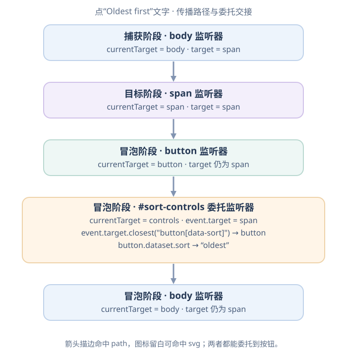

图对应上面的点文字日志；工具栏框展示同一传播路径到达 `#sort-controls` 后，由下一节注册的委托监听器继续处理，这不是上面只打印日志的 `controls bubble` 回调。点箭头描边时，路径为 `path → svg → button → #sort-controls → body`；点图标留白时从 `svg` 开始，随后经过同样的祖先。委托器从实际命中的 `event.target` 向上找到按钮，两条路径都不经过 `.sort-label` span。

`event.target` 在一次普通 DOM 派发中保持为最初命中的节点；`event.currentTarget` 则是当前监听器绑定的节点。图中的文字分支依次以 `body`、`span`、按钮、工具栏和 `body` 为 `currentTarget`；点箭头描边或图标留白时，target 分别为 `path` 或 `svg`，两条路径都不含 span。普通函数监听器中的 `this` 也指向 `currentTarget`，箭头函数的 `this` 则保留词法绑定。图不覆盖 Shadow DOM（影子 DOM）：跨影子边界时 `target` 可能被重定向；`bubbles` 决定是否向普通祖先冒泡，`composed` 决定能否穿过影子边界，二者不是同一开关。输入框获得和失去焦点时分别派发 `focus` 与 `blur`，这两个原生事件不冒泡；父级要委托焦点变化时可监听会冒泡的 `focusin` 与 `focusout`。

### 什么时候用父级监听器处理子控件？

event delegation（事件委托）让一个父级监听器处理多个后代控件，包括稍后插入的控件，因此不用逐一注册监听器。它适合事件会冒泡、父级确实拥有这些控件、目标匹配规则清楚的场景；它不会消除每次事件分发或处理器本身的计算。

~~~html
<h1 id="summary">Recent reports</h1>
<div id="sort-controls">
  <button type="button" data-sort="recent" aria-pressed="true">
    <span class="sort-label">Most recent</span>
  </button>
  <button type="button" data-sort="oldest" aria-pressed="false">
    <svg class="sort-icon" width="16" height="16" viewBox="0 0 16 16"
         aria-hidden="true">
      <path d="M8 13V3m-4 4 4-4 4 4" fill="none" stroke="currentColor"
            stroke-width="1.5" stroke-linecap="round" stroke-linejoin="round" />
    </svg>
    <span class="sort-label">Oldest first</span>
  </button>
</div>
<ol id="reports">
  <li data-id="may" data-date="2026-05-01">May report</li>
  <li data-id="april" data-date="2026-04-01">April report</li>
</ol>
~~~

图标 SVG 设为 `16 × 16`，内部 `path` 画出箭头，因此页面中有实际可见的命中区域；旁边的文字已经说明按钮用途，图标用 `aria-hidden="true"` 隐藏其重复信息。

~~~css
#sort-controls .sort-icon {
  vertical-align: -0.15em;
}
~~~

~~~javascript
const controls = document.querySelector("#sort-controls");
const reports = document.querySelector("#reports");

function applySort(intent, activeButton) {
  if (intent !== "recent" && intent !== "oldest") return;

  const rows = Array.from(
    reports.querySelectorAll(":scope > li[data-date]")
  );
  const direction = intent === "oldest" ? 1 : -1;
  rows.sort((a, b) =>
    direction * a.dataset.date.localeCompare(b.dataset.date)
  );
  for (const row of rows) reports.append(row);

  for (const button of controls.querySelectorAll("button[data-sort]")) {
    button.setAttribute("aria-pressed", String(button === activeButton));
  }
}

controls.addEventListener("click", (event) => {
  const target = event.target instanceof Element ? event.target : null;
  const button = target?.closest("button[data-sort]");
  if (!button || !controls.contains(button)) return;

  const intent = button.dataset.sort;
  console.log("Sort requested:", intent); // 点击“最早优先”时得到 "oldest"
  applySort(intent, button);
});
~~~

点击标签文字或图标时，`closest()` 从命中的后代向上找到带 `data-sort` 的按钮；`controls.contains(button)` 确认它属于这个工具栏。处理器读到 `oldest` 后，`applySort()` 先拒绝未知意图，再用固定的 ISO 日期值比较两行。`querySelectorAll()` 给出当前行的静态集合，`Array.from()` 把它变为可排序数组；对现有行调用 `append()` 会移动节点，而不是重新创建行。事件处理器同步完成后，本例得到：

| 时点 / 意图 | 行顺序（`data-id`） | `recent` | `oldest` |
| --- | --- | --- | --- |
| 初始 HTML / `recent` | `may` → `april` | `aria-pressed="true"` | `aria-pressed="false"` |
| 点击处理完成 / `oldest` | `april` → `may` | `aria-pressed="false"` | `aria-pressed="true"` |

本节的 `applySort()` 只负责把同一排序意图写成 DOM 顺序和按钮状态；完整页面还要让 URL、前进后退与这份状态同步，见[每次 URL 变化都会加载新文档吗？](#2.%20%E6%AF%8F%E6%AC%A1%20URL%20%E5%8F%98%E5%8C%96%E9%83%BD%E4%BC%9A%E5%8A%A0%E8%BD%BD%E6%96%B0%E6%96%87%E6%A1%A3%E5%90%97%EF%BC%9F)。若操作会删除匹配节点并继续遍历，应先取静态快照，避免移除节点改变实时集合；集合差异见[修改 DOM 时，HTMLCollection 和 NodeList 会怎样变化？](#57.%20%E4%BF%AE%E6%94%B9%20DOM%20%E6%97%B6%EF%BC%8CHTMLCollection%20%E5%92%8C%20NodeList%20%E4%BC%9A%E6%80%8E%E6%A0%B7%E5%8F%98%E5%8C%96%EF%BC%9F)。

### 默认动作与传播控制是两回事

按钮若位于表单中，点击可能触发表单提交；这是与事件传播分开的默认动作。`preventDefault()` 只在事件可取消且监听器不是 passive listener（被动监听器）时取消默认动作，它不会停止冒泡。`stopPropagation()` 不取消正在运行的回调，也不会跳过当前 `EventTarget` 本次捕获或非捕获调用中剩余的匹配监听器；它会阻止随后沿路径进行的监听器调用。目标上的捕获调用结束后，若它设置了停止传播标志，目标上的非捕获调用会被跳过（两次调用中的 `eventPhase` 都是 `AT_TARGET`）。`stopImmediatePropagation()` 还会停止当前 `EventTarget` 本次调用中的后续监听器。

如果滚动或触控监听器不需要取消浏览器默认滚动，设置 `{ passive: true }` 能表明这一点；被动监听器调用 `preventDefault()` 无法取消默认动作。DOM 标准规定，未显式设置 `passive` 的 `touchstart`、`touchmove`、`wheel` 和 `mousewheel` 监听器，在 `Window`、`Document`、`documentElement` 或 `body` 上默认 passive 为 true；确实需要拦截时，应先按事件的 `cancelable` 状态判断，再显式设置 `{ passive: false }`。

### 移动端点击与手势策略

历史上的移动端 click 延迟有特定条件：部分浏览器曾等待判断一次触摸是否还会成为双击缩放手势。它不是今天所有浏览器、所有 viewport（视口）或所有输入模式下的固定延迟。先设置符合设备宽度的 viewport；不要为了绕开历史延迟而禁止用户缩放。

~~~html
<meta name="viewport" content="width=device-width, initial-scale=1">
~~~

若某个控件不需要双击缩放，但仍应允许平移和双指缩放，可以对该控件使用 Pointer Events（指针事件）的 `touch-action: manipulation`：

~~~css
#sort-controls button[data-sort] {
  touch-action: manipulation;
}
~~~

它让浏览器保留平移和连续缩放，同时不把双击缩放作为该元素上的手势。把规则限制在确实需要的控件，不要用 `touch-action: none` 全局封锁操作。原生 `<button>` 自带键盘激活；自制的 `role="button"` 还必须补足键盘行为。Chrome 的 viewport 诊断指出一个特定条件：初始视口未针对移动设备优化时，点击可能延后至多 300 毫秒；其他浏览器和输入设置会不同，不能把这个值当成所有移动端点击的固定时延。除非目标设备实测仍有兼容问题，不要同时在 `touchend` 和 `click` 上触发同一动作，以免合成 click 与原生 click 重复执行。

### 拖动时怎样跟踪坐标并处理取消？

Pointer Events（指针事件）把鼠标、触摸和笔输入统一到 pointer 事件，但一次拖动不是只有 `pointermove`：它从 `pointerdown` 开始，可通过 `setPointerCapture(pointerId)` 把后续该 pointer 的事件留给手柄；正常释放由 `pointerup` 结束，系统接管手势时可能收到 `pointercancel`，捕获释放后会有 `lostpointercapture`。清理时按 `pointerId` 匹配当前拖动，避免另一根手指或旧事件结束错误手势。

坐标属性对应不同参照系：

| 属性 | 参照系 | 适合回答的问题 |
|---|---|---|
| `clientX / clientY` | viewport（视口） | 指针现在相对当前可视区域在哪里 |
| `pageX / pageY` | 文档 | 指针在页面内容坐标中在哪里 |
| `screenX / screenY` | 屏幕 | 指针相对设备显示区域的位置 |

下面把一个报表卡片放进定位容器。移动用 client 坐标的差值；初始卡片位置来自同一个定位容器的 `offsetLeft` / `offsetTop`。本例假设容器没有 CSS 缩放或旋转，拖动时页面与容器也不滚动；在此条件下，视口坐标的位移对应卡片的 CSS 像素位移。若变换或滚动改变坐标参照系，就需先转换到同一坐标空间。

~~~html
<div id="report-canvas">
  <button id="movable-report" type="button" aria-describedby="move-report-help">
    May report
  </button>
</div>
<p id="move-report-help">鼠标或触摸拖动卡片；聚焦后也可用方向键移动。</p>
~~~

~~~css
#report-canvas {
  position: relative;
  width: 24rem;
  height: 12rem;
  border: 1px solid;
}

#movable-report {
  position: absolute;
  left: 0;
  top: 0;
  touch-action: none;
}
~~~

~~~javascript
const card = document.querySelector("#movable-report");
let drag = null;

card.addEventListener("pointerdown", (event) => {
  const nonPrimary = !event.isPrimary;
  const secondaryMouse = event.pointerType === "mouse" && event.button !== 0;
  if (drag || nonPrimary || secondaryMouse) return;
  drag = {
    pointerId: event.pointerId,
    x: event.clientX,
    y: event.clientY,
    left: card.offsetLeft,
    top: card.offsetTop,
  };
  card.setPointerCapture(event.pointerId);
});

card.addEventListener("pointermove", (event) => {
  if (!drag || drag.pointerId !== event.pointerId) return;
  const left = drag.left + event.clientX - drag.x;
  const top = drag.top + event.clientY - drag.y;
  card.style.left = `${left}px`;
  card.style.top = `${top}px`;
});

function finishDrag(event, canceled = false) {
  if (!drag || drag.pointerId !== event.pointerId) {
    return;
  }
  const start = drag;
  drag = null;
  if (canceled) {
    card.style.left = start.left + "px";
    card.style.top = start.top + "px";
  }
}

card.addEventListener("pointerup", finishDrag);
card.addEventListener(
  "pointercancel",
  (event) => finishDrag(event, true),
);
card.addEventListener(
  "lostpointercapture",
  (event) => finishDrag(event, true),
);

card.addEventListener("keydown", (event) => {
  const step = event.shiftKey ? 24 : 8;
  let dx = 0;
  let dy = 0;
  if (event.key === "ArrowLeft") dx = -step;
  else if (event.key === "ArrowRight") dx = step;
  else if (event.key === "ArrowUp") dy = -step;
  else if (event.key === "ArrowDown") dy = step;
  else return;

  event.preventDefault();
  card.style.left = `${card.offsetLeft + dx}px`;
  card.style.top = `${card.offsetTop + dy}px`;
});
~~~

卡片仍连接文档时，捕获让它在指针移出按钮后仍收到同一指针的移动与结束事件；正常抬起保留新位置，取消或捕获丢失则回到拖动起点。捕获目标脱离文档后，规范建议（SHOULD）把捕获目标改为 `document`，因此卸载时不能依赖卡片监听器收到 `lostpointercapture`。卸载区域时，应先清空拖动状态、释放捕获，再移除节点；下面的清理函数与前面的拖动代码共用同一作用域中的 `card` 和 `drag`：

~~~javascript
function disposeCard() {
  const activeDrag = drag;
  drag = null;
  if (activeDrag && card.hasPointerCapture(activeDrag.pointerId)) {
    card.releasePointerCapture(activeDrag.pointerId);
  }
  card.remove();
}
~~~

`touch-action: none` 会禁止从卡片上开始的视口平移与缩放，所以只应放在确实需要拖动的小控件上；页面其余区域仍可正常滚动。另有 `contextmenu` 和 `selectstart` 的默认动作可在特定自定义交互上取消，但全页禁用菜单或选中文字会移除浏览器本身提供的操作，也不是安全机制。

### 窗口 resize、元素尺寸与 scroll 应监听在哪里？

`resize` 事件用于窗口/视口尺寸变化；若要响应某个报表容器自身的尺寸变化，使用 `ResizeObserver`（尺寸变化观察器）。`scroll` 应监听页面或实际发生滚动的容器；元素滚动时，把 listener 绑在该元素上，而不是假设它会冒泡到任意父级。两种事件都可能频繁触发，应让处理器只做该界面所需的更新。

Navigator 对象（浏览器环境信息接口）提供环境线索：`navigator.language` 是浏览器报告的首选语言，`navigator.platform` 是平台字符串，`navigator.userAgent` 是 user-agent 字符串（用户代理字符串）。语言不是国籍，平台或 user-agent 字符串也不能证明某个 API 可用；相关识别信息还会增加隐私暴露。页面需要容器尺寸能力时，直接检测 `ResizeObserver`，不按浏览器品牌猜测。

~~~javascript
const reportList = document.querySelector("#reports");
const lifetime = new AbortController();
let sizeObserver = null;

function recordViewportWidth() {
  if (reportList) {
    reportList.dataset.viewportWidth = String(window.innerWidth);
  }
}

if (reportList && typeof ResizeObserver === "function") {
  sizeObserver = new ResizeObserver(([entry]) => {
    if (!entry) return;
    reportList.dataset.containerWidth = String(
      Math.round(entry.contentRect.width)
    );
  });
  sizeObserver.observe(reportList);
} else if (reportList) {
  window.addEventListener("resize", recordViewportWidth, {
    signal: lifetime.signal,
  });
  recordViewportWidth();
}

function stopObservingReport() {
  lifetime.abort();
  sizeObserver?.disconnect();
}
~~~

检测到 `ResizeObserver` 时，更新来自实际报表容器；退回 `window.resize` 时只知道视口变化，父容器单独改变大小不会触发该回退。示例中的 `stopObservingReport()` 应由移除该页面区域的一方调用。

页面区域被移除时，用 `AbortController`（中止控制器）的 `signal` 一次清除绑定到该 signal 的事件监听器；`ResizeObserver` 则调用 `disconnect()` 停止观察。文档就绪和页面加载完成时，`DOMContentLoaded` / `load` 的触发条件见[脚本如何影响 HTML 解析与文档就绪？](#3.%20%E8%84%9A%E6%9C%AC%E5%A6%82%E4%BD%95%E5%BD%B1%E5%93%8D%20HTML%20%E8%A7%A3%E6%9E%90%E4%B8%8E%E6%96%87%E6%A1%A3%E5%B0%B1%E7%BB%AA%EF%BC%9F)。

### 把浏览器事件交给 React 时，交接什么？

若同一报表页由 React 管理，浏览器仍然派发 click；React 的 `onClick` 处理函数收到筛选意图 `oldest` 后，把它交给 state（状态）更新。浏览器这一侧的输入仍是点击事件和当前 DOM；交给应用的意图是“筛选变为 `oldest`”。React 章节从这个输入继续，讲状态快照、组件重算和 commit（提交）后需要的 DOM 变化。见[React 如何把用户操作变成更新后的界面？](#6.%20React%E5%A6%82%E4%BD%95%E6%8A%8A%E4%B8%80%E6%AC%A1%E7%94%A8%E6%88%B7%E6%93%8D%E4%BD%9C%E5%8F%98%E6%88%90%E7%95%8C%E9%9D%A2%E6%9B%B4%E6%96%B0%EF%BC%9F)。React 管理的节点应由 React 状态描述；若另用 DOM API 直接改它们，下一次 React 提交可能覆盖这些修改。

React 的 JSX 事件使用 SyntheticEvent（合成事件），保留常用的 DOM 事件概念；`onClick` 默认冒泡，`onClickCapture` 对应捕获。`currentTarget` 在当前处理函数执行时指向该 JSX 监听器所在元素。React DOM 17 起不再池化事件；当前监听函数返回后，React 仍会把 `event.currentTarget` 清为 `null`。因此跨越 `await` 或延后回调前，先把 `event.currentTarget.dataset.sort` 读成普通字符串。这里的 `handleSort` 直接绑定到带筛选意图的按钮，例如 `<button data-sort="oldest" onClick={handleSort}>Oldest first</button>`；若把处理器绑定到工具栏，`currentTarget` 就是工具栏，而不是带 `data-sort` 的按钮：

~~~jsx
async function handleSort(event) {
  const intent = event.currentTarget.dataset.sort;
  await savePreference(intent);
  setSort(intent); // 使用已保存的字符串，不再读取 event.currentTarget
}
~~~

React DOM 的 `persist()` 不用于延长 `currentTarget` 的有效期；这里要保存的是 `intent`。React 17 也把委托根从 `document` 移到 React root container，但 React 事件对象中的 `currentTarget` 仍表示 JSX 监听元素。与原生 `focus`、`blur` 不冒泡不同，React 的 `onFocus`、`onBlur` 会沿 React 树传播。React Native 的事件行为有自己的边界。

**延伸：**[浏览器如何把 URL 变成第一帧？](#1.%20%E6%B5%8F%E8%A7%88%E5%99%A8%E5%A6%82%E4%BD%95%E6%8A%8A%20URL%20%E5%8F%98%E6%88%90%E7%AC%AC%E4%B8%80%E5%B8%A7%EF%BC%9F)交代该页面的首帧和筛选入口；[每次 URL 变化都会加载新文档吗？](#2.%20%E6%AF%8F%E6%AC%A1%20URL%20%E5%8F%98%E5%8C%96%E9%83%BD%E4%BC%9A%E5%8A%A0%E8%BD%BD%E6%96%B0%E6%96%87%E6%A1%A3%E5%90%97%EF%BC%9F)展示同一点击如何更新历史地址和列表；[浏览器 JavaScript 何时运行，画面何时更新？](#5.%20%E6%B5%8F%E8%A7%88%E5%99%A8%20JavaScript%20%E4%BD%95%E6%97%B6%E8%BF%90%E8%A1%8C%EF%BC%8C%E7%94%BB%E9%9D%A2%E4%BD%95%E6%97%B6%E6%9B%B4%E6%96%B0%EF%BC%9F)说明 click 处理器如何等待主线程并交接到渲染机会；[跨浏览上下文如何通信？](#53.%20%E5%90%8C%E4%B8%80%E6%8A%A5%E8%A1%A8%E5%9C%A8%E5%A4%9A%E4%B8%AA%E6%A0%87%E7%AD%BE%E9%A1%B5%E4%B8%AD%E6%80%8E%E6%A0%B7%E4%BA%A4%E6%8D%A2%E5%8F%98%E5%8C%96%EF%BC%9F)讲跨文档消息；[JavaScript 事件总线怎样处理重入？](#56.%20JavaScript%20%E4%BA%8B%E4%BB%B6%E6%80%BB%E7%BA%BF%E5%9C%A8%E7%9B%91%E5%90%AC%E5%99%A8%E4%B8%AD%E9%87%8D%E5%85%A5%E6%97%B6%E6%80%8E%E6%A0%B7%E4%BF%9D%E6%8C%81%E9%A1%BA%E5%BA%8F%EF%BC%9F)讨论应用层发布/订阅。

> [!info]- 来源
> - 查询、树节点与事件机制：[WHATWG DOM，Living Standard（2026-11-11 更新）](https://dom.spec.whatwg.org/) 的 [`querySelector()`](https://dom.spec.whatwg.org/#dom-parentnode-queryselector)、[`querySelectorAll()`](https://dom.spec.whatwg.org/#dom-parentnode-queryselectorall)、[节点复制算法](https://dom.spec.whatwg.org/#concept-node-clone)、[事件分发、invoke 与 inner invoke](https://dom.spec.whatwg.org/#concept-event-dispatch)。涵盖首个匹配、静态结果、cloneNode 复制范围、事件阶段、`target` / `currentTarget`、传播和取消。核对日期：2026-11-12。
> - 输入框默认值、dirty value flag 与表单 reset：[WHATWG HTML，input element](https://html.spec.whatwg.org/multipage/input.html#the-input-element)；表单控件及 fieldset 的禁用规则：[form control infrastructure](https://html.spec.whatwg.org/multipage/form-control-infrastructure.html#enabling-and-disabling-form-controls:-the-disabled-attribute) 与 [fieldset element](https://html.spec.whatwg.org/multipage/form-elements.html#the-fieldset-element)。包含 first-legend 例外。持续更新规范，核对日期：2026-11-12。
> - `innerText` 的读取和写入、`data-*` 与 `dataset`、HTML 属性：[WHATWG HTML，DOM](https://html.spec.whatwg.org/multipage/dom.html#the-innertext-and-outertext-properties)，§3.2.4、§3.2.6.6、§3.2.7；图片 `src` 与 `alt`：[The `img` element](https://html.spec.whatwg.org/multipage/embedded-content.html#the-img-element)。持续更新规范，核对日期：2026-11-12。
> - `element.style` 读取行内声明、`getComputedStyle()` 读取解析后的样式：[CSS Object Model (CSSOM) Level 1](https://drafts.csswg.org/cssom/)，§7。CSS Working Group Editor’s Draft，核对日期：2026-11-12。
> - passive 默认值与 `preventDefault()` 的条件：[WHATWG DOM，addEventListener](https://dom.spec.whatwg.org/#dom-eventtarget-addeventlistener)。窗口尺寸、页面与元素滚动的目标：[CSSOM View](https://drafts.csswg.org/cssom-view/)，CSS Working Group Editor’s Draft，核对日期：2026-11-12。
> - pointer capture、取消和 `touch-action`：[Pointer Events Level 3](https://www.w3.org/TR/pointerevents3/)，W3C Recommendation，2026-06-30，§§4.1、5.1、7；元素尺寸观察与 `disconnect()`：[Resize Observer](https://drafts.csswg.org/resize-observer/)，CSS Working Group Editor’s Draft。均核对日期：2026-11-12。
> - `key` 与修饰键 `shiftKey`：[UI Events](https://www.w3.org/TR/uievents/)，KeyboardEvent，W3C Working Draft，2026-02-21，核对日期：2026-11-12。`code`、`repeat` 和旧 `keypress` 不在本页示例中。
> - SVG 可点击区域按可见 fill/stroke 和 `pointer-events` 规则命中：[SVG 2，Pointer Events property](https://www.w3.org/TR/SVG2/interact.html#PointerEventsProperty)，W3C Candidate Recommendation Snapshot（2026-10-06），核对日期：2026-11-12。
> - 初始 viewport 未适配移动设备时，点击可能延迟至多 300 毫秒：[Chrome Performance Insights：Optimize viewport for mobile](https://developer.chrome.com/docs/performance/insights/viewport)，适用条件见文档，发布于 2025-10-08，核对日期：2026-11-12。
> - React DOM 事件对象、`currentTarget` 与 React DOM 不使用 `persist()`：[React event object](https://react.dev/reference/react-dom/components/common#react-event-object)；React 17 移除事件池并把委托根移入 root container：[React 17 release notes](https://legacy.reactjs.org/blog/2020/10/20/react-v17.html)。本文关于监听器返回后清空 `currentTarget` 的版本结论以 [React DOM v19.2.0 分发源码](https://github.com/facebook/react/blob/v19.2.0/packages/react-dom-bindings/src/events/DOMPluginEventSystem.js#L240-L252) 为准；React `onFocus`、`onBlur` 的传播说明见同一发布说明。核对日期：2026-11-12。
> - Navigator 的语言、平台和 userAgent 接口及隐私要求：[WHATWG HTML，Navigator object](https://html.spec.whatwg.org/multipage/system-state.html#the-navigator-object)。持续更新规范，核对日期：2026-11-12。
## 5. 浏览器 JavaScript 何时运行，画面何时更新？

案例背景：上一章的报表页已显示 `https://example.test/reports?sort=recent#summary`，`/reports.js` 也已注册“最早优先”按钮的 click 处理器。用户点击后，处理器同步把当前 URL 改为 `sort=oldest`、切换按钮的 `aria-pressed` 并把行重排为 April、May。这里追问：如果点击到达时该窗口事件循环正运行一段同步 JavaScript，处理器何时开始？这些同步改动何时有机会变成新的画面？[浏览器首帧与点击交接](#%E4%BB%8E%E9%A6%96%E5%B8%A7%E4%BA%A4%E6%8E%A5%E5%88%B0%E7%AD%9B%E9%80%89%E6%9B%B4%E6%96%B0)给出页面和操作，本章沿一次处理过程追踪调度边界。

### task source 怎样交出下一次工作？

HTML 的窗口事件循环协调事件、脚本、渲染和网络等工作；这是宿主调度模型，不对应所有浏览器固定的线程流水线。一个 task（任务）封装宿主安排的一段工作；task source（任务源）按工作类别分组，例如用户交互、定时器和更新渲染。事件循环的 task queue（任务队列）不是所有回调共用的单一先进先出队列：规范允许用户代理把不同任务源合并到一个或多个队列，并在有可运行任务的队列中选择下一项。它会保留同一任务源要求的顺序；不同队列之间由用户代理选择。

**图：task 完成与 callback 返回后的检查点分别回到哪里**

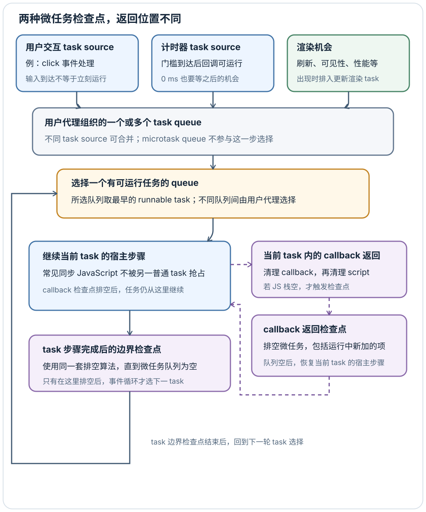

常见的页面处理路径里，事件循环选中的一个普通 task 会运行到任务步骤结束，期间同步 JavaScript 不会被另一个普通 task 抢占。因此，点击到达时如果当前同步脚本很长，或它后续排入的微任务一直新增，click handler 就只能等待。task 步骤结束后，事件循环执行 task 边界检查点；这次检查点排空后，事件循环才会选择下一项 task。若某次脚本或 Web IDL callback 的清理先让 JavaScript execution context stack（执行上下文栈）变空，也会先进入同一套排空算法；但这种检查点排空后会回到调用它的宿主步骤，让当前 task 继续执行，并不会直接跳到下一项 task。两种入口都会持续取出微任务，直到队列为空。

规范没有规定跨所有 task queue 的固定优先级。HTML 举例说明，用户代理可以将鼠标和键盘工作分到一队列，并在四次选择中三次优先处理该队列，同时仍让其他队列推进；这是展示实现自由度的例子，不是浏览器必须采用的公平策略。因而一次点击可以等当前工作结束，也可能在微任务排空后再等候 task 选择；规范不保证每个点击之后立刻更新画面。

渲染机会（rendering opportunity）由用户代理根据显示刷新、页面可见性、性能和其他条件判断。HTML 把机会判断和排入更新渲染 task 的步骤定义为与事件循环主步骤并行；同步 JavaScript 正在运行时，这个机会仍可能出现并把 task 排入队列。被延迟的是事件循环之后选择并执行更新渲染 task 的时刻，不是这一步机会判断本身。页面隐藏或当前没有渲染机会时，文档不会进入本轮更新；若用户代理认为更新没有可见效果且没有待运行的 rAF callback，也可以跳过文档更新，此外还有其他允许跳过的理由。更新渲染 task 仍要参与队列选择；若 timer 和渲染 task 都已可运行且属于同一队列，就先取该队列中较早的可运行 task；不同队列间如何选择由用户代理决定。

### 微任务的先后顺序与让出的边界

microtask（微任务）是当前 JavaScript 工作完成后、下一个普通 task 运行前处理的短小延续，例如已满足 Promise 上注册的 reaction（处理器）。ECMAScript 定义 Promise reaction job，HTML 宿主把它们接入事件循环的微任务队列。下面保留一个最小可追踪例子，并让一个微任务在执行时再排入另一个微任务：

~~~javascript
console.log("start");
setTimeout(() => console.log("timer task"), 0);
Promise.resolve().then(() => {
  console.log("Promise reaction");
  queueMicrotask(() => console.log("queued by reaction"));
});
queueMicrotask(() => console.log("queued microtask"));
console.log("end");
~~~

顺序是 `start`、`end`、`Promise reaction`、`queued microtask`、`queued by reaction`，随后计时器回调在其延迟门槛达到且被选中时运行。同步代码先入队 Promise reaction，再入队 `queueMicrotask()`；reaction 执行时，新微任务排到现有队列尾部，所以它在 `queued microtask` 之后运行。微任务检查点不会因为某个微任务返回就结束，而是把其间新增的微任务也排空。

`setTimeout(fn, 0)` 只安排一个之后可运行的 timer task，不会在当前同步段中途切走，也不保证它一定先于或后于一次渲染更新。类似地，`await Promise.resolve()` 会把续接安排为微任务，不会主动让浏览器先处理输入或绘制。长同步循环和不断追加微任务会阻止事件循环选择并执行更新渲染 task，因此可能错过预期呈现时机；HTML 定义的渲染机会判断与 task 排入仍可在并行步骤中发生。有界计算若要主动让出，应拆成后续 task、交给 Worker，或使用框架提供且目标环境支持的调度策略。

在报表页的 click handler 中，URL 与 DOM 的状态转换都在同步处理时完成：`history.pushState()` 新增同文档历史条目并更新当前文档 URL，脚本可立即从 `location` 读到 `sort=oldest`；它不会重取文档，也不会替页面排序。handler 随后分别把按钮状态从 `true/false` 改为 `false/true`，并把 DOM 行从 May、April 改为 April、May。handler 返回时 DOM 已是新顺序，但屏幕仍可能显示上一帧。下面先画出“状态 → handler → 新状态”，再沿该 listener 返回后的宿主步骤追踪观察用的 Promise、微任务、`requestAnimationFrame()` 和 timer；它们不是排序功能本身的依赖。两次本地重放分别用 CDP 模拟鼠标输入和同步 `.click()` 触发：模拟鼠标输入那次观察到渲染 task 先运行，脚本 `.click()` 那次观察到 timer 先运行。这只是两次运行记录，不能推出触发类型决定顺序，也不代表 task source 有固定优先级。

**图：一次点击中的状态转换、listener 检查点和后续 task 选择**

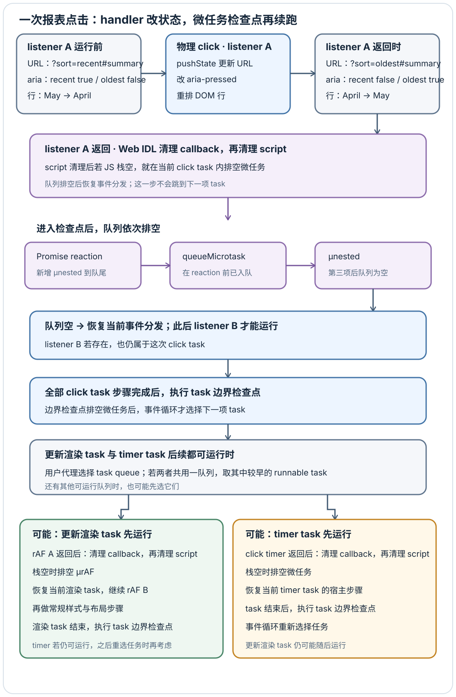

理解图里的 listener 交接要看两个规范调用点。DOM 的事件分发通过 Web IDL `call a user object's operation` 调用 `EventListener`；rAF 则由 HTML 用 Web IDL callback function 调用。两条 Web IDL 返回路径都会先执行 `clean up after running a callback`，再执行 HTML 的 `clean up after running script`。前一步清理 callback 宿主状态，本身不运行微任务；后一步从 JavaScript 执行上下文栈移除脚本，若栈此时为空才触发微任务检查点。因此，物理输入的 click task 中 listener A 返回时，微任务可在事件分发继续调用 listener B 前运行；排空后恢复的是当前事件分发，而非下一项 task。若 JavaScript 正在调用 `element.click()`，外层脚本仍在栈上，listener A 返回不会让栈变空；A、B 都会先返回，外层脚本结束后才运行检查点。无论 callback 中途是否触发过检查点，task 自身步骤结束后仍有 task 边界检查点；HTML 的防重入标志会阻止嵌套检查点重复排空同一队列。

### `requestAnimationFrame` 把写入对齐到渲染更新

`requestAnimationFrame(callback)` 把 callback 注册到文档的动画帧 callback 列表。它不是独立 task，也不是微任务；用户代理选中更新渲染 task 后，HTML 在执行这一轮的常规样式和布局更新之前运行列表中的动画帧 callbacks。若页面有可呈现的渲染机会且用户代理没有跳过更新，这能让动画写入和当前更新对齐。DOM 修改并不要求应用一定调用 rAF，普通 DOM 改动也可以在后续更新渲染中反映出来。

rAF callback 本身通过 Web IDL callback 调用。callback 返回后，Web IDL 先清理 callback 状态，再清理 script；如果执行上下文栈变空，后者就在同一个渲染 task 内运行微任务检查点。排空后控制返回当前更新渲染算法，继续运行后续 rAF callback，再进入常规样式和布局步骤；检查点不会把这次渲染 task 结束掉。rAF callback 内排入的 Promise reaction 因而能在该轮样式与布局步骤之前执行，但不会额外获得一轮输入或绘制机会。HTML 的更新渲染算法随后按需重算样式、布局和其他文档更新步骤。浏览器如何把更新结果继续交给绘制、合成和屏幕呈现，取决于引擎实现；见[一次 DOM 改动怎样进入布局与绘制？](#12.%20%E4%B8%BA%E4%BB%80%E4%B9%88%E4%B8%80%E6%AC%A1%20DOM%20%E6%94%B9%E5%8A%A8%E4%BC%9A%E5%A2%9E%E5%8A%A0%E5%B8%83%E5%B1%80%E6%88%96%E7%BB%98%E5%88%B6%E5%B7%A5%E4%BD%9C%EF%BC%9F)。

rAF 的回调时刻受渲染机会与页面状态影响，不是固定的 `60 Hz` 定时器；隐藏页面或被节流时，回调可能延迟。它给出的时间戳适合计算动画经过时间，但 callback 中大量计算仍会拖慢当前渲染更新。读几何值还可能促使同步布局，不能假定把读写放进 rAF 就只做合成。

### `requestIdleCallback` 只安排可推迟的小块工作

`requestIdleCallback(callback, { timeout })` 让用户代理在它认为空闲时安排低优先级工作，并把剩余空闲时间的估计传给 `deadline.timeRemaining()`。空闲期何时开始、可有多长由用户代理决定；页面忙或隐藏时，回调可能很久都不运行。提供正数 `timeout` 后，若回调没有在 idle period 内运行，超过期限后，用户代理会安排超时 task；规范允许它再等待一段由实现决定的时间才入队，入队后仍要等该 task 被选中运行，`didTimeout` 只说明这个 callback 是因 timeout 才执行。`timeRemaining()` 是估计值，不是执行预算或抢占点。

~~~javascript
function runIdleSlice(deadline) {
  if (!workQueue.length) return;
  if (deadline.didTimeout || deadline.timeRemaining() > 0) {
    processNext(workQueue.shift()); // processNext 只处理一个有界项目
  }
  if (workQueue.length) requestIdleCallback(runIdleSlice, { timeout: 2000 });
}

requestIdleCallback(runIdleSlice, { timeout: 2000 });
~~~

这里的 `workQueue` 和 `processNext` 是应用自己的队列与工作函数。`requestIdleCallback()` 在目标浏览器中需做能力检测；不支持时可以退回普通 task 分片，但 `setTimeout()` 不能保证回调发生时浏览器正空闲。React 等框架的 scheduler 也建立在宿主机制之上，不是 HTML 规范统一规定的 task source。

Node.js 有另一套宿主边界：它按 libuv 阶段处理 I/O、定时器和 `setImmediate()`，并额外提供 `process.nextTick()` 队列；CommonJS 顶层和 ES module 顶层中，nextTick 与 Promise 微任务的相对顺序也可能不同。这里的渲染机会与 rAF 讨论针对浏览器窗口，不要把它改写成 Node 的固定阶段图；见 [Node.js 事件循环阶段与微任务队列如何交互？](../../engineering-foundations/backend/node-event-loop-and-microtasks.md)。

**延伸：**[脚本如何影响 HTML 解析与文档就绪？](#3.%20%E8%84%9A%E6%9C%AC%E5%A6%82%E4%BD%95%E5%BD%B1%E5%93%8D%20HTML%20%E8%A7%A3%E6%9E%90%E4%B8%8E%E6%96%87%E6%A1%A3%E5%B0%B1%E7%BB%AA%EF%BC%9F)说明解析期间的脚本调度；[DOM 事件如何传播，何时适合事件委托？](#4.%20%E6%B5%8F%E8%A7%88%E5%99%A8%E6%80%8E%E6%A0%B7%E6%9F%A5%E8%AF%A2%E3%80%81%E6%9B%B4%E6%96%B0%20DOM%20%E5%B9%B6%E5%93%8D%E5%BA%94%E7%94%A8%E6%88%B7%E8%BE%93%E5%85%A5%EF%BC%9F)说明 click 如何到达处理器；[JavaScript 异步](#40.%20%E5%9B%9E%E8%B0%83%E3%80%81Promise%20%E4%B8%8E%20async%20%E5%87%BD%E6%95%B0%E6%80%8E%E6%A0%B7%E7%BB%84%E5%90%88%E5%BC%82%E6%AD%A5%E5%B7%A5%E4%BD%9C%EF%BC%9F)解释 Promise 本身的语言行为；[如何测量并诊断网页性能？](#13.%20%E5%A6%82%E4%BD%95%E6%B5%8B%E9%87%8F%E5%B9%B6%E8%AF%8A%E6%96%AD%E7%BD%91%E9%A1%B5%E6%80%A7%E8%83%BD%E9%97%AE%E9%A2%98%EF%BC%9F)帮助区分点击前等待、handler 执行和后续呈现延迟。

> [!info]- 来源
> - **任务源、task queue、task 结束检查点、task 选择与渲染机会。** [WHATWG HTML §8.1.7 Event loops](https://html.spec.whatwg.org/multipage/webappapis.html#event-loops)，Living Standard，核对日期：2026-11-11；重点对照 §8.1.7.1 Definitions、§8.1.7.2 Queuing tasks 和 [§8.1.7.3 Processing model](https://html.spec.whatwg.org/multipage/webappapis.html#event-loop-processing-model)。定义段说明 task source 如何映射到 task queue、不同来源可合并；processing model 规定从所选队列取最早的可运行 task、task 步骤结束后的微任务检查点，以及渲染机会如何在并行步骤中排入 rendering task source。规范的用户交互优先示例只是实现自由度示意，不是固定策略。
> - **DOM listener、callback 清理与空栈检查点。** [WHATWG DOM inner invoke](https://dom.spec.whatwg.org/#concept-event-listener-inner-invoke) 对事件 listener 执行 Web IDL 的 [§3.11 call a user object's operation](https://webidl.spec.whatwg.org/#call-a-user-objects-operation)；rAF callback 路径见 [§3.12 invoke a callback function](https://webidl.spec.whatwg.org/#invoke-a-callback-function)，Web IDL Living Standard 核对日期：2026-11-11。两条返回算法依次运行 `clean up after running a callback` 和 `clean up after running script`；前者不做 checkpoint，后者调用 [WHATWG HTML §8.1.4.4 clean up after running script](https://html.spec.whatwg.org/multipage/webappapis.html#clean-up-after-running-script)，在 JS 执行上下文栈变空时触发 [§8.1.7.3 perform a microtask checkpoint](https://html.spec.whatwg.org/multipage/webappapis.html#perform-a-microtask-checkpoint)，Living Standard 核对日期：2026-11-11。
> - **History API 与当前文档 URL。** [WHATWG HTML §7.2.5 The `History` interface](https://html.spec.whatwg.org/multipage/nav-history-apis.html#the-history-interface)，Living Standard，核对日期：2026-11-11。`pushState()` 更新同一文档的 session history 与当前 URL，不会触发文档重取；列表排序是报表 handler 的另一项 DOM 操作。
> - **Promise reaction 与微任务队列。** [ECMAScript 2026 §27.2.1.8 TriggerPromiseReactions](https://tc39.es/ecma262/2026/#sec-triggerpromisereactions) 为 reaction 生成 job；[§9.5.5 HostEnqueuePromiseJob](https://tc39.es/ecma262/2026/#sec-hostenqueuepromisejob) 要求按调用顺序运行这些 Promise jobs。[WHATWG HTML §8.1.6.6.4 HostEnqueuePromiseJob](https://html.spec.whatwg.org/multipage/webappapis.html#hostenqueuepromisejob) 将其接入浏览器宿主队列；[§8.8 Microtask queuing](https://html.spec.whatwg.org/multipage/timers-and-user-prompts.html#microtask-queuing) 规定 `queueMicrotask()` 使用同一事件循环的微任务队列，Living Standard，核对日期：2026-11-11。
> - **rAF 与更新渲染步骤。** [WHATWG HTML §8.12 run the animation frame callbacks](https://html.spec.whatwg.org/multipage/imagebitmap-and-animations.html#run-the-animation-frame-callbacks) 定义按序调用；[§8.1.7 update the rendering](https://html.spec.whatwg.org/multipage/webappapis.html#update-the-rendering) 将运行动画帧 callbacks 排在样式/布局更新之前，Living Standard，核对日期：2026-11-11。
> - **空闲回调。** [W3C `requestIdleCallback()` Working Draft，2025-05-21，§§2、4.1、4.3、5](https://www.w3.org/TR/requestidlecallback/) 定义用户代理决定的 idle period、deadline 与超时 callback；[WHATWG HTML §8.1.7.3 Processing model](https://html.spec.whatwg.org/multipage/webappapis.html#event-loop-processing-model) 说明浏览器窗口事件循环在无可运行 task 时才启动 idle period，Living Standard，核对日期：2026-11-11。
> - **Node 边界。** [Node.js v26.13.0 Event Loop](https://nodejs.org/learn/asynchronous-work/event-loop-timers-and-nexttick) 说明 libuv 阶段；[Node.js v26.13.0 `process.nextTick()` 与 `queueMicrotask()`](https://nodejs.org/api/process.html#when-to-use-queuemicrotask-vs-processnexttick) 说明 nextTick 队列、CommonJS/ES module 排序差异和 Legacy 状态，核对日期：2026-11-11。
> - **本地重放。** 用 headless Chrome `157.0.8103.50` 经 CDP `Input.dispatchMouseEvent` 对本地按钮模拟一次鼠标输入，产生可信的 click 事件，观察到 `click A → promise microtask → queueMicrotask → microtask queued by promise → click B → rAF A → microtask from rAF A → rAF B → timer task`。另一次从同步脚本调用 `button.click()`，观察到 `click A → click B → outer end → promise microtask → queueMicrotask → microtask queued by promise → timer task → rAF A → microtask from rAF A → rAF B`。这两次本机运行观察到相反先后；它们不构成不同 task source 的固定优先级保证。另以文档中的同一语句块重放同步代码例，只在 `console.log` 外包了一层记录器，观察到 `start → end → Promise reaction → queued microtask → queued by reaction → timer task`。本地 CDP 模拟鼠标输入 trace 和代码示例的运行记录在本轮报告目录；同步 `.click()` 的对照记录来自独立复读。
## 6. React如何把一次用户操作变成界面更新？

**案例背景。** 沿用浏览器主线中的 `/reports?sort=recent#summary` 报表页，本章用 React 实现它的筛选控件和列表。`#summary` 是浏览器定位片段，不会发给服务端；服务端按 `sort=recent` 给出 May、April。现在用户点 **Oldest first**。React 把 `sort` 改为 `oldest` 后，会先用手头已有的两条记录在本地排成 April、May，再在提交后请求服务端确认。若很快又选回 **Most recent**，界面再次先排成 May、April；较早的请求不能把较新的选择误标成已确认。

以下示例按 React 19.3.0 与对应 React DOM 核验。本章从点击处理器接手，解释一次状态更新如何经过 `render`（渲染）和 `commit`（提交）改变 React 管理的 DOM（文档对象模型）。`useEffect`（副作用同步）在提交后协调需要跟随已提交状态的外部工作，例如网络请求。完整页面由路由把选择写入浏览器历史，并在 Back 时恢复；这里展示 React 内部轮次，省略 URL（统一资源定位符）与历史栈接线，细节见[筛选状态与前进后退](#%E8%AE%A9%E6%8E%92%E5%BA%8F%E7%8A%B6%E6%80%81%E8%B7%9F%E9%9A%8F%E5%9C%B0%E5%9D%80%E6%A0%8F%E4%B8%8E%E5%89%8D%E8%BF%9B%E5%90%8E%E9%80%80)。本章停在 React 已提交 DOM；后续是否需要样式计算、布局或绘制，由浏览器决定，接回[浏览器如何把 URL 变成第一帧？](#1.%20%E6%B5%8F%E8%A7%88%E5%99%A8%E5%A6%82%E4%BD%95%E6%8A%8A%20URL%20%E5%8F%98%E6%88%90%E7%AC%AC%E4%B8%80%E5%B8%A7%EF%BC%9F)。

先看点击后没有再次切换选择的一轮；快速反选时，后文再展开旧响应的处理。

| 阶段 | 这一轮发生什么 |
| --- | --- |
| 点击处理器 | 用户选择 Oldest first；处理器排入 `sort=oldest` 与 `requestId=1`，当前处理器仍读到旧的 `sort=recent`。 |
| `render` | React 读取新状态，从上次成功的两条记录派生 April、May，并计算“等待请求 1”；这里不发网络请求。 |
| `commit` | React 更新选中按钮、行顺序和提示对应的 DOM。 |
| `useEffect` 建立 | 提交后，Effect 才调用 `fetchReports("oldest")`。 |
| 响应回调 | 成功或失败回调排入带 `requestId=1` 的结果；React 再 render、commit，显示确认，或单独报错并保留上次成功数据。 |

### 处理器读到的是本次界面的状态快照

`state`（状态）变量不会被 setter（状态更新函数）原地改写；调用 setter 不会改变当前处理器读到的 `state`。React 每次调用组件，都给它一份当前状态快照；事件处理器也是在某一次 `render` 时创建的。因此在本例的 `chooseSort` 中，若这轮的 `sort` 还是 `recent`，调用 `setSort("oldest")` 后，这个处理器里的 `sort` 仍然是 `recent`。本例的一次点击中，React 会在处理器返回后一起处理排序和请求编号这两个更新，再据此计算下一份界面。

例如本轮 `count` 为 `0` 时，同一处理器连续调用两次 `setCount(count + 1)`，两次都根据快照 `0` 排入 `1`，结果仍是 `1`。若要让每一步基于队列中前一步的结果，传入 updater（更新函数）。以下处理器定义在组件函数内部：

~~~tsx
const [count, setCount] = useState(0);

function addFromSnapshot() {
  setCount(count + 1);
  setCount(count + 1);
}

function addFromQueue() {
  setCount(value => value + 1);
  setCount(value => value + 1);
}
~~~

在 `count` 快照为 `0` 时单独调用 `addFromSnapshot`，结果是 `1`；单独调用 `addFromQueue`，React 依次应用两个 updater，结果是 `2`。本页的 `setRequestId(id => id + 1)` 也用 updater，让编号从待处理状态继续递增。

**用户动作直接触发的一次性工作放在事件处理器里；从 props（属性）和 state 可算出的值在 render 里计算；只有需要随着已提交界面同步外部系统的工作才放进 Effect。** 本例点击处理器记录新的排序意图，`sortReports` 在 render 中派生可见行，Effect 在 commit 后请求与这份选择相符的数据。把可见行再写进一份 state 并用 Effect 同步，会多出一次不必要的更新轮次。

下面的 TypeScript JSX（TSX）代码把 `fetchReports` 作为路由传入的数据层函数：它接收排序值，成功时返回已验证的 `Report[]`，失败时以拒绝的 Promise 表示。`initialReports` 常量是“路由已经取得并验证首屏服务端数据”的合成输入；组件从收到这份数据开始，不实现首屏读取。列表以每条报表稳定的 `key`（键）作为身份，排序不会更换报表身份。`periodStart` 用固定格式日期排序；`period` 只作 May、April 这样的显示标签，不按月份单词的字母顺序比较。两个排序按钮用 `aria-pressed` 暴露当前选择。初始数据由路由先给好，所以 `requestId=0` 时跳过请求。示例刻意只保留 React 状态和请求身份；真实 URL 历史接线在上面的浏览器章节。若需知道排序状态由哪些组件共同持有，见[如何在 React 中组合组件与复用行为？](#7.%20%E5%A6%82%E4%BD%95%E5%9C%A8%20React%20%E4%B8%AD%E7%BB%84%E5%90%88%E7%BB%84%E4%BB%B6%E4%B8%8E%E5%A4%8D%E7%94%A8%E8%A1%8C%E4%B8%BA%EF%BC%9F)。

> [!info]- 输入类型与首屏示意数据
>
> ~~~tsx
> import { useEffect, useState } from "react";
>
> type SortOrder = "recent" | "oldest";
> type Report = {
>   id: string;
>   period: string;
>   periodStart: string;
>   title: string;
> };
> type FetchReports = (sort: SortOrder) => Promise<Report[]>;
> type SuccessfulRequest = {
>   requestId: number;
>   sort: SortOrder;
>   reports: Report[];
> };
> type FailedRequest = {
>   requestId: number;
>   sort: SortOrder;
> };
>
> const initialReports: Report[] = [
>   {
>     id: "may",
>     period: "May",
>     periodStart: "2026-05-01",
>     title: "May summary"
>   },
>   {
>     id: "april",
>     period: "April",
>     periodStart: "2026-04-01",
>     title: "April summary"
>   }
> ];
>
> function sortReports(reports: Report[], sort: SortOrder): Report[] {
>   // periodStart 是固定格式 YYYY-MM-DD；复制后排序，不改写上游数据。
>   return [...reports].sort((a, b) => {
>     const order = a.periodStart.localeCompare(b.periodStart);
>     return sort === "recent" ? -order : order;
>   });
> }
> ~~~

#### 点击怎样记录新的选择？

下面依次展开同一个 `ReportsPage` 组件；输入、状态、Effect、派生值、JSX、路由这六段按顺序拼接，组成完整示例。`sort` 保存当前选择，`requestId` 标识本次确认请求；`lastSuccess` 保存最近一次有效成功数据，`lastFailure` 单独记录失败。分开保存后，当前请求失败也能保留旧数据，并明确告诉读者它尚未被这次请求确认。

~~~tsx
function ReportsPage({
  initialSort,
  initialReports,
  fetchReports
}: {
  initialSort: SortOrder;
  initialReports: Report[];
  fetchReports: FetchReports;
}) {
  const [sort, setSort] = useState(initialSort);
  const [requestId, setRequestId] = useState(0);
  const [lastSuccess, setLastSuccess] = useState<SuccessfulRequest>({
    requestId: 0,
    sort: initialSort,
    reports: initialReports
  });
  const [lastFailure, setLastFailure] = useState<
    FailedRequest | null
  >(null);

  function chooseSort(nextSort: SortOrder) {
    if (nextSort === sort) return;
    setSort(nextSort);
    setRequestId(id => id + 1);
  }
~~~

处理器只排入新选择和新编号。此时还没有向服务端发请求，也没有直接挪动列表节点。React 接着根据新状态 render、commit，再执行相应 Effect。

#### 提交后，怎样识别这一轮请求？

这个 Effect 属于特定的一次已提交选择。它把当时的 `requestId` 和 `sort` 放进结果，同时用独立的 `ignore` 变量记录自己的生命周期。首屏 `requestId=0` 已有路由数据，直接跳过读取。

~~~tsx
  useEffect(() => {
    if (requestId === 0) return;

    let ignore = false;
    const currentRequestId = requestId;

    fetchReports(sort).then(
      reports => {
        if (!ignore) {
          setLastSuccess({
            requestId: currentRequestId,
            sort,
            reports
          });
        }
      },
      () => {
        if (!ignore) {
          setLastFailure({ requestId: currentRequestId, sort });
        }
      }
    );

    return () => {
      ignore = true;
    };
  }, [sort, requestId, fetchReports]);
~~~

`ignore` 在这次 Effect 被清理后阻止旧回调写状态。回调写入结果时附上的编号还承担另一项工作：即使旧回调抢在 cleanup 前运行，它也只能写入自己的编号，不能把后来的请求误标为已确认。稍后的时序表会分别跟踪这两种情况。

#### 状态怎样决定列表和提示？

每次 render 都从当前状态算出以下三个值。`visibleReports` 用最近一次成功数据配合当前排序；是否确认或失败，则必须同时匹配当前请求编号和排序。

~~~tsx
  const requestConfirmed =
    lastSuccess.requestId === requestId && lastSuccess.sort === sort;
  const requestFailed =
    lastFailure !== null &&
    lastFailure.requestId === requestId &&
    lastFailure.sort === sort;
  const visibleReports = sortReports(lastSuccess.reports, sort);
~~~

| 当前结果 | 界面提示 | 列表使用的数据 |
| --- | --- | --- |
| 匹配当前编号和排序的失败结果存在 | 通过 `role="alert"` 显示失败 | 最近成功数据，按当前选择排序 |
| 否则，成功结果匹配当前编号与排序 | 通过 `role="status"` 显示已确认 | 本次成功数据 |
| 其余情况 | 通过 `role="status"` 显示等待当前请求 | 最近成功数据，按当前选择排序 |

返回的 JSX 根据这些值描述界面：按钮点击调用 `chooseSort`，其 `aria-pressed` 跟随 `sort`；列表遍历 `visibleReports`，以 `report.id` 为 key。React 的 commit 再把这份描述落实到 DOM。

> [!info]- 组件的 JSX 返回部分（承接上面的 ReportsPage）
>
> ~~~tsx
>   return (
>     <section>
>       <div role="group" aria-label="报表排序">
>         <button
>           type="button"
>           aria-pressed={sort === "recent"}
>           onClick={() => chooseSort("recent")}
>         >
>           Most recent
>         </button>
>         <button
>           type="button"
>           aria-pressed={sort === "oldest"}
>           onClick={() => chooseSort("oldest")}
>         >
>           Oldest first
>         </button>
>       </div>
>
>       {requestFailed ? (
>         <p role="alert">
>           {"当前选择：" + sort + "；请求 #" + requestId +
>             " 失败。仍显示上次成功（" + lastSuccess.sort +
>             "）的数据，并按当前选择排序。"}
>         </p>
>       ) : requestConfirmed ? (
>         <p role="status">
>           {"服务端已确认当前选择：" + sort + "（请求 #" + requestId + "）。"}
>         </p>
>       ) : (
>         <p role="status">
>           {"当前选择：" + sort + "；等待请求 #" + requestId +
>             "。下方保留上次成功（" + lastSuccess.sort +
>             "）的数据，并按当前选择排序。"}
>         </p>
>       )}
>
>       <ul>
>         {visibleReports.map(report => (
>           <li key={report.id}>{report.period} — {report.title}</li>
>         ))}
>       </ul>
>     </section>
>   );
> }
> ~~~

路由传入初始排序、首屏数据和数据层函数。下面的外层组件只展示这些输入怎样交接，不实现 URL/history 或真实请求。

> [!info]- 路由如何传入本例输入
>
> ~~~tsx
> function ReportsRoute({
>   fetchReports
> }: {
>   fetchReports: FetchReports;
> }) {
>   return (
>     <ReportsPage
>       initialSort="recent"
>       initialReports={initialReports}
>       fetchReports={fetchReports}
>     />
>   );
> }
> ~~~

`initialSort` 和 `initialReports` 是首屏输入；`useState` 只在首次挂载时用它们初始化。后续 URL 变化不能只改这两个 prop 就期待状态自动重置。由于 `fetchReports` 在依赖中，同一数据域内应传入稳定的数据层函数；若每次 render 都新建函数，Effect 会把它当作依赖变化而重新请求。若 `fetchReports` 内部读取原始 JSON，也应先在数据边界验证形状，而不是只用 TypeScript 类型断言；见[收到不可信 JSON 后，TypeScript 怎样建立可信的类型？](#45.%20%E6%94%B6%E5%88%B0%E4%B8%8D%E5%8F%AF%E4%BF%A1%20JSON%20%E5%90%8E%EF%BC%8CTypeScript%20%E6%80%8E%E6%A0%B7%E5%BB%BA%E7%AB%8B%E5%8F%AF%E4%BF%A1%E7%9A%84%E7%B1%BB%E5%9E%8B%EF%BC%9F)。完整路由需要在用户选择筛选时用 `pushState` 新增历史项；若用 `replaceState` 覆盖当前项，Back 就无法返回之前的选择。路由还要在 `popstate` 到来时把 URL 中的排序交给状态所有者。若 Back 恢复的排序需要重新向服务端确认，即使排序值和上一次相同，路由也要为这次读取发出新请求身份；若能复用该历史项对应的有效数据，则不必为了编号而强制请求。React Router 与单页应用（SPA）/多页应用（MPA）的边界见[React 路由如何把 URL 映射到视图？](#62.%20React%20%E8%B7%AF%E7%94%B1%E6%80%8E%E6%A0%B7%E6%8A%8A%E5%9C%B0%E5%9D%80%E6%98%A0%E5%B0%84%E5%88%B0%E7%95%8C%E9%9D%A2%E5%B9%B6%E5%8A%A0%E8%BD%BD%E6%95%B0%E6%8D%AE%EF%BC%9F)。

请求身份只约束同一数据域内的确认结果，不负责隔离界面正在显示的数据。切换账户时，仅增加请求编号仍会让 `lastSuccess.reports` 中的旧账户行留在列表里，等待期间和失败时尤其明显。路由应在数据域变化时同时隔离或清空成功数据；一种直接做法是按账户 ID 重新挂载 `ReportsPage`，并传入该账户已取得的首屏数据。

**跟着 May 和 April 走一遍。** 初始 `requestId=0` 的路由输入是 May、April，首屏直接显示它们，不额外请求。点击 **Oldest first** 后，React 将 `sort=oldest` 与编号 `1` 排入更新；下一次 render 从上次成功的两条记录派生 April、May。commit 提交按钮、列表和等待提示；之后 Effect 才为 `oldest` 启动请求 `1`。排序操作由点击触发，纯排序在 render 执行，请求则由已提交选择的 Effect 发起。请求成功或失败时，回调只把带编号的结果排入状态；React 下一轮 render 和 commit 才更新确认提示或错误提示。

若请求 `1` 尚未结束时又点 **Most recent**，下一次 render 会把选择和请求身份计算为 `recent #2`，并从当前上次成功数据派生 May、April；commit 更新按钮、列表和等待 `#2` 的提示。这个 render 本身不会发请求。依赖改变的旧 Effect 会清理，然后新 Effect 才启动请求 `2`。旧请求 `1` 的响应回调可能在 cleanup 前或后运行，两个路径的生命周期和显示数据不同。这里比较的是回调实际运行的时刻；Promise 先完成，并不代表排队的回调已在 cleanup 前运行：

| 请求 1 回调相对 cleanup 的时机 | 响应回调 | 等待请求 2 时的列表与提示 |
| --- | --- | --- |
| cleanup 前运行 | `ignore` 仍为 `false`，成功回调可把响应写为 `lastSuccess`，但仍标记 `requestId=1`。 | 用这份刚到的成功数据按当前 `recent` 排序；确认条件仍不匹配 `#2`，所以界面继续等待请求 2。 |
| cleanup 后运行 | cleanup 已将 `ignore` 设为 `true`，回调不写入状态。 | 保留之前的 `lastSuccess`，按当前 `recent` 排序；界面继续等待请求 2。 |

若请求 `1` 的失败回调在 cleanup 前运行，它只记下编号 `1` 的失败，不改 `lastSuccess`，也不能把请求 `2` 标成失败；cleanup 后运行则直接被忽略。无论哪条路径，编号 `1` 都不能确认编号 `2`。请求身份决定哪个响应可以确认当前轮次；`lastSuccess` 决定等待或失败时屏幕拿哪份同一数据域的成功数据来显示。若当前请求失败，独立的 `role="alert"` 会报错，列表保留同一数据域最近成功的数据，并按当前选择排序；不会把旧数据说成服务端刚确认的结果。

cleanup 守卫是“Effect 已被 React 清理后不再采用它的结果”，不是取消网络请求的承诺。Back 若需重新向服务端确认同一排序，也由路由创建新的请求身份；若重用缓存数据，则由路由提供相应有效结果。生产应用要缓存、去重、取消、重试或协调多组件请求时，通常由路由数据层或查询库承担这些契约，见[React 如何维护服务端数据与乐观更新？](#9.%20React%E7%95%8C%E9%9D%A2%E5%A6%82%E4%BD%95%E7%BB%B4%E6%8A%A4%E6%9C%8D%E5%8A%A1%E7%AB%AF%E6%95%B0%E6%8D%AE%E4%B8%8E%E4%B9%90%E8%A7%82%E6%9B%B4%E6%96%B0%E7%9A%84%E6%AD%A3%E7%A1%AE%E6%80%A7%EF%BC%9F)。

### 渲染、协调与提交是不同工作

`render` 阶段调用组件，把当前 props、state 转成 JSX 元素描述。它是计算，不是直接改 DOM。并发特性可能让尚未提交的 render 暂停、重试或放弃；因此不能在 render 中发请求、写 URL、改现有对象，或手动改 React 管理的 DOM。**是否调用组件、是否产生 DOM 变化、浏览器是否绘制，是三个不同问题。**

reconciliation（协调）按树中的位置、元素类型和 key（键）对应前后两次描述。本例的 `sortReports` 每次按当前 `sort` 生成新数组；它不修改 `lastSuccess.reports`。May 和 April 的 `id` 在顺序改变时保持不变，`key`（键）取 `report.id`，让 React 把前后两棵列表中属于同一报表的行对应起来。key 只需在同一列表兄弟节点间稳定且唯一；用数组下标代替数据身份，排序后行内状态可能跟着位置走。

render 完成后才进入 `commit`（提交阶段），React 将必要的改动写到宿主树。一个 setter 不等于一次 DOM 修改：新旧界面若相同，React 可以不改 DOM；若排序改变，则更新所需的行位置和按钮属性。React 负责 DOM commit，浏览器按需在后续渲染机会处理样式、布局或绘制；任务排队和帧调度的细节见[浏览器 JavaScript 何时运行，画面何时更新？](#5.%20%E6%B5%8F%E8%A7%88%E5%99%A8%20JavaScript%20%E4%BD%95%E6%97%B6%E8%BF%90%E8%A1%8C%EF%BC%8C%E7%94%BB%E9%9D%A2%E4%BD%95%E6%97%B6%E6%9B%B4%E6%96%B0%EF%BC%9F)。浏览器帧与 React setter 不是一一对应关系。

React 会把同一批的多个状态更新一起处理，避免逐个更新都触发一次完整的 render/commit，这叫 batching（批量处理）。本例点击处理器同时排入 `sort` 与 `requestId`，React 不会先提交一个只改排序、又立刻提交一个只改编号的半成品。React 18 起，使用 `createRoot` 的应用也会自动批量处理 Promise、定时器和原生事件处理器中的更新；React 18 的旧 `ReactDOM.render` 根会保留旧的批处理范围，升级后切换根 API 才启用新行为。批量处理不会改写当前 handler 的快照，也不表示每个更新都会单独绘制一帧。

> [!example] JSX 描述界面，不是 HTML（超文本标记语言）字符串
> JSX 是描述元素的语法。构建工具可以把它转换成自动运行时的 `react/jsx-runtime` 调用，也可以转换成经典的 `React.createElement` 调用。转换方式不改变 state 快照、render 和 commit 的关系。

### Effect在提交后同步外部系统

`Effect` 适合做由“组件现在需要与外部系统保持一致”触发的工作，例如订阅、连接，或按已提交选择读取服务端数据。它不适合代替点击处理器执行只由那次点击触发的一次性动作，也不适合在两份 React state 之间搬运可直接算出的值。需要时 `useEffect` 在 commit 后运行；依赖改变时先用旧闭包执行 `cleanup`（清理），再用新值执行 `setup`（建立）；卸载时再执行最后一次清理。依赖应包含 setup 实际读取的响应式值，React 用 `Object.is` 比较它们。本例的 `sort`、`requestId` 与 `fetchReports` 都在依赖中。

React 不能保证 Effect 总在浏览器 paint（绘制）之后运行。与点击交互有关的 Effect 可能在 paint 前运行；其他更新通常会让浏览器先绘制。若任务本身需要测量或在绘制前调整 DOM，可评估 `useLayoutEffect`；本例发起数据请求，不依赖这个精确帧时机。Promise 失败由此处显式转为状态与错误提示；渲染期间抛出的异常属于错误边界处理范围。

根组件包在 `StrictMode`（严格模式）中时，开发环境首次挂载会额外执行一次 Effect 的 `setup → cleanup`，再执行正式 setup，用来检查清理能否撤销建立工作。不是生产环境每次都发两次请求。本例初次调用因 `requestId=0` 提前返回，既不启动请求也没有可调用的 cleanup；之后排序更新才会为请求建立清理函数。即便使用 ignore，网络请求本身也可能继续运行；它解决的是清理后旧闭包不能采用结果。

类组件的 `render()` 同样必须保持纯计算。维护旧类组件时，`componentDidMount` 和 `componentDidUpdate` 可在 DOM 提交后同步外部系统，`componentWillUnmount` 可清理连接；若要在 DOM 更新前读取布局快照，使用 `getSnapshotBeforeUpdate`。这些生命周期帮助定位阶段，但不与函数组件的 Effect 一一对应；React 仍支持 class components（类组件），但新组件通常使用函数组件。若一次排序确实让用户输入变慢，再看[如何让报表筛选在昂贵更新时保持响应？](#8.%20%E5%A6%82%E4%BD%95%E8%AE%A9%E6%8A%A5%E8%A1%A8%E7%AD%9B%E9%80%89%E5%9C%A8%E6%98%82%E8%B4%B5%E6%9B%B4%E6%96%B0%E6%97%B6%E4%BF%9D%E6%8C%81%E5%93%8D%E5%BA%94%EF%BC%9F)；若是渲染抛出的异常需要恢复，则看[React 错误边界能恢复哪些失败？](#11.%20React%E9%94%99%E8%AF%AF%E8%BE%B9%E7%95%8C%E8%83%BD%E6%81%A2%E5%A4%8D%E5%93%AA%E4%BA%9B%E5%A4%B1%E8%B4%A5%EF%BC%9F)。

> [!info]- 来源与版本核验（当前 React 文档 19.3；历史行为按 React 18 核验，日期 2026-11-12）
>
> - 状态快照、setter 请求下一次 render、处理器保留当前状态，以及函数 updater 在队列中逐个计算：[State as a Snapshot](https://react.dev/learn/state-as-a-snapshot)、[Queueing a Series of State Updates](https://react.dev/learn/queueing-a-series-of-state-updates)、[`useState`](https://react.dev/reference/react/useState)，React 19.3 文档。
>
> - render/commit 分工、render 纯净及组件调用不必对应 DOM 改动：[Render and Commit](https://react.dev/learn/render-and-commit)、[Keeping Components Pure](https://react.dev/learn/keeping-components-pure)，React 19.3 文档。
>
> - 同级 key 与树位置怎样确定状态身份：[Preserving and Resetting State](https://react.dev/learn/preserving-and-resetting-state)，React 19.3 文档。
>
> - Effect 与事件的不同触发来源，依赖比较，改变依赖时先 cleanup 再 setup，Effect 相对 paint 的时序条件，以及 fetch 结果忽略模式：[Synchronizing with Effects](https://react.dev/learn/synchronizing-with-effects)、[`useEffect`](https://react.dev/reference/react/useEffect)，React 19.3 文档；绘制前测量布局的 API：[`useLayoutEffect`](https://react.dev/reference/react/useLayoutEffect)，React 19.3 文档。
>
> - 根 StrictMode 的开发时额外 Effect setup/cleanup 检查：[StrictMode](https://react.dev/reference/react/StrictMode)，React 19.3 文档。
>
> - React 18 `createRoot` 与 legacy `ReactDOM.render` 的行为边界：[How to Upgrade to React 18 — Client Rendering APIs](https://react.dev/blog/2022/03/08/react-18-upgrade-guide#updates-to-client-rendering-apis)；自动批处理：[React v18 — Automatic Batching](https://react.dev/blog/2022/03/29/react-v18#new-feature-automatic-batching)；并发 render 的中断、恢复、放弃与完整树提交：[React v18 — What Is Concurrent React?](https://react.dev/blog/2022/03/29/react-v18#what-is-concurrent-react)，React 团队发布文档。
>
> - `pushState` 添加历史项、`replaceState` 替换当前项：[HTML Standard — History interface](https://html.spec.whatwg.org/multipage/nav-history-apis.html#the-history-interface)，核验日期 2026-11-12。
>
> - JSX 自动与经典转换：[Introducing the New JSX Transform](https://react.dev/blog/2020/09/22/introducing-the-new-jsx-transform)，React 团队，2020-09-22。
>
> - 类组件 render、`getSnapshotBeforeUpdate` 与 mount/update/unmount lifecycle：[Component](https://react.dev/reference/react/Component)，React 19.3 文档。
>
> - URL 片段只供客户端定位且不会随 HTTP（超文本传输协议）请求发给服务端：[RFC 3986 §3.5](https://www.rfc-editor.org/rfc/rfc3986#section-3.5)，核验日期 2026-11-12。
## 7. 如何在 React 中组合组件与复用行为？

**案例背景。** 报表页地址为 `/reports?sort=recent#summary`：查询参数决定排序，片段 `#summary` 只负责浏览器定位。路由把服务端给出的 May、April 两行与 `initialSort="recent"` 传入；初次提交选中 **Most recent**，显示 May 在 April 前。用户点 **Oldest first** 后，工具栏要选中旧序，列表要排成 April、May。因为同一份 `sort`（排序状态）同时决定两个界面，包含工具栏和列表的最近共同父组件负责持有它。父组件把状态和派生结果传给子组件，工具栏把用户意图通过回调交还状态所有者。远距离组件要共享行距偏好时，可选 Context；多个组件要复用同种外部监听行为时，可选自定义 Hook；父组件确实需要子组件的窄范围命令式动作时，才暴露 ref。

本章代码按 React 19.3 与 React DOM 19.3 核验。状态所有权示例省略 URL 与历史栈；若要让排序选择进入浏览器历史，可用 `pushState` 写入排序，并在 `popstate` 时把 Back/Forward 恢复的排序同步给同一状态所有者，见[浏览器主线](#%E8%AE%A9%E6%8E%92%E5%BA%8F%E7%8A%B6%E6%80%81%E8%B7%9F%E9%9A%8F%E5%9C%B0%E5%9D%80%E6%A0%8F%E4%B8%8E%E5%89%8D%E8%BF%9B%E5%90%8E%E9%80%80)。

> [!info]- 读旧版示例时需要识别的 API 差异
>
> React 19 的 Context 可直接用 `<Context value={...}>` 作为 Provider（提供者）；React 18 及更早版本需用 `<Context.Provider>`。React 19 函数组件也能把 `ref` 当作 prop，旧版本需 `forwardRef`。本章使用自动 JSX 转换，TSX 使用对应的 React 19 类型声明。下面使用当前写法；`use` 和 `useEffectEvent` 的调用规则在对应小节解释。

### 把状态放在共同使用者之上的最近一层

本例由调用方传入 `<ReportsPage reports={reports} initialSort="recent" />`。`reports` 只有 May、April 两行：May 的 `periodStart` 是 `2026-05-01`，April 的是 `2026-04-01`；本例日期固定为 `YYYY-MM-DD`。显示标签 `period` 不参与排序。`ReportsPage` 是工具栏和列表的最近共同祖先；它持有 `sort` 并在 render（渲染）中派生行顺序。

这一次数据流从父组件向下、用户意图再向上：

~~~mermaid
flowchart TD
    P["ReportsPage<br/>持有 sort<br/>派生有序 rows"] -->|"sort 与回调"| T["ReportToolbar<br/>显示选中按钮"]
    P -->|"有序 reports"| L["ReportList<br/>按顺序显示行"]
    T -->|"点击调用 onSortChange"| P
~~~

首次 render 中 `sort="recent"`，提交后 **Most recent** 被选中，列表为 May、April。排序按钮不直接改列表：工具栏接收 `sort` 和 `onSortChange`，其中回调就是父组件的 `setSort`；点击时调用它，安排下一轮 render。状态所有者从 `oldest` 派生新 `rows`，commit（提交）后工具栏与列表一起显示 Oldest first、April/May。`sortReports` 复制数组再排，不原地修改路由给的报表；`ReportList` 只显示派生结果，并用稳定的报表 ID 做 `key`（列表项标识）。当多个组件需要协调同一份状态时，通常由一处更新、其他组件读取，把 state 提到它们的最近共同祖先；提得更高会让职责和更新路径变宽，不会自动改善性能。

`initialSort` 只用于首次挂载时初始化 `useState`。完整路由若在 `popstate` 后拿到新排序，不能只换这个 prop 就期待组件状态自动重置；应让路由直接拥有排序状态并把它作为受控 prop 传入，或显式更新/重新挂载状态所有者。例如，只把同一实例的 `initialSort` prop 改成 `oldest`，按钮和列表仍保持 recent、May/April；调用 `setSort("oldest")` 才会安排状态更新，提交后显示 oldest、April/May。当前片段只展示组件通信，不实现 URL/history。

props（属性）适合父子层级清楚的数据向下传和 callback prop（回调属性）向上交互。若两个组件没有共享状态，贸然把 state 上移只会扩大维护范围。跨较深子树读取主题、地区或行距偏好时，可考虑 Context（上下文）；多处功能需共享并统一更新策略的客户端状态，可再考虑 store（共享状态容器），如 Redux；服务端拥有的报表记录仍归查询层，不因放进 Context 就获得缓存、请求身份或取消语义。Redux 的 action（动作）、reducer（归约器）、selector（选择器）和异步工作流见[Redux 如何组织共享界面状态与异步工作？](#60.%20Redux%20%E5%A6%82%E4%BD%95%E7%BB%84%E7%BB%87%E5%85%B1%E4%BA%AB%E7%95%8C%E9%9D%A2%E7%8A%B6%E6%80%81%E4%B8%8E%E5%BC%82%E6%AD%A5%E5%B7%A5%E4%BD%9C%EF%BC%9F)。

> [!example]- 完整示例：排序状态、按钮与报表列表
>
> ~~~tsx
> import { useState } from "react";
>
> type SortOrder = "recent" | "oldest";
> type Report = {
>   id: string;
>   period: string;
>   periodStart: string;
>   title: string;
> };
>
> function sortReports(reports: Report[], sort: SortOrder): Report[] {
>   return [...reports].sort((a, b) => {
>     const order = a.periodStart.localeCompare(b.periodStart);
>     return sort === "recent" ? -order : order;
>   });
> }
>
> export function ReportsPage({
>   reports,
>   initialSort
> }: {
>   reports: Report[];
>   initialSort: SortOrder;
> }) {
>   const [sort, setSort] = useState(initialSort);
>   const rows = sortReports(reports, sort);
>
>   return (
>     <main>
>       <ReportToolbar sort={sort} onSortChange={setSort} />
>       <ReportList reports={rows} />
>     </main>
>   );
> }
>
> function ReportToolbar({
>   sort,
>   onSortChange
> }: {
>   sort: SortOrder;
>   onSortChange: (sort: SortOrder) => void;
> }) {
>   return (
>     <div role="group" aria-label="报表排序">
>       <button
>         type="button"
>         aria-pressed={sort === "recent"}
>         onClick={() => onSortChange("recent")}
>       >
>         Most recent
>       </button>
>       <button
>         type="button"
>         aria-pressed={sort === "oldest"}
>         onClick={() => onSortChange("oldest")}
>       >
>         Oldest first
>       </button>
>     </div>
>   );
> }
>
> function ReportList({ reports }: { reports: Report[] }) {
>   return (
>     <ul>
>       {reports.map(report => (
>         <li key={report.id}>
>           {report.period} — {report.title}
>         </li>
>       ))}
>     </ul>
>   );
> }
>
> const reports: Report[] = [
>   {
>     id: "may",
>     period: "May",
>     periodStart: "2026-05-01",
>     title: "May report"
>   },
>   {
>     id: "april",
>     period: "April",
>     periodStart: "2026-04-01",
>     title: "April report"
>   }
> ];
>
> export function ReportsDemo() {
>   return <ReportsPage reports={reports} initialSort="recent" />;
> }
> ~~~

### 用Context传递远距离视图偏好

`ReportsView` 把视图内容作为 `children`（子节点）交给 `ReportViewProvider`；Provider 决定把这些内容放进 Context 子树。中间的 `ReportPanel` 只负责把收到的 children 放在 `<section>` 中，不用接收或转发 `density`。因此行距消费者即使隔着普通布局组件，仍能读到最近的 Provider。

下面的框表示组件包含关系。蓝色外框内的两个消费者读取同一份 `density`，中间布局组件只转交 `children`，不必转交行距值：

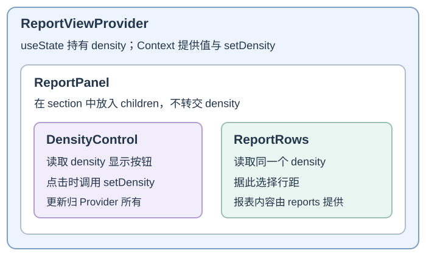

`ReportsView` 调用 Provider 时，把 `<ReportPanel>` 作为 `children` 交给它；`ReportPanel` 再把控制按钮和列表放入自己的 `<section>`。调用方提供内容，组件决定插入位置，这就是 children 组合。`useContext` 向上查找这个 Context 最近的 Provider；子树里若再嵌一个同类型 Provider，只有它下面的消费者改读内层值。Context 对象本身不保存状态；这里真正持有 `density` 的是 Provider 中的 `useState`。初始 `density="comfortable"`：按钮写“切换紧凑行距”，列表 `lineHeight=1.8`。点击调用 `setDensity("compact")` 后，Provider 提供的新 value 让两个消费者更新：按钮变为“恢复舒适行距”，列表 `lineHeight=1.2`。若消费者上方没有该 Context 的 Provider，`useReportView` 会读到默认 `null` 并报错，明确要求调用方补齐 Provider。

此例每次 Provider render 都新建 `{ density, setDensity }` 对象，因此 value 引用也改变。React 用 `Object.is` 比较新旧 `value`；即使两个对象字段完全相同，只要引用不同，Context 消费者就会更新。点击行距按钮时 `density` 确实变化，两个消费者需要新值。若父组件因其他状态或 `reports` 更新而重新 render，即使 `density` 没变，Provider 仍会创建新对象并使 Context 消费者更新；即使消费者包在 `memo`（按 props 浅比较跳过子组件渲染的优化）中，也挡不住 Context 值变化。确认这造成可见成本后，再考虑稳定 value 或拆分 Context。TypeScript 中为 Context 值和消费者建立类型边界的旧例仍见[归档中的旧 TypeScript Context 与自定义 Hook 示例](../../archive/front-end/0-1_Learning_Notes/react_typescript/typed-hooks-and-context.md)。Context 不会改变报表记录的服务端所有权，查询身份、新鲜度、取消与变更协调仍由[服务端状态章节](#9.%20React%E7%95%8C%E9%9D%A2%E5%A6%82%E4%BD%95%E7%BB%B4%E6%8A%A4%E6%9C%8D%E5%8A%A1%E7%AB%AF%E6%95%B0%E6%8D%AE%E4%B8%8E%E4%B9%90%E8%A7%82%E6%9B%B4%E6%96%B0%E7%9A%84%E6%AD%A3%E7%A1%AE%E6%80%A7%EF%BC%9F)负责。

> [!example]- 完整示例：Provider、children 与两个消费者
>
> ~~~jsx
> import { createContext, useContext, useState } from "react";
>
> const ReportViewContext = createContext(null);
>
> function ReportViewProvider({ children }) {
>   const [density, setDensity] = useState("comfortable");
>
>   return (
>     <ReportViewContext value={{ density, setDensity }}>
>       {children}
>     </ReportViewContext>
>   );
> }
>
> function ReportPanel({ children }) {
>   return <section>{children}</section>;
> }
>
> function useReportView() {
>   const value = useContext(ReportViewContext);
>   if (value === null) {
>     throw new Error("useReportView 必须在 ReportViewProvider 内调用");
>   }
>   return value;
> }
>
> function DensityControl() {
>   const { density, setDensity } = useReportView();
>   const nextDensity = density === "compact" ? "comfortable" : "compact";
>
>   return (
>     <button type="button" onClick={() => setDensity(nextDensity)}>
>       {density === "compact" ? "恢复舒适行距" : "切换紧凑行距"}
>     </button>
>   );
> }
>
> function ReportRows({ reports }) {
>   const { density } = useReportView();
>   return (
>     <ul style={{ lineHeight: density === "compact" ? 1.2 : 1.8 }}>
>       {reports.map(report => (
>         <li key={report.id}>{report.title}</li>
>       ))}
>     </ul>
>   );
> }
>
> export function ReportsView({ reports }) {
>   return (
>     <ReportViewProvider>
>       <ReportPanel>
>         <DensityControl />
>         <ReportRows reports={reports} />
>       </ReportPanel>
>     </ReportViewProvider>
>   );
> }
> ~~~

### 用自定义Hook复用状态行为

自定义 Hook 复用的是一段 Hook 行为，不会让不同调用自动共用 state。下面每个 `useWindowSize()` 调用都创建自己的 size 状态和 `resize` 监听器；多个组件可以用同样方式订阅窗口尺寸，各自独立更新。

~~~jsx
import { useEffect, useState } from "react";

export function useWindowSize() {
  const [size, setSize] = useState({ width: 0, height: 0 });

  useEffect(() => {
    function update() {
      setSize({ width: window.innerWidth, height: window.innerHeight });
    }

    window.addEventListener("resize", update);
    update();
    return () => window.removeEventListener("resize", update);
  }, []);

  return size;
}
~~~

`useEffect`（用于提交后同步外部系统的 Hook）在首次 commit（提交）后才运行，所以首次 render（渲染）暂时返回 `0 × 0`；随后 Effect 读取浏览器尺寸并更新。服务端也不会运行这个 Effect，服务端渲染与客户端首轮 hydration（水合）都会看到相同占位值。若两个组件都调用这个 Hook，在 `700×900` 窗口下它们会各自从占位值更新到 `700×900`；窗口变为 `720×900` 后，各自的监听器再把自己的 state 更新到新尺寸。相同输出是因为两次都读取同一个 `window`，不表示它们共用一份 state。卸载时每次调用都移除自己建立的监听器。若有很多消费者需要共享同一个外部窗口 store，应明确订阅同一 store（可用 React 的 [`useSyncExternalStore`](https://react.dev/reference/react/useSyncExternalStore)），而不是误以为每次调用同一自定义 Hook 就共享状态。

大多数 Hook 必须在组件或其他 Hook 顶层按固定顺序调用。React 19 的 `use` API 是特殊例外：它可以在条件和循环里读 Promise 或 Context，但仍须处于组件或 Hook 中，而且不能放进 `try/catch`；`useContext` 等普通 Hook 仍遵守固定顺序。

React 19.2 的 `useEffectEvent` 用于 Effect 里的 Effect Event（效果事件）逻辑：它在调用时读取最新提交的 props/state，但不因此让连接等 Effect 重新建立。它是一个 Hook，可在组件或自定义 Hook 顶层创建；自定义 Hook 可接收普通 callback 并用 `useEffectEvent(callback)` 包装，再由该 Hook 自己的 Effect 调用。Effect Event 要留在定义它的组件或 Hook 内，只能由本地 Effect 或另一个 Effect Event 调用；不能传给子组件、拿来当普通点击回调，也不能用它隐藏本来应该声明的 Effect 依赖。Effect Event 的函数身份每次 render 都会变化，不放进依赖数组。Effect 生命周期见[React 更新轮次](#Effect%E5%9C%A8%E6%8F%90%E4%BA%A4%E5%90%8E%E5%90%8C%E6%AD%A5%E5%A4%96%E9%83%A8%E7%B3%BB%E7%BB%9F)。

### ref用于窄范围的命令式能力

界面需要随值变化时用 state；ref 可持有不驱动界面的可变值，也可引用已提交的 DOM。下面父工具栏只调用子组件公开的 `focus()`，输入节点始终由 `ReportSearchInput` 自己持有。

~~~tsx
import { useImperativeHandle, useRef, type Ref } from "react";

type SearchHandle = {
  focus(): void;
};

function ReportSearchInput({ ref }: { ref: Ref<SearchHandle> }) {
  const inputRef = useRef<HTMLInputElement>(null);
  useImperativeHandle(
    ref,
    () => ({
      focus() {
        inputRef.current?.focus();
      }
    }),
    []
  );
  return <input ref={inputRef} aria-label="搜索报表" />;
}

export function ReportFocusControl() {
  const searchRef = useRef<SearchHandle>(null);
  return (
    <>
      <ReportSearchInput ref={searchRef} />
      <button type="button" onClick={() => searchRef.current?.focus()}>
        聚焦搜索
      </button>
    </>
  );
}
~~~

React 19 的函数组件可把 `ref`（引用）当作 prop 接收；React 18 及更早版本要用 `forwardRef` 转发。若父组件只需要 `focus()`，`useImperativeHandle` 暴露这个有限动作即可，不把内部节点和实现一起交出去。通过这种 API，调用者只依赖子组件承诺的行为。

### 组合组件与旧式逻辑复用接口

`children`（子节点）组合让调用方提供内容，由接收组件决定把它插在哪里；前面的 `ReportPanel` 接收按钮和列表的 JSX，再把它们放进 `<section>`。render prop（渲染属性）是可由列表提供的扩展接口：如果 `ReportList` 接收 `renderRow` prop，调用方可传 `renderRow={report => <strong>{report.title}</strong>}`，列表对每条报表调用这个函数，并把返回的 JSX 放进对应行；当前 `ReportList` 只接收 `reports`，没有实现这个扩展 prop。higher-order component（高阶组件，HOC）包装组件并返回新组件。自定义 Hook 通常更适合复用 Hook 状态逻辑，但旧库的 render prop 或 HOC 也可能是稳定且清楚的 API，不必只为“改成 Hook”而重写。

条件分支也是组合的一部分：二选一用三元表达式，只在条件为真时渲染用逻辑 AND，能早退时用 `if`。在 `ReportsPage` 里，`ReportList` 必须收到 `reports`；错误写法 `{rows.length && <ReportList reports={rows} />}` 在 `rows` 为空时得到数字 `0`，React 会把它渲染出来。改成 `{rows.length > 0 && <ReportList reports={rows} />}` 时，空数组得到布尔值 `false`，不会多出数字。

这些模式解决状态归属和行为复用。若一次交互的 React render 成本已测出，再看[如何测量并减少不必要的 React 工作？](#14.%20%E5%A6%82%E4%BD%95%E6%B5%8B%E9%87%8F%E5%B9%B6%E5%87%8F%E5%B0%91%E4%B8%8D%E5%BF%85%E8%A6%81%E7%9A%84React%E5%B7%A5%E4%BD%9C%EF%BC%9F)；本章不把 memoization（记忆化）当作组件组合规则。

> [!info]- 来源与版本核验（React 19.3；核验日期 2026-11-12）
>
> - props 传递、调用方提供 JSX children、共同使用者的 state 归属、Context 数据下传：[Passing Props to a Component](https://react.dev/learn/passing-props-to-a-component)、[Passing JSX as children](https://react.dev/learn/passing-props-to-a-component#passing-jsx-as-children)、[Sharing State Between Components](https://react.dev/learn/sharing-state-between-components)、[useState](https://react.dev/reference/react/useState#returns)、[Passing Data Deeply with Context](https://react.dev/learn/passing-data-deeply-with-context)，React 19.3 文档。
> - Context 的默认值、最近 Provider、value 变化触发消费者更新、React 19 新 Provider 语法与旧 `.Provider`：[createContext](https://react.dev/reference/react/createContext)、[useContext](https://react.dev/reference/react/useContext)，React 19.3 文档。
> - 自定义 Hook 复用行为与调用限制：[Reusing Logic with Custom Hooks](https://react.dev/learn/reusing-logic-with-custom-hooks)、[Rules of Hooks](https://react.dev/reference/rules/rules-of-hooks)；React 19 的 `use` 可在条件/循环中读资源，但不能在 `try/catch` 中：[use](https://react.dev/reference/react/use)。
> - React 19.2 的 `useEffectEvent` 最新提交值、组件与自定义 Hook 中的定义/调用范围、依赖与身份限制：[useEffectEvent](https://react.dev/reference/react/useEffectEvent)、[Caveats](https://react.dev/reference/react/useEffectEvent#caveats)、[Using Effect Events in custom Hooks](https://react.dev/reference/react/useEffectEvent#using-effect-events-in-custom-hooks)、[React 19.2](https://react.dev/blog/2025/10/01/react-19-2)，React 官方文档。
> - React 19 的自动 JSX 转换要求及对应类型声明：[React 19 Upgrade Guide — New JSX Transform is now required](https://react.dev/blog/2024/04/25/react-19-upgrade-guide#new-jsx-transform-is-now-required)。
> - ref 与命令式 handle；React 19 可直接收 ref prop，旧版需 `forwardRef`：[useRef](https://react.dev/reference/react/useRef)、[useImperativeHandle](https://react.dev/reference/react/useImperativeHandle)、[forwardRef](https://react.dev/reference/react/forwardRef)，React 19.3 文档。
> - 多处读取同一外部 store 的订阅 API：[useSyncExternalStore](https://react.dev/reference/react/useSyncExternalStore)，React 19.3 文档。
> - 逻辑 AND 条件渲染：[Conditional Rendering](https://react.dev/learn/conditional-rendering#logical-and-operator)，React 19.3 文档。
> - render prop 与 higher-order component 的旧式复用接口：[Render Props](https://legacy.reactjs.org/docs/render-props.html)、[Higher-Order Components](https://legacy.reactjs.org/docs/higher-order-components.html)，React 官方旧版文档；用于解释仍存在于库 API 中的接口。
> - toggle button 的 `aria-pressed`：[WAI-ARIA APG — Button Pattern](https://www.w3.org/WAI/ARIA/apg/patterns/button/)，W3C WAI 官方模式，核验日期 2026-11-12。
> - 当前 React 文档版本：[Versions](https://react.dev/versions)，React 19.3，核验日期 2026-11-12。
## 8. 如何让报表筛选在昂贵更新时保持响应？

**案例背景。** 报表页已经收到 May、April 两条数据，当前列表可按日期排序。用户在搜索框输入标题时，输入框应立即显示新字符；如果报表结果很多，列表可以稍后跟上。用户点击“查看摘要”时，也希望保留当前列表，等摘要代码准备好再切换。下面分别跟踪输入筛选和摘要切换，区分紧急更新、可延后的 render（渲染）、commit（提交）、Transition（过渡更新）和 Suspense（挂起边界）。这些 API 调整 React 的工作优先级，不会把 JavaScript 移到另一个线程，也不设固定毫秒延迟。

以下行为按 React 19.3 与 React DOM 19.3 核验。先看同一次输入如何产生两轮更新，再看等待摘要代码时如何保留当前界面。状态快照见[React 更新轮次](#6.%20React%E5%A6%82%E4%BD%95%E6%8A%8A%E4%B8%80%E6%AC%A1%E7%94%A8%E6%88%B7%E6%93%8D%E4%BD%9C%E5%8F%98%E6%88%90%E7%95%8C%E9%9D%A2%E6%9B%B4%E6%96%B0%EF%BC%9F)，服务端查询仍由[服务端状态章节](#9.%20React%E7%95%8C%E9%9D%A2%E5%A6%82%E4%BD%95%E7%BB%B4%E6%8A%A4%E6%9C%8D%E5%8A%A1%E7%AB%AF%E6%95%B0%E6%8D%AE%E4%B8%8E%E4%B9%90%E8%A7%82%E6%9B%B4%E6%96%B0%E7%9A%84%E6%AD%A3%E7%A1%AE%E6%80%A7%EF%BC%9F)管理。本章省略 URL 与 Back 接线，见[浏览器历史栈机制](#%E8%AE%A9%E6%8E%92%E5%BA%8F%E7%8A%B6%E6%80%81%E8%B7%9F%E9%9A%8F%E5%9C%B0%E5%9D%80%E6%A0%8F%E4%B8%8E%E5%89%8D%E8%BF%9B%E5%90%8E%E9%80%80)。

> [!info]- 挂载方式与版本前提
>
> 本例从空挂载点创建客户端界面，使用 `createRoot`。若服务端已经输出 React HTML，应以首轮内容匹配的 `hydrateRoot` 接管。文本或 DOM 结构不匹配可能使 hydration（客户端接管）失败并转为客户端渲染：错误位于 Suspense 边界内时可从最近边界重建，没有边界时会重建整个根。属性值不匹配的处理不同，React 不保证修补属性。
>
> `useDeferredValue` 和 `useTransition` 自 React 18 提供；React 19 支持异步 Transition Action（动作），跨 `await` 的状态更新限制在后文说明。若查旧资料，React 18 的 `ReactDOM.render` 使用接近 React 17 的旧根兼容模式；React 19 已移除此 API，当前入口使用 `createRoot`。
### 输入保持即时，结果视图可以延后

这里把搜索框的 `query` 作为紧急状态，把 `useDeferredValue` 返回的 `deferredQuery` 交给结果组件 `ReportResults`。用 `isStale = query !== deferredQuery` 判断列表是否尚未跟上输入，并据此显示等待提示。列表子组件用 `memo`（记忆化组件）包住；示例的 `reports` 数组来自已经取得的一份数据集，在输入变化期间保持同一引用且不原地改写。否则子组件收到新数组时仍会重渲染，不能用这个例子说明如何跳过旧查询的列表工作。

假设初始搜索词为空，列表显示 May、April。用户一次把搜索框填成 `apr` 时，`onChange` 处理器排入新的 `query` 更新；setter 不会改写本轮仍读到的状态快照。下一轮紧急 render 得到新 `query`，但 `deferredQuery` 仍可能为空。下面按 React 实际提交顺序展开。

render（渲染）按状态快照计算下一份界面。React 采用计算结果时，commit（提交）才把必要的 DOM 改动应用到页面。下面把事件处理器安排更新与之后的提交分开：

| 次序 | 本例发生什么 |
| --- | --- |
| 1. 输入事件 | 用户一次把搜索框填成 `apr`；处理器排入 `query` 更新。 |
| 2. 紧急 render / commit | render 得到 `query="apr"`、`deferredQuery=""`、`isStale=true`。提交后输入显示 `apr`、等待提示出现；列表 DOM 仍是 May、April，`ReportResults` 的 props 未变，可跳过这轮工作。 |
| 3. 后台 render | React 尝试用 `deferredQuery="apr"` 计算新列表；此时旧列表仍是已提交的画面。中途有更紧急更新时，可放弃这轮并按最新输入重试。 |
| 4. 后台 commit | 若 `apr` 这一轮被采用，新结果提交为 April，`isStale` 转为 `false`，等待提示消失。 |

表格说的是 React 提交次序，不承诺每一步都单独显示成浏览器绘制的一帧；后台工作若很快完成，用户可能只看见最终列表。

`memo` 只在子组件 props（属性）没变时提供跳过重渲染的机会；它是性能优化，不是输出正确性的保证。如果输入时父组件同时换了 `reports` 数组，默认浅比较会发现数组引用不同，子组件仍会渲染。若项目已配置 React Compiler（React 编译器）并检查过该组件的编译结果，编译器也可能自动建立相同的跳过边界；本例显式使用 `memo`，让代码即使未配置编译器也能呈现这个因果关系。

本例直接更新 `query`，所以输入事件是紧急更新。如果把更新 `query` 本身包进 Transition，`useDeferredValue` 会直接返回新词，不会再额外创建一轮 deferred render；要保留受控输入的即时响应，应让输入状态保持紧急。

`useDeferredValue` 不承诺等待某个固定时长；React 会在紧急更新后开始后台 render，并可在后续输入到来时中断、重启。它也不等于 debounce（防抖），不会减少网络请求数。上面的过滤发生在 render 中，但 `reports.filter(...)` 是一段同步 JavaScript，运行到结束前主线程不能插入新输入事件，React 也不能抢占这段函数。如果全量过滤本身已经是长任务，应先缩小数据、优化算法、拆成能在小块之间让出主线程的工作，或放入 Web Worker（网页工作线程）；若成本来自许多结果组件的 render，跳过旧查询子树才会有帮助。远端搜索频率仍应由明确的请求策略或查询层控制。

> [!example]- 完整示例：输入状态与结果列表
>
> ~~~tsx
> import { memo, useDeferredValue, useState } from "react";
>
> type FilterReport = {
>   id: string;
>   title: string;
> };
>
> export function ReportFilter({ reports }: { reports: FilterReport[] }) {
>   const [query, setQuery] = useState("");
>   const deferredQuery = useDeferredValue(query);
>   const isStale = query !== deferredQuery;
>
>   return (
>     <section>
>       <label>
>         搜索报表
>         <input
>           value={query}
>           onChange={event => setQuery(event.currentTarget.value)}
>         />
>       </label>
>       {isStale && (
>         <p role="status">列表仍对应旧的搜索词，正在更新。</p>
>       )}
>       <div aria-busy={isStale}>
>         <ReportResults reports={reports} query={deferredQuery} />
>       </div>
>     </section>
>   );
> }
>
> const ReportResults = memo(function ReportResults({
>   reports,
>   query
> }: {
>   reports: FilterReport[];
>   query: string;
> }) {
>   const visibleReports = reports.filter(report =>
>     report.title.toLowerCase().includes(query.toLowerCase())
>   );
>
>   return (
>     <ul>
>       {visibleReports.map(report => (
>         <li key={report.id}>{report.title}</li>
>       ))}
>     </ul>
>   );
> });
> ~~~

### 用Transition标记非紧急的界面切换

第二个问题是用户点击“查看摘要”后，摘要模块可能尚未下载。这个独立例子从清空搜索框、已选 oldest 的列表开始，行顺序为 April、May；下面只处理从列表切换到摘要。`useTransition` 把 `view` 更新标为非紧急 Transition，并提供 `isPending`（仍在等待）反馈。调用 `startTransition` 时，包住的函数会立即运行；它标记其中的 state 更新，而不是延迟执行事件处理器。Transition 不能用来控制受控文本输入；这里用它处理的是一整块摘要视图。

本例首次挂载时 `view="rows"`，先显示 April、May；摘要模块即使尚未下载，也不会让当前列表挂起。点击把 `view` 设为 `"summary"` 后，React 才需要那个模块来呈现摘要。假定此时模块仍未就绪，同一个 Suspense 边界会因已有内容和更新方式不同而呈现不同结果；模块准备好后，摘要显示“当前共有 2 条报表”：

| 开始等待时的状态 | 等待期间显示什么 | 模块准备好后 |
| --- | --- | --- |
| 已显示列表，点击由 Transition 更新 `view` | 保留 April、May；`isPending` 提示正在准备摘要 | 重试 render，提交摘要 |
| 对照：若把同次点击改为紧急更新 `view` | 用 fallback（备用界面）替换列表 | 重试 render，提交摘要 |
| 首次直接挂载摘要，还没有已提交内容 | 显示 fallback，没有旧内容可保留 | 首次提交摘要 |

这解释了为什么“资源还没加载完”不必等于“把已有页面换成加载提示”。快速加载时，用户也可能看不到等待提示。

Suspense 可以等待多种资源，但等待资源不代表每次都会显示 fallback；当前边界是否已有内容以及更新优先级会影响呈现。这里用 `lazy` 加载组件代码。读取数据时，可用 React 19 的 `use(promise)` 读取跨重渲染复用的 Promise，例如由服务端组件传来的 Promise，也可使用集成 Suspense 的数据框架。传给 `use` 的数据 Promise 必须能跨重渲染复用，不能每次 render 都新建；带 `precedence` 的样式表也能让边界等待样式表加载，但不适用 Promise 身份缓存条件。普通 `fetch` 放在 `useEffect` 或事件处理器里，不会自动触发边界；这类工作需要自己的加载状态。模块加载或数据读取失败时，最近的错误边界/查询错误状态负责显示错误。同一个 `lazy` 声明会缓存 loader Promise，重置错误边界不会再次调用 loader；产品可提供刷新页面的恢复入口，让新页面重新尝试加载模块，前提是发布资源或网络已经恢复。

若使用 TanStack Query v5（最低要求 React 18），数据挂起读取采用专用 `useSuspenseQuery`、`useSuspenseInfiniteQuery` 等 Hook（钩子）；不要照搬 v4 的 `useQuery({ suspense: true })` 选项，v5 移除了旧的布尔开关。普通 `useQuery` 的 pending 状态不会自行让 React Suspense 边界显示 fallback。`useSuspenseQuery` 的初次加载错误需要错误边界；后台刷新失败可以保留已有缓存，重试还需要错误边界重置或查询层的恢复机制。

> [!example]- 完整示例：切换摘要与懒加载模块
>
> ~~~tsx
> // ReportWorkspace.tsx
> import { lazy, Suspense, useState, useTransition } from "react";
>
> type WorkspaceReport = {
>   id: string;
>   title: string;
> };
>
> const ReportSummary = lazy(() => import("./ReportSummary.js"));
>
> export function ReportWorkspace({ reports }: { reports: WorkspaceReport[] }) {
>   const [view, setView] = useState<"rows" | "summary">("rows");
>   const [isPending, startTransition] = useTransition();
>
>   function openSummary() {
>     startTransition(() => {
>       setView("summary");
>     });
>   }
>
>   return (
>     <main>
>       <button type="button" onClick={openSummary}>
>         查看摘要
>       </button>
>       {isPending && <span role="status">正在准备摘要视图…</span>}
>       <Suspense fallback={<p>正在加载摘要模块…</p>}>
>         {view === "summary" ? (
>           <ReportSummary reports={reports} />
>         ) : (
>           <ul>
>             {reports.map(report => (
>               <li key={report.id}>{report.title}</li>
>             ))}
>           </ul>
>         )}
>       </Suspense>
>     </main>
>   );
> }
> ~~~
>
> `ReportSummary.tsx` 默认导出接收同一组报表的组件：
>
> ~~~tsx
> // ReportSummary.tsx
> type SummaryReport = {
>   id: string;
>   title: string;
> };
>
> export default function ReportSummary({
>   reports
> }: {
>   reports: SummaryReport[];
> }) {
>   return (
>     <section>
>       <h2>报表摘要</h2>
>       <p>当前共有 {reports.length} 条报表。</p>
>     </section>
>   );
> }
> ~~~

Transition 表示渲染优先级，不会把模块请求移到后台线程，也不自动保证自定义异步请求的完成顺序。React 19 的 `useTransition` 可以接收异步 Action（动作），并在 Action 等待期间维持 pending 状态。单次刷新可以在 `startTransition` 中等待 `fetchSummary()`：等待期间保留当前 `summary` 文本，显示正在刷新提示。成功后，再用一次 `startTransition` 包住状态更新，用返回文本更新 `summary` 并清除 `error`，继续把结果渲染标为非紧急；失败时只更新 `error`，保留已有摘要。


为避免这个单按钮入口重复发请求，下面的完整示例在 pending 时禁用按钮，结束后恢复。若界面允许前一轮结束前再次触发（例如重新启用同一按钮或提供其他入口），请求可能乱序返回；仍要用请求编号、取消或数据层排序规则避免旧结果覆盖新选择。React 的 `useActionState`、`<form>` Action 与 Server Functions 会在各自适用的工作流中处理请求顺序；`useTransition` 本身主要负责非紧急 render。

> [!example]- 完整示例：异步刷新、等待与失败状态
>
> ~~~tsx
> // SummaryRefresh.tsx
> import { useState, useTransition } from "react";
>
> export function SummaryRefresh({
>   fetchSummary
> }: {
>   fetchSummary: () => Promise<string>;
> }) {
>   const [summary, setSummary] = useState("尚未加载摘要");
>   const [error, setError] = useState<string | null>(null);
>   const [isPending, startTransition] = useTransition();
>
>   function refresh() {
>     startTransition(async () => {
>       try {
>         const nextSummary = await fetchSummary();
>         startTransition(() => {
>           setSummary(nextSummary);
>           setError(null);
>         });
>       } catch {
>         startTransition(() => setError("摘要读取失败。"));
>       }
>     });
>   }
>
>   return (
>     <section>
>       <button type="button" onClick={refresh} disabled={isPending}>
>         刷新摘要
>       </button>
>       {isPending && <p role="status">正在刷新摘要…</p>}
>       {error && <p role="alert">{error}</p>}
>       <div aria-busy={isPending}>
>         <p>{summary}</p>
>       </div>
>     </section>
>   );
> }
> ~~~

如果长同步计算仍占住主线程，先优化计算或交给 Worker；若问题来自同时挂载过多结果行，继续看[长列表何时适合虚拟滚动？](#15.%20%E9%95%BF%E6%8A%A5%E8%A1%A8%E5%88%97%E8%A1%A8%E4%BD%95%E6%97%B6%E9%80%82%E5%90%88%E8%99%9A%E6%8B%9F%E6%BB%9A%E5%8A%A8%EF%BC%9F)。筛选子树的 memo 边界见[React 渲染优化](#14.%20%E5%A6%82%E4%BD%95%E6%B5%8B%E9%87%8F%E5%B9%B6%E5%87%8F%E5%B0%91%E4%B8%8D%E5%BF%85%E8%A6%81%E7%9A%84React%E5%B7%A5%E4%BD%9C%EF%BC%9F)。

> [!info]- 来源与版本核验（React 19.3；核验日期 2026-11-12）
>
> - `useDeferredValue` 未传 `initialValue` 时初次直接返回当前值；更新先尝试旧 deferred 值，再可中断地后台 render 新值；Transition 内会直接返回新值；不设固定延迟、不减少网络请求：[useDeferredValue](https://react.dev/reference/react/useDeferredValue)，React 19.3。
> - `memo` 按 props 浅比较跳过重渲染的条件；React Compiler 在已配置时可自动应用等价优化：[`memo`](https://react.dev/reference/react/memo)、[React Compiler](https://react.dev/learn/react-compiler)，React 19.3。
> - Transition 可中断、不能控制文本输入；React 19 Action 跨 `await` 更新要再次包 `startTransition`，自定义异步工作可能乱序；`useActionState` 与 form Actions 覆盖特定顺序管理场景：[useTransition](https://react.dev/reference/react/useTransition)、[`useActionState`](https://react.dev/reference/react/useActionState)，React 19.3。
> - 已揭示边界在 Transition 中保留旧内容；Suspense 可等待 `lazy`、交给 `use` 的 Promise、集成数据源、带 `precedence` 的样式表等资源。Promise 缓存条件只适用于传给 `use` 的数据 Promise；Effect/事件处理器中的普通 fetch 不会自动触发边界：[Suspense](https://react.dev/reference/react/Suspense#what-activates-a-suspense-boundary)、[`lazy`](https://react.dev/reference/react/lazy)、[`use`](https://react.dev/reference/react/use#reading-a-promise-with-use-vs-fetching-in-an-effect)，React 19.3。
> - `lazy` 会缓存声明的 loader Promise；同一声明失败后仅重置错误边界不会再次调用 loader，整页刷新可作为重新尝试模块请求的恢复路径：[lazy](https://react.dev/reference/react/lazy)，React 19.3；刷新后的第二次请求由本章隔离回放实测。
> - `hydrateRoot` 要求服务端 HTML 与客户端首轮一致。文本或树结构不匹配可能导致客户端重建，错误范围取最近 Suspense 边界或整个根；属性差异则不保证被修补：[hydrateRoot caveats](https://react.dev/reference/react-dom/client/hydrateRoot#caveats)、[React error 418](https://react.dev/errors/418)、[React 18 hydration recovery](https://react.dev/blog/2022/03/08/react-18-upgrade-guide#other-breaking-changes)，React 团队；本章另对 text、boundary、root、attribute 四种情况做了独立回放。
> - React 18 的 `createRoot` 启用并发渲染/新根行为，`useTransition` 和 `useDeferredValue` 出自 React 18 并发特性；已有服务端 HTML 用 `hydrateRoot` 并匹配客户端首轮内容：[React 18 Upgrade Guide](https://react.dev/blog/2022/03/08/react-18-upgrade-guide)、[React v18](https://react.dev/blog/2022/03/29/react-v18)、[`hydrateRoot`](https://react.dev/reference/react-dom/client/hydrateRoot)，React 团队发布说明。
> - React 19 移除 `ReactDOM.render`，客户端入口使用 `createRoot`：[React 19 Upgrade Guide](https://react.dev/blog/2024/04/25/react-19-upgrade-guide)，React 团队发布说明。
> - React render 与 commit 不是一回事；`aria-busy` 标记仍在更新的区域：[Render and Commit](https://react.dev/learn/render-and-commit)，React 19.3；[WAI-ARIA 1.2 `aria-busy`](https://www.w3.org/TR/wai-aria-1.2/#aria-busy)，W3C。
> - TanStack Query v5 专用 Suspense Hook、查询失败与错误边界恢复：[Suspense](https://tanstack.com/query/latest/docs/framework/react/guides/suspense)、[`useSuspenseQuery`](https://tanstack.com/query/latest/docs/framework/react/reference/useSuspenseQuery)、[Migrating to v5](https://tanstack.com/query/latest/docs/framework/react/guides/migrating-to-v5)，TanStack 官方文档。
> - React 文档版本：[Versions](https://react.dev/versions)，当前 React 19.3，核验日期 2026-11-12。
## 9. React界面如何维护服务端数据与乐观更新的正确性？

**案例背景。** 报表路由当前账户为 `acct-a`，地址是 `/reports?sort=recent#summary`，服务端给出 May、April 两行。点击 **Oldest first** 后，路由把 `sort` 推入浏览器历史，当前排序变为 April、May；此时 UI（界面）可以先在完整的同账户记录上本地排序，再等待对应查询确认。服务端拥有报表，TanStack Query 的查询缓存只是客户端副本。账户 ID 和会改变结果的筛选条件都属于查询身份：切到 `acct-b` 时，查询键随账户改变；若没有匹配的 B 账户路由行或缓存，就先显示等待/空状态，绝不能把 A 账户的行当作 B 的结果。

浏览器请求会带路径和 `?sort=recent`，不会带 `#summary`；片段只供客户端定位。地址栏、前进/后退与查询状态如何连接由[浏览器导航路径](#%E8%AE%A9%E6%8E%92%E5%BA%8F%E7%8A%B6%E6%80%81%E8%B7%9F%E9%9A%8F%E5%9C%B0%E5%9D%80%E6%A0%8F%E4%B8%8E%E5%89%8D%E8%BF%9B%E5%90%8E%E9%80%80)负责。本例只接收路由解析出的 `accountId`、当前 `sort`、匹配的初始数据和排序回调；`pushState`、`popstate` 订阅及路由库由调用方实现。使用 `useQuery` 的组件还须位于 `<QueryClientProvider>` 下，查询/保存函数由应用提供网络适配器；示例不创建这些接线。

### 排序值构成查询身份

`queryKey`（查询键）描述 `queryFn`（查询函数）将取回的结果。这里响应取决于 `accountId` 和 `sort`，所以两者都在 key 中；同一账户的排序列表放在共同前缀下，失效时可只刷新该账户的列表。若再加改变记录集合的过滤条件或页码，也要把它加入 key。

| 阶段 | 当前身份 | 列表与提示 |
| --- | --- | --- |
| 初始路由 | `['reports', 'acct-a', 'list', 'recent']` | 路由给出的 May、April 只种入匹配的账户与排序；`initialData` 可直接显示。 |
| 点击 Oldest first | URL/路由状态先变为 `sort='oldest'`；key 变为 `['reports', 'acct-a', 'list', 'oldest']` | 若这个 key 没有缓存，当前请求等待时只在同账户、同一完整记录集合上把路由行排成 April、May；这批本地行不是该 key 的服务端确认结果，行操作保持禁用。 |
| Oldest 响应到达 | 只更新 `acct-a/oldest` | 列表换成该 key 的服务端数据。先前 `recent` 的请求即使完成，也只能写入 `recent` key；若 query function 消费了取消信号，它也可能在离开 key 时被取消。 |
| 切换到账户 B | `['reports', 'acct-b', 'list', sort]` | key 与页面身份都含账户。若没有匹配的 B 路由行/缓存，先等待或显示空状态，不能把 A 账户的 May、April 当作 B 数据。 |

路由把当前 URL 的排序解析为 `sort`，调用方提供的 `onSortChange` 负责用 `pushState` 新增历史项；浏览器 Back 产生 `popstate` 后，调用方把旧 `sort` 传回，查询 key 随之切回。本例只消费这些路由输入和回调，不实现上述 History API 逻辑。这里保留 `#summary` 只是说明它不参与服务器请求或 query key；只有客户端明确把片段映射为请求参数时，映射后的值才成为查询输入。

路由提供的完整报表行只作为 `initialSort`、`initialAccountId` 对应查询的 `initialData`（初始数据）；其他排序/账户不接收这份缓存种子。TanStack Query v5 会把 `initialData` 写入查询缓存，并按新鲜度策略处理；若路由还给出这批数据的生成时间，就用 JavaScript 毫秒时间戳传入 `initialDataUpdatedAt`，否则客户端会把初始化时刻当成数据时间。30 秒 `staleTime`（新鲜期）只是客户端在该窗口内避免按过期策略自动重取，不承诺服务器数据没有变化；失效仍可强制校准。

`placeholderData`（占位数据）用途不同：它不写入 cache，结果带 `isPlaceholderData` 标记。若为了平滑排序而复用上一 key 的行，应先确认上一 key 的账户仍是当前账户，并在界面标明它还不是新排序的服务端确认；绝不能用上一账户的数据作占位。本文主示例不用这个选项，而是在数据成员完全相同的同账户列表上做本地排序。

本文使用普通 TanStack Query v5 `useQuery` 的状态返回路径，没有设置 `throwOnError`：请求失败保存在 `isError`、`error`、`data` 中。若应用改为抛错配置或 Suspense 查询，失败会走不同界面路径，见[错误边界章节](#11.%20React%E9%94%99%E8%AF%AF%E8%BE%B9%E7%95%8C%E8%83%BD%E6%81%A2%E5%A4%8D%E5%93%AA%E4%BA%9B%E5%A4%B1%E8%B4%A5%EF%BC%9F)。没有当前 key 数据时会先处于 `isPending`；失败则检查 `isError` 与 `data`：无 query data 时保留同账户路由行（若有）并允许重试，有上次成功结果时保留结果并提示刷新失败。切换排序后若该 key 已有缓存，可以先显示缓存，再按 `staleTime` 等策略后台校准。

### 变更先乐观显示，再与服务端协调

在 `acct-a/oldest` 已显示服务端确认数据时，点击 April 行的 **Mark reviewed**。事件把 `{ accountId: "acct-a", sort: "oldest", id: "april", reviewed: true }` 交给 mutation（服务端变更）。等待保存时，TanStack Query 暴露这份待处理变量；组件按账户、排序和行 ID 把 April 的 `reviewed` 暂时显示为 `true`，查询缓存仍保存上次服务端确认的行。

**保存期间：缓存行与匹配的待处理变量合成界面**

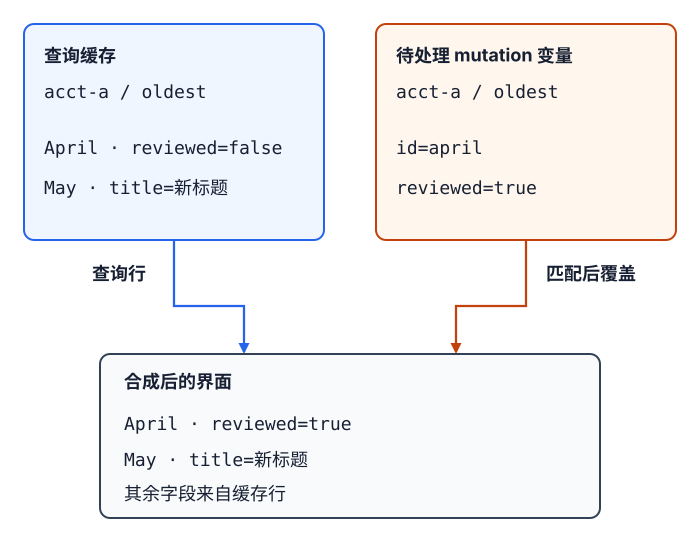

图中展示已回放失败分支在保存仍 pending 时的合成结果：焦点重取先把新 April、May 写入缓存。下表再展开后续时序；保存请求和 `onSettled` 发起的重取都失败，因此 cache 保留那次焦点重取的结果。

| 时点 | `acct-a/oldest` 的 query cache；匹配的 mutation variable | 界面 |
| --- | --- | --- |
| 焦点重取到达，保存仍 pending | April `reviewed=false`；May 是新标题。变量为 April `reviewed=true`。 | April 显示 `true`；May 保留新标题。 |
| 保存请求失败，`onSettled` 重取中 | cache 不变；变量仍 pending。 | April 仍显示 `true`；May 仍保留新标题。 |
| `onSettled` 重取结束 | 该重取失败，cache 保留上次成功值；pending 变量解除。 | overlay 消失，April 回到 `false`；May 新标题仍在。旧整表快照没有把列表恢复成旧值。 |

1. `submit` 先用共享 QueryClient 检查是否已有这类保存，再启动 mutation；所有行按钮在待处理期间禁用。这个示例主动限制为一次报表标记操作，不让其它调用入口绕过 `submit`。
2. 保存期间发生后台重取时，查询缓存可以照常接收服务器结果；界面层的待处理变量仍盖住 April 的标记。保存请求失败后，mutation 仍等待 `onSettled` 的失效重取收尾；在它退出 pending 前，overlay 继续盖住标记。pending 结束时覆盖消失，列表保留当时可用的查询结果或同账户路由备用数据；不会以旧整表快照覆盖新结果。
3. 保存成功时，`onSuccess` 根据这次提交的 `accountId` 和 `sort` 找到原查询 key，并用服务器返回的 April 行更新缓存。`onSettled` 失效该账户的列表前缀：在本例联网且活跃查询可运行时，匹配的活跃查询会立即重取；非活跃排序只会标为失效、等下次使用再读取。回调返回的 Promise 完成前 mutation 仍处于 pending。

这条成功路径假设保存后发起的列表读取能看到刚才的提交。等待失效重取完成，本身不提供 read-your-writes（读己之写）保证：若它读的是落后副本，仍可能把已确认的新行换回旧值。这种接口需让校准读取到达权威数据源，或按服务端提供的修订号拒绝低于已确认版本的结果；仅延长 overlay 不能修复读取契约。

完整组件只消费路由 props、路由排序回调、provider 和网络适配器；不实现 `pushState`、`popstate` 或客户端创建：

> [!example]- 报表查询与乐观更新组件（TanStack Query v5）
>
> ~~~tsx
> import {
>   useIsMutating,
>   useMutation,
>   useMutationState,
>   useQuery,
>   useQueryClient
> } from "@tanstack/react-query";
>
> type SortOrder = "recent" | "oldest";
> type Report = {
>   id: string;
>   period: string;
>   periodStart: string; // 规范化的 YYYY-MM-DD，可按字典序排序
>   title: string;
>   reviewed: boolean;
> };
>
> const reportKeys = {
>   lists: (accountId: string) =>
>     ["reports", accountId, "list"] as const,
>   list: (accountId: string, sort: SortOrder) => [
>     ...reportKeys.lists(accountId),
>     sort
>   ] as const,
>   markReviewed: () => ["reports", "mark-reviewed"] as const
> };
>
> type MarkReviewed = {
>   accountId: string;
>   sort: SortOrder;
>   id: string;
>   reviewed: boolean;
> };
>
> declare function fetchReports(
>   accountId: string,
>   sort: SortOrder,
>   signal: AbortSignal
> ): Promise<Report[]>;
> declare function saveReviewed(
>   accountId: string,
>   id: string,
>   reviewed: boolean
> ): Promise<Report>;
>
> function sortReports(reports: Report[], sort: SortOrder) {
>   return [...reports].sort((a, b) => {
>     const order = a.periodStart.localeCompare(b.periodStart);
>     return sort === "recent" ? -order : order;
>   });
> }
>
> type ReportsRouteProps = {
>   accountId: string; // 当前已登录/选中的账户
>   sort: SortOrder; // 路由从 URL 解析
>   onSortChange: (sort: SortOrder) => void; // 路由写入 pushState
>   initialAccountId: string;
>   initialSort: SortOrder;
>   initialReports: Report[];
>   initialReportsUpdatedAt: number | undefined;
> };
>
> function useReports({
>   accountId,
>   sort,
>   initialAccountId,
>   initialSort,
>   initialReports,
>   initialReportsUpdatedAt
> }: Pick<ReportsRouteProps,
>   | "accountId"
>   | "sort"
>   | "initialAccountId"
>   | "initialSort"
>   | "initialReports"
>   | "initialReportsUpdatedAt"
> >) {
>   const routeDataMatchesQuery =
>     accountId === initialAccountId && sort === initialSort;
>
>   return useQuery({
>     queryKey: reportKeys.list(accountId, sort),
>     queryFn: ({ signal }) =>
>       fetchReports(accountId, sort, signal),
>     initialData: routeDataMatchesQuery
>       ? initialReports
>       : undefined,
>     initialDataUpdatedAt: routeDataMatchesQuery
>       ? initialReportsUpdatedAt
>       : undefined,
>     staleTime: 30_000
>   });
> }
>
> function useMarkReviewed() {
>   const client = useQueryClient();
>   const mutation = useMutation({
>     mutationKey: reportKeys.markReviewed(),
>     mutationFn: (change: MarkReviewed) =>
>       saveReviewed(
>         change.accountId,
>         change.id,
>         change.reviewed
>       ),
>     onSuccess: (saved, change, _result, context) => {
>       const key = reportKeys.list(
>         change.accountId,
>         change.sort
>       );
>       context.client.setQueryData<Report[]>(
>         key,
>         rows => rows?.map(row =>
>           row.id === saved.id ? saved : row
>         )
>       );
>     },
>     onSettled: (_data, _error, change, _result, context) =>
>       context.client.invalidateQueries({
>         queryKey: reportKeys.lists(change.accountId)
>       })
>   });
>
>   function submit(change: MarkReviewed) {
>     // 其它入口也必须经过这道提交级门闩。
>     const hasPending = client.isMutating({
>       mutationKey: reportKeys.markReviewed()
>     }) > 0;
>     if (hasPending) return;
>     mutation.mutate(change);
>   }
>
>   return {
>     isError: mutation.isError,
>     isPending: mutation.isPending,
>     submit
>   };
> }
>
> function ReportsRoute(props: ReportsRouteProps) {
>   return <ReportsPage key={props.accountId} {...props} />;
> }
>
> function ReportsPage({
>   accountId,
>   sort,
>   onSortChange,
>   initialAccountId,
>   initialReports,
>   ...route
> }: ReportsRouteProps) {
>   const query = useReports({
>     accountId,
>     sort,
>     initialAccountId,
>     initialSort: route.initialSort,
>     initialReports,
>     initialReportsUpdatedAt: route.initialReportsUpdatedAt
>   });
>   const update = useMarkReviewed();
>   const isSavingReviewed = useIsMutating({
>     mutationKey: reportKeys.markReviewed()
>   }) > 0;
>   const hasRouteRowsForAccount =
>     accountId === initialAccountId;
>   const confirmedReports = query.data ?? (
>     hasRouteRowsForAccount
>       ? sortReports(initialReports, sort)
>       : []
>   );
>   const pendingChanges = useMutationState<MarkReviewed>({
>     filters: {
>       mutationKey: reportKeys.markReviewed(),
>       status: "pending"
>     },
>     select: mutation =>
>       mutation.state.variables as MarkReviewed
>   });
>   const visibleReports = confirmedReports.map(report => {
>     const pending = pendingChanges.find(change =>
>       change.accountId === accountId &&
>       change.sort === sort &&
>       change.id === report.id
>     );
>     return pending
>       ? { ...report, reviewed: pending.reviewed }
>       : report;
>   });
>
>   return (
>     <section>
>       <div role="group" aria-label="报表排序">
>         <button
>           type="button"
>           onClick={() => onSortChange("recent")}
>         >
>           Most recent first
>         </button>
>         <button
>           type="button"
>           onClick={() => onSortChange("oldest")}
>         >
>           Oldest first
>         </button>
>       </div>
>
>       {query.isPending && (
>         <p role="status">
>           {hasRouteRowsForAccount
>             ? "正在等待服务端确认当前排序…"
>             : "正在读取当前账户的报表…"}
>         </p>
>       )}
>       {query.isFetching && !query.isPending && (
>         <p role="status">正在更新当前账户的报表…</p>
>       )}
>       {query.isError && (
>         <div>
>           <p role="alert">
>             {query.data === undefined
>               ? hasRouteRowsForAccount
>                 ? "确认失败；仍显示同账户的路由报表。"
>                 : "读取失败；尚无当前账户的报表数据。"
>               : "刷新失败；仍显示上次成功的结果。"}
>           </p>
>           <button
>             type="button"
>             onClick={() => query.refetch()}
>           >
>             重试读取
>           </button>
>         </div>
>       )}
>       {update.isError && (
>         <p role="alert">
>           保存失败；已撤去这次待处理显示，
>           列表保留当前可用结果，可再次提交。
>         </p>
>       )}
>       {update.isPending && (
>         <p role="status">正在保存报表更改…</p>
>       )}
>
>       <div aria-busy={query.isFetching}>
>         <ul>
>           {visibleReports.map(report => (
>             <li key={report.id}>
>               {report.period} — {report.title}
>               <span>
>                 {report.reviewed
>                   ? "Reviewed"
>                   : "Not reviewed"}
>               </span>
>               <button
>                 type="button"
>                 disabled={
>                   !query.data ||
>                   query.isPlaceholderData ||
>                   report.reviewed ||
>                   isSavingReviewed
>                 }
>                 onClick={() => update.submit({
>                   accountId,
>                   sort,
>                   id: report.id,
>                   reviewed: true
>                 })}
>               >
>                 Mark reviewed
>               </button>
>             </li>
>           ))}
>         </ul>
>       </div>
>     </section>
>   );
> }
> ~~~

`<QueryClientProvider>` 应在 `ReportsRoute` 的祖先位置提供同一个 QueryClient；`fetchReports` 与 `saveReviewed` 是应用适配器，需要检查 HTTP 响应并将 JSON 作为 `unknown`（尚未验证的数据）运行时校验，TypeScript 声明不会验证网络值。结构合法还不够：保存响应必须对应本次账户和行。本例由已授权的请求资源范围绑定账户，适配器再确认返回的 `saved.id` 等于提交的 `id`；不匹配就按错误处理，不能交给 `onSuccess` 更新另一行。

代码中的 query function 读取 `signal`（取消信号）并交给 `fetchReports`：适配器把它继续传给 `fetch` 才能中止底层请求；适配器忽略时网络仍可能完成，但已取消的查询状态不会接收该结果。若 query function 连 signal 都不读取，离开页面的请求通常可完成并写入自己的旧 key。客户端取消不能承诺服务器停止执行。

排序例子只在记录成员完全相同的 May/April 全列表上本地重排。若账户、筛选、搜索词或页码改变了集合，就不能把旧集合重排后称为当前结果；切换期间应显示当前查询缓存或等待状态。若有上一排序/账户的占位值，必须确认账户身份相同并标出 `isPlaceholderData`，且不允许在占位行上操作。

`staleTime: 30_000` 与“服务端 30 秒内不变”不是一回事。TanStack Query v5 的过期查询可按挂载、窗口重新聚焦或网络恢复等策略后台读取；手动失效也能要求刷新。若用户改了 URL 中的 `sort` 并点击 Back，路由状态应回到原值，query key 也切回对应缓存；`replaceState` 不会像 `pushState` 那样为每次用户选择新增可回退历史项。

### 整表快照回滚的前提与竞态

另一种乐观更新会在 `onMutate` 中先改查询缓存并保存整表快照，失败时用快照回滚，成功时把服务器行写回该 key。下面保留这组回调，作为列表 key 在变更期间确实独占时可用的方案：

~~~tsx
onMutate: async (change: MarkReviewed, context) => {
  const key = reportKeys.list(change.accountId, change.sort);
  await context.client.cancelQueries({
    queryKey: key,
    exact: true
  });
  const previous = context.client.getQueryData<Report[]>(key);
  context.client.setQueryData<Report[]>(key, rows =>
    rows?.map(row => row.id === change.id
      ? { ...row, reviewed: change.reviewed }
      : row)
  );
  return { key, previous };
},
onError: (_error, _change, snapshot, context) => {
  if (snapshot?.previous !== undefined) {
    context.client.setQueryData(snapshot.key, snapshot.previous);
  }
},
onSuccess: (saved, _change, snapshot, context) => {
  if (snapshot) {
    context.client.setQueryData<Report[]>(snapshot.key, rows =>
      rows?.map(row => row.id === saved.id ? saved : row)
    );
  }
}
~~~

这组快照回调只有在同一列表 key 没有并行写入，也没有后续重取覆盖乐观值时才可靠。`cancelQueries` 只取消调用时已匹配的读取，不是锁；`staleTime` 到期后的窗口聚焦、轮询或手动 `refetch` 仍能在保存期间更新缓存。实际回放把时钟推进 31 秒后触发聚焦读取：读取先把服务端 April 的 `false` 和 May 的新标题写入缓存，覆盖此前 April 的乐观 `true`；保存失败后，旧整表快照再把 April、May 整体恢复为旧表，May 新标题随之丢失。主示例因此使用界面层 overlay，让 pending 变量覆盖读取结果，不把一次旧快照当成共享缓存的权威值。

主例以同一个 mutation key（变更键）和共享 QueryClient 做一次全局标记门闩：`useIsMutating` 禁用所有报表行按钮，`submit` 再检查是否有同类保存正在处理，并且只暴露 `submit`、状态，不把可绕过门闩的原生 `mutate` 返回给调用方。若允许多行并发提交，`useMutationState` 会返回多份 pending variables，必须按账户、排序、行 ID 过滤，并用 `submittedAt` 或明确的冲突策略决定同一行显示哪次变更；当前门闩刻意不开放这种并发。

查询缓存和页面中任何已确认数据仍是服务端状态的副本，不是授权来源。若同一报表另有详情 key，也要按 `accountId` 更新/失效详情项，不能只修当前列表。切换账号时 query key 会隔离组件读取的缓存项；退出登录或权限范围更换时，若旧账户数据不该留在客户端，再显式移除对应缓存。对不上账户身份的界面 fallback 不应暂时显示旧账户行。

最后，React 手写 `useEffect` 请求要在 cleanup 中忽略过期结果或取消请求；该请求模式与 TanStack Query 的 key/cache 管理由[React 更新轮次中的数据请求](#Effect%E5%9C%A8%E6%8F%90%E4%BA%A4%E5%90%8E%E5%90%8C%E6%AD%A5%E5%A4%96%E9%83%A8%E7%B3%BB%E7%BB%9F)对照学习。有关错误如何从查询状态进入错误边界，见[React 错误边界](#11.%20React%E9%94%99%E8%AF%AF%E8%BE%B9%E7%95%8C%E8%83%BD%E6%81%A2%E5%A4%8D%E5%93%AA%E4%BA%9B%E5%A4%B1%E8%B4%A5%EF%BC%9F)。网络 JSON 仍需在运行时校验，见[如何处理不可信 JSON？](#45.%20%E6%94%B6%E5%88%B0%E4%B8%8D%E5%8F%AF%E4%BF%A1%20JSON%20%E5%90%8E%EF%BC%8CTypeScript%20%E6%80%8E%E6%A0%B7%E5%BB%BA%E7%AB%8B%E5%8F%AF%E4%BF%A1%E7%9A%84%E7%B1%BB%E5%9E%8B%EF%BC%9F)。

> [!info]- 来源与版本核验（React 19.3；TanStack Query v5 Latest；核验日期 2026-11-12）
> - Query key 应包含会改变 `queryFn` 结果的变量；此处账户和排序都影响数据：[Query Keys](https://tanstack.com/query/latest/docs/framework/react/guides/query-keys)，TanStack Query v5 Latest。
> - Query function 获取 `AbortSignal`。访问它可让 TanStack Query 取消查询状态；继续传给 transport 才会取消底层请求。手动取消会回滚 query state，但不代表服务器停止处理：[Query Functions](https://tanstack.com/query/latest/docs/framework/react/guides/query-functions)、[Query Cancellation](https://tanstack.com/query/latest/docs/framework/react/guides/query-cancellation)，TanStack Query v5 Latest。
> - `initialData` 写入 cache；`initialDataUpdatedAt` 可提供原数据时间。`placeholderData` 不进 cache，结果带 `isPlaceholderData`：[Initial Query Data](https://tanstack.com/query/latest/docs/framework/react/guides/initial-query-data)、[Placeholder Query Data](https://tanstack.com/query/latest/docs/framework/react/guides/placeholder-query-data)，TanStack Query v5 Latest。
> - 普通 `useQuery` 的 `throwOnError` 与错误状态返回：[useQuery](https://tanstack.com/query/latest/docs/framework/react/reference/functions/useQuery)，TanStack Query v5 Latest。
> - `staleTime` 控制客户端 freshness；stale query 的自动重取入口及按 key 前缀失效：[Important Defaults](https://tanstack.com/query/latest/docs/framework/react/guides/important-defaults)、[Query Invalidation](https://tanstack.com/query/latest/docs/framework/react/guides/query-invalidation)，TanStack Query v5 Latest。
> - mutation 回调收到提交变量，`onSettled` 返回的 Promise 会在 mutation 完成前等待；`useMutationState` 可以读取同 key 的多笔 pending variables，并可选择 `submittedAt`：[useMutation](https://tanstack.com/query/latest/docs/framework/react/reference/functions/useMutation)、[Optimistic Updates](https://tanstack.com/query/latest/docs/framework/react/guides/optimistic-updates)，TanStack Query v5 Latest。
> - Cache optimistic update 和 UI variables overlay 是两种受支持路径；pending variables 可能同时有多笔：[Optimistic Updates](https://tanstack.com/query/latest/docs/framework/react/guides/optimistic-updates)，TanStack Query v5 Latest。
> - `invalidateQueries` 将匹配查询标为 invalidated，默认立即重取活跃查询；非活跃查询留在缓存并等待下次使用：[QueryClient.invalidateQueries](https://tanstack.com/query/latest/docs/framework/react/reference/classes/QueryClient#invalidatequeries)，TanStack Query v5 Latest。
> - `QueryClientProvider` 把一个 QueryClient 提供给子树中的查询组件：[QueryClientProvider](https://tanstack.com/query/latest/docs/framework/react/reference/functions/QueryClientProvider)，TanStack Query v5 Latest。
> - query cache 可以按 query key 前缀移除：[QueryClient](https://tanstack.com/query/latest/docs/framework/react/reference/classes/QueryClient)，TanStack Query v5 Latest。
> - HTTP URI 的 fragment 不作为请求目标发送：[RFC 3986 §3.5](https://www.rfc-editor.org/rfc/rfc3986#section-3.5)。浏览器历史恢复 `sort` 的完整路由流程见[浏览器导航路径](#%E8%AE%A9%E6%8E%92%E5%BA%8F%E7%8A%B6%E6%80%81%E8%B7%9F%E9%9A%8F%E5%9C%B0%E5%9D%80%E6%A0%8F%E4%B8%8E%E5%89%8D%E8%BF%9B%E5%90%8E%E9%80%80)。
> - Effect cleanup 防止过期读取写回界面：[Synchronizing with Effects](https://react.dev/learn/synchronizing-with-effects)，React 19.3。
## 10. 管理表格打开多步骤编辑后，怎样在查询变化与提交冲突中保住用户意图？

**案例背景。** 管理员从 `/reports?sort=oldest#summary` 打开合成报表列表。报表 42 出现在第一页；用户选择它后翻到第 2 页，再从“已选 1 项”打开编辑抽屉。详情读取到强 ETag（实体标签）`"report-42-v7"` 和一份可编辑表示。编辑器允许改通知方式和备注，后来表格筛选、分页响应可能先后变化；另一位用户也可能先保存。页面要让 Uniform Resource Locator（统一资源定位符，URL）、选择、编辑草稿和服务端版本各自有明确所有者，才能不把任何一份旧数据误当成用户最新意图。

报表 42 的合成表示为：

~~~json
{"id":42,"title":"Monthly summary","delivery":{"channel":"email","recipients":["reader@example.test"]},"note":"Draft"}
~~~

`delivery.channel` 与 `delivery.recipients` 是本教学变体新增的字段，数据不对应真实业务。报表 42 的 GET、条件 PATCH、强 ETag 和 `412` 行为与[HTTP API 条件更新契约](../../engineering-foundations/backend/http-api-contracts.md)一致；本文聚焦表格与编辑器怎样保留草稿。

~~~mermaid
flowchart TD
  URL[sort / filter / page 来自 URL] --> Query[查询当前页]
  Query --> Rows[用 report.id 标识行]
  Rows --> Selection[选择集合按 ID 跨页保留]
  Selection --> Open[按选中 ID GET 详情与 ETag]
  Open --> Baseline[编辑基线 + 本地草稿分开保存]
  Baseline --> Validate[联动字段与异步校验按 ID 和代次归属]
  Validate --> Patch[仅序列化已改变且当前模式有效的字段]
  Patch --> Match{If-Match 仍匹配？}
  Match -->|是| Saved[接收新表示和 ETag，刷新查询]
  Match -->|否，412| Reload[保留草稿，读取当前表示并三方比较]
  Reload --> Confirm[用户选择并确认新基线]
  Confirm --> Patch
~~~

表格查询只决定当前看到哪些行；编辑草稿以稳定资源 ID 和它自己的服务端基线为依据。若把整张表、选中行和表单值都写进同一个临时对象，一次筛选响应就可能覆盖用户正在改的输入。

### URL 查询、行选择与详情草稿怎样各自保存？

表格的 `sort`、筛选和页码可复制、刷新和由浏览器后退恢复，所以它们放在 URL。开始地址是 `/reports?sort=oldest#summary`。用户选择“已发布”后，路由写成 `/reports?sort=oldest&status=published&page=1#summary`；点“下一页”再变为 `/reports?sort=oldest&status=published&page=2#summary`。片段 `#summary` 仍是客户端定位信息，不是筛选参数。

本例的合成表格投影只有两行一页：第 1 页含 ID `17`、`42`；第 2 页含 ID `61`。主流程是在第 1 页选择 `42`、翻页后仍保留 `{42}`，再从“已选 1 项”打开编辑抽屉。另一个筛选分支里，用户把筛选从“已发布”改为“处理中”，路由重置页码并写成 `/reports?sort=oldest&status=open&page=1#summary`；页面清除原集合并告知用户，因为旧过滤条件选出的 ID 可能不属于新结果。若产品需要保留跨筛选选择，应明确将其做成独立的“已选对象”集合并在批量操作前重新校验权限，不能因隐藏行而悄悄套用旧集合。排序或页码改变不会清除当前筛选下的显式选择。

列表行以 `report.id` 而非页内下标作为稳定身份。打开编辑器后，客户端对 `/api/reports/42` 重新 GET，而不是把表格行的摘要字段直接当成完整详情。每次读取和 PATCH 都由服务端按当前身份检查对报表 42 的权限；URL 参数、已选 ID、隐藏按钮或客户端缓存都不授权访问。

编辑器收到响应后保存三份相互关联的状态：基线表示、对应的 ETag、本地草稿。后续表格排序结果或缓存刷新只更新表格查询；它不把表单重置成新的列表对象。草稿脏时关闭抽屉或切换到另一行，先让用户留下、保存或明确丢弃；重新开启报表 42 是一个新编辑会话，必须再读取当前详情和 ETag。React 的局部状态应跟随这个会话，而不是跟随“当前页第 0 行”等列表位置；只有用户明确切换资源或开始新会话时才换编辑器身份。`React` 中组件状态会随组件树的位置与 `key` 变化而保留或重置；筛选列表重渲染与编辑会话重建是两个不同事件。

### 条件字段与动态输入怎样生成有效草稿？

本例的 `email` 模式显示收件人，至少保留一个有效地址；`download` 模式隐藏收件人。草稿可以在未保存的编辑会话里暂存隐藏输入，用户切回 `email` 时仍看见它们，但提交序列化器只写当前模式允许的字段。Merge Patch（合并补丁）一般规定省略成员表示保持、`null` 表示删除；本合成接口另有领域规则：合并后若 `channel` 为 `download`，服务端规范化时移除 `recipients`，并在成功表示中不返回它。比如 `{"delivery":{"channel":"download"},"note":null}` 合并后得到不含 `recipients` 和 `note` 的规范表示。保存成功后，客户端用返回表示和新 ETag 重设基线，并从该表示重建已确认表单；此时收件人列表为空，已删除的隐藏旧值不再留在草稿中。如果随后重新切回 `email`，需要显式补充收件人，不能把服务端刚删除的旧值又提交回来。

`note` 是可选成员，详情类型用 `note?: string` 才能接收条件更新契约中删除备注后的合法 GET/200 表示。新草稿从详情复制备注；只有用户明确执行“移除备注”动作，才把草稿属性记为缺失。将它改成空字符串是另一种输入，不等同于删除。基线里有 `note`、草稿现在缺少它时，客户端发送 `note: null`；基线与草稿都没有备注时，序列化器省略该成员。服务端返回备注缺失后，后续草稿也从这个规范表示重建。

动态收件人行的内部身份与 API 中的字符串数组分开。下面的 `clientId` 在新增时分配一次，并随行移动或删除；它不是邮件地址、数据库 ID，也不会写进 API。这样 React 行键、焦点和异步校验状态不会因为数组重排而错绑到另一个地址。

> [!example]- 可选：完整补丁序列化与规范化响应重建代码
>
> ~~~typescript
> type Report42 = {
>   id: 42;
>   title: string;
>   delivery: { channel: "email" | "download"; recipients?: string[] };
>   note?: string;
> };
>
> type RecipientField = { clientId: string; value: string };
> type ReportDraft = {
>   channel: "email" | "download";
>   recipients: RecipientField[];
>   note?: string;
> };
>
> type ReportPatch = {
>   delivery?: { channel?: "email" | "download"; recipients?: string[] };
>   note?: string | null;
> };
>
> const report42: Report42 = {
>   id: 42,
>   title: "Monthly summary",
>   delivery: { channel: "email", recipients: ["reader@example.test"] },
>   note: "Draft",
> };
>
> function makePatch(baseline: Report42, draft: ReportDraft): ReportPatch {
>   const patch: ReportPatch = {};
>   const delivery: NonNullable<ReportPatch["delivery"]> = {};
>
>   if (draft.channel !== baseline.delivery.channel) delivery.channel = draft.channel;
>   if (draft.channel === "email") {
>     const recipients = draft.recipients.map(field => field.value.trim());
>     if (JSON.stringify(recipients) !== JSON.stringify(baseline.delivery.recipients ?? [])) {
>       delivery.recipients = recipients;
>     }
>   }
>   if (Object.keys(delivery).length > 0) patch.delivery = delivery;
>   if (draft.note !== baseline.note) patch.note = draft.note ?? null;
>   return patch;
> }
>
> const draft: ReportDraft = {
>   channel: "download",
>   recipients: [
>     { clientId: "recipient-1", value: "reader@example.test" },
>     { clientId: "recipient-2", value: "analyst@example.test" },
>   ],
>   note: "Draft",
> };
> const patch = makePatch(report42, draft);
> // => { delivery: { channel: "download" } }
> // 隐藏的 recipients 仍在本地草稿中，但不进入这个模式的 PATCH。
>
> const removeNoteDraft = { ...draft };
> delete removeNoteDraft.note; // 显式移除属性，区别于 note: ""
> const removeNotePatch = makePatch(report42, removeNoteDraft);
> // => { delivery: { channel: "download" }, note: null }
> // null 是 Merge Patch 的删除指令，序列化后的正文明确包含 note:null。
>
> declare function newRecipientClientId(): string;
> function draftFromReport(saved: Report42): ReportDraft {
>   return {
>     channel: saved.delivery.channel,
>     recipients: (saved.delivery.recipients ?? []).map(value => ({ clientId: newRecipientClientId(), value })),
>     ...(saved.note === undefined ? {} : { note: saved.note }),
>   };
> }
> const savedV8: Report42 = {
>   id: 42,
>   title: "Monthly summary",
>   delivery: { channel: "download" }, // 200 不含 recipients
>   // 备注已删除，200 也不含 note
> };
> const rebuiltDraft = draftFromReport(savedV8);
> // => { channel: "download", recipients: [] }；旧隐藏收件人不再存在于草稿。
> ~~~

下面三次变更展示序列化器的关键输入与结果。省略 `recipients` 只表示 Merge Patch 不直接改写此成员；`download` 的服务端规范化才在成功表示中删除它。

| 用户变更 | PATCH 正文 | 成功表示和下一份草稿 |
|---|---|---|
| v7 从 `email` 切到 `download`，备注 `Draft` 不变 | `{"delivery":{"channel":"download"}}` | 200 不含 `recipients`；以响应重建时 `recipients: []` |
| 同上，并明确移除备注 | `{"delivery":{"channel":"download"},"note":null}` | 200 不含 `recipients` 和 `note`；后续草稿也缺少备注属性 |
| 保持 `email`，新增 `analyst@example.test` | `{"delivery":{"recipients":["reader@example.test","analyst@example.test"]}}` | 数组整体替换；备注未改，不进入补丁 |

三行分别展示三个操作：下载模式只改渠道；`note:null` 表示用户明确删除；邮件模式把收件人数组整体替换。

上述函数只构造增量字段。若 `note` 没有变化，它不会被塞回补丁去覆盖另一个用户刚改过的备注；从基线中删除备注时才明确写入 `null`。若 `channel` 为 `download`，它不会将隐藏的收件人数组放进补丁；成功响应中的规范表示也不会再含旧收件人。进入 `email` 模式后，全部动态行按当前顺序序列化，服务器仍验证地址、重复项、是否至少一项和最终资源约束；客户端即时提示不能替代服务端验证。切换到 `download` 会在同一事件处理中递增并作废每个收件人的校验代次，清除当前错误并丢弃待返回 ticket；切回 `email` 时用仍在草稿中的当前值重新校验。关闭编辑会话或移除动态行也同步作废 ticket，避免隐藏字段、已关闭草稿或新会话被旧响应改写。

异步校验必须绑定编辑会话、输入身份与发起时的依赖值。例子中的 `organizationId` 是本教学校验 API 的合成依赖：同一邮箱在不同组织可能有不同可用性。为每个 `sessionId + clientId` 分配单调请求代次，并保存实际校验快照；只有会话仍打开、ticket 仍最新且快照仍与当前字段相同的响应才可以改写错误状态。不同编辑会话即使复用了同一个动态行 ID，也不会接受彼此的迟到结果。

对 `recipient-1`，服务端接收的校验结果按下列次序归属：

| 时刻 | 当前快照和代次 | UI 状态 |
|---|---|---|
| 输入 `reader@old.example.test` | `edit-A / recipient-1 / gen=1 / org-a` | 发出请求 1 |
| 输入改为 `reader@example.test` | 同步更新快照并推进到 `gen=2` | 发出请求 2；请求 1 后到时已过期 |
| 切换到 `download` | 同步推进代次、删除 ticket 与快照 | 收件人隐藏；请求 1 或 2 都不能写入错误 |
| 切回 `email` | 以当前值重新校验，创建 `gen=4` | 只接受新请求；若关掉抽屉，当前 ticket 也立即失效 |
| 重开为 `edit-B` | 键空间变为 `edit-B / recipient-1` | 即使 clientId 与邮箱相同，旧会话响应也无法命中新状态 |

校验结果为 `ok: false` 时始终显示错误；如果响应缺少或给出空 `message`，客户端用“该地址未通过校验”兜底，不能把 `undefined` 传给表示清错的 setter。

> [!example]- 可选：带编辑会话生命周期的校验 ticket 实现
>
> ~~~typescript
> type RecipientField = { clientId: string; value: string };
> type ValidationTicket = { generation: number; snapshot: string };
> const latestTicket = new Map<string, ValidationTicket>();
> const generationByField = new Map<string, number>();
> const currentSnapshotByField = new Map<string, string>();
> declare function checkRecipient(input: { value: string; organizationId: string }): Promise<{ ok: boolean; message?: string }>;
> declare function setIssue(sessionId: string, clientId: string, message: string | undefined): void;
> declare function updateDraftRecipient(sessionId: string, clientId: string, value: string): void;
> declare function updateDraftChannel(sessionId: string, channel: "email" | "download"): void;
>
> function fieldKey(sessionId: string, clientId: string) {
>   return `${sessionId}:${clientId}`; // sessionId 是每次打开编辑器新建的唯一 ID
> }
>
> function invalidateRecipientTicket(sessionId: string, clientId: string) {
>   const key = fieldKey(sessionId, clientId);
>   generationByField.set(key, (generationByField.get(key) ?? 0) + 1);
>   latestTicket.delete(key);
>   currentSnapshotByField.delete(key);
>   setIssue(sessionId, clientId, undefined);
> }
>
> function onRecipientInput(sessionId: string, field: RecipientField, nextValue: string, organizationId: string) {
>   const key = fieldKey(sessionId, field.clientId);
>   const snapshot = JSON.stringify({ value: nextValue.trim(), organizationId });
>   currentSnapshotByField.set(key, snapshot); // 同步作废旧依赖快照
>   updateDraftRecipient(sessionId, field.clientId, nextValue);
>
>   const generation = (generationByField.get(key) ?? 0) + 1;
>   generationByField.set(key, generation);
>   const ticket = { generation, snapshot };
>   latestTicket.set(key, ticket);
>   const isCurrent = () => {
>     const current = latestTicket.get(key);
>     return current?.generation === ticket.generation &&
>       current.snapshot === ticket.snapshot &&
>       currentSnapshotByField.get(key) === ticket.snapshot;
>   };
>   void checkRecipient({ value: nextValue.trim(), organizationId }).then(result => {
>     if (!isCurrent()) return;
>     setIssue(sessionId, field.clientId, result.ok ? undefined : (result.message || "该地址未通过校验"));
>   }, () => {
>     if (!isCurrent()) return;
>     setIssue(sessionId, field.clientId, "暂时无法验证；保留当前草稿");
>   });
> }
>
> function changeChannel(sessionId: string, channel: "email" | "download", fields: RecipientField[], organizationId: string) {
>   updateDraftChannel(sessionId, channel);
>   for (const field of fields) {
>     if (channel === "download") invalidateRecipientTicket(sessionId, field.clientId);
>     else onRecipientInput(sessionId, field, field.value, organizationId);
>   }
> }
>
> function closeEditSession(sessionId: string, fields: RecipientField[]) {
>   for (const field of fields) invalidateRecipientTicket(sessionId, field.clientId);
> }
>
> function removeRecipient(sessionId: string, field: RecipientField) {
>   invalidateRecipientTicket(sessionId, field.clientId);
>   // 然后从该会话草稿移除此行。
> }
> ~~~

以 `recipient-1` 为例，用户先输入 `reader@old.example.test` 并发出第 1 次请求，接着同步改成 `reader@example.test` 并发出第 2 次请求。若第 1 次响应先于第 2 次响应返回，输入处理器已经把快照改为新值，旧响应不能再改写错误；若第 2 次先返回“可用”，再晚到的第 1 次响应仍被新代次挡住。`organizationId` 等其它依赖改变时也调用同一个输入处理函数，即使邮箱文本没变。若此时从 `email` 切到 `download`，`changeChannel` 在发出下一次响应前同步递增代次并删除 ticket；旧 Promise 返回时 `latestTicket.get(key)` 已为空，不能把错误写回隐藏输入。切回 `email` 时当前字段值重新发起校验。移除字段或关闭抽屉同样使 ticket 失效；关闭后重开使用新的 `sessionId`，即使复用了 `clientId` 也不会让旧响应命中新会话。校验服务暂时失败时保留草稿并显示“暂时无法验证”，不能把网络失败说成字段有效。

### 服务器版本改变时怎样处理 `412`？

GET 已读取强 ETag `"report-42-v7"`。用户将备注改为“Send after review”，并在 `email` 模式添加 `analyst@example.test`。提交使用原始基线的 `If-Match`；版本检查与更新由服务器在同一个原子操作中完成：

~~~http
PATCH /api/reports/42 HTTP/1.1
Content-Type: application/merge-patch+json
If-Match: "report-42-v7"

{"delivery":{"recipients":["reader@example.test","analyst@example.test"]},"note":"Send after review"}
~~~

这里的 `412` 是一条重新从 v7 开始的冲突分支。上一节的 `savedV8` 是“切到下载并保存成功”分支；本段的 v8 则是另一位用户在冲突分支里提交的表示，两者不是同一次连续编辑。

假如另一位用户先保存，把当前资源推进到 `"report-42-v8"` 并将备注写成“Reviewed”，上述旧条件不会覆盖它。服务返回 `412 Precondition Failed` 和 Problem Details；至少包含 `type`、`title`、`status`。客户端不能自动重发同一补丁，也不能把当前 `ETag` 静默换成 v8 后再提交。

这时编辑器仍保留原基线 v7、完整的本地草稿和每个字段的校验状态。它重新 GET 当前表示与 ETag v8，再按字段比较三份值：

| 字段 | v7 基线 | 本地草稿 | v8 当前值 | 展示给用户的差异 |
|---|---|---|---|---|
| `title` | `Monthly summary` | `Monthly summary` | `Monthly summary — May` | 只有服务端改过，可采用当前值 |
| `delivery.recipients` | `[reader@example.test]` | `[reader@example.test, analyst@example.test]` | `[reader@example.test]` | 只有本地改过，可在重新确认后保留本地增量 |
| `note` | `Draft` | `Send after review` | `Reviewed` | 两边都改过，要求用户选择或再次编辑 |

若用户确认采用服务端标题、保留本地新增收件人并把备注设为 `Reviewed; send after review`，客户端用 v8 作为新基线重新计算一个最小补丁，展示差异后才提交 `If-Match: "report-42-v8"`。成功时服务器返回新的表示和新强 ETag；本例递增到 `"report-42-v9"`。如果本地意图是移除备注，三方比较会把“属性缺失”与空字符串、服务端当前值分别显示；用户确认删除后仍将 `note: null` 作为补丁语义提交。若合并或提交之间又发生修改，新的 `412` 再次保留草稿并按相同过程处理。冲突界面解决的是“用户想提交什么”，不是让客户端猜测某个版本理应胜出。

成功响应替换详情缓存中的已确认表示和 ETag，再刷新受影响的列表查询。服务端可能因此把报表移出当前筛选页，或改变其排序位置；不能为了让乐观 UI 看起来稳定而在旧页保留已不符合筛选的数据。独立路由中的编辑表单也使用同一基线、草稿、异步校验和条件提交生命周期；它不依赖从表格入口打开。

**延伸阅读：**[React 如何维护服务端数据与乐观更新](#9.%20React%E7%95%8C%E9%9D%A2%E5%A6%82%E4%BD%95%E7%BB%B4%E6%8A%A4%E6%9C%8D%E5%8A%A1%E7%AB%AF%E6%95%B0%E6%8D%AE%E4%B8%8E%E4%B9%90%E8%A7%82%E6%9B%B4%E6%96%B0%E7%9A%84%E6%AD%A3%E7%A1%AE%E6%80%A7%EF%BC%9F)说明列表查询身份与缓存更新；[React 路由如何把地址映射到界面并恢复前进后退](#62.%20React%20%E8%B7%AF%E7%94%B1%E6%80%8E%E6%A0%B7%E6%8A%8A%E5%9C%B0%E5%9D%80%E6%98%A0%E5%B0%84%E5%88%B0%E7%95%8C%E9%9D%A2%E5%B9%B6%E5%8A%A0%E8%BD%BD%E6%95%B0%E6%8D%AE%EF%BC%9F)说明查询 URL 的导航状态；[语义化 HTML 表单如何支持键盘与辅助技术用户](#16.%20%E8%AF%AD%E4%B9%89%E5%8C%96%20HTML%20%E8%A1%A8%E5%8D%95%E5%A6%82%E4%BD%95%E6%94%AF%E6%8C%81%E9%94%AE%E7%9B%98%E4%B8%8E%E8%BE%85%E5%8A%A9%E6%8A%80%E6%9C%AF%E7%94%A8%E6%88%B7%EF%BC%9F)说明字段错误与焦点。条件 PATCH 和授权的服务端边界见[HTTP API 契约](../../engineering-foundations/backend/http-api-contracts.md)。

> [!info]- 来源
> - **表格行身份与 React 编辑状态生命周期：** [React: Preserving and Resetting State](https://react.dev/learn/preserving-and-resetting-state)，React 官方文档，核对日期 2026-11-09。
> - **URL、查询参数与历史状态：** [WHATWG HTML: History interface](https://html.spec.whatwg.org/multipage/nav-history-apis.html#the-history-interface)，[WHATWG URL: URLSearchParams](https://url.spec.whatwg.org/#urlsearchparams-class)；并参见[浏览器怎样让筛选状态跟随地址栏与前进后退](#2.%20%E6%AF%8F%E6%AC%A1%20URL%20%E5%8F%98%E5%8C%96%E9%83%BD%E4%BC%9A%E5%8A%A0%E8%BD%BD%E6%96%B0%E6%96%87%E6%A1%A3%E5%90%97%EF%BC%9F)。
> - **强 ETag、`If-Match`、原子条件更新、`412` 与合并补丁：** [HTTP API 条件更新契约](../../engineering-foundations/backend/http-api-contracts.md)；具体协议由其所引 RFC 核验。本篇的字段和版本是冻结的合成示例。
> - **表单校验与错误提示的用户界面边界：** [语义化 HTML 表单怎样支持键盘与辅助技术用户](#16.%20%E8%AF%AD%E4%B9%89%E5%8C%96%20HTML%20%E8%A1%A8%E5%8D%95%E5%A6%82%E4%BD%95%E6%94%AF%E6%8C%81%E9%94%AE%E7%9B%98%E4%B8%8E%E8%BE%85%E5%8A%A9%E6%8A%80%E6%9C%AF%E7%94%A8%E6%88%B7%EF%BC%9F)。校验响应代次与草稿隔离是本文根据该合成流程明确的客户端所有权。
## 11. React错误边界能恢复哪些失败？

**案例背景。** 延续报表页：服务端给出 May、April，用户选 **Oldest first** 后，路由状态变为 `sort=oldest`，父组件把排好序的 April、May 传给列表；排序状态随浏览器前进/后退恢复，见[浏览器导航路径](#%E8%AE%A9%E6%8E%92%E5%BA%8F%E7%8A%B6%E6%80%81%E8%B7%9F%E9%9A%8F%E5%9C%B0%E5%9D%80%E6%A0%8F%E4%B8%8E%E5%89%8D%E8%BF%9B%E5%90%8E%E9%80%80)。若列表组件在 `render`（渲染）时抛错，错误边界可以把这块列表换成备用界面，让边界外的排序区域继续留在页面。它能捕获 React 渲染路径中的子树错误、React 提交阶段同步执行时的异常，以及 React 明确追踪的部分异步失败。普通点击、定时器和 Effect 启动后自行运行的 Promise 拒绝，仍须各自处理。

### 先按失败发生的位置选择处理方式

Error Boundary（错误边界）是包住子树、在子树出错时改显示 fallback（备用界面）的组件。React 内置的边界由类组件实现：`static getDerivedStateFromError`（从错误派生状态）让下一次 render 进入 fallback，`componentDidCatch`（捕获错误）在提交阶段记录错误与组件栈。React 19.3 的捕获边界如下：

| 失败发生的位置 | 最近错误边界会怎样处理 |
| --- | --- |
| 子组件构造、render 或 React 生命周期中的同步错误 | 显示最近边界的 fallback（备用界面）。错误若发生在边界自身的 render/生命周期，则交给更外层边界。 |
| React 管理的 Effect setup/cleanup 同步抛错 | React 19.3.0 浏览器回放中由最近仍挂载的边界接住；若内层边界随子树卸载，仍挂载的外层边界可以接住。没有仍挂载的祖先边界时，就无边界可显示 fallback。 |
| `useTransition()` 返回的 `startTransition` 中，动作函数（Action）同步抛错或返回的 Promise 拒绝 | 交给包住调用 `useTransition()` 组件的边界。若 Action 另行启动 Promise 却不 return/await，拒绝不会自动归入此 Action。 |
| 从 React 导入的独立 `startTransition` 回调抛错或返回拒绝的 Promise | 这个 API 用于标记更新；此回调中的错误会进入全局错误报告，不会因此交给错误边界。不要把它和 `useTransition()` 返回的同名函数混为一谈。 |
| `use(promise)` 在 render 中读取已复用的 Promise | Promise pending 时由最近 `Suspense`（挂起边界）管理等待；首次挂载等情形会显示 fallback，Transition 等更新也可能保留已显示内容。Promise 拒绝时进入最近错误边界。Promise 应跨重渲染复用，不能每次 render 都创建新的 Promise。 |
| 普通点击处理器、定时器或 Effect 启动的 Promise 后续拒绝 | 错误边界不会自动接住。处理器里用 `try/catch`，异步任务显式处理 Promise 拒绝，或把错误写入界面状态。 |
| `useEffect` 启动的普通请求失败 | 把失败和重试放在请求状态中；它不会自动变成 render 错误或 Suspense 挂起。 |
| 服务端渲染期间抛错 | 类错误边界不捕获服务端错误，由服务端渲染管线处理。流式 SSR 可用 `Suspense` 输出 fallback；若客户端随后重试渲染仍报错，才可能由客户端错误边界处理。 |

React 19 文档把 Error Boundary 的内置用途描述为捕获子树 rendering errors，并明确排除普通事件、一般异步任务、服务端渲染和边界自身错误。React 调用 Effect setup/cleanup 时，可捕获其中的同步抛错；普通 `useEffect` 也可能在浏览器绘制后运行，这不要求它与 DOM 提交同步。本章实测了 19.3.0 中仍挂载边界的捕获范围。由 Effect 启动、之后才拒绝的 Promise 已离开 React 当次调用，必须自行处理。Hook 返回的 `startTransition` 是文档列出的例外；独立导入的同名 API 不提供这条错误边界路径。

### 边界放在用户能理解的恢复位置

本例把报表列表和排序区拆开。当前示例已处于 `oldest` 状态，父组件把 April、May 两行传入；列表 render 出错时，最近仍挂载的 `ReportBoundary` 用 fallback 替换列表，排序区仍留在外层页面。图中虚线表示组件树的父子关系，橙色箭头表示发生错误后列表内容被 fallback 替换。

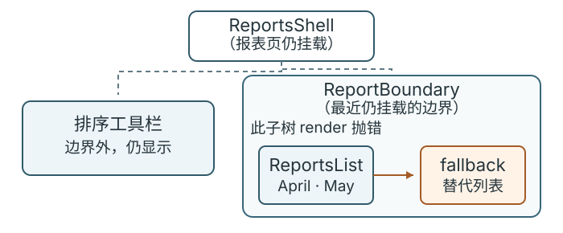

下面给出边界、报表区域和一个最小调用。工具栏固定显示 `Oldest first`，只代表边界外仍在页面的区域；此例省略 URL 和实际排序逻辑，由父组件传入已按 April、May 排序的数据。`key={accountId}` 让切换账户时重新建立边界和列表树，边界本地的失败状态不会带到新账户；它只重置 React 子树身份，不负责隔离查询缓存或验证报表数据，共享查询缓存且账户会改变结果时，查询身份也必须区分账户。查询键如何区分结果集，见[报表查询章节](#9.%20React%E7%95%8C%E9%9D%A2%E5%A6%82%E4%BD%95%E7%BB%B4%E6%8A%A4%E6%9C%8D%E5%8A%A1%E7%AB%AF%E6%95%B0%E6%8D%AE%E4%B8%8E%E4%B9%90%E8%A7%82%E6%9B%B4%E6%96%B0%E7%9A%84%E6%AD%A3%E7%A1%AE%E6%80%A7%EF%BC%9F)。目前 React 内置边界仍由类组件实现；即使用函数组件组装页面，也能在子树周围嵌入类边界或使用现有边界库。

> [!example]- 完整的类边界与报表区域
>
> ~~~jsx
> import { Component } from "react";
>
> class ReportBoundary extends Component {
>   state = { hasError: false };
>
>   static getDerivedStateFromError() {
>     return { hasError: true };
>   }
>
>   componentDidCatch(error, info) {
>     console.error(
>       "报表区域渲染失败",
>       error,
>       info.componentStack
>     );
>   }
>
>   render() {
>     if (this.state.hasError) {
>       return (
>         <section>
>           <p role="alert">报表列表暂时无法显示。</p>
>           <button
>             type="button"
>             onClick={() => this.setState({ hasError: false })}
>           >
>             重新渲染列表
>           </button>
>         </section>
>       );
>     }
>     return this.props.children;
>   }
> }
>
> function ReportsShell({ accountId, reports }) {
>   return (
>     <main>
>       <p>当前排序：Oldest first</p>
>       <ReportBoundary key={accountId}>
>         <ReportsList reports={reports} />
>       </ReportBoundary>
>     </main>
>   );
> }
>
> function ReportsList({ reports }) {
>   return (
>     <ul>
>       {reports.map(report => (
>         <li key={report.id}>{report.title}</li>
>       ))}
>     </ul>
>   );
> }
>
> const initialReports = [
>   { id: "april", title: "April" },
>   { id: "may", title: "May" }
> ];
>
> function App() {
>   return (
>     <ReportsShell
>       accountId="a"
>       reports={initialReports}
>     />
>   );
> }
> ~~~

起始调用用账户 `a` 和已排序的 `initialReports` 显示 April、May。若父组件为同一账户传入 `reports = [null]`，列表在渲染这条空记录并读取其属性时会触发 `TypeError`，fallback 替代列表而工具栏继续留在页面。坏输入不变时点击“重新渲染列表”会再失败；先传回有效行，边界仍会保留 fallback，直到再次点击重试才恢复。若换成新的账户 ID 且传入有效行，`key` 会重建边界。真实 API JSON 应先做运行时校验；这里注入的 render TypeError 只验证错误边界，不能替代请求或数据校验失败的处理。

“重新渲染列表”按钮只把边界状态重置为可尝试渲染；它不会修复错误数据，也不会重新发送查询。若 `reports` 仍含 `null`，子树一重试就再次报错。真正的恢复动作应先由数据所有者修复输入、重新读取或离开故障路由，然后再重置/重新挂载边界。查询状态、重试和缓存由[报表服务端状态章节](#9.%20React%E7%95%8C%E9%9D%A2%E5%A6%82%E4%BD%95%E7%BB%B4%E6%8A%A4%E6%9C%8D%E5%8A%A1%E7%AB%AF%E6%95%B0%E6%8D%AE%E4%B8%8E%E4%B9%90%E8%A7%82%E6%9B%B4%E6%96%B0%E7%9A%84%E6%AD%A3%E7%A1%AE%E6%80%A7%EF%BC%9F)负责。

边界粒度按用户能理解和恢复的区域决定：把整页包起来会连工具栏一起隐藏；每一行都放边界则可能留下许多局部错误框，读者也难以知道列表是否完整。JSX 中写 `try { return <ReportsList /> } catch { ... }` 捕获不到之后的子组件 render，因为那一行只创建元素描述，React 会在后续工作中调用子组件。

### 错误边界与其他失败处理方式

普通 TanStack Query v5 `useQuery` 默认把请求失败作为结果状态交给组件；组件读取 `isError`、`error`、`data` 决定报错和重试。配置 `throwOnError` 或改用 `useSuspenseQuery` 时，查询 Hook 会按当前规则把错误抛入边界；应用也可以在 render 中自行抛出查询错误。`useSuspenseQuery` 的默认规则不是“所有失败都丢弃数据”：无缓存数据时错误交给边界；已有缓存但后台刷新失败时，默认继续显示缓存数据。若用边界承接查询错误并在 fallback 提供重试，需要用 TanStack 的 Query Error Reset Boundary 协调查询错误重置和边界重置；只清空 React 边界的 `hasError` 不会重置查询状态。

客户端资源暂未就绪时，`Suspense` 可用 fallback 显示等待界面；首次挂载或不保留旧内容的更新通常会切到它。若已显示的内容在 Transition 等更新中再次挂起，React 也可能保留旧界面。错误边界的 fallback 则表示子树已经失败。`use(promise)` 只在 render 中读取并跨重渲染复用的 Promise：pending 属于挂起，拒绝属于错误。普通 `fetch` 写在 `useEffect` 或点击处理器中不会自动进入 Suspense；常规查询若选择 `isError` 状态路径，也无须额外套一层错误边界。

状态更新包在 Transition（过渡）中时，如果新内容暂时挂起，React 可以继续显示已经提交的旧内容，而不马上换成 Suspense fallback。是否保留旧界面由更新方式与边界位置决定；Transition 不会把已提交的旧数据变成新请求结果。

> [!info]- 来源与版本核验（React 19.3；TanStack Query v5 Latest；核验日期 2026-11-12）
> - React 类边界的 `getDerivedStateFromError`、`componentDidCatch`、错误粒度建议，以及事件、普通异步任务、服务端渲染和边界自身的排除范围：[Component — Catching Rendering Errors with an Error Boundary](https://react.dev/reference/react/Component#catching-rendering-errors-with-an-error-boundary)，React 19.3。
> - `useTransition()` 返回的 `startTransition` 把其 Action 的同步抛错或返回的 Promise rejection 交给最近边界：[useTransition — Displaying an error to users](https://react.dev/reference/react/useTransition#displaying-an-error-to-users-with-an-error-boundary)，React 19.3。独立导入的 `startTransition` 走全局错误报告，按 [React 19.3.0 实现](https://github.com/react/react/blob/v19.3.0/packages/react/src/ReactStartTransition.js)核验。
> - `use(promise)` 在 render 时读取 Promise；pending 进入 Suspense，rejection 进入 Error Boundary，Promise 应缓存以便重渲染复用：[use](https://react.dev/reference/react/use)，React 19.3。
> - Effect setup 在提交后由 React 调用、清理在依赖改变/卸载时执行；普通 `useEffect` 可能在绘制后运行：[useEffect](https://react.dev/reference/react/useEffect)，React 19.3。同步错误是否由仍挂载的最近边界接住按本章 React 19.3.0 浏览器回放核验；Promise 后续拒绝由异步路径处理。
> - 流式 SSR 中组件错误可由最近 `Suspense` 在服务端输出 fallback；客户端后续 render 再发生错误时才可能由客户端边界接住：[Suspense — Providing a fallback for server errors and client-only content](https://react.dev/reference/react/Suspense#providing-a-fallback-for-server-errors-and-client-only-content)，React 19.3。
> - TanStack Query `useQuery` 的 `throwOnError` 与 error-as-state 选项：[useQuery](https://tanstack.com/query/latest/docs/framework/react/reference/useQuery)，TanStack Query v5 Latest，核验日期 2026-11-12。
> - `useSuspenseQuery` 无可显示数据时的错误边界路径、缓存存在时的后台刷新错误规则和 `QueryErrorResetBoundary`：[Suspense guide](https://tanstack.com/query/latest/docs/framework/react/guides/suspense)、[QueryErrorResetBoundary](https://tanstack.com/query/latest/docs/framework/react/reference/QueryErrorResetBoundary)，TanStack Query v5 Latest，核验日期 2026-11-12。
> - Suspense 不侦测 Effect/事件处理器内的普通请求；更新中再次挂起时，Transition/`useDeferredValue` 可避免已显示内容立即切到 fallback：[Suspense](https://react.dev/reference/react/Suspense#what-activates-a-suspense-boundary)，React 19.3。
## 12. 为什么一次 DOM 改动会增加布局或绘制工作？

案例背景：用户打开 `https://example.test/reports?sort=recent#summary`，看到 May、April 两行报表；点击“最早优先”后，页面把地址中的 `sort` 参数改为 `oldest`，并把 Document Object Model (DOM, 文档对象模型) 中的行顺序换成 April → May。[DOM 更新与事件章节](#4.%20%E6%B5%8F%E8%A7%88%E5%99%A8%E6%80%8E%E6%A0%B7%E6%9F%A5%E8%AF%A2%E3%80%81%E6%9B%B4%E6%96%B0%20DOM%20%E5%B9%B6%E5%93%8D%E5%BA%94%E7%94%A8%E6%88%B7%E8%BE%93%E5%85%A5%EF%BC%9F)解释了点击处理器怎样改动节点；本章从“新 DOM 已经写入”开始，解释浏览器怎样让后续画面与新状态一致，以及脚本何时可能为了读取当前几何而等浏览器先更新布局。

### 浏览器需要让哪些信息重新一致？

HyperText Markup Language (HTML, 超文本标记语言) 标准定义浏览器何时有机会更新窗口渲染，但没有规定每个浏览器都使用同一套内部阶段、线程或绘图技术。把报表变成画面的过程可先分成几层：Cascading Style Sheets (CSS, 层叠样式表) 规则针对当前 DOM 计算 computed style (计算样式)；layout (布局) 为盒子求出尺寸与位置；paint (绘制) 生成描述可见内容的绘制操作；需要生成新像素时再做 rasterization (栅格化)；compositing (合成) 把已有与更新后的绘制表面组合，再交给显示过程。

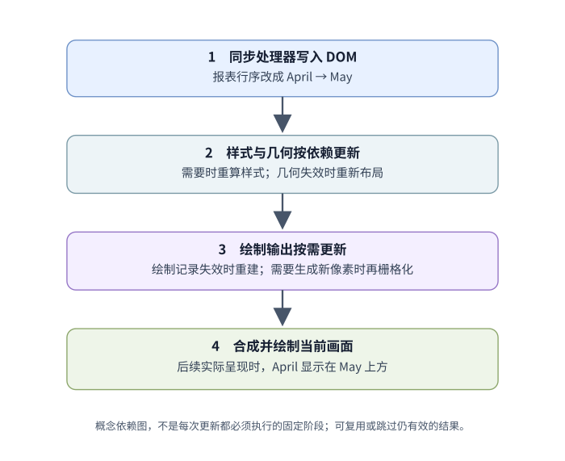

图是用来说明依赖关系的概念模型，不表示每次改动都要顺序重做每一层。浏览器可以延后并合并工作、复用仍有效的结果，也可以跳过没有失效的阶段。渲染机会与 JavaScript 任务的边界见[浏览器 JavaScript 何时运行，画面何时更新？](#5.%20%E6%B5%8F%E8%A7%88%E5%99%A8%20JavaScript%20%E4%BD%95%E6%97%B6%E8%BF%90%E8%A1%8C%EF%BC%8C%E7%94%BB%E9%9D%A2%E4%BD%95%E6%97%B6%E6%9B%B4%E6%96%B0%EF%BC%9F)：处理器返回后 DOM 已是新顺序，但浏览器不保证每个任务后都立即显示一帧；请求或异步业务结果是否完成，也不会由 DOM 写入自动保证。对通常按 DOM 顺序从上到下排布的报表，April 会从第二行移到第一行，May 移到第二行；相关几何与绘制输出更新后，下一次实际呈现的画面才会显示 April 在上。几何读取可以让脚本拿到计算后的值，但不会因此立即把一帧画到屏幕上。

| 对这张报表做什么 | 浏览器可能要更新什么 | 仅凭操作名称不能推出什么 |
| --- | --- | --- |
| 把两行从 May → April 调成 April → May | 更新受影响的样式、几何或绘制结果 | 失效范围取决于选择器依赖、布局关系与引擎优化 |
| 只把按钮文字颜色改成强调色 | 重算适用样式并更新相应绘制结果 | 若尺寸与换行不变，原有几何可能仍可复用 |
| 改宽度、字体或会占空间的内容 | 重新计算受影响盒子的尺寸与后续位置，再更新绘制 | 重排范围不一定只限于被改的节点 |
| 改变 `transform` 或 `opacity` | 某些实现路径可不重新布局，甚至复用绘制结果 | 不能仅凭属性名保证提升图层、只走合成或使用 GPU |
| DOM / 样式写入后读取几何 | 若所需样式或布局已失效，读取前可能同步更新 | 同一几何读取接口并非每次调用都触发布局 |

reflow (重排) 和 repaint (重绘) 是常见工程用语，不是跨浏览器可比较的性能分数。一个节点改变尺寸后，后续流式内容的位置可能一起改变；反过来，属性改了但布局几何未失效时，也可能不需要重做布局。`transform` 和 `opacity` 常被选作动画候选，是因为它们在某些渲染路径中可以绕过布局或复用绘制内容；目标页面是否真的走这条路，应看目标浏览器的性能录制。

### 为什么读几何会让脚本停下来？

浏览器可以把样式或布局结果标为待更新，继续运行 JavaScript，并把工作留到下一次渲染更新。可测量几何的 application programming interface (API, 应用程序接口) 必须返回调用时可观察到的当前值：`offsetWidth` 在普通单盒案例中返回未应用变换的整数边框盒宽度；`getBoundingClientRect()` 返回相对视口的包围矩形，并把变换计入。如果前面的 DOM / CSS 写入使返回值依赖的数据失效，实现就可能在返回前同步重算样式或布局。若数据仍然是最新的，读取可以复用结果，不必新做一次布局。

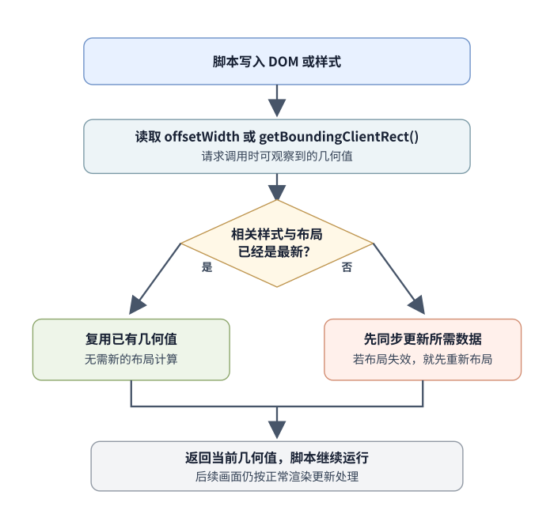

同步刷新会让脚本等所需计算完成后才继续；其中同步执行布局的情况，Chrome 文档称为 forced reflow (强制重排)。被等待的工作不一定是 API 本身的固定成本：它取决于此前哪些数据失效、布局影响范围多大，以及实现是否能复用结果。图示的是“读取当前值”这一契约带来的实现压力，不意味着每次读取都会刷新。

下面是一个独立的宽度例子，不是前面的报表行。它从同一组已有元素开始：两个没有最小 / 最大宽度约束、没有变换的普通块级元素，边框盒宽度分别为 100px 和 160px。`box-sizing: border-box` 使声明的宽度指定边框盒宽度，因此将当前值加 10 后，目标宽度分别为 110px 和 170px。

~~~html
<div id="width-demo">
  <div class="item" style="width: 100px"></div>
  <div class="item" style="width: 160px"></div>
</div>
~~~

~~~css
#width-demo .item {
  box-sizing: border-box;
  padding: 4px;
  border: 1px solid;
}
~~~

`querySelectorAll()` 返回的 `NodeList` 没有 `Array.prototype.map()`，所以先用 `Array.from()` 转成数组：

~~~javascript
const items = Array.from(
  document.querySelectorAll("#width-demo .item")
);
~~~

下面两段是从上述相同起始宽度分别运行的写法，不是先后执行。第一段每次写完宽度就读取同一元素的新宽度；若该写入使布局数据失效，后读会迫使浏览器先把当前尺寸算出来：

~~~javascript
const widthsAfterEachWrite = [];
for (const item of items) {
  item.style.width = (item.offsetWidth + 10) + "px";
  widthsAfterEachWrite.push(item.offsetWidth);
}
~~~

如果每个新值只依赖它自己的原宽度，而且不必观察前一项写入后的中间几何，就不必在每次写入后立即读回。先读取所有原值，再统一写入；若仍需要验证最终几何，可在最后集中读取：

~~~javascript
const nextWidths = items.map(item => item.offsetWidth + 10);
items.forEach((item, index) => {
  item.style.width = nextWidths[index] + "px";
});
const widthsAfterBatch = items.map(item => item.offsetWidth);
~~~

探针在记录前先读取两个 `offsetWidth`，确保初始几何已就绪。在同一版 headless Chrome (无头 Chrome) 的可重复探针中，两种写法都得到 110px、170px：逐项版本第一次读取原值 100px，写入 110px 后立即读取时，浏览器更新当前几何；随后第二项从原值 160px 写成 170px 并再次读取，又需要更新几何。批量版本先读到 `[100, 160]`，再写入两个新值；末尾第一次读取处理两项变更，第二次读取复用刚更新的结果。用 Chrome DevTools Protocol (CDP, Chrome 开发者工具协议) 记录这一段脚本时，逐项写后读观察到 2 次布局事件，批量读写并在末尾读回观察到 1 次。若开始时的布局本来已失效，批量代码开头的读取也可能先触发更新；这次计数只说明这个小例子的读写次序，不证明任何批量操作在所有页面都更快。应先在性能录制里确认同步布局，再定位让数据失效的写入和紧跟其后的读取。

几何读取接口返回的盒子与坐标系不同：例如，变换会影响 `getBoundingClientRect()` 的结果，却不影响 `offsetWidth`。按问题选择测量方式，见[哪个 DOM 几何 API 能回答哪种测量问题？](#25.%20%E5%93%AA%E4%BA%9B%E7%BD%91%E9%A1%B5%E5%87%A0%E4%BD%95%E6%8E%A5%E5%8F%A3%E8%83%BD%E6%B5%8B%E9%87%8F%E5%93%AA%E4%B8%80%E7%A7%8D%E7%9B%92%E5%AD%90%EF%BC%9F)。

### 引擎怎样实现这些步骤？

Web 平台规定 DOM、CSS 和几何 API 的可观察结果，不要求各浏览器共享一个内部管线。以 Chromium 的 RenderingNG 为例，渲染器会处理样式、布局、预绘制和绘制记录；后续把绘制内容分块栅格化，再提交 compositor frame (合成帧)，由 Chromium 的 Viz 组件聚合可见表面并绘制。Chromium 文档展示的 graphics processing unit (GPU, 图形处理器) 纹理 tile (图块) 是这一实现中的数据结构；实际设备可能使用不同的栅格后端或回退路径，其他引擎的组件名称和阶段安排也会不同。因此，浏览器通用解释要落在“输入状态、失效数据与画面结果”，性能判断则要看目标引擎的录制。

如果报表增长到许多行，先区分网络传输、服务端查询、客户端数据计算和已挂载节点的样式与布局成本。虚拟滚动主要减少同时挂载的 DOM；不会自动缩小已下载数据或消除对全量数据的计算。窗口计算、可变行高、焦点与辅助技术边界见[长报表列表何时适合虚拟滚动？](#15.%20%E9%95%BF%E6%8A%A5%E8%A1%A8%E5%88%97%E8%A1%A8%E4%BD%95%E6%97%B6%E9%80%82%E5%90%88%E8%99%9A%E6%8B%9F%E6%BB%9A%E5%8A%A8%EF%BC%9F)；性能录制怎样区分处理时长、布局与绘制成本，见[如何测量并诊断网页性能问题？](#13.%20%E5%A6%82%E4%BD%95%E6%B5%8B%E9%87%8F%E5%B9%B6%E8%AF%8A%E6%96%AD%E7%BD%91%E9%A1%B5%E6%80%A7%E8%83%BD%E9%97%AE%E9%A2%98%EF%BC%9F)。

> [!info]- 来源与核验
> - **渲染机会与更新渲染。** [WHATWG HTML §8.1.7 Event loops / update the rendering](https://html.spec.whatwg.org/multipage/webappapis.html#update-the-rendering)，Living Standard，更新于 2026-11-11，核对于 2026-11-12。规范定义渲染机会与更新渲染中的样式、布局等步骤；图示的绘制、栅格化和合成阶段是概念说明，不是 HTML 要求的跨浏览器固定管线。
> - **盒子生成与布局模型。** [CSS Display Module Level 3](https://www.w3.org/TR/css-display-3/)，W3C Candidate Recommendation Draft，2026-06-05；用于解释元素生成的盒与格式化模型。
> - **几何读取的返回值。** [CSSOM View Module Level 1](https://drafts.csswg.org/cssom-view/)，Editor’s Draft，2026-11-05，`offsetWidth` 与 `getBoundingClientRect()` 算法；[CSS Sizing Module Level 3](https://www.w3.org/TR/css-sizing-3/#box-sizing)，`box-sizing` 的尺寸解释。CSSOM View 当前页面标明是讨论中的编辑草案，核对于 2026-11-12。
> - **强制重排诊断。** [Chrome Performance Insights: Forced reflow](https://developer.chrome.com/docs/performance/insights/forced-reflow)，Chrome DevTools 官方文档，更新于 2025-10-08；其强制重排描述和诊断范围针对 Chrome 实现。
> - **Chromium 实现路径。** [RenderingNG architecture](https://developer.chrome.com/docs/chromium/renderingng-architecture) 与 [Key data structures in RenderingNG](https://developer.chrome.com/docs/chromium/renderingng-data-structures)，Chromium 官方架构文档；核对于 2026-11-12。文中的 Viz、tile (图块) 和 compositor frame (合成帧) 仅描述 Chromium。
> - **本地探针。** 本轮 headless Chrome `157.0.8103.51` 使用 CDP 记录布局：记录前显式读取两个元素的 `offsetWidth` 使初始几何就绪；逐项写后读出现 2 个 `Layout` 完成事件，批量写入并在末尾读回出现 1 个；两种结果均为 `[110, 170]`。这是本机配置和该 DOM/CSS 的可重复观察，不作跨版本性能承诺。
## 13. 如何测量并诊断网页性能问题？

案例背景：用户打开 `https://example.test/reports?sort=recent#summary`，等报表首屏出现，再点击“最早优先”把 May → April 排成 April → May。有人反馈“页面开得慢”，有人反馈“点击没反应”；这两种描述可能落在不同阶段，修复前要先把用户感受到的时间与浏览器实际工作对应起来。

### 三项核心指标分别回答什么？

Core Web Vitals（核心网页指标）目前包含三项稳定指标，分别覆盖主要内容加载、交互响应和视觉稳定性。表里的“良好”阈值是现场数据的分档标准，不是单次访问的服务保证。

| 指标 | 它回答的问题 | 良好阈值 |
|---|---|---:|
| Largest Contentful Paint（最大内容绘制，LCP） | 视口中最大的合格图片、文字块或视频何时绘制，通常用来观察主要内容是否及时出现 | ≤ 2.5 秒 |
| Interaction to Next Paint（交互到下一次绘制，INP） | 用户点击、触屏或键盘交互后，浏览器何时能呈现下一帧；有时没有新帧要绘制，也不保证业务结果已出现；每次访问通常取最慢交互，交互很多时每 50 次排除一个最慢值 | ≤ 200 毫秒 |
| Cumulative Layout Shift（累积布局偏移，CLS） | 页面生命周期中最大一组连续的意外布局偏移有多大 | ≤ 0.1 |

评估一个页面或站点时，要看真实访问样本在移动端、桌面端分别计算的第 75 百分位（p75）：至少 75% 的访问达到良好阈值，才会被划入该指标的良好档。它是现场人群分布的摘要，不能说明每次访问都一样快。CLS 也不是把整次访问的所有偏移直接相加；它取一组相邻偏移组成的 session window（会话窗口）中的最大分数，窗口内相邻偏移间隔少于 1 秒，且窗口最长为 5 秒。阈值与口径截至 2026-11-06 核对；发布说明或测量产品改变时，应重新核实。

INP 不是“事件处理器运行了多久”。一个逻辑交互可能产生 `pointerdown`、`pointerup`、`click` 等多个 Event Timing 条目；浏览器按关联条目汇总交互延迟，再定位三段时间。输入延迟结束于相关回调开始，不是处理器自身的耗时：

| 阶段 | 起止点 | 报表点击中的可能原因 |
|---|---|---|
| input delay（输入延迟） | 用户开始点击，到该交互的第一个事件回调开始 | 更早运行的长任务、脚本执行或其他主线程工作 |
| processing duration（处理时长） | 该交互相关事件回调执行期间 | 点击处理器排序数据、React 计算更新或其他监听器工作 |
| presentation delay（呈现延迟） | 事件回调结束，到浏览器下一次可以呈现帧时（有时没有新帧要绘制） | 样式、布局、绘制等渲染工作，或下一帧前的其他主线程任务；指标不保证业务结果已在这帧出现 |

例如，一次假设录制从用户输入 0 ms 开始，回调在 90 ms 开始，105 ms 调用几何 API 并因同步布局等待 85 ms，回调在 195 ms 返回，下一帧在 230 ms 呈现。对应三段是 90 / 105 / 35 ms；85 ms 的同步布局属于处理时长，因为它发生在回调内。若同一读取发生在回调返回之后、下一帧呈现之前，它才可能落在呈现延迟。这些数字用于演示归类，不是报表的实测数据。

所以处理器很短也可能有高 INP：点击前主线程忙会增加输入延迟；DOM 修改后的布局与绘制会增加呈现延迟。反过来，INP 衡量到这次呈现机会为止，并不计量之后才完成的网络请求或所有异步业务效果；下一帧也可能尚未显示业务结果。复杂操作可先给出加载状态等可见反馈，结果到达后再更新内容。浏览器点击、处理器、微任务与渲染机会的边界见[浏览器 JavaScript 何时运行，画面何时更新？](#5.%20%E6%B5%8F%E8%A7%88%E5%99%A8%20JavaScript%20%E4%BD%95%E6%97%B6%E8%BF%90%E8%A1%8C%EF%BC%8C%E7%94%BB%E9%9D%A2%E4%BD%95%E6%97%B6%E6%9B%B4%E6%96%B0%EF%BC%9F)。

### 现场数据与实验室录制怎样配合？

field data（现场数据）来自实际用户访问，包含设备、网络、地理位置、缓存状态和用户行为的差异，适合判断用户整体体验及指标分布。lab data（实验室数据）在较受控的设备、网络和位置中运行，适合重现路径、比较改动并检查原因；一次 Lighthouse 加载录制并没有真实交互，不能直接给出该次访问的 INP。Total Blocking Time（总阻塞时间，TBT）可以提示页面加载期间主线程被长任务占用的风险，但它是实验室诊断指标，不等同于 INP，也无法代表用户何时点击。

用同一个 URL 和动作做前后比较，并记录浏览器、设备、网络模拟、缓存是否冷启动以及数据来自现场还是实验室。现场指标看相同设备分组与百分位；排查点击时，用 Chrome DevTools（Chrome 开发者工具）的 Performance 面板交互轨道录制一次真实点击，观察输入延迟、处理时长、呈现延迟以及对应的主线程任务。排查加载时单独录制导航；Network 面板检查关键请求的发起时点、传输和响应时间。一次实验室运行解释某个复现条件，不替代多用户的现场分布。

### 怎样从用户症状找到主要成本？

| 观察到的症状 | 先看什么 | 可能的下一步 |
|---|---|---|
| `/reports` 的主要内容迟迟没有出现 | 实际 LCP 元素、服务器首字节、重定向、关键资源何时被发现与完成、渲染延迟 | 若资源发现晚，调整 HTML 中可发现性或优先级；若响应晚，追网络或服务端；若图片是 LCP，避免对它延迟加载 |
| 点“最早优先”后，按下去很久才开始处理 | 交互的输入延迟，点击到达前的主线程任务 | 查长任务、脚本解析执行或其他占用；有界的非关键计算可切到后续任务或 Worker |
| 处理器开始后，列表迟迟没变化 | 交互的处理时长、事件处理器和框架提交工作 | 定位数据排序、组件计算或回调；只拆分确实阻塞主线程的工作 |
| 处理器很快结束，但下一帧仍晚 | 呈现延迟、事件回调结束后的样式/布局/绘制轨迹 | 检查 DOM 规模和昂贵样式；见[为什么一次 DOM 改动会增加布局或绘制工作？](#12.%20%E4%B8%BA%E4%BB%80%E4%B9%88%E4%B8%80%E6%AC%A1%20DOM%20%E6%94%B9%E5%8A%A8%E4%BC%9A%E5%A2%9E%E5%8A%A0%E5%B8%83%E5%B1%80%E6%88%96%E7%BB%98%E5%88%B6%E5%B7%A5%E4%BD%9C%EF%BC%9F) |
| React 处理时长长 | 浏览器 Performance 录制与组件 render/commit 记录 | 用 [React Profiler](#14.%20%E5%A6%82%E4%BD%95%E6%B5%8B%E9%87%8F%E5%B9%B6%E5%87%8F%E5%B0%91%E4%B8%8D%E5%BF%85%E8%A6%81%E7%9A%84React%E5%B7%A5%E4%BD%9C%EF%BC%9F) 找出组件工作，再回到浏览器轨迹查看提交后的样式、布局和绘制 |
| 路由主脚本传输或解析时间长 | Network 请求体积、脚本解析与执行时间、生产构建的 chunk | 检查路由代码是否实际拆分并延后加载；构建产物边界见[构建工具](#51.%20%E6%9E%84%E5%BB%BA%E5%B7%A5%E5%85%B7%E6%80%8E%E6%A0%B7%E6%8A%8A%E6%BA%90%E7%A0%81%E5%8F%98%E6%88%90%E5%8F%AF%E5%8F%91%E5%B8%83%E4%BA%A7%E7%89%A9%EF%BC%9F) |
| 图片出现时文字或按钮向下跳 | CLS 事件、缺少尺寸的图片/嵌入内容、字体替换或异步插入 | 提前保留内容空间并复现相同网络条件 |
| 首屏按钮显示了但点击无反馈 | 脚本是否已完成初始化，或处理器是否被主线程工作挡住 | 分清“已经看见”与“事件可处理”；HTML 脚本调度边界见[脚本如何影响 HTML 解析与文档就绪？](#3.%20%E8%84%9A%E6%9C%AC%E5%A6%82%E4%BD%95%E5%BD%B1%E5%93%8D%20HTML%20%E8%A7%A3%E6%9E%90%E4%B8%8E%E6%96%87%E6%A1%A3%E5%B0%B1%E7%BB%AA%EF%BC%9F) |

若 click handler 在返回前调用 `offsetWidth` 或 `getBoundingClientRect()`，并因此同步触发布局，这段成本在 INP 中计入处理时长；若几何读取或渲染工作发生在事件回调结束后、下一帧出现前，则计入呈现延迟。录制中出现强制刷新时，再检查具体调用顺序；不要因为看到布局或绘制就先把它们视为缺陷。修复后在同一 URL、设备、数据和动作下复测，再用相同设备分组观察现场样本。DOM 变更引发的工作边界见[为什么一次 DOM 改动会增加布局或绘制工作？](#12.%20%E4%B8%BA%E4%BB%80%E4%B9%88%E4%B8%80%E6%AC%A1%20DOM%20%E6%94%B9%E5%8A%A8%E4%BC%9A%E5%A2%9E%E5%8A%A0%E5%B8%83%E5%B1%80%E6%88%96%E7%BB%98%E5%88%B6%E5%B7%A5%E4%BD%9C%EF%BC%9F)。

### 优化首屏时，先处理实际 LCP 路径

打开 Performance 或 Lighthouse 录制后，先确定本次视口中的实际 LCP 元素，再看它的资源从哪里发现、何时开始请求、何时响应、何时绘制。不同设备视口、URL 参数和缓存可能让同一路由的 LCP 元素不同，因此不要只按本机一次录制假定全体用户看见同一内容。若 LCP 是图片，不要对它使用延迟加载；为图片或嵌入内容声明尺寸可以提前留出空间，减少后续内容位移。

只有录制显示某个非关键图片或脚本与关键路径竞争时，才考虑延后它。若阻塞样式表确实拖慢 LCP，可以比较内联首屏必需样式是否有收益；代价是 HTML 变大，而且首屏样式不能像独立样式表那样单独复用缓存。服务端渲染或静态输出可能让内容更早进入 HTML，但不会自动保证 LCP 或 INP 良好。HTTP 新鲜度、缓存验证与网络请求时序见[HTTP 协议与缓存](../../engineering-foundations/networking/http-protocols-and-websockets.md)；图片加载策略见[如何延迟加载图片而不损害 LCP 或布局稳定性？](#26.%20%E5%9B%BE%E7%89%87%E4%B8%8E%E5%AA%92%E4%BD%93%E8%B5%84%E6%BA%90%E6%80%8E%E6%A0%B7%E5%8A%A0%E8%BD%BD%E5%B9%B6%E4%BF%9D%E6%8C%81%E9%A1%B5%E9%9D%A2%E7%A8%B3%E5%AE%9A%EF%BC%9F)。

### 大列表要先分辨数据成本与 DOM 成本

如果报表数据量很大，不要仅凭条目数决定方案：先分别看网络传输了多少、查询/筛选和转换计算了多少、同时挂载了多少节点，以及交互中的布局和绘制花了多少时间。客户端不需要全量结果时，分页、增量加载、服务端过滤或返回汇总值可减少传输与数据处理；若用户需要大量数据但录制确认瓶颈是大量已挂载行，虚拟滚动可减少可见窗口之外的 DOM 工作。虚拟滚动不自动减少完整数据集的下载、内存或 `O(n)` 计算；它的计算、测量、焦点、键盘和辅助技术边界集中在[长报表列表何时适合虚拟滚动？](#15.%20%E9%95%BF%E6%8A%A5%E8%A1%A8%E5%88%97%E8%A1%A8%E4%BD%95%E6%97%B6%E9%80%82%E5%90%88%E8%99%9A%E6%8B%9F%E6%BB%9A%E5%8A%A8%EF%BC%9F)。

### 这些加载事件各自说明什么？

| 时间点 | 可以回答的问题 | 不能据此推出什么 |
|---|---|---|
| First Contentful Paint（首次内容绘制，FCP） | 第一次文本、图片等内容何时出现在页面 | 主要内容是否已就绪，或应用按钮是否可用 |
| Time to First Byte（首字节时间，TTFB） | 从导航开始到收到首个响应字节的时长 | 响应体解析和主要内容绘制是否已经完成 |
| `DOMContentLoaded`（DCL） | HTML 解析结束，解析完成后的延后脚本处理流程到达该步后，事件何时触发 | 图片加载完成、应用所有异步初始化结束或页面达到可交互状态 |
| `load` | 会延迟该事件的文档依赖资源何时完成加载 | 用户何时第一次看到内容或点击何时有反馈 |

DCL 在解析完成后的延后脚本队列执行流程之后触发；普通、无顶层 `await` 的模块会先同步执行，因此可以在事件前注册处理器。若模块在顶层 `await` 暂停、依赖异步模块，或只启动 `fetch()` / Promise 工作，后续续体不因 DCL 而一概完成。样式表也可能通过等待延后脚本而间接推迟 DCL。详细脚本与就绪条件见[脚本如何影响 HTML 解析与文档就绪？](#3.%20%E8%84%9A%E6%9C%AC%E5%A6%82%E4%BD%95%E5%BD%B1%E5%93%8D%20HTML%20%E8%A7%A3%E6%9E%90%E4%B8%8E%E6%96%87%E6%A1%A3%E5%B0%B1%E7%BB%AA%EF%BC%9F)。首屏与加载里程碑并非同一个指标；First Input Delay（首次输入延迟，FID）已由 INP 取代，不属于当前核心网页指标；FCP、TTFB 和 TBT 仍可用于诊断。

> [!info]- 来源
> - 核心网页指标当前集合、良好阈值及按移动端 / 桌面端 p75 评估： [web.dev：Web Vitals](https://web.dev/articles/vitals)，当前指标说明，2024-10-31 更新；[阈值定义方法](https://web.dev/articles/defining-core-web-vitals-thresholds)，表格与百分位说明，2025-05-07 更新。核对日期：2026-11-06。
> - LCP 候选元素、时间范围及阈值： [web.dev：Largest Contentful Paint](https://web.dev/articles/lcp)，LCP 定义与合格元素，2025-09-04 更新；避免延迟加载 LCP 图片与首屏资源优先级： [优化 LCP](https://web.dev/articles/optimize-lcp)，资源发现和加载延迟章节。核对日期：2026-11-06。
> - INP 汇总范围、离群值处理、良好阈值及输入延迟/处理时长/呈现延迟： [web.dev：Interaction to Next Paint](https://web.dev/articles/inp)，定义与交互阶段，2025-09-02 更新。核对日期：2026-11-06。
> - CLS 的布局偏移、会话窗口与 p75 阈值： [web.dev：Cumulative Layout Shift](https://web.dev/articles/cls)，CLS 定义与阈值。核对日期：2026-11-06。
> - 实验室与现场数据的差异、Lighthouse 加载录制与真实交互的边界、TBT 的诊断用途： [web.dev：Why lab and field data can be different](https://web.dev/articles/lab-and-field-data-differences)，实验室/现场及 INP 小节。核对日期：2026-11-06。
> - 录制加载和运行时交互、Performance 交互轨道及各阶段提示： [Chrome DevTools：Performance features reference](https://developer.chrome.com/docs/devtools/performance/reference)，录制与 Interactions track；请求瀑布、响应头和请求时序： [Chrome DevTools：Network panel](https://developer.chrome.com/docs/devtools/network/overview/)，Requests 与 Timing 章节。核对日期：2026-11-06。
> - FCP、导航首字节、DCL 与 `load` 的计时边界： [W3C Paint Timing](https://www.w3.org/TR/2025/WD-paint-timing-20250517/)，Working Draft，2025-05-17，FCP 定义；[W3C Navigation Timing Level 2](https://www.w3.org/TR/navigation-timing-2/)，Working Draft，2026-11-02，`responseStart`、`domContentLoadedEventStart` 与 `loadEventStart`；[web.dev：Time to First Byte](https://web.dev/articles/ttfb)，导航开始到收到首个响应字节的定义，2025-11-18 更新；[WHATWG HTML：解析结束](https://html.spec.whatwg.org/multipage/parsing.html#the-end)，DCL 与加载事件算法。核对日期：2026-11-06。
> - 交互关联条目与 INP 时间分段： [W3C Event Timing](https://www.w3.org/TR/event-timing/)，Working Draft，2026-10-13，Event Timing 条目与 interaction id；[web.dev：Interaction to Next Paint](https://web.dev/articles/inp)，交互阶段。核对日期：2026-11-06。
> - FID 停止作为核心网页指标并由 INP 取代： [web.dev：First Input Delay](https://web.dev/articles/fid)，弃用说明，2024-09-09。核对日期：2026-11-06。
## 14. 如何测量并减少不必要的React工作？

**案例背景。** 沿用报表页 `/reports?sort=recent#summary`：服务端给 May、April 两行，用户选择 **Oldest first** 后，`sort=oldest` 让可见顺序变成 April、May。打开说明面板只改变面板自身，不改变报表数据。若这次点击让大量行重复执行组件函数，先定位主线程上由谁触发了哪些工作；若 React 组件计算不是主耗时，就按 Performance 轨迹标出的阶段继续排查，记忆化是否影响端到端时间仍要复测。排序 URL 和 Back 恢复由[浏览器历史栈机制](#%E8%AE%A9%E6%8E%92%E5%BA%8F%E7%8A%B6%E6%80%81%E8%B7%9F%E9%9A%8F%E5%9C%B0%E5%9D%80%E6%A0%8F%E4%B8%8E%E5%89%8D%E8%BF%9B%E5%90%8E%E9%80%80)负责，本章聚焦这两个动作的工作量。

**测量路径：** 先用浏览器 Performance 定位打开说明的点击，再按时间轨迹判断是否需要 React Profiler。

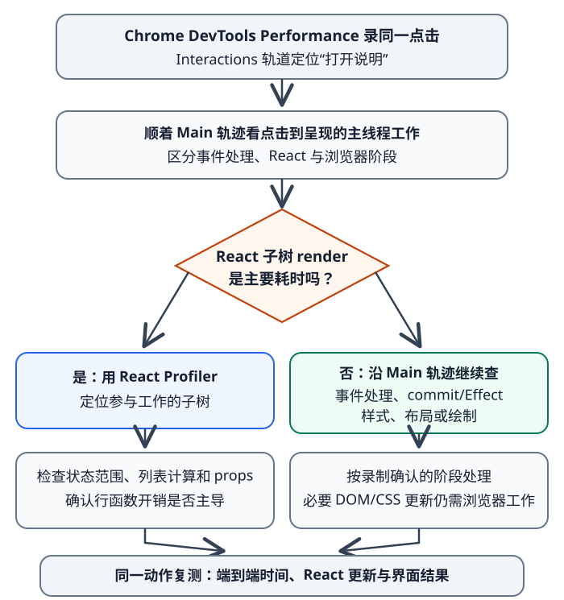

### 先分清render和DOM变化

React 的 render（渲染）是组件函数计算下一份界面描述；commit（提交）才把必要的变化应用到 DOM（文档对象模型）。组件运行了，不代表 DOM 一定改变；React 可能比较出宿主属性与顺序不变。浏览器还要根据 DOM 和 CSS 决定后续的样式、布局、绘制或合成，因此 React 的 render 耗时也不是用户完整等待时间。

先用同一 URL、同一组报表、同一交互和目标设备在 Chrome DevTools（Chrome 开发者工具）的 Performance 面板录一次基线。Interactions（交互）轨道可定位“打开说明”这次点击及其输入、处理和呈现延迟；再顺着 Main（主线程）轨迹看时间花在事件处理、React、commit/Effect，还是样式、布局和绘制。若记录显示 React 子树 render 占主要成本，再用 React Developer Tools（React 开发者工具）的 Profiler（性能分析器）定位参与的组件；`<Profiler>` API 可在指定子树记录 `phase`、`actualDuration` 和 `baseDuration`。`actualDuration` 是该次已提交更新中子树实际花在 render 的时间；`baseDuration` 是按最近各组件耗时估计、没有跳过子树时的成本。Profiler 有额外开销，生产构建默认关闭程序化分析；比较线上构建时需使用启用 profiling 的构建，不能把开发构建耗时当成生产时延。

render 不是主耗时时，不要只看提交后的浏览器工作：继续检查点击处理器、React commit 与 Effect，以及其后的样式、布局和绘制。`useLayoutEffect` 及其状态更新会在浏览器重绘前处理；其中测量 DOM 的操作可能把同步布局带入这段交互。React Performance tracks（React 性能轨道）可以在浏览器 Performance 时间线上区分 React render、commit/layout Effect 与剩余 Effect；这些 React 专用轨道只在开发构建和 profiling 构建中可见，且有额外开销。普通 `useEffect` 通常在 paint 后，但与交互相关时也可能在 paint 前运行。按轨迹里实际占时的阶段处理，不要从“React render 较短”直接推断布局/绘制就是唯一瓶颈。浏览器阶段边界见[如何测量并诊断网页性能问题？](#13.%20%E5%A6%82%E4%BD%95%E6%B5%8B%E9%87%8F%E5%B9%B6%E8%AF%8A%E6%96%AD%E7%BD%91%E9%A1%B5%E6%80%A7%E8%83%BD%E9%97%AE%E9%A2%98%EF%BC%9F)与[为什么一次 DOM 改动会增加布局或绘制工作？](#12.%20%E4%B8%BA%E4%BB%80%E4%B9%88%E4%B8%80%E6%AC%A1%20DOM%20%E6%94%B9%E5%8A%A8%E4%BC%9A%E5%A2%9E%E5%8A%A0%E5%B8%83%E5%B1%80%E6%88%96%E7%BB%98%E5%88%B6%E5%B7%A5%E4%BD%9C%EF%BC%9F)。render 次数或控制台日志只能提示“谁可能运行过”，不能单独证明交互更快。

若说明面板只在面板内部使用，最直接的修法通常是把 `helpOpen` 状态移进独立的 `HelpPanel`。这样面板自己的更新不必从 `ReportBoard` 向整张报表列表传播：

~~~jsx
import { useState } from "react";

function HelpPanel() {
  const [open, setOpen] = useState(false);
  return (
    <section>
      <button type="button" onClick={() => setOpen(value => !value)}>
        {open ? "隐藏说明" : "显示说明"}
      </button>
      {open && <p>说明面板</p>}
    </section>
  );
}
~~~

由 `ReportBoard` 同时渲染 `<HelpPanel />` 和报表列表，并让 `open` 由 `HelpPanel` 自己持有；点击时只有这棵子树更新，兄弟列表不必因 `helpOpen` 重算。组件状态由谁持有、何时该拆开组件见[如何在 React 中组合组件与复用行为？](#7.%20%E5%A6%82%E4%BD%95%E5%9C%A8%20React%20%E4%B8%AD%E7%BB%84%E5%90%88%E7%BB%84%E4%BB%B6%E4%B8%8E%E5%A4%8D%E7%94%A8%E8%A1%8C%E4%B8%BA%EF%BC%9F)。下例故意把 `helpOpen` 留在列表父组件，单独展示它触发父组件 render 时，手工缓存怎样影响传给行的值；这是为了分析依赖身份的教学路径，不表示应先给每个组件加缓存。

从同一个合成起点读下面这段代码：`reports` 为 May、April 两个对象，`query` 为空，`helpOpen=false`。此刻 `visible` 是两行的筛选结果，`toggleReviewed` 是切换某行状态的函数。

| `id` | `title` | `reviewed` |
| --- | --- | --- |
| `may` | `May summary` | `false` |
| `april` | `April summary` | `false` |

先把案例入口的排序变化说清：初始 `sort=recent` 时，列表为 May、April；选择 **Oldest first** 后，`sort=oldest` 让同一组报表显示为 April、May。排序只改变列表顺序，不修改两个报表对象；稳定的 `key` 保留每行身份，但 key 本身不会跳过 render。在下方手工 `memo` 路径中，如果每行的对象与回调 props（属性）保持同一引用，行函数可以跳过，React 仍需协调并重排列表节点。下面的代码没有实现排序或 URL 历史处理，只隔离说明面板、搜索词和本地 `reviewed` 三种更新。

> [!example]- 查看这个案例的 React 实现
> ~~~jsx
> import { memo, useCallback, useMemo, useState } from "react";
>
> function filterReports(reports, query) {
>   const normalizedQuery = query.toLowerCase();
>   return reports.filter(report =>
>     report.title.toLowerCase().includes(normalizedQuery)
>   );
> }
>
> function replaceReviewed(reports, id) {
>   return reports.map(report =>
>     report.id === id
>       ? { ...report, reviewed: !report.reviewed }
>       : report
>   );
> }
>
> function ReportBoard({ initialReports }) {
>   const [reports, setReports] = useState(initialReports);
>   const [query, setQuery] = useState("");
>   const [helpOpen, setHelpOpen] = useState(false);
>
>   const visible = useMemo(
>     () => filterReports(reports, query),
>     [reports, query]
>   );
>   const toggleReviewed = useCallback((id) => {
>     setReports(current => replaceReviewed(current, id));
>   }, []);
>
>   return (
>     <>
>       <input
>         aria-label="筛选报表"
>         value={query}
>         onChange={event => setQuery(event.target.value)}
>       />
>       <button
>         type="button"
>         onClick={() => setHelpOpen(open => !open)}
>       >
>         {helpOpen ? "隐藏说明" : "显示说明"}
>       </button>
>       {helpOpen && <p>说明面板</p>}
>       <ul>
>         {visible.map(report => (
>           <ReportRow
>             key={report.id}
>             report={report}
>             onToggle={toggleReviewed}
>           />
>         ))}
>       </ul>
>     </>
>   );
> }
>
> const ReportRow = memo(function ReportRow({ report, onToggle }) {
>   return (
>     <li>
>       {report.title}
>       <button type="button" onClick={() => onToggle(report.id)}>
>         {report.reviewed ? "已读" : "标为已读"}
>       </button>
>     </li>
>   );
> });
> ~~~

在这条手工记忆化路径里，`useMemo` 首次 render 仍会筛选；缓存仍在时，后续 render 只有 `reports` 或 `query` 按 `Object.is` 比较发生变化，才重跑筛选函数。`useCallback` 在依赖不变的后续 render 返回同一个函数引用；空依赖成立，是因为回调只调用 updater，并不读取某一轮的 `reports` 快照。`memo(ReportRow)` 默认逐项用 `Object.is` 比较 props；若同一行对象和回调都相同，React 可以跳过这行的父级传播 render。

表中每项操作都从同一初始状态独立重放：`query=""`，May 与 April 两行都挂载。输入 `apr` 会让 May 行离开树；因此“把 May 标为已读”不是在该行后面连续进行，而是从初始两行仍可见时单独开始。作为对照，若不用缓存，打开说明会让父组件、过滤函数和两行函数重新执行，但不必改变行 DOM；使用这段手工缓存时，父组件与 `visible.map` 仍执行，依赖不变且缓存仍在时可以复用过滤结果，稳定 props 可让 memo 行跳过函数调用。

| 操作 | 状态与引用如何变化 | 行组件会发生什么 |
| --- | --- | --- |
| 初始显示两行 | `reports`、`query` 首次出现，执行过滤并创建 `visible`；第一次创建 `toggleReviewed` | 两行首次 render |
| 打开说明面板 | 只改 `helpOpen`；`reports`、`query` 不变，缓存仍在时 `useMemo` 可返回原 `visible`，`useCallback` 可返回原函数 | 父组件和 `visible.map` 仍执行；两行的 `report` 与 `onToggle` props 相同，已包 `memo` 的行可以跳过。React Compiler 生效时也可能自动建立等价缓存 |
| 输入 `apr` | `query` 改变，过滤必须再扫描当前 `reports`，`visible` 只含 April | May 行离开树；April 仍有相同的行对象与回调，手工 memo 边界可以跳过它 |
| 把 May 标为已读 | 不可变更新创建新 `reports` 数组和新的 May 对象；April 对象保持原引用 | 过滤重算；May 行 props 改变而需更新，April 行 props 不变时仍可能跳过 |

这张表说明几种优化作用在不同环节：memoization（记忆化）中的 `useMemo` 省掉依赖未变时的 `filter`；`useCallback` 保持传给行的回调身份；`memo` 才检查行 props（属性）并决定是否跳过组件函数。行接收的是单个 `report` 对象，不是 `visible` 数组；即使 React 因特殊原因丢弃 `useMemo` 缓存、重新生成了数组，只要数组里的行对象引用没变，行 props 仍可相同。`memo` 管的是父组件传入的 props；行自身 state（状态）或它读取的 Context（上下文）变化，仍可让行 render。少了 `memo`，稳定值不会单独阻止子组件 render；若回调每次新建或行对象被原地改写，默认 props 比较也无法可靠地区分更新。筛选词变化时仍需检查每一条记录，`useMemo` 不能让一次新的全量过滤变成常数时间。对 May 的更新若要让 React 看见变化，应创建新数组和新对象，同时保留未变的 April 对象；不能为追求身份稳定而原地改写数据。

这段 `reviewed` 示例只演示本地对象的不可变更新；真实写入服务端还要处理请求身份、确认和失败状态，见[React 服务端状态与乐观更新](#9.%20React%E7%95%8C%E9%9D%A2%E5%A6%82%E4%BD%95%E7%BB%B4%E6%8A%A4%E6%9C%8D%E5%8A%A1%E7%AB%AF%E6%95%B0%E6%8D%AE%E4%B8%8E%E4%B9%90%E8%A7%82%E6%9B%B4%E6%96%B0%E7%9A%84%E6%AD%A3%E7%A1%AE%E6%80%A7%EF%BC%9F)。若说明面板只需暂时隐藏，CSS 隐藏会让它留在 React 树中，state 与 Effect 仍存在；条件移除则会卸载组件并运行 cleanup（清理），再次显示时创建新实例，按交互和生命周期需求选择。Fragment（片段）可避免纯包装用的额外 DOM 节点，但是否有性能收益仍要测量。

### React Compiler改变手工memo的默认做法

React Compiler（React 编译器）v1.0 已稳定；截至 2026-11-12，React 官方文档版本为 React 19.3。Compiler 是可选的构建期优化：项目必须在构建链中配置它，且具体文件和组件要被编译器识别。启用后，它可以在组件与 Hook（钩子）内自动记忆化可复用的子树和计算，通常无需新代码先手写 `memo`、`useMemo`、`useCallback`。先检查项目是否接入、构建是否覆盖本文件，再用 Profiler 观察结果；仅安装插件或看到新版本号，不足以证明某个组件已获得优化。

编译范围有边界：Compiler 主要优化 React 组件和 Hook，不会将任意工具函数自动变成跨组件共享的缓存。同一昂贵纯函数若在多个独立组件中分别调用，组件内的记忆化不会自然共用一次结果；是否需要显式的共享缓存，要根据实际调用和数据所有权另作设计。启用 Compiler 后仍可保留确有意图的手工 memo，但不要叠加一层只为“更安全”的缓存。

未启用 Compiler、某个模块未被覆盖，或 Profiler 显示一个稳定边界仍反复做昂贵工作时，才考虑手工 API。React 在特定情况下可丢弃 `useMemo` / `useCallback` 缓存，例如初次挂载时发生 Suspense；需要语义持久状态时应使用 state（状态）或 ref（引用）。新建的对象、数组和函数每次身份都不同；自定义 `memo` 比较必须保证函数行为和可见输出等价，否则可能保留旧闭包。React Compiler、组件编译范围与手工 memo 当前用途见下方来源。

### 用结果决定优化是否值得保留

按相同交互复测，从点击到界面呈现，并沿 Performance 轨迹比较原先占时阶段。若 Compiler 已覆盖，可比较编译前后的同一操作；若手工拆分状态或加入 `memo`，确认可见界面仍正确，并且目标 render 成本或点击到呈现时间能稳定、可重复地改善。是否覆盖 Compiler 只是解释优化从哪里来，不单独决定保留缓存；没有可重复收益，或维护成本超过收益时，可以移除手工缓存后复测。已有代码的手工缓存可能影响 Compiler 的编译结果，移除后也要重新验证界面行为和性能，不能仅凭启用 Compiler 就批量删除。Profiler 有额外开销，最终判断还要回到目标构建和设备上的浏览器 Performance 轨迹。

稳定 `key`（列表键）用来保留列表项在排序、插入和删除中的身份，不是跳过 render 的性能 API；虚拟列表卸载行后，原组件的局部 state 也会销毁。如果测量显示成本随同时挂载的行数增加——无论来自 React 创建/更新行，还是 DOM、样式与布局——再评估[长报表列表何时适合虚拟滚动？](#15.%20%E9%95%BF%E6%8A%A5%E8%A1%A8%E5%88%97%E8%A1%A8%E4%BD%95%E6%97%B6%E9%80%82%E5%90%88%E8%99%9A%E6%8B%9F%E6%BB%9A%E5%8A%A8%EF%BC%9F)。若主要耗时在窗口选择之前的全量过滤，虚拟化不一定能缩短那段计算。React commit 后的浏览器工作与组件 render 分开看，并用同一交互复测端到端结果。

> [!info]- 来源与版本核验（React 19.3；React Compiler v1.0；核验日期 2026-11-12）
> - React 官方文档当前版本为 19.3，npm 版本 `v19.3.0` 发布于 2026-09-09：[Versions](https://react.dev/versions)、[React 19.3](https://react.dev/blog/2026/09/09/react-19-3)。
> - render 是 React 调用组件求得界面，commit 才更新 DOM，render 不必导致 DOM 变化：[Render and Commit](https://react.dev/learn/render-and-commit)，React 19.3。
> - Chrome Performance 的 Interactions 轨道显示输入、处理和呈现延迟，Main 轨道显示主线程调用栈和事件耗时：[Performance features reference](https://developer.chrome.com/docs/devtools/performance/reference#view-interactions)，核验日期 2026-11-12。
> - React 性能轨道将 Update、Render、Commit（含 layout Effects）和剩余 Effects 放在浏览器时间线上；`useLayoutEffect` 与其状态更新会在重绘前执行：[React Performance tracks](https://react.dev/reference/dev-tools/react-performance-tracks#renders)、[useLayoutEffect](https://react.dev/reference/react/useLayoutEffect)，React 19.3。
> - React Developer Tools 的 Profiler 面板与组件检查：[React Developer Tools](https://react.dev/learn/react-developer-tools)，React 19.3；`<Profiler>` 的 commit 回调、`actualDuration`、`baseDuration` 及生产 profiling 开销：[Profiler](https://react.dev/reference/react/Profiler)，React 19.3。
> - Compiler 是可选且稳定的构建期优化；它主要在组件与 Hook 中跳过级联 render 和重复计算，不对任意工具函数共享缓存；先 profile 后再增加复杂度：[React Compiler Introduction](https://react.dev/learn/react-compiler/introduction)，React Compiler v1.0，2025-10-07。
> - `memo` 默认以 `Object.is` 比较 props，状态或所读 Context 改变仍可 render；`useMemo` 的缓存与依赖比较、缓存可在特定条件丢弃：[memo](https://react.dev/reference/react/memo)、[useMemo](https://react.dev/reference/react/useMemo)，React 19.3。
> - `useCallback` 只返回稳定函数引用、不主动执行函数，依赖按 `Object.is` 比较；缓存可被丢弃：[useCallback](https://react.dev/reference/react/useCallback)，React 19.3。
> - 条件移除组件会重置其树位置上的 state、Effect 会在卸载时清理、Fragment 不增加包装 DOM：[Preserving and Resetting State](https://react.dev/learn/preserving-and-resetting-state)、[useEffect](https://react.dev/reference/react/useEffect)、[Fragment](https://react.dev/reference/react/Fragment)，React 19.3。
> - 状态所有权、组件边界和向下传值：本库[如何在 React 中组合组件与复用行为？](#7.%20%E5%A6%82%E4%BD%95%E5%9C%A8%20React%20%E4%B8%AD%E7%BB%84%E5%90%88%E7%BB%84%E4%BB%B6%E4%B8%8E%E5%A4%8D%E7%94%A8%E8%A1%8C%E4%B8%BA%EF%BC%9F)；提交后的样式、布局与绘制：本库[为什么一次 DOM 改动会增加布局或绘制工作？](#12.%20%E4%B8%BA%E4%BB%80%E4%B9%88%E4%B8%80%E6%AC%A1%20DOM%20%E6%94%B9%E5%8A%A8%E4%BC%9A%E5%A2%9E%E5%8A%A0%E5%B8%83%E5%B1%80%E6%88%96%E7%BB%98%E5%88%B6%E5%B7%A5%E4%BD%9C%EF%BC%9F)。
## 15. 长报表列表何时适合虚拟滚动？

**案例背景。** 报表页从 `/reports?sort=recent#summary` 得到 May、April 两行；选择 **Oldest first** 后，`sort=oldest` 让可见顺序变成 April、May。两行列表不需要虚拟化。下面有意把这个案例扩大为假设的 **100,000 条**历史报表，问题变成：用户到底要看什么，客户端要拿到哪些数据，浏览器要同时挂载多少节点？十万只是演算规模，不是启用虚拟滚动的门槛。先按真实交互分辨网络、React render（渲染）、DOM（文档对象模型）与布局成本，再选择处理方式。

### 十万条报表先决定哪些数据需要传输

把历史增长到 100,000 条后，至少有三种不同成本：从服务端拿来多少字节；客户端为筛选、排序和转换跑多少 JavaScript 并保留多少数据对象；React 与浏览器同时要处理多少组件、DOM 节点、样式和布局。100,000 条不是通用阈值：是否能承受全量处理还取决于设备、行复杂度、数据形状和交互，应分别测量请求、脚本、渲染与内存。用户只看总数或月度趋势时，服务端聚合可直接返回结果；用户要搜索、排序、分页浏览时，接口可以按条件处理后只发送当前页；若用户确实需要连续浏览已加载数据，虚拟滚动才处理挂载窗口。客户端过滤十万条仍要检查十万条：若 `n` 是记录数且每条记录的判定成本近似固定，扫描一次的过滤成本随 `n` 线性增长，常记作 `O(n)`；把剩余行从 DOM 移走，不会减少这次扫描、已下载数据或其 JavaScript 内存。

| 经同一任务录制确认的主要成本 | 优先处理方向 | 要计入的代价或边界 |
| --- | --- | --- |
| 网络传输包含用户尚不需要的记录 | 服务端过滤、排序、分页或按需请求；只需统计时返回聚合 | 加载、错误、重试、结束状态和排序一致性 |
| 客户端全量变换或查询占主线程 | 改算法、缩小输入、分块，或把可移出的纯计算交给 Web Worker（网页工作线程） | Worker 不减少算法工作量；对象消息通常要结构化复制，数据传递也要计时 |
| React 组件函数反复执行 | 按[React 渲染优化](#14.%20%E5%A6%82%E4%BD%95%E6%B5%8B%E9%87%8F%E5%B9%B6%E5%87%8F%E5%B0%91%E4%B8%8D%E5%BF%85%E8%A6%81%E7%9A%84React%E5%B7%A5%E4%BD%9C%EF%BC%9F)检查状态范围、稳定的 `props`（属性）和已测量的 `memo`（记忆化）边界；若成本主要随同时挂载的行数增加，也可评估虚拟化 | 缓存跳过重复计算，虚拟化减少参与工作的行，两者作用不同 |
| 大量已挂载节点让样式、布局或呈现变慢 | 虚拟化当前可视窗口 | 测量、滚动、焦点、键盘、读屏、打印和查找行为更复杂 |

若从开场的 `sort=oldest` 切到跨请求分页，下面明确改用 `sort=recent`：按 `periodStart` 降序，再以唯一 `report.id` 升序打破同日并列。唯一 ID 让固定数据集的顺序确定；keyset pagination（键集分页）的游标记录页尾的完整排序键值，服务端按同一排序定义和方向继续，排序方向若已由查询配置固定，不必重复编码在游标里。只带可能重复的日期不足以区分并列报表。

偏移边界如何移动，可以用页大小为 2 的小例子单独看：原顺序为 `A, B, C, D`，第一页是 `A, B`。若下一次请求前在头部插入 `X`，新顺序是 `X, A, B, C, D`；`OFFSET 2` 会返回 `B, C`，重复了 `B`。若另一种变化是第一页之后删除头部的 `A`，剩余顺序 `B, C, D` 的 `OFFSET 2` 只返回 `D`，跳过了 `C`。稳定的次级 ID 不会冻结两次请求间变化的数据集；需要一致的历史浏览时，还要由服务端定义快照或版本边界。分页减少单次传输；在客户端收到全量数据后再虚拟化，不会追溯减少之前的网络流量。

### 固定行高怎样算出挂载窗口

先用一个固定行高的小模型，明确索引约定：以下行号从 `0` 开始，区间右端不包含在内；每行的重复高度步长为 `40px`（若有行间距，也计入此步长），滚动窗口高 `480px`，上下各多渲染 4 行的 overscan（预渲染缓冲区）。在 `scrollTop = 4000px` 时，视口恰好从第 100 行开始，到第 112 行之前结束，因此可见区间是 `[100, 112)`，共 12 行。加上前后缓冲，挂载区间成为 `[96, 116)`，共 20 行。窗口顶端偏移为 `96 × 40 = 3840px`；整条列表仍要用 `100,000 × 40 = 4,000,000px` 的占位高度保留滚动范围。

下面函数只演算固定高度窗口。示例中的 `items` 是浏览器已持有的 100,000 条合成报表；`totalRows` 是非负整数；`rowHeight` 是有限正数；视口高度是有限正数，`scrollTop` 是有限数；`overscan` 是非负整数。尚未测到正高的滚动容器先不计算窗口。滚动位置会限制在整条列表可滚动范围内。实际容器的尺寸和位置应从浏览器测量，不能一直把示例常数写死。

~~~javascript
const items = Array.from({ length: 100_000 }, (_, id) => ({ id }));

function getWindow(
  totalRows,
  scrollTop,
  viewportHeight,
  rowHeight,
  overscan = 4
) {
  const totalHeight = totalRows * rowHeight;
  const maxScrollTop = Math.max(0, totalHeight - viewportHeight);
  const offset = Math.min(Math.max(scrollTop, 0), maxScrollTop);
  const firstVisible = Math.floor(offset / rowHeight);
  const start = Math.max(0, firstVisible - overscan);
  const end = Math.min(
    totalRows,
    Math.ceil((offset + viewportHeight) / rowHeight) + overscan
  );

  return {
    start,
    end,
    offsetY: start * rowHeight,
    totalHeight
  };
}

const range = getWindow(items.length, 4_000, 480, 40);
// { start: 96, end: 116, offsetY: 3840, totalHeight: 4000000 }
const mountedItems = items.slice(range.start, range.end);
~~~

下图对应 `scrollTop=4000px`，局部窗口把视口中实际可见的 12 行与上下缓冲的 8 行分开；左侧只标出它在完整列表中的位置，不按 4,000,000px 高度比例绘制：

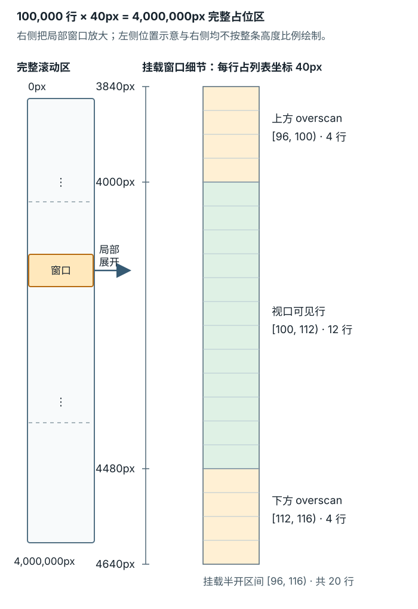

在真实组件中，滚动容器的 `scroll` 更新 `scrollTop` 后会重新计算窗口；下面列出前后两次状态。`getWindow` 本身只算范围，真正挂载和卸载由组件按新范围重绘时发生。

| `scrollTop` | 可见半开区间 | 挂载半开区间 | 窗口容器 `offsetY` | 与上次相比 |
| ---: | --- | --- | ---: | --- |
| `4000px` | `[100, 112)` | `[96, 116)` | `3840px` | 初始窗口，挂载 20 行 |
| `4040px` | `[101, 113)` | `[97, 117)` | `3880px` | 卸载第 96 行，挂载第 116 行；第 97–115 行继续挂载 |

实现会把 `mountedItems` 放进一个从 `range.offsetY` 开始的定位容器；外层占位区高度为 `range.totalHeight`，让滚动条仍代表完整列表，内层只创建窗口中的报表行。代码逐项满足边界处理：靠近开头时 `start` 不会小于 0；靠近结尾时 `end` 不会超过 `totalRows`；列表短于视口时最大滚动位置为 0。窗口滚动只是选择当前要挂载的下标，不会改变 `items` 本身。

`report.id` 应是跨排序和翻页稳定的唯一 key（键），不用当前窗口内的索引。React `key`（列表键）帮助 React 在同一棵已挂载列表中识别行；当某行滚出窗口并从树中卸载，它的局部 state 也会结束。若“已选中”或编辑草稿要在离开窗口后保留，把状态放在列表外并按报表 ID 关联。若离开页面后还要回到原阅读位置，可保存可见行 ID 与该行内的滚动偏移，再恢复到对应位置。窗口索引不是报表身份，排序后以 index 当 key 可能把旧行状态交给另一份报表。

虚拟化只让当前窗口的行进入 DOM。用户必须看到所有数据时，它仍可与分页或增量请求组合；但请求下一页、保持 API 游标和处理失败，是独立的数据加载流程。若首要目标是让查询少扫描记录，应减少查询输入或改变算法；若主要成本是全量数据对象占用内存，减少挂载节点也不会清除那批对象。

### 固定高度不适用时怎样跟上实际尺寸

报表标题可能换行，说明行可能展开，字体或图片也可能在挂载后改变高度。此时初始只能按每行估算高度累加出后续位置；真实行挂载后，虚拟器测得实际高度，并更新它之后行的起点和总高度。沿用 `scrollTop=4000px` 的算例：视口上方的第 96 行原估 `40px`、实测 `52px`，相差 `12px`；第 100 行的内容坐标便从 `4000px` 移到 `4012px`。若滚动位置仍是 `4000px`，第 100 行会比原来低 `12px`；若它是锚点且实现把 `scrollTop` 补偿到 `4012px`，它仍在视口原位置。使用动态尺寸的虚拟器应有估算、实际测量及滚动锚定策略，并应在目标浏览器中检查展开行、异步内容和视口尺寸变化。TanStack Virtual 当前文档以 `estimateSize` 提供初始估计、`measureElement` 取得实际尺寸，并用 `shouldAdjustScrollPositionOnItemSizeChange` 控制视口上方行尺寸变化时是否校正滚动位置；具体配置按项目安装版本核对。

### 让被卸载的行仍能被键盘和辅助技术使用

虚拟窗口之外的行不存在于当前 DOM。若键盘焦点落在某行按钮上，而下一次滚动将该行卸载，焦点可能丢失；交互列表应按报表 ID 跟踪活动项，保证它仍被挂载，或在卸载前按其控件模式移动并恢复焦点。对使用方向键的虚拟 `grid`（网格），若目标单元格在窗口外，先算出目标报表 ID/索引并滚动到包含该行的窗口，待目标行挂载后再把焦点移到单元格。不要因为数据看起来像列表就随手加 `role="listbox"`：列表框是选择选项的复合控件，不适合把按钮或复选框等独立交互控件塞进每个选项；列表框、grid（网格）等复合控件也要求各自的方向键和焦点行为。只需展示和浏览报表时，带正确表头的原生 `<table>` 配合服务端分页通常更容易使用；单页表格呈现的仍只是当前页，要搜索或打印全量结果时还需相应的应用级搜索或导出能力。当测量确认同时挂载的行数带来主要成本——可能在 React 计算，也可能在 DOM、样式与布局——且用户需求能接受部分节点时，再承担虚拟表格的复杂性。

当部分集合被渲染时，无障碍富互联网应用规范（WAI-ARIA）对适用的 `listitem` / `treeitem` 提供 `aria-posinset` 与 `aria-setsize`；位置从 1 开始，若总数未知，`aria-setsize="-1"` 表示未知。`table`、`grid`、`treegrid` 使用 `aria-rowindex` 与 `aria-rowcount`；行位置相对完整表格从 1 开始，总行数未知时 `aria-rowcount="-1"`。例如 100,000 条数据再加一行表头，完整表格应报告 `aria-rowcount="100001"`；表头行为 `aria-rowindex="1"`，挂载窗口首条数据（数组下标 96）为 `aria-rowindex="98"`。每一条当前挂载的表格行都要标出它在完整表格中的索引。ARIA 属性只描述集合中当前行的位置和总数，不会把未挂载行放回 DOM，也不能补上错误角色、缺失表头或不完整键盘模型。最终应在目标浏览器与屏幕阅读器中验证读序、焦点、滚动、加载、空结果和总数未知时的表达。

决定虚拟化后，在[如何测量并诊断网页性能问题？](#13.%20%E5%A6%82%E4%BD%95%E6%B5%8B%E9%87%8F%E5%B9%B6%E8%AF%8A%E6%96%AD%E7%BD%91%E9%A1%B5%E6%80%A7%E8%83%BD%E9%97%AE%E9%A2%98%EF%BC%9F)用同一 URL、设备、数据和滚动交互比较挂载节点、布局与呈现成本；分别记录 React 计算与浏览器呈现的成本，再比较端到端交互。即使布局耗时不变，减少原先占主导的 React 工作仍可能有收益；若 React 计算仍是主要瓶颈，再沿[如何测量并减少不必要的React工作？](#14.%20%E5%A6%82%E4%BD%95%E6%B5%8B%E9%87%8F%E5%B9%B6%E5%87%8F%E5%B0%91%E4%B8%8D%E5%BF%85%E8%A6%81%E7%9A%84React%E5%B7%A5%E4%BD%9C%EF%BC%9F)继续定位。

> [!info]- 来源与核验（核验日期 2026-11-12）
> - 本章的成本区分、固定高度公式和是否虚拟化的选择来自本例的状态与计算推演；`100,000` 行不是库或浏览器规定的阈值。React render 与 commit 的边界见 React 19.3 官方[Render and Commit](https://react.dev/learn/render-and-commit)。
> - TanStack Virtual 当前官方 v3 [Virtualizer API](https://tanstack.com/virtual/latest/docs/api/virtualizer) 的 `count`、`estimateSize`、`overscan`、`getItemKey`、`measureElement`、`getTotalSize`；`shouldAdjustScrollPositionOnItemSizeChange` 说明它处理视口上方测量值与估算值不同时的滚动位置校正，默认在未反向滚动时才应用，并且是实例属性。核验日期 2026-11-12；文中未把 `/latest` 当作具体安装版本。
> - 分页的排序要求：[PostgreSQL 18，Sorting Rows (`ORDER BY`)](https://www.postgresql.org/docs/18/queries-order.html) 说明后续排序项在前项相等时继续决定顺序；[`LIMIT` and `OFFSET`](https://www.postgresql.org/docs/18/queries-limit.html) 要求分页查询使用能约束到唯一顺序的 `ORDER BY`，并说明 offset 会先跳过前序行。新数据插在两次请求间导致页边界移动是基于该规则的跨请求推演，不是 PostgreSQL 特有承诺。
> - Web Worker 的 `postMessage()` 可发送结构化数据，`ArrayBuffer` 可放入 transfer list 转移；跨 realm 的序列化/反序列化称为 structured cloning：[WHATWG HTML Living Standard，Web Workers](https://html.spec.whatwg.org/multipage/workers.html)、[Safe passing of structured data](https://html.spec.whatwg.org/multipage/structured-data.html#structured-cloning)，核验日期 2026-11-12。
> - 虚拟窗口只呈现集合子集时，`aria-rowcount` 包含表头行，且每个挂载行（包括表头）都用 `aria-rowindex` 标出其在完整表格中的 1 基位置：[WAI-ARIA 1.2，`aria-rowindex` / `aria-rowcount`](https://www.w3.org/TR/wai-aria-1.2/#aria-rowindex)，W3C Recommendation，2023-06-06；[WAI-ARIA APG Grid and Table Properties](https://www.w3.org/WAI/ARIA/apg/practices/grid-and-table-properties/#using-aria-rowcount-and-aria-rowindex)，核验日期 2026-11-12。
> - `grid` 是需要作者管理内部焦点移动的复合控件，而表格中的可聚焦元素仍在页面 Tab 顺序中：[WAI-ARIA APG Grid Pattern](https://www.w3.org/WAI/ARIA/apg/patterns/grid/)，核验日期 2026-11-12。listbox 用于选择选项，其交互模型不支持在选项内操作链接、按钮或复选框：[WAI-ARIA APG Listbox Pattern](https://www.w3.org/WAI/ARIA/apg/patterns/listbox/)，核验日期 2026-11-12。
> - 对适用的 `listitem` / `treeitem` 使用 `aria-posinset` 与 `aria-setsize` 时，位置从 1 开始，未知总数为 `-1`：[WAI-ARIA 1.2，`aria-setsize`](https://www.w3.org/TR/wai-aria-1.2/#aria-setsize) 与 [`aria-posinset`](https://www.w3.org/TR/wai-aria-1.2/#aria-posinset)，W3C Recommendation，2023-06-06。
## 16. 语义化 HTML 表单如何支持键盘与辅助技术用户？

沿用一张合成的 2026 年 10 月订单月报：用户用键盘选择月份、地区和订单状态，提交筛选后查看订单号、地区与状态。HTML（HyperText Markup Language，超文本标记语言）标记决定控件的名称、角色和值；浏览器把当前选择序列化为 GET 请求；报表应用校验这些查询值、按约定筛选订单，再返回有标题关系的数据表。本例用 CSS（Cascading Style Sheets，层叠样式表）安排视觉布局，控件语义与原生操作由 HTML 提供。

### 先建立有语言和视口的文档

文档骨架让浏览器正确解释页面，并让辅助技术更容易定位主要内容。`<!doctype html>` 选择标准模式；根元素的 `lang` 声明主要语言；文件本身也须使用 UTF-8 编码，字符集声明不会转换错误编码的字节。`meta name="viewport"` 这个 viewport（视口）声明让窄屏布局视口的宽度与设备宽度相符，但它本身不会把固定宽度布局变成响应式布局。

~~~html
<!doctype html>
<html lang="zh-CN">
<head>
  <meta charset="utf-8">
  <meta name="viewport" content="width=device-width, initial-scale=1">
  <title>月度订单报表</title>
</head>
<body>
  <main>
    <h1>月度订单报表</h1>
    <!-- 报表筛选表单与结果表格 -->
  </main>
</body>
</html>
~~~

让标题层级表达页面结构，用 `main`、`nav` 等 landmark（地标区域）标记主要区域。`id` 在一份文档中应唯一，既可关联标签，也可用于片段导航；`class` 可把多个元素归为同一组样式。

> [!info]- 页面元数据与内容模型
> `title` 命名浏览器标签页。`meta name="description"` 可提供搜索摘要，但搜索引擎可能改从正文生成摘要；`link rel="icon"` 提供站点图标，搜索结果是否展示图标仍由搜索引擎决定。Google Search 不使用 `meta name="keywords"` 作为排名信号。`div` 和 `span` 适合没有更具体语义的布局容器；不要因默认字号或块级显示来选择元素，因为 CSS 可以改变显示方式，却不改变元素语义。HTML 内容模型仍决定元素能否嵌套：例如，段落只接受 phrasing content（短语内容），把 `div` 设成 inline 样式也不会使它成为段落可接受的内容。

### 让控件名称、提交值和动作明确

每个字段都要有可见且程序化关联的 `label`（标签）；按钮可用自身文字命名。显式 `for`/`id` 关联能为控件提供名称，标签也扩大了可点击区域，例如点击复选框的标签可切换选中状态；把输入控件放在 `label` 内也是有效关联方式。`fieldset` 与 `legend` 把同一问题的控件组成有名称的一组。下面的 GET 表单适合非敏感筛选值，因为查询可以出现在 URL（统一资源定位符）中并被收藏或分享；敏感值不应放入 URL。

~~~html
<form action="/reports" method="get">
  <label for="month">月份</label>
  <input id="month" name="month" type="month" value="2026-10" required>

  <label for="region">地区</label>
  <select id="region" name="region">
    <option value="" selected>全部地区</option>
    <option value="north">北区</option>
    <option value="south">南区</option>
  </select>

  <fieldset>
    <legend>订单状态（可多选）</legend>
    <label><input type="checkbox" name="status" value="open"> 处理中</label>
    <label><input type="checkbox" name="status" value="closed"> 已完成</label>
  </fieldset>

  <button type="submit">筛选报表</button>
</form>
~~~

组名“订单状态（可多选）”说明两项复选框回答的是同一个问题；各选项仍要能单独辨认。辅助技术可能按平台习惯在选项前重复读出组名，所以组名保持简短。

在常见浏览器的顺序键盘导航中，用户按 Tab 会依照文档顺序到达月份、地区、两项状态和提交按钮。本例保留预设月份 `2026-10`；月控件可能包含多个键盘停靠位置，用户继续 Tab 到“地区”；这是一个单选 `<select>`，其可访问名称来自关联标签“地区”，当前选项是“全部地区”。在 HTML Accessibility API Mappings 的映射中，这种未设 `multiple`、默认大小为 1 的下拉选择控件对应 `combobox`（组合框）角色；浏览器和辅助技术的具体显示与读法可能不同。继续按 Tab 到“处理中”复选框，它以原生 checkbox（复选框）角色和标签“处理中”提供名称与选中状态；按空格键（Space）把状态从未选中切换为已选中。按 Tab 到“已完成”，再按空格键选中它。最后 Tab 到名称为“筛选报表”的按钮，按空格键或 Enter 激活。这个键盘路径最终选择 2026 年 10 月、全部地区及两种状态；本例不承诺所有平台逐字相同的播报内容。

提交后，浏览器按表单中的元素顺序构造 `name=value` 项。在本例中，没有 `name` 或被禁用的控件不产生项目；未选中的复选框和单选框也不提交；本例没有 `name` 的提交按钮不会多出一项。`checked` 和 `selected` 属性建立初始选中状态；用户操作后，提交采用控件当前的选中状态，而不是原始属性值。同名的已选复选框会分别产生项目，而且次序按文档中的控件顺序确定，不按用户点击顺序确定。浏览器按表单 URL 编码规则将项目写进 GET 查询串。本例的名称和值只包含字母、数字或连字符，所以在结果中不需转义；“都是 ASCII”本身不能推出无需编码，例如 `&`、`+` 和空格仍需要编码处理。

`type="month"` 支持时，非空值以类似 `2026-10` 的年月字符串表示：年份为至少四位且大于零的数字，后接连字符及 `01`–`12` 的两位月份。不支持该输入类型的浏览器会把它按文本输入处理，仍可输入任意字符串；它不再保证提供月份选择器或月份格式校验。`required` 可阻止常规提交空值，但服务器仍须校验真实收到的值。

| 用户选择 | GET 请求路径与查询参数 | 合成服务器按本页约定进行的筛选 |
| --- | --- | --- |
| 2026 年 10 月、全部地区、不限制状态 | `/reports?month=2026-10&region=` | 返回当月所有地区和状态的订单 |
| 2026 年 10 月、全部地区、处理中与已完成 | `/reports?month=2026-10&region=&status=open&status=closed` | 匹配任一所选状态；这是下方结果表对应的请求 |
| 2026 年 10 月、北区、只选处理中 | `/reports?month=2026-10&region=north&status=open` | 仅匹配北区且处于处理中的订单 |
| 2026 年 10 月、北区、未选状态 | `/reports?month=2026-10&region=north` | 仅匹配北区，不限制状态 |

这些业务含义由合成报表应用定义，不是 HTML 或 URL 自动带来的规则：`month` 必须是一个有效的年月；缺失、空或格式无效时，服务器返回字段错误并要求重新选月，不静默改用其他月份。有效但没有订单的月份返回空结果和说明。`region=` 或省略 `region` 都表示全部地区；`north`、`south` 分别表示北区、南区，其他非空值返回错误。省略全部 `status` 表示不限制状态；多个 `status` 值组成一个列表，命中其中任一值即可；未知状态值返回错误。

结果表明确对应第二行请求 `/reports?month=2026-10&region=&status=open&status=closed`，因此可同时显示来自北区的处理中订单 `A-1042` 与来自南区的已完成订单 `A-1043`。浏览器负责提交查询值；应用负责按上面的契约筛选并生成结果。

> [!info]- 相邻表单控件的边界
> `type="password"` 只遮住屏幕显示，不会加密传输或替代安全存储；文件选择器的 `accept` 只是可选类型提示，服务器仍须校验收到的文件。`select multiple` 也可让一个字段提交多个同名值。相同 `name` 的单选按钮保证同组只能选择一个值，复选框则可提交多个已选值。表单里的按钮默认可能提交表单，因此写明 `type="submit"`、`type="reset"` 或 `type="button"`；页面导航用有真实 `href` 的链接，`href="#"` 会导航到当前文档顶部，不能当作无动作的占位符。若地区改变会影响下一级门店选项，应用更新选项时还要清除不再有效的旧门店值；选项暂不可用时应明确告知用户。

### 让报表结果保持数据表语义

当数据的行和列本身有意义时，用表格标记，而不是用 CSS Grid（网格布局）伪造表格语义。`caption` 说明表格主题；`th scope="col"` 给出列标题，`scope="row"` 标记本行的识别值。这样读者可以把单元格 `A-1042` 关联到“订单号”，并把“处理中”关联到“状态”列与该行；具体导航方式和播报文字随浏览器与辅助技术而异。

~~~html
<table>
  <caption>2026 年 10 月订单结果（全部地区，处理中或已完成）</caption>
  <thead>
    <tr>
      <th scope="col">订单号</th>
      <th scope="col">地区</th>
      <th scope="col">状态</th>
    </tr>
  </thead>
  <tbody>
    <tr><th scope="row">A-1042</th><td>北区</td><td>处理中</td></tr>
    <tr><th scope="row">A-1043</th><td>南区</td><td>已完成</td></tr>
  </tbody>
</table>
~~~

> [!info]- 其他内容结构与窄屏表格
> `rowspan` 或 `colspan` 会占据后续单元格位置；例如三列表格中，上行一个 `rowspan="2"` 已占下行第一列，下行只再写两个单元格。无序项目用 `ul`，有序步骤用 `ol`，术语与解释用 `dl`、`dt`、`dd`；不应用连续空格或非断行空格排版。窄屏宽表可以放入局部横向滚动容器，避免整个页面横向溢出，详见[固定与流动内容的布局选择](#21.%20%E5%9B%BA%E5%AE%9A%E4%B8%8E%E6%B5%81%E5%8A%A8%E5%86%85%E5%AE%B9%E9%80%82%E5%90%88%E5%93%AA%E7%A7%8D%20CSS%20%E5%B8%83%E5%B1%80%EF%BC%9F)。

### 键盘、焦点与校验错误

Tab 顺序通常跟随有意义的 HTML 文档顺序；`:focus-visible` 或 `:focus` 样式应保留可辨认、未被完全遮挡的焦点提示。不要只用颜色、图标或位置表达错误状态。CSS Flexbox（弹性盒布局）的 `order` 和 Grid（网格布局）的放置规则可改变视觉位置，却不会改变默认顺序导航或非视觉阅读顺序；CSS Display Level 4 另定义 `reading-flow`、`reading-order` 来改变特定布局下的阅读/焦点顺序，本例没有使用它们。必须让视觉和阅读顺序一致时，应先检查源码顺序，而不是用视觉移动掩盖结构问题。

通知邮箱是同一报表页上的另一个独立表单。原生约束可以阻止空邮箱或格式错误的邮箱提交，并在字段上触发可取消的 `invalid` 事件。若应用取消浏览器的原生错误提示，表单仍因约束失败而不能提交，但应用仍需提供可发现的错误通知并更新字段状态。下面单字段示例使用 `aria-describedby` 关联帮助和错误文本，用 `aria-invalid` 标出当前错误；动态显示错误并不保证每种辅助技术都会立刻播报它，因此示例还会把焦点移回邮箱字段。

~~~html
<form action="/notification-settings" method="post">
  <label for="email">通知邮箱</label>
  <input id="email" name="email" type="email" required
         aria-describedby="email-help email-error">
  <p id="email-help">用于接收筛选完成通知。</p>
  <p id="email-error" hidden></p>
  <button type="submit">保存通知设置</button>
</form>
~~~

在表单标记之后运行以下脚本；若使用外部脚本，也可用 `defer` 确保表单节点已经创建：

~~~js
const email = document.querySelector("#email");
const error = document.querySelector("#email-error");
let hasShownError = false;

function updateEmailError() {
  const message = email.validity.valueMissing
    ? "请填写通知邮箱。"
    : email.validity.typeMismatch
      ? "请输入有效的邮箱地址。"
      : email.validity.valid
        ? ""
        : email.validationMessage || "请检查通知邮箱。";

  error.textContent = message;
  error.hidden = message === "";
  if (message) {
    email.setAttribute("aria-invalid", "true");
  } else {
    email.removeAttribute("aria-invalid");
  }
}

email.addEventListener("invalid", (event) => {
  event.preventDefault();
  hasShownError = true;
  updateEmailError();
  email.focus();
});

email.addEventListener("input", () => {
  if (!hasShownError) return;
  updateEmailError();
  if (email.validity.valid) hasShownError = false;
});
~~~

第一次提交空值时，`validity.valueMissing` 使应用显示“请填写通知邮箱。”。若用户改成 `person@`，`validity.typeMismatch` 使错误继续显示并更新为“请输入有效的邮箱地址。”，不会误显示为已恢复。输入合法的 `team@example.com` 后，错误文字清空、错误段落重新隐藏、`aria-invalid` 移除。只有当字段满足原生约束时，表单才会按默认行为提交到服务器；服务器还应再次校验输入。

| 时刻 | 字段值 | 可见与程序化状态 | 焦点 |
| --- | --- | --- | --- |
| 初始 | 空 | 帮助说明显示；错误段落为空且带 `hidden`，没有 `aria-invalid` | 由用户决定 |
| 提交空值后 | 空 | 显示“请填写通知邮箱。”、移除 `hidden`、设置 `aria-invalid="true"` | 应用移至邮箱字段 |
| 改成非空但格式错误 | `person@` | 更新为格式错误说明，保留 `aria-invalid="true"` | 留在邮箱字段 |
| 修正后 | `team@example.com` | 清空错误、恢复 `hidden` 并移除 `aria-invalid` | 留在字段，用户可继续 Tab |

> [!info]- HTML 字符引用与用户输入
> 在普通 HTML 文本上下文中，源码 `&lt;` 和 `&amp;` 分别显示为 `<` 和 `&`；`&nbsp;` 表示不换行空格，不应用来代替 CSS 间距。字符引用依所在解析状态处理：例如 `script` 中的 script data 与 `style` 中的 RAWTEXT 状态不会按普通正文那样解码字符引用。它也不是动态字符串安全插入的替代品；把用户输入作为普通文字显示时，应使用 DOM（Document Object Model，文档对象模型）的文本接口，而不是把拼接后的字符串当作标记解析。

> [!info]- 来源
> - 文档骨架、语言、地标、内容模型与文本结构：WHATWG HTML Living Standard，§3–4；更新时间 2026-11-11：[document semantics and metadata](https://html.spec.whatwg.org/multipage/semantics.html)、[grouping content](https://html.spec.whatwg.org/multipage/grouping-content.html)、[text-level semantics](https://html.spec.whatwg.org/multipage/text-level-semantics.html)，检查于 2026-11-11。
> - 表单标签、分组、输入类型、当前控件状态、按钮、月字符串和约束验证：WHATWG HTML Living Standard，§4.10；更新时间 2026-11-11：[forms](https://html.spec.whatwg.org/multipage/forms.html)、[input](https://html.spec.whatwg.org/multipage/input.html)、[months](https://html.spec.whatwg.org/multipage/common-microsyntaxes.html#months)，检查于 2026-11-11。
> - 表单项按控件顺序构造、重复名称与 GET 查询序列化：WHATWG HTML Living Standard，§4.10.22，[form control infrastructure](https://html.spec.whatwg.org/multipage/form-control-infrastructure.html#constructing-form-data-set)；URL 表单编码算法：[WHATWG URL Standard](https://url.spec.whatwg.org/#concept-urlencoded-serializer)，检查于 2026-11-11。
> - 单选 `<select>` 的组合框映射：W3C HTML Accessibility API Mappings 1.0，§3.5.116，Working Draft（2026-10-12）：[HTML AAM](https://www.w3.org/TR/2026/WD-html-aam-1.0-20261012/)，检查于 2026-11-11。
> - 标签、分组、错误通知和提交后错误处理：W3C WAI Forms Tutorial，[Labeling Controls](https://www.w3.org/WAI/tutorials/forms/labels/)、[Grouping Controls](https://www.w3.org/WAI/tutorials/forms/grouping/)、[User Notification](https://www.w3.org/WAI/tutorials/forms/notifications/#after-submit)，检查于 2026-11-11。复选框 Space 与按钮 Space/Enter：WAI-ARIA Authoring Practices Guide，[Checkbox keyboard interaction](https://www.w3.org/WAI/ARIA/apg/patterns/checkbox/#keyboardinteraction)、[Button keyboard interaction](https://www.w3.org/WAI/ARIA/apg/patterns/button/#keyboardinteraction)，检查于 2026-11-11。
> - 结果表格标题、行列标题关系与跨行跨列：WHATWG HTML Living Standard，§4.9；更新时间 2026-11-11：[tables](https://html.spec.whatwg.org/multipage/tables.html)，检查于 2026-11-11。
> - `aria-describedby` 隐藏内容引用与文本接口：W3C Accessible Name and Description Computation 1.2，§4.3.2，[computation steps](https://www.w3.org/TR/accname-1.2/#computation-steps)；WHATWG DOM Standard，[`Node.textContent`](https://dom.spec.whatwg.org/#dom-node-textcontent)，检查于 2026-11-11。
> - 焦点可见、不被完全遮挡、状态不只用颜色：W3C WCAG 2.2，Success Criteria 2.4.7、2.4.11、1.4.1，Recommendation（2024-12-12）：[WCAG 2.2](https://www.w3.org/TR/WCAG22/)，检查于 2026-11-11。
> - `order` 对非视觉与顺序导航的作用，以及 `reading-flow`、`reading-order`：W3C CSS Display Level 4，§3.1、§4，Working Draft（2025-11-06）：[CSS Display Level 4](https://www.w3.org/TR/css-display-4/#reading-flow)，检查于 2026-11-11。Flexbox 顺序：W3C CSS Flexible Box Layout Module Level 1，§5.4；Grid 放置：W3C CSS Grid Layout Module Level 2，§4，检查于 2026-11-11。
> - 字符引用、HTML 解析状态和动态文本内容：WHATWG HTML Living Standard，§13.2.5、§13.5；更新时间 2026-11-11：[HTML parsing](https://html.spec.whatwg.org/multipage/parsing.html)、[named character references](https://html.spec.whatwg.org/multipage/named-characters.html)，检查于 2026-11-11。
> - Google 搜索摘要、站点图标和 meta keywords：Google Search Central，[snippets](https://developers.google.com/search/docs/appearance/snippet)、[favicon](https://developers.google.com/search/docs/appearance/favicon-in-search)、[supported meta tags](https://developers.google.com/search/docs/crawling-indexing/special-tags)，检查于 2026-11-11。
## 17. CSS 级联如何决定最终生效的声明？

案例背景：2026 年 10 月的订单月报要给数据行交替着色，并单独加粗其中一行。表格由一行表头和数据 A、数据 B、数据 C 三行组成。HTML（HyperText Markup Language，超文本标记语言）给出表格与行的结构；CSS（Cascading Style Sheets，层叠样式表）的层叠（cascade，亦称级联）回答同一元素、同一属性有多条适用声明时，哪一条胜出。浏览器先筛掉不适用的声明，再按来源、封装上下文、元素附加样式、层叠层（cascade layer）、选择器权重（specificity）、作用域接近度及声明顺序比较。若胜出的值是 CSS-wide keyword（CSS 全局关键字），还要按关键字决定继承、初始值或回退范围。

### 先确认选择器匹配到谁

结构伪类只数元素兄弟，源码中的空白文本节点不占位置；位置从 1 开始：

~~~css
tbody > tr:nth-child(even) { background: #f4f7fb; }
tbody > tr:nth-child(even of .data-row) { font-weight: 600; }
~~~

~~~html
<table>
<tbody>
  <tr class="heading"><th>本月订单</th></tr>
  <tr class="data-row"><td>数据 A</td></tr>
  <tr class="data-row"><td>数据 B</td></tr>
  <tr class="data-row"><td>数据 C</td></tr>
</tbody>
</table>
~~~

| 行 | 所有 `tr` 中的序号 | 筛出 `.data-row` 后的序号 | `:nth-child(even)` | `:nth-child(even of .data-row)` |
| --- | ---: | ---: | --- | --- |
| 表头 | 1 | — | — | — |
| 数据 A | 2 | 1 | 命中 | — |
| 数据 B | 3 | 2 | — | 命中 |
| 数据 C | 4 | 3 | 命中 | — |

第一条规则改 A、C 的背景，第二条改 B 的字重；它们没有给同一元素的同一属性竞争。把 `.data-row` 放在伪类前面，如 `tr.data-row:nth-child(even)`，只要求匹配行有该类，不会改变 `:nth-child()` 对所有元素兄弟的计数范围，因此仍命中 A、C。

`:first-child`、`:last-child`、`:nth-child()` 和 `:nth-last-child()` 都按元素兄弟位置匹配；`nth-last-child()` 从末尾倒数。`:nth-child(2n+1)` 表示第 1、第 3 等位置；这里的 `n` 依次取非负整数。写成 `:nth-child(表达式 of S)` 时，先用选择器列表 `S` 筛选，再按筛选后的位置计数；例如 `:nth-last-child(-n+2 of .data-row)` 可选中数据 B、数据 C。相应的 `-of-type` 形式只在同一父元素下按元素类型计数，即匹配相同命名空间和标签名的兄弟。

选择器权重依 `(ID, 类/属性/伪类, 元素/伪元素)` 三列从左向右比较。上面第一条 `tbody > tr:nth-child(even)` 是 `(0, 1, 2)`：一个伪类、两个类型选择器。第二条 `tbody > tr:nth-child(even of .data-row)` 是 `(0, 2, 2)`，因为 `of S` 中最具体选择器 `.data-row` 再贡献一个类权重。`:nth-child(... of S)` 和 `:nth-last-child(... of S)` 各自先计一个伪类，再加 `S` 中最具体选择器的权重；权重取 `S` 整个列表中的最大值，即使贡献最大值的分支没有匹配兄弟，也仍会计入。比如 `of .data-row, #not-in-report` 中的 ID 分支仍贡献 ID 权重，但目标行仍须匹配列表中的某个分支。`:not()`、`:is()`、`:has()` 本身不额外计一个伪类，而取参数列表中最具体选择器的权重；`:where()` 本身及其参数权重为零。

当 `content` 属性的计算值不是 `none`、且盒生成未被抑制时，`::before` 和 `::after` 分别在元素实际内容前、后生成盒子；它们不是新增的 DOM（Document Object Model，文档对象模型）节点。例如，可以用装饰括号包住报表中的状态：

~~~html
<span class="status">处理中</span>
~~~

~~~css
.status::before { content: "［"; }
.status::after { content: "］"; }
~~~

这里的括号只是装饰，去掉样式后“处理中”仍在文档中。清除浮动技巧（clearfix）也可用 `::after` 空伪元素生成辅助盒：

~~~css
.group::after {
  content: "";
  display: table;
  clear: both;
}
~~~

这个辅助盒参与正常流；`clear: both` 将它排到两侧浮动之后，容器的自动高度因此包含这段空间。不要只用生成内容表达唯一的状态文字、说明或交互功能；用户关闭或替换样式时，它可能消失，也不一定像正文一样便于选取。WAI 旧的 F87 失败技术已经标记过时，当前浏览器和辅助技术对生成文字的支持也已改善，因此不能说所有生成文字都会被辅助技术隐藏；本例仍把有意义的状态保留为实际文本。`::before` 和 `::after` 也不会在 `` 等被替换元素上生成。

### 按级联步骤找到胜出声明

比较之前，先确认样式表适用于当前文档、条件规则为真、选择器匹配目标，且属性和值在解析阶段语法有效；不满足这些条件的声明不会进入层叠。含自定义属性替换函数 `var()` 的值则可能在赢得层叠后、计算值阶段才发现替换结果不符合属性语法。两种情况的结果不同：

~~~css
.parse-invalid {
  background-color: red;
  background-color: 20px;
}

.var-invalid {
  background-color: red;
  --surface: 20px;
  background-color: var(--surface);
}
~~~

~~~html
<p class="parse-invalid">解析阶段无效</p>
<p class="var-invalid">替换后无效</p>
~~~

第一条规则的 `20px` 在解析时无效，被丢弃，所以背景仍为红色。第二条的 `var()` 在解析时有效，先赢得层叠；替换出 `20px` 后才对 `background-color` 无效，此值按 `unset` 处理。由于 `background-color` 不继承，它取初始透明值，不会回头恢复已被抛弃的红色声明；若这种失效发生在继承属性上，则按继承处理。以下步骤针对同一元素的同一属性；前一步已分出高下时，后面的步骤不再参与：

1. **来源与重要性。** 从高到低为过渡中的声明、用户代理 `!important`、用户 `!important`、作者 `!important`、动画声明、作者普通声明、用户普通声明、用户代理普通声明。用户代理是浏览器或其他用户代理提供的默认样式。某些宿主语言也会把 `bgcolor` 这类非 CSS 表现提示映射到作者表现提示来源，其优先级位于一般用户来源与作者来源之间；本例没有使用这种提示。`!important` 会改变优先次序，也会让后续覆盖更难维护。
2. **封装上下文。** 跨越 Shadow DOM（影子 DOM）等边界比较规则时，普通声明由外层上下文优先，重要声明由内层上下文优先。
3. **元素附加样式。** 在来源、上下文和重要性相同的情况下，直接写在元素 `style` 属性（内联样式）中的声明优先于选择器匹配到的规则；它并不会越过前面的来源与重要性比较。
4. **层叠层。** 同一来源和上下文内，普通声明由层顺序较后的层优先，未分层普通声明排在所有显式层之后。重要声明的层序反转，因此显式层中的重要声明优先于未分层的重要声明。
5. **选择器权重。** 只在以上步骤持平时比较。ID 列先比；前一列一旦分出高下，后一列不能抵消。通配符 `*` 与组合符 `>`、`+`、`~` 不增加权重。
6. **作用域接近度与声明顺序。** 至少有一条规则位于 `@scope` 中、且两条规则的作用域根不同或其中一条无作用域根时，前面步骤（包括选择器权重）持平后，从作用域根到目标的代际或兄弟元素跳数较少者优先；没有作用域根的规则视为无限跳。`@scope` 前置的根选择器不计入规则自身的选择器权重。最后由样式表顺序打平局；同一文件中可把后出现的声明理解为后者胜出，被 `@import` 引入的样式表则按导入位置参与顺序比较。

下面三条规则的选择器权重都是 `(0, 1, 0)`。根元素的 ID 不会加入 `@scope` 内部规则的选择器权重；对 `.status` 而言，`#monthly-report` 根有两个祖先跳数，`.status-group` 根有一个，无作用域规则视作无限跳，因此较近作用域胜出，即使无作用域规则写在最后：

~~~html
<section id="monthly-report">
  <div class="status-group"><p class="status">处理中</p></div>
</section>
~~~

~~~css
@scope (#monthly-report) { .status { color: #8a3b00; } }
@scope (.status-group) { .status { color: #555; } }
.status { color: purple; }
~~~

下面两条作者普通样式都给同一个报表状态元素设置 `color`，且其他优先步骤都相同。`#status` 的选择器权重 `(1, 0, 0)` 高于三个类 `(0, 3, 0)`，所以即使类规则写在后面，ID 规则仍胜出：

~~~html
<p id="status" class="report status warning">待处理</p>
~~~

~~~css
#status { color: #8a3b00; }
.report.status.warning { color: #b00020; }
~~~

### 用层次组织样式来源

层叠层（cascade layer）可以把 reset、第三方组件、业务组件和工具类样式分开。先声明层顺序，再让选择器保持适度的权重：

~~~css
@layer reset, components, utilities;

@layer reset {
  .revert-important.has-reset { color: green; }
}

@layer components {
  #layer-status { color: #8a3b00; }
  .revert-normal { color: #8a3b00; }
  .revert-important { color: revert-layer !important; }
}

@layer utilities {
  .text-muted { color: #555; }
  .revert-normal { color: revert-layer; }
  .revert-important { color: #555 !important; }
}
~~~

~~~html
<p id="layer-status" class="text-muted">状态由工具类设为灰色</p>
<p class="revert-normal">普通声明回退到组件层</p>
<p class="revert-important has-reset">重要声明回退到 reset 层</p>
<p class="revert-important">没有较低优先级作者声明时回退到用户代理来源</p>
~~~

第一个状态同时匹配 `components` 层的 ID 选择器与 `utilities` 层的单类选择器。普通声明按层列表从前到后排优先级，因此较后的 `utilities` 声明胜出，即使它的选择器权重较低。未分层普通声明排在所有显式层之后；重要声明的层序反转，因此较早层的 `!important` 声明优先于较晚层及未分层的重要声明。层只在相同来源和封装上下文内排序，不能越过来源、重要性或封装上下文等更早步骤。

对于层叠层中的声明，`revert-layer` 不是“选前一条规则”：它会让该属性重新计算，仿佛当前层以及这一层的普通级与重要级两个层序位置之间的声明都没有为此元素指定该属性。普通工具层的 `revert-layer` 因而显出组件层的棕色。组件层中的重要声明回滚时，工具层的重要灰色处于被略去的区间；较早 `reset` 层的普通绿色仍可胜出。没有该 reset 声明时，本例同一作者来源没有剩余的低优先级值，于是继续回退到前一来源，露出用户代理默认颜色。

### 级联之后，属性怎样继承？

> [!info] 五个常见 CSS-wide keyword
> `inherit` 明确取父元素的计算值，即使该属性通常不继承；`initial` 取属性定义的初始值；`unset` 按属性是否继承来选择，继承属性等同 `inherit`，非继承属性等同 `initial`。作者来源上的 `revert` 会去掉作者来源（包括动画来源）的该属性声明，露出用户来源结果；若没有用户样式，则露出用户代理来源。例如对 `<em>` 写 `font-style: revert`，浏览器的默认斜体可重新生效。对于本节的层叠层规则，`revert-layer` 会去掉当前层及其普通级与重要级层序位置之间的声明；若同一来源没有剩余的低优先级值，就回退到前一来源，见层叠层示例。两种回滚关键字都不等同于 `unset`。

没有胜出声明时，继承属性从父元素取得计算值，非继承属性取初始值。父元素选择器的选择器权重不会“传给”子元素：

~~~html
<article id="report">
  <span class="status">处理中</span>
</article>
~~~

~~~css
#report { color: #222; font-family: system-ui, sans-serif; margin: 2rem; }
.status { color: #8a3b00; }
~~~

`span` 自己的 `color` 声明胜出，它仍从父级继承 `font-family`；父级的 `margin` 不会继承。`color`、`font-family` 和 `line-height` 是默认继承属性；`width`、`padding`、`margin`、`display`、`position` 默认不继承，具体以属性定义为准。

数字、长度和百分比行高的继承结果不同。父元素字号为 `20px` 时，`line-height: 1.5` 计算并继承为数字 `1.5`；字号为 `12px` 的子元素据此得到 `12 × 1.5 = 18px` 的行高。父元素设 `line-height: 30px` 或 `line-height: 150%` 时，两者都先计算为 `30px` 长度；子元素继承长度 `30px`，即使字号降到 `12px`，行高仍是 `30px`。

父级链接的下划线还可能沿盒树绘制到后代文字。文本装饰不是普通继承属性，而是沿盒树传播；对子级 `<em>` 写 `text-decoration: none` 不会取消祖先建立的下划线，应修改建立该装饰的元素规则。

### 文本元素怎样表达不同含义？

在订单月报中，用 `h1`–`h6` 标记标题层级，例如页面主标题用 `h1`、月份区块标题用 `h2`；说明段落用 `p`。标题层级表达文档结构，字号和间距交给 CSS。只有换行本身有意义时才用 `br`；`hr` 表示段落级内容之间的主题转换。`strong` 表示重要性、严重程度或紧急性，`b` 只是引起注意；`em` 表示语气重读，`i` 表示另一种语调或与正文表达方式不同的内容，例如术语。`del` 和 `ins` 标记删除与插入的内容，`s` 表示内容已不再准确，`u` 可标记错别字等非文本注记，例如在“订单状太”中用它标出误写的“太”。CSS 可以改变这些元素的外观，不能替换它们表达的文档语义。

### 报表文字和背景样式怎样组合？

`font-family`（字体族）按书写顺序尝试字体，末尾应给出 `sans-serif`、`serif` 等通用族作为回退。`text-align`（文本对齐）对齐块内的行文字；`text-indent`（首行缩进）设置段落首行缩进。它们不会替代文本语义。只想调整字体的一个方面时，使用对应长属性，例如 `font-weight`（字重），避免顺手覆盖其他设置。

> [!info] `font` 简写会重置它的字体子属性
> `font`（字体简写）为相应字体长属性提供声明；这些长属性仍分别参与前述单属性层叠。规范列为 `font` 子属性的其他属性也会先重置为初始值，因此它可能把 `font-style: italic` 重置为 `normal`，并把 `font-kerning: none` 重置为 `auto`。需要保留其他字体设置时，改用目标长属性。

~~~css
.report-title {
  font-style: italic;
  font-kerning: none;
  font: 600 1.25rem/1.3 system-ui, sans-serif;
}

.report-summary {
  font-size: 1rem;
  line-height: 1.5;
  text-indent: 1em;
}

.report-total {
  text-align: end;
  font-weight: 700;
}
~~~

`background-image`（背景图像）既可用 `url()` 指向图片，也可用 `linear-gradient()`（线性渐变）生成渐变；图像层绘制在 `background-color`（背景色）上方。背景色可透过图片透明处显示，也能在图片未加载时提供底色。报表状态仍要作为正文文字保留，不能只靠背景颜色或渐变表达。

`background-size`（背景尺寸）的 `cover` 会等比缩放并覆盖整个背景区，可能裁去图片边缘；`contain` 会等比缩放并完整放入背景区，可能留下空白。简写中用斜线分隔位置和尺寸；`background` 还会把未写出的背景子属性重置为初始值：

下面的 `/assets/report-cover.jpg` 只是示例路径。

~~~css
.report-cover {
  background: center / cover no-repeat url("/assets/report-cover.jpg");
}
~~~

只想调整一个背景属性时，使用对应长属性，避免简写顺带重置其他图层设置：

~~~css
.report-status {
  color: #704000;
  background-color: #fff3d6;
  background-image: linear-gradient(180deg, rgb(255 255 255 / 35%), transparent);
}
~~~

属性选择器例如 `[data-state="warning"]` 可把显式状态映射到样式；扁平、可维护的类选择器通常比逐层增加选择器权重更容易覆盖。CSS-in-JS（在 JavaScript 中生成或组织 CSS）生成的类名也仍参与浏览器层叠。

内联关键 CSS 有时可省去首屏样式表请求的等待；它会增大首次 HTML 响应；若后续样式表仍含同一规则，这些内容就同时存在于 HTML 和 CSS 两份资源中。是否有收益应结合缓存、载入路径与实测判断，而不是把它当作选择器加速技巧，参见[网页性能测量与诊断](#13.%20%E5%A6%82%E4%BD%95%E6%B5%8B%E9%87%8F%E5%B9%B6%E8%AF%8A%E6%96%AD%E7%BD%91%E9%A1%B5%E6%80%A7%E8%83%BD%E9%97%AE%E9%A2%98%EF%BC%9F)。

> [!info]- 来源
> - 标题、段落、换行、主题分隔、强调与修订文本的 HTML 语义：WHATWG HTML Living Standard，[Sections](https://html.spec.whatwg.org/multipage/sections.html)、[Grouping content](https://html.spec.whatwg.org/multipage/grouping-content.html)、[Text-level semantics](https://html.spec.whatwg.org/multipage/text-level-semantics.html)，更新时间 2026-11-11，检查于 2026-11-11。
> - 声明过滤、来源/重要性、层排序及 `revert` / `revert-layer` 的回滚：W3C CSS Cascading and Inheritance Level 5，§5–7.3.5，Candidate Recommendation Snapshot（2022-01-13）：[CSS Cascade Level 5](https://www.w3.org/TR/css-cascade-5/)，检查于 2026-11-12。
> - `@scope` 接近度的跳数、无作用域根的无限跳及根选择器不计入规则权重：W3C CSS Cascading and Inheritance Level 6，§2.1、§2.5.1，Exploratory Working Draft（2024-09-06；差异草案明确建议实现时以 Level 5 为参考）：[CSS Cascade Level 6](https://www.w3.org/TR/css-cascade-6/)，检查于 2026-11-12。
> - 结构伪类计数、`of S` 筛选和选择器权重计算：W3C Selectors Level 4，§13.3–13.4、§15，Working Draft（2026-01-22）：[Selectors Level 4](https://www.w3.org/TR/selectors-4/)，检查于 2026-11-11。
> - `::before`、`::after` 生成位置和替换元素限制：W3C CSS Pseudo-Elements Level 4，§4.1，Working Draft（2025-06-27）：[CSS Pseudo-Elements](https://www.w3.org/TR/css-pseudo-4/#generated-content)，检查于 2026-11-12。
> - `content: normal` 在 `::before`、`::after` 上计算为 `none`：W3C CSS Generated Content Level 3，§1，Working Draft（2025-12-04）：[CSS Generated Content](https://www.w3.org/TR/css-content-3/)，检查于 2026-11-12。
> - `display: none` 不生成盒子：W3C CSS Display Level 3，§2.5，Candidate Recommendation Draft（2026-06-05）：[CSS Display](https://www.w3.org/TR/css-display-3/#box-generation)，检查于 2026-11-12。
> - `clear: both` 将正常流块级盒推到先前的双侧浮动下方，正常流子盒也计入父级自动高度：W3C CSS 2.2，§9.5.2、§10.6.3，First Public Working Draft（2016-04-12）：[CSS 2.2 floats](https://www.w3.org/TR/CSS22/visuren.html#flow-control)、[block auto height](https://www.w3.org/TR/CSS22/visudet.html#normal-block)，检查于 2026-11-12。
> - `var()` 替换后的值在计算值阶段无效时，不会恢复先前声明：W3C CSS Custom Properties for Cascading Variables Level 1，§3.1，Candidate Recommendation Snapshot（2022-06-16）：[CSS Variables](https://www.w3.org/TR/css-variables-1/#invalid-variables)，检查于 2026-11-12。
> - 将 CSS 生成内容用于装饰的适用条件：W3C WAI WCAG 2.2 Technique C9（2026-01-12 更新）；关于非装饰性生成文字的旧失败技术 F87 已标记过时，且指出当前支持状况不应一概视为失败：[C9](https://www.w3.org/WAI/WCAG22/Techniques/css/C9)、[F87（Obsolete）](https://www.w3.org/WAI/WCAG22/Techniques/failures/F87)，检查于 2026-11-11。
> - 状态信息不能只用颜色表达：W3C Web Content Accessibility Guidelines 2.2，Success Criterion 1.4.1，Recommendation（2024-12-12）：[Use of Color](https://www.w3.org/TR/WCAG22/#use-of-color)，检查于 2026-11-11。
> - 文本装饰的盒树传播：W3C CSS Text Decoration Level 3，§2，Candidate Recommendation Draft（2022-05-05）：[CSS Text Decoration](https://www.w3.org/TR/css-text-decor-3/#line-decoration)，检查于 2026-11-11。
> - 字体属性、字体族回退、`font` 子属性重置：W3C CSS Fonts Level 4，§2.7、§3，Working Draft（2026-11-04）：[CSS Fonts](https://www.w3.org/TR/css-fonts-4/)，检查于 2026-11-12。
> - 数字、长度和百分比 `line-height` 的计算及继承：W3C CSS Inline Layout Level 3，§5.1，Working Draft（2024-12-18）：[CSS Inline Layout](https://www.w3.org/TR/css-inline-3/)，检查于 2026-11-12。
> - 背景层、背景色、图像、`background` 简写与尺寸：W3C CSS Backgrounds and Borders Level 3，§2.1–2.3、§2.9–2.10，Candidate Recommendation Draft（2024-03-11）：[CSS Backgrounds and Borders](https://www.w3.org/TR/css-backgrounds-3/)，检查于 2026-11-12。
> - 内联关键 CSS 的适用情况与缓存、HTML 体积权衡：web.dev [Optimize resource loading](https://web.dev/learn/performance/optimize-resource-loading/)，Inline critical CSS，2023-11-01 更新，检查于 2026-11-11。
## 18. CSS 如何计算元素盒子的尺寸？

固定的 `width` 和 `height` 要先看量到哪一条边。默认 `content-box` 把声明值给内容区；`border-box` 把它给边框盒，再从中扣除 padding 与 border。margin 始终在 border 外。本页用宽度演算四层；高度遵循同样的边缘规则，但 `min-height`、`max-height` 和布局约束可能改变浏览器最后采用的高度。

### 用报表筛选面板演算宽度

报表页面每个父级内容区宽 `360px`。每次只放一个筛选面板，并从父级内容区左边界 `x=0` 开始，所以面板左边框位于左 margin 之后的 `x=12px`。筛选面板左右各有 `16px` padding、`1px solid` border 和 `12px` margin。为单独观察固定宽度，让它以 `inline-block` 排在父级的一行中：它按块盒计算宽高，但像行内内容一样占据这一行。父级固定宽 `360px` 且不换行；不设 `min-width` 或 `max-width`，也不让 Flex/Grid 布局改写尺寸。图中的虚线是父级内容区边界；斜线表示透明的 margin 区域。

~~~css
.track { width: 360px; white-space: nowrap; }
.panel {
  display: inline-block;
  width: 360px;
  margin-inline: 12px;
  padding-inline: 16px;
  border: 1px solid;
}
.panel.border-box { box-sizing: border-box; }
.panel.border-box.fit { width: 336px; }
~~~

图表的三行分别使用类组合 `panel`、`panel border-box` 和 `panel border-box fit`；每种情况都在独立的 `360px` 父级中计算。

从里到外，padding box 是内容区加 padding；border box 再包住 border；margin box 最外面再加 margin。

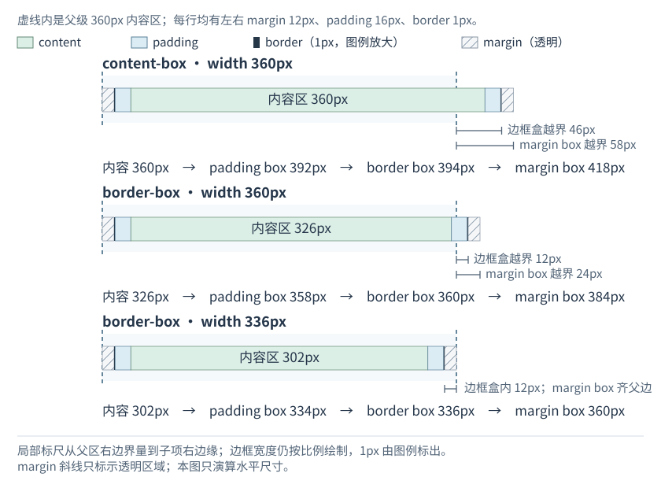

默认 `content-box` 的 `width: 360px` 量的是内容区。加上两侧 padding 后，padding box 是 `360 + 16 × 2 = 392px`；再加两侧 border，border box 是 `394px`；最后加 `24px` margin，margin box 是 `418px`。由于左 margin 位于父区内，子项边框盒向右越出父区 `46px`，margin box 外缘总共越出 `58px`。

改成 `box-sizing: border-box`，声明的 `360px` 包含内容、padding 和 border：

> [!example] border-box，width 360px
> 内容区 `360 - 32 - 2 = 326px`；padding box `358px`；border box `360px`。margin box 是 `360 + 24 = 384px`，所以边框盒越出父区 `12px`、最外侧 margin box 越出 `24px`。

若父区宽 `360px`，并希望左右 margin 各 `12px` 后也完全放得下，可把 border-box 宽度设为 `336px`：内容区 `302px`，padding box `334px`，border box `336px`，margin box 恰为 `360px`。这把原来的边界计算闭合为一个可用宽度：父级宽度先扣掉两侧 margin，剩余值就是边框盒上限。

| 声明值实际控制的宽度 | 内容区 | padding box | border box | margin box |
|---|---:|---:|---:|---:|
| `content-box; width:360px` | `360px` | `392px` | `394px` | `418px` |
| `border-box; width:360px` | `326px` | `358px` | `360px` | `384px` |
| `border-box; width:336px` | `302px` | `334px` | `336px` | `360px` |

表只计算 `width` 对该盒生效、浏览器采用值未被其他规则改写的情形。像普通 `span` 这样的非替换行内盒不能直接用 `width` 定宽；`min-width`、`max-width` 或 Flex/Grid 的尺寸计算也会改变最后采用的宽度。`height` 同理：只有固定值实际采用时，`box-sizing` 才决定它量到内容盒还是边框盒；最小/最大高度和布局也可能改写最终尺寸。`box-sizing` 也影响 `flex-basis` 等 sizing properties 的固定值解释。

若 border-box 声明宽度只有 `20px`，而两侧 padding 与 border 合计 `34px`，内容区不会变成负数：内容宽度下限为 `0px`，边框盒仍会长到 `34px`。保留两侧 `12px` margin 时，margin box 是 `58px`。

常见重置让页面元素和伪元素采用 border-box，使组件声明宽度更接近可见边框宽度：

~~~css
*, *::before, *::after {
  box-sizing: border-box;
}
~~~

`padding` 和 `margin` 的一至四值简写按上、右、下、左分配：一值设四边；两值为上下、左右；三值为上、左右、下；四值按顺时针排列。

### 边框几何可以画小三角

内容宽高与 padding 都为零时，边框仍占据空间。下面的等宽实线边框在 Chromium 中汇到中心，形成四个三角；只给左边着色、其他三边保持透明，就会露出朝右的三角：

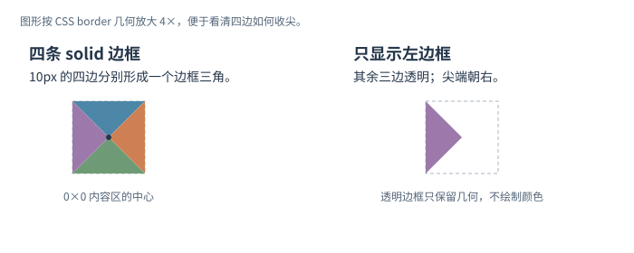

~~~css
.caret-right {
  display: inline-block;
  width: 0;
  height: 0;
  padding: 0;
  border: 10px solid transparent;
  border-left-color: currentColor;
  border-radius: 0;
}
~~~

把这组样式用于空 `span` 时，`inline-block` 使宽高声明生效；四条边框仍占宽度，其中未着色的三条透明边框也会占位，边框盒为 `20 × 20px`。`padding: 0` 与 `border-radius: 0` 保持图示的尖角。若希望形状独立于边框、随方盒一起缩放，可改用 `clip-path` 绘制向下的三角形。百分比坐标从盒子左上角开始，y 值向下增加：

~~~css
.caret-down {
  display: inline-block;
  width: 1rem;
  aspect-ratio: 1;
  background: currentColor;
  clip-path: polygon(0 0, 100% 0, 50% 100%);
}
~~~

装饰性箭头可以对辅助技术隐藏；若箭头表达开合状态或方向，还要通过控件文字或其他语义暴露该信息。

要看 margin 怎样在普通流中相遇，以及 float 怎样影响块的边界，请继续读[块格式化上下文如何约束浮动和外边距](#19.%20%E5%9D%97%E6%A0%BC%E5%BC%8F%E5%8C%96%E4%B8%8A%E4%B8%8B%E6%96%87%E5%A6%82%E4%BD%95%E7%BA%A6%E6%9D%9F%E6%B5%AE%E5%8A%A8%E5%92%8C%E5%A4%96%E8%BE%B9%E8%B7%9D%EF%BC%9F)。居中和浮层位置分别见[Flex/Grid 对齐](#21.%20%E5%9B%BA%E5%AE%9A%E4%B8%8E%E6%B5%81%E5%8A%A8%E5%86%85%E5%AE%B9%E9%80%82%E5%90%88%E5%93%AA%E7%A7%8D%20CSS%20%E5%B8%83%E5%B1%80%EF%BC%9F)与[定位和堆叠](#22.%20%E5%AE%9A%E4%BD%8D%E5%A6%82%E4%BD%95%E7%A1%AE%E5%AE%9A%E5%85%83%E7%B4%A0%E4%BD%8D%E7%BD%AE%E4%B8%8E%E5%89%8D%E5%90%8E%E9%A1%BA%E5%BA%8F%EF%BC%9F)。

CSS 声明的盒尺寸和脚本读取到的几何值是不同问题：对本例单一、未分片的面板，`offsetWidth` 返回边框盒的整数宽度，通常包括占位滚动条，但不含 margin，也不应用变换；各 API 的测量边界见[DOM 几何 API](#25.%20%E5%93%AA%E4%BA%9B%E7%BD%91%E9%A1%B5%E5%87%A0%E4%BD%95%E6%8E%A5%E5%8F%A3%E8%83%BD%E6%B5%8B%E9%87%8F%E5%93%AA%E4%B8%80%E7%A7%8D%E7%9B%92%E5%AD%90%EF%BC%9F)。

> [!info]- 来源
> - **盒子的四层边缘与间距简写。** CSS Box Model Module Level 3，§2.1、§3.2、§4.2，W3C Recommendation（2024-04-11）：[CSS Box Model Level 3](https://www.w3.org/TR/css-box-3/#boxes-edges)。其中 margin 在 border 外且背景透明，margin/padding 简写按一至四值分配边缘；访问于 2026-11-12。
> - **`box-sizing`、声明宽度与下限。** CSS Box Sizing Module Level 3，§3.3，W3C Working Draft（2026-09-04）：[CSS Sizing Level 3](https://www.w3.org/TR/css-sizing-3/#box-sizing)。`border-box` 不包含 margin，计算内容尺寸时将负数下限为零；访问于 2026-11-12。
> - **inline-block 与普通 inline 宽度。** CSS 2.2，§10.3.1、§10.3.9，W3C First Public Working Draft（2016-04-12）：[CSS 2.2 width calculation](https://www.w3.org/TR/CSS22/visudet.html#inlineblock-width)。普通非替换 inline 的 `width` 不生效；inline-block 按自身宽度规则处理。该文档是历史草案；访问于 2026-11-12。
> - **边框三角与 `clip-path`。** 本页边框三角已在 Chromium 149 实际渲染；[CSS Backgrounds Level 3 §4.4](https://www.w3.org/TR/css-backgrounds-3/#corner-transitions) 并未强制规定角部颜色切换的精确路径。透明边框属性见 CSS 2.2 §8.5：[CSS 2.2 box model](https://www.w3.org/TR/CSS22/box.html#border-properties)，W3C First Public Working Draft（2016-04-12）；形状裁切见 CSS Masking Module Level 1 §5.1：[CSS Masking](https://www.w3.org/TR/css-masking-1/#the-clip-path)，W3C Candidate Recommendation Draft（2021-08-05）。访问于 2026-11-12。
> - **`offsetWidth`。** CSSOM View Module，§7：[CSSOM View](https://www.w3.org/TR/cssom-view-1/#dom-htmlelement-offsetwidth)，W3C Working Draft（2025-09-16）。访问于 2026-11-12。
## 19. 块格式化上下文如何约束浮动和外边距？

块格式化上下文（block formatting context, BFC）是一套独立的块级排版环境。建立 BFC 的盒子（BFC 根）会为自己的内容开启新的格式化上下文，根盒自身仍参加外层格式化上下文。浮动盒（float）脱离普通流，却仍会缩窄旁边的行框（line box）。普通块的自动高度不直接计入内部 float 的边缘；float 缩窄行框、增加文字行数时，仍会间接增加普通块的高度。BFC 根在高度为 auto 时，会把参与该 BFC 的浮动后代计入到底部外边距边缘（bottom margin edge）。固定高度或高度限制会约束最终结果。BFC 根本身也不会自动创建堆叠上下文或定位包含块。

在报表页面里，<code>display: flow-root</code> 是直接建立 BFC 的写法。下面沿同一报表页面说明摘要卡内部浮动如何被自动高度纳入、外部浮动怎样影响新 BFC 根，以及垂直外边距（margin）何时折叠。盒子的 content、border 与 margin 尺寸见[CSS 如何计算元素盒子的尺寸](#18.%20CSS%20%E5%A6%82%E4%BD%95%E8%AE%A1%E7%AE%97%E5%85%83%E7%B4%A0%E7%9B%92%E5%AD%90%E7%9A%84%E5%B0%BA%E5%AF%B8%EF%BC%9F)。

### 为什么报表卡片里浮动徽标会撑不开父级？

假设摘要卡宽 <code>360px</code>，根字号 <code>16px</code>；徽标宽高各 <code>3rem</code>，右 margin 为 <code>8px</code>；文字行高 <code>20px</code>：

~~~html
<div class="summary">
  <span class="badge">异常</span>
  <p>共12条记录需要复核。</p>
</div>
~~~

~~~css
html { font-size: 16px; }
.summary { width: 360px; background: #f3f6fa; }
.summary.flow-root { display: flow-root; }
.badge {
  float: left;
  inline-size: 3rem;
  block-size: 3rem;
  margin-right: 8px;
}
.summary p { margin: 0; line-height: 20px; }
~~~

徽标是 <code>48 × 48px</code>。它和右侧 <code>8px</code> margin 一起占 <code>56px</code>，所以文字旁边的行框宽 <code>360 − 48 − 8 = 304px</code>；文字实测约 <code>162px</code>，只占一行。段落块盒仍宽 <code>360px</code>。普通块卡片的内容高是 <code>20px</code>，徽标则向下露出背景 <code>48 − 20 = 28px</code>。把卡片改为 <code>display: flow-root</code> 后，BFC 根的自动高度增至 <code>48px</code>，将参与这个 BFC 的徽标纳入高度。

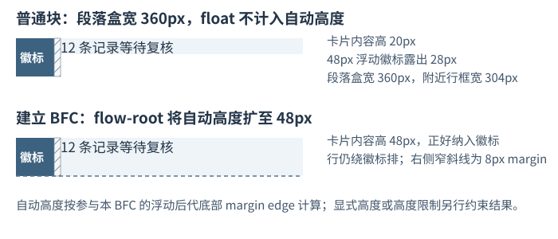

### 外部 float 怎样影响一个 BFC 盒？

BFC 根的内容使用内部格式化上下文排版；根盒仍在外层按普通流参与布局。若它和 float 属于同一个外层 BFC，根的 **边框盒（border box）** 不与该 float 的 **外边距盒（margin box）** 重叠。空间不足时，根可以变窄，或移到前方 float 下面。以下例子沿用 <code>360px</code> 外层、左 float <code>120px × 80px</code>，并让内部提示卡自身建立 BFC：

~~~css
.outer { display: flow-root; inline-size: 360px; }
.external-float { float: left; inline-size: 120px; block-size: 80px; }
.note { display: flow-root; block-size: 32px; } /* 自动宽度 */
.note.fixed { inline-size: 300px; }             /* 固定宽度 */
~~~

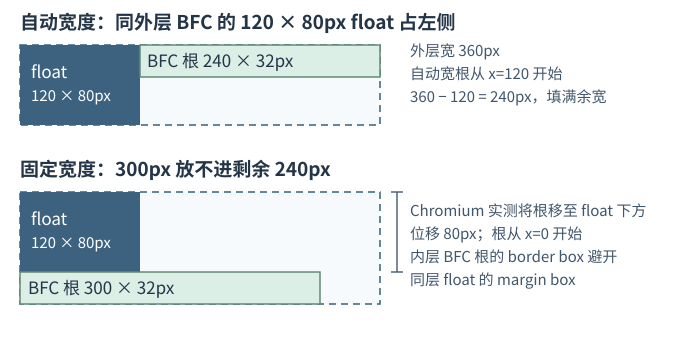

Chromium <code>149.0.7827.55</code> 实测：自动宽度的提示卡从 <code>x=120px</code> 开始，占剩余 <code>240px</code>；固定宽 <code>220px</code> 时可以并排，右边还余 <code>20px</code>；固定宽 <code>300px</code> 放不下，实测移至 float 下方 <code>80px</code>。这些具体宽度和落点是该浏览器与这组 CSS 数值下的结果，不是 CSS 对所有空间条件规定的唯一策略。例中未给 float 或提示卡加 margin、padding、border；若有这些尺寸，避让判断仍比较 float 的 margin box 与 BFC 根的 border box。

### 相邻 margin 为什么不是简单相加？

同一 BFC 中，前一个普通流块的下 margin 与紧随其后的普通流块兄弟的上 margin 可以折叠；后一个兄弟带有 clearance（clear 为避开 float 加入的间隔）时例外。两边之间若有 line box、这种 clearance、padding 或 border，就不会相邻折叠。每个兄弟自己的 border 和 padding 位于自己的 margin 内，不会自动隔开这两条外侧 margin。

两个正 margin 取较大值：状态卡 A 的下 margin <code>24px</code> 与卡 B 的上 margin <code>16px</code> 折叠为 <code>24px</code>，不是 <code>40px</code>。一正一负时，用最大正值加上最负值：<code>24px + (−16px) = 8px</code>。若两个 margin 都为负，则取更负者，例如 <code>−24px</code> 与 <code>−16px</code> 折叠为 <code>−24px</code>。

~~~css
.report-card { block-size: 20px; margin-block-end: 24px; }
.report-card + .report-card { margin-block-start: 16px; }
~~~

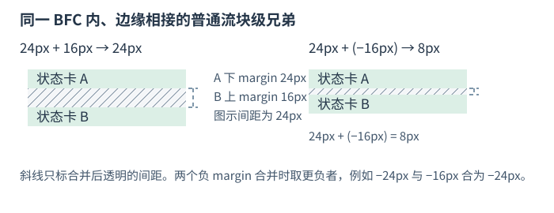

父级的上 margin 还可能与首个普通流块子级的上 margin 向外折叠：父级上边没有 border 或 padding，两条 margin 之间没有 line box，且首个子级没有 clearance 时，父 margin <code>24px</code> 与子 margin <code>16px</code> 折叠为父级外侧的 <code>24px</code>。此时子盒从父盒顶部开始。若父级改成 <code>display: flow-root</code>，父的外 margin 仍为 <code>24px</code>，子 margin <code>16px</code> 留在父盒内部；父自动高度因此从子盒的固定 <code>20px</code> 增为 <code>36px</code>。

~~~css
.sheet { display: flow-root; inline-size: 200px; }
.panel { margin-block-start: 24px; }
.panel > .first-row {
  inline-size: 150px;
  block-size: 20px;
  margin-block-start: 16px;
}
.panel.flow-root { display: flow-root; }
~~~

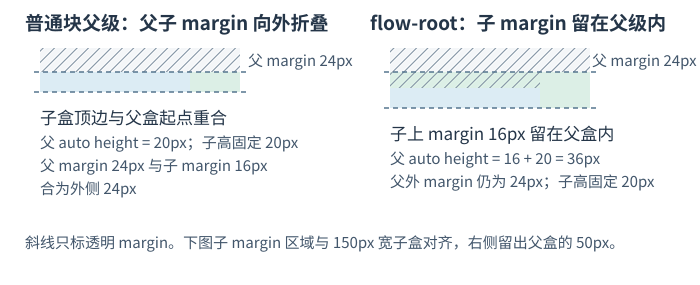

BFC 阻止的是盒内外跨边界折叠，不会自动取消 BFC 根自身与外层的 margin 规则。

### 如何创建 BFC，什么副作用值得注意？

- <code>display: flow-root</code> 直接建立 BFC，不裁切内容，也不创建滚动容器。
- 浮动、绝对定位、inline-block、table cell 和 table caption 等也会为内容建立格式化上下文；它们自身还有浮动、定位、行内排版或表格布局行为。Flex/Grid 容器建立各自的格式化上下文，不是 BFC；相邻项目的 margin 不折叠，float 不会使项目按浮动盒参与布局。
- 对块盒，计算后的 <code>overflow</code> 值为 <code>hidden</code>、<code>auto</code> 或 <code>scroll</code> 时也会建立独立格式化上下文。它们都是滚动容器；<code>hidden</code> 不显示滚动界面，但仍允许程序滚动。<code>auto</code> 即使没有溢出，也不保证界面上有滚动条；若用户代理用可见滚动机制，只有存在溢出时才显示。<code>scroll</code> 在用户代理采用可见滚动机制时，即使没有溢出也应显示。若只想建立 BFC，选 <code>flow-root</code>，不要把 <code>overflow: hidden</code> 当作没有其他效果的替代品。
- <code>overflow: clip</code> 可裁切溢出，但本身不建立格式化上下文或滚动容器。若另一轴设成非 <code>visible</code> / <code>clip</code> 的值，两个轴的计算值可能让原来的 <code>clip</code> 变为 <code>hidden</code>；这时要按计算后的值判断是否建立 BFC。

旧环境里也常见 clearfix 清除伪元素：

~~~css
.legacy-parent::after {
  content: "";
  display: table;
  clear: both;
}
~~~

<code>clear: both</code> 会把这个生成的清除盒放到前方 float 下方；它作为普通流子盒参与父级自动高度，因此可让父背景延伸到 float 底部。但它没有让父盒成为同样的 BFC 根，所以不能取代 <code>flow-root</code> 来建立外部浮动避让或父子 margin 的边界。

> [!info]- 来源
> - **BFC 与独立格式化边界。** CSS Display Module Level 3，§2.2、附录 A，W3C Candidate Recommendation Draft（2026-06-05）：[CSS Display Level 3](https://www.w3.org/TR/css-display-3/)。flow-root 为内容建立 BFC；独立格式化上下文隔开 float 影响与 margin collapse；Flex/Grid 建立各自格式化上下文。草案状态截至 2026-11-12。
> - **块级 float 布局与清除。** CSS 2.2，§9.4.1、§9.5、§9.5.2，W3C First Public Working Draft（2016-04-12）：[BFC](https://www.w3.org/TR/CSS22/visuren.html#block-formatting)、[float 避让](https://www.w3.org/TR/CSS22/visuren.html#floats)、[clear 与 clearance](https://www.w3.org/TR/CSS22/visuren.html#flow-control)。§9.5 的避让对象限定为同外层 BFC 中 float 的 margin box；普通流 BFC 根的 border box 可能下移，clearance 不检查 float 自身或其他 BFC 中的 float。该文档是历史草案。
> - **BFC 根的自动高度。** CSS 2.2，§10.6.7，W3C First Public Working Draft（2016-04-12）：[Auto heights for BFC roots](https://www.w3.org/TR/CSS22/visudet.html#root-height)。自动高度纳入参与该 BFC 的浮动后代底部 margin edge；其他 BFC、绝对定位后代与嵌套在其他 float 中的浮动不计入。
> - **相邻与父子 margin 折叠。** CSS 2.2，§8.3.1，W3C First Public Working Draft（2016-04-12）：[Collapsing margins](https://www.w3.org/TR/CSS22/box.html#collapsing-margins)。它定义边缘相邻条件、父子折叠条件及多条正负 margin 的合并算法。
> - **overflow、滚动容器与格式化上下文。** CSS Overflow Module Level 3，§3.1，W3C Working Draft（2025-10-07）：[Managing Overflow](https://www.w3.org/TR/css-overflow-3/#overflow-properties)。该草案定义可滚动值、clip 例外、滚动界面条件、计算值和独立格式化上下文；访问于 2026-11-12。
> - **Flex/Grid 项目的边距与 float。** [CSS Flexbox Level 1 §4.2](https://www.w3.org/TR/css-flexbox-1/#item-margins)、[CSS Grid Level 2 §6.4](https://www.w3.org/TR/css-grid-2/#item-margins)：相邻项目的 margin 不折叠；项目按各自格式化上下文排布，float 不会使它们按浮动盒参与布局。
## 20. 哪些 CSS 单位与响应式布局规则适合当前空间？

Cascading Style Sheets (CSS, 层叠样式表) 的长度单位先问“相对于什么”，断点再问“谁的尺寸或状态改变时需要换规则”。报表页面通常让 Grid (网格布局) 的自动重复轨道根据网格容器可用宽度和轨道最小尺寸决定列数，不会先量卡片文字宽度；media query (媒体查询) 响应视口或用户偏好；container query (容器查询) 则让放在主栏、窄侧栏等不同区域的卡片按自身可用宽度调整。

### 常见尺寸单位各自参照什么？

| 单位 | 参照 | 常见用途 | 需要记住的边界 |
| --- | --- | --- | --- |
| `px` | CSS reference pixel (CSS 参考像素) | 边框、精确间距 | 不保证最终绘制成一个物理设备像素 |
| `%` | 由该属性定义的参照盒或参照值 | 流动宽度、偏移 | 每个属性的百分比基准不同，不能只看符号 |
| `em` | 通常取使用该值的元素计算字号；用于 `font-size` 时取继承字号 | 随文字缩放的局部间距 | 嵌套字号可能逐层相乘 |
| `rem` | 根元素的计算字号 | 跨组件的一致文字相对尺寸 | 媒体查询和容器查询对相对单位的求值规则不同 |
| `vw` / `vh` | 默认 large viewport (大视口) 的宽、高；每单位为对应尺寸的 1% | 视口区域 | 视口不是普通内容盒；工具栏展开时，`100vh` 可能大于当前可见高度 |
| `svh` / `lvh` / `dvh` | 每单位分别为 small viewport height (小视口高度)、large viewport height (大视口高度)、dynamic viewport height (动态视口高度) 的 1% | 移动端全高界面 | 需选择是否随浏览器工具栏伸缩 |
| `vmin` / `vmax` | 默认 large viewport 的短边 / 长边；每单位为对应边长的 1% | 随方向变化的尺寸 | 不表示内容容器宽度 |

例如，若初始字号与根字号均为 16px，`1.5rem = 24px`；将根元素计算字号改为 20px 后，普通声明中的 `5rem = 100px`。`em` 用在非 `font-size` 声明时参照当前元素字号；用在 `font-size` 本身时参照父元素继承来的字号。`rem` 让一组声明共用根字号，但如果在根元素上计算 `font-size`，CSS 对该循环关系采用初始字号。

媒体查询、容器查询和普通样式声明对字号相对单位的求值需要分开看：

| 使用位置 | `em` 的参照 | `rem` 的参照 |
| --- | --- | --- |
| 普通样式声明 | 使用该值的元素计算字号；`font-size` 取父元素字号 | 根元素计算字号 |
| `@media` | 初始 `font-size` 值 | 初始 `font-size` 值 |
| `@container` 尺寸条件 | 被选中查询容器的计算字号 | 根元素计算字号 |

因此，固定根字号可能影响用户的基础文字偏好；而媒体查询中的 `rem` 断点不会跟随页面自己的 `html { font-size: ... }` 声明改变。CSS `1px` 是参考像素：设备像素比、页面缩放与栅格对齐会共同影响它最终覆盖多少个设备像素。

对会改变可见视口高度的浏览器工具栏，`100svh` 按工具栏展开时的小视口计算，`100lvh` 按收起时的大视口计算，`100dvh` 随当前动态视口变化。想让关键内容在工具栏展开时也完整可见，可从小视口单位开始；想随可见区域伸缩，则考虑动态单位，并接受伸缩时的布局变化。

`100vw` 按视口宽度计算；内部滚动容器的滚动条槽只缩小该容器的内容宽度，不缩小视口。在本机 headless Chrome (无头 Chrome) `157.0.8103.51` 的 700px 视口中，内部滚动 `<section>` 设置为 `width: 700px; height: 100px; overflow-x: hidden; overflow-y: auto; scrollbar-gutter: stable`，并放入高度超过 100px 的内容。经典垂直滚动条在该容器内预留 15px；容器内容宽 685px，与 700px 视口宽度不同。内部 `width: 100vw` 子项按视口宽度为 700px；`width: 100%` 子项按该滚动区域提供的宽度为 685px。数字绑定于本机滚动条环境；overlay scrollbar (覆盖式滚动条) 不占用这段宽度。CSS Overflow 规定根元素的 `scrollbar-gutter` 应用到视口；`vw` 与根滚动条槽的实际尺寸关系需另按目标浏览器检查，不能直接套用这个内部容器结果。若目标是填满当前内容区，块容器通常用 `width: 100%` 或保持 `width: auto`，让父级分配可用空间。如果还需要手动设 `width: 100%`，带有内边距或边框的元素可配合 `box-sizing: border-box`，避免外尺寸超出父级；其他滚动条模式也应按目标环境检查。

### 断点由视口还是组件决定？

| 需要响应的变化 | 起点 | 报表中的例子 |
| --- | --- | --- |
| 整个页面的视口宽度或方向变化 | `@media` | 小视口把并排区域改为单列，内容按文档源顺序堆叠 |
| 卡片自身分配到的宽度变化 | `@container` | 同一查询卡片在主栏横排，在窄侧栏竖排 |
| 重复卡片随网格可用宽度换列 | Grid 自动重复轨道 | 有空间就放下一列，不硬编码设备名称 |

断点应服务于内容，而不是机械套用“手机 / 平板 / 桌面”的设备标签。报表外框在视口宽度 48rem 及以下由两列改为单列，项目按源文档顺序堆叠；这个改列规则本身不会重排侧栏或其他区域的文档顺序：

~~~css
.report-layout {
  display: grid;
  grid-template-columns: 14rem minmax(0, 1fr);
  gap: 1rem;
}

@media (max-width: 48rem) {
  .report-layout { grid-template-columns: minmax(0, 1fr); }
}
~~~

媒体查询里的 `em`、`rem` 等字号相对单位按初始字号求值，不按页面样式改过的根字号求值。若初始字号是 16px，`48rem = 768px`，且 `max-width` 包含等号：视口正好 768px 时也改成单列。即使页面写了 `html { font-size: 20px; }`，这个媒体断点仍为 768px。若用户代理或用户偏好改变初始字号，断点也会按那个初始值计算。

若筛选栏按面板自身宽度换列，建立 inline-size query container (行内尺寸查询容器)，再由该容器决定后代样式。未命名 `@container` 从被设样式的元素向外寻找最近的合格祖先；若需要查询更外层的特定容器，可用 `container-name` 指定名称。本例的 `.report-panel` 提供可查询的 inline size (行内尺寸)，`.report-filter` 是被调整的后代。默认横向书写模式下，inline size 是内容盒宽度；改为纵向书写模式时，它沿行内轴，物理上对应高度。查询条件只能作用于查询容器的后代。筛选区只包含月份、地区与提交按钮三个项目；每个 `label` 把说明与输入控件放在一起，便于作为一组参与 Grid 布局：

~~~html
<section class="report-panel">
  <form class="report-filter" action="/reports" method="get">
    <label>月份
      <input name="month" type="month" value="2026-10">
    </label>
    <label>地区
      <select name="region">
        <option value="">全部地区</option>
        <option value="north">北区</option>
      </select>
    </label>
    <button type="submit">筛选报表</button>
  </form>
</section>
~~~

~~~css
.report-panel {
  container-type: inline-size;
}
.report-filter {
  display: grid;
  grid-template-columns: 1fr;
}

@container (inline-size > 30rem) {
  .report-filter {
    grid-template-columns: 1fr 1fr auto;
    align-items: end;
  }
}
~~~

在根字号 16px、面板内容盒为 480px 的演算中，`30rem = 480px`，但条件使用严格大于号，所以 480px 仍是单列；宽度超过 480px 才是三列。以整数 CSS px 步进时，481px 是第一个匹配值；若容器宽度可以是小数，则 480px 以上的任意值都会匹配。若页面把根字号改为 20px，`rem` 查询阈值为 600px；若要让阈值随面板自身字号缩放，可改用 `em`，它按被选中查询容器的计算字号求值。

本例条件使用逻辑特征 `inline-size`，它随书写模式沿行内轴查询；若改用物理特征 `width`，默认横向书写模式下它指向同一宽度，而纵向书写模式下 `width` 是与行内轴垂直的物理宽度，未必由 `container-type: inline-size` 提供。`container-type: inline-size` 让元素成为沿行内轴可查询尺寸的容器，并应用行内尺寸包含与样式包含，建立独立格式化上下文。它改变容器自身的内在尺寸计算，因此组件的行内尺寸应由父级布局或明确约束提供，而不应依赖子内容把容器撑宽。本例的 `section` 是普通块盒，填满父级可用宽度；更复杂的组件需结合自身布局用途选择查询容器。

### 用内容和实际宽度决定响应规则

#### 让 Grid 按可容纳的最小轨道自动换列

自动列数由 Grid container (网格容器) 的可用行内尺寸和轨道最小值决定，不是先测卡片文字宽度。沿用报表主栏的 880px 可用宽度、根字号 16px，并把最小轨道设为 `15rem = 240px`、间隔设为 `1rem = 16px`：三列至少需要 `3 × 240 + 2 × 16 = 752px`，四列要 `4 × 240 + 3 × 16 = 1008px`，所以这里最多排三列。以下独立例子用三个普通卡片展示；按默认自动放置每项占一列：

~~~html
<section class="report-cards" aria-label="月度报表">
  <article>订单总量</article>
  <article>准时交付</article>
  <article>待复核</article>
</section>
~~~

~~~css
.report-cards {
  display: grid;
  inline-size: min(100%, 880px);
  grid-template-columns:
    repeat(auto-fit, minmax(min(100%, 15rem), 1fr));
  gap: 1rem;
}
~~~

若有三张卡片，每列约 `(880 − 2 × 16) ÷ 3 = 282.7px`；本机 Chromium 157 测得约 282.66px。若只有两张卡片，自动重复仍可容纳三条最小轨道，但 `auto-fit` 折叠没有项目的第三条轨道及其相邻间隔，两列各约 `(880 − 16) ÷ 2 = 432px`。若主栏变成 220px，`min(100%, 15rem)` 允许唯一轨道降至 220px。`auto-fill` 会保留空轨道的位置，适合想在两张卡片后留出空槽而不拉宽卡片的情况。

#### 让字号随视口连续变化

以前端设计稿宽 1000px 且视口同为 1000px 为例，宽 200px 的图标占画布 20%，所以对应 `20vw`。这只是特定设计宽度下的换算；如果图标在窄屏仍需保持可读尺寸，`20vw` 会随视口继续缩小，可能需要 `clamp()` 上下限，或让布局在内容放不下时重排。

~~~css
.report-title {
  font-size: clamp(1.25rem, calc(2vw + 0.75rem), 2rem);
}
~~~

根字号为 16px 时，`1.25rem = 20px` 是下限，`2rem = 32px` 是上限：

| 视口宽度 | 中间表达式 `2vw + 0.75rem` | 最终字号 |
| --- | --- | --- |
| 300px | 18px | 20px，下限生效 |
| 600px | 24px | 24px，随视口变化 |
| 1000px | 32px | 32px，正好到达上限 |
| 1200px | 36px | 32px，上限生效 |

不需要连续缩放时，用媒体查询表达台阶变化；需要适配组件大小时，用容器查询；重复内容应随可用宽度换列时，可让 Grid 自动重复轨道参与计算。固定轨道、`fr` 分配与内在最小尺寸的完整关系见[固定与流动内容适合哪种 CSS 布局？](#21.%20%E5%9B%BA%E5%AE%9A%E4%B8%8E%E6%B5%81%E5%8A%A8%E5%86%85%E5%AE%B9%E9%80%82%E5%90%88%E5%93%AA%E7%A7%8D%20CSS%20%E5%B8%83%E5%B1%80%EF%BC%9F)。

### 受限文本与行数裁切

单行 ellipsis (省略号) 要求文本块有受限的行内宽度、文字不换行、溢出被裁切；`text-overflow` 只决定怎样提示溢出，不替代这些条件。下面假设工具栏父级宽度为 360px，标题直接作为 Flex 项；先看裁切写在该项目上的版本：

~~~html
<nav class="toolbar" aria-label="当前报表操作">
  <a class="report-name" href="/reports/october">
    2026 年 10 月跨地区订单处理与复核情况汇总
  </a>
  <button type="button">筛选</button>
</nav>
~~~

~~~css
.toolbar {
  display: flex;
  inline-size: 360px;
  gap: 16px;
}
.toolbar > .report-name {
  flex: 1 1 0;
  white-space: nowrap;
  overflow: hidden;
  text-overflow: ellipsis;
}
~~~

这个例子把 `overflow: hidden` 写在直接 Flex 项上；它属于可滚动的溢出值（虽然不显示滚动条，仍能通过程序滚动），所以该项目的自动主轴最小尺寸为零，不需再写 `min-inline-size: 0`。如果保留一个内层链接、只在链接上裁切，直接 Flex 项本身仍可能因为内容最小宽度拒绝收缩：

~~~html
<div class="toolbar">
  <div class="report-name">
    <a href="/reports/october">
      2026 年 10 月跨地区订单处理与复核情况汇总
    </a>
  </div>
  <button type="button">筛选</button>
</div>
~~~

这时在直接项目上设零最小行内尺寸，并在内层文本元素上裁切：

~~~css
.toolbar > .report-name {
  flex: 1 1 0;
  min-inline-size: 0;
}
.toolbar > .report-name > a {
  display: block;
  overflow: hidden;
  white-space: nowrap;
  text-overflow: ellipsis;
}
~~~

在 Grid 中也要看项目的直接轨道和最小尺寸条件：像 `minmax(0, 1fr)` 这样的零下限轨道已经允许轨道收缩，但内容本身仍需断行、裁切或滚动。`overflow: clip` 不是 `hidden` 的同义写法：前者不建立 scroll container (滚动容器)，可能保留基于内容的自动最小尺寸。需要看完整轨道约束时见[固定与流动内容适合哪种 CSS 布局？](#21.%20%E5%9B%BA%E5%AE%9A%E4%B8%8E%E6%B5%81%E5%8A%A8%E5%86%85%E5%AE%B9%E9%80%82%E5%90%88%E5%93%AA%E7%A7%8D%20CSS%20%E5%B8%83%E5%B1%80%EF%BC%9F)。

多行摘要可用目标浏览器支持的行数裁切形式。CSS Overflow Level 4 草案定义了未加前缀的 `line-clamp`；截至本地 Chromium 157，`CSS.supports("line-clamp", "3")` 返回 `false`，而 `CSS.supports("-webkit-line-clamp", "3")` 返回 `true`。以下兼容写法在此浏览器中可识别；目标浏览器仍需验证：

~~~css
.report-summary {
  display: -webkit-box;
  -webkit-box-orient: vertical;
  -webkit-line-clamp: 3;
  overflow: hidden;
}
~~~

裁切会改变可见部分，不会删除文本值；用户能否看见、朗读或复制未显示部分取决于交互与工具。关键信息应提供阅读或复制全文的办法；不要把省略号当成唯一披露方式。

### 细边框何时等于一个设备像素？

`1px` 是一个 CSS 参考像素，不保证是一条物理设备像素宽的线。若 effective device pixel ratio (DPR, 有效设备像素比) 约为 2，`0.5 CSS px` 名义上接近一个设备像素；实际绘制还受缩放、边缘对齐和栅格化影响。因此分数线与阴影是视觉技巧，应在目标设备检查。

~~~css
.hairline {
  box-shadow: 0 0 0 0.5px #d9d9d9;
}
~~~

> [!info]- 来源与核验
> - **CSS 绝对、相对与视口单位。** W3C [CSS Values and Units Module Level 4](https://www.w3.org/TR/css-values-4/)，Working Draft，2024-03-12，§§6.1–6.2；并核对 [CSSWG 编辑草案](https://drafts.csswg.org/css-values-4/)，2026-08-24。包括 `px`、`em`、`rem`、`vw` / `vh`、`svh` / `lvh` / `dvh`、`vmin` / `vmax` 与 `clamp()`。
> - **媒体查询中的相对单位。** W3C [Media Queries Level 5](https://www.w3.org/TR/mediaqueries-5/)，Working Draft，2026-02-19，§1.3；媒体查询中的字号相对单位按初始字号解析，核对日期：2026-11-12。
> - **容器查询与相对单位。** W3C [CSS Conditional Rules Level 5](https://www.w3.org/TR/css-conditional-5/)，Working Draft，2025-10-30，§§5、6.1；查询容器、`container-type: inline-size` 与容器查询条件中 `em` / `rem` 的参照值，核对日期：2026-11-12。
> - **文本溢出与行数裁切。** W3C [CSS Overflow Level 3](https://www.w3.org/TR/css-overflow-3/)，Working Draft，2025-10-07，§§3.1、5.1；[CSS Overflow Level 4](https://www.w3.org/TR/css-overflow-4/)，Working Draft，2023-03-21，§5.1；并核对 [CSSWG 编辑草案](https://drafts.csswg.org/css-overflow-4/)，2026-10-16，§§5.1、5.1.1，定义 `line-clamp` 与遗留的 `-webkit-line-clamp` 语法。
> - **Grid / Flex 自动最小尺寸。** W3C [CSS Flexible Box Layout Level 1](https://www.w3.org/TR/css-flexbox-1/)，Candidate Recommendation Draft，2025-10-14，§4.5；[CSS Grid Layout Level 2](https://www.w3.org/TR/css-grid-2/)，Candidate Recommendation Draft，2025-03-26，§6.6。核对日期：2026-11-12。
> - **本地探针。** 本轮 headless Chrome `157.0.8103.51`：根字号 20px、查询容器字号 10px 时，`30rem` 条件在宽度 601px 匹配、`30em` 在 301px 即匹配；视口 800px 时 `max-width: 48rem` 不匹配；`CSS.supports()` 对未加前缀 `line-clamp` 返回 `false`、对 `-webkit-line-clamp` 返回 `true`。滚动条宽度例子使用 700px 视口和内部 `.scroll-area { width: 700px; height: 100px; overflow-x: hidden; overflow-y: auto; scrollbar-gutter: stable }`，内容高度 202px；内部 `100vw` / `width: 100%` 子项的实际宽度分别为 700px / 685px。该数值不代表根元素的视口滚动条行为，也不能替代目标浏览器矩阵检查。
## 21. 固定与流动内容适合哪种 CSS 布局？

报表外框常同时有固定侧栏和可伸缩主栏；操作工具栏沿一个方向排列链接与按钮；卡片列表则要在窄宽度下自动换列。沿用报表页的 `<main>` 作为主栏：先描述项目之间怎样分配空间，再选布局。Flexbox (弹性盒布局) 适合沿一个主轴分配项目；Grid (网格布局) 适合显式组织行列轨道。作为 Cascading Style Sheets (CSS, 层叠样式表) 布局模型，默认情况下两者只改变盒子的视觉布局，不会改写 HyperText Markup Language (HTML, 超文本标记语言) 文档中 Document Object Model (DOM, 文档对象模型) 节点的源顺序。

### 固定侧栏与流动结果区

先把设计输入说清楚：报表外框的内容宽度固定为 1120px，左侧导航固定为 14rem（按根字号 16px，即 224px），中间留 16px。没有内容下限时，主栏剩余宽度为：

> [!example] 报表主栏的轨道宽度
> `1120 - 224 - 16 = 880px`。但主栏若含 `min-content`（最小内容尺寸）为 920px 的不可断内容，`1fr` 的自动最小轨道会取 920px；两轨与间隔合计 `224 + 16 + 920 = 1160px`，超出设定为 1120px 的外框 40px。改成 `minmax(0, 1fr)` 后，主栏轨道仍是 880px；本例中的 920px 内容盒被裁掉 40px，真实内容则要自行换行、裁切或滚动。

下面用一个固定 920px 宽的合成内容，单独展示轨道下限怎样影响结果区。它不是实际统一资源定位符的宽度；真实内容如何保留全文见例子之后。

~~~html
<div class="report-layout">
  <nav aria-label="报表分类导航">...</nav>
  <main>
    <h1>月度订单</h1>
    <p class="report-url">
      <span class="synthetic-token">合成的 920px 不可断内容</span>
    </p>
  </main>
</div>
~~~

~~~css
.report-layout {
  display: grid;
  inline-size: 1120px;
  grid-template-columns: 14rem minmax(0, 1fr);
  gap: 16px;
}
.report-url {
  display: block;
  overflow: hidden;
  white-space: nowrap;
}
.synthetic-token { display: inline-block; inline-size: 920px; }
~~~

在这个单列主栏中，`1fr` 等价于 `minmax(auto, 1fr)`：`auto` 是轨道最小范围，不总是 min-content (最小内容尺寸)；本例的直接 grid item (网格项目) 在默认约束下采用内容下限，因此 920px 内容会撑开它。`minmax(0, 1fr)` 明确把轨道下限设为零，因而能收进剩下的 880px；它不会替长内容选择换行或滚动方式。这里直接网格项目的自动最小尺寸也已是零，所以不必再为同一问题加 `min-inline-size: 0`。

这个合成行内盒会被裁切，只用于看清轨道宽度。若换成真实链接地址并要显示全文，应移除固定宽度和 `white-space: nowrap` / 裁切规则，再为长词设置 `overflow-wrap: anywhere`。若结果是宽数据表，应保留真实 `<table>` 的行列和标题关系，把表放进局部横向滚动容器；该滚动区域应有名称，并确保目标浏览器里键盘用户能到达和滚动它。

下面的 Flex 规则替换上例的 `.report-layout` 布局声明；沿用 1120px 外框、16px 间距和根字号 16px，导航仍为 224px，主栏仍为 880px：

~~~css
.report-layout { display: flex; inline-size: 1120px; gap: 16px; }
.report-layout > nav { flex: 0 0 14rem; }
.report-layout > main { flex: 1 1 0; min-inline-size: 0; }
~~~

flex item (弹性项目) 的主轴自动最小尺寸在默认情况下可能受内容最小宽度限制；长链接地址或大表格因此可能拒绝收缩。`min-inline-size: 0` 明确允许主栏沿行方向缩小，内容随后要自行换行、裁切或在局部滚动。Grid 与 Flex 的细节和适用条件不同：多列关系要按轨道同时对齐时 Grid 更容易表达；只需沿主轴分配一排控件时 Flex 更直接。Flex 可以换行，但每条 flex line (弹性行) 仍各自分配，不会像 Grid 那样把不同项目排成共同列轨道。

### Flexbox 一次处理一个主轴

`display: flex` 或 `inline-flex` 会创建 flex container (弹性容器)，其参与正常流的直接子元素成为 flex item (弹性项目)，非纯空白的直接文本内容会被包进匿名项目；绝对定位的子元素不参与这套空间分配。`flex-direction` 决定 main axis (主轴)，cross axis (交叉轴) 与其垂直。布局先求项目的 flex base size (Flex 基础尺寸)，再把它限制在最小 / 最大尺寸之间，得到 hypothetical main size (假设主尺寸)。算法比较各项外部假设主尺寸（包括外边距）之和与容器内主尺寸，决定本轮使用增长还是收缩；因此 min/max 约束在选择分支之前就会参与判断。随后以基础尺寸为起点分配空间：增长按 `flex-grow` 比例分配 positive free space (正剩余空间)；收缩按 `flex-shrink` 与基础尺寸的乘积，即 scaled flex-shrink factor (缩放后的收缩权重)，分配 negative free space (负剩余空间)。算法依据违反约束的情况冻结部分项目，再把剩余空间分给未冻结的项目。这里先考虑增长因子合计不小于 1 的常见情形；若一行的增长因子合计小于 1，可能只用掉部分正剩余空间。

| 属性 | 负责什么 |
| --- | --- |
| `flex-direction`、`flex-wrap` | 主轴方向、是否产生多条 flex line (弹性行) |
| `justify-content` | 项目尺寸与自动外边距确定后，沿主轴分配剩余空间 |
| `align-items`、`align-self` | 项目在各自 Flex line 的交叉轴上对齐 |
| `align-content` | 在交叉轴上对齐 Flex line；只对允许换行的容器生效，单条 line 也可能移动 |
| `gap` | 项目之间的间距；先从容器可用空间中扣除，再计算可分配空间 |
| `flex-grow`、`flex-shrink`、`flex-basis` | 正剩余空间增长比例、负空间收缩权重、基础尺寸 |
| `order` | 改变 Flex 项目的视觉顺序，不改 DOM 顺序 |

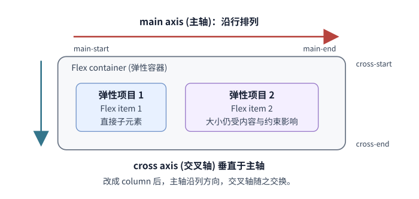

本图以默认 horizontal writing mode (横向书写模式)、`direction: ltr` (left-to-right, 从左向右) 和 `flex-direction: row` 为例：主轴从左向右，交叉轴从上向下。改用 `column` 后，主轴沿列方向，交叉轴随之交换。两轴起点和终点的物理方向随书写模式与 `direction` 变化；`row-reverse` / `column-reverse` 会反转主轴方向。main size (主尺寸) 和 cross size (交叉尺寸) 分别指项目沿主轴和交叉轴的尺寸。

> [!example] 允许换行的容器即使只有一条 line，也能移动它
> 设容器高 100px、唯一项目高 20px，并使用 `flex-wrap: wrap`、`align-content: flex-end` 和 `align-items: flex-start`。在默认行方向下，单条弹性行的起点落在 `y = 80px`。若把容器改成 `flex-wrap: nowrap`，它成为单行 Flex 容器，`align-content` 不生效，项目仍从 `y = 0px` 开始。

> [!example] 负剩余空间遇到最小尺寸时重新分配
> 容器内宽 256px，项目间距 16px，所以两项共有 240px 可用空间。两项的基础尺寸分别为 200px 和 100px，`flex-shrink` 都为 1，合计比可用空间多 60px。初次按 `1 × 200 : 1 × 100` 的缩放收缩权重分配，得到暂定尺寸 160px 和 80px。若第一项的最小行内尺寸为 180px，它触及下限后被冻结；剩下的第二项重新分配余下空间，最终为 60px。最终尺寸 `180 + 60 + 16 = 256px` 正好填满容器。本机 Chromium 探针也测得 180px、60px。

~~~html
<div class="shrink-demo">
  <div class="first"></div>
  <div class="second"></div>
</div>
~~~

~~~css
.shrink-demo { display: flex; inline-size: 256px; gap: 16px; }
.first { flex: 0 1 200px; min-inline-size: 180px; }
.second { flex: 0 1 100px; min-inline-size: 0; }
~~~

为从零基准分配剩余空间，可显式写 `flex: 1 1 0`。其中 `flex-grow` 与 `flex-shrink` 都为 1，`flex-basis` 明确为零。CSS Flexbox 规范定义的单数值简写 `flex: 1` 也表示以零基准分配空间；本机 Chromium `157.0.8103.51` 的 `getComputedStyle()` 却将它序列化为 `0%`。在主轴尺寸不确定的列容器中，百分比基准会按内容解析，因而可能与明确的零长度表现不同。下文的探针把 `flex: 1` 与 `flex: 1 1 0` 分开测量；若布局依赖确定的零基准且主轴尺寸可能不确定，应写三值形式。

这个差异在本机无头 Chrome 的小例子里可见：自动高度的列容器有两个项目，文字内容高分别为 40px 和 20px，项目设 `min-height: 0; overflow: hidden`。单值 `flex: 1` 的计算基准为 `0%`，两项按内容得到 40px、20px，容器高 60px；显式写 `flex: 1 1 0px` 时，容器与两项高度都为 0px。该尺寸结果是本机 Chromium 157 的探针观察；它限定了上面的写法建议，不意味着所有主轴或浏览器都会出现相同差异。

`flex: auto` 等价于 `1 1 auto`：先参考明确的主轴尺寸，尺寸为 `auto` 时再依据内容。`flex: none` 等价于 `0 0 auto`，按基础尺寸排布且不增长或收缩。`flex: initial` 等价于 `0 1 auto`：有正剩余时不增长，空间不足时仍可收缩到其最小尺寸。项目的自动最小尺寸可能继续阻止收缩，因此还要看其内容和溢出规则。

### 用 Flex 排列报表工具栏并截断长标题

一排导航、操作按钮和当前报表名只有一条主轴，适合 Flex。工具栏可放在 `<main>` 的标题下方；以下 360px 与 1120px 是单独演算的工具栏宽度，不沿用前面 880px 的主栏约束。为让宽度演算可复现，例子把两个链接固定为 64px，按钮固定为 43px，间隔均为 16px；标题项目从零基准增长，标题本身采用单行省略号。

~~~html
<nav class="report-toolbar" aria-label="当前报表操作">
  <a class="fixed-link" href="/reports">全部报表</a>
  <a class="fixed-link" href="/reports/monthly">月度报表</a>
  <span class="current-report">
    2026 年 10 月跨地区订单处理与复核情况汇总
  </span>
  <button type="button">导出</button>
</nav>
~~~

~~~css
.report-toolbar {
  display: flex;
  align-items: center;
  gap: 16px;
  inline-size: 360px;
  font-size: 16px;
}
.report-toolbar > * { box-sizing: border-box; }
.fixed-link { flex: 0 0 64px; white-space: nowrap; }
.current-report {
  flex: 1 1 0;
  overflow: hidden;
  white-space: nowrap;
  text-overflow: ellipsis;
}
.report-toolbar > button { flex: 0 0 43px; padding: 0; }
~~~

工具栏内容宽度为 360px 时，固定部分共占 `64 + 64 + 43 + 3 × 16 = 219px`，标题从零基准得到 `360 − 219 = 141px` 的正剩余空间。这不是 `flex-shrink` 把标题压窄；标题按 `flex-grow` 增长到 141px 后，才在盒内显示省略号。这个标题在本机 16px 字号的 Chromium 探针中自然宽度约 316px；实际文字宽度会随字体变化。把 `inline-size` 改为 1120px 时，标题得到 `1120 − 219 = 901px`，足够显示完整文本。`overflow: hidden` 在直接 Flex 项上属于可滚动的溢出值：它不显示滚动条，但内容仍能通过程序滚动；因此该项的自动主轴最小尺寸为零。如果只在内层子元素上裁切，外层 Flex 项通常要另写 `min-inline-size: 0` 允许收缩。

裁切只隐藏视觉部分，文本仍在 DOM 中。若标题需要导航，应使用真实链接并保留完整的可访问名称；同时确保省略容器不会裁掉键盘焦点指示。不要用已截断的字符串替换完整标题。

### Grid 同时定义行与列

`display: grid` 或 `inline-grid` 建立显式或隐式行列轨道。固定尺寸适合不变的导航，`fr` 表示按因子分配可用剩余空间，但每条轨道仍要满足自身的最小和最大尺寸。内容关键时，可用 `min-content`、`max-content`、`auto` 与 `fit-content()` 参与轨道尺寸计算：`min-content` 尽量缩到仍可在合法断点换行的最窄尺寸；`max-content` (最大内容尺寸) 则按不利用软换行机会时的内容宽度计算。最终结果还受容器空间、可换行机会与显式约束影响。

~~~css
.cards {
  display: grid;
  grid-template-columns:
    repeat(auto-fit, minmax(min(100%, 15rem), 1fr));
  gap: 1rem;
}
~~~

这里的 `.cards` 直接子项是卡片；容器宽度明确时，默认自动放置会让每张卡片占一列：

~~~html
<section class="cards" aria-label="月度报表">
  <article><h2>订单总量</h2><p>本月订单数量与上月比较。</p></article>
  <article><h2>准时交付</h2><p>按地区查看订单交付情况。</p></article>
  <article><h2>待复核</h2><p>需要进一步检查的订单。</p></article>
</section>
~~~

根字号为 16px 时，轨道的设计下限是 `15rem = 240px`。沿用 880px 的报表主栏，3 条轨道需 `3 × 240 + 2 × 16 = 752px`，4 条需 `4 × 240 + 3 × 16 = 1008px`，放不下，所以三张及以上卡片排三列，每列约 `(880 − 2 × 16) ÷ 3 = 282.7px`；第四张会进入下一行。若只有两张卡片，`auto-fit` 折叠未放入项目的第三条重复轨道及其相邻间隔，于是每列约 `(880 − 16) ÷ 2 = 432px`。若主栏缩到 220px，`min(100%, 15rem)` 使单列轨道下限缩到 220px。轨道宽度和卡片自身的宽度约束是两件事：若卡片写了 `min-inline-size: 300px`，它仍可撑到 300px 并在 220px 轨道内溢出。本机 Chromium 探针测得 880px 容器中，两张卡片各 432px、三张各约 282.66px，220px 容器中轨道宽 220px。若要在空位保留未使用的轨道槽位，可选择 `auto-fill`；`auto-fit` 则折叠空轨道，让现有项目伸展。

### 居中未知尺寸的内容

如果内容应留在正常流中，让父容器负责二维或单轴对齐。容器必须有多余空间，否则没有可分配的空白：

~~~css
.center-grid {
  display: grid;
  place-items: center;
}

.center-flex {
  display: flex;
  justify-content: center;
  align-items: center;
}
~~~

`place-items: center` 将 Grid 项目在格内水平与垂直对齐；Flex 版分别沿主轴和交叉轴对齐。需要覆盖整个区域时，应让容器从父级布局或轨道取得预期高度，而不是给内容写固定尺寸。

居中浮层离开普通流，需要先确定它的包含块，再用定位和 `transform` 让未知尺寸自身回移；规则见[定位如何确定元素位置与前后顺序？](#22.%20%E5%AE%9A%E4%BD%8D%E5%A6%82%E4%BD%95%E7%A1%AE%E5%AE%9A%E5%85%83%E7%B4%A0%E4%BD%8D%E7%BD%AE%E4%B8%8E%E5%89%8D%E5%90%8E%E9%A1%BA%E5%BA%8F%EF%BC%9F)。本节的居中元素仍留在正常流中，浮层位置由定位机制决定。

### 看懂旧布局，不把它当新布局首选

- **float (浮动)。** 让文字绕排浮动盒；还要处理包含浮动与外边距交互，见[block formatting context (BFC, 块级格式上下文) 如何约束浮动和外边距？](#19.%20%E5%9D%97%E6%A0%BC%E5%BC%8F%E5%8C%96%E4%B8%8A%E4%B8%8B%E6%96%87%E5%A6%82%E4%BD%95%E7%BA%A6%E6%9D%9F%E6%B5%AE%E5%8A%A8%E5%92%8C%E5%A4%96%E8%BE%B9%E8%B7%9D%EF%BC%9F)。
- **表格布局。** 可维护旧项目；`display: table-cell` 不会创建 HTML 表格的标题、行列等语义。
- **inline-block (行内块)。** 源码空白会形成项目间隙，基线也可能影响对齐。
- **绝对定位。** 可把按钮锚定到卡片角落，但它脱离普通流，不参与父级尺寸计算。
- **Bootstrap Grid。** 是框架约定，不等同于 CSS Grid。新项目先确认实际采用的 Bootstrap 版本，再按对应官方文档选类名与断点。

> [!info]- Bootstrap 3.4.1 与 Bootstrap 4.6 的旧网格示例
> 归档 Bootstrap 3.4.1 示例使用十二列系统：`.container` / `.container-fluid`、`.row`、`.col-xs-*` / `.col-sm-*` / `.col-md-*` / `.col-lg-*`。断点为 `<768px`、`≥768px`、`≥992px`、`≥1200px`。归档截图显示的是 Bootstrap 4.6：它有 `.col-` 与 `.col-xl-`，并包含 `576px` 断点，不能用它推断 Bootstrap 3 的类名和断点。可[打开归档 Bootstrap 4 网格截图](../../archive/front-end/0-1_Learning_Notes/CSS/grid.png) 查看。
>
> Bootstrap 3 插件 JavaScript 需要先加载 jQuery；CSS 网格本身不需要该依赖。Bootstrap 官方文档目前将 Bootstrap 3 与 Bootstrap 4 标为结束支持：3.4.1 的维护于 2019-07-24 结束，4.6.2 于 2023-01-01 结束；它们适合作为旧项目维护资料，不是新项目的默认选择。
>
> 来源：[Bootstrap 3.4 Grid system](https://getbootstrap.com/docs/3.4/css/#grid) 与 [Bootstrap 3.4 JavaScript 插件依赖](https://getbootstrap.com/docs/3.4/javascript/)；[Bootstrap 4.6 Grid system](https://getbootstrap.com/docs/4.6/layout/grid/) 与 [Bootstrap 官方结束支持说明](https://getbootstrap.com/docs/4.6/end-of-life/)，核对日期：2026-11-12。

在未使用显式阅读顺序控制时，HTML 源码顺序仍是文档与键盘顺序的通常依据。Flex `order`、`row-reverse` 和 Grid 指定区域改变视觉位置，不会同步改写源码或默认顺序；不要用它们修补错误的源顺序。

> [!info]- 来源与核验
> - **Flex 项目的轴、尺寸与自动最小尺寸。** W3C [CSS Flexible Box Layout Module Level 1](https://www.w3.org/TR/css-flexbox-1/)，Candidate Recommendation Draft，2025-10-14，§§4.5、6、7.1、8.3–8.4、9；并核对 [CSSWG 编辑草案](https://drafts.csswg.org/css-flexbox/)，2026-05-08。用于单数值 `flex` 简写、基础尺寸、正 / 负剩余空间分配与约束处理。
> - **Grid 轨道和自动重复。** W3C [CSS Grid Layout Module Level 2](https://www.w3.org/TR/css-grid-2/)，Candidate Recommendation Draft，2025-03-26，§§6.6、7.2.3、12；`1fr` 的自动最小范围、`auto-fit` 折叠空轨道与轨道尺寸算法。
> - **Flex/Grid 项目自动最小尺寸与裁切值。** W3C [CSS Overflow Module Level 3](https://www.w3.org/TR/css-overflow-3/)，Working Draft，2025-10-07，§3.1；`hidden`、`clip` 与 `scroll` 的区别，核对日期：2026-11-12。
> - **绘制顺序与格式化模型。** W3C [CSS Display Module Level 3](https://www.w3.org/TR/css-display-3/)，Candidate Recommendation Draft，2026-06-05，§3.1；`order` 改变视觉顺序，不改默认的语音呈现顺序与顺序键盘导航顺序。
> - **键盘焦点顺序。** W3C [Understanding Success Criterion 2.4.3: Focus Order](https://www.w3.org/WAI/WCAG22/Understanding/focus-order.html)；焦点移动顺序需保留内容含义与操作关系。
> - **本地布局探针。** 本轮 headless Chrome `157.0.8103.51`：`1fr` 案例主轨道为 920px、两轨与间距合计 1160px，超出 1120px 外框 40px；`minmax(0, 1fr)` 主轨道为 880px。`auto-fit` 在 880px 容器中排出 3 × 282.66px 或 2 × 432px；220px 容器中的轨道为 220px，另测 `min-inline-size: 300px` 卡片本身为 300px 并溢出轨道。负剩余空间的冻结例最终为 180px、60px。独立 Flex 探针中，`flex: 1` 的计算 `flex-basis` 为 `0%`，`flex: 1 1 0` 为 `0px`；自动高度列容器、两项内容高 40px / 20px 时，前者尺寸为 40px / 20px、容器高 60px，后者项目和容器都为 0px。工具栏代码本身使用 `flex: 1 1 0`，不是此处的单值简写探针。这些数字是本机对固定输入的核验，不是跨浏览器性能或兼容性保证。
## 22. 定位如何确定元素位置与前后顺序？

报表卡片里的状态徽标要贴住卡片右上角，弹窗要位于视口中央，工具条则要在滚动时贴顶，直到所属区域离开。`position` 决定盒子怎样参与布局、相对什么参照移动；containing block（包含块）提供定位坐标；stacking context（堆叠上下文）决定绘制时一组盒子如何整体排前后。`display` 决定元素生成什么盒子、使用哪类布局，它回答的是另一类问题。

> [!info] 先把四个问题分开
> normal flow（普通流）中，盒子按块级或行内等布局规则排布；本例的绝对定位徽标脱离普通流，后续内容不会为它留位置。
>
> inset properties（偏移属性）包括物理方向的 `top`、`right`、`bottom`、`left`，也包括逻辑方向的 `inset-block-start`、`inset-inline-end` 等。padding edge（内边距边缘）是 padding box（内边距盒）的外缘。
>
> | 属性或概念 | 要回答的问题 | 常见结果 |
> | --- | --- | --- |
> | `display` | 生成什么盒子，内部如何排布？ | `block`、`flex`、`grid` 选择盒子的类型和布局；`none` 不生成元素及其后代的盒子 |
> | `position` | 盒子是否保留流中位置，偏移怎样解释？ | `relative` 保留原位置再视觉偏移；`absolute` 脱离普通流 |
> | 包含块 | 定位坐标相对哪个矩形计算？ | 绝对定位常用最近建立包含块的祖先 padding edge |
> | 堆叠上下文 | 哪些盒子作为一个组参与前后绘制？ | 子组先在组内排序，再由父级比较整个组 |
>
### position（定位方式）值分别保留什么？

| `position` | 普通流中的位置 | 偏移参照 | 常见滚动表现 |
| --- | --- | --- | --- |
| `static`（静态） | 保留 | 普通流；`top` 等偏移不生效 | 随文档移动 |
| `relative`（相对定位） | 保留原位置 | 元素原来的流位置 | 随文档移动；可为绝对定位后代建立包含块 |
| `absolute`（绝对定位） | 不占原流位置 | 最近建立绝对定位包含块的祖先；若不存在则用初始包含块 | 随该包含块移动 |
| `fixed`（固定定位） | 不占原流位置 | 最近建立固定定位包含块的祖先；通常是视口 | 参照该包含块固定；若祖先建立了固定定位包含块，就不一定贴着视口 |
| `sticky`（粘性定位） | 保留原位置 | 最近滚动容器的滚动视口，并受自身包含块约束 | 在某轴至少一个 inset 不是 `auto` 时，滚动期间才会沿该轴贴近边缘 |

`absolute` 和 `fixed` 会把盒子的外部 `display` 类型块化（blockify），例如内联盒会变成块级定位盒；这只改变盒子的布局类型，不会因此选定包含块或创建堆叠上下文。

所有非 `static` 的 `position` 值都会为后代建立绝对定位包含块。普通块级祖先建立的包含块通常以 padding edge 为边界；`position: relative` 是常见做法。更一般地说，应查找最近建立绝对定位包含块的祖先，而不是默认把父元素当作参照。`transform` 或 `perspective` 非 `none`、`filter` 非 `none`（但对当前浏览上下文的根元素有例外），以及 `contain: layout` 或 `contain: paint` 也会建立绝对与固定定位后代的包含块；因此这类祖先会让 `fixed` 后代改为相对祖先定位。这些属性还各自有创建堆叠上下文的规则；`contain: paint` 会裁切后代绘制。Grid 容器等布局有专门的包含块规则。于是 `position: relative` 单独可以提供坐标参照，但配合 `z-index: auto` 时本身不会新建堆叠上下文。

### 把徽标放到卡片右上角

下面是一个明确的定位案例：卡片的 `320 × 180px` 没有 padding 或 border，所以其 padding box 与内容盒同尺寸；徽标为 `32 × 24px`，距上、右边缘各 `8px`。

~~~css
.report-card {
  position: relative;
  width: 320px;
  height: 180px;
}

.report-card__badge {
  position: absolute;
  top: 8px;
  right: 8px;
  width: 32px;
  height: 24px;
}
~~~

卡片建立绝对定位包含块，徽标的右、上偏移从这个 padding box 计算。左坐标为 `320 − 8 − 32 = 280px`，上坐标为 `8px`，所以徽标左上角是 `(280, 8)`。它脱离普通流，标题仍按自己的流位置排版。

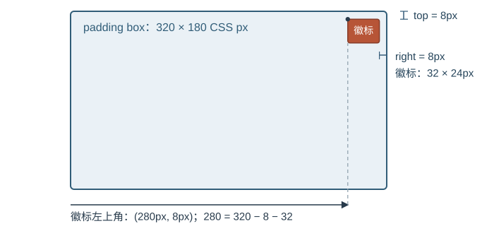

### 让未知尺寸的弹窗居中

遮罩层可覆盖固定定位包含块，再用 Grid（网格布局）对齐弹窗。视口为 `1120 × 700px`、弹窗为 `320 × 160px` 时，视口中心是 `(560, 350)`；弹窗左上角因此是 `(560 − 160, 350 − 80) = (400, 270)`。

~~~css
.dialog-backdrop {
  position: fixed;
  inset: 0;
  display: grid;
  place-items: center;
}

.dialog {
  width: 320px;
  height: 160px;
}
~~~

另一种方案不使用 Grid：让遮罩建立绝对定位包含块，再将弹窗左上角定位到包含块中心，最后平移自身宽高的一半。此例中遮罩没有 padding 或 border，仍以 `1120 × 700px` 视口为 `fixed` 包含块：

~~~css
.dialog-backdrop {
  position: fixed;
  inset: 0;
  display: block;
}

.dialog {
  position: absolute;
  top: 50%;
  left: 50%;
  width: 320px;
  height: 160px;
  transform: translate(-50%, -50%);
}
~~~

这里 `top` 与 `left` 以遮罩的 padding box 为参照；`translate` 再将弹窗自身左上角向左、向上移动宽高的一半，结果也是 `(400, 270)`。这和前一段的 Grid 流内子项居中是两套独立方案：在上面的显式 inset 方案中，是遮罩的 `position: fixed` 建立绝对定位包含块；弹窗靠偏移和平移居中。使用 `fixed` 时，应检查祖先是否建立了固定定位包含块；否则参照物通常是视口。

### sticky 为什么没有贴住？

`sticky` 在要粘住的轴上至少需要一个非 `auto` inset，例如 `top: 0`。它相对最近滚动容器的滚动视口移动，并且受自身包含块限制。假设文档顶部有一个 `300px` 高的包裹层，里面的工具条高 `32px`、设 `top: 0`：窗口滚动 `100px` 后，工具条顶边能贴在视口 `y=0`；滚动到 `290px` 时，包裹层底边已到 `y=10`，工具条只能移到 `y=10−32=−22px`，再随包裹层离开。若包裹层只有 `32px` 高，滚动 `100px` 后工具条已在 `y=−100px`，没有剩余空间可粘住。

祖先的 `overflow` 可能改变最近滚动容器，即使那个祖先当前没有可见滚动条；因此应沿祖先链确认实际滚动容器和 sticky 可移动的空间。

### z-index 为什么仍然在下面？

先看最小结构：`.shell` 与 `.other` 是同一 `.stage` 下的重叠兄弟，`.dialog` 则是 `.shell` 的子项。它们覆盖相同的演示区域，因而能观察到谁画在上面：

~~~html
<div class="stage">
  <div class="shell"><div class="dialog">弹窗</div></div>
  <div class="other">其他内容</div>
</div>
~~~

`z-index` 的数值只在相同堆叠上下文中比较。新建的堆叠上下文会作为一个整体放进父上下文，因此内部子项的数值不能越过祖先组，与组外元素直接比较：

~~~css
.stage { position: relative; width: 240px; height: 120px; }
.shell, .other { position: absolute; inset: 0; }
.shell  { z-index: 1; }
.shell .dialog {
  position: absolute; inset: 20px; width: auto; height: auto;
  z-index: 9999; background: #ded3f4;
}
.other { z-index: 2; background: #cfe2fa; }
~~~

`.dialog` 仍在 `.shell` 这一绘制组中；组外 `.other` 的层级高于 `.shell` 时，子项的 `9999` 不会改变这两个组的顺序。蓝色的 `.other` 此时覆盖紫色弹窗；仅把 `.shell` 改为 `z-index: 3`，紫色弹窗才出现在蓝色区域上面。应调整实际参与比较的祖先层级，或把弹窗放入能与目标组同层比较的结构。

上面的比较限定于普通文档层叠。调用原生 `<dialog>` 的 `showModal()` 会把该对话框放入 top layer（顶层）；顶层内容作为根元素的同级整体绘制，普通文档中的任意 `z-index` 都不能把它盖住。

| 观察到的问题 | 先检查 |
| --- | --- |
| 兄弟节点被推开或覆盖 | 普通流位置、绝对定位包含块 |
| 高 `z-index` 元素仍被遮住 | 实际参与比较的祖先堆叠上下文及其层级 |
| 浮动没有计入父元素高度 | [BFC 与流式布局边界](#19.%20%E5%9D%97%E6%A0%BC%E5%BC%8F%E5%8C%96%E4%B8%8A%E4%B8%8B%E6%96%87%E5%A6%82%E4%BD%95%E7%BA%A6%E6%9D%9F%E6%B5%AE%E5%8A%A8%E5%92%8C%E5%A4%96%E8%BE%B9%E8%B7%9D%EF%BC%9F) |

> [!info] 常见堆叠上下文创建条件
> 定位盒配合非 `auto` 的 `z-index`、`fixed` 或 `sticky`（即使 `z-index: auto`）、非 `none` 的 `transform`、`perspective` 或 `filter`、小于 `1` 的 `opacity`、`isolation: isolate`、`contain: layout` 或 `contain: paint` 都会创建堆叠上下文。Flex/Grid 子项配合非 `auto` 的 `z-index` 也会创建。`will-change` 只有在它指向的属性本来会带来对应效果时，才会提前建立包含块或堆叠上下文；不要把所有创建条件都当成同时建立包含块。

> [!info]- 来源
> - `position`、包含块、偏移、sticky 滚动视口和定位盒层叠：W3C CSS Positioned Layout Level 3，Working Draft，2025-10-07，§§2、2.1、2.2、3.4，[规范](https://www.w3.org/TR/css-position-3/)。
> - 顶层绘制顺序：W3C CSS Positioned Layout Level 4，Working Draft，2025-10-07，§§3.1、4，[规范](https://www.w3.org/TR/css-position-4/)。
> - `display:none`、blockification：W3C CSS Display Module Level 3，Candidate Recommendation Draft，2026-06-05，§§2.5、2.7，[规范](https://www.w3.org/TR/css-display-3/)。
> - Flex/Grid 子项的 `z-index` 和绝对定位边界：W3C CSS Flexible Box Layout Module Level 1，Candidate Recommendation Draft，2025-10-14，§§4.1、4.3，[规范](https://www.w3.org/TR/css-flexbox-1/)；CSS Grid Layout Module Level 1，Candidate Recommendation Draft，2025-03-26，§§6.5、9.1、9.2，[规范](https://www.w3.org/TR/css-grid-1/)。
> - `transform` 建立后代定位包含块和堆叠上下文：W3C CSS Transforms Module Level 1，Candidate Recommendation，2019-02-14，§3，[规范](https://www.w3.org/TR/css-transforms-1/)；`perspective` 非 `none` 的包含块和堆叠效果：W3C CSS Transforms Module Level 2，Working Draft，2021-11-09，§8，[规范](https://www.w3.org/TR/css-transforms-2/)；`contain: layout` 与 `contain: paint` 的包含块、堆叠及裁切：W3C CSS Containment Module Level 2，Working Draft，2022-09-17，§§3.2、3.4，[规范](https://www.w3.org/TR/css-contain-2/)。
> - `filter` 的包含块与堆叠效果：W3C Filter Effects Module Level 1，Working Draft，2018-12-18，§5，[规范](https://www.w3.org/TR/filter-effects-1/)；`will-change` 的提前效果：W3C CSS Will Change Module Level 1，Candidate Recommendation Draft，2022-05-05，§2，[规范](https://www.w3.org/TR/css-will-change-1/)；整体透明度：W3C CSS Color Module Level 4，Candidate Recommendation Draft，2026-11-03，§3.3，[规范](https://www.w3.org/TR/css-color-4/)；`isolation`：W3C Compositing and Blending Level 1，Candidate Recommendation Draft，2024-03-21，§3.4.2，[规范](https://www.w3.org/TR/compositing-1/)。
> - 原生模态对话框进入 top layer：WHATWG HTML Living Standard，更新于 2026-11-11，§4.11.4，[`showModal()` 与模态显示算法](https://html.spec.whatwg.org/multipage/interactive-elements.html#dom-dialog-showmodal)。
> - 相关布局边界另见 [BFC 与流式布局边界](#19.%20%E5%9D%97%E6%A0%BC%E5%BC%8F%E5%8C%96%E4%B8%8A%E4%B8%8B%E6%96%87%E5%A6%82%E4%BD%95%E7%BA%A6%E6%9D%9F%E6%B5%AE%E5%8A%A8%E5%92%8C%E5%A4%96%E8%BE%B9%E8%B7%9D%EF%BC%9F)；隐藏状态见[隐藏与可访问性](#23.%20%E9%9A%90%E8%97%8F%E7%8A%B6%E6%80%81%E4%BC%9A%E6%80%8E%E6%A0%B7%E5%BD%B1%E5%93%8D%E7%84%A6%E7%82%B9%E4%B8%8E%E5%8F%AF%E8%AE%BF%E9%97%AE%E6%80%A7%EF%BC%9F)，运动见[CSS 过渡与动画](#24.%20%E4%BD%95%E6%97%B6%E4%BD%BF%E7%94%A8%E8%BF%87%E6%B8%A1%EF%BC%8C%E4%BD%95%E6%97%B6%E4%BD%BF%E7%94%A8%E5%85%B3%E9%94%AE%E5%B8%A7%E5%8A%A8%E7%94%BB%EF%BC%9F)，布局绘制路径见[渲染流水线与强制布局](#12.%20%E4%B8%BA%E4%BB%80%E4%B9%88%E4%B8%80%E6%AC%A1%20DOM%20%E6%94%B9%E5%8A%A8%E4%BC%9A%E5%A2%9E%E5%8A%A0%E5%B8%83%E5%B1%80%E6%88%96%E7%BB%98%E5%88%B6%E5%B7%A5%E4%BD%9C%EF%BC%9F)。
## 23. 隐藏状态会怎样影响焦点与可访问性？

案例背景：报表页面有一个“查看详情”按钮，展开后在原位置显示详情和“关闭详情”按钮。这是普通的 disclosure（展开/折叠控件），页面其余部分仍可操作。用户在面板内点击关闭时，希望内容淡出、焦点回到“查看详情”，随后按 Tab 不再进入已关闭的面板。

一次关闭同时改变两件事：**内容现在是否可用**，以及**屏幕上的内容怎样消失**。后者可以花 180 ms，前者应当在关闭时就完成。理解这两个时点，才能同时处理布局、指针、键盘焦点和 accessibility tree（无障碍树）。

### 几种隐藏方式留下什么？

| 状态 | 布局空间 | 指针命中 | 键盘焦点 | 无障碍树 |
| --- | --- | --- | --- | --- |
| `display: none`（不生成显示盒）或普通 HTML `hidden`（未被作者样式覆盖） | 移除 | 不绘制、不命中 | 隐藏期间不能聚焦 | 通常不暴露 |
| `visibility: hidden`（不可见） | 保留 | hidden 后代不命中；显式设为 `visible` 的后代可命中 | hidden 后代通常不能聚焦；本来可聚焦的 visible 后代可以 | hidden 后代通常不暴露；visible 后代可能暴露 |
| `opacity: 0`（不透明度为零） | 保留 | 仍可能命中 | 仍可能聚焦 | 通常仍暴露 |
| `inert`（惰性子树） | 样式决定 | 普通子树退出用户交互 | 普通子树不可聚焦 | 辅助技术忽略该子树；视觉仍由 CSS 决定 |
| `aria-hidden="true"`（辅助技术隐藏状态） | 样式决定 | 样式决定 | 不会自行禁用焦点 | 从辅助技术呈现中隐藏子树 |

`visibility:hidden` 只对仍保持隐藏值的盒子隐藏绘制和交互；后代显式设为 `visibility:visible` 后会重新绘制、参与指针命中，本来可聚焦的元素也能重新接收焦点。父级 `visibility:hidden` 不等同于禁用整棵子树的 `inert`。

> [!info] HTML `hidden` 的两种状态
> 表中普通 `hidden` 指默认隐藏状态；作者 CSS 可以覆盖它默认的隐藏样式，所以还要检查实际的 `display`。`hidden="until-found"` 则为页内查找和片段导航保留可揭示的内容：元素仍有盒子、边框和间距，找到时浏览器先派发 `beforematch`，再移除 `hidden`。它需要 layout containment（布局包含）；设成 `display: none`、`contents` 或 `inline` 会妨碍页内查找揭示。这不是下面面板示例使用的状态。

`opacity` 不继承；浏览器把元素及其后代作为透明绘制组处理，因此子元素设为 `opacity: 1` 也无法穿透父元素的 `opacity: 0`。`pointer-events` 只影响指针命中，`pointer-events: none` 不会关闭键盘焦点或无障碍呈现。

> [!info] inert 与 aria-hidden 的责任不同
> 对本例的普通面板，`inert` 同时限制用户交互、焦点和辅助技术呈现。`aria-hidden` 只影响辅助技术呈现，不能替代焦点管理；不要用它把仍可聚焦的区域藏起来。`inert` 也不禁止脚本读取 DOM 或调用函数。一个需要单独处理的例外是通过 `showModal()` 打开的 modal dialog（模态对话框）：它可脱离祖先的 inert 状态，除非对话框自身也显式设置了 `inert`。

### 关闭面板时先处理焦点

先沿一次关闭看状态变化。下图假设面板已经完全展开，焦点位于里面的“关闭详情”按钮；CSS 支持稍后使用的离散过渡。图里的 `hidden` 是 HTML 关闭目标，`display` 则是当时计算出的显示值；过渡可以暂时保留盒子，让内容画完淡出。

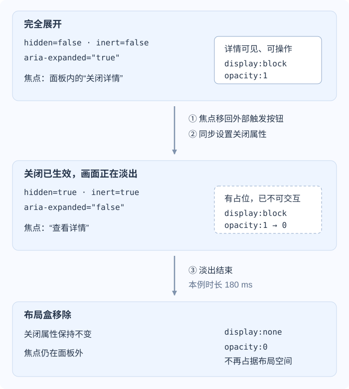

**先移动焦点，再禁用面板**，否则原来的焦点会留在马上不可用的区域中，接下来落到哪里就不再由这段界面逻辑明确决定。一般的外部状态更新若发现焦点已经在外面，就保持其位置。面板自身的“关闭详情”按钮则明确先调用 `trigger.focus()`：鼠标点击原生按钮是否使其获得焦点取决于浏览器，不能假设点击关闭时焦点必定已经在面板里。

下面的 HTML、CSS 和 JavaScript 组成同一个例子。`aria-controls` 关联触发按钮与面板，`aria-expanded` 报告展开状态；普通 `<button>` 已具备 Enter 和 Space 激活行为。打开时移除 `hidden` 和 `inert`，并把 `aria-expanded` 设为 `true`。从已经聚焦的触发按钮激活时，打开操作保留它的焦点，用户可再通过顺序焦点导航进入面板（通常按 Tab，具体受浏览器和系统键盘设置影响）；代码没有要求鼠标点开时强制聚焦按钮。

~~~html
<button type="button" aria-controls="report-details" aria-expanded="false">
  查看详情
</button>
<section id="report-details" hidden inert>
  <h2>筛选结果详情</h2>
  <button type="button" data-close>关闭详情</button>
</section>
~~~

~~~css
#report-details {
  display: none;
  opacity: 0;
  transition: opacity 180ms ease, display 180ms allow-discrete;
}

#report-details:not([hidden]) {
  display: block;
  opacity: 1;
}

@starting-style {
  #report-details:not([hidden]) { opacity: 0; }
}

@media (prefers-reduced-motion: reduce) {
  #report-details { transition-duration: 0s; }
}
~~~

~~~javascript
const trigger = document.querySelector('[aria-controls="report-details"]');
const panel = document.querySelector("#report-details");
const closeButton = panel.querySelector("[data-close]");

function setDetailsOpen(open) {
  if (!open && panel.contains(document.activeElement)) trigger.focus();
  panel.inert = !open;
  panel.hidden = !open;
  trigger.setAttribute("aria-expanded", String(open));
}

trigger.addEventListener("click", () => setDetailsOpen(panel.hidden));
closeButton.addEventListener("click", () => {
  trigger.focus();
  setDetailsOpen(false);
});
~~~

这里不靠 `transitionend` 更新可用状态：关闭函数当次就完成焦点和三个属性的同步。关闭过渡中再次打开，CSS 会转向新的显示目标；没有旧定时器或旧动画回调随后再把面板藏掉。启用 `prefers-reduced-motion: reduce` 时，过渡时间变为零，这套状态切换仍然成立。

### display 也能参与离散过渡

`opacity` 可以从 1 连续变到 0；`display` 在 `block` 和 `none` 之间没有“半个盒子”的中间值。`allow-discrete` 允许它参与离散过渡，其中 `none` 与可显示值的切换有专门规则：

- **打开**：过渡开始就生成盒子，再让 `opacity` 从 0 变到 1。原来不渲染的元素没有可供过渡使用的普通前一帧样式，`@starting-style` 在这里提供起始的 0。
- **关闭**：过渡期间仍保留盒子，`opacity` 从 1 变到 0；结束时才切成 `display: none`，移除布局占位。

因此，图中淡出时可以同时出现 `hidden=true` 与动画中的 `display:block`。属性表达目标状态，过渡暂时保留盒子以画完退出过程。本例显式 `inert` 让这段时间里的面板不可交互。CSS Display Level 4 也规定：忽略过渡和动画的级联来源后，如果 `display` 仍为 `none`，元素就应处于惰性状态。

在不支持这些过渡特性的浏览器中，显示/隐藏仍由基础样式和属性控制，只是淡入淡出可能直接完成。实际核验本例时，在 Chrome 157.0.8103.51 中观察到关闭当次焦点已移出、面板已退出无障碍树，而动画中的 `display` 仍是 `block`；结束后才变为 `none`。这是浏览器状态检查，并不替代真实屏幕阅读器的操作验证。

> [!info]- 来源
> - 显示盒生成和 <code>display</code>：W3C CSS Display Level 3，Candidate Recommendation Draft（2026-06-05），[CSS Display](https://www.w3.org/TR/css-display-3/)，核对于 2026-11-12。
> - <code>display</code> 离散过渡中生成/移除显示盒的时点与 inert 行为：W3C CSS Display Level 4，§2.9，Working Draft（2025-11-06），[Animating and Interpolating display](https://www.w3.org/TR/css-display-4/#display-animation)，核对于 2026-11-12。
> - `visibility` 的后代覆盖：W3C CSS Display Level 3，§4，Candidate Recommendation Draft（2026-06-05），[visibility](https://www.w3.org/TR/css-display-3/#visibility)，核对于 2026-11-12。
> - `opacity` 的非继承性、整组透明绘制和命中测试：W3C CSS Color Level 4，Candidate Recommendation Draft（2026-11-03），[CSS Color](https://www.w3.org/TR/css-color-4/)，核对于 2026-11-12。
> - `pointer-events` 对指针命中与顺序焦点导航的边界：W3C CSS Basic User Interface Level 4，Working Draft（2026-01-20），[CSS Basic User Interface](https://www.w3.org/TR/css-ui-4/)，核对于 2026-11-12。
> - `inert` 子树与交互：WHATWG HTML Living Standard（2026-11-11 更新），[Inert subtrees](https://html.spec.whatwg.org/multipage/interaction.html#inert-subtrees)，核对于 2026-11-12。
> - 普通 `hidden` 与 `until-found` 状态：WHATWG HTML Living Standard（2026-11-11 更新），[The `hidden` attribute](https://html.spec.whatwg.org/multipage/interaction.html#the-hidden-attribute)，核对于 2026-11-12。
> - `aria-hidden` 和 `aria-expanded` 状态：W3C WAI-ARIA 1.2，Recommendation（2023-06-06），[WAI-ARIA](https://www.w3.org/TR/wai-aria-1.2/)，核对于 2026-11-12。
> - 离散显示过渡：W3C CSS Transitions Level 2，Working Draft（2026-02-04），[transition-behavior](https://www.w3.org/TR/css-transitions-2/#transition-behavior-property)，核对于 2026-11-12。
> - 减少动态效果：W3C Media Queries Level 5，Working Draft（2026-02-19），[prefers-reduced-motion](https://www.w3.org/TR/mediaqueries-5/#prefers-reduced-motion)，核对于 2026-11-12。
> - 键盘操作和焦点管理：W3C WAI [ARIA APG Keyboard Interface](https://www.w3.org/WAI/ARIA/apg/practices/keyboard-interface/)，核对于 2026-11-12。
> - 普通展开控件的按钮、键盘和 `aria-expanded` / `aria-controls` 约定：[WAI-ARIA APG Disclosure Pattern](https://www.w3.org/WAI/ARIA/apg/patterns/disclosure/)，核对于 2026-11-12。
> - 点击可聚焦性由 user agent 决定：[WHATWG HTML Focus](https://html.spec.whatwg.org/multipage/interaction.html#focus)，click focusable 定义；键盘与鼠标不能共用“点击后必然已聚焦”的假设，核对于 2026-11-12。
## 24. 何时使用过渡，何时使用关键帧动画？

报表筛选按钮改变颜色、卡片从正面翻到背面，都是两个状态间的视觉过渡；面板进入时先越过终点再回落，装饰图片条带则要连续循环。transition（过渡）在样式值变化时插值；keyframe animation（关键帧动画）用 `@keyframes` 指定时间点上的样式。

> [!info] 先按状态模型选机制
> 一个起点到一个终点，且由 hover、焦点或 class 状态变化触发，通常用 transition。需要按时间点指定多个状态、自动开始、循环、播放方向或暂停时，用 keyframes。若属性沿同一条插值路径略过目标再回来，可用输出进度超出 `[0,1]` 的 easing（缓动函数）；若要安排几个明确的中间状态，则用关键帧。两种方式都要评估对阅读和操作的影响。

### 状态变化用 transition

~~~css
.filter-button {
  background-color: #17324d;
  transition: background-color 180ms ease-out;
}

.filter-button:hover,
.filter-button:focus-visible {
  background-color: #24547d;
}
~~~

| 属性 | 作用 |
| --- | --- |
| `transition-property` | 指定参与过渡的属性，如 `opacity`、`transform` |
| `transition-duration` | 插值持续时间 |
| `transition-timing-function` | 把时间进度映射为插值进度的曲线，如 `ease-out`、`cubic-bezier(...)` |
| `transition-delay` | 开始前等待的时间 |

下例的各属性列表等长，按逗号位置一一对应：

~~~css
.result-card {
  transition-property: transform, opacity;
  transition-duration: 300ms, 200ms;
  transition-timing-function: ease-out, linear;
  transition-delay: 0ms, 100ms;
}
~~~

把过渡声明放在基础状态上，进入和离开状态都会应用。只把声明写在 `:hover` 规则中，离开 hover 时基础状态没有过渡声明，返回过程可能直接跳变。

状态规则决定目标值，过渡中的画面则是当前插值值。若目标在过渡中改变，浏览器从当前画面继续转向新目标；在这个按钮例子里，目标回到原端点时会启动一段缩短的返回过渡，而不是把动画时间轴倒放。在本例的单次回切中，反向缩短因子由旧缓动函数在目标改变时的输出进度决定，也就是沿值区间已走过的比例；不能只用已过毫秒数代替。`cubic-bezier(.34, 1.56, .64, 1)` 的输出可超过 `1`，但只有属性能表示超出端点的值时，画面才会越过终点；例如 `transform: translateY(0) → translateY(100px)` 可以越过 `100px` 后回落，`opacity: 0 → 1` 的计算值则限制在 `[0,1]`。

### 多个时间点用 @keyframes

~~~css
@keyframes panel-enter {
  0%   { transform: translateY(8px); opacity: 0; }
  55%  { transform: translateY(-2px); opacity: 1; }
  100% { transform: translateY(0); opacity: 1; }
}

.report-panel {
  transform: none;
  opacity: 1;
}

.report-panel.is-entering {
  animation: panel-enter 240ms ease-out both;
}
~~~

将 `.is-entering` 加到面板会启动动画。55% 时面板先越过终点 `2px`，最后再回到原位；这个中间关键帧明确指定了越过与回落的时间。如果只要简单越过同一条路径的目标，也可以使用上一节的过冲缓动；这里保留 `55%` 是为了控制中间状态何时发生。

| 属性 | 作用 |
| --- | --- |
| `animation-name` | 选择 `@keyframes` 规则 |
| `animation-duration` | 一轮持续时间 |
| `animation-timing-function` | 在相邻定义了该属性的关键帧之间映射时间进度；可在关键帧中为接下来的一段另设缓动 |
| `animation-delay` | 第一轮开始前等待时间 |
| `animation-iteration-count` | 轮数或 `infinite` |
| `animation-direction` | 正向、反向或交替播放 |
| `animation-fill-mode` | 动画区间外是否应用播放边界时的效果值 |
| `animation-play-state` | `running` 或 `paused` |

本例是一轮默认正向播放且没有延迟，因此实际播放起点和终点的样式分别是 `0%` 与 `100%` 关键帧。若在开始前加延迟，`animation-fill-mode: both` 会应用实际播放起点的效果值；结束后则保留动画实际结束时的效果值。它们不一定总是端点关键帧：播放方向（如反向、交替）和迭代次数（尤其是小数轮数）会决定动画在哪个进度开始与结束，边界处也可能是两个关键帧之间插值出的样式。只要动画声明仍适用于元素，这些填充值就继续参与样式；移除 `.is-entering` 后，面板回到基础样式的 `opacity: 1; transform: none`。fill mode（填充模式）不会把结果写成永久状态。`animation-play-state: paused` 则暂停在当前播放位置；改回 `running` 时从那里继续。

### 用两面翻牌理解 3D transform

transform（变换）可平移、旋转或缩放绘制盒子。下面用类名控制两面卡片的角度；实际交互卡片还需单独提供按钮状态、焦点行为和内容语义，纯 CSS 的背面隐藏只影响绘制，不能代替内容可访问性处理。

~~~html
<div class="flip-demo" aria-hidden="true">
  <div class="flip-demo__inner">
    <div class="flip-demo__face flip-demo__front">正面</div>
    <div class="flip-demo__face flip-demo__back">背面</div>
  </div>
</div>
~~~

~~~css
.flip-demo {
  width: 200px;
  height: 120px;
  perspective: 800px;
}

.flip-demo__inner {
  position: relative;
  width: 100%;
  height: 100%;
  transform-style: preserve-3d;
  transition: transform 600ms ease;
}

.flip-demo.is-flipped .flip-demo__inner { transform: rotateY(180deg); }

.flip-demo__face {
  position: absolute;
  inset: 0;
  display: grid;
  place-items: center;
  backface-visibility: hidden;
  color: white;
}

.flip-demo__front { background: #24547d; }
.flip-demo__back { background: #8c3d16; transform: rotateY(180deg); }
~~~

外层 `perspective` 提供近大远小的透视效果；内层 `preserve-3d` 保留两个面的三维位置；背面先旋转 `180deg`，这样父级翻转后它才转到朝向读者的一侧。未加 `.is-flipped` 时，蓝色正面朝向读者；加入该类后，内层转过 `180deg`，正面背向读者，橙色背面转到前方。示例整体 `aria-hidden="true"`，文字只用于演示，不承载页面内容。

`translate`（平移）移动，`rotate`（旋转）改变朝向，`scale`（缩放）改变绘制尺寸。`transform-origin`（变换原点）默认在盒子中心；旋转或缩放时改变它，会改变视觉效果所绕的参照点。多种变换函数组合时顺序会影响结果，交换平移和旋转的顺序可能得到不同位置。`transform` 不重新安排周围普通流项目，但可能扩展可滚动溢出区域，并为后代建立 containing block（包含块）与 stacking context（堆叠上下文）。

### 无限滚动图片条带怎样无缝循环？

以下“双组三图”例子用作纯装饰的 CSS 理想尺寸演算。本例明确采用水平书写、从左到右的条带：视窗宽 `320px`，原图组三张、复制组三张，共六项；整条轨道宽度是视窗的 `600%`，移动 `50%` 对应其中一组三张的理论宽度。

~~~html
<div class="strip-window" aria-hidden="true">
  <div class="strip-track">
    
    
    
    
    
    
  </div>
</div>
~~~

~~~css
.strip-window {
  width: 320px;
  overflow: hidden;
  writing-mode: horizontal-tb;
  direction: ltr;
}

.strip-track {
  display: flex;
  flex-direction: row;
  align-items: flex-start;
  width: 600%;
  animation: strip-loop 18s linear infinite;
}

.strip-track img {
  flex: 0 0 calc(100% / 6);
  min-inline-size: 0;
  height: auto;
}

@keyframes strip-loop {
  to { transform: translateX(-50%); }
}
~~~

> [!example] 循环距离
> 轨道宽 `6 × 320 = 1920px`；两个等宽图组各占 `960px`。`translateX(-50%)` 移动 `1920 × 0.5 = 960px = 3 × 320px`，在理想尺寸下，下一组占据原组的位置。这里固定的百分比 `flex-basis` 负责每项宽度；`` 的默认 `min-inline-size: auto` 可能按内容尺寸阻止它缩到 `320px`，因此设为 `0`。例如原图自然宽 `640px` 时，不覆写这个最小尺寸的 Chrome 实测每项仍宽 `640px`，第四项在移动半轨道后落到 `x=960px`，无法接上首组三项。加上 `min-inline-size: 0` 后每项约为 `320px`，第四项落在 `x≈0`；实测仍有不到 `0.05px` 的子像素误差。此几何演算是按 CSS px 计算的理想值，不是对所有图片、浏览器和屏幕都无接缝的保证。素材宽高比不同不影响横向组宽；若卡片宽度或组数变化，需同步调整轨道和每项比例。

**循环位置示意（按理想 CSS px 比例）**

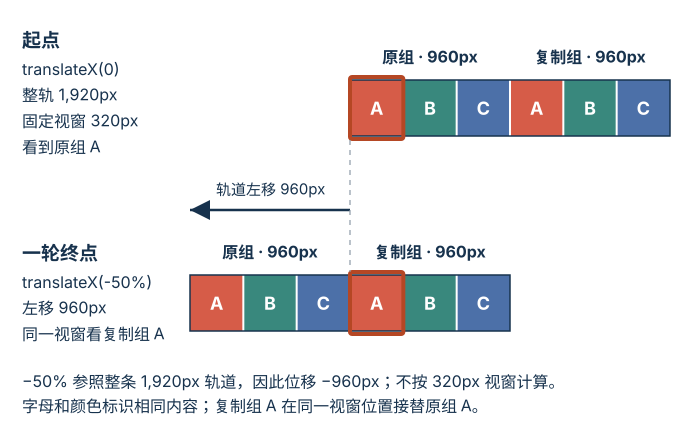

下一轮开始时，位移从 `-960px` 重置到 `0`，视窗由复制组 A 切回原组 A。两组内容、排列和尺寸相同，理想几何下重置前后的画面才相同；这就是复制一整组能隐藏循环接点的原因。

这个循环没有控制按钮、键盘浏览、暂停机制或轮播语义，所以不能充当内容轮播。内容轮播应提供前后切换；若自动播放，还要提供停止/开始控制，键盘焦点进入后停止，只有用户显式重启才恢复，并在鼠标悬停时停止。还要处理 prefers-reduced-motion（减少动态效果偏好）。若动画只是装饰，也要确保它不承载唯一信息。

`align-items: flex-start` 还避免 flex 默认的交叉轴拉伸把每张图拉成同一高度。`height: auto` 会按图像比例确定高度：本例自然尺寸分别为 `640×320`、`640×640`、`640×480` 的三张图缩到约 `320px` 宽后分别高约 `160px`、`320px`、`240px`。高度不同不改变横向组宽或移动距离；若去掉 `align-items: flex-start`，默认拉伸可能改变这些高度。

示例上的 `aria-hidden="true"` 只隐藏辅助技术树中的条带，不会暂停屏幕上的运动。若把自动移动的条带放在其他页面内容旁并持续超过五秒，应提供暂停、停止或隐藏机制，除非该运动对活动不可或缺（WCAG 2.2 成功准则 2.2.2）。

### 动画性能与减少动态效果

每帧需要的样式变化可能牵涉样式计算、布局、绘制、栅格化或合成，具体工作由属性、元素内容和浏览器实现共同决定。`transform` 与 `opacity` 通常不改变周围布局，在满足实现的合成条件时可避免逐帧重新布局或绘制；属性名本身不能证明动画一定在合成线程或 GPU 上执行。Chrome Performance 面板的 Animations 轨道会标记未合成动画；选中后可查看未合成原因。应测量目标页面，而不是假定所有浏览器和元素都有同一执行路径。[渲染流水线与强制布局](#12.%20%E4%B8%BA%E4%BB%80%E4%B9%88%E4%B8%80%E6%AC%A1%20DOM%20%E6%94%B9%E5%8A%A8%E4%BC%9A%E5%A2%9E%E5%8A%A0%E5%B8%83%E5%B1%80%E6%88%96%E7%BB%98%E5%88%B6%E5%B7%A5%E4%BD%9C%EF%BC%9F)说明写入和几何读取如何影响布局工作。

`will-change`（即将变化提示）只是预告可能发生的变化，不是强制创建 GPU 图层的开关。浏览器可用它提前准备优化，但实现可能不同；若对应属性会创建堆叠上下文或包含块，提前提示也会产生该效果，并可能占用资源。只在测量确认有收益时，对少量元素短时使用，变化结束后移除。`translateZ(0)` 也不是通用加速开关。

~~~css
@media (prefers-reduced-motion: reduce) {
  .report-panel.is-entering,
  .strip-track { animation: none; }

  .filter-button,
  .result-card,
  .flip-demo__inner { transition: none; }
}
~~~

用户选择 `reduce` 表示希望减少可能引起不适或分心的非必要运动。这里面板保持基础可见样式、条带停在第一组的起点；按钮和翻牌状态仍更新，只是不再插值移动。状态由 class 和属性值表达，不由动画是否结束来保存；运动被关闭后，界面仍要显示相同结果，也不能让动画成为唯一信息通道。

> [!info]- 来源
> - 隐式过渡与中断、当前插值值、反向缩短：W3C CSS Transitions Level 1，Working Draft（2026-01-08），§§2–4、§3.1，[CSS Transitions](https://www.w3.org/TR/css-transitions-1/)，检查于 2026-11-12。
> - 显式关键帧、移除动画、暂停与填充模式：W3C CSS Animations Level 1，Working Draft（2023-03-02），§§1–2、3.4–3.9、4，[CSS Animations](https://www.w3.org/TR/css-animations-1/)，检查于 2026-11-12。
> - cubic Bézier 的进度映射与 `opacity` 对 `[0,1]` 的计算值限制：W3C CSS Easing Functions Level 2，First Public Working Draft（2024-08-29），§2.3；CSS Color Module Level 4，Candidate Recommendation Draft（2026-11-03），§3.3，[CSS Easing](https://www.w3.org/TR/css-easing-2/) 与 [CSS Color](https://www.w3.org/TR/css-color-4/)，检查于 2026-11-12。
> - flex 项目默认交叉轴拉伸与 `align-items: flex-start`：W3C CSS Flexible Box Layout Module Level 1，Candidate Recommendation Draft（2025-10-14），§8.3；自动最小尺寸与内容最小尺寸：§4.5，[CSS Flexbox](https://www.w3.org/TR/css-flexbox-1/#align-items-property)，检查于 2026-11-12。
> - `min-inline-size` 与书写模式的物理尺寸映射：W3C CSS Logical Properties and Values Level 1，Working Draft（2025-12-04），§4.1，[CSS Logical Properties](https://www.w3.org/TR/css-logical-1/)，检查于 2026-11-12。
> - 变换、绘制溢出、包含块、堆叠上下文、变换原点、函数顺序及平移百分比相对 reference box：W3C CSS Transforms Level 1，Candidate Recommendation（2019-02-14），§§3–6、9.1，[CSS Transforms](https://www.w3.org/TR/css-transforms-1/)，检查于 2026-11-12。
> - 三维变换模型、保留 3D、透视与背面可见性：W3C CSS Transforms Level 2，Working Draft（2021-11-09），§§4.1、7、8、10，[backface-visibility](https://www.w3.org/TR/css-transforms-2/#backface-visibility-property)，检查于 2026-11-12。
> - `will-change` 提示的实现差异、潜在资源消耗与副作用：W3C CSS Will Change Level 1，Candidate Recommendation Draft（2022-05-05），§§1.2、2，[CSS Will Change](https://www.w3.org/TR/css-will-change-1/)，检查于 2026-11-12。
> - 减少非必要运动的用户偏好：W3C Media Queries Level 5，Working Draft（2026-02-19），§12.1，[prefers-reduced-motion](https://www.w3.org/TR/mediaqueries-5/#prefers-reduced-motion)，检查于 2026-11-12。
> - 检查未合成动画和未合成原因：Chrome DevTools [Performance features reference](https://developer.chrome.com/docs/devtools/performance/reference)，View animations 一节，检查于 2026-11-12。
> - 轮播控制、焦点进入后停止与悬停停止：W3C WAI [ARIA APG Carousel Pattern](https://www.w3.org/WAI/ARIA/apg/patterns/carousel/)，About This Pattern，检查于 2026-11-12。
> - 自动移动内容与页面其他内容并列显示时的暂停、停止或隐藏机制：W3C WCAG 2.2 Recommendation（2024-12-12），成功准则 2.2.2，[Pause, Stop, Hide](https://www.w3.org/TR/WCAG22/#pause-stop-hide)，检查于 2026-11-12。
> - `aria-hidden` 对辅助技术树的影响：W3C WAI-ARIA 1.2 Recommendation（2023-06-06），§7.1，[Excluding Elements from the Accessibility Tree](https://www.w3.org/TR/wai-aria-1.2/#aria-hidden)，检查于 2026-11-12。
## 25. 哪些网页几何接口能测量哪一种盒子？

Document Object Model（文档对象模型，DOM）的几何 API 读的是不同结果：`offset*` 与 `client*` 测量布局盒的大小或相对偏移，`scroll*` 描述滚动区域和当前位置，`getBoundingClientRect()` 则给出经过 CSS transform（变换）后的视口矩形。先问自己要的是盒子的尺寸、内部可用范围、滚动位置，还是视口坐标；选错 API 时，数值即使没有异常，也可能回答了另一个问题。

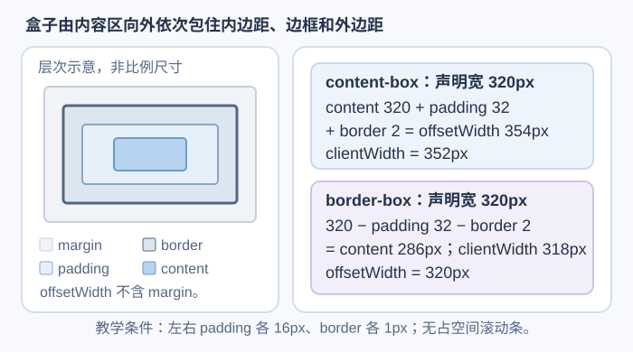

### 先按测量目标选择属性

| API | 返回内容 | 不包含或需留意 |
|---|---|---|
| `offsetWidth` / `offsetHeight` | 未变换边框盒片段的整数轴对齐范围；占空间的滚动条计入常见布局尺寸 | 不含 margin；忽略元素和祖先上的 transform |
| `clientWidth` / `clientHeight` | 整数 padding 区尺寸 | 普通 inline 元素或没有布局盒时返回 `0`；不含 border，也不含 padding 边缘与 border 边缘之间占空间的滚动条；标准模式下根元素例外地表示视口尺寸 |
| `scrollWidth` / `scrollHeight` | 整数滚动区域尺寸，可大于可见的客户区 | 不含 border；值大于客户区不保证用户能滚动该元素 |
| `scrollLeft` / `scrollTop` | 当前滚动区域相对滚动框的偏移 | 可写；当前 CSSOM View 接口允许小数，具体浏览器可能量化；零点方向和可用范围取决于滚动方向与布局 |
| `offsetLeft` / `offsetTop` | 第一个边框盒片段相对 `offsetParent` 第一个盒的 padding edge 的偏移 | `body` 或无布局盒时返回 `0`；其他元素若 `offsetParent` 为 `null`，则相对初始包含块原点；这些值忽略 transform |
| `getBoundingClientRect()` | 本次读取时，变换后边框片段的视口包围矩形；坐标和尺寸可为小数 CSS px | 不含 margin；结果是快照，不会跟着之后的滚动或布局变化而更新 |

这些尺寸使用 CSS 像素，不是设备物理像素。占空间的滚动条会减少 `clientWidth` 或 `clientHeight`；覆盖在内容上的滚动条通常不占这部分布局空间。没有布局盒的元素，例如 `display: none` 的元素，部分尺寸属性会返回 `0`。普通 inline 元素即使有文字片段，`clientWidth` / `clientHeight` 仍为 `0`；合成页中的普通 `span` 读到 `clientWidth = 0`、`offsetWidth = 101`，说明这两个属性回答的并非同一问题。

### 用固定数字对照布局尺寸

下面的两个元素都声明 `width: 320px`。第一种宽度只给 content；第二种把 padding 和 border 也算在声明宽度里。假设采用普通横排，且没有占空间的滚动条：

~~~css
.content-box {
  box-sizing: content-box;
  width: 320px;
  padding-inline: 16px;
  border: 1px solid;
}

.border-box {
  box-sizing: border-box;
  width: 320px;
  padding-inline: 16px;
  border: 1px solid;
}
~~~

| `box-sizing` | content 宽度 | `clientWidth` | `offsetWidth` | 计算 |
|---|---:|---:|---:|---|
| `content-box` | 320px | 352px | 354px | content `320` + 左右 padding `16×2` + 左右 border `1×2` |
| `border-box` | 286px | 318px | 320px | 声明总宽 `320` − 左右 padding `16×2` − 左右 border `1×2` |

`offsetWidth` 取边框盒宽度，`clientWidth` 取扣除边框与占空间滚动条后的内部宽度。`margin` 在这两个数值之外；因此它们都不能直接当作元素与相邻元素之间的总间距。

### 读滚动区域与当前偏移

`scrollHeight` / `scrollWidth` 表示滚动区域的尺寸；溢出内容可能使其大于可见的 `clientHeight` / `clientWidth`：

~~~javascript
const hasVerticalOverflow = element.scrollHeight > element.clientHeight;
const currentY = element.scrollTop;
element.scrollTop = 0; // 在普通向下溢出的例子中，回到滚动起点
~~~

这个比较只说明滚动区域比客户区高，并不单独证明用户能滚动它。`overflow: hidden` 会裁剪内容且不允许用户直接滚动，但仍可通过 `scrollTop` 程序滚动；`overflow: visible` 则把溢出内容画在盒外，不建立可滚动的区域，对它写入 `scrollTop` 不起作用。在 Chrome 157 的合成页中，两种盒子的 `scrollHeight` 都是 `200`、`clientHeight` 都是 `80`；写入 `30.5` 后，`hidden` 读回 `31`，`visible` 仍为 `0`。因此，区域尺寸和实际滚动能力要分开检查。`scrollTop` 和 `scrollLeft` 可写；当前 CSSOM View 的接口类型允许小数，但浏览器可能把它量化为整数。反向溢出方向也会改变滚动起点：普通 `direction: rtl` 横向溢出容器从右端的 `scrollLeft = 0` 开始，向左滚动时读数可变为负数。合成页中它的 `scrollWidth = 240`、`clientWidth = 100`，初值为 `0`；设为 `-20.5` 后 Chrome 读回 `-20`，随后设为 `25` 会回到 `0`。

带弹性回弹的浏览器还可能在用户拖过滚动边界时暴露通常范围外的偏移；这是依赖实现的行为。判断“已经到顶”或“已经到底”时，需要结合方向、范围与目标浏览器，不能先假设偏移总是非负整数。

在 standards mode（标准模式）下，根元素 `document.documentElement.scrollHeight` 特别返回视口滚动区域高度与视口高度的较大值；`clientHeight` 则是扣除占空间滚动条后的视口高度。普通元素的 `scrollHeight` 返回它自己的滚动区域高度。若只是想异步知道元素何时与观察区域相交，图片延迟加载的 [IntersectionObserver（相交观察器）示例](#26.%20%E5%9B%BE%E7%89%87%E4%B8%8E%E5%AA%92%E4%BD%93%E8%B5%84%E6%BA%90%E6%80%8E%E6%A0%B7%E5%8A%A0%E8%BD%BD%E5%B9%B6%E4%BF%9D%E6%8C%81%E9%A1%B5%E9%9D%A2%E7%A8%B3%E5%AE%9A%EF%BC%9F)通常比反复读取矩形更合适；它会异步报告结果，但不承诺完全不需要布局信息。

### offset 相对哪个父元素？

`offsetLeft` / `offsetTop` 先处理两个返回 `0` 的情况：元素是 `body`，或元素没有布局盒。其他元素若 `offsetParent` 为 `null`，返回第一个盒片段的边框边缘相对初始包含块原点的位置；例如在没有祖先建立固定定位包含块的合成页中，`position: fixed; left: 55px; top: 30px` 的元素得到 `offsetParent === null` 和 `(offsetLeft, offsetTop) = (55, 30)`。此例的初始包含块原点与布局视口左上角重合。若 `offsetParent` 存在，坐标是子元素第一个边框盒片段的边框边缘，减去该父元素第一个盒片段的 padding edge；这里指 padding 区靠边框的一侧边缘，不是 content 与 padding 的分界。`offsetParent` 的规则还会考虑固定定位、表格结构、包含块、缩放和 Shadow DOM（影子 DOM）边界；它不固定等同于最近的 `position` 祖先。

### 读变换后的视口矩形

`getBoundingClientRect()` 先取得元素的 client rect（客户端矩形）列表。对于普通、宽高均非零的盒片段，它返回这些片段的最小轴对齐包围矩形；元素没有布局盒、片段列表为空时，返回位置与尺寸全为 `0` 的矩形。CSS transform 及其祖先的变换会反映在片段上。行内文字跨多行时可以产生多个片段，返回的是它们的联合范围；`DOMRect`（DOM 矩形）是读取时的快照，不会自行更新。这里的坐标以 layout viewport（布局视口）左上角为原点；它不是双指缩放后可见的 visual viewport 坐标原点。

> [!info]- 零宽或零高片段要区分规范算法与实现
> CSSOM View 草案规定：若列表中每个片段都至少有一边为 `0`，返回首片段；否则，对宽或高至少一项非 `0` 的片段求包围范围。这里陈述的是规范算法。Chrome 157.0.8103.51 的合成页中，三个零宽但非零高的片段实际返回末片段；混有普通片段和零宽尾片时，又没有把那些尾片纳入包围范围。依赖这类退化片段时，应按目标浏览器验证，不能把草案分支直接当作跨浏览器保证。下面的数值例子全部使用普通非退化盒子。

下面是一个可复算的布局例子：文档未滚动或缩放，也没有变换祖先；初始包含块左上角与布局视口原点对齐。盒子以 `(100px, 100px)` 起始，content 宽高为 `100px × 40px`，四边 border 各为 `2px`；变换原点设为左上角。`transform` 列表按从左到右的顺序合成矩阵，因此对点的实际作用从右侧函数开始：先绕左上角执行 `scale(1.5)`，再执行 `translate(20px, 12px)`。左上角本身在缩放时仍是原点，所以最终矩形从布局位置 `(100px, 100px)` 平移到视口位置 `(120px, 112px)`。

~~~html
<div id="target"></div>
~~~

~~~css
#target {
  position: absolute;
  left: 100px;
  top: 100px;
  box-sizing: content-box;
  width: 100px;
  height: 40px;
  border: 2px solid;
  transform-origin: 0 0;
  transform: translate(20px, 12px) scale(1.5);
}
~~~

布局边框盒宽 `100 + 2×2 = 104px`，高 `40 + 2×2 = 44px`；`offsetWidth` / `offsetHeight` 忽略变换，仍是 `104px × 44px`。变换后矩形从视口坐标 `(120px, 112px)` 开始，宽高为 `104×1.5 = 156px` 与 `44×1.5 = 66px`。因此，`rect.left = 120` 是视口原点到矩形左边缘的水平坐标，不是矩形宽度：

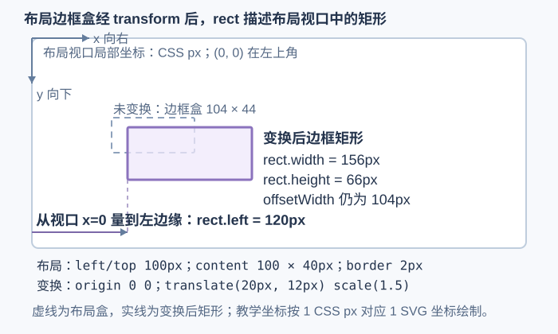

~~~javascript
const target = document.querySelector("#target");
const rect = target.getBoundingClientRect();
// rect.top / bottom：相对视口顶部的上下边缘
// rect.left / right：相对视口左侧的左右边缘
// rect.width / height：变换后边框盒片段的联合范围，单位为 CSS px
~~~

在标准模式中，下面的函数测试元素的变换后矩形是否与 layout viewport（布局视口）有正面积交叠。根元素的 `clientWidth` / `clientHeight` 给出扣除占空间滚动条后的布局视口尺寸；仅在边缘相接不算有面积交叠。

~~~javascript
function overlapsLayoutViewport(element) {
  const rect = element.getBoundingClientRect();
  const root = document.documentElement;
  return root.clientWidth > 0 && root.clientHeight > 0 &&
    rect.width > 0 && rect.height > 0 &&
    rect.bottom > 0 && rect.top < root.clientHeight &&
    rect.right > 0 && rect.left < root.clientWidth;
}
~~~

这个判断只比较矩形与布局视口，不检查祖先滚动容器的裁切、遮挡、透明度或旋转形状内部的空白区域，因此函数名不是“元素已可见”。移动端 pinch-zoom（双指缩放）缩小或平移当前可见区域时，layout viewport（布局视口）也不等于 visual viewport（视觉视口）。若需求要比较当前视觉视口，可把 `window.visualViewport.offsetLeft` / `offsetTop` 作为布局视口内的可见区域左上角，并将 `(offsetLeft, offsetTop, offsetLeft + width, offsetTop + height)` 当作当前视口四边界，按相同的矩形条件比较；这样仍不包含祖先裁切或遮挡。

### 把写入和读取分批

偶尔读取几何属性时，选择与问题相符的盒子和坐标系。若此前的 DOM 或样式写入使布局信息失效，紧接着读几何值可能迫使浏览器先同步完成所需的样式或布局；若布局仍有效，读取可以直接使用现有结果。循环交替写入和读取，在每次写入都影响下一次读取结果时可能反复付出这类成本。关于失效怎样沿渲染工作传播，以及如何批量读、再批量写，见[为什么一次 DOM 改动会增加布局或绘制工作？](#12.%20%E4%B8%BA%E4%BB%80%E4%B9%88%E4%B8%80%E6%AC%A1%20DOM%20%E6%94%B9%E5%8A%A8%E4%BC%9A%E5%A2%9E%E5%8A%A0%E5%B8%83%E5%B1%80%E6%88%96%E7%BB%98%E5%88%B6%E5%B7%A5%E4%BD%9C%EF%BC%9F)。

> [!info]- 来源
> - `offsetWidth` / `offsetHeight` 忽略变换并量边框盒片段：[W3C CSSOM View §7，HTMLElement 扩展](https://www.w3.org/TR/cssom-view-1/#extensions-to-the-htmlelement-interface)；`clientWidth` / `clientHeight` 对普通 inline 或无盒元素返回 `0`，并按 §6 定义边框、滚动区域和根元素例外：[Element 扩展](https://www.w3.org/TR/cssom-view-1/#extensions-to-the-element-interface)。几何坐标和尺寸以 CSS px 表示：[§2.1 CSS pixels](https://www.w3.org/TR/cssom-view-1/#css-pixels)。CSSOM View，W3C Working Draft，2025-09-16；核对于 2026-11-12。
> - `offsetParent`、`offsetLeft` / `offsetTop` 的参照关系与例外：`offsetLeft` / `offsetTop` 在元素是 `body` 或没有布局盒时返回 `0`；其他元素的 `offsetParent` 为 `null` 时，坐标取第一个盒片段相对初始包含块原点的位置；非空父元素时以其第一个盒片段的 padding edge 为参照。`getClientRects()` 与 `getBoundingClientRect()` 的片段联合及非实时结果：[W3C CSSOM View §6–7](https://www.w3.org/TR/cssom-view-1/)，核对于 2026-11-12。
> - `scrollTop` / `scrollLeft` 的可写属性、滚动范围与负向坐标规则：[W3C CSSOM View，Editor’s Draft §6](https://drafts.csswg.org/cssom-view/#extensions-to-the-element-interface)，2026-11-05 版本；这是工作草案，当前 IDL 将偏移定义为 `unrestricted double`。本地 Chrome 157 的合成页把 `30.5` 读回 `31`、把 RTL 的 `-20.5` 读回 `-20`，所以文中不把小数支持说成每个浏览器的保证。
> - `overflow: visible` 让溢出内容绘制在盒外；`overflow: hidden` 裁剪内容、不提供用户直接滚动，但仍允许程序滚动。初始滚动位置通常取决于书写模式，并与滚动原点重合；滚动原点默认在 block-start 与 inline-start 的交角，RTL 的 inline-start 位于右侧：[CSS Overflow Module Level 3 §2.3、§3.1](https://drafts.csswg.org/css-overflow-3/)，Editor’s Draft，2026-08-13。
> - 弹性回弹可能暴露超出常规边界的偏移；这是实现差异，不是所有浏览器的保证：[CSSWG issue 4011](https://github.com/w3c/csswg-drafts/issues/4011)、[WebKit issue 198597](https://bugs.webkit.org/show_bug.cgi?id=198597)。2026-11-12 核对时仍未形成统一约定；本章没有声称已实测 Safari 的回弹。
> - content-box 与 border-box 的 `box-sizing` 计算：[W3C CSS Sizing Level 3 §3.3，Box Edges for Sizing](https://www.w3.org/TR/css-sizing-3/#box-sizing)，W3C Working Draft，2026-09-04；核对于 2026-11-12。
> - `getBoundingClientRect()` 对空片段、每个片段都至少有一边为零、其余片段的联合分别执行的返回规则，以及视口矩形；标准模式根元素的视口尺寸、布局视口与视觉视口的嵌套关系、视觉视口偏移和尺寸：[W3C CSSOM View §2、§6、§12](https://www.w3.org/TR/cssom-view-1/)，W3C Working Draft，2025-09-16；核对于 2026-11-12。
> - `transform` 函数从左到右合成变换矩阵；把局部点映射到父坐标系时，右侧的函数先作用：[CSS Transforms Module Level 1 §2，Transform Rendering Model](https://drafts.csswg.org/css-transforms/#transform-rendering)，Editor’s Draft，2025-11-30。
> - IntersectionObserver 的结果异步送达，面向相对根或视口的位置查询；规范明确不以像素级实际显示结果为目标：[W3C Intersection Observer §1](https://www.w3.org/TR/intersection-observer/#introduction)，Working Draft，2023-10-18；核对于 2026-11-12。
> - 几何读取可能同步触发布局的条件是此前样式或 DOM 已使布局失效；Chrome 的实现说明及读写批处理建议：[Chrome for Developers，Forced reflow](https://developer.chrome.com/docs/performance/insights/forced-reflow)，更新于 2025-10-08。本仓库的机制展开见[渲染流水线与强制布局](#12.%20%E4%B8%BA%E4%BB%80%E4%B9%88%E4%B8%80%E6%AC%A1%20DOM%20%E6%94%B9%E5%8A%A8%E4%BC%9A%E5%A2%9E%E5%8A%A0%E5%B8%83%E5%B1%80%E6%88%96%E7%BB%98%E5%88%B6%E5%B7%A5%E4%BD%9C%EF%BC%9F)。
## 26. 图片与媒体资源怎样加载并保持页面稳定？

同一份公开的合成报表要展示四月至六月趋势图：图表既要有合适的替代文本，也要按屏幕选择文件；首屏外的图可以晚些请求，但占位区域仍应尽量稳定。先确定内容语义与地址，再选择文件和请求时机，最后检查资源到达前后页面几何是否变化。

> [!info] 替代文本由用途决定
> alternative text（替代文本）通过 `alt` 提供。纯装饰图使用 `alt=""`；信息图用简洁文字传达页面所需信息；图片是链接或按钮唯一内容时，写出该控件的目的。复杂图表用简短 alt 指出内容与主要结论，再由邻近正文或数据表给出完整信息；`title` 不能代替图像的 `alt`。表单控件应优先使用与控件关联的 `<label>`，因为 `title` 作为标签备选较不可靠。

### 先按内容选择图像与媒体元素

图像内容用 ``；导航目标用 `<a href>`；播放音频和视频分别用 `<audio>`、`<video>`。本例的趋势图用 `alt` 简述四月至六月的变化和六月最高点；只有图像不再提供表格以外的信息时，才把它当装饰图写 `alt=""`。先决定语义与替代文本，再配置文件地址和加载策略。

### 资源地址相对哪个基准？

| 写法 | 示例 | 解析位置 |
| --- | --- | --- |
| 带 scheme（方案）的 URL（统一资源定位符） | `https://example.com/a.png` | 使用 URL 自身的方案和地址；`mailto:team@example.com` 有 scheme，但没有主机 |
| 根相对路径 | `/assets/chart.png` | 从文档基准 URL 的 origin（源）根目录解析；`<base>` 可能改变 origin |
| 文档相对路径 | `../assets/chart.png` | 默认相对当前文档 URL；`<base>` 可改变文档基准 URL |

`src` 指向要载入的图片资源；`href` 为链接提供导航目标。根相对 URL 不是永远相对页面原站：若 `<base href="https://cdn.example.net/reports/q4/">` 改变文档基准，`/assets/chart.png` 会解析为 `https://cdn.example.net/assets/chart.png`，`../assets/chart.png` 则解析为 `https://cdn.example.net/reports/assets/chart.png`。把本机路径 `/project/site/image.png` 写进 HTTP 页面时，浏览器仍会按文档基准 URL 解析它；服务器需先提供该路径对应的资源。

用 `<a>` 导航，用 `<button>` 执行动作；`href="#"` 会改变片段位置并可能影响历史记录，不是无操作占位符。清楚写出链接文字。确需另开页面时，`target="_blank"` 用于请求新的浏览上下文。当前 HTML 标准中，它在未指定 `rel="opener"` 时默认具有 `noopener` 效果，不向新页面提供指向原页面的 `opener` 引用；显式写 `rel="noopener"` 也可把意图写在标记上。

### 原生延迟加载适合什么图片？

普通首屏外的内容图片可以使用 HTML `loading="lazy"`。浏览器自行决定延迟到何时开始请求，距离阈值不是可依赖的固定数值；元素仍要有真实的 `src` 或 `srcset`，只写 `data-src` 不会启动浏览器图片请求。

~~~html

~~~

`width` 和 `height` 给浏览器一个加载前的首选宽高比。上例按 `640 ÷ 360 = 16:9` 预留空间；如果 CSS 让图片宽 `320px` 并写 `height: auto`，匹配的 `16:9` 文件到达前，预留高度为 `320 × 9 ÷ 16 = 180px`。这些属性应对应实际资源比例；若文件实际是 `800 × 600` 的 `4:3`，浏览器拿到自然尺寸后可能把高度改为 `320 × 3 ÷ 4 = 240px`，布局因此再增高 `60px`。不同裁切的图片尤其要检查宽高比，或用容器的 `aspect-ratio` 与合适的 `object-fit` 控制展示盒。在 DevTools 模拟慢网，分别于图片自然尺寸可用前后读取 `getBoundingClientRect().height`，可以检查预留高度是否稳定。

已确认的 Largest Contentful Paint（最大内容绘制，LCP）图片不应设置 `loading="lazy"`；对首屏可见且很可能成为 LCP 的主图，也应让资源从初始 HTML 可发现并尽早请求，因为延后发现或请求会增加资源加载时延。若测量显示优先级不足，且目标浏览器支持，再考虑 `fetchpriority="high"`。它是优先级提示，不是保证，且不应批量标高。

脚本被禁用时，HTML 标准不让 `loading="lazy"` 延迟资源请求；这是为避免网站借请求时间推测用户滚动位置的反跟踪措施。原生 `loading` 仍在 HTML 中保留真实资源地址；这与下文依赖 JavaScript 改写 `src` 的自定义模式不同。

### 响应式候选文件怎样被选中？

`srcset` 中的 `640w`、`1280w` 描述候选文件的固有像素宽度；`sizes` 描述布局给图像留下的 CSS 像素宽度。下面的样式让图像在视口不宽于 `640px` 时占满视口，宽屏上限为 `640px`；所以 `sizes` 与实际展示宽度相符。若该图片在首屏外，可在同一个 `` 上同时使用 `loading="lazy"`、`srcset`、`sizes` 和尺寸属性：

~~~html

~~~

~~~css
.report-responsive {
  display: block;
  width: min(100vw, 640px);
  height: auto;
}
~~~

展示宽 `320px` 时，设备像素比（DPR）为 `2` 给出 `320 × 2 = 640` 的候选密度目标，通常由 `640w` 文件满足；展示宽 `640px`、DPR 为 `2` 时，目标是 `1280`。浏览器结合可用候选、设备像素比、缩放与用户代理策略选文件；这个乘法帮助理解目标，不保证某个候选一定被选中。此处 `` 的 `srcset` 使用宽度描述符时，作者必须提供 `sizes`；若省略，浏览器会把 `100vw` 当作源尺寸，可能与图片实际的 CSS 展示宽度不同。

若窄屏需要不同裁切而不是同一画面的高低分辨率版本，使用 `<picture>` 的 `<source media>` 切换图像；当没有匹配的 `<source>` 时，浏览器采用 `` 的候选。下面窄屏源图为 `800 × 600`（4:3），宽屏 `` 为 `640 × 360`（16:9）；`<source>` 的宽高属性让所选裁切比例也能在加载前参与展示尺寸计算。

~~~html
<picture>
  <source media="(max-width: 640px)"
          srcset="/assets/report-narrow-crop.webp"
          width="800" height="600">
  
</picture>
~~~

### 何时用 IntersectionObserver（相交观察器）？

IntersectionObserver（相交观察器）适合自定义滚动根、预加载边距、阈值，或目标进入范围时除了加载图片还要执行其他工作。只要“加载首屏外图片”是唯一需求，先考虑浏览器的 `loading="lazy"`；只有需要自选触发范围或额外回调时才接入自定义观察器。

下面是一个独立页面中、归同一组件拥有的单批图片示例；组件容器限定查询范围，观察器也只管理这批图片。初始 `src` 是本地占位图，`data-src` 只是应用保存的目标 URL。目标接近视口后，回调把目标地址赋给标准的 `src`，由浏览器开始加载真实图片；后续移除 `data-src` 并 `unobserve` 只清理属性和观察关系，不会触发加载。若用户不运行脚本仍需看到图表，应提供合适的非脚本后备内容；不能只把唯一图片地址放在 `data-src`。

~~~html
<div id="report-images">
  
</div>
~~~

~~~javascript
const observer = new IntersectionObserver((entries) => {
  for (const entry of entries) {
    if (!entry.isIntersecting) continue;

    const image = entry.target;
    image.src = image.dataset.src;
    image.removeAttribute("data-src");
    observer.unobserve(image);
  }
}, { root: null, rootMargin: "200px 0px", threshold: 0 });

const imageBatch = document.querySelector("#report-images");
for (const image of imageBatch.querySelectorAll("img[data-src]")) {
  observer.observe(image);
}
// 组件卸载且拥有该观察器时，调用 observer.disconnect()。
~~~

本例假设图片位于顶层页面，且没有中间容器裁剪目标。`root: null` 使用顶层浏览上下文的 `document` 作为隐式 root，其视口矩形是相交边界；这不是泛指任意嵌入文档自己的视口。设置元素 `root` 时，目标必须是该根的后代（位于它的包含块链中）。`rootMargin` 只扩展 root 自身矩形，不会改变其他祖先的裁剪。正的 `rootMargin: "200px 0px"` 只把本例根的上、下边各向外扩展 `200px`，左右边保持原位。首次观察后会有初始状态通知；本例设置 `threshold: 0`，并按 `isIntersecting` 判断。目标与边界刚好接触时，`isIntersecting` 可为 true，交集面积仍为零。false 条目使上面的循环跳过目标并继续观察；目标进入上下预加载区后，true 条目让赋值 `src` 启动图片加载，随后移除 `data-src` 并 `unobserve` 结束对该目标的跟踪。一个回调可以收到多个 entry，所以要逐项处理。

**图：目标进入上下预加载区后，`src` 赋值触发加载；随后清理属性并停止观察**

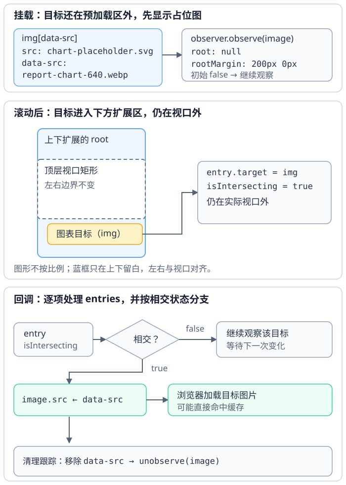

这里的 `isIntersecting` 表示目标与相交 root 矩形相交；边缘刚好接触也可能为 true，交集面积可以为零。因此它不表示“至少一像素可见”，也不能证明图片未被其他元素遮挡。IntersectionObserver 会异步交付状态通知，但回调中的 JavaScript 仍在文档事件循环中运行；重工作仍可能占用页面线程。若图片失败，应用代码应另处理 `load` / `error` 结果和有界重试。

加载成功后，`width` 和 `height` 继续帮助保持几何稳定；组件卸载时由组件所有者调用 `disconnect()` 停止观察所有目标。只有需要兼容未提供 IntersectionObserver 的浏览器时，才考虑 scroll/resize 几何检查作为回退：挂载时先检查一次，后续检查要合并或节流；卸载时移除监听器并取消尚未执行的定时检查，避免回调继续保留 DOM 节点。矩形判断复用[DOM 几何 API](#25.%20%E5%93%AA%E4%BA%9B%E7%BD%91%E9%A1%B5%E5%87%A0%E4%BD%95%E6%8E%A5%E5%8F%A3%E8%83%BD%E6%B5%8B%E9%87%8F%E5%93%AA%E4%B8%80%E7%A7%8D%E7%9B%92%E5%AD%90%EF%BC%9F)中的测量边界；真实效果应在[浏览器性能测量](#13.%20%E5%A6%82%E4%BD%95%E6%B5%8B%E9%87%8F%E5%B9%B6%E8%AF%8A%E6%96%AD%E7%BD%91%E9%A1%B5%E6%80%A7%E8%83%BD%E9%97%AE%E9%A2%98%EF%BC%9F)与[浏览器如何把 URL 绘制成像素](#1.%20%E6%B5%8F%E8%A7%88%E5%99%A8%E5%A6%82%E4%BD%95%E6%8A%8A%20URL%20%E5%8F%98%E6%88%90%E7%AC%AC%E4%B8%80%E5%B8%A7%EF%BC%9F)所述的路由和设备数据中验证。

### 音频和视频还要保留什么语义？

`<audio>` 与 `<video>` 用于可播放媒体；提供 `controls`，让用户能启动、暂停和调整播放。媒体格式和编解码器支持因浏览器与平台而异，可按目标环境提供多个 `<source>`。在支持媒体懒加载的浏览器中，首屏外的播放器可设置 `loading="lazy"`；它会延后媒体数据请求，视频的 `poster` 图片也会一起延后，并优先于 `preload` 生效。仅写 `preload="none"` 并不保证视频 poster 不请求。Chrome 148 起支持媒体 `loading`；其他目标浏览器和版本需按实际支持情况核验。首屏主媒体不应延迟加载。`preload` 表达媒体数据的加载偏好，`autoplay` 是播放请求，也可能受自动播放策略限制。

~~~html
<audio controls loading="lazy" preload="metadata">
  <source src="/media/summary.ogg" type="audio/ogg">
  <source src="/media/summary.mp3" type="audio/mpeg">
</audio>

<video controls loading="lazy" preload="metadata"
       width="640" height="360" poster="/media/preview.jpg">
  <source src="/media/demo.webm" type="video/webm">
  <source src="/media/demo.mp4" type="video/mp4">
  <track kind="captions" src="/media/demo.zh.vtt" srclang="zh" label="中文字幕">
</video>
~~~

给视频标出宽高或比例，降低播放器加入布局时的跳动；字幕通过 `<track>` 提供。音频与视频用 `controls` 表达播放交互，不要把视觉样式当成媒体控件语义。

> [!info]- 来源
> - 文档基准 URL、相对 URL 解析与链接：WHATWG HTML Living Standard，[Document base URLs](https://html.spec.whatwg.org/multipage/urls-and-fetching.html#document-base-urls) 与 [Links / `noopener`](https://html.spec.whatwg.org/multipage/links.html#link-type-noopener)，版本最后更新于 2026-11-11；URL Standard 的 [Basic URL parser](https://url.spec.whatwg.org/#concept-basic-url-parser)，该标准最后更新于 2026-10-19，核验于 2026-11-12。
> - `picture`、`source`、`img`、宽高、`srcset`、`sizes` 与媒体元素：[WHATWG HTML Living Standard，Embedded content](https://html.spec.whatwg.org/multipage/embedded-content.html)（最后更新于 2026-11-12）、[Images / source size](https://html.spec.whatwg.org/multipage/images.html#parsing-a-sizes-attribute)（最后更新于 2026-11-12）和 [Media elements](https://html.spec.whatwg.org/multipage/media.html)（最后更新于 2026-11-12），核验于 2026-11-12。
> - 图片和媒体 `loading` 延迟条件、`preload` 优先级与 poster 延迟：[WHATWG HTML Living Standard，Lazy loading attributes](https://html.spec.whatwg.org/multipage/urls-and-fetching.html#lazy-loading-attributes) 与 [Media elements](https://html.spec.whatwg.org/multipage/media.html#attr-media-loading)，分别最后更新于 2026-11-11 和 2026-11-12；`fetchpriority`：[Fetch priority attributes](https://html.spec.whatwg.org/multipage/urls-and-fetching.html#fetch-priority-attributes)，最后更新于 2026-11-11，核验于 2026-11-12。
> - 图片信息、装饰图片和功能图片的 `alt`：W3C WAI [Images Tutorial](https://www.w3.org/WAI/tutorials/images/)；表单控件标签优先级：[Labeling Controls](https://www.w3.org/WAI/tutorials/forms/labels/)，核验于 2026-11-12。
> - LCP 图片不宜延迟加载；高优先级提示应只用于确实重要的少数资源：[web.dev “Optimize Largest Contentful Paint”](https://web.dev/articles/optimize-lcp)，最后更新于 2025-03-31，访问于 2026-11-12。Chrome 对媒体懒加载的版本说明与使用条件：[New in Chrome 148](https://developer.chrome.com/blog/new-in-chrome-148#lazy_loading_for_video_and_audio_elements)（发布于 2026-05-05）与[媒体懒加载指南](https://developer.chrome.com/docs/modern-web-guidance/guides/performance/lazy-load-video-and-audio)，访问于 2026-11-12。
> - `root`、`rootMargin`、异步通知、阈值与边缘相接的 `isIntersecting`：W3C [Intersection Observer](https://www.w3.org/TR/intersection-observer/)，Working Draft，2023-10-18 §2.2–2.4、§3.2.2–5、§3.2.7–8；W3C 页面列为当前最新发布稿，核验于 2026-11-12。
> - `aspect-ratio` 与 `object-fit`：[CSS Box Sizing Module Level 4](https://www.w3.org/TR/css-sizing-4/#aspect-ratio)，Working Draft，2026-09-04；[CSS Images Module Level 3](https://www.w3.org/TR/css-images-3/#the-object-fit)，Candidate Recommendation Draft，2023-12-18。视口矩形 API：[CSSOM View Module](https://www.w3.org/TR/cssom-view-1/)，Working Draft，2025-09-16。
## 27. 怎样为报表图标选择资源形式？

**案例背景。** 同一公开合成案例中，用户打开 `/reports/42` 并改变筛选；工具栏有“添加筛选条件”和“编辑报表”按钮，多个报表页还复用一组小型状态图标。添加筛选图标会随主题、焦点和禁用状态换色；编辑图标外形固定；不同页面会取用不同数量的状态图标。选择资源时，要同时看控件名称、图形是否要跟页面样式变化、页面会取用多少图、文件怎样缓存，以及一次更新会让哪些页面重新下载。

图形用 Scalable Vector Graphics（可缩放矢量图形，SVG）绘制时，页面会用 Cascading Style Sheets（层叠样式表，CSS）控制颜色与尺寸。常见载体是 inline SVG（行内 SVG）、独立 SVG 图片、CSS Sprite（CSS 雪碧图）和 icon font（图标字体）。没有一种形式能单凭“文件更少”或“矢量更清晰”胜出；先沿着这个报表站的一次选择看颜色与名称，再比较缓存单位和下载范围。

### SVG 怎样兼顾颜色、复用与替代文本？

“添加筛选条件”的颜色要跟随按钮状态，行内 SVG 可以直接受宿主页面的 CSS 控制。让形状使用 `currentColor`（当前文字颜色），它就沿用按钮的 `color`。按钮已有可见文字时，图标只是装饰，应从辅助技术呈现中隐藏：

~~~html
<button type="button" class="report-action">
  <svg class="report-action__icon" viewBox="0 0 16 16" aria-hidden="true">
    <path d="M7 2h2v5h5v2H9v5H7V9H2V7h5z" fill="currentColor" />
  </svg>
  <span>添加筛选条件</span>
</button>
~~~

~~~css
.report-action { color: #24547d; }
.report-action__icon { width: 1em; height: 1em; }
~~~

行内 SVG 的标记和所在 HyperText Markup Language（超文本标记语言，HTML）一起传输；它没有可供其他页面单独请求的资源 Uniform Resource Locator（统一资源定位符，URL）。若“编辑报表”图案固定而多个页面重复使用，可把它保存成独立 SVG，通过 `` 使用同一 URL。宿主页面的 CSS 不能直接选择外部 SVG 文档里的路径，内部 `currentColor` 也不会继承按钮颜色。按钮已有可见文字时图片用 `alt=""`；图片本身承担信息时，才由 `alt` 提供替代文本：

~~~html
<button type="button">
  
  <span>编辑报表</span>
</button>
~~~

控件的名称应来自控件内的可见文字、图片替代文本，或显式关联的可访问名称；孤立的相邻文字不会自动成为控件名称。若无文字图标按钮承担操作名称，可把 `aria-label="编辑报表"` 放在按钮上，不要让图案本身成为唯一的说明。

### CSS Sprite 怎样裁出图集中的一格？

当多个小图总在同一组页面一起出现，可以把它们排进一张 sprite sheet（精灵图集），让固定尺寸的盒子只露出目标区域。假设图集是 `64 × 32px`，每格 `16 × 16px`，有 4 列、2 行：

图中的 `x`、`y` 是每格左上角坐标，以图集左上角为原点；数值单位均为 CSS px。右侧小盒子大小固定，移动的是它背后的整张背景图。

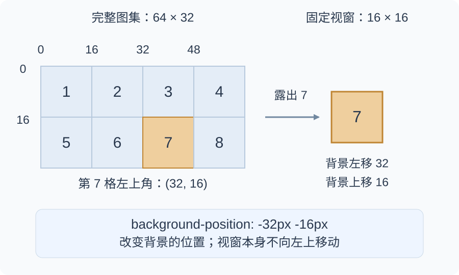

> [!example] 第二行第三列的坐标
> 第七格位于 `x=32`、`y=16`，也就是第三列、第二行。把背景向左、向上移动这么多距离后，该格落进 `16 × 16px` 的视窗，所以定位写成 `-32px -16px`。

~~~css
.report-status__pending-icon {
  display: inline-block;
  width: 16px;
  height: 16px;
  background-image: url("/assets/report-icons.4f2a.svg");
  background-repeat: no-repeat;
  background-position: -32px -16px;
}
~~~

~~~html
<span class="report-status__pending-icon" aria-hidden="true"></span>
<span>等待处理</span>
~~~

这是“等待处理”状态旁的装饰图标。背景图本身不提供有意义的替代文本；状态文字承担说明。图标很多时，可以在构建阶段从源图和布局配置同时生成图集与坐标，避免手写偏移。若图片本身承载信息，应改用 `` 提供替代文本，并按[图片与媒体资源加载规则](#26.%20%E5%9B%BE%E7%89%87%E4%B8%8E%E5%AA%92%E4%BD%93%E8%B5%84%E6%BA%90%E6%80%8E%E6%A0%B7%E5%8A%A0%E8%BD%BD%E5%B9%B6%E4%BF%9D%E6%8C%81%E9%A1%B5%E9%9D%A2%E7%A8%B3%E5%AE%9A%EF%BC%9F)处理宽高、候选资源和加载时机。图集坐标一旦移动，每个引用这些坐标的页面都可能要改；更新一个格子也会更新整张图集资源。

### Sprite 是否一定比独立图片快？

先看浏览器缓存的对象：Hypertext Transfer Protocol（超文本传输协议，HTTP）缓存按请求目标 URL 等条件寻找可复用响应，同一 URL 只有在响应仍新鲜、验证成功或其他缓存条件允许时才能复用。若报表图标是公开且不含用户数据的静态资源，构建时可把内容摘要放进 URL，例如 `/assets/report-icons.4f2a.svg`。服务器首次成功响应这个新 URL 时，可以返回：

~~~http
HTTP/1.1 200 OK
Content-Type: image/svg+xml
Cache-Control: public, max-age=31536000, immutable
~~~

`Cache-Control` 是服务器随响应发送的字段。`max-age` 指定这份响应可新鲜复用的时间；`immutable` 扩展声明在新鲜期间不需要再次验证。图片内容改变时生成新的摘要 URL，再让页面或样式表引用新地址。若发布时删掉仍被旧页面引用的文件，旧页面仍会请求那个旧 URL，所以部署应保留旧哈希资源一段足够的时间。

验证器和新鲜时间解决不同问题。响应带 `ETag`（实体标签）时，缓存可以在响应变旧后发 `If-None-Match` 询问是否仍是同一份内容；服务器回 `304 Not Modified` 时复用已保存的正文，内容改变时回 `200 OK` 和新正文。`ETag` 本身不会让仍新鲜的旧响应提前发起验证。可变的同 URL 图标可以用较短的 `max-age` 限制旧内容最多直接复用多久，到期后配合 `ETag` 验证；也可以让服务器返回 `Cache-Control: public, no-cache` 和单独的 `ETag` 响应字段，让缓存保留正文、但每次复用前都联系服务器验证。`no-store` 则要求缓存不存储响应。

对照报表站的一次更新：把详情页 `/reports/42` 记作 A，它使用整组 8 格；把报表列表页记作 B，它只使用第 1 格；这次只改第 7 格。若图集按内容摘要生成新 URL，两个更新后的页面都指向新版整张图集。在同一浏览器缓存上下文里，A 或 B 先打开都会请求新版完整图集，后打开的页面可复用该 URL 的新鲜响应。若每格是独立的哈希图片，B 仍引用未变化的第 1 格 URL，可以复用缓存；A 只需取得改名后的第 7 格，其余七个仍可用原 URL。是否命中还取决于缓存分区、响应新鲜度和缓存是否仍保留该对象。

因此，图集减少的是多个图标共享时的资源数；它不会把一张雪碧图拆成可单独缓存的格子。若某个页面没有可复用的图集响应，即便它只露出一格，也需要请求整份图集。独立图片则可以只请求当前页面所需的 URL，并让未变化的图标继续命中缓存。

下面的本地浏览器对照只回答“请求哪些文件、缓存能否复用”，不把它当成所有站点的速度结论：

| 报表页加载的图标资源 | 冷缓存请求数 | 正文编码字节 | `transferSize` 合计 | 同一上下文热重载 |
|---|---:|---:|---:|---|
| 8 个独立 `16 × 16` SVG | 8 | 1,780 | 4,180 | 0 新请求；0 字节传输值 |
| 含 8 个图形的单张 SVG 图集 | 1 | 1,383 | 1,683 | 0 新请求；0 字节传输值 |
| 只取 1 个独立 SVG | 1 | 210 | 510 | 0 新请求；0 字节传输值 |
| 只用图集中的 1 格 | 1 | 1,383 | 1,683 | 0 新请求；0 字节传输值 |

实测使用 Chromium `157.0.8103.51`、本机 Node HTTP/1.1 服务、8 个极小合成 SVG 和 `Cache-Control: public, max-age=86400, immutable`；分别新建干净浏览器上下文测冷缓存，再在原上下文热重载。字节来自 PerformanceResourceTiming（资源计时 API）：`encodedBodySize` 计响应正文；网络响应的 `transferSize` 是编码正文大小加规范定义的 `300` 字节响应头估值，本地缓存命中且无需网络验证时为 `0`。若缓存响应经过网络验证后复用，`transferSize` 按规范记为 `300` 字节估值。此值不是实际 HTTP 头、TLS 或链路字节的精确账单。本表只计图标资源，不含 HTML、CSS 或其他页面资源；它也没有测连接、内容压缩、Content Delivery Network（内容分发网络，CDN）、真实图形复杂度或页面延迟。它只展示同一配置下的资源粒度：页面取用全组时图集少 7 个请求；只取一格时，单张独立 SVG 少传约 `1,173` 个 `transferSize` 字节。热重载结果说明本次测试配置可复用缓存，并不保证资源一直留在缓存里。

现代协议也改变了“少一个请求”的意义。HTTP/2 允许多个资源流在同一 Transmission Control Protocol（传输控制协议，TCP）连接上交错传输，但 TCP 丢失字节时仍可能暂时挡住同一连接的后续数据；HTTP/3 用 QUIC 流承载请求，单个流受阻时其他流可以继续推进，但流仍共享连接的拥塞与连接级流量控制。资源请求数不再等于新建连接数，因此不能仅为减少文件请求就断言雪碧图更快。独立图标仍会带来各自的请求处理和响应头；图集则把未用图案的字节、变更频率与缓存失效绑在一起。实际选择时，若这组图标在多数报表页一起出现且共用更新节奏，可测图集；若路由只取少量图标或图标经常独立更新，独立资源可以只请求当前需要的 URL；若少量图案要随按钮状态换色，行内 SVG 更直接。

### 图标字体怎样保留可访问名称？

若报表站已经维护一套图标字体，字形也能用 CSS 控制颜色和尺寸。每个私用区码点只对配套字体有意义；字体载入失败时，字形可能缺失或显示替代符号。把字形当装饰，让按钮或链接文字承担功能名称：

~~~css
@font-face {
  font-family: "report-icons";
  src: url("/assets/report-icons.woff2") format("woff2");
}

.icon {
  font-family: "report-icons";
  font-size: 1.25rem;
  line-height: 1;
}
~~~

~~~html
<button type="button">
  <span class="icon" aria-hidden="true">&#xe900;</span>
  <span>编辑报表</span>
</button>
~~~

`aria-hidden="true"` 把纯装饰字形从辅助技术呈现中隐藏，按钮的可见文字仍提供名称。新系统若只为几个小图标引入一整套字体，会多一个字体资源和字形映射维护成本；字体文件还可能带入当前页面用不到的字形。为已有字体继续支付这项成本，取决于它是否已被页面使用、是否跨页面共享，以及是否能按实际使用子集构建。选择字体并不会自动解决无文字按钮的名称问题。

### 怎样只显示当前横幅？

雪碧图从同一张资源里裁出装饰性小图；横幅则按状态显示完整图片。图片角色不同，替代文本和请求时机也不同。下面先保留旧电商页面的归档截图；原图可见中秋活动文案、商品分类和左右切换箭头。接着的报表代码是另一个独立合成示例，只用 `.current` 显示一项，不是截图中的页面源码：


下面的列表只有静态的选中项，没有把归档截图里的箭头纳入行为：

~~~html
<ul class="report-banner">
  <li class="current">
    <a href="/reports/monthly">
      
    </a>
  </li>
  <li>
    <a href="/reports/quarterly">
      
    </a>
  </li>
</ul>
~~~

~~~css
.report-banner {
  position: relative;
  overflow: hidden;
  aspect-ratio: 16 / 5;
  margin: 0;
  padding: 0;
  list-style: none;
}
.report-banner li { position: absolute; inset: 0; display: none; }
.report-banner li.current { display: block; }
.report-banner img { display: block; width: 100%; height: 100%; object-fit: cover; }
~~~

这段代码只决定哪项显示；它没有自动轮换、前后按钮、键盘模式或暂停控制，因此不构成完整轮播。真正的自动轮播需提供操作控制并照顾焦点、悬停和减少动态效果；连续移动图片的装饰演算见[何时使用过渡，何时使用关键帧动画？](#24.%20%E4%BD%95%E6%97%B6%E4%BD%BF%E7%94%A8%E8%BF%87%E6%B8%A1%EF%BC%8C%E4%BD%95%E6%97%B6%E4%BD%BF%E7%94%A8%E5%85%B3%E9%94%AE%E5%B8%A7%E5%8A%A8%E7%94%BB%EF%BC%9F)。信息图片的宽高、候选文件与加载时机见[图片与媒体资源怎样加载并保持页面稳定？](#26.%20%E5%9B%BE%E7%89%87%E4%B8%8E%E5%AA%92%E4%BD%93%E8%B5%84%E6%BA%90%E6%80%8E%E6%A0%B7%E5%8A%A0%E8%BD%BD%E5%B9%B6%E4%BF%9D%E6%8C%81%E9%A1%B5%E9%9D%A2%E7%A8%B3%E5%AE%9A%EF%BC%9F)。

这里的 CSS 只控制显示，不会推迟普通 `` 的请求。按 HTML 标准，图片默认立即获取；两个 URL 在 HTML 创建时就已提供，即使季度项是 `display: none`，浏览器仍可获取它。若需要由应用决定请求时机，初始状态不要设置真实 `src`，在选中该项时再设置。本页的 Chromium `157.0.8103.51` 小复现记录了隐藏的季度图片被请求并解码。

> [!info]- 来源
> - `` 的替代文本与图片呈现边界：[WHATWG HTML Living Standard，Images](https://html.spec.whatwg.org/multipage/images.html#the-img-element)；外部 SVG 作为图像是独立文档、不会继承宿主属性：[W3C SVG 2，Embedded content](https://www.w3.org/TR/SVG/embedded.html)；核对于 2026-11-12。
> - `currentColor` 的计算与使用：[W3C CSS Color Module Level 4，2026-10-07 CRD，§4.4](https://www.w3.org/TR/2026/CRD-css-color-4-20261007/#valdef-color-currentcolor)；SVG 图形的 `color` 如何为 `fill` 提供 `currentColor`，以及行内 SVG 接受 HTML 文档继承值：[W3C SVG 2，§§13.2–13.3](https://www.w3.org/TR/SVG/single-page.html#ColorProperty)；核对于 2026-11-12。
> - `background-position` 的定位语法：[W3C CSS Backgrounds and Borders Module Level 3](https://www.w3.org/TR/css-backgrounds-3/#the-background-position)；核对于 2026-11-12。图例使用 4 列 × 2 行、每格 16px 的合成数据，偏移按该几何直接计算。
> - 背景图不提供替代文本、隐藏装饰并给控件名称：[W3C WAI-ARIA 1.2，`aria-hidden`](https://www.w3.org/TR/wai-aria-1.2/#aria-hidden)；[WAI Images Tutorial](https://www.w3.org/WAI/tutorials/images/)；轮播操作模式：[WAI-ARIA APG Carousel Pattern](https://www.w3.org/WAI/ARIA/apg/patterns/carousel/)；核对于 2026-11-12。
> - 缓存键、新鲜度和 `max-age`：[IETF RFC 9111，HTTP Caching §§2、4.2](https://www.rfc-editor.org/rfc/rfc9111.html#section-4.2)，2022-06；`ETag` 验证、`no-cache` 与 `no-store`：[RFC 9111 §§4.3、5.2.2](https://www.rfc-editor.org/rfc/rfc9111.html#section-4.3)；不可变响应扩展：[IETF RFC 8246，§§2–3](https://www.rfc-editor.org/rfc/rfc8246.html#section-2)，2017-09；核对于 2026-11-12。哈希 URL 更新策略：[MDN HTTP Caching Guide，Cache Busting](https://developer.mozilla.org/en-US/docs/Web/HTTP/Guides/Caching#cache_busting)，访问于 2026-11-12。
> - HTTP/2 多路复用但仍受 TCP 队头阻塞影响：[IETF RFC 9113，§§1.2、5](https://www.rfc-editor.org/rfc/rfc9113.html#section-1.2)，2022-06；HTTP/3 的 QUIC 流、流间独立交付与连接级拥塞控制：[IETF RFC 9114，§§1.2、2](https://www.rfc-editor.org/rfc/rfc9114.html#section-1.2)，2022-06；QUIC 流级与连接级流量控制：[IETF RFC 9000，§4](https://www.rfc-editor.org/rfc/rfc9000.html#section-4)，2021-05；核对于 2026-11-12。
> - `PerformanceResourceTiming.transferSize`、`encodedBodySize` 的定义，网络响应的 300 字节估值与无网络缓存命中为 0：[W3C Resource Timing，2026-11-02 Candidate Recommendation Draft，§3.3](https://www.w3.org/TR/2026/CRD-resource-timing-20261102/#dom-performanceresourcetiming-transfersize)；实测条件和数值见上文本地浏览器对照。
## 28. JavaScript 值如何转换、比较，并成为属性键？

**案例背景：**2026 年 10 月的报表导入中，`first` 与 `retry` 的 `reportId` 相同但金额不同，`rows` 还保留了一个缺失位置。导入代码需要保住合法的零金额、识别缺行，并决定按业务键还是对象身份查记录。本章用这组输入说明值转换、相等比较、对象图比较和属性键转换；后续章节沿用同一组输入：

~~~javascript
const owner = { id: "u-17", name: "Ada" };
const first = { reportId: "r-104", amount: 0, owner };
const retry = {
  reportId: "r-104",
  amount: 120,
  owner: { id: "u-17", name: "Ada" },
};
const rows = [first, , retry]; // 第二个位置是空位；第三项是重试记录
~~~

业务字段 `reportId` 相同，表示两条输入记录描述同一业务实体；`first` 与 `retry` 仍是两个对象。它们的 `owner` 字段也指向内容相同、身份不同的对象。

### 值的类型决定哪些转换有意义

JavaScript 有七种 primitive types（原始值类型）：`undefined`（未定义值）、`null`（空值）、`Boolean`（布尔值）、`Number`（数值）、`BigInt`（大整数）、`String`（字符串）和 `Symbol`（符号）。`Symbol()` 每次调用都会产生新值；`Symbol.for(key)` 则会从全局注册表取回同一注册符号。其他值都是 `object`（对象），函数也属于对象。对象赋值复制的是对象引用值，两个变量可以指向同一个对象；这是一条语言行为规则，不意味着对象一定物理存放在某个特定内存区域。

| 类型 | 本章会用到的行为 |
|---|---|
| `undefined` | 缺少属性或越界读取的常见结果；也可显式存入属性 |
| `null` | 显式表示“当前没有对象”；历史兼容使 `typeof null` 返回 `"object"` |
| `Boolean` | 只有 `false` 为假值 |
| `Number` | `binary64`（二进制 64 位浮点）数值；包含 `NaN`、正负无穷和带符号的零 |
| `BigInt` | 任意精度整数；不能直接与 `Number` 混做算术 |
| `String` | 不可变的 UTF-16 `code unit` 序列 |
| `Symbol` | 唯一的原始值，可作为属性键 |

值的运行时存储位置和布局由引擎决定；reference type（引用类型）可用来简称对象按身份传递的语义，但不能据此推断栈、堆或指针布局。

### 真值转换不是数值转换

`0` 是假值，但空数组和空对象是真值；非空字符串 `"false"` 也是真值。`Number` 转换遵循另一套规则，因此输入含义重要时应显式转换。

`Boolean(value)` 与 `!!value` 都执行真值转换；在历史浏览器对象 `document.all` 上，二者也都返回 `false`，因为标准为它保留了特殊例外。

~~~javascript
Boolean("false");  // true
Boolean([]);       // true
Boolean({});       // true

Number("");        // 0
Number(null);      // 0
Number(undefined); // NaN

Number.isNaN(NaN);  // true
Number.isNaN("x");  // false：不做隐式转换
~~~

浏览器里的历史对象 `document.all` 带有标准附录定义的特殊行为，此外 `typeof document.all` 为 `"undefined"`，且 `document.all == null` 为 `true`。普通对象的真值规则不受影响，业务代码不应依赖这个例外。

逻辑运算也不会自动把结果变成 `Boolean`。逻辑与 `&&` 返回某个操作数，因此 React 条件渲染中，`0 && <ItemList />` 的结果是 `0`，可能直接显示数字零；条件需要表达“条数大于零”时就写出比较条件。

~~~jsx
0 && <ItemList />; // 结果为 0

function ReportPanel({ validCount, rows }) {
  return validCount > 0 ? <ItemList items={rows} /> : null;
}
~~~

### 比较运算回答的是不同问题

strict equality（严格相等，`===`）不做跨类型强制转换；loose equality（宽松相等，`==`）遵循多条转换规则，包括 `null == undefined` 这一特殊情况。除非特意使用转换规则，通常优先用 `===`。对一般输入，`value == null` 是一种有意同时判断 `null` 与 `undefined` 的写法。

对象比较关注的是 identity（身份）：两个对象字段相同，也不会因此变成同一对象。

~~~javascript
first.reportId === retry.reportId; // true：业务字段相等
first === retry;                    // false：对象身份不同
first.owner === retry.owner;        // false：嵌套对象身份不同

5 == "5";              // true：字符串转换为数值后比较
5 === "5";             // false
null == undefined;     // true
~~~

几个常见比较规则的差别集中在 NaN、有符号零和对象上：

| 操作 | NaN 与自身 | +0 与 -0 | 对象 |
|---|---|---|---|
| === | 不相等 | 相等 | 按身份 |
| `Object.is`（SameValue，同值） | 相等 | 不同 | 按身份 |
| `Map`（映射） / `Set`（集合，SameValueZero，同值零） | 相等 | 相等 | 按身份 |

~~~javascript
NaN === NaN;                    // false
Object.is(NaN, NaN);            // true
Object.is(+0, -0);              // false
new Set([NaN, NaN, -0, +0]).size; // 2
~~~

`Map` 和 `Set` 使用 SameValueZero（同值零），所以它们既能识别重复 `NaN`，也会把 `+0` 和 `-0` 视为同一个键或成员。集合章节把这个规则用于报表索引和去重，见[何时使用 Map、Set 或普通对象？](#29.%20%E4%BD%95%E6%97%B6%E4%BD%BF%E7%94%A8%20Map%E3%80%81Set%20%E6%88%96%E6%99%AE%E9%80%9A%E5%AF%B9%E8%B1%A1%EF%BC%9F)。

`Number` 采用 IEEE 754 `binary64`（二进制 64 位浮点）；`0.1` 和 `0.2` 这样的十进制小数通常没有精确的有限二进制表示。比较结果是否可接受需要由金额精度、容差和舍入规则共同决定，不能把某个固定 `epsilon`（误差容限）当作所有领域的通用答案。

~~~javascript
0.1 + 0.2 === 0.3; // false
Math.abs((0.1 + 0.2) - 0.3) < 1e-12; // 对这个量级的例子成立
~~~

金额可在币种规则允许时用最小单位整数表示，或使用明确舍入规则的十进制运算。

### 结构比较要把输入范围写成契约

`===` 对对象只比较身份；业务判断有时还需要问两份输入是否有相同的数据结构。这不是 JavaScript 内建的统一规则，比较结果取决于应用选择的输入契约。这里比较筛选条件和接口纯数据：普通对象键的插入顺序不重要，数组顺序重要，键缺失与显式 `undefined` 不同。

本例只讨论有限、无环的数据对象图；不同属性可以共享同一个子对象。容器限于当前 realm（执行环境）的普通数组、普通对象或 null 原型对象；叶子是 `null`、`undefined`、布尔值、字符串或数字；容器的数据属性为自有、可枚举的字符串键。数组的 `length` 是不可枚举的自有属性，因此代码会单独比较它，再比较可枚举键。Symbol 或其他不可枚举属性、访问器、代理、函数、BigInt、Symbol 值及 Date、Map 等带内部状态的对象都在契约之外；代码不负责检测循环，调用方必须保证输入无环。普通对象可继承标准 `Object.prototype` 成员，但继承属性不参与比较。调用方应先保证输入符合契约；这段递归代码不是验证不可信对象的通用入口。

~~~javascript
function isPlainObject(value) {
  const prototype = Object.getPrototypeOf(value);
  return prototype === Object.prototype || prototype === null;
}

function deepEqual(left, right) {
  const leftIsObject = left !== null && typeof left === "object";
  const rightIsObject = right !== null && typeof right === "object";
  if (!leftIsObject || !rightIsObject) {
    return !leftIsObject && !rightIsObject && Object.is(left, right);
  }

  const leftIsArray = Array.isArray(left);
  const rightIsArray = Array.isArray(right);
  if (leftIsArray !== rightIsArray) return false;

  if (leftIsArray) {
    if (Object.getPrototypeOf(left) !== Array.prototype ||
        Object.getPrototypeOf(right) !== Array.prototype) {
      throw new TypeError("只支持当前 realm 的普通数组");
    }
    if (left.length !== right.length) return false;
  } else {
    if (!isPlainObject(left) || !isPlainObject(right)) {
      throw new TypeError("只支持普通对象或 null 原型对象");
    }
    if (Object.getPrototypeOf(left) !== Object.getPrototypeOf(right)) {
      return false;
    }
  }

  if (Object.is(left, right)) return true;

  const leftKeys = Object.keys(left);
  const rightKeys = Object.keys(right);
  if (leftKeys.length !== rightKeys.length) return false;

  for (const key of leftKeys) {
    if (!Object.hasOwn(right, key)) return false;

    const leftDescriptor = Object.getOwnPropertyDescriptor(left, key);
    const rightDescriptor = Object.getOwnPropertyDescriptor(right, key);
    if (!Object.hasOwn(leftDescriptor, "value") ||
        !Object.hasOwn(rightDescriptor, "value")) {
      throw new TypeError("只支持数据属性");
    }
    if (!deepEqual(leftDescriptor.value, rightDescriptor.value)) {
      return false;
    }
  }
  return true;
}
~~~

递归步骤可以按四件事复算：先区分叶子与容器，叶子用 `Object.is`；再确认两边同为数组或对象；对象原型类别不同就不相等，数组先比不可枚举的 `length`；最后比较可枚举自有键集合，并对每个键的值递归。对象键次序因此不影响结果；数组索引是否存在仍影响结果，因为空位不在 `Object.keys` 里。使用属性描述符读取数据值，不会调用输入 getter；当比较走到一个可枚举访问器属性时会抛 `TypeError`。若两边是同一对象引用，容器类别检查后就会由 `Object.is` 短路，因此本函数不能用作输入验证器。

| 输入 | 差异 | 结果 |
| --- | --- | --- |
| `{ a: 1, b: 2 }` 与 `{ b: 2, a: 1 }` | 只有键插入顺序不同 | `true` |
| `{ amount: undefined }` 与 `{}` | 自有键缺失 | `false` |
| `[]` 与 `[,]` | 数组 `length` 分别为 0 与 1 | `false` |
| `[,]` 与 `[undefined]` | 前者索引 0 是空位，后者有自有元素 | `false` |
| `[1, 2]` 与 `[2, 1]` | 数组值的索引顺序不同 | `false` |
| `{ value: NaN }` 与 `{ value: NaN }` | `Object.is(NaN, NaN)` | `true` |
| `{ value: -0 }` 与 `{ value: +0 }` | `Object.is(-0, +0)` | `false` |
| `{}` 与 `Object.create(null)` | 自有键相同，原型类别不同 | `false` |
| 左侧两个属性共享同一子对象，右侧各自保存等值副本 | 比较值，不维护两边的共享身份关系 | `true` |
| 两个不同的 `new Date(0)` | Date 有本契约之外的内部状态 | 抛 `TypeError` |

同一批报表行能把身份比较和结构比较区分开：两个 `owner` 的引用不同，但按本契约内容相等；两条记录的金额不同，因此结构不相等。

例如，两个记录可以分别共享一个等值子对象，比较器会按值递归，不要求两侧的共享关系一致。普通对象和 null 原型对象都可装载键值，但本契约把它们的原型类别也纳入结果：

~~~javascript
deepEqual({}, Object.create(null)); // false
deepEqual({ value: NaN }, { value: NaN }); // true
deepEqual({ value: -0 }, { value: +0 });   // false
deepEqual(first.owner, retry.owner); // true：引用不同，数据相同
deepEqual(first, retry); // false：amount 不同
~~~

单看可见原型不能证明一个对象确实是纯数据：把 Date 的原型手动改成 `Object.prototype` 会越过这项检查。因此，输入边界必须保证对象来自可信的纯数据构造流程；对任意对象、Proxy 或带隐藏内部状态的值，先用适合其来源的解析和校验。递归深度仍受 JavaScript 调用栈限制；无环是本例前提，代码不负责检测环。

用 `JSON.stringify` 直接比较字符串也不是结构相等：属性插入顺序可能改变输出，显式 `undefined` 属性会被省略，数值 `-0` 会序列化成 `0`。

~~~javascript
JSON.stringify({ a: 1, b: 2 }) === JSON.stringify({ b: 2, a: 1 }); // false
JSON.stringify({ amount: undefined }) === JSON.stringify({});    // true
JSON.stringify({ amount: -0 }) === JSON.stringify({ amount: 0 }); // true
~~~

若这些差异会影响业务判断，应比较经过约束的数据结构；对象隔离或保留共享身份关系则是复制问题，见[如何安全地深拷贝 JavaScript 值？](#31.%20%E5%A6%82%E4%BD%95%E5%AE%89%E5%85%A8%E5%9C%B0%E6%B7%B1%E6%8B%B7%E8%B4%9D%20JavaScript%20%E5%80%BC%EF%BC%9F)。


### 变量保存对象身份，不会自动复制对象

把对象赋给新变量后，两个绑定仍指向同一个对象。属性赋值会先求出并记录左侧的基对象，再求右侧；右侧即使重新绑定变量，也不会改变已记录的基对象。

~~~javascript
let a = { n: 1 };
const b = a;
a.x = a = { n: 2 };

a.x; // undefined
b.x; // { n: 2 }：写入落在先前记录的旧对象上
~~~

求值顺序可拆成三步：赋值左侧先记下旧对象 `A` 的 `x` 属性位置，右侧再把 `a` 改指向新对象 `B`，最后把 `B` 写进已记下的 `A.x`。

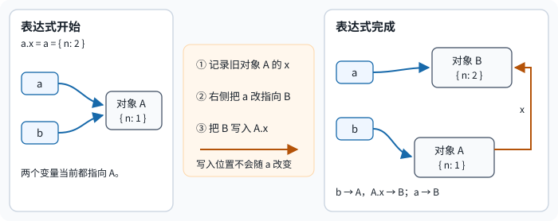

*图：左侧求值时固定写入位置；整个表达式求值完成后，`a` 与 `b` 分别指向新旧对象。*

函数实参按值传递：形参拿到实参值的副本。实参若是原始值，修改形参不改调用方的绑定；若是对象，副本仍指向同一对象，所以属性变更可见，但重新给形参赋另一个对象不会重绑调用方变量。

~~~javascript
function update(count, profile) {
  count += 1;
  profile.name = "Grace";
  profile = { name: "Replacement" };
}

let count = 1;
const profile = { name: "Ada" };
update(count, profile);
count;        // 1
profile.name; // "Grace"
~~~

这也解释了浅拷贝为何会共享嵌套对象：新数组或新记录只复制了里面的对象引用。数组变异、复制和空位规则见[数组操作怎样处理空位与复制？](#30.%20JavaScript%20%E6%95%B0%E7%BB%84%E6%93%8D%E4%BD%9C%E5%A6%82%E4%BD%95%E5%A4%84%E7%90%86%E7%A9%BA%E4%BD%8D%E3%80%81%E4%BF%AE%E6%94%B9%E4%B8%8E%E5%A4%8D%E5%88%B6%EF%BC%9F)；需要隔离整张对象图时见[如何安全地深拷贝 JavaScript 值？](#31.%20%E5%A6%82%E4%BD%95%E5%AE%89%E5%85%A8%E5%9C%B0%E6%B7%B1%E6%8B%B7%E8%B4%9D%20JavaScript%20%E5%80%BC%EF%BC%9F)。

### 类型检查能回答什么，不能证明什么

- `typeof` 适合检查原始值和函数，但 `typeof null` 的历史结果是 "object"。
- `Array.isArray` 检查数组，也能识别来自另一个 realm（执行环境）的数组。
- `instanceof` 通常检查构造函数的 `prototype` 是否出现在对象原型链上。不同 realm 的构造函数拥有不同 prototype，因此本地 Array 检查另一个窗口创建的数组可能为 false；`Symbol.hasInstance` 还可以定制检查。
- `Object.prototype.toString.call(value)` 给出内建标签，但 `Symbol.toStringTag` 可以改变显示结果，标签不是类型证明。

~~~javascript
typeof null; // "object"
Array.isArray([]); // true

const misleading = { [Symbol.toStringTag]: "Array" };
Object.prototype.toString.call(misleading); // "[object Array]"，但它不是数组
~~~

应检查程序真正需要的形状或行为，而不是只依赖通用标签。

### 普通对象属性键会先转换

普通对象的属性键只能是字符串或 `Symbol`。方括号里传入其他值时，JavaScript 会执行 `ToPropertyKey`（转成属性键）；对象可以通过 `Symbol.toPrimitive` 等钩子影响转换结果，因此不能简单概括为“总是调用 `toString`”。

转换分两步：`ToPropertyKey` 先用字符串提示（string hint）调用 `ToPrimitive`（转成原始值）；对象若提供可调用的 `Symbol.toPrimitive` 就以该提示调用它，若提供了非 `null`/`undefined` 的不可调用值则报错。没有这个方法时，普通转换依次试 `toString`、`valueOf`，取第一个原始值。得到 `Symbol` 时原样保留，其他原始值再转成字符串；`Symbol.toPrimitive` 若返回对象会抛出 `TypeError`，普通转换若两个方法都未返回原始值也会抛错。

| 键输入 | `ToPrimitive` 的结果 | 最终属性键 |
|---|---|---|
| `123` | 数值 `123` | 字符串 `"123"` |
| `accountKey` | 字符串 `"account"` | 字符串 `"account"` |
| `symbolKey` | `Symbol("account")` | 同一个 Symbol |
| `first`、`retry` | 各自都得到字符串 `"[object Object]"` | 同一个字符串键；后写值覆盖先写值 |

`first` 和 `retry` 都没有自定义转换钩子；它们继承的 `Object.prototype.toString` 先返回相同的 `"[object Object]"`，于是普通对象转换在 `toString` 这一步就结束了。

~~~javascript
const dictionary = {};
dictionary[123] = "number key";
dictionary["123"]; // "number key"

const accountKey = {
  [Symbol.toPrimitive](hint) {
    console.log(hint); // "string"
    return "account";
  },
};
dictionary[accountKey] = "Ada";
dictionary.account; // "Ada"

const symbol = Symbol("account");
const symbolKey = {
  [Symbol.toPrimitive](hint) {
    console.log(hint); // "string"
    return symbol;
  },
};
dictionary[symbolKey] = "symbol key";
dictionary[symbol]; // "symbol key"：Symbol 被保留为属性键

dictionary[first] = "first object";
dictionary[retry] = "retry object";
dictionary["[object Object]"]; // "retry object"：默认转换相同，后写覆盖先写
~~~

如果键需要保持对象身份、数字与字符串必须区分，或需要任意类型的键，使用 `Map`。若普通对象确实是字典，可用 `Object.create(null)` 去掉继承原型行为，并用 `Object.hasOwn` 检查自有属性。键值集合的选择见[何时使用 Map、Set 或普通对象？](#29.%20%E4%BD%95%E6%97%B6%E4%BD%BF%E7%94%A8%20Map%E3%80%81Set%20%E6%88%96%E6%99%AE%E9%80%9A%E5%AF%B9%E8%B1%A1%EF%BC%9F)。

### 枚举与复制属性时，先看 API 选中了什么

`Object.keys`、`Object.values` 和 `Object.entries` 选择同一类属性：自有、可枚举、字符串键；`Symbol` 键不在结果中。`keys` 只列键；`values` 和 `entries` 会读取相应的值，因此可能调用 getter。普通对象的数组索引键先按数值升序排列，其他字符串键按创建顺序排列；`Proxy` 和特殊对象可能有不同的键顺序。`for...in` 还会遍历可枚举的继承字符串键，因此对象数据和数组索引应选不同的遍历方式。

~~~javascript
const record = { name: "Ada", age: 36 };
Object.keys(record);   // ["name", "age"]
Object.values(record); // ["Ada", 36]
Object.entries(record); // [["name", "Ada"], ["age", 36]]

const keyOrder = {};
keyOrder["4294967296"] = "large integer, not an array index";
keyOrder["4294967295"] = "one past the maximum array index";
keyOrder["2"] = "array index";
Object.keys(keyOrder);
// ["2", "4294967296", "4294967295"]

for (const [key, value] of Object.entries(record)) {
  console.log(key, value);
}
~~~

`Object.assign(target, ...sources)` 把来源对象的自有可枚举字符串键和 `Symbol` 键浅复制到已有 target，修改并返回 target，后面的来源覆盖前面的属性。读取来源可能触发 getter，写入 target 可能触发 setter。对象展开也浅复制，但会在新对象上创建数据属性，不会写入传入的已有 target。

~~~javascript
const target = { a: 1, b: 2 };
Object.assign(target, { b: 3, c: 4 });
// target 是 { a: 1, b: 3, c: 4 }

const defaults = { retries: 2 };
const overrides = { retries: 4 };
const merged = { ...defaults, ...overrides };
// merged 是新对象；retries 为 4，defaults 不变
~~~

这些方法适合检查或组装属性记录，不会深拷贝嵌套对象。数组的复制、迭代输入与空位结果见[数组操作怎样处理空位与复制？](#30.%20JavaScript%20%E6%95%B0%E7%BB%84%E6%93%8D%E4%BD%9C%E5%A6%82%E4%BD%95%E5%A4%84%E7%90%86%E7%A9%BA%E4%BD%8D%E3%80%81%E4%BF%AE%E6%94%B9%E4%B8%8E%E5%A4%8D%E5%88%B6%EF%BC%9F)；复杂对象图的隔离见[如何安全地深拷贝 JavaScript 值？](#31.%20%E5%A6%82%E4%BD%95%E5%AE%89%E5%85%A8%E5%9C%B0%E6%B7%B1%E6%8B%B7%E8%B4%9D%20JavaScript%20%E5%80%BC%EF%BC%9F)。

### 缺失属性默认值与解构

读取嵌套字段时，optional chaining（可选链）运算符 `?.` 只在它检查的值为 `null` 或 `undefined` 时短路，不把 `0`、`false` 或空字符串当成缺失。根变量本身若未声明，使用 `?.` 仍会抛 `ReferenceError`；用括号结束一段链后，括号外的普通属性读取也不再受短路保护。

~~~javascript
const report = { profile: null, rows };
report.profile?.name; // undefined
// report?.profile.name; // TypeError：report 存在，但后续普通访问 .name 遇到 null
report.rows[0]?.amount; // 0：合法的零值
report.rows[1]?.amount; // undefined：读取空位

const count = 0;
count?.toFixed(0); // "0"：零既非 null 也非 undefined

const key = "value";
({ value: 1 })?.[key]; // 1
const maybeCall = undefined;
maybeCall?.(); // undefined

const user = null;
user?.profile?.name; // undefined
// (user?.profile).name; // TypeError：括号结束了短路链
// undeclaredUser?.name; // ReferenceError：根标识符不存在
~~~

若只有缺省值应触发回退，使用 nullish coalescing（空值合并）运算符 `??`；`||` 会把所有假值都替换。它们在此沿用同一个报表值，因此金额 `0` 仍保留，而空位读取产生的 `undefined` 会触发默认值。`??` 与 `||` 或 `&&` 不能不加括号混用。

~~~javascript
report.rows[0].amount ?? 100; // 0
report.rows[0].amount || 100; // 100
report.rows[1]?.amount ?? 100; // 100
~~~

destructuring（解构）把属性或可迭代值绑定到局部变量。默认初始化仅在读到 `undefined` 时运行，所以不会覆盖合法零值、`false`、空字符串或 `null`。对象剩余项收集来源对象余下的自有可枚举属性，但只复制一层；数组解构按迭代器取值，省略绑定仍会向前消费一个值。

~~~javascript
const { amount: firstAmount = 100, owner: firstOwner, ...rowFields } = first;
// firstAmount 是 0；firstOwner 仍是 first.owner；rowFields 只创建浅层新对象

const { profile = { name: "Guest" } } = report;
profile; // null：默认值只处理 undefined

const [firstRow, , ...tail] = rows;
firstRow === first; // true
tail[0] === retry; // true：rest 收集剩余项，形成新数组
Object.hasOwn(rows, 1); // false：索引 1 没有自有属性
1 in rows; // false：本例的原型链上也没有索引 1
rowFields; // { reportId: "r-104" }：只剩下 first 的其他自有可枚举字段
~~~

数组解构和数组展开同样消费迭代器；本例原型链没有索引 1，所以空位被读成 `undefined`。`Object.hasOwn` 可区分自有索引与空位，`in` 还会检查原型链：继承索引可让 `Object.hasOwn(rows, 1)` 为假而 `1 in rows` 为真。数组空位的其他读取结果见[数组空位如何改变遍历结果？](#%E7%A9%BA%E4%BD%8D%E6%80%8E%E6%A0%B7%E6%94%B9%E5%8F%98%E9%81%8D%E5%8E%86%E7%BB%93%E6%9E%9C)；同一个属性是否缺失或显式为 `undefined`，也不能只靠读取结果区分。

### 模板标签收到值，但不会自动净化它

模板字面量（template literal）会把表达式插入文本。tagged template（带标签模板）调用函数时，会把固定文本片段和各个表达式值分开传入；标签函数可以做格式化或领域处理，但插入用户输入不会因此自动安全。

~~~javascript
function capture(strings, ...values) {
  return { strings: [...strings], values };
}

const untrusted = "<b>user text</b>";
capture`label: ${untrusted}`;
// strings 是 ["label: ", ""]；values 是 ["<b>user text</b>"]
~~~

标签函数需要按实际输出上下文选择转义或净化规则，不能把“使用了 tagged template”当作安全保证。报表文本进入 DOM 时的上下文边界见[报表标题进入 DOM 时如何避免 XSS？](../../engineering-foundations/security/web-browser-security-boundaries.md)。

> [!info]- 来源
> - 值类型、原始值与对象行为：[ECMAScript 2026 §6.1–6.2](https://tc39.es/ecma262/2026/multipage/ecmascript-data-types-and-values.html)。
> - 严格相等、SameValue、SameValueZero 和宽松相等：[ECMAScript 2026 §7.2.9、§7.2.10、§7.2.13、§7.2.14](https://tc39.es/ecma262/2026/multipage/abstract-operations.html)，访问于 2026-11-12。
> - 属性键转换先执行 `ToPrimitive`（含 string hint 下的 `OrdinaryToPrimitive`），再按 Symbol 保留或转成字符串：[ECMAScript 2026 §7.1.1、§7.1.1.1、§7.1.19](https://tc39.es/ecma262/2026/multipage/abstract-operations.html)，访问于 2026-11-12。
> - 本章教学 `deepEqual` 的属性描述符与数组检查：[ECMAScript 2026 — OrdinaryGetOwnProperty](https://tc39.es/ecma262/2026/multipage/ordinary-and-exotic-objects-behaviours.html#sec-ordinarygetownproperty)、[Array Exotic Objects](https://tc39.es/ecma262/2026/multipage/ordinary-and-exotic-objects-behaviours.html#sec-array-exotic-objects)、[Object.hasOwn](https://tc39.es/ecma262/2026/multipage/fundamental-objects.html#sec-object.hasown)、[数组实例的 length](https://tc39.es/ecma262/2026/multipage/indexed-collections.html#sec-properties-of-array-instances-length)，访问于 2026-11-12。比较契约、不支持类型及“输入必须无环”由本章示例定义。
> - 赋值先求得左侧引用，再求右侧值并写回：[ECMAScript 2026 §13.15.2 Assignment Operators — Runtime Semantics](https://tc39.es/ecma262/2026/multipage/ecmascript-language-expressions.html#sec-assignment-operators-runtime-semantics-evaluation)，访问于 2026-11-12。
> - `JSON.stringify` 对不可表示的对象值、`undefined` 属性、数字与属性枚举顺序的处理：[ECMAScript 2026 §25.5.4.2、§25.5.4.5、§10.1.11.1](https://tc39.es/ecma262/2026/)，访问于 2026-11-12。
> - `document.all` 的历史例外：[ECMAScript 2026 Annex B IsHTMLDDA internal slot](https://tc39.es/ecma262/2026/multipage/additional-ecmascript-features-for-web-browsers.html#sec-IsHTMLDDA-internal-slot)。
> - `instanceof` 与 `Object.prototype.toString` 的检查行为：[ECMAScript 2026 §13.10.2 InstanceofOperator](https://tc39.es/ecma262/2026/multipage/ecmascript-language-expressions.html#sec-instanceofoperator)、[§20.1.3.6 Object.prototype.toString](https://tc39.es/ecma262/2026/multipage/fundamental-objects.html#sec-object.prototype.tostring)。
> - Object.keys / values / entries 与 Object.assign 的属性范围：[ECMAScript 2026 §20.1.2](https://tc39.es/ecma262/2026/multipage/fundamental-objects.html)；普通对象的键顺序：[§10.1.11.1 OrdinaryOwnPropertyKeys](https://tc39.es/ecma262/2026/multipage/ordinary-and-exotic-objects-behaviours.html#sec-ordinaryownpropertykeys)。
> - 可选链与空值合并的短路条件、运算优先级：[ECMAScript 2026 §13.3.9 Optional Chains](https://tc39.es/ecma262/2026/multipage/ecmascript-language-expressions.html#sec-optional-chains) 与 [§13.13 Binary Logical Operators](https://tc39.es/ecma262/2026/multipage/ecmascript-language-expressions.html#sec-binary-logical-operators)。
> - 对象与数组解构默认值、剩余项和迭代读取：[ECMAScript 2026 §14.3.3 Destructuring Binding Patterns](https://tc39.es/ecma262/2026/multipage/ecmascript-language-statements-and-declarations.html#sec-destructuring-binding-patterns)；数组迭代器及空位的属性读取：[ECMAScript 2026 §23.1.3.38 Array.prototype.values](https://tc39.es/ecma262/2026/multipage/indexed-collections.html#sec-array.prototype.values)；自有性测试：[§20.1.2.14 Object.hasOwn](https://tc39.es/ecma262/2026/multipage/fundamental-objects.html#sec-object.hasown)，访问于 2026-11-12。
> - 带标签模板调用参数的组成：[ECMAScript 2026 §13.3.11 Tagged Templates](https://tc39.es/ecma262/2026/multipage/ecmascript-language-expressions.html#sec-tagged-templates)。
> - React 条件渲染中 0 会作为结果呈现：[React 文档 Conditional Rendering](https://react.dev/learn/conditional-rendering)，访问于 2026-11-06。
> - 本章值转换和相等示例在 Node.js v26.13.0 / V8 14.6.202.34-node.40 执行，2026-11-12；`deepEqual` 边界用例同版本执行，原始复演日期 2026-11-09。
## 29. 何时使用 Map、Set 或普通对象？

报表导入按输入顺序逐条读取业务记录；同一个 `reportId` 可能出现重试。程序既要用 `Map`（映射）保留同一 `reportId` 最后读到的记录，也要为某个对象实例保存临时状态。选择数据结构前，先确定“相同”指什么、键需要什么类型，以及数据是否要按插入顺序遍历。对象字段与身份的比较规则见[JavaScript 值如何转换、比较，并成为属性键？](#28.%20JavaScript%20%E5%80%BC%E5%A6%82%E4%BD%95%E8%BD%AC%E6%8D%A2%E3%80%81%E6%AF%94%E8%BE%83%EF%BC%8C%E5%B9%B6%E6%88%90%E4%B8%BA%E5%B1%9E%E6%80%A7%E9%94%AE%EF%BC%9F)。

用一次导入中的两条记录说明这些选择：

~~~javascript
const owner = { id: "u-17", name: "Ada" };
const first = { reportId: "r-104", amount: 0, owner };
const retry = {
  reportId: "r-104",
  amount: 120,
  owner: { id: "u-17", name: "Ada" },
};
~~~

两条记录的 `reportId` 和 `owner` 字段内容相同，但记录对象和 `owner` 对象的身份都不同。

后文的覆盖策略只保留输入顺序最后读到的一条；若业务要比较事件时间或版本号，必须先按该规则判断是否覆盖，`Map.set` 不会自行判断哪条记录更新。

### 先按数据形状选择

| 结构 | 适合的数据 | 键、成员与顺序 |
|---|---|---|
| `Map`（映射） | 任意键值对、对象身份键、需要直接遍历或 `size` | 键可以是任意值；按首次插入顺序遍历 |
| `Set`（集合） | 唯一成员或反复进行成员查询 | 按插入顺序保存；成员按相等规则去重 |
| `Array`（数组） | 有位置、重复项或要按索引访问的数据 | 每个位置独立，即使值相同也可重复 |
| 普通对象 | 固定字段的记录，或确实需要字符串 / `Symbol` 属性键的字典 | 其他输入需先转换成字符串或 `Symbol`，转换也可能抛错；普通原型行为仍然存在 |

### Map 的键按值或身份匹配

`Map` 键可以是任意值。相同对象身份能查到原条目；字段完全相同但分别创建的两个对象是不同键。数字 `7` 和字符串 `"7"` 也不同。更新已有键只替换值，不移动其遍历位置；删除后重新插入才会移到末尾。

~~~javascript
const byId = new Map();
byId.set(7, { name: "Ada" });
byId.set("7", { name: "Grace" });

byId.get(7); // { name: "Ada" }
byId.has(8); // false
byId.size; // 2

const firstKey = { id: "r-104" };
const copiedKey = { id: "r-104" };
const byObject = new Map([[firstKey, "selected"], ["next", "another"]]);

byObject.get(copiedKey); // undefined：字段相同，身份不同
byObject.set(firstKey, "reviewed");
[...byObject.keys()]; // [firstKey, "next"]：更新不移动位置
byObject.delete(firstKey);
byObject.set(firstKey, "reselected"); // 删除后再插入，位于末尾
[...byObject.keys()]; // ["next", firstKey]
~~~

`Map` 使用 `SameValueZero`（同值零）：`NaN` 与 `NaN` 匹配，`+0` 与 `-0` 视为同一个键；对象则按身份匹配。常用操作是 `set`、`get`、`has`、`delete`、`clear` 和 `size`。`keys()`、`values()`、`entries()` 返回迭代器；默认迭代器产出 `[key, value]`；`forEach` 的参数顺序为 `(value, key, map)`。

`get(key)` 返回 `undefined` 既可能表示没有该键，也可能表示键存在且保存了 `undefined`；需要区分这两种状态时，再用 `has(key)`。

~~~javascript
const optionalValue = new Map([["cached", undefined]]);
[optionalValue.get("cached"), optionalValue.has("cached")]; // [undefined, true]
[optionalValue.get("missing"), optionalValue.has("missing")]; // [undefined, false]
~~~

默认 `Map` 迭代器会产出键值对，因此可直接解构遍历：

~~~javascript
const byName = new Map([["ada", { name: "Ada" }], ["grace", { name: "Grace" }]]);
for (const [id, person] of byName) {
  console.log(id, person.name);
}
~~~

例如，两个输入对象可以描述同一个 `reportId`，但其对象身份仍不同。按业务 id 索引要把字段作为键；若要区分具体对象实例，则直接以对象作键：

~~~javascript
const rowById = new Map();
rowById.set(first.reportId, first);
rowById.get("r-104") === first; // true：此时记录的是首条输入
rowById.set(retry.reportId, retry);

rowById.get("r-104") === retry; // true：后一次写入替换值
rowById.size; // 1

const metadataByRow = new Map([[first, { selected: true }]]);
metadataByRow.has(retry); // false：重试记录是另一个对象
~~~

### Set 按相等规则保留唯一值

`Set`（集合）保存唯一成员并按插入顺序遍历。删除后再次添加可以移动顺序。它也使用 `SameValueZero`（同值零），因此 `NaN` 只保留一次、有符号零合并，而两个对象即使字段相同仍是两个成员。

~~~javascript
const tags = new Set(["js", "runtime", "js"]);
tags.add("language");
tags.has("js"); // true
[...tags]; // ["js", "runtime", "language"]

const specialNumbers = new Set([NaN, NaN, -0, +0]);
[...specialNumbers]; // [NaN, 0]：NaN 去重，零合并

const importedIds = new Set([first.reportId, retry.reportId]);
[...importedIds]; // ["r-104"]：按业务 ID 去重

const selectedRows = new Set([first, retry]);
selectedRows.size; // 2：对象身份不同
~~~

常用操作是 `add`、`has`、`delete`、`clear` 和 `size`。`keys()` 与 `values()` 产出相同成员；`entries()` 为 `Map` 兼容性产出 `[value, value]`；`forEach` 的参数为 `(value, value, set)`。

ECMAScript 2025 标准化 `Set` 的 `union`、`intersection`、`difference`、`symmetricDifference`、`isSubsetOf`、`isSupersetOf` 和 `isDisjointFrom`。运算接收者必须是真正的 `Set`；另一侧可用类 Set 对象（Set-like object），但要遵守成员接口：`size` 报告成员数，`has(value)` 判断成员，`keys()` 返回逐个产出成员的迭代器。

规范先把 `size` 转成数值，若为 `NaN` 就抛 `TypeError`；其余数值转为整数或无穷，结果为负就抛 `RangeError`。仅能被 `for...of` 读取的数组不满足这个接口，数组也没有成员语义所需的 `size` 和 `has`；而 `keys()` 直接返回一个数组也不行，因为该算法要求它返回迭代器对象。`Map` 满足这组接口并按键参与运算。面向旧运行时仍需检查支持。

~~~javascript
const enabled = new Set(["search", "export"]);
const available = new Set(["search", "export", "admin"]);

[...enabled.intersection(available)]; // ["search", "export"]
enabled.isSubsetOf(available); // true

const availableByName = new Map([["search", true], ["admin", true]]);
[...enabled.intersection(availableByName)]; // ["search"]：按 Map 的键判断

const requestedInOrder = new Set(["review", "export", "search"]);
const supported = new Set(["export", "review"]);
[...requestedInOrder.intersection(supported)]; // ["export", "review"]

const sameSizeRequest = new Set(["review", "export"]);
const sameSizeSupport = new Set(["export", "review"]);
[...sameSizeRequest.intersection(sameSizeSupport)]; // ["review", "export"]：同大小时按接收者顺序

const arrayAsKeys = {
  size: 2,
  has(value) { return supported.has(value); },
  keys() { return ["export", "review"]; },
};
try {
  requestedInOrder.intersection(arrayAsKeys);
} catch (error) {
  error.name; // "TypeError"：keys() 返回的是数组，不是迭代器对象
}
~~~

`intersection` 根据接收者大小与参数 `size` 报告值选择迭代来源：接收者大小小于或等于该值时按接收者顺序检查；接收者较大时按参数 `keys()` 的成员迭代器顺序检查。因此结果 Set 的插入顺序不一定沿用接收者。三对二的例子按 `supported` 的顺序产生；同大小的例子按接收者顺序产生。若结果顺序用于展示，应显式确定排序规则。

### 普通对象仍适合固定字段与字典

记录 `{ reportId, amount, owner }` 的属性有固定名称时，用普通对象表达最清楚。属性键只能是字符串或 `Symbol`；把数字或对象等其他值放在方括号中时，JavaScript 会先执行属性键转换。数字 `123` 和字符串 `"123"` 因而会撞到同一个属性；若对象无法转换成原始值，访问会抛 `TypeError`。`Object.create(null)` 仅去掉继承原型，不会改变键转换。

~~~javascript
const dictionary = Object.create(null);
dictionary[123] = "number";
dictionary["123"]; // "number"

const record = { reportId: "r-104", amount: 0 };
Object.hasOwn(record, "amount"); // true
Object.hasOwn(record, "toString"); // false

function lookupDictionary(key) {
  try {
    return dictionary[key];
  } catch (error) {
    return error.name;
  }
}
lookupDictionary(Object.create(null)); // "TypeError"：对象键无法转换成原始值
~~~

`Object.hasOwn` 可区分自有和继承属性，也不会因对象覆盖了 `hasOwnProperty` 而失效。需要精确说明哪些属性可枚举、如何复制，请看[JavaScript 值如何转换、比较，并成为属性键？](#%E6%9E%9A%E4%B8%BE%E4%B8%8E%E5%A4%8D%E5%88%B6%E5%B1%9E%E6%80%A7%E6%97%B6%EF%BC%8C%E5%85%88%E7%9C%8B%20API%20%E9%80%89%E4%B8%AD%E4%BA%86%E4%BB%80%E4%B9%88)。

属性遍历顺序也与 `Map` 不同：`Object.keys` 先按数值顺序列出可枚举的自有数组索引键，再按创建顺序列出其他可枚举的自有字符串键；它不列 `Symbol` 键。若用对象表达字典，且处理结果依赖插入顺序，先确认代码实际采用的枚举 API 和键类型。

~~~javascript
const orderedObject = {};
orderedObject.z = "created first";
orderedObject["10"] = "index ten";
orderedObject["2"] = "index two";
Object.keys(orderedObject); // ["2", "10", "z"]
~~~

### 成本和生命周期也属于选择条件

规范要求 `Map`、`Set` 和弱集合的平均访问时间相对集合大小为次线性，但不规定具体哈希表或常数时间实现。总体成本还取决于外围算法：如果过滤 n 个数组项时每次都新建同一张查找表，建表成本会被重复支付。需要比较数组去重、批量移除和排序的结果时，见[数组操作怎样处理空位与复制？](#30.%20JavaScript%20%E6%95%B0%E7%BB%84%E6%93%8D%E4%BD%9C%E5%A6%82%E4%BD%95%E5%A4%84%E7%90%86%E7%A9%BA%E4%BD%8D%E3%80%81%E4%BF%AE%E6%94%B9%E4%B8%8E%E5%A4%8D%E5%88%B6%EF%BC%9F)。

普通 `Map` 强持有当前条目中的键和值，`Set` 强持有当前成员。用 `Map.set` 替换已有键对应的值后，`Map` 不再因此持有被替换的旧值；删除条目也会解除该条目的持有。集合自身不再可达时，也不会仅靠内部引用让整个集合永久存活。对象实例的元数据若不应延长键对象寿命，可考虑 `WeakMap`（弱映射）；它不提供遍历、`size` 或确定的清理时间，详见[弱集合与弱引用能保证什么？](#38.%20%E5%BC%B1%E9%9B%86%E5%90%88%E4%B8%8E%E5%BC%B1%E5%BC%95%E7%94%A8%E8%83%BD%E4%BF%9D%E8%AF%81%E4%BB%80%E4%B9%88%EF%BC%9F)。

> [!info]- 来源
> - Map / Set 可接受的键、成员比较、遍历与平均次线性访问要求：[ECMAScript 2026 §§24.1–24.2](https://tc39.es/ecma262/2026/multipage/keyed-collections.html)。
> - `SameValueZero` 的定义：[ECMAScript 2026 §7.2.10](https://tc39.es/ecma262/2026/multipage/abstract-operations.html#sec-samevaluezero)。
> - Set 运算和 Set-like 参数契约：[ECMAScript 2025 §§24.2.1.2、24.2.4.5–24.2.4.16](https://tc39.es/ecma262/2025/multipage/keyed-collections.html#sec-getsetrecord)；`intersection` 按较小一侧遍历：[§24.2.4.9](https://tc39.es/ecma262/2025/multipage/keyed-collections.html#sec-set.prototype.intersection)。
> - 普通对象自有键顺序与 `Object.keys` 的筛选范围：[ECMAScript 2026 §10.1.11.1](https://tc39.es/ecma262/2026/multipage/ordinary-and-exotic-objects-behaviours.html#sec-ordinaryownpropertykeys) 与 [§20.1.2.19](https://tc39.es/ecma262/2026/multipage/fundamental-objects.html#sec-object.keys)。
> - 普通对象属性键转换为字符串或 `Symbol`：[ECMAScript 2026 §7.1.19 `ToPropertyKey`](https://tc39.es/ecma262/2026/multipage/abstract-operations.html#sec-topropertykey)；强集合与弱集合的键值及可观察边界：[§§24.1–24.4](https://tc39.es/ecma262/2026/multipage/keyed-collections.html)。
> - 本章代码核对：Node.js v26.13.0 / V8 14.6.202.34-node.40，2026-11-12。
## 30. JavaScript 数组操作如何处理空位、修改与复制？

2026 年 10 月月报导入两条 `reportId` 相同的记录：首条金额为 0，重试记录金额为 120；数组第二个位置刻意保留空位。本章先用这组报表行对照去重策略，再用短数组看空位、删除、排序与展平，在复制节回到 `rows` 和 `owner` 观察浅复制。选择哪条报表记录由业务规则决定：后文会比较 Map 保留最后一次写入与排序后保留组内首项的不同结果。

~~~javascript
const owner = { id: "u-17", name: "Ada" };
const first = { reportId: "r-104", amount: 0, owner };
const retry = {
  reportId: "r-104",
  amount: 120,
  owner: { id: "u-17", name: "Ada" },
};
const rows = [first, , retry];
~~~

业务字段 `reportId` 相同，表示两条输入记录描述同一业务实体；`first` 与 `retry` 仍是两个对象。它们的 `owner` 字段也指向内容相同、身份不同的对象，后文用来说明浅复制共享嵌套对象。普通业务结果通常应使用稠密数组；这个空位用于辨别 JavaScript 操作的迭代契约。空位、显式 `undefined` 和数组迭代器返回的 `undefined` 不是同一个结构状态。

### 去重前先选“相同”的定义

对于原始值，`Set`（集合）按 `SameValueZero`（同值零）保留首次出现顺序。`NaN` 会和 `NaN` 合并，`+0` 与 `-0` 合并；对象按身份去重，字段相同但引用不同的对象仍会保留。相等规则和 `Map`（映射）/ `Set` 的键行为见[何时使用 Map、Set 或普通对象？](#29.%20%E4%BD%95%E6%97%B6%E4%BD%BF%E7%94%A8%20Map%E3%80%81Set%20%E6%88%96%E6%99%AE%E9%80%9A%E5%AF%B9%E8%B1%A1%EF%BC%9F)。

~~~javascript
[...new Set([1, 1, NaN, NaN, -0, +0])]; // [1, NaN, 0]
[...new Set([{ id: 1 }, { id: 1 }])].length; // 2：对象身份不同
~~~

用 `indexOf` 过滤也能保留首次值，但 `indexOf` 使用严格相等，找不到 `NaN`；于是每个 `NaN` 都会因 `indexOf(NaN)` 返回 `-1` 而被过滤掉。`filter` 自身会跳过没有属性的位置。

~~~javascript
const values = [NaN, NaN, 1, 1];
values.filter((value, index) => values.indexOf(value) === index); // [1]
[...new Set(values)]; // [NaN, 1]
~~~

记录若按业务字段判重，用 `Map` 把字段映射到最后出现的对象。重复 `reportId` 的后一个对象替换值，而 `Map` 键的遍历位置仍取首次插入时的位置：

~~~javascript
function uniqueByReportId(items) {
  const byId = new Map();
  items.forEach(item => byId.set(item.reportId, item));
  return [...byId.values()];
}

uniqueByReportId(rows); // [retry]
~~~

这里使用 `forEach`，空位不会被当成一条记录；若输入可能包含显式 `undefined`，仍需在业务边界另行校验。重复项按 `reportId` 保留最后版本，是一个业务策略，不是 `Map` 自动推断出来的“对象相等”。

如果结果允许改变顺序，也可先排序副本，再对相邻项按同一业务等价关系去重。这个策略是“保留排序后每组首项”，不同于上面的 Map “保留最后一次写入”：当前输入的排序比较相等，稳定排序保留原顺序，所以结果会保留 `first`（金额 `0`），Map 结果则保留 `retry`（金额 `120`）。比较器必须把所有相等项排在一起；`same` 必须和 `compare` 表达同一组等价类。函数先用 `filter` 跳过普通空位；它假设原型链没有提供缺失索引，每个现存元素都是记录且不含显式 `undefined`，外部输入不满足时应先校验。

~~~javascript
function uniqueSorted(items, compare, same) {
  const result = [];
  const presentItems = items.filter(() => true); // 跳过空位，结果已是稠密副本
  for (const item of presentItems.sort(compare)) {
    if (result.length === 0 || !same(result[result.length - 1], item)) {
      result.push(item);
    }
  }
  return result;
}

uniqueSorted(
  rows,
  (left, right) => left.reportId === right.reportId ? 0
    : left.reportId < right.reportId ? -1 : 1,
  (left, right) => left.reportId === right.reportId,
).map(item => item.amount); // [0]：排序策略保留组内首项
uniqueByReportId(rows).map(item => item.amount); // [120]：Map 策略保留最后一次写入
~~~

`filter` 已经创建稠密副本，`sort` 只改变这个副本的顺序；这段方法不会修改 `items`，无需再展开复制一次。当“保留首次顺序”重要时，不要用排序去重替代 Set 或 Map。

### 删除匹配项时，选择副本还是原地修改

若原数组还要给其他调用方使用，用 `filter` 返回新数组。下面两个写法分别展示直接检查排除列表，和排除列表较大时先建一次 `Set`；`includes` 与 `Set.has` 都按 `SameValueZero` 判断值，比较对象时按身份。这里的副本/原地差异按稠密数组说明；稀疏数组会产生另一种结果。

~~~javascript
const removeWithFilter = (items, ...excluded) =>
  items.filter(item => !excluded.includes(item));

const removeWithSet = (items, ...excluded) => {
  const removed = new Set(excluded);
  return items.filter(item => !removed.has(item));
};

removeWithFilter([1, 2, 1, 3], 1); // [2, 3]
removeWithSet([NaN, 1, NaN], NaN); // [1]
~~~

第一种在长度为 n 的输入和 m 个排除值下会做至多 n×m 次成员比较；第二种建立一次 Set，再逐项查询。规范只要求 Set 的平均访问时间相对集合大小为次线性，不保证所有引擎的精确常数或具体实现。若移除对象记录的业务 id，应先从记录读取 id，而不是把一个“字段相同”的新对象当成同一对象。

若调用方明确要求原地修改，可用 `splice`；删除后索引上的后续元素会左移，因此命中时不应递增索引。

~~~javascript
function removeInPlace(items, ...excluded) {
  let index = 0;
  while (index < items.length) {
    if (excluded.includes(items[index])) items.splice(index, 1);
    else index += 1;
  }
  return items;
}

const mutable = [1, 2, 1, 3];
removeInPlace(mutable, 1); // mutable 变为 [2, 3]

const sparseForRemoval = [, 1];
const filteredRemoval = sparseForRemoval.filter(value => value !== 1);
const splicedRemoval = sparseForRemoval.slice();
removeInPlace(splicedRemoval, 1);
filteredRemoval; // []：filter 跳过空位
splicedRemoval.length; // 1：splice 删除 1 后保留了原空位
0 in splicedRemoval; // false
~~~

连续多次 splice 可能让整体移动成本接近平方级；大批删除通常先构造结果或采用一次线性压缩实现。原地循环读取空位会得到 `undefined`，若排除列表含 `undefined`，该空位也会被当作命中项删除；filter 则不会为它调用回调。

### 空位怎样改变遍历结果

空位表示该索引没有自有属性；它不同于存在一个值为 `undefined` 的属性。多数数组回调方法用 `HasProperty`（属性存在性检查）检查索引，因此普通稀疏数组的空位会被跳过；若原型链上存在同索引属性，该属性也可能被访问。`find` 系列（查找方法）会按查找方向逐个读取索引，遇到第一个使回调返回真值的位置就立即停止；原型链没有同索引属性时，空位会以 `undefined` 传给回调。

下表按没有继承索引属性的普通数组描述空位结果。

| 操作 | 输入有空位时的行为 | 是否改动原数组 |
|---|---|---|
| `map` | 跳过空位，并在对应结果位置保留空位 | 否 |
| `filter` | 跳过空位，结果只包含通过的现存值 | 否 |
| `forEach`、`some`、`every`、`reduce` | 普通空位不调用回调；`reduce` 无初始值且没有现存项时抛错 | 否 |
| `find`、`findIndex`、`findLast`、`findLastIndex` | 按查找方向读取；普通空位作为 `undefined` 传给回调，命中后立即停止 | 否 |
| `for...of`、数组展开 | 消费数组迭代器；无继承索引属性时，空位读成 `undefined` | 否 |
| `flat` | 被展平层级中自身与原型链都不存在的索引不写入结果 | 否 |
| `sort`、`reverse`、`splice` | 操作原接收数组；稀疏结构可能改变 | 是 |
| `toSorted`、`toReversed`、`toSpliced` | 生成副本；被复制的空位若无继承索引值，会写成显式 `undefined` | 否 |

~~~javascript
const sparse = [, "x"];

Object.hasOwn(sparse, 0); // false：索引 0 没有自有属性
0 in sparse; // false：原型链上也没有索引 0
sparse[0]; // undefined
sparse.map(value => value); // [ <1 empty item>, "x" ]
sparse.filter(() => true); // ["x"]
const visited = [];
sparse.find((value, index) => {
  visited.push(index);
  return value === undefined;
});
visited; // [0]：空位读为 undefined 后命中，find 随即停止
[...sparse]; // [undefined, "x"]
Object.keys(sparse); // ["1"]
~~~

数组回调中的索引存在性检查也会看到原型链上的属性，因此某个“空位”若继承到同索引值，就会被 `map` 等方法访问。`for...in` 枚举可枚举的字符串属性名，可能包含自定义或继承属性；`for...of` 消费数组迭代器，读出位置上的值，通常更适合数组数据。

~~~javascript
const inheritedPrototype = Object.create(Array.prototype);
inheritedPrototype[0] = "from prototype";
const holeWithInheritedIndex = new Array(1);
Object.setPrototypeOf(holeWithInheritedIndex, inheritedPrototype);
Object.hasOwn(holeWithInheritedIndex, 0); // false：仍没有自有索引 0
0 in holeWithInheritedIndex; // true：原型链提供了索引 0
holeWithInheritedIndex[0]; // "from prototype"
holeWithInheritedIndex.map(value => value); // ["from prototype"]

const enumerableArray = [10, 20];
enumerableArray.note = "custom property";
const extraProperties = Object.create(Array.prototype);
extraProperties.label = "inherited property";
Object.setPrototypeOf(enumerableArray, extraProperties);

const keys = [];
for (const key in enumerableArray) keys.push(key);
keys; // ["0", "1", "note", "label"]

const values = [];
for (const value of enumerableArray) values.push(value);
values; // [10, 20]
~~~

`some` 和 `every` 在答案确定后会提前停止，也会跳过普通空位；空数组上 `some` 为 `false`，`every` 为 `true`。若需要判断“所有项都满足”但不接受空输入，需另行处理空数组。

~~~javascript
[].some(() => true); // false
[].every(() => false); // true
new Array(2).some(() => true); // false：空位不会调用回调
new Array(2).every(() => false); // true：所有空位都被跳过
~~~

`map` 和 `filter` 的回调都接收 `value`、`index`、`array`。把 `parseInt` 直接作为 `map` 回调会让索引被当作 `radix`；显式传入基数才能得到预期值。

~~~javascript
["1", "2", "3"].map(parseInt); // [1, NaN, NaN]
["1", "2", "3"].map(text => parseInt(text, 10)); // [1, 2, 3]
["1", "2", "3"].map(Number); // [1, 2, 3]
~~~

### 从迭代器或类数组输入创建数组

`Array.from` 可以消费可迭代对象，也可以按 `length` 和索引读取类数组对象；可选映射函数能在创建时转换元素。对没有继承索引的普通稀疏数组，迭代器读取空位得到 `undefined`，所以结果是稠密数组；如果原型链提供该索引，则读取继承值。数组展开也消费迭代器并产生同样的结果，但不能像 `Array.from` 一样处理只有 `length` 和索引的类数组对象。

~~~javascript
Array.from(rows); // [first, undefined, retry]
Array.from(new Set(["paid", "review", "paid"])); // ["paid", "review"]
Array.from({ 0: "r-104", 1: "r-105", length: 2 }); // ["r-104", "r-105"]
Array.from({ length: 3 }, (_, index) => index * 2); // [0, 2, 4]

Array(3);    // 长度为 3 的稀疏数组
Array.of(3); // [3]：参数本身作为元素
Array.of(1, 2, 3); // [1, 2, 3]
~~~

类数组读取、可迭代对象和 `Array.from` 的差异也会出现在[HTMLCollection 与 NodeList 如何处理实时集合？](#57.%20%E4%BF%AE%E6%94%B9%20DOM%20%E6%97%B6%EF%BC%8CHTMLCollection%20%E5%92%8C%20NodeList%20%E4%BC%9A%E6%80%8E%E6%A0%B7%E5%8F%98%E5%8C%96%EF%BC%9F)的 DOM 集合快照中；迭代协议本身见[迭代器与生成器如何按需产出值？](#43.%20%E8%BF%AD%E4%BB%A3%E5%99%A8%E4%B8%8E%E7%94%9F%E6%88%90%E5%99%A8%E6%80%8E%E6%A0%B7%E6%8C%89%E9%9C%80%E4%BA%A7%E5%87%BA%E5%B9%B6%E6%B8%85%E7%90%86%E6%95%B0%E6%8D%AE%EF%BC%9F)。文本要按 Unicode 码点遍历时，`Array.from(string)` 也会消费字符串迭代器；用户感知字符可能由多个码点组成，还需另做分段，详见[文本算法应按什么单位计数和比较？](../../engineering-foundations/algorithms/text-units-and-algorithms.md)。

### 复制数组只复制一层

数组展开和 `slice` 会创建新数组，但元素值仍是原来的对象引用；修改复制数组内的嵌套记录，原数组仍能观察到这次属性变更。对原型链没有同索引属性的普通稀疏数组，`slice` 和 `concat` 保留空位；展开与 `Array.from` 通过迭代读取时会把它变为 `undefined`。

| 结果 | `Object.hasOwn(..., 1)` | 读取 `[1]` | 现存记录及 `owner` 是否仍共享 |
| --- | --- | --- | --- |
| `rows.slice()` | `false` | `undefined` | 是 |
| `[...rows]` | `true` | `undefined` | 是 |

~~~javascript
const slicedRows = rows.slice();
const spreadRows = [...rows];

Object.hasOwn(slicedRows, 1); // false：slice 保留这个空位
Object.hasOwn(spreadRows, 1); // true：展开写入显式 undefined
slicedRows[0] === rows[0]; // true：数组副本仍引用同一条记录
spreadRows[0].owner === rows[0].owner; // true：嵌套对象也共享
spreadRows[0].owner.name = "Grace";
rows[0].owner.name; // "Grace"：原数组仍可观察到同一对象的变化

const scoreRows = [{ score: 1 }];
const scoreCopy = [...scoreRows];
scoreCopy[0].score = 2;
scoreRows[0].score; // 2：副本中的对象仍与原数组共享
~~~

对象展开与数组展开不是同一协议。数组展开消费迭代器；`Object.assign` 和对象展开读取自有可枚举属性。两者都只是浅复制，且对 `getter`、`setter` 的影响不同；见[JavaScript 值如何转换、比较，并成为属性键？](#28.%20JavaScript%20%E5%80%BC%E5%A6%82%E4%BD%95%E8%BD%AC%E6%8D%A2%E3%80%81%E6%AF%94%E8%BE%83%EF%BC%8C%E5%B9%B6%E6%88%90%E4%B8%BA%E5%B1%9E%E6%80%A7%E9%94%AE%EF%BC%9F)。

`concat` 返回浅层新数组，还会检查 `Symbol.isConcatSpreadable`，所以数组展开与 `concat` 不总是等价：展开要求输入可迭代；`concat` 则可展开带有长度和索引的类数组对象。

~~~javascript
const concatOnly = {
  0: "x",
  length: 1,
  [Symbol.isConcatSpreadable]: true,
};
[1].concat(concatOnly); // [1, "x"]
// [...concatOnly]; // TypeError：该对象没有迭代器
~~~

### 数组排序如何比较并处理原数组

`sort` 原地排序，默认按字符串形式比较；排序规范要求稳定，因此比较结果相等的元素仍保持原有相对顺序。ES2019 将稳定性要求纳入标准。`toSorted` 使用同类排序规则但返回副本；如要按数字升序，需传入比较函数。

~~~javascript
[1, 11, 2].sort(); // [1, 11, 2]：默认按字符串比较
[1, 11, 2].toSorted((left, right) => left - right); // [1, 2, 11]：原数组不变
~~~

### flat、递归与逐层 concat 的空位结果

`flat(depth)` 返回展平副本，默认只展平一层；`flat(Infinity)` 不设置展平层数上限，也不检测循环，应当用于无环的嵌套数组；极深嵌套仍可能超出引擎调用栈或资源限制。它会跳过被访问层级中原型链上也不存在的索引，不会递归展平 `Set` 之类的非数组可迭代对象。

~~~javascript
const sparseNested = [, [, 1]];
[].concat(...sparseNested); // [undefined, <1 empty item>, 1]
sparseNested.flat(Infinity); // [1]
~~~

旧式逐层 concat 的差别来自两步：外层展开消费迭代器，把没有继承值的外层空位变成 `undefined`；concat 随后浅复制嵌套数组时仍可保留其中空位。它还可能反复复制宽数组，或超过引擎的实参数量限制。

递归循环可清楚展示层级规则，但极深输入可能耗尽调用栈；这里按每个数值索引读取，因此没有继承同索引值时，空位变成 `undefined`，与 `flat` 不同。

~~~javascript
function flattenNested(items) {
  const result = [];
  function append(list) {
    for (let index = 0; index < list.length; index += 1) {
      const value = list[index];
      if (Array.isArray(value)) append(value);
      else result.push(value);
    }
  }
  append(items);
  return result;
}

flattenNested([1, [2, [3]], 4]); // [1, 2, 3, 4]
[1, [2, [3]], 4].flat(Infinity); // [1, 2, 3, 4]
~~~

迭代式 `[].concat(...items)` 每轮展平一层，可能命中参数数量限制、重复复制大数组，且空位行为与 `flat` 不同。如果输入没有嵌套数组，它会直接返回原输入，而非副本。循环只适用于无环、普通且嵌套数组可由 `concat` 默认展开的输入；若某个嵌套数组设置 `Symbol.isConcatSpreadable = false`，`some(Array.isArray)` 仍看到它，`concat` 却不展开它，循环将无法收敛。

~~~javascript
function flattenByLevels(items) {
  while (items.some(Array.isArray)) items = [].concat(...items);
  return items;
}
~~~

需要复杂嵌套展平时，先确认期望的层数、空位语义和是否要保留输入身份；这些都是接口行为，不只是性能选择。

### 大数组求最大值时避免展开成大量实参

`Math.max(...values)` 和 `Math.max.apply(null, values)` 都会把每个值变成一个函数实参。很大的输入可能超过引擎允许的参数数量，具体阈值由实现决定。循环每次只传固定数量参数，也能明示空数组和非法数值的策略。

~~~javascript
function maxOfNumbers(values) {
  let max = -Infinity;
  for (const value of values) {
    max = Math.max(max, value);
  }
  return max;
}

maxOfNumbers([]); // -Infinity
maxOfNumbers([7, NaN]); // NaN
maxOfNumbers([, 7]); // NaN：数组迭代器把空位读成 undefined
~~~

如果业务把空位视为不存在，应使用会跳过空位的遍历并明确空输入结果；Number 无效值如何处理也应由调用方决定。

> [!info]- 来源
> - 数组方法对缺失索引的读取、HasProperty、回调参数、concat、flat、展开复制与排序：[ECMAScript 2026 §23.1.3 Indexed Collections](https://tc39.es/ecma262/2026/multipage/indexed-collections.html)。
> - `concat` 与 `Symbol.isConcatSpreadable` 的展开规则：[ECMAScript 2026 §23.1.3.2 Array.prototype.concat](https://tc39.es/ecma262/2026/multipage/indexed-collections.html#sec-array.prototype.concat)；稳定排序：[ECMAScript 2026 §23.1.3.30 Array.prototype.sort](https://tc39.es/ecma262/2026/multipage/indexed-collections.html#sec-array.prototype.sort)。
> - `for...in` 与 `for...of` 的枚举和迭代规则：[ECMAScript 2026 §14.7.5](https://tc39.es/ecma262/2026/multipage/ecmascript-language-statements-and-declarations.html#sec-for-in-and-for-of-statements)；数组迭代器的索引读取：[§23.1.3.38](https://tc39.es/ecma262/2026/multipage/indexed-collections.html#sec-array.prototype.values)。
> - `Object.hasOwn` 只检查对象自有属性，不查原型链：[ECMAScript 2026 §20.1.2.14](https://tc39.es/ecma262/2026/multipage/fundamental-objects.html#sec-object.hasown)，访问于 2026-11-12。
> - Set 去重、SameValueZero 与平均访问时间：[ECMAScript 2026 §24.1–24.2 Keyed Collections](https://tc39.es/ecma262/2026/multipage/keyed-collections.html)；[§7.2.10 SameValueZero](https://tc39.es/ecma262/2026/multipage/abstract-operations.html#sec-samevaluezero)。
> - Math.max 和实参处理：[ECMAScript 2026 §21.3.2.25](https://tc39.es/ecma262/2026/multipage/numbers-and-dates.html#sec-math.max)。
> - 本章代码核对：Node.js v26.13.0 / V8 14.6.202.34-node.40，2026-11-12。
## 31. 如何安全地深拷贝 JavaScript 值？

假设报表编辑器要保存一份快照，让用户修改快照时不影响当前界面。shallow copy（浅复制）只新建外层数组或对象；嵌套的 `owner` 仍指向原对象。deep copy（深拷贝）要回答的不只是“嵌套对象是否复制”，还包括 object graph（对象图）中的 cyclic reference（循环引用）、多个字段是否继续共享同一个子对象（shared reference，共享引用），以及哪些 property descriptor（属性描述符）和 prototype（原型）行为要保留；底层资源还要决定是复制、共享还是转移。

没有脱离数据契约的通用深拷贝。若输入本来就是 JSON 形状，JSON 往返可能够用；若要保留受支持对象图中的循环和共享关系，可用宿主提供的 `structuredClone`（结构化克隆）；只有当输入范围与属性规则都受控时，才值得维护手写复制器。

复制对象与比较两个值是否结构相等是不同操作。若只需在受限纯数据范围内比较，见[JavaScript 如何按约定比较对象与数组？](#%E7%BB%93%E6%9E%84%E6%AF%94%E8%BE%83%E8%A6%81%E6%8A%8A%E8%BE%93%E5%85%A5%E8%8C%83%E5%9B%B4%E5%86%99%E6%88%90%E5%A5%91%E7%BA%A6)。

### JSON 往返只适合 JSON 形状的数据

`JSON.parse(JSON.stringify(value))` 先把值序列化为 JSON 文本，再从文本创建新值。这个过程不保存对象身份和引用边：两个属性指向同一个对象时，文本里会有两份相同内容，解析后成为两个不同对象；循环结构则无法表示。

~~~javascript
const jsonShared = { ownerId: "u-17", name: "Ada" };
const jsonSource = { first: jsonShared, second: jsonShared };
const jsonCopy = JSON.parse(JSON.stringify(jsonSource));

jsonCopy.first !== jsonCopy.second; // true：共享引用被拆成两个对象
JSON.stringify([, undefined, NaN]); // "[null,null,null]"
JSON.stringify({ notFinite: Infinity }); // '{"notFinite":null}'

const inheritedArrayPrototype = Object.create(Array.prototype);
inheritedArrayPrototype[0] = "inherited";
const inheritedHole = [];
Object.setPrototypeOf(inheritedHole, inheritedArrayPrototype);
inheritedHole.length = 1;
JSON.stringify(inheritedHole); // '["inherited"]'：原型链提供了索引 0 的值
~~~

在未覆写 `toJSON`、未提供 `replacer` 时，`Date` 会通过 `Date.prototype.toJSON()` 转换；有效 `Date` 变为 ISO 时间字符串。普通 `Map`、`Set` 的条目存放在内部槽中，不是 JSON 遍历的自有可枚举属性，因此没有额外自有可枚举属性时会变成 `{}`。对象中值为 `undefined`、函数或 `Symbol` 的字符串键属性会被省略，`Symbol` 键属性也不参与默认序列化。数组按 `length` 逐项读取：值为 `undefined`、函数、`Symbol`，以及原型链也没有该索引值的空位会变成 `null`；若原型链提供了值，该值会被序列化。对象属性和数组元素里的 `NaN`、`Infinity`、`-Infinity` 都会变成 `null`。

默认序列化遇到 BigInt 会抛 `TypeError`，遇到循环引用也会抛 `TypeError`。自定义 `toJSON` 或 `replacer` 可以改变部分结果，但那是在按 JSON 契约转换数据，不再是通用对象图复制。

~~~javascript
function stringifyErrorName(value) {
  try {
    JSON.stringify(value);
    return "serialized";
  } catch (error) {
    return error.name;
  }
}

stringifyErrorName({ amount: 1n }); // "TypeError"
const cyclicValue = {};
cyclicValue.self = cyclicValue;
stringifyErrorName(cyclicValue); // "TypeError"
~~~

若数据契约本来就只包含 JSON 值，且共享引用、原型、属性描述符和特殊数值的变化都可以接受，JSON 往返才是合适的简化方案。

### structuredClone 复制对象图并保留图内关系

`structuredClone(value)` 是宿主 API；WHATWG HTML 标准规定它怎样执行结构化克隆，ECMAScript 本身不提供这个全局函数。算法把输入序列化成与 realm（执行环境）无关的记录，再在调用目标 realm 中反序列化；普通全局调用时，目标 realm 就是当前环境。过程中有一张记忆表：对象第一次遇到时登记其序列化结果，后面再次遇到同一对象就复用登记项。因此循环能回指克隆对象，多处原本指向同一子对象的引用仍指向同一个克隆对象。

这里沿用[数组篇的报表案例](#%E5%A4%8D%E5%88%B6%E6%95%B0%E7%BB%84%E5%8F%AA%E5%A4%8D%E5%88%B6%E4%B8%80%E5%B1%82)，但故意让两条记录共用同一个 `owner`，以便观察共享关系；数组篇的 `first` / `retry` 各有一个内容相同但身份不同的 `owner`；本节改成共享同一个 `owner`，其他记录字段仍可不同。图中实线箭头表示属性引用，数组框包含两个记录对象；相同编号表示输入与克隆中的对应位置，撇号表示新对象身份。

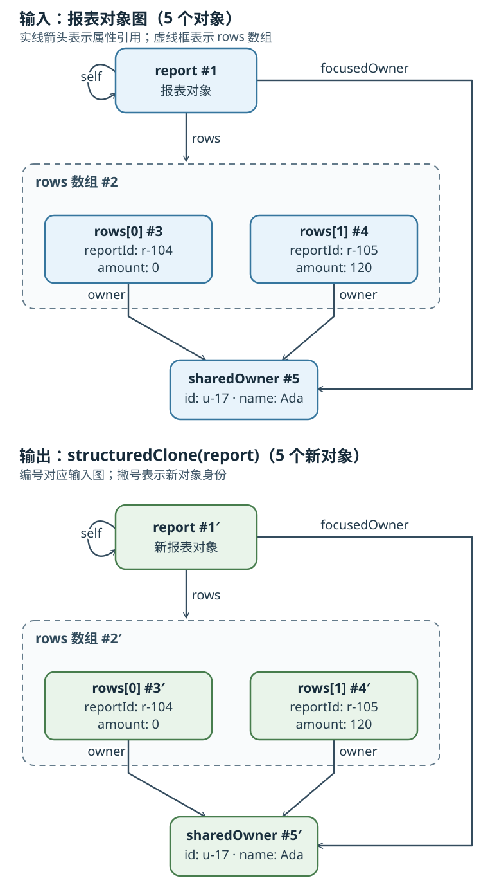

~~~javascript
const sharedOwner = { id: "u-17", name: "Ada" };
const report = {
  rows: [
    { reportId: "r-104", amount: 0, owner: sharedOwner },
    { reportId: "r-105", amount: 120, owner: sharedOwner },
  ],
  focusedOwner: sharedOwner,
};
report.self = report;

const snapshot = structuredClone(report);
snapshot !== report; // true：根对象不同
snapshot.self === snapshot; // true：循环关系保留
snapshot.self !== snapshot.rows[0].owner; // true：self 回到根，不是 owner
snapshot.rows[0].owner === snapshot.rows[1].owner; // true：共享子对象关系保留
snapshot.focusedOwner === snapshot.rows[0].owner; // true
snapshot.rows[0].owner !== sharedOwner; // true：克隆节点与原节点分离
~~~

结构化克隆会读取普通对象和数组的自有、可枚举字符串键。属性值若由 getter（读取器）提供，getter 会执行，得到的值会成为克隆中的普通数据属性；Symbol 键和非枚举属性不参与这一步。由此可见，克隆不是绕过代码去复制“隐藏状态”：被读取的 getter 可能有副作用，而被过滤的属性不会进入结果。

~~~javascript
const metadataKey = Symbol("metadata");
let getterReads = 0;
const propertyInput = {};
Object.defineProperty(propertyInput, "label", {
  enumerable: true,
  get() {
    getterReads += 1;
    return "quarterly report";
  },
});
Object.defineProperty(propertyInput, "internal", {
  enumerable: false,
  value: () => "hidden",
});
propertyInput[metadataKey] = Symbol("not visited");

const propertyCopy = structuredClone(propertyInput);
getterReads; // 1
Object.keys(propertyCopy); // ["label"]
Object.getOwnPropertyDescriptor(propertyCopy, "label");
// { value: "quarterly report", writable: true, enumerable: true, configurable: true }
propertyCopy[metadataKey]; // undefined
~~~

`Date`、`RegExp`、`Map`、`Set`、`ArrayBuffer` 和 typed array（类型化数组）等标准对象有各自的序列化步骤：internal slot（内部槽）中的数据会按类型复制，但对象上临时挂的扩展属性不一定参与。例如 `Map` 的条目会复制，自加的 `note` 属性不会。其他平台对象能否克隆，也要看该接口是否定义了序列化步骤。可克隆不等于所有对象行为都保留。普通用户类实例的自有可枚举数据会按普通对象属性处理，但类原型、原型方法和访问器描述符不会随对象图复制。函数、`WeakMap`（弱映射）、`Symbol` 值、`Proxy`（代理）和普通 DOM `Node` 不能序列化；若不可克隆值出现在对象图任一待复制位置，调用会抛 `DataCloneError`。

~~~javascript
structuredClone(9007199254740993n); // 9007199254740993n：结构化克隆支持 BigInt
~~~

~~~javascript
const mapWithExpando = new Map([["r-104", 120]]);
mapWithExpando.note = "visible only on the input";
const clonedMap = structuredClone(mapWithExpando);

clonedMap.get("r-104"); // 120：Map 条目保留
clonedMap.note; // undefined：自定义扩展属性未复制
~~~

~~~javascript
class ReportRow {
  constructor() {
    this.reportId = "r-104";
  }
  label() {
    return this.reportId;
  }
}

const classCopy = structuredClone(new ReportRow());
Object.getPrototypeOf(classCopy) === Object.prototype; // true
classCopy.label; // undefined：实例方法没有复制

function cloneErrorName(value) {
  try {
    structuredClone(value);
    return "cloned";
  } catch (error) {
    return error.name;
  }
}

cloneErrorName(() => {}); // "DataCloneError"
cloneErrorName(new WeakMap()); // "DataCloneError"
cloneErrorName(Symbol("value")); // "DataCloneError"
cloneErrorName({ format: () => "r-104" }); // "DataCloneError"：嵌套函数也会失败
~~~

`structuredClone` 的 `transfer`（转移）选项把可转移资源的所有权交给结果，而不是另外复制一份。对 `ArrayBuffer` 来说，结果接管原缓冲区的字节，原 `ArrayBuffer` 被分离；它仍是原对象，但不能再读写缓冲区内容。只有确实要交出所有权时才转移；普通快照应使用不带 `transfer` 的克隆。

~~~javascript
const buffer = new ArrayBuffer(8);
const transferred = structuredClone({ buffer }, { transfer: [buffer] });

transferred.buffer.byteLength; // 8
buffer.byteLength; // 0：原 buffer 已分离
~~~

新建包装对象也不一定代表底层数据独立。在允许使用 `SharedArrayBuffer`（共享数组缓冲区）的环境中，结构化克隆会新建包装对象，但两者继续共享字节；浏览器环境还要求满足 cross-origin isolated（跨源隔离）条件。下面的例子在支持 `SharedArrayBuffer` 的运行时观察共享效果。复制到普通 `ArrayBuffer` 后，结果不会随源的后续写入改变；若还要求复制期间读到同一时刻的一致内容，读写双方需另行协调。本例两端都是 `Uint8Array`，`TypedArray.prototype.set()` 按字节复制，但不保证跨字节的原子快照；若两端都存 Number 或都存 BigInt，但元素类型不同，复制时会逐元素读取并转换，同样不保证多个元素来自同一时刻。Number 与 BigInt 混拷会抛 `TypeError`。

~~~javascript
const sharedBuffer = new SharedArrayBuffer(1);
const sharedCopy = structuredClone(sharedBuffer);
const sourceByte = new Uint8Array(sharedBuffer);
const copiedByte = new Uint8Array(sharedCopy);

sharedCopy !== sharedBuffer; // true：包装对象不同
sourceByte[0] = 42;
copiedByte[0]; // 42：底层字节仍共享

const independentBuffer = new ArrayBuffer(sharedBuffer.byteLength);
const independentByte = new Uint8Array(independentBuffer);
independentByte.set(sourceByte);
sourceByte[0] = 7;
copiedByte[0]; // 7：共享缓冲区继续变化
independentByte[0]; // 42：复制出的快照不随之变化
~~~

### 何时 JSON 与 structuredClone 都不符合契约

若应用只处理一组很小且稳定的类型，并且确实需要自定义属性复制规则，可以写范围受限的复制器。下面实现支持同一 realm（执行环境）的基础 `Date`、`RegExp`、`Map`、`Set`、数组，以及原型为当前 realm `Object.prototype` 或 `null` 的普通对象。在普通对象分支，原型不符合这一范围时，代码会显式抛 `TypeError`。这不是拒绝所有范围外输入的校验器；被调用的 getter、迭代器或递归子项也可能抛错，并向外传播。

`seen` 是本次递归使用的 `WeakMap`（弱映射）。每个对象在递归子项前就登记“输入对象 → 副本”：再次遇到同一对象时直接返回登记的副本，所以不会因循环而无限递归，也能保留图内共享关系。原始值直接返回；函数和 `Symbol` 值也原样返回，因此它们若出现在结果中仍与输入共享同一身份或值，并没有被隔离。

> [!example]- 一个有限范围的递归复制器实现
>
> ~~~javascript
> function deepCopy(value, seen = new WeakMap()) {
>   if (value === null || typeof value !== "object") return value;
>   if (seen.has(value)) return seen.get(value);
>
>   let copy;
>   if (value instanceof Date) {
>     copy = new Date(value.getTime());
>   } else if (value instanceof RegExp) {
>     copy = new RegExp(value.source, value.flags);
>     copy.lastIndex = value.lastIndex;
>   } else if (value instanceof Map) {
>     copy = new Map();
>     seen.set(value, copy);
>     for (const [key, item] of value) {
>       copy.set(deepCopy(key, seen), deepCopy(item, seen));
>     }
>     return copy;
>   } else if (value instanceof Set) {
>     copy = new Set();
>     seen.set(value, copy);
>     for (const item of value) copy.add(deepCopy(item, seen));
>     return copy;
>   } else if (Array.isArray(value)) {
>     copy = new Array(value.length);
>   } else {
>     const prototype = Object.getPrototypeOf(value);
>     if (prototype !== Object.prototype && prototype !== null) {
>       throw new TypeError("Unsupported object type");
>     }
>     copy = Object.create(prototype);
>   }
>
>   seen.set(value, copy);
>   if (value instanceof Date || value instanceof RegExp) return copy;
>
>   for (const key of Object.keys(value)) {
>     Object.defineProperty(copy, key, {
>       value: deepCopy(value[key], seen),
>       enumerable: true,
>       writable: true,
>       configurable: true,
>     });
>   }
>   return copy;
> }
> ~~~

把同一个 `report` 对象图交给这个复制器时，`self` 回到副本根对象；`rows[0].owner`、`rows[1].owner` 和 `focusedOwner` 则指向同一个 owner 副本。所有这些新对象都与原图中的对应对象分离。该实现的普通对象与数组部分只复制自有、可枚举字符串键。数组长度先复制，因此原型链也没有值的空位会保留；数组上的可枚举字符串扩展属性也会复制。Symbol 键、非枚举属性被忽略；getter 会在读取 `value[key]` 时执行，结果被写成可写、可枚举、可配置的数据属性，原属性描述符不保留。

~~~javascript
const manualSnapshot = deepCopy(report);
manualSnapshot !== report; // true
manualSnapshot.self === manualSnapshot; // true
manualSnapshot.self !== manualSnapshot.rows[0].owner; // true：self 回到根，不是 owner
manualSnapshot.rows[0].owner === manualSnapshot.rows[1].owner; // true
manualSnapshot.focusedOwner === manualSnapshot.rows[0].owner; // true
manualSnapshot.rows[0].owner !== sharedOwner; // true

const cyclicMapExample = new Map();
cyclicMapExample.set(cyclicMapExample, cyclicMapExample);
const cyclicMapCopy = deepCopy(cyclicMapExample);
cyclicMapCopy.get(cyclicMapCopy) === cyclicMapCopy; // true：键和值都回指副本

const cyclicSetExample = new Set();
cyclicSetExample.add(cyclicSetExample);
const cyclicSetCopy = deepCopy(cyclicSetExample);
cyclicSetCopy.has(cyclicSetCopy); // true：成员回指副本

const trailingHoles = deepCopy([1, , ,]);
trailingHoles.length === 3; // true
0 in trailingHoles; // true
1 in trailingHoles; // false
2 in trailingHoles; // false

const emptySparse = deepCopy(new Array(3));
emptySparse.length === 3; // true
Object.keys(emptySparse); // []

const extendedArray = Object.assign([, 1], { note: "extra" });
deepCopy(extendedArray).note; // "extra"

class CustomMap extends Map {}
class CustomArray extends Array {}
const copiedMapSubclass = deepCopy(new CustomMap([["r-104", 120]]));
const copiedArraySubclass = deepCopy(new CustomArray(1, 2));
console.log(copiedMapSubclass instanceof CustomMap, copiedMapSubclass instanceof Map);
// false true：保留 Map 条目，原型降为 Map.prototype
console.log(copiedArraySubclass instanceof CustomArray,
  Object.getPrototypeOf(copiedArraySubclass) === Array.prototype);
// false true：数组子类降为普通 Array
~~~

这段实现的边界属于调用者必须满足的输入契约，不是统一的拒绝行为：不要传入 `Proxy`、跨 realm 对象、未知宿主对象，或覆写这段代码会读取的内建方法、属性和迭代器的实例。分支顺序会让 `Date`、`RegExp`、`Map`、`Set` 子类降为对应基础类型；数组子类和跨 realm 数组也会进入数组分支，成为当前 realm 的普通数组。调用者仍须排除不支持的输入。`Date`、`RegExp`、`Map`、`Set` 上的自有扩展属性会被忽略；数组的可枚举字符串扩展属性则会复制。`RegExp.lastIndex` 按原值赋给副本，故这里要求它是普通数字位置。递归实现也要求对象图深度受控。若输入不能可靠地满足这些条件，应缩窄数据契约或使用明确支持目标类型的机制，而不是把得到的结果称作完整副本。

> [!info]- 来源
> - JSON 序列化属性选择、对象中的未表示值、数组中的 `null` 替代、BigInt 默认错误及循环结构错误：[ECMAScript 2026 §25.5.4 JSON.stringify](https://tc39.es/ecma262/2026/multipage/structured-data.html#sec-json.stringify)，尤其是 §25.5.4.2 `SerializeJSONProperty`、§25.5.4.5–.6 对象和数组序列化；日期默认 JSON 表示：[ECMAScript 2026 §21.4.4.37 `Date.prototype.toJSON`](https://tc39.es/ecma262/2026/multipage/numbers-and-dates.html#sec-date.prototype.tojson)。
> - 结构化克隆的宿主 API、复制与转移的区别、不可序列化时的错误，以及反序列化到该 `structuredClone` 方法接收者的 relevant realm：[WHATWG HTML Living Standard §2.7.11](https://html.spec.whatwg.org/multipage/structured-data.html#structured-cloning-api)，更新时间 2026-11-11。
> - 循环和重复对象身份的记忆表、Symbol/函数/弱映射/Proxy/其他内部槽对象的克隆边界、对象自有可枚举键读取与反序列化为数据属性：[WHATWG HTML Living Standard §2.7.4](https://html.spec.whatwg.org/multipage/structured-data.html#structuredserializeinternal) 与 [§2.7.7](https://html.spec.whatwg.org/multipage/structured-data.html#structureddeserialize)。
> - ArrayBuffer 复制字节、SharedArrayBuffer 的跨源隔离检查与共享底层数据、转移后的分离行为：[WHATWG HTML Living Standard §2.7.4、§2.7.8](https://html.spec.whatwg.org/multipage/structured-data.html#structuredserializewithtransfer)。
> - DOM `Node` 接口未定义可序列化步骤：[DOM Standard §4.4 Interface `Node`](https://dom.spec.whatwg.org/#interface-node)。
> - 手写子集用到的语言操作：`Object.create`、`Object.defineProperty`、`Object.getPrototypeOf`、`Object.keys` 的属性规则，`Array.isArray`，`Date.prototype.getTime`，`RegExp.prototype.flags`、`source` 与 `lastIndex`，以及 `Map`、`Set`、`WeakMap` 的实例行为：[ECMAScript 2026 Fundamental Objects](https://tc39.es/ecma262/2026/multipage/fundamental-objects.html#sec-object.create)（§20.1.2.2、.4、.12、.19）、[Indexed Collections](https://tc39.es/ecma262/2026/multipage/indexed-collections.html#sec-array.isarray)（§23.1.2.3）、[Numbers and Dates](https://tc39.es/ecma262/2026/multipage/numbers-and-dates.html#sec-date.prototype.gettime)（§21.4.4.10）、[Text Processing](https://tc39.es/ecma262/2026/multipage/text-processing.html#sec-get-regexp.prototype.flags)（§22.2.6.4、.13 与 §22.2.8.1）、[Keyed Collections](https://tc39.es/ecma262/2026/multipage/keyed-collections.html)（§§24.1–24.3）。
> - `TypedArray.prototype.set()` 要求两端的 Number/BigInt 内容类别相同；元素类型相同时逐字节复制，不同时逐元素读取并转换；两者都不提供共享内存的跨元素一致快照：[ECMAScript 2026 §23.2.3.26.2 `SetTypedArrayFromTypedArray`](https://tc39.es/ecma262/2026/multipage/indexed-collections.html#sec-settypedarrayfromtypedarray)。
> - `structuredClone` 在 Node.js 中的宿主 API 入口：[Node.js v26.13.1 Global objects](https://nodejs.org/api/globals.html#structuredclonevalue-options)。本章代码核对环境为 Node.js v26.13.0 / V8 14.6.202.34-node.40，2026-11-12。
## 32. JavaScript 作用域与闭包如何保留状态？

**案例背景。** 网页用 `attachLogger` 为按钮注册点击日志；注册函数返回后，用户再点击按钮，callback（回调）为什么仍能读到当时传入的 `label`？scope（作用域）决定一个名称在哪里可见，closure（闭包）让函数以后仍能访问它定义处的绑定。本章沿名称查找、声明初始化和几个延后执行的回调追踪这条路径。ordinary function（普通函数）的 `this` 由调用形式提供；arrow function（箭头函数）没有自己的 `this` 绑定，而是从定义处的外层环境读取。本章的接收者规则只针对普通函数；更多形式见[JavaScript 函数的 `this` 值由什么决定？](#34.%20JavaScript%20%E5%87%BD%E6%95%B0%E7%9A%84%20this%20%E5%80%BC%E7%94%B1%E4%BB%80%E4%B9%88%E5%86%B3%E5%AE%9A%EF%BC%9F)。

以下代码块彼此独立。标为 HTML 的代码需要浏览器；计时器例子使用浏览器或 Node.js 提供的计时 API。

### 名称查找沿函数的定义位置进行

当代码读取标识符时，JavaScript 从当前 lexical environment（词法环境）查找对应的 binding（绑定）；当前环境没有该名称才沿外层环境继续。每次调用 `outer` 时，函数体开始执行前的声明实例化会建立 `inner` 的绑定并创建函数对象；它的 `[[Environment]]` 指向这次 `outer` 调用的词法环境。接着函数体才执行，初始化 `label` 并返回这个函数。即使本次 `outer` 调用结束，返回的函数仍能让那份环境可达。`callFromElsewhere` 调用返回值时，才建立 `inner` 本次调用的局部环境。调用者的局部环境不会插入函数定义时建立的查找链；普通函数调用者能提供实参和接收者 `this`，箭头函数则从词法外层读取 `this`。

下面的图只展示 `outer` 已返回、`inner` 又被调用之后的名称查找。`inner` 的局部环境里有 `detail`，没有 `label`；因此查找沿函数对象保留的那次 `outer` 环境继续，而不是沿调用者 `callFromElsewhere` 的局部环境继续。

~~~mermaid
flowchart TB
  Q["inner 读取 label"] -->|先查当前环境| I["inner 的词法环境<br/>有 detail；没有 label"]
  I -->|未找到 label，沿定义时的外层环境查找| O["outer 本次调用的环境<br/>label = outer；命中并停止"]
~~~

~~~javascript
const label = "global";

function outer() {
  const read = inner;
  const label = "outer";
  function inner() {
    const detail = "inner";
    return [label, detail];
  }
  return read;
}

function callFromElsewhere() {
  const label = "caller";
  const read = outer();
  return read();
}

callFromElsewhere(); // ["outer", "inner"]
~~~

这里的环境节点是语言规范描述名称查找的抽象，不表示引擎必须按相同形状分配 JavaScript 对象。execution context（执行上下文）描述当前正在执行的脚本或函数及其状态；environment record（环境记录）描述绑定与名称查找操作。调用栈告诉我们哪些调用尚未返回，词法链告诉我们一个名称按什么顺序解析；两者相关，但不是同一条链。

### 声明方式决定绑定范围与初始化时机

`var`、`let`、`const` 的差异不只是“函数级或块级”：声明先在哪个环境建立绑定、什么时候初始化，也会决定读取结果。

| 声明 | 绑定范围 | 初始化时机 | 重复声明与重新赋值 |
| --- | --- | --- | --- |
| `var` | 普通函数作用域；脚本或模块的顶层也有各自范围 | 本节没有同名形参的例子里，声明实例化把新变量绑定初始化为 `undefined`；声明中的初始化式到代码执行至声明处才运行 | 兼容的 `var` 声明可重复；可重新赋值 |
| `let` | 所在词法作用域，如代码块或脚本、模块顶层 | 进入作用域先建立未初始化绑定；从进入作用域到声明初始化完成是 temporal dead zone（暂时性死区）；无初始化式时到声明处初始化为 `undefined` | 同一词法作用域不能重复声明；可重新赋值 |
| `const` | 所在词法作用域，如代码块或脚本、模块顶层 | 与 `let` 一样先建立未初始化绑定；从进入作用域到声明初始化完成是暂时性死区；通常必须写初始化式，`for...in` / `for...of` 头部例外 | 同一词法作用域不能重复声明；初始化后不能重新绑定 |

`if` 代码块不会为 `var` 创建新绑定，因此即使声明写在条件块里，函数开头读取的也是已初始化为 `undefined` 的同一个 `status`。`let` 和 `const` 进入代码块时已经有绑定，但初始化前读取会抛出 `ReferenceError`。下例的内层 `let count` 已经遮蔽外层 `count`；查找遇到这个尚未初始化的内层绑定就抛错，不会跳过它再去读外层的 `0`。离开代码块后，外层 `count` 仍为 `0`。`const` 限制变量名重新绑定，不会冻结它指向的对象。
`for...in` 和 `for...of` 头部的 `const` 由每轮枚举或迭代取出的值初始化；普通 `const` 声明则必须显式写初始化式。

~~~javascript
function readBeforeAssignment() {
  console.log(status); // undefined
  if (true) {
    var status = "ready";
  }
  return status; // "ready"
}

let count = 0;
let tdzError;
{
  try {
    count;
  } catch (error) {
    tdzError = error.name;
  }
  let count = 1;
}

const options = { theme: "light" };
options.theme = "dark";
let reassignmentError;
try {
  options = {};
} catch (error) {
  reassignmentError = error.name;
}
const statusAfterReturn = readBeforeAssignment();
[statusAfterReturn, tdzError, count, options.theme, reassignmentError];
// ["ready", "ReferenceError", 0, "dark", "TypeError"]
~~~

兼容的 `var` 名称可以在同一变量作用域重复声明，但不能与同一作用域内冲突的词法声明混用；重复声明同名 `let` 或 `const` 是语法错误。绑定不需要重新赋值时通常用 `const`，需要重新赋值时用 `let`；维护依赖函数作用域的旧代码时才需要 `var`。

#### “顶层”取决于宿主怎样执行代码

浏览器经典脚本、浏览器模块、Node.js CommonJS 和 Node.js ESM 都能声明顶层变量，但它们处在不同的外层环境中。top-level `this`（顶层 `this`）也不总是全局对象；`globalThis` 才是跨这些调用位置访问当前 Realm（执行域）全局 `this` 值的标准入口。

| 运行方式 | 顶层声明 | 顶层 `this` | 宿主全局入口 |
| --- | --- | --- | --- |
| 浏览器 classic script（经典脚本，`<script>` 不写 `type="module"`） | `var` 通常成为 `window` 属性；`let` / `const` 是 global lexical binding（全局词法绑定） | 当前全局 `this` 值，即 `window` | `window`、`globalThis` |
| 浏览器 module script（模块脚本） | `var`、`let`、`const` 都是 module-local binding（模块局部绑定） | `undefined` | `globalThis`；窗口页面另有 `window` |
| Node.js CommonJS（Node.js 模块格式，简称 CJS） | `var`、`let`、`const` 都是 wrapper-local binding（包装函数内的局部绑定） | 包装函数收到的初始 `exports` 对象 | `globalThis` |
| Node.js ECMAScript module（ES 模块，简称 ESM） | `var`、`let`、`const` 都是 module-local binding | `undefined` | `globalThis` |

浏览器主线程的 `window` 代表窗口全局；Web Worker（Web 工作线程）有自己的全局环境，可用 `self` 或 `globalThis`，没有 `window`。模块规则与 Node.js 包格式及互操作的更多差异见[ECMAScript 模块与 CommonJS 在语法、加载和运行时有什么不同？](#49.%20ECMAScript%20%E6%A8%A1%E5%9D%97%E4%B8%8E%20CommonJS%EF%BC%88Node.js%20%E6%A8%A1%E5%9D%97%E6%A0%BC%E5%BC%8F%EF%BC%89%E5%9C%A8%E8%AF%AD%E6%B3%95%E3%80%81%E5%8A%A0%E8%BD%BD%E5%92%8C%E8%BF%90%E8%A1%8C%E6%97%B6%E6%9C%89%E4%BB%80%E4%B9%88%E4%B8%8D%E5%90%8C%EF%BC%9F)。

~~~html
<script>
  var scriptValue = "global object property";
  let scriptBinding = "global lexical binding";

  const browserScriptResults = [
    window.scriptValue,
    window.scriptBinding,
    scriptBinding,
    this === globalThis,
  ];
  // ["global object property", undefined, "global lexical binding", true]
</script>
~~~

### 闭包保留绑定，而不是冻结快照

closure（闭包）使函数代码以后仍能访问它定义处可见的绑定。每次调用 `makeCounter(start)` 都会建立参数 `start` 和独立的局部 `value` 绑定。执行到 `let value = start` 时，用 `start` 的值初始化 `value`。返回的函数保留对这份 `value` 的访问。`value++` 先读取旧值，再把加一后的值写回原绑定，然后以旧值作为表达式结果交给调用者。因此第一次调用将 `value` 从 `10` 写成 `11` 并返回 `10`；第二次读取同一绑定时从 `11` 开始。它不是创建时复制下来的快照。

~~~javascript
function makeCounter(start) {
  let value = start;
  return () => value++;
}

const first = makeCounter(10);
const second = makeCounter(-2);
const firstResults = [first(), first(), first()];
const secondResults = [second(), second(), second()];
[firstResults, secondResults];
// [[10, 11, 12], [-2, -1, 0]]
~~~

同一次调用也可以返回多个共享状态的函数。`increment`、`decrement` 和 `reset` 都访问同一份 `current`；`reset` 把该绑定改回输入的初值，不会创建一个新的计数器。

~~~javascript
function createCounter(init) {
  let current = init;
  return {
    increment() { return ++current; },
    decrement() { return --current; },
    reset() { return current = init; },
  };
}

const counter = createCounter(5);
[counter.increment(), counter.reset(), counter.decrement()]; // [6, 5, 4]
~~~

### 报表处理器把闭包状态与调用时接收者结合起来

报表服务创建处理器时，工厂函数把 `tag` 和 `calls` 两个词法绑定交给返回的普通函数继续访问。每次方法调用都更新同一份 `calls`；闭包不会顺带捕获普通函数的 `this`。先看 `service.onReport(...)`：成员调用以 `service` 为接收者，所以 `onReport` 里的 `this` 是 `service`。函数体又执行 `this.format(...)` 这个成员调用，于是 `format` 里的 `this` 仍是 `service`。

~~~javascript
function makeReportHandler(tag) {
  let calls = 0;
  return function onReport(report) {
    "use strict";
    calls += 1;
    return this.format(report, tag, calls);
  };
}

const service = {
  prefix: "Sales",
  format(report, tag, sequence) {
    return `${this.prefix}/${tag}: ${report.title} #${sequence}`;
  },
  onReport: makeReportHandler("daily"),
};

const firstReport = service.onReport({ title: "Q4" });
const secondReport = service.onReport({ title: "Q4" });
const { onReport } = service;
let bareCallError;
try {
  onReport({ title: "Q4" });
} catch (error) {
  bareCallError = error.name;
}
const reportAfterBareCall = service.onReport({ title: "Q4" });
[firstReport, secondReport, bareCallError, reportAfterBareCall];
// [
//   "Sales/daily: Q4 #1",
//   "Sales/daily: Q4 #2",
//   "TypeError",
//   "Sales/daily: Q4 #4",
// ]
~~~

裸调时，`onReport` 的严格模式使 `this` 为 `undefined`。函数先执行 `calls += 1`，再读 `this.format` 才抛出 `TypeError`；因此下一次正常服务调用是 `#4`。`tag`、`calls` 来自函数定义时的词法环境；普通函数的 `this` 则由每次调用形式分别提供。箭头函数没有自己的 `this`；若此处把处理器改写成箭头，它会读定义它的外层 `this`，不再随 `service.onReport(...)` 改变。

### 循环回调需要符合预期数量的绑定

循环把回调保存起来、稍后才调用时，关键是每个回调最后读取的是同一份绑定，还是每轮各自的绑定。`var` 在循环里重复赋值同一份函数作用域绑定；顶层示例里的 `var` 归脚本/模块环境，放进普通函数时则归函数环境。带 `let` 的 `for` 循环会为每轮提供新的绑定：第一轮体读取 `j = 0`，回调记住这份绑定；循环体结束后，语言先把当前值复制到下一轮的新绑定，再在新绑定上执行 `j++`。因此下一轮体是 `1`，第一份回调仍读旧的 `0`。

~~~javascript
const fromVar = [];
for (var i = 0; i < 3; i++) fromVar.push(() => i);

const fromLet = [];
for (let j = 0; j < 3; j++) fromLet.push(() => j);

[fromVar.map(fn => fn()), fromLet.map(fn => fn())];
// [[3, 3, 3], [0, 1, 2]]
~~~

旧代码也能用 Immediately Invoked Function Expression（IIFE，立即调用函数表达式）为每轮新建一个函数调用参数绑定。回调读取各自的 `capturedIndex`，所以得到和 `let` 循环相同的结果。

~~~javascript
const callbacks = [];
for (var index = 0; index < 3; index++) {
  (function (capturedIndex) {
    callbacks.push(() => capturedIndex);
  })(index);
}
callbacks.map(fn => fn()); // [0, 1, 2]
~~~

### 工厂函数专门化行为，回调保留捕获值

工厂可以把一次调用建立的参数绑定保存在闭包里，返回一个更专用的函数。本例的 `x` 绑定在工厂返回后仍可读，且后续不再赋值；这正是“捕获值”恰好保持不变的条件。同一机制也让延后执行的 callback（回调）读取注册时的参数绑定。

~~~javascript
function add(x) {
  return function (y) {
    return x + y;
  };
}

const addFive = add(5);
addFive(3); // 8
~~~

下面两段 DOM 代码都要在浏览器页面的 `<body>` 已经存在后运行。注册监听器后，`attachLogger` 已经返回；真实用户可以之后点击按钮。这里用 `dispatchEvent` 在注册函数返回后同步派发事件，监听器会在 `dispatchEvent` 返回前运行。箭头回调读取 `attachLogger` 那次调用创建的 `label` 参数绑定；该绑定之后不再赋值。

~~~javascript
function attachLogger(elementId, label) {
  document.getElementById(elementId).addEventListener("click", () => {
    console.log("Clicked: " + label);
  });
}

const loggerButton = document.createElement("button");
loggerButton.id = "btn1";
document.body.append(loggerButton);
attachLogger("btn1", "primary");
loggerButton.dispatchEvent(new MouseEvent("click"));
// 控制台输出："Clicked: primary"
~~~

animation frame（动画帧）回调也会延后运行。`animate` 每次调用都会建立 `start`、`element`、`from`、`to` 和 `duration` 绑定；这些参数和 `start` 随后不再赋值。`performance.now()` 返回毫秒时间戳，因此 `duration` 也以毫秒计。后续每一帧的 `update` 都从同一次 `animate` 调用读取它们，算出当前位置，再决定是否请求下一帧。代码也必须等页面 `<body>` 已经存在后运行。

~~~javascript
function animate(element, from, to, duration) {
  const start = performance.now();

  function update() {
    const elapsed = performance.now() - start;
    const progress = Math.min(elapsed / duration, 1);
    const value = from + (to - from) * progress;
    element.style.left = value + "px";

    if (progress < 1) requestAnimationFrame(update);
  }

  requestAnimationFrame(update);
}

const animatedElement = document.createElement("div");
animatedElement.textContent = "报表已更新";
animatedElement.style.position = "relative";
document.body.append(animatedElement);
animate(animatedElement, 0, 100, 1000); // duration 必须大于 0
~~~

当进度到达 `1` 时，`style.left` 最终为 `100px`，并且不再请求下一帧。`left` 对普通静态定位元素不起偏移作用；本例设置 `position: relative`，只移动绘制位置，不移除元素在正常流中占据的空间。

### 定时回调怎样用闭包保留调度状态

debounce（防抖）在一段静默时间后运行最后一次调用；throttle（节流）则限制调用频率。两者都让返回函数通过闭包保存跨调用状态，但保存内容和更新时机不同。库和自定义包装函数可以选择 leading-edge（首沿）、trailing-edge（尾沿）或两者兼有；下面的实现分别是 trailing-only debounce（仅尾沿防抖）和 leading-only throttle（仅首沿节流）。示例把 `wait` 和 `interval` 设为正整数毫秒数；时间表采用理想时钟推演，不代表任一宿主的实际触发测量或保证。节流的推论只针对正间隔。

~~~javascript
function debounce(fn, wait) {
  let timer;

  function debounced(...args) {
    const receiver = this;
    clearTimeout(timer);
    timer = setTimeout(() => {
      timer = undefined;
      fn.apply(receiver, args);
    }, wait);
  }

  debounced.cancel = function () {
    clearTimeout(timer);
    timer = undefined;
  };

  return debounced;
}

function throttleLeading(fn, interval) {
  let lastCallAt = null;

  return function (...args) {
    const now = performance.now();
    if (lastCallAt !== null && now - lastCallAt < interval) return;

    lastCallAt = now;
    return fn.apply(this, args);
  };
}
~~~

`timer` 来自某一次 `debounce(fn, wait)` 调用，并由返回的 `debounced` 闭包跨调用共享。每次进入 `debounced(...args)` 时都会新建这一轮的 `args` 绑定与 `receiver` 绑定；旧计时器被清除后，新计时器的箭头回调访问的就是这次调用的接收者和参数。因而静默期结束时只执行最后一组输入。`.cancel()` 只撤销尚未触发的 timer。`throttleLeading` 用 `performance.now()` 的单调时钟计算间隔，系统校时不会改变这段差值；用 `null` 表示“尚无上次调用时间”，因此即使计时器初始读数为 `0`，第一次调用也会立即通过；到达间隔边界时，差值等于 `interval`，本次也会通过。

下面是理想时钟的合成时间线：等待值与节流间隔都设为 `100ms`，`pageA`、`pageB`、`pageC` 表示不同接收者，包装目标把接收者页面名和搜索词记下来。每一行同时把相同输入交给两个包装函数；这些时刻是便于推演的逻辑时间，不是宿主时钟的测量结果。

| 理想时刻 | 防抖包装函数收到的输入与状态 | 首沿节流包装函数收到的输入与结果 |
| ---: | --- | --- |
| `0ms` | `debouncedSearch.call(pageA, "A")`：设置 `100ms` 等待 | `throttledSearch.call(pageA, "A")`：立即以 `pageA` 和 `"A"` 执行，记录上次通过时刻 `0` |
| `40ms` | `debouncedSearch.call(pageB, "B")`：取消旧 timer，重新等待 `100ms` | `throttledSearch.call(pageB, "B")`：丢弃，距离上次通过 `40ms` |
| `110ms` | `debouncedSearch.call(pageC, "C")`：再次取消旧 timer，重新等待 `100ms` | `throttledSearch.call(pageC, "C")`：执行，距上次通过 `110ms`，超过间隔 |
| 自 `210ms` 起 | 若无新调用，timer 以 `pageC` 和 `"C"` 执行 | 没有新调用 |

`setTimeout` 接收 delay（延迟）并由宿主安排计时器任务；它不保证回调会在指定的精确时刻触发。隔离复现中，Node.js 26.13.0 的高分辨率时间实测有时观察到略短于传入值的等待，因此上表采用理想时钟，不把时间点当作实际保证。Node.js 26.13 将小于 `1ms` 或大于 `2147483647ms` 的 delay 改为 `1ms`，并截去非整数小数部分；这是 Node 的边界，不可套用为所有宿主的规则。控件销毁时应移除事件监听器并调用 `.cancel()`；它只移除尚未触发的防抖 callback。如果 callback 已经启动 `fetch`，还可以调用该请求 AbortController（中止控制器）的 `abort()`，这会取消客户端操作，但不会撤回服务端已经收到并开始处理的工作。

节流实现先写入 `lastCallAt` 再调用目标函数，所以目标同步重入时会看到这次调用的时间：若重入时仍未经过间隔，会被挡下；若目标同步耗时已达到或超过间隔才重入，重入会通过。`interval` 为 `0` 时该判断不会限制同步重入；本节的节流结论限于正间隔。

### 闭包生命周期取决于可达性

外层调用返回后，返回函数仍可观察它使用的绑定，这是行为保证；这不表示引擎必须把所有局部变量永久装进一个环境对象。长期存在的事件监听器可以让闭包与数据继续可达，控件销毁时应移除监听器和其他引用。循环引用本身不等于内存泄漏；需要判断的是活动程序仍能否沿引用到达这些数据。

**相关机制：** [JavaScript 对象如何查找属性并组织成员？](#33.%20JavaScript%20%E5%AF%B9%E8%B1%A1%E5%A6%82%E4%BD%95%E6%9F%A5%E6%89%BE%E5%B1%9E%E6%80%A7%E5%B9%B6%E7%BB%84%E7%BB%87%E6%88%90%E5%91%98%EF%BC%9F) 将同一报表处理器放入服务实例，并说明 `format` 如何从原型查找；[JavaScript 函数的 `this` 值由什么决定？](#34.%20JavaScript%20%E5%87%BD%E6%95%B0%E7%9A%84%20this%20%E5%80%BC%E7%94%B1%E4%BB%80%E4%B9%88%E5%86%B3%E5%AE%9A%EF%BC%9F) 解释调用形式怎样提供接收者。

> [!info]- 来源
> - 词法环境、环境记录和标识符查找：[ECMAScript 2026 Execution Contexts](https://tc39.es/ecma262/2026/multipage/executable-code-and-execution-contexts.html#sec-execution-contexts)、[Environment Records](https://tc39.es/ecma262/2026/multipage/executable-code-and-execution-contexts.html#sec-environment-records)、[GetIdentifierReference](https://tc39.es/ecma262/2026/multipage/executable-code-and-execution-contexts.html#sec-getidentifierreference)、[NewFunctionEnvironment](https://tc39.es/ecma262/2026/multipage/executable-code-and-execution-contexts.html#sec-newfunctionenvironment)。
> - `var`、`let`、`const` 的绑定建立、初始化和声明限制：[ECMAScript 2026 FunctionDeclarationInstantiation](https://tc39.es/ecma262/2026/multipage/ordinary-and-exotic-objects-behaviours.html#sec-functiondeclarationinstantiation)、[Source Text Module Record InitializeEnvironment](https://tc39.es/ecma262/2026/multipage/ecmascript-language-scripts-and-modules.html#sec-source-text-module-record-initialize-environment)、[Let and Const Declarations](https://tc39.es/ecma262/2026/multipage/ecmascript-language-statements-and-declarations.html#sec-let-and-const-declarations)、[Variable Statement](https://tc39.es/ecma262/2026/multipage/ecmascript-language-statements-and-declarations.html#sec-variable-statement)。
> - 函数对象保留定义处环境，以及普通函数调用与箭头函数 `this` 的区别：[ECMAScript 2026 Function Objects](https://tc39.es/ecma262/2026/multipage/ordinary-and-exotic-objects-behaviours.html#sec-ecmascript-function-objects)、[Arrow Function Definitions](https://tc39.es/ecma262/2026/multipage/ecmascript-language-functions-and-classes.html#sec-arrow-function-definitions)、[EvaluateCall](https://tc39.es/ecma262/2026/multipage/ecmascript-language-expressions.html#sec-evaluatecall)、[OrdinaryCallBindThis](https://tc39.es/ecma262/2026/multipage/ordinary-and-exotic-objects-behaviours.html#sec-ordinarycallbindthis)。
> - `for (let...)` 的每轮绑定复制与更新顺序：[ECMAScript 2026 ForBodyEvaluation](https://tc39.es/ecma262/2026/multipage/ecmascript-language-statements-and-declarations.html#sec-forbodyevaluation)、[CreatePerIterationEnvironment](https://tc39.es/ecma262/2026/multipage/ecmascript-language-statements-and-declarations.html#sec-createperiterationenvironment)。
> - 浏览器经典脚本、模块脚本、DOM 点击与 Web Worker 全局环境：[WHATWG HTML The `script` element](https://html.spec.whatwg.org/multipage/scripting.html#the-script-element)、[Document.body](https://html.spec.whatwg.org/multipage/dom.html#dom-document-body)、[dispatchEvent](https://dom.spec.whatwg.org/#dom-eventtarget-dispatchevent)、[The global scope](https://html.spec.whatwg.org/multipage/workers.html#the-global-scope)（Living Standard，核对日期 2026-11-12）；Node.js [CommonJS module wrapper](https://nodejs.org/api/modules.html#the-module-wrapper) 与 [ECMAScript modules](https://nodejs.org/api/esm.html)（官方文档 26.13.1，实际回放 Node.js 26.13.0）。
> - 动画帧、计时器时限和延迟任务：[WHATWG HTML `requestAnimationFrame`](https://html.spec.whatwg.org/multipage/imagebitmap-and-animations.html#dom-animationframeprovider-requestanimationframe)、[Timers](https://html.spec.whatwg.org/multipage/timers-and-user-prompts.html#timers)（Living Standard，核对日期 2026-11-12）、[Node.js Timers: `setTimeout`](https://nodejs.org/api/timers.html#settimeoutcallback-delay-args)（官方文档 26.13.1）；单调时间戳：[W3C High Resolution Time `performance.now()`](https://www.w3.org/TR/hr-time-3/#dom-performance-now)（Level 3，核对日期 2026-11-12）；`position: relative` 的偏移语义：[CSS Positioned Layout Level 3](https://drafts.csswg.org/css-position-3/#valdef-position-relative)（Editor’s Draft，2026-05-14）。
> - 监听器注册与请求取消边界：[WHATWG DOM `addEventListener`](https://dom.spec.whatwg.org/#dom-eventtarget-addeventlistener)、[Aborting ongoing activities](https://dom.spec.whatwg.org/#aborting-ongoing-activities)、[Fetch Standard Aborting a fetch](https://fetch.spec.whatwg.org/#abort-fetch)，核对日期 2026-11-12。
## 33. JavaScript 对象如何查找属性并组织成员？

**案例背景。** 一个报表页面创建多个服务实例：每个实例有自己的区域前缀和调用次数，但共享格式化方法。读取 `service.prefix` 可以在实例自身找到值，读取 `service.format` 却要去它的原型上找。下面沿这次属性查找，解释成员放在哪里、getter/setter 怎样参与读写，以及为什么改一个共享方法会影响多个实例。

property key（属性键）可以是字符串或 `Symbol`（符号）。点号语法 `object.key` 使用字符串键 `"key"`；方括号语法 `object[symbolKey]` 可以用 Symbol 值，之后的查找和赋值规则相同。

instance（实例）状态与共享 method（方法）分别存在哪里，取决于对象之间的关系。这里先分开两个名字相近的概念：对象的 `[[Prototype]]` 内部链接负责查找，组成 prototype chain（原型链）；对本页普通 constructor function（构造函数）的直接 `new C()`，构造函数上的 `prototype` 属性提供新建接收者的初始原型，前提是它的值为对象。若值不是对象，构造过程会按函数所在 Realm（执行域）回退到对应的内建原型。下文的报表服务实例 `service` 从 `ReportService.prototype` 共享 `format`；图分别展示读取 `service.format`、函数对象自身的继承链，以及 `new` 的原型传递。

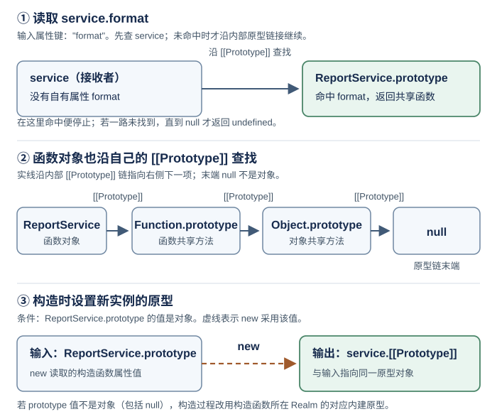

图中第一行输入的是属性键 `format`：从 `service` 沿 `[[Prototype]]` 找到共享函数并返回；若某个键一路未找到，到达 `null` 后结果才是 `undefined`。第二行实线表示沿函数对象的 `[[Prototype]]` 链前进；最后的 `null` 是链末端，并非一个对象。第三行虚线只表示 `new` 读取构造函数的 `prototype` 属性值并把该对象用作新实例的 `[[Prototype]]`；若属性值不是对象，则会改用构造函数所在执行域相应的内建原型。

### 属性查找沿原型链进行

ordinary object（普通对象）用 property descriptor（属性描述符）记录属性的值或访问器。读取 `object.key` 时先检查 own property（自有属性）；没有匹配的描述符，就沿 `[[Prototype]]` 链继续查找，直到命中或到达 `null`。命中 data descriptor（数据描述符）时返回 `value`，它也可以是函数。命中 accessor descriptor（访问器描述符）时，若有 getter（读取器），就以原始接收者 `object` 为 `this` 调用它；若没有 getter，读取结果为 `undefined`。沿链始终没有找到属性，也会得到 `undefined`。

getter 的 `this` 不因属性位于原型上而改变，也不是额外的位置实参。继承不是拷贝：实例保留自己的属性，需要共享成员时通过查找取得。setter（设置器）怎样处理赋值，稍后用同一个接收者继续说明。

~~~javascript
const base = { kind: "report" };
const record = Object.create(base);
record.title = "Q4";
const marker = Symbol("reviewed");
record[marker] = true;

Object.hasOwn(record, "title"); // true：title 是 record 的自有属性
Object.hasOwn(record, "kind");  // false：kind 不在 record 自身
"kind" in record;               // true：in 会继续检查原型链
record.kind;                    // "report"
record.missing;                 // undefined：查找到原型链末端仍未找到
Object.hasOwn(record, marker); // true：Symbol 也是有效属性键
Object.getOwnPropertySymbols(record); // [marker]
Object.getPrototypeOf(record) === base; // true
~~~

`Object.hasOwn(object, key)` 只问属性是否定义在这个对象自身；`key in object` 也会报告继承属性。因而当值可能是 `undefined` 时，用属性是否存在来判断不能只看 `object[key]` 的结果。

数据描述符保存 `value`；访问器描述符保存 `get` 与 `set`。本例的 `name` 访问器定义在 `guestProfile` 的原型 `profile` 上；读取或写入这个继承属性时，语言仍以原始接收者 `guestProfile` 为 `this` 调用 getter 或 setter，所以它可以读取或改变实例自己的状态：

~~~javascript
const profile = { _name: "John" };
Object.defineProperty(profile, "name", {
  get() { return this._name; },
  set(value) { this._name = value; },
  enumerable: true,
  configurable: true,
});

const guestProfile = Object.create(profile);
// 先在 profile 找到 getter；getter 的 this 是 guestProfile。
guestProfile.name; // "John"
// this._name 在 guestProfile 上不存在，于是从 profile 读取 "John"。

// 再在 profile 找到 setter；setter 的 this 仍是 guestProfile。
guestProfile.name = "Jo";
// setter 内的赋值找到 profile 上可写的 _name 数据属性，
// 随后在 guestProfile 上新建 _name，留下 profile._name 不变。
[profile.name, guestProfile.name,
  Object.hasOwn(guestProfile, "name"),
  Object.hasOwn(guestProfile, "_name")];
// ["John", "Jo", false, true]
~~~

getter 是会执行的代码：读取属性可能产生副作用或抛错。访问器对外看起来像属性读取或赋值，但其行为由 getter/setter 决定；只有 getter 而没有 setter 的属性不能通过普通赋值改变。

### 报表服务把实例状态与共享行为分开

案例背景：报表页面为每个服务实例保存不同的区域前缀和处理器，所有实例共享同一个格式化算法。工厂函数用 closure（闭包）分别保存处理器的标签与调用次数。调用 `service.onReport(...)` 先执行实例自己的处理器；处理器再读取 `this.format` 并从原型取得共享函数，最后由这个函数通过 `this.prefix` 读取实例前缀。

~~~javascript
function makeReportHandler(tag) {
  let calls = 0;
  return function onReport(report) {
    "use strict";
    calls += 1;
    return this.format(report, tag, calls);
  };
}

function ReportService(prefix) {
  this.prefix = prefix;                        // 每个实例各自持有
  this.onReport = makeReportHandler("daily"); // 每个实例各自持有闭包状态
}

ReportService.prototype.format = function (report, tag, sequence) {
  return this.prefix + "/" + tag + ": " + report.title + " #" + sequence;
};

const service = new ReportService("Sales");
service.onReport({ title: "Q4" }); // "Sales/daily: Q4 #1"
service.onReport({ title: "Q4" }); // "Sales/daily: Q4 #2"
Object.hasOwn(service, "format"); // false
Object.hasOwn(ReportService.prototype, "format"); // true
Object.getPrototypeOf(service) === ReportService.prototype; // true
~~~

`prefix` 和 `onReport` 是构造器运行时写入实例的自有属性，处理器闭包各自保留 `tag` 与 `calls`。每次 `service.onReport(...)` 都先调用该处理器；它读取 `this.format` 时沿 `service.[[Prototype]]` 找到 `ReportService.prototype.format`，再以 `service` 为 `this` 调用这个共享函数。`format` 函数体执行到 `this.prefix` 时，才读取实例自己的 `"Sales"`。构造器、实例、函数调用的关系分别属于原型与 `this` 的机制；[函数的 `this` 值由什么决定？](#34.%20JavaScript%20%E5%87%BD%E6%95%B0%E7%9A%84%20this%20%E5%80%BC%E7%94%B1%E4%BB%80%E4%B9%88%E5%86%B3%E5%AE%9A%EF%BC%9F) 继续解释调用形式怎样提供接收者。

### `[[Prototype]]` 与函数的 `prototype` 是两种关系

函数本身也是对象，因此它也有内部 `[[Prototype]]` 链，通常从 `Function.prototype` 继续到 `Object.prototype`。可构造的普通函数通常还有一个自有的数据属性 `prototype`，其值是供实例查找共享成员的对象。对本页这样的普通基础构造函数调用 `new C()` 时，构造过程读取当时的 `C.prototype` 值，初始化新建接收者的 `[[Prototype]]`；实例不是通过函数对象自身的 `[[Prototype]]` 找到成员。构造器若显式返回另一个对象，`new` 的最终结果会改为那个对象，具体返回规则见后面的构造章节。

~~~javascript
function ReportService() {}

// 函数对象自身的原型
Object.getPrototypeOf(ReportService) === Function.prototype; // true
Object.getPrototypeOf(ReportService.prototype) ===
  Object.prototype; // true
Object.hasOwn(ReportService, "prototype"); // true：构造函数上的普通属性

const firstService = new ReportService();
const firstPrototype = ReportService.prototype;
ReportService.prototype = { format() { return "new"; } };
const laterService = new ReportService();

// 已有实例不被迁移
Object.getPrototypeOf(firstService) === firstPrototype; // true
// 新实例采用新值
Object.getPrototypeOf(laterService) === ReportService.prototype; // true
~~~

上例替换的是函数上的 `prototype` 属性。已创建实例仍连着旧原型对象；新实例采用新对象。若只是给当前原型对象添加或修改方法，属性查找能到达该对象的实例会看到变化；若实例有同名自有属性，查找在实例处就停止，共享方法仍被遮蔽。

`prototype` 属性的值只需是对象，不要求它一定是专为该构造函数创建的原型对象；函数本身也是对象，可以成为另一个构造函数实例的原型。反过来，若普通构造函数的 `prototype` 被改成 `null` 或其他原始值，`new` 会回退到该构造函数所属执行域的 `Object.prototype`：

~~~javascript
function Parent() {}
function Child() {}
Child.prototype = Parent; // Parent 是函数对象，因此可以作为原型
Object.getPrototypeOf(new Child()) === Parent; // true

function FallbackDemo() {}
FallbackDemo.prototype = null;
// 同一执行域内，回退结果为 Object.prototype。
Object.getPrototypeOf(new FallbackDemo()) === Object.prototype; // true
~~~

`class`（类）语法也利用这套对象关系，而不是另建一类公开成员存储。公开实例字段初始化为每个新实例创建自有属性；公开非静态方法和访问器放在类的原型对象上；公开 `static`（静态）成员是构造函数本身的属性。

~~~javascript
class User {
  label = "member";
  get displayLabel() { return this.label; }
  greet() { return "Hi"; }
  static category = "account";
}

const user = new User();
Object.hasOwn(user, "label"); // true：实例字段
Object.hasOwn(user, "greet"); // false：方法在原型上
Object.hasOwn(Object.getPrototypeOf(user), "displayLabel"); // true
Object.hasOwn(User, "category"); // true：静态属性属于构造函数
~~~

箭头函数和上例 `greet()` 这样的普通简洁方法默认没有自有的 `prototype` 属性，也不能用 `new` 构造；生成器简洁方法与异步生成器简洁方法则有自有的 `prototype` 属性，但同样不能用 `new`。这些函数仍是对象，有自己的 `[[Prototype]]`。其构造能力边界会在[JavaScript 的 `new` 如何构造对象？](#35.%20JavaScript%20%E7%9A%84%20new%20%E5%A6%82%E4%BD%95%E6%9E%84%E9%80%A0%E5%AF%B9%E8%B1%A1%EF%BC%9F)中继续说明。

### 属性描述符决定读写是否执行代码

data descriptor（数据描述符）的 `value` 存值，`writable`（可写）控制能否通过赋值改值；accessor descriptor（访问器描述符）的 `get` 和 `set` 控制读取与写入时执行什么代码。两类都有 `enumerable`（可枚举）与 `configurable`（可配置）标记。对象字面量的普通数据属性通常三个标记都为真；`Object.defineProperty` 新建属性时未提供的标记都为假。

| 字段 | 作用 |
|---|---|
| `value`、`writable` | 数据属性保存的值，以及普通赋值能否更新它 |
| `get`、`set` | 读取或写入时调用的函数；未提供的读取器/设置器相当于 `undefined` |
| `enumerable` | `Object.keys` 只列自有、可枚举的字符串键；`for...in` 还会沿原型链枚举可枚举的字符串键；这两种枚举都不列 Symbol 键 |
| `configurable` | 是否通常可以删除、改标记，或在数据属性与访问器属性之间切换 |

~~~javascript
const descriptorDemo = {};
Object.defineProperty(descriptorDemo, "item", {
  value: 1, writable: true, enumerable: true, configurable: true,
});

Object.defineProperty(descriptorDemo, "item", { value: 2 });
const sameType = Object.getOwnPropertyDescriptor(descriptorDemo, "item");
[sameType.value, sameType.writable,
  sameType.enumerable, sameType.configurable];
// [2, true, true, true]：同类描述符只更新给出的 value

Object.defineProperty(descriptorDemo, "item", { get() { return 3; } });
const switchedToAccessor =
  Object.getOwnPropertyDescriptor(descriptorDemo, "item");
[descriptorDemo.item, switchedToAccessor.set,
  switchedToAccessor.enumerable, switchedToAccessor.configurable];
// [3, undefined, true, true]：writable/value 不再属于访问器描述符

Object.defineProperty(descriptorDemo, "item", { value: 4 });
const switchedToData =
  Object.getOwnPropertyDescriptor(descriptorDemo, "item");
[switchedToData.value, switchedToData.writable,
  switchedToData.enumerable, switchedToData.configurable];
// [4, false, true, true]：新类型专有的 writable 缺省为 false

Object.defineProperty(descriptorDemo, "fresh", { value: 1 });
const fresh = Object.getOwnPropertyDescriptor(descriptorDemo, "fresh");
[fresh.writable, fresh.enumerable, fresh.configurable];
// [false, false, false]
~~~

更新已有属性时，未给出的同类字段保持原值。切换数据/访问器类型要求属性可配置；旧类型专有字段会去掉，新类型专有字段按默认值补齐，而未提供的共同字段 `enumerable`、`configurable` 继续保留。这个区别解释了上例：切换回数据属性后，`writable` 是 `false`，但可枚举、可配置仍是 `true`。不可配置属性不能任意删除或重新定义；给不可写属性或无 setter 的属性赋值时，strict mode（严格模式）中的普通赋值会抛出 `TypeError`，非严格代码则可能静默失败。

### 继承属性的赋值会调用 setter 或建立自有属性

读取与赋值都沿原型关系查找，但找到后执行的规则不同。若继承位置有 setter，setter 会以最初接收者作为 `this` 执行。沿链未找到同名属性，或找到可写的继承数据属性时，可扩展的接收者可以建立自有属性；若继承位置是不可写数据属性，普通赋值不能覆盖它。

~~~javascript
const defaults = { mode: "shared" };
const localSettings = Object.create(defaults);
localSettings.mode = "local";

[defaults.mode, localSettings.mode,
  Object.hasOwn(localSettings, "mode")];
// ["shared", "local", true]

const lockedDefaults = {};
Object.defineProperty(lockedDefaults, "mode", { value: "fixed" });
const lockedSettings = Object.create(lockedDefaults);
Reflect.set(lockedSettings, "mode", "changed"); // false：写入被拒绝
lockedSettings.mode; // "fixed"
~~~

`Object.defineProperty` 创建的 `lockedDefaults.mode` 默认不可写，所以赋值没有在实例建出同名属性。使用普通赋值时，严格代码对这种拒绝会抛出 `TypeError`；`Reflect.set` 则把写入是否成功作为布尔结果交还调用者。访问器 setter 仍可自行决定要改哪个状态，因此属性赋值不总等于写入同名字段。

自有属性会遮住原型上的同名属性；删除自有属性后，查找才会重新落到原型上。给构造函数添加静态属性，只会修改函数对象本身。下面的实例沿 `Example.prototype` 查找，不经过函数对象 `Example`，所以读不到它的静态属性；前面 `Child.prototype = Parent` 那种特意把函数对象放进原型链的配置则不同。

~~~javascript
function Example() {
  Example.value = function () { return 1; };
  this.value = function () { return 2; };
}
Example.prototype.value = function () { return 3; };
Example.value = function () { return 4; };

Example.value(); // 4
const instance = new Example();
instance.value(); // 2：实例自有属性遮住原型方法
delete instance.value;
instance.value(); // 3：删除遮蔽属性后，查找回到原型方法
Example.value(); // 1：构造函数体改写函数对象自己的静态属性
~~~

### 没有原型的对象与引擎优化

`Object.create(null)` 建立的字典对象没有原型，因此不会继承 `Object.prototype` 上的 `toString` 等属性：

~~~javascript
const dictionary = Object.create(null);
dictionary.toString; // undefined
"toString" in dictionary; // false
~~~

这适合确实需要没有继承键的字典；也意味着这些对象不能直接调用常规对象方法，使用前要明确要用哪些操作。

V8 可用 hidden class（隐藏类）和属性布局转换优化属性访问，但这是引擎实现选择，不是 ECMAScript 对象语义的保证。只有性能测量定位到属性访问瓶颈时，才值得为形状稳定性调整布局。

**相关机制：** [函数 `this` 与绑定](#34.%20JavaScript%20%E5%87%BD%E6%95%B0%E7%9A%84%20this%20%E5%80%BC%E7%94%B1%E4%BB%80%E4%B9%88%E5%86%B3%E5%AE%9A%EF%BC%9F)解释方法调用和继承 getter 怎样接收 `this`；[使用 `new` 构造对象](#35.%20JavaScript%20%E7%9A%84%20new%20%E5%A6%82%E4%BD%95%E6%9E%84%E9%80%A0%E5%AF%B9%E8%B1%A1%EF%BC%9F)跟进实例的初始原型、构造器与返回值；[Proxy 代理对象](#36.%20JavaScript%20%E7%9A%84%20Proxy%20%E5%A6%82%E4%BD%95%E6%8B%A6%E6%88%AA%E5%AF%B9%E8%B1%A1%E6%93%8D%E4%BD%9C%EF%BC%9F)说明被拦截的读取、写入和属性描述符约束。

> [!info]- 来源
> - 属性读取沿原型链查找、并把原接收者传给 getter：[ECMAScript 2026 OrdinaryGet](https://tc39.es/ecma262/2026/multipage/ordinary-and-exotic-objects-behaviours.html#sec-ordinaryget)（§10.1.8.1）。
> - 属性写入沿链判断数据属性或调用 setter：[ECMAScript 2026 OrdinarySet](https://tc39.es/ecma262/2026/multipage/ordinary-and-exotic-objects-behaviours.html#sec-ordinaryset)（§10.1.9.1）和 [OrdinarySetWithOwnDescriptor](https://tc39.es/ecma262/2026/multipage/ordinary-and-exotic-objects-behaviours.html#sec-ordinarysetwithowndescriptor)（§10.1.9.2）。
> - `Object.defineProperty`、描述符默认值与可枚举键：[ECMAScript 2026 Object.defineProperty](https://tc39.es/ecma262/2026/multipage/fundamental-objects.html#sec-object.defineproperty)（§20.1.2.4）、[Object.keys](https://tc39.es/ecma262/2026/multipage/fundamental-objects.html#sec-object.keys)（§20.1.2.19）和 [Object.hasOwn](https://tc39.es/ecma262/2026/multipage/fundamental-objects.html#sec-object.hasown)（§20.1.2.14）。
> - 属性键是字符串或 Symbol，字符串与 Symbol 的自有键枚举：[ECMAScript 2026 ToPropertyKey](https://tc39.es/ecma262/2026/multipage/abstract-operations.html#sec-topropertykey)（§7.1.19）、[Object.getOwnPropertySymbols](https://tc39.es/ecma262/2026/multipage/fundamental-objects.html#sec-object.getownpropertysymbols)（§20.1.2.11）。
> - 普通构造器依 `prototype` 属性选择新实例原型，并在属性不是对象时回退到构造器所在执行域的内建原型：[ECMAScript 2026 GetPrototypeFromConstructor](https://tc39.es/ecma262/2026/multipage/ordinary-and-exotic-objects-behaviours.html#sec-getprototypefromconstructor)（§10.1.14）。[Class Definitions](https://tc39.es/ecma262/2026/multipage/ecmascript-language-functions-and-classes.html#sec-class-definitions)（§15.7）规定类字段和方法的创建位置。
> - `Object.prototype.__proto__` 是规范标为可选实现且遗留的特性；读写原型优先用 `Object.getPrototypeOf` 与 `Object.setPrototypeOf`：[ECMAScript 2026 Object.prototype.__proto__](https://tc39.es/ecma262/2026/multipage/fundamental-objects.html#sec-object.prototype.__proto__)（§20.1.3.8）。
> - V8 的隐藏类和属性访问优化：[V8 Fast Properties](https://v8.dev/blog/fast-properties)。
## 34. JavaScript 函数的 `this` 值由什么决定？

**案例背景。** 报表服务要把 Q4 数据格式化成一行文本：`service.onReport(...)` 能格式化报表，把同一个函数取出再裸调却抛 `TypeError`。函数值没有改变，调用表达式变了。本页讲 ordinary function（普通函数）在普通调用中的 `this`；构造调用见[JavaScript 的 `new` 如何构造对象？](#35.%20JavaScript%20%E7%9A%84%20new%20%E5%A6%82%E4%BD%95%E6%9E%84%E9%80%A0%E5%AF%B9%E8%B1%A1%EF%BC%9F)。

以下每个代码块都可独立运行，行内注释给出求值结果。包含 sloppy function（非严格函数）的代码块须按 classic script（经典脚本）执行，不能改作 ES module（ES 模块）；DOM（Document Object Model，文档对象模型）例子需要浏览器页面已有 `document.body`。

### 调用形式为报表处理器提供接收者

同一个处理器先以方法形式调用，再取出裸调，最后恢复为方法调用：

~~~javascript
function makeReportHandler(tag) {
  let calls = 0;
  return function onReport(report) {
    "use strict";
    calls += 1;
    return this.format(report, tag, calls);
  };
}

const service = {
  prefix: "Sales",
  format(report, tag, sequence) {
    return this.prefix + "/" + tag + ": " + report.title + " #" + sequence;
  },
  onReport: makeReportHandler("daily"),
};

const firstReport = service.onReport({ title: "Q4" });
const detached = service.onReport;
let detachedError;
try {
  detached({ title: "Q4" });
} catch (error) {
  detachedError = error.name;
}
const thirdReport = service.onReport({ title: "Q4" });
[firstReport, detachedError, thirdReport];
// ["Sales/daily: Q4 #1", "TypeError", "Sales/daily: Q4 #3"]
~~~

`service.onReport(...)` 是方法调用，属性访问的基底 `service` 成为这次调用的 `this`。存入 `detached` 后再用变量调用，通常没有对象基底；这个 strict function（严格函数）收到 `undefined`，访问 `this.format` 时抛出 `TypeError`。处理器也把计数存在 closure（闭包）里；失败发生在递增之后，所以第三次调用成功时返回 `#3`。

### 严格模式会改变部分调用行为

先分清两步：ordinary function（普通函数）调用时，调用表达式提供一个 `this` 初值，即 receiver（接收者）；被调函数自己的模式再决定怎样绑定这个初值。点号或方括号属性调用会保留属性访问的基底，基底可以是对象或原始值。常见作用域里的变量裸调用 `fn()` 提供 `undefined`；非严格脚本的 `with` 环境是特殊情况，可以为这种调用提供对象接收者。

strict mode（严格模式）会让部分历史代码中的错误变成异常，也改变普通函数如何绑定 `this`。经典脚本或函数体可用开头的 `"use strict"` 指令启用它；ES module（ES 模块）和 class（类）方法则自动处于严格模式。strict function（严格函数）原样保留初值；sloppy function（非严格函数）把 `null` 或 `undefined` 换成函数所属 Realm（执行域）的全局 `this` 值，并把数字、字符串、布尔值、BigInt（大整数）或 Symbol（符号值）接收者装箱。即使调用表达式位于严格代码中，非严格被调函数仍会进行转换。严格模式不是安全沙箱，也不会让 `eval` 变安全。

| 被调函数模式 | 常见变量裸调用 `fn()` | `fn.call(null)` | `fn.call(7)` |
| --- | --- | --- | --- |
| strict function（严格函数） | `undefined` | `null` | 原始数字 `7` |
| sloppy function（非严格函数） | 所属 Realm 的全局 `this` 值 | 所属 Realm 的全局 `this` 值 | Number object（Number 包装对象） |

~~~javascript
function sloppyTarget() {
  return this;
}

function strictCaller() {
  "use strict";
  return sloppyTarget();
}
strictCaller() === globalThis; // true：被调函数仍按非严格模式绑定 this。

function writeUndeclaredName() {
  "use strict";
  undeclaredName = 1;
}

try {
  writeUndeclaredName();
} catch (error) {
  error.name; // "ReferenceError"
}
~~~

严格函数把 `this` 原样保留，非严格函数则按表格转换。`strictCaller` 虽然严格，仍不会替它调用的 `sloppyTarget` 改变模式。严格代码中给不可写属性赋值会抛出 `TypeError`，并禁止 `with`、旧式八进制字面量和严格函数中的重复形参。

### `call`、`apply` 与 `bind` 的调用时机不同

三个方法何时执行目标、怎样提供实参和 `thisArg`（传给目标函数的 `this` 参数）如下：

| 方法 | 目标执行时机 | 实参来源 | `thisArg`（传给目标函数的 `this` 参数）怎样到达目标 |
| --- | --- | --- | --- |
| `call` | 立即 | 后续分开的参数 | 原样交给目标；strict function 保留，sloppy function 按上一节转换 |
| `apply` | 立即 | 空列表，或从对象的 `length` 和索引读取 | 原样交给目标；strict function 保留，sloppy function 按上一节转换 |
| `bind`（绑定） | 调用返回的新函数时 | 保存的前置参数，再加调用时参数 | 保存并交给目标；strict function 保留，sloppy function 按上一节转换 |

目标若是 arrow function（箭头函数）或 bound function（绑定函数）则会忽略传入的 `thisArg`；箭头函数稍后单独说明。`apply` 省略 argument list（实参列表）或传 `null`、`undefined` 时使用空列表；其他输入必须是对象，内置方法按其 `length` 与数字索引读取实参，不会遍历迭代器。

~~~javascript
function describe(prefix, report, punctuation) {
  "use strict";
  const message = this.prefix + ": " + prefix + " " + report.title;
  return message + (punctuation === undefined ? "" : punctuation);
}

const salesContext = { prefix: "Sales" };
const report = { title: "Q4" };
const boundDescribe = describe.bind(salesContext, "Ready");
const reboundDescribe = boundDescribe.bind(
  { prefix: "Ignored" }, report, "!",
);

const callResults = [
  describe.call(salesContext, "Ready", report),
  describe.apply(salesContext, ["Ready", report]),
  describe.apply(salesContext, { 0: "Ready", 1: report, length: 2 }),
  boundDescribe(report),
  reboundDescribe(),
];

function countArgs() {
  return arguments.length;
}
let primitiveListError;
try {
  countArgs.apply(salesContext, "Q4");
} catch (error) {
  primitiveListError = error.name;
}
const applyResults = [
  countArgs.apply(salesContext),
  countArgs.apply(salesContext, null),
  countArgs.apply(salesContext, undefined),
  countArgs.apply(salesContext, { 0: "one", length: 1 }),
  countArgs.apply(salesContext, new Set(["one"])),
  primitiveListError,
];
[callResults[0], callResults[4], applyResults];
// [
//   "Sales: Ready Q4",
//   "Sales: Ready Q4!",
//   [0, 0, 0, 1, 0, "TypeError"],
// ]
~~~

再次对已绑定函数调用 `bind` 不会改掉最初保存的接收者，但会把新前置实参追加在原参数之后；`reboundDescribe()` 因此在原报表结果后追加标点。`Set` 实例没有 `length`，而 `apply` 不读取它的迭代器，所以这里得到空实参列表；原始字符串不是对象，作为原生 `apply` 的参数列表会抛 `TypeError`。`new` 调用可构造的绑定函数时会忽略已保存的接收者，却保留前置参数；构造行为见[JavaScript 的 `new` 如何构造对象？](#35.%20JavaScript%20%E7%9A%84%20new%20%E5%A6%82%E4%BD%95%E6%9E%84%E9%80%A0%E5%AF%B9%E8%B1%A1%EF%BC%9F)。只用包装函数拼接实参，不会自动得到原生绑定函数的构造行为或相同的 `name`、`length` 等元数据。

### 箭头函数与宿主回调遵循不同规则

arrow function（箭头函数）没有自己的 `this`、`arguments`、`super` 或 `new.target` 绑定，不能用 `new` 构造；它创建时也没有自有 `prototype` 属性。这两点并非因果关系，因为可构造的 bound function（绑定函数）也没有自有 `prototype`。箭头读取定义位置的 lexical `this`（词法 `this`）；`call`、`apply` 和 `bind` 可以传递实参或预填参数，但不能替换这个 `this`。需要让对象成为接收者时使用普通方法；需要词法 `this` 时才使用箭头函数。

~~~javascript
function makePanel(title) {
  return {
    title,
    read() { return this.title; },
    readArrow: label => this.title + ":" + label,
  };
}

const panel = makePanel.call({ title: "Outer" }, "Q4");
const arrowReader = panel.readArrow;
let arrowConstructError;
try {
  new arrowReader();
} catch (error) {
  arrowConstructError = error.name;
}
[
  panel.read(),
  panel.readArrow("direct"),
  panel.readArrow.call({ title: "Call" }, "call"),
  panel.readArrow.apply({ title: "Apply" }, ["apply"]),
  panel.readArrow.bind({ title: "Bind" }, "bind")(),
  Object.hasOwn(arrowReader, "prototype"),
  arrowConstructError,
];
// [
//   "Q4",
//   "Outer:direct", "Outer:call", "Outer:apply", "Outer:bind",
//   false, "TypeError",
// ]
~~~

`makePanel` 的这次调用通过 `call` 收到 `{ title: "Outer" }` 作为 `this`。`readArrow` 调用时访问的是 `makePanel` 这次调用的 `this`，其 `title` 值为 `"Outer"`，不是创建箭头时复制下来的一份值。之后的 `call`、`apply` 或 `bind` 都不能把箭头的 `this` 改成别的对象，但照常传入或预填 `"call"`、`"apply"`、`"bind"` 这些实参；`panel.read()` 是普通方法，才以 `panel` 为接收者。

host API（宿主 API）提供接收者的另一例是 DOM event listener（文档对象模型事件监听器）。普通监听函数运行时，DOM 把注册该监听器的当前对象设为 `event.currentTarget`，并作为监听函数的 `this`；事件冒泡时它可以与事件目标 `event.target` 不同；本例中前者是 `wrapper`，后者是按钮。`currentTarget` 只在监听器执行期间可用，派发结束后会重置。箭头仍保留外层 `this`，所以应通过事件对象显式读取目标：

~~~javascript
const button = document.createElement("button");
const wrapper = document.createElement("div");
wrapper.append(button);
document.body.append(wrapper);
const listenerResults = [];

wrapper.addEventListener("click", function (event) {
  const matches = this === event.currentTarget &&
    this === wrapper && event.target === button;
  listenerResults.push(matches);
});
wrapper.addEventListener("click", event => {
  const matches = event.currentTarget === wrapper &&
    event.target === button;
  listenerResults.push(matches);
});
button.dispatchEvent(new MouseEvent("click", { bubbles: true }));
listenerResults;
// [true, true]
~~~

### 临时属性调用辅助函数只覆盖有限契约

临时 Symbol（符号值）属性能演示未绑定 ordinary function 通过 `receiver.method()` 如何把 `receiver` 作为 `this`：先将函数放到临时键，再用 `receiver[key](...)` 的方法调用形式执行它，最后删除该键。箭头函数和 bound function 会忽略这个方法接收者；这个办法也只适合可扩展的普通对象或函数。辅助函数会拒绝非对象接收者；原生 `call`、`apply`、`bind` 则把给定值传给目标，再由目标按自身严格性决定是否转换。non-extensible object（不可扩展对象）、Proxy（代理对象）以及宿主对象可能让属性定义、读取或删除失败或产生额外行为。

~~~javascript
function callWithObjectReceiver(fn, receiver, ...args) {
  if (receiver === null ||
      (typeof receiver !== "object" && typeof receiver !== "function")) {
    throw new TypeError("This exercise requires an object receiver");
  }
  const key = Symbol("temporary call");
  Object.defineProperty(receiver, key, { value: fn, configurable: true });
  try {
    return receiver[key](...args);
  } finally {
    delete receiver[key];
  }
}

const receiver = { base: 10 };
function addToBase(amount) {
  "use strict";
  return this.base + amount;
}
const sum = callWithObjectReceiver(addToBase, receiver, 3);

function failAfterReceivingThis() {
  "use strict";
  if (this !== receiver) throw new TypeError("receiver was lost");
  throw new Error("target failed");
}
let failureName;
try {
  callWithObjectReceiver(failAfterReceivingThis, receiver);
} catch (error) {
  failureName = error.name;
}
[sum, failureName, Object.getOwnPropertySymbols(receiver).length];
// [13, "Error", 0]
~~~

`finally` 会在目标抛错后继续执行删除语句；普通接收者的例子验证临时 Symbol 已清除。目标若把临时键改成不可配置，非严格辅助函数的删除会返回 `false`，键会留下；若辅助函数处于严格模式，删除会抛 `TypeError` 并可能替换目标原先的异常。归档中的 `myApply` 练习用 `Array.prototype.slice.call` 复制类数组实参，遇到 `null` 或 `undefined` 时直接使用空列表，再委托给范围受限的 `myCall`；`countArgs.myApply(receiver, [])` 与 `countArgs.myApply(receiver, null)` 都令被调函数收到 0 个实参。

> [!info]- 归档练习：范围受限的 myCall 与 myApply
>
> 该练习用临时 Symbol 属性制造方法调用语法，只接受对象或函数接收者。apply 版本把 nullish（`null` 或 `undefined`）实参列表当作空列表，并复制其他 array-like（类数组）输入；它不模拟原始值接收者转换，也不完全复现原生 `apply` 对非对象实参列表的检查，且不能覆盖不可扩展对象和 Proxy 的所有行为。
>
> ~~~javascript
> Function.prototype.myCall = function (context, ...args) {
>   if (context === null ||
>       (typeof context !== "object" && typeof context !== "function")) {
>     throw new TypeError("This exercise requires an object receiver");
>   }
>   const key = Symbol("temporary call");
>   Object.defineProperty(context, key, {
>     value: this, configurable: true,
>   });
>   try {
>     return context[key](...args);
>   } finally {
>     delete context[key];
>   }
> };
>
> Function.prototype.myApply = function (context, args) {
>   const list = args === null || args === undefined
>     ? []
>     : Array.prototype.slice.call(args);
>   return this.myCall(context, ...list);
> };
>
> const receiver = { base: 10 };
> function sum(a, b) { return this.base + a + b; }
> function countArgs() { return arguments.length; }
>
> const zeroWithArray = countArgs.myApply(receiver, []);
> const zeroWithNull = countArgs.myApply(receiver, null);
> [sum.myCall(receiver, 1, 2), zeroWithArray, zeroWithNull];
> // [13, 0, 0]
> ~~~
>
> 唯一 Symbol 避免与既有字符串键冲突；`finally` 总会执行删除尝试，但目标若让临时键不可配置，属性就无法清除。向 `Function.prototype` 添加自定义方法会修改共享内置对象，因此这仅是机制练习，应用代码应使用内置方法。

**相关机制：** [JavaScript 对象如何查找属性？](#33.%20JavaScript%20%E5%AF%B9%E8%B1%A1%E5%A6%82%E4%BD%95%E6%9F%A5%E6%89%BE%E5%B1%9E%E6%80%A7%E5%B9%B6%E7%BB%84%E7%BB%87%E6%88%90%E5%91%98%EF%BC%9F) 解释属性查找和 getter；[JavaScript 的 `new` 如何构造对象？](#35.%20JavaScript%20%E7%9A%84%20new%20%E5%A6%82%E4%BD%95%E6%9E%84%E9%80%A0%E5%AF%B9%E8%B1%A1%EF%BC%9F) 说明绑定函数构造时为何忽略已绑定的 `this`。

> [!info]- 来源
>
> - 严格模式与普通调用的接收者绑定：[ECMAScript 2026 Strict Mode Code](https://tc39.es/ecma262/2026/multipage/ecmascript-language-source-code.html#sec-strict-mode-code)、[Function Calls](https://tc39.es/ecma262/2026/multipage/ecmascript-language-expressions.html#sec-function-calls) 和 [OrdinaryCallBindThis](https://tc39.es/ecma262/2026/multipage/ordinary-and-exotic-objects-behaviours.html#sec-ordinarycallbindthis)（§10.2.1.2）。
>
> - 显式接收者与绑定函数：[ECMAScript Function.prototype.call](https://tc39.es/ecma262/2026/multipage/fundamental-objects.html#sec-function.prototype.call)、[Function.prototype.apply](https://tc39.es/ecma262/2026/multipage/fundamental-objects.html#sec-function.prototype.apply) 和 [Function.prototype.bind](https://tc39.es/ecma262/2026/multipage/fundamental-objects.html#sec-function.prototype.bind)；箭头函数：[Arrow Function Definitions](https://tc39.es/ecma262/2026/multipage/ecmascript-language-functions-and-classes.html#sec-arrow-function-definitions)。
>
> - DOM 普通事件监听器的接收者：[WHATWG DOM Event Listener Invocation](https://dom.spec.whatwg.org/#concept-event-listener-invoke)。
## 35. JavaScript 的 `new` 如何构造对象？

创建一个报表服务时，我们希望新对象保留自己的区域名称，同时复用共享的格式化方法。`new ReportService("Sales")` 怎样选定它的原型、让构造器里的 `this` 指向它，最后又为什么可能返回另一个对象？先跟完这个普通基类构造过程，再看派生 `class`、`new.target` 和绑定函数的变化。

### 报表服务使用构造出的接收者

案例背景：报表页面创建一个区域服务。新对象需要保留自己的 `prefix` 和带独立调用次数的处理器；格式化算法在构造函数的原型对象上共享：

~~~javascript
function makeReportHandler(tag) {
  let calls = 0;
  return function onReport(report) {
    "use strict";
    calls += 1;
    return this.format(report, tag, calls);
  };
}

function ReportService(prefix) {
  this.prefix = prefix;
  this.onReport = makeReportHandler("daily");
}

ReportService.prototype.format = function (report, tag, sequence) {
  return this.prefix + "/" + tag + ": " + report.title + " #" + sequence;
};

const service = new ReportService("Sales");
Object.getPrototypeOf(service) === ReportService.prototype; // true
service.prefix; // "Sales"
service.onReport({ title: "Q4" }); // "Sales/daily: Q4 #1"
~~~

**先选原型并建立接收者。** 在直接调用 `new C(a, b)` 时，语言先求值构造器表达式和实参，再检查 `C` 是否有 `[[Construct]]` internal method（内部构造方法）；没有就抛 `TypeError`。这里的内部方法是语言定义的构造操作，并非用户对象上名为 `Construct` 的属性。普通基类构造从 `newTarget.prototype` 选择新对象的内部原型 `[[Prototype]]`；直接 `new C(...)` 时，`newTarget` 就是 `C`。

下图从目标已通过构造能力检查后开始，只画普通基类构造；receiver（接收者）指新建并将交给构造器作为 `this` 的对象。

~~~mermaid
%%{init: {"flowchart": {"wrappingWidth": 280}}}%%
flowchart TD
  P["读取 newTarget.prototype"] --> T{"读取值是对象？"}
  T -->|是，包括函数| V["采用这个对象作为原型"]
  T -->|否，包括 null| R["采用 newTarget 所属 Realm 的<br/>Object.prototype"]
  V --> I["创建接收者，绑定 this<br/>初始化实例字段（若有）"]
  R --> I
~~~

本例的 `newTarget` 是 `ReportService`，它的 `.prototype` 是对象，因此走左支。构造函数还没运行，接收者已经连接到共享的原型对象；随后 `this.prefix` 和 `this.onReport` 写到这个接收者。这里的原型回退按 `newTarget` 所属 Realm（执行域）选择，该环境有自己的一套内建对象；不要默认总是当前代码所在环境的 `Object.prototype`。

构造器没有返回替换对象，所以 `service` 就是新接收者。接着 `service.onReport(...)` 使 `service` 成为处理器的 `this`；处理器沿实例原型找到 `format`，再从接收者读取 `prefix`。调用形式如何提供这个接收者，见[JavaScript 函数的 `this` 值由什么决定？](#34.%20JavaScript%20%E5%87%BD%E6%95%B0%E7%9A%84%20this%20%E5%80%BC%E7%94%B1%E4%BB%80%E4%B9%88%E5%86%B3%E5%AE%9A%EF%BC%9F)；共享方法如何被找到，见[JavaScript 对象如何查找属性并组织成员？](#33.%20JavaScript%20%E5%AF%B9%E8%B1%A1%E5%A6%82%E4%BD%95%E6%9F%A5%E6%89%BE%E5%B1%9E%E6%80%A7%E5%B9%B6%E7%BB%84%E7%BB%87%E6%88%90%E5%91%98%EF%BC%9F)。

读取原型、初始化实例字段或执行构造器时若抛错，本次构造就中断，不会继续到正常返回。派生 `class` 的接收者初始化另有规则，下面接着说明。

只要 `newTarget.prototype` 的值是对象，它就可以作为新接收者的原型，函数本身也可以。普通 `new C()` 中 `newTarget` 就是 `C`；若普通函数构造器的 `prototype` 为 `null` 或其他原始值，构造过程会回退到 `newTarget` 所属 Realm 的 `Object.prototype`：

~~~javascript
function Parent() {}
function Child() {}
Child.prototype = Parent; // 函数也是对象，可以作为原型
Object.getPrototypeOf(new Child()) === Parent; // true

function FallbackDemo() {}
FallbackDemo.prototype = null;
// 同一 Realm：回退到当前 Object.prototype
Object.getPrototypeOf(new FallbackDemo()) === Object.prototype; // true
~~~

### 构造器返回值可能替换接收者

**再运行函数体并选择最终结果。** 沿用上一图已建立的接收者，普通基类构造器会把实参交给函数体。函数体对 `this` 的修改留在接收者上，但最终是否返回它，要看构造器的返回值：

~~~mermaid
%%{init: {"flowchart": {"wrappingWidth": 280}}}%%
flowchart TD
  I["已有接收者作为 this<br/>运行构造器函数体"] --> T{"返回值是对象？"}
  T -->|是，包括函数| O["返回显式对象<br/>它替换新建的接收者"]
  T -->|否，包括 null 和 undefined| N["返回新建的接收者"]
~~~

数字、字符串、布尔值、Symbol、BigInt、`null` 和 `undefined` 都是 primitive value（原始值），不用于替换接收者。没有显式 `return` 时相当于返回 `undefined`，所以报表案例走右支。以下四个例子分别改变返回值，其他构造规则不变：

~~~javascript
function ReturnsPrimitive() {
  this.created = true;
  return 1;
}
new ReturnsPrimitive().created; // true：数字返回值被忽略

function ReturnsNull() {
  this.created = true;
  return null;
}
new ReturnsNull().created; // true：null 也不是对象

function ReturnsObject() {
  this.ignored = true;
  return { replacement: true };
}
new ReturnsObject(); // { replacement: true }：显式对象取代 this

function ReturnsFunction() {
  return function replacement() {};
}
typeof new ReturnsFunction(); // "function"
~~~

派生 `class` 构造器（derived constructor）必须先由 `super()` 初始化 `this`，才能读取或写入它。`super()` 用同一个 `newTarget` 调用基类构造器，并把基类构造结果绑定为派生构造器的 `this`；因此基类显式返回对象时，派生构造器接着初始化的是这个返回对象。如果派生构造器直接返回对象或函数，则可以不调用 `super()`。派生构造器的返回规则也不同于基类：调用 `super()` 后返回 `undefined` 会采用已初始化的 `this`，返回对象或函数会替换它；未调用 `super()` 却返回 `undefined` 会因没有接收者而抛出 `ReferenceError`，返回 `null` 或其他原始值会抛出 `TypeError`。

下面的派生类示例沿用上节已经定义的 `ReportService`；从头执行本文代码时先运行上节报表案例。

~~~javascript
class FactoryReport extends ReportService {
  constructor(prefix) {
    return new ReportService(prefix); // 返回对象，可以不调用 super()
  }
}

const factoryResult = new FactoryReport("North");
factoryResult.prefix; // "North"
Object.getPrototypeOf(factoryResult) === ReportService.prototype; // true
factoryResult instanceof FactoryReport; // false：结果是替换对象

class InvalidDerivedReport extends ReportService {
  constructor() {
    return 1; // 非 undefined 原始值不允许
  }
}
try {
  new InvalidDerivedReport();
} catch (error) {
  error.name; // "TypeError"
}

class UninitializedReport extends ReportService {
  constructor() {
    return undefined; // 没有 super()，也没有初始化 this
  }
}
try {
  new UninitializedReport();
} catch (error) {
  error.name; // "ReferenceError"
}
~~~

### `new.target` 标识本次构造目标

`new.target` 读取这次构造传入的 `newTarget`。普通 `new C()` 中它是 `C`；`Reflect.construct(C, args, D)` 运行的仍是 `C`，但让 `D` 成为 `newTarget`，于是普通基类创建接收者时改从 `D.prototype` 选原型。省略第三参数时 `newTarget` 仍为 `C`。相反，把不可构造的箭头函数传作第三参数，如 `Reflect.construct(function C() {}, [], () => {})`，会抛出 `TypeError`，不会进入目标构造器函数体。

> [!info] Reflect 的检查顺序
> `Reflect.construct` 是函数调用，先求值 `C`、`args` 和 `D` 的实参表达式。进入它后先检查 `C`、显式提供时再检查 `D`，两者都必须可构造；随后要求 `args` 是对象，从它读取数组状的实参列表，最后启动构造。任一步抛错就不再继续。这个顺序不同于“先读取参数列表，再判断能不能构造”。

派生 class 每次调用 `super()` 都把同一个 `newTarget` 传给基类，因此多层继承中每一层构造器都看到同一次构造传入的目标。`super()` 把基类的构造结果（包括基类显式返回的对象）绑定为派生构造器的 `this`，再初始化派生类自己的实例字段。

下面的派生类代码沿用前面报表案例中已经定义的 `makeReportHandler` 和 `ReportService`；请按本文顺序执行。

~~~javascript
class RegionalReportService extends ReportService {
  constructor(prefix) {
    super(prefix);
    this.createdBy = new.target;
  }
}

const regional = new RegionalReportService("Sales");
regional.createdBy === RegionalReportService; // true
Object.getPrototypeOf(regional) ===
  RegionalReportService.prototype; // true
regional.onReport({ title: "Q4" }); // "Sales/daily: Q4 #1"
~~~

**箭头读取外层收到的目标。** 下面让同一个函数分别被普通调用和构造调用；它返回一个箭头函数，稍后再读出那次调用的 `new.target`：

~~~javascript
function TargetReader() {
  return () => new.target;
}

const arrowFromCall = TargetReader();
const arrowFromConstruction = new TargetReader();
[
  arrowFromCall() === undefined,
  arrowFromConstruction() === TargetReader,
]; // [true, true]
~~~

**Reflect 可以分开“执行谁”和“按谁选原型”。** `BaseReader` 执行函数体，而 `AlternateTarget` 提供本次 `newTarget`：

~~~javascript
function BaseReader() {
  this.seenTarget = new.target;
}
function AlternateTarget() {}
AlternateTarget.prototype = { source: "alternate" };
const reflected = Reflect.construct(BaseReader, [], AlternateTarget);
const reflectedResults = [
  reflected.seenTarget === AlternateTarget,
  Object.getPrototypeOf(reflected) === AlternateTarget.prototype,
]; // [true, true]
reflectedResults; // [true, true]
~~~

**基类返回的对象沿 `super()` 传给派生层。** 这个三层例子里的基类返回新对象，每一层接着使用它；`new.target` 始终是 `LeafLayer`：

~~~javascript
class ReplacementBase {
  constructor() {
    return { fromBase: true, seenByBase: new.target };
  }
}
class MiddleLayer extends ReplacementBase {
  constructor() {
    super();
    this.fromMiddle = true;
  }
}
class LeafLayer extends MiddleLayer {
  constructor() {
    super();
    this.seenByLeaf = new.target;
  }
}
const leaf = new LeafLayer();
const leafResults = [
  leaf.fromBase,
  leaf.fromMiddle,
  leaf.seenByBase === LeafLayer,
  leaf.seenByLeaf === LeafLayer,
];
leafResults; // [true, true, true, true]
~~~

`new.target` 不是等价于构造器函数体的局部名称：它是沿这次构造传递的目标。箭头函数自身不建立这个绑定。在本例的函数内嵌套中，它沿词法环境读取 `TargetReader` 那次调用收到的 `newTarget`。`TargetReader()` 直接调用时该值是 `undefined`，`new TargetReader()` 时是 `TargetReader`；通过 `new LeafLayer()` 逐层执行 `super()` 进入基类时，基类中的 `new.target` 仍是 `LeafLayer`，不是当前执行的基类构造器名称。

### 可调用的函数未必可以用 `new`

构造器表达式与实参求值完毕后，`new` 按 `IsConstructor`（构造能力检查）判断目标是否具有构造能力；仅能被普通调用不够。普通函数声明通常可构造。class 构造器也有构造能力，可以作为 `Reflect.construct` 的目标或通过派生类的 `super()` 调用；直接写 `C()` 则会抛出 `TypeError`。箭头函数、普通非生成器简洁方法、生成器函数、async function（异步函数）和 async generator（异步生成器）都不可构造；生成器与异步生成器简洁方法也不可构造。函数上是否有名为 `prototype` 的属性不能单独证明它可构造，例如生成器函数及生成器简洁方法可以有这个属性但仍不支持 `new`。

这两项能力可以直接并排看。下表检查语法刚创建的函数，尚未手动添加、删除或替换其属性：

| 函数形式 | 自有 `prototype` | 能否作为构造目标 |
|---|---|---|
| 普通 `function F() {}` | 有 | 能 |
| `class C {}` | 有 | 能；直接 `C()` 仍报错 |
| 箭头函数 | 无 | 不能 |
| 普通非生成器简洁方法 | 无 | 不能 |
| 生成器函数或生成器简洁方法 | 有 | 不能 |
| 异步函数或普通异步简洁方法 | 无 | 不能 |
| 异步生成器函数或方法 | 有 | 不能 |

能力检查不阻止更早的实参求值。下面目标不可构造，但计数已经增加；因此不能把 `new` 的错误理解成“什么都没发生”：

~~~javascript
const notAConstructor = () => {};
let argumentCount = 0;
let constructionError;
try {
  new notAConstructor(++argumentCount);
} catch (error) {
  constructionError = error.name;
}
[constructionError, argumentCount]; // ["TypeError", 1]
~~~

绑定函数（bound function）是否能构造取决于目标函数：目标可构造时，`bind` 返回的绑定函数也可构造。使用 `new` 调用它时，已经绑定的 `this` 会被忽略，但绑定的前置参数仍会加入实参列表；当 `newTarget` 正是这个绑定函数时，构造会改用原目标函数作为 `newTarget`。

~~~javascript
function BuildReport(prefix, title) {
  this.prefix = prefix;
  this.title = title;
  this.seenTarget = new.target;
}

const boundBuildReport = BuildReport.bind({ prefix: "ignored" }, "North");
const builtReport = new boundBuildReport("Q4");
[
  builtReport.prefix,
  builtReport.title,
  builtReport.seenTarget === BuildReport,
  Object.getPrototypeOf(builtReport) === BuildReport.prototype,
];
// ["North", "Q4", true, true]
~~~

### 简化的 `new` 模型有有限输入范围

下面的教学模型只模拟当前 Realm 中直接使用的普通基类函数构造器：目标须已知可构造，函数体不依赖 `new.target`，而 `fn.prototype` 的值和构造器的直接返回值均不能是浏览器历史特殊对象 `document.all`。该对象虽然 `typeof` 返回 `"undefined"`，语言仍将它视为对象；模型用 `typeof` 判断这两个直接值时无法识别它。模型展示原型选择、接收者绑定和显式返回对象替换规则；不实现 class、派生构造器、绑定函数、内置构造器、Proxy 的 `construct` trap 或跨 Realm 回退。应用代码应直接使用 `new`、class 语法或 `Reflect.construct`。

~~~javascript
function emulateNew(fn, ...args) {
  const candidate = fn.prototype;
  const prototype =
    candidate !== null &&
    (typeof candidate === "object" || typeof candidate === "function")
      ? candidate
      : Object.prototype;
  const receiver = Object.create(prototype);
  const result = Reflect.apply(fn, receiver, args);
  const isObject =
    result !== null &&
    (typeof result === "object" || typeof result === "function");
  return isObject ? result : receiver;
}

function SimpleReport(prefix) {
  this.prefix = prefix;
}
SimpleReport.prototype.describe = function () { return this.prefix; };

const simple = emulateNew(SimpleReport, "West");
[
  Object.getPrototypeOf(simple) === SimpleReport.prototype,
  simple.describe(),
];
// [true, "West"]
~~~

改用 `Reflect.apply` 可避免函数自有的 `apply` 属性遮住内建调用方法，但这个模型依旧不能替代 `[[Construct]]`：它没有 `newTarget`，会把箭头函数当作普通函数调用，也不能调用 class 构造器。不能仅凭 `typeof fn === "function"` 就判断它可构造，class 也不能被这个模型当作普通函数执行。

**相关机制：** [Proxy 如何拦截构造操作？](#36.%20JavaScript%20%E7%9A%84%20Proxy%20%E5%A6%82%E4%BD%95%E6%8B%A6%E6%88%AA%E5%AF%B9%E8%B1%A1%E6%93%8D%E4%BD%9C%EF%BC%9F)说明可构造代理和 `construct` trap 必须返回对象的条件；[JavaScript 对象如何查找属性并组织成员？](#33.%20JavaScript%20%E5%AF%B9%E8%B1%A1%E5%A6%82%E4%BD%95%E6%9F%A5%E6%89%BE%E5%B1%9E%E6%80%A7%E5%B9%B6%E7%BB%84%E7%BB%87%E6%88%90%E5%91%98%EF%BC%9F)解释新实例连接原型后怎样找到共享成员。

> [!info]- 来源
> - `new` 表达式先检查目标是否具有构造能力，再调用 `Construct`：[ECMAScript 2026 EvaluateNew](https://tc39.es/ecma262/2026/multipage/ecmascript-language-expressions.html#sec-evaluatenew)（§13.3.5.1.1）。
> - 普通函数的接收者创建、实例字段初始化与基类/派生构造返回规则：[ECMAScript 2026 Function Objects `[[Construct]]`](https://tc39.es/ecma262/2026/multipage/ordinary-and-exotic-objects-behaviours.html#sec-ecmascript-function-objects-construct-argumentslist-newtarget)（§10.2.2）。
> - 从 `newTarget.prototype` 选原型及非对象回退：[ECMAScript 2026 GetPrototypeFromConstructor](https://tc39.es/ecma262/2026/multipage/ordinary-and-exotic-objects-behaviours.html#sec-getprototypefromconstructor)（§10.1.14）。
> - 派生 class 的构造器和 `super()` 语义：[ECMAScript 2026 Class Definitions](https://tc39.es/ecma262/2026/multipage/ecmascript-language-functions-and-classes.html#sec-class-definitions)（§15.7）。
> - `new.target` 取得当前函数环境中的 `NewTarget`：[ECMAScript 2026 GetNewTarget](https://tc39.es/ecma262/2026/multipage/executable-code-and-execution-contexts.html#sec-getnewtarget)（§9.4.5），以及 [Function Environment Records](https://tc39.es/ecma262/2026/multipage/executable-code-and-execution-contexts.html#sec-function-environment-records)（§9.1.1.3）。
> - `Reflect.construct` 先检查 `target` 和 `newTarget` 的构造能力，再把 `argumentsList` 转成实参列表：[ECMAScript 2026 Reflect.construct](https://tc39.es/ecma262/2026/multipage/reflection.html#sec-reflect.construct)（§28.1.2）。派生类执行 `super()` 时沿用同一个 `newTarget`，并把基类构造结果绑定为 `this`：[SuperCall](https://tc39.es/ecma262/2026/multipage/ecmascript-language-expressions.html#sec-super-keyword)（§13.3.7.1）。
> - 绑定函数只有在目标可构造时才有 `[[Construct]]`，构造时合并前置实参并处理 `newTarget`：[ECMAScript 2026 Bound Function Exotic Objects](https://tc39.es/ecma262/2026/multipage/ordinary-and-exotic-objects-behaviours.html#sec-bound-function-exotic-objects)（§10.4.1）。
> - 箭头函数没有本地 `new.target` 绑定，`new.target` 会沿词法环境解析：[ECMAScript 2026 Arrow Function Definitions](https://tc39.es/ecma262/2026/multipage/ecmascript-language-functions-and-classes.html#sec-arrow-function-definitions)（§15.3）。
> - 浏览器的 `document.all` 是带 `[[IsHTMLDDA]]` 的 `HTMLAllCollection` 对象，因此 `typeof` 会返回 `"undefined"`：[WHATWG HTML Standard HTMLAllCollection](https://html.spec.whatwg.org/multipage/common-dom-interfaces.html#the-htmlallcollection-interface)（§2.6.4.1）。
## 36. JavaScript 的 `Proxy` 如何拦截对象操作？

Proxy（代理对象）把 target（目标对象）与 handler（处理器）配对。对象内部方法（internal method）执行读取、赋值等操作；只有规范指定名称的 handler 方法（例如 `get`、`set`）才是相应 trap（拦截方法）。有 trap 时它可以观察或改变操作，没有时代理把同一内部操作交给 target。Reflect（反射 API）可显式转发内部操作；需要保留 receiver（接收者）时必须传入它，省略时默认用 target。Trap 的结果还受代理不变量约束。查到对应 handler 属性为 `undefined` 或 `null` 时才走默认转发；若它是 `0` 之类不可调用的其他值，则抛出 `TypeError`。

常用操作与 trap 的对应关系如下：

| 操作 | handler trap |
| --- | --- |
| `Object.getPrototypeOf(obj)` / `Object.setPrototypeOf(obj, proto)` | `getPrototypeOf` / `setPrototypeOf` |
| `Object.isExtensible(obj)` / `Object.preventExtensions(obj)` | `isExtensible` / `preventExtensions` |
| `Object.getOwnPropertyDescriptor(obj, key)` / `Object.defineProperty(obj, key, descriptor)` | `getOwnPropertyDescriptor` / `defineProperty` |
| `key in obj` / `obj[key]` / `obj[key] = value` / `delete obj[key]` | `has` / `get` / `set` / `deleteProperty` |
| `Reflect.ownKeys(obj)` | `ownKeys` |
| `fn()` / `new fn()` | `apply` / `construct` |

这些 trap 对应规范列出的 13 种代理内部方法；未提供相应 trap 时，操作转发给 target。`Object.keys()` 会先取键再查询属性描述符，`Object.freeze()` 也会组合多个操作，因此不能只记录一个 trap 就断定高层操作全部经过检查。

### 报表处理器只观察经过代理的操作

案例背景：一个合成报表服务实例 `service` 保存 `prefix = "Sales"`，原型上的 `label` getter 返回 `this.prefix + " reports"`。我们希望记录外部读取，同时看见 getter 内部又读了什么。为此，用 `direct` 和 `observed` 两个 Proxy 包装同一个实例：二者先记下属性名，`direct` 再通过 `target[property]` 读取，`observed` 则用 `Reflect.get(target, property, receiver)` 转发。先只比较最初的 `label` 读取，实例尚未发生写入。

从 `observed.label` 到 getter 有几层不同的操作：

1. 求值普通属性表达式 `obj[key]` 时，语言对这个 base 对象调用 `obj.[[Get]](key, obj)`；这里的 `[[Get]]` 是对象内部方法，`obj` 是这次调用的 receiver。
2. 因为 base 是 Proxy，`observed.[[Get]]("label", observed)` 会查找规范指定的 `handler.get`。有 trap 时它收到 `target`、键和 receiver；没有 trap 时，Proxy 内部方法执行 `target.[[Get]]("label", observed)`，仍把同一个 receiver 传下去。
3. 本例的 `get` trap 调用 `Reflect.get(target, property, receiver)`，明确将 receiver 传给 target 的 `[[Get]]`。普通 target 查不到自有 `label` 描述符，就沿原型继续查找，并把 receiver 保持为 `observed`；找到 getter 后以 receiver 作为 getter 的 `this`。
4. getter 中的 `this.prefix` 是一次新的属性读取。此时 `this` 为 `observed`，所以新的 `[[Get]]` 又经过代理，记录 `get prefix`。

普通表达式 `direct.label` 先以 `direct` 为 receiver 进入 Proxy；trap 内直接求值 `target[property]` 才从 target 开始一笔新读取，因此这次读取的 receiver 与 getter 的 `this` 都是 target，只记录 `direct get label`。在这个例子里 `observed.label` 和 `direct.label` 都返回 `Sales reports`，区别是日志和后续读取路径。`Reflect.get(target, property)` 若省略第三个参数，receiver 默认为 target；它不会自动猜测原来的代理。

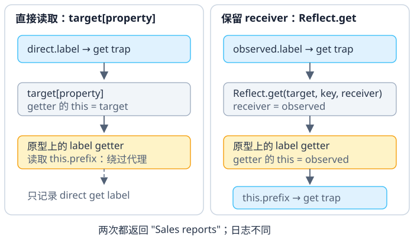

赋值也有对称的接收者通路：`obj[key] = value` 开始于 `obj.[[Set]](key, value, obj)`；Proxy 的 `set` trap 收到 `target`、键、值和 receiver。没有 trap 时代理将同一个 receiver 交给 target 的 `[[Set]]`，而 `Reflect.set(target, key, value, receiver)` 也会显式传递它。若沿原型找到 setter，setter 的 `this` 是 receiver；若找到可写数据属性，普通赋值会在 receiver 上更新或新建自有属性（还要满足接收者描述符和可扩展性约束）。所以看到 trap 的 `target` 参数，不能据此判断最终写入位置。省略 `Reflect.set` 的第四个参数时 receiver 默认是 target。

继续这个实例，先经 `observed.prefix = "Ops"` 改变前缀。这里 receiver 是代理：`Reflect.set` 找到 target 上可写的 `prefix` 数据属性后，会查询 receiver 的自有描述符，并在 receiver 上执行属性定义。本例没有 `getOwnPropertyDescriptor` 或 `defineProperty` trap，这两步又默认转发给 `service`，所以最终改变的是 `service.prefix`。后面换成普通子对象作为 receiver 时，定义才留在子对象本身。

`label` 还有一个 setter，执行 `this.prefix = value`。创建 `observedChild = Object.create(observed)` 后，子对象最初没有自己的 `prefix`；给它的 `label` 赋值 `"Branch"` 时，代理收到子对象作为 receiver。Reflect 转发后，继承 setter 的 `this` 是子对象，setter 的 `this.prefix` 写入又经过代理，Reflect.set 在子对象上创建自有 `prefix`，target 保持 `"Ops"`。再读子对象的 getter 时 `this` 仍是子对象，但 `this.prefix` 命中它自己的键，所以这次内部读取不再经过代理。

相对地，另建 `directChild = Object.create(direct)` 并给它的 `label` 赋值 `"West"`。这里 `direct` 的 set trap 用 `Reflect.set(target, key, value)`，省略 receiver，默认接收者就是 target：setter 将 target 的 `prefix` 改成 `"West"`，`directChild` 没有新建该键。

| 按上述顺序操作 | 子对象有自己的 `prefix` 吗？ | 此时 `service.prefix` | 读子对象 `label` |
|---|---|---|---|
| `observedChild.label = "Branch"` | 有，值为 `"Branch"` | `"Ops"` | `"Branch reports"` |
| `directChild.label = "West"` | 没有 | `"West"` | `"West reports"` |

方法调用又是另一条路径。服务的 `onReport` 方法会递增闭包计数，再调用 `this.format`，用前缀、`daily` 标签、报表标题和次数拼出结果。`observed.onReport(...)` 是方法调用，返回的处理器以 `observed` 为 `this`；它读取 `this.format` 时触发 `get format`，`format` 再读取 `this.prefix` 时触发 `get prefix`。即使 `observed` 的 trap 改用直接的 `target[property]` 返回这个方法，调用表达式仍会把 `observed` 作为 `this`。若代码保留原始 `service` 引用，就能绕过代理。代理也有独立身份：`observed !== service`。这里从对象代理取出的是原函数；`apply` trap 只有在被调用的函数本身也是 Proxy 时才介入，可用 `Reflect.apply(target, thisArg, args)` 转发调用。Proxy 是 JavaScript 运行时对象特性，不是 TypeScript 类型特性。

> [!example]- 完整报表服务：对照属性读取、子对象写入和方法日志
> 完整代码从 `Sales` 开始；先调用报表方法得到 `Sales/daily: Q4 #1`，改成 `Ops` 后再次调用得到 `Ops/daily: Q4 #2`，最后依次执行上表两个子对象写入。下面的全部代码共用同一个实例；按这个顺序运行，输出与前面的各阶段对应。
>
> ~~~javascript
> function makeReportHandler(tag) {
>   let calls = 0;
>   return function onReport(report) {
>     "use strict";
>     calls += 1;
>     return this.format(report, tag, calls);
>   };
> }
>
> function ReportService(prefix) {
>   this.prefix = prefix;
>   this.onReport = makeReportHandler("daily");
> }
>
> ReportService.prototype.format = function (report, tag, sequence) {
>   return this.prefix + "/" + tag + ": " + report.title + " #" + sequence;
> };
>
> Object.defineProperty(ReportService.prototype, "label", {
>   configurable: true,
>   get() {
>     return this.prefix + " reports";
>   },
>   set(value) {
>     this.prefix = value;
>   },
> });
>
> const service = new ReportService("Sales");
> const direct = new Proxy(service, {
>   get(target, property) {
>     console.log("direct get", String(property));
>     return target[property];
>   },
>   set(target, property, value) {
>     console.log("direct set", String(property));
>     return Reflect.set(target, property, value);
>   },
> });
>
> const observed = new Proxy(service, {
>   get(target, property, receiver) {
>     console.log("get", String(property));
>     return Reflect.get(target, property, receiver);
>   },
>   set(target, property, value, receiver) {
>     console.log("set", String(property));
>     if (property === "prefix" && typeof value !== "string") {
>       throw new TypeError("prefix must be a string");
>     }
>     return Reflect.set(target, property, value, receiver);
>   },
> });
>
> console.log("direct.label =", direct.label);
> // 记录 direct get label；输出 "Sales reports"，getter 的 this 是 target
>
> console.log("observed.label =", observed.label);
> // 记录 get label、get prefix；输出 "Sales reports"，getter 的 this 是 observed
>
> console.log("report =", observed.onReport({ title: "Q4" }));
> // 记录 get onReport、get format、get prefix；输出 "Sales/daily: Q4 #1"
>
> observed.prefix = "Ops"; // 记录 set prefix
> console.log("observed.prefix =", observed.prefix); // 再记录 get prefix；输出 "Ops"
> console.log("report =", observed.onReport({ title: "Q4" })); // "Ops/daily: Q4 #2"
> console.log("separate identity =", observed !== service); // true
>
> const observedChild = Object.create(observed);
> observedChild.label = "Branch";
> console.log("observed child =", observedChild.label,
>   Object.hasOwn(observedChild, "prefix"), service.prefix);
> // setter 的 this 是子对象；结果为 "Branch reports"、true、"Ops"
>
> const directChild = Object.create(direct);
> directChild.label = "West";
> console.log("direct child =", directChild.label,
>   Object.hasOwn(directChild, "prefix"), service.prefix);
> // direct set 忽略 receiver，结果为 "West reports"、false、"West"
> console.log("Reflect.get default receiver =", Reflect.get(service, "label"));
> // receiver 省略时使用 target，getter 返回 "West reports"
> ~~~

Map 与 class private field（私有字段）会以两种机制表现出相同的 receiver 陷阱。`Map.prototype.get` 检查调用时的 `this` 是否带有 `[[MapData]]` 内部槽；包住 Map 的 Proxy 没有 target 的内部槽，所以即使 Reflect 正确转发普通方法读取，方法以 Proxy 为 `this` 时仍会抛 `TypeError`：

~~~javascript
const originalMap = new Map([["Q4", 4]]);
const proxiedMap = new Proxy(originalMap, {
  get(target, property, receiver) {
    return Reflect.get(target, property, receiver);
  },
});

console.log(originalMap.get("Q4")); // 4
try {
  proxiedMap.get("Q4");
} catch (error) {
  console.log(error.name); // TypeError：代理没有 Map 的 [[MapData]] 内部槽
}
~~~

这类内建对象不能仅凭普通属性转发就假定行为透明；是否把方法绑定到 target 需要按 API 的 `this` 语义单独设计。

私有字段不是字符串属性，也不会触发 `get` trap。读取 `this.#id` 会按当前对象查找私有元素；Proxy 没有原实例的私有元素。把所有方法绑定到 target 也不是通用修复：绑定会改变方法的 `this`，方法里的普通读写可能因此绕开代理。

~~~javascript
class PrivateReport {
  #id = 7;
  readId() { return this.#id; }
}

const rawReport = new PrivateReport();
const proxyReport = new Proxy(rawReport, {
  get(target, property, receiver) {
    console.log("get", String(property));
    return Reflect.get(target, property, receiver);
  },
});

console.log("raw private field =", rawReport.readId()); // 7
try {
  proxyReport.readId();
} catch (error) {
  console.log("proxy private field =", error.name); // get readId 后抛 TypeError；没有 get #id
}
~~~

### trap 的返回值受到哪些约束，校验又能覆盖哪些入口？

`set` trap 的返回值会先转成布尔值；`false` 表示这次赋值失败，非严格赋值可能静默失败，严格赋值会抛出 `TypeError`。`true` 只表示 trap 报告成功，并不证明它实际写入了值；只要不违反目标对象的不变量，引擎就可以接受这个报告。

~~~javascript
const rejected = new Proxy({ prefix: "Sales" }, {
  set() { return false; },
});

console.log(Reflect.set(rejected, "prefix", "Ops")); // false
console.log(rejected.prefix); // "Sales"
(function () {
  "use strict";
  try {
    rejected.prefix = "Ops";
  } catch (error) {
    console.log(error.name); // TypeError：严格赋值不接受 false
  }
})();
~~~

另一个 trap 可以报告成功而不动目标。因为 `label` 是可配置属性，这个成功报告不违反 Proxy 不变量：

~~~javascript
const reportedTarget = { label: "Sales" };
const reportedOnly = new Proxy(reportedTarget, {
  set() { return true; },
});

console.log(Reflect.set(reportedOnly, "label", "Ops")); // true
console.log(reportedTarget.label); // "Sales"：trap 没有写入
~~~

Proxy invariant（代理不变量）禁止 trap 对 `target` 的某些**自有**属性报告矛盾结果。例如，`get` trap 不能为不可配置且不可写的自有数据属性返回其他值；对应的不可配置访问器若没有 getter，则必须返回 `undefined`。对不可配置且不可写的数据属性，`set` trap 报告 `true` 时，写入值必须与固定值满足规范的 `SameValue`（相同值）比较；若不可配置访问器没有 setter，则不能报告写入成功。违反约束会抛出 `TypeError`。

~~~javascript
const fixed = Object.freeze({ id: 7 });
const inconsistent = new Proxy(fixed, {
  get(target, property, receiver) {
    if (property === "id") return 8;
    return Reflect.get(target, property, receiver);
  },
});

try {
  inconsistent.id;
} catch (error) {
  console.log(error.name); // TypeError：不能用 8 代替固定值 7
}
~~~

~~~javascript
const fixedId = Object.freeze({ id: 7 });
const reportsSet = new Proxy(fixedId, { set() { return true; } });

console.log(Reflect.set(reportsSet, "id", 7)); // true：满足 SameValue 不变量
try {
  Reflect.set(reportsSet, "id", 8);
} catch (error) {
  console.log(error.name); // TypeError：不能报告不同固定值写入成功
}

const noSetter = Object.defineProperty({}, "id", {
  get() { return 7; }, configurable: false,
});
const reportsNoSetter = new Proxy(noSetter, { set() { return true; } });
try {
  Reflect.set(reportsNoSetter, "id", 8);
} catch (error) {
  console.log(error.name); // TypeError：目标访问器没有 setter
}
~~~

不可扩展目标对象还约束 `ownKeys`：trap 必须给出完全相同的一组自有键，包括仍可配置的键；返回顺序可以不同。

~~~javascript
const closedTarget = Object.preventExtensions({ id: 7, note: 8 });
const missingKey = new Proxy(closedTarget, {
  ownKeys() { return ["id"]; },
});

try {
  Reflect.ownKeys(missingKey);
} catch (error) {
  console.log(error.name); // TypeError：漏掉 note
}
~~~

一个高层操作可能触发多个 trap。例如 `array.push(value)` 会读取方法和当前长度，再写入数组索引、更新 `length`。校验或记录写入时，应覆盖需要观察的每个操作。

~~~javascript
const events = [];
const values = new Proxy([], {
  get(target, property, receiver) {
    events.push(`get ${String(property)}`);
    return Reflect.get(target, property, receiver);
  },
  set(target, property, value, receiver) {
    events.push(`set ${String(property)}=${value}`);
    return Reflect.set(target, property, value, receiver);
  },
});

values.push("new");
console.log(events.join(" | "));
// get push | get length | set 0=new | set length=1
~~~

再换一个小型校验例子：产品价格从 `10` 改为 `12`，读取和写入都会被记录，赋值为负数时在转发前抛错。关键问题是，这条校验覆盖了哪些写入入口？

~~~javascript
const product = new Proxy({ price: 10 }, {
  get(target, property, receiver) {
    console.log("read", String(property));
    return Reflect.get(target, property, receiver);
  },
  set(target, property, value, receiver) {
    console.log("write", String(property));
    if (property === "price" && (!Number.isFinite(value) || value < 0)) {
      throw new RangeError("price must be a non-negative finite number");
    }
    return Reflect.set(target, property, value, receiver);
  },
});

product.price = 12; // 记录 write price 并更新目标对象
product.price;      // 12；触发 get trap
try {
  product.price = -1;
} catch (error) {
  console.log(error.name, product.price); // RangeError 12；无效值未写入
}

Object.defineProperty(product, "price", { value: -1 }); // 经 [[DefineOwnProperty]]；没有 defineProperty trap 时转发给 target，不经过 set
console.log(product.price); // -1：应用校验只覆盖赋值路径
~~~

### 可调用和可构造 target 保留相应能力

Proxy 的 `target` 和 `handler` 都必须是对象。若 `target` 可调用或可构造，代理也具有相应能力；`construct` trap 必须返回对象。`Reflect.construct` 会连同参数一起转发 `newTarget`。

~~~javascript
function ReportFactory(prefix) {
  this.prefix = prefix;
}

const tracedFactory = new Proxy(ReportFactory, {
  construct(target, args, newTarget) {
    console.log("construct", args[0]);
    return Reflect.construct(target, args, newTarget);
  },
});

class RegionalReport extends tracedFactory {}
const created = new RegionalReport("Finance"); // 记录 construct Finance
console.log(created instanceof RegionalReport); // true
console.log(created instanceof ReportFactory); // true

const arrowProxy = new Proxy(() => {}, {
  construct() { return {}; },
});
try {
  new arrowProxy();
} catch (error) {
  console.log(error.name); // TypeError：Proxy 不会让箭头函数变成构造器
}
~~~

保留 `newTarget` 后，`ReportFactory` 内的 `new.target` 是 `RegionalReport`；本例据此选用 `RegionalReport.prototype` 创建实例，所以对象同时属于 `RegionalReport` 和 `ReportFactory`。若 trap 调用 `Reflect.construct(target, args)` 而漏传 `newTarget`，对象仍是 `ReportFactory` 的实例，但不再是 `RegionalReport` 的实例。Proxy 保留 target 原有的可构造能力；给箭头函数写 `construct` trap 也不能让它变成构造器。

### 响应式系统为什么关心操作是否经过代理？

Vue 的响应式实现也能用“经过哪条操作路径”来理解。维护 Vue 2 旧应用时，它在初始化时为已有属性安装 getter/setter，后来给嵌套对象直接增加新筛选键，不会自动安装观察器；需用 `Vue.set` 等 API 添加响应式属性。Vue 3 的 `reactive()` 通过 Proxy 在读取时跟踪依赖，经代理且值确实发生变化的写入会触发相关依赖，新键赋值也会经过这些代理操作；通过原对象直接改值虽会改变数据，却不会触发这次响应式更新。Vue 3 的 `ref.value` 仍通过 getter/setter 工作。这些是框架采用的操作路径，不代表所有应用都必须照搬。

已知属性有稳定读写契约时使用访问器；需要拦截对象上的操作时再用 Proxy，例如校验之后新增的键或记录一组属性访问。Proxy 无法观察通过另行保留的 `target` 引用执行的操作。

**相关机制：** [对象与原型](#33.%20JavaScript%20%E5%AF%B9%E8%B1%A1%E5%A6%82%E4%BD%95%E6%9F%A5%E6%89%BE%E5%B1%9E%E6%80%A7%E5%B9%B6%E7%BB%84%E7%BB%87%E6%88%90%E5%91%98%EF%BC%9F) 解释属性描述符和 getter；[Map 与 Set](#29.%20%E4%BD%95%E6%97%B6%E4%BD%BF%E7%94%A8%20Map%E3%80%81Set%20%E6%88%96%E6%99%AE%E9%80%9A%E5%AF%B9%E8%B1%A1%EF%BC%9F) 介绍这里提到的 Map 集合；[使用 `new` 构造对象](#35.%20JavaScript%20%E7%9A%84%20new%20%E5%A6%82%E4%BD%95%E6%9E%84%E9%80%A0%E5%AF%B9%E8%B1%A1%EF%BC%9F) 说明代理构造和 `construct` 的边界。

> [!info]- 来源
> - 属性读写的内部方法入口：[ECMAScript GetValue](https://tc39.es/ecma262/2026/multipage/ecmascript-data-types-and-values.html#sec-getvalue)（§6.2.5.5）与 [PutValue](https://tc39.es/ecma262/2026/multipage/ecmascript-data-types-and-values.html#sec-putvalue)（§6.2.5.6）；receiver 沿原型传递见 [OrdinaryGet](https://tc39.es/ecma262/2026/multipage/ordinary-and-exotic-objects-behaviours.html#sec-ordinaryget)（§10.1.8.1）和 [OrdinarySetWithOwnDescriptor](https://tc39.es/ecma262/2026/multipage/ordinary-and-exotic-objects-behaviours.html#sec-ordinarysetwithowndescriptor)（§10.1.9.2）。
> - Proxy 的 trap 分发、receiver 转发和 ownKeys/set 不变量：[ECMAScript Proxy Object Internal Methods](https://tc39.es/ecma262/2026/multipage/ordinary-and-exotic-objects-behaviours.html#sec-proxy-object-internal-methods-and-internal-slots)（§10.5）；对象内部方法的一般约束见 [Invariants of the Essential Internal Methods](https://tc39.es/ecma262/2026/multipage/ecmascript-data-types-and-values.html#sec-invariants-of-the-essential-internal-methods)（§6.1.7.3）。
> - receiver 默认值及构造转发：[ECMAScript Reflect.get](https://tc39.es/ecma262/2026/multipage/reflection.html#sec-reflect.get)、[Reflect.set](https://tc39.es/ecma262/2026/multipage/reflection.html#sec-reflect.set)、[Reflect.construct](https://tc39.es/ecma262/2026/multipage/reflection.html#sec-reflect.construct)（§28）。
> - Map 内部槽与私有元素访问：[Map.prototype.get](https://tc39.es/ecma262/2026/multipage/keyed-collections.html#sec-map.prototype.get)（§24.1.3.6）、[PrivateGet](https://tc39.es/ecma262/2026/multipage/abstract-operations.html#sec-privateget)（§7.3.30）。
> - Vue 2 新增属性限制：[Change Detection Caveats](https://v2.vuejs.org/v2/guide/reactivity.html#Change-Detection-Caveats)；Vue 3 的代理读取/写入和原对象边界：[Reactivity in Depth](https://vuejs.org/guide/extras/reactivity-in-depth.html#how-reactivity-works-in-vue)、[Reactive Proxy vs. Original](https://vuejs.org/guide/essentials/reactivity-fundamentals.html#reactive-proxy-vs-original)。
## 37. 函数变换如何改变调用过程？

函数可以返回新函数，也可以由包装器改变一次调用的处理流程。本章沿调用过程看 rest parameter（剩余参数）、currying（柯里化）与 partial application（部分应用）、composition（组合）、decorator（装饰器）和 memoization（记忆化）：参数何时齐备、this 如何传递、返回值与异常如何处理；涉及缓存时再定义键策略。

### 返回函数可以捕获状态，也可以不捕获

rest parameter（剩余参数）把尚未被前面形参接收的实参收集成数组；下面的函数只有 `...args`，所以它收集全部实参。显式传入 `undefined` 仍计为一个实参。返回函数只有在后续调用需要读取外层绑定时，才需要 closure（闭包）状态。

~~~javascript
function argumentsLength(...args) {
  return args.length;
}

argumentsLength();            // 0
argumentsLength(undefined);   // 1
argumentsLength({}, null, 3); // 3

function createHelloWorld() {
  return () => "Hello World";
}

const hello = createHelloWorld();
hello({}, null, 42); // "Hello World"；无需捕获状态
~~~

JavaScript 函数即使没有声明形参，也可以接收多余实参；这里没有读取它们，所以不需要声明 rest parameter。

### 柯里化把实参分到多次调用中提供

严格意义的 currying（柯里化）把多参数函数变为每次接收一个参数的一串函数，例如 `sum(a, b, c)` 变为 `curriedSum(a)(b)(c)`。partial application（部分应用）则先固定部分实参，返回等待其余实参的新函数，不要求每次只接收一个。下面是常见的宽松 `curry` 辅助函数：它允许一次提供一个或多个实参，收集够声明的数量后才调用原函数。简单位置参数函数可用 `fn.length` 作为 arity（元数）约定，但它不代表通用参数契约：它只数第一个带默认值的形参之前的形参，rest parameter 也不计入长度。占位符和可变参数函数需要另定规则。

~~~javascript
function curry(fn) {
  "use strict";
  return function curried(...args) {
    if (args.length >= fn.length) return fn.apply(this, args);
    return function (...next) {
      return curried.apply(this, args.concat(next));
    };
  };
}

const sum = (a, b, c) => a + b + c;
const curriedSum = curry(sum);

curriedSum(1)(2)(3); // 6
curriedSum(1, 2)(3); // 6
curriedSum(1, 2, 3); // 6

function describeParts(prefix, period) {
  return this.name + ":" + prefix + "/" + period;
}

const partial = curry(describeParts).call({ name: "first" }, "daily");
partial.call({ name: "final" }, "Q4"); // "final:daily/Q4"
~~~

以 `curriedSum(1)(2)(3)` 为例，参数的状态变化如下。每一步返回的函数都保留当前前缀；它不会把其他分支的前缀一起修改。

| 这次调用 | 当前收集到的实参 | 是否调用 `sum` | 返回值 |
| --- | --- | --- | --- |
| `curriedSum(1)` | `[1]` | 否，距离 `sum.length = 3` 还差两个 | 等待后续参数的函数 |
| 上一步结果 `(2)` | `[1, 2]` | 否，还差一个 | 新的等待函数 |
| 上一步结果 `(3)` | `[1, 2, 3]` | 是，调用 `sum(1, 2, 3)` | `6` |

不借助 `curry` 也能做部分应用：`const addOneDirect = (b, c) => sum(1, b, c)` 固定第一个参数，调用 `addOneDirect(2, 3)` 得到 `6`。它一次接收剩余两个参数。下面的 `const addOne = curriedSum(1)` 既是宽松柯里化的一步，也产生了固定前缀的部分应用；它可先调用 `addOne(2, 3)` 得到 `6`，再调用 `addOne(4, 5)` 得到 `10`；两次都从同一个 `[1]` 前缀开始。对于 `function f(a, b = 10) { return a + b; }`，`f.length` 为 `1`，所以 `curry(f)(2)` 已立即返回 `12`，不会等待第二次调用。这正是必须先选择参数契约的原因。

这个实现会转发补足参数那次调用的接收者，不会保存第一次部分调用的接收者。达到声明元数时，它也会保留多余实参。这些都属于该辅助函数的契约。

### 组合把上一步输出接到下一步输入

function composition（函数组合）从右向左执行：`compose([f, g, h])(x)` 计算 `f(g(h(x)))`。函数列表为空时返回 identity function（恒等函数），也就是原样返回输入。

~~~javascript
function compose(functions) {
  return function (value) {
    for (let i = functions.length - 1; i >= 0; i--) {
      const step = functions[i];
      value = step(value);
    }
    return value;
  };
}

const transform = compose([
  value => value + 1,
  value => value * value,
  value => 2 + value,
]);

transform(4); // 37: 4 -> 6 -> 36 -> 37
compose([])(42); // 42
~~~

对 `n` 个单输入函数，每次正常完成的组合调用执行 `n` 次，循环仅使用常量额外空间。若操作不可交换或带副作用，执行顺序就很重要。这个 `compose` 是同步组合：某一步抛错会立即退出循环，把同一个异常传给调用者，左侧剩余步骤不会运行；某一步返回 Promise 时，它会把这个 Promise 对象原样交给下一步，不会等待兑现值。若步骤需要异步串接，应显式选择 Promise 链或 async/await 的组合契约。

循环先把步骤函数取到局部变量，再裸调用，避免把 `functions` 数组意外作为接收者。裸调用提供 `undefined` 接收者；被调用函数若为非严格函数，仍会按自身规则将其转换为全局对象。

### 包装器转发一次调用并附加一种策略

wrapper（包装器）是调用原函数并附加策略的新函数。计时 decorator（装饰器）应转发 `this` 和全部实参，并在原函数返回或抛错时都报告耗时。`finally` 会处理正常返回和异常完成两种情况；只要记录耗时本身正常完成，原返回值或异常便继续向外传递。若 `finally` 自己抛错或执行 `return`，则会覆盖之前的完成结果。

~~~javascript
function withTiming(fn) {
  "use strict";
  return function (...args) {
    const started = performance.now();
    try {
      return fn.apply(this, args);
    } finally {
      console.log((fn.name || "operation") + ": " +
        (performance.now() - started) + " ms");
    }
  };
}
~~~

包装器本身是严格函数，因此裸调用时收到的 `undefined` 会原样传给 `fn.apply`；被包装函数仍按自己的严格性决定如何处理它。若包装器在非严格模式下运行，裸调用时 `this` 会先变成全局对象，`apply` 就无法保留原调用的接收者语义。这个计时包装器只测同步执行时间。若 `fn` 返回 Promise，`finally` 会在 Promise 对象返回后立即运行，不会计入异步操作完成前的时间；测异步完成耗时需要按 Promise 生命周期另行包装。

TypeScript 的显式 `this` 参数只向类型检查器描述接收者，不会增加运行时实参。

函数装饰器模式指用包装器增加调用策略；它与 JavaScript 或 TypeScript 的 decorator syntax（装饰器语法）不同；语法可用的位置与行为取决于采用的语言模式，见末尾的装饰器章节。

单次调用包装器保存一个布尔绑定。应在调用目标函数前置位，因此第一次调用即使抛错也会消耗机会。后续调用返回 `undefined`；第一次的结果或异常原样传递。

~~~javascript
function once(fn) {
  "use strict";
  let called = false;
  return function (...args) {
    if (called) return undefined;
    called = true;
    return fn.apply(this, args);
  };
}

let calls = 0;
const onlyOnce = once(function (a, b, c) {
  calls += 1;
  return a + b + c;
});

onlyOnce(1, 2, 3); // 6
onlyOnce(2, 3, 6); // undefined
calls;             // 1
~~~

若首次调用抛错，标志已经置位，因此下次不会重试目标函数；首次返回的 Promise 后来拒绝也不会重置这个标志。这种策略不同于“只允许一次成功调用”；包装可能失败的操作时应明确选择。

~~~javascript
let attempts = 0;
const failOnce = once(function () {
  attempts += 1;
  throw new Error("failed");
});

try { failOnce(); } catch (error) { error.message; } // "failed"
failOnce(); // undefined
attempts;   // 1
~~~

### 记忆化在调用前增加缓存键策略

memoization（记忆化）会缓存结果，命中时跳过原函数调用。因此必须确认相同缓存键能复用同一个结果，而且跳过原调用的副作用是允许的；读取随时间变化的状态通常还需要失效策略。判断是否命中要检查键是否存在，而不是缓存值是否为真：`0`、`false`、`undefined` 都可能是有效结果。

`LeetCode 2623` 只接受有限整数实参：`sum(a, b)` 中 `0 ≤ a, b ≤ 10^5`，`fib(n)` 和 `factorial(n)` 中 `1 ≤ n ≤ 10`。因此该题可将有序整数实参元组序列化为键；这不是任意 JavaScript number 元组的通用编码。`Map.has` 可以区分键不存在和缓存值为 `undefined`。下例只将实参放入缓存键，因此只适用于结果不依赖 `this` 的这些函数；缓存未命中时仍转发 `this`，并不意味着缓存键也包含它。

~~~javascript
function memoizeNumeric(fn) {
  "use strict";
  const cache = new Map();
  return function (...args) {
    const key = JSON.stringify(args);
    if (cache.has(key)) return cache.get(key);
    const result = fn.apply(this, args);
    cache.set(key, result);
    return result;
  };
}

let evaluations = 0;
const add = memoizeNumeric(function (a, b) {
  evaluations += 1;
  return a + b;
});

[add(2, 2), add(2, 2), add(1, 2), evaluations];
// [4, 4, 3, 2]
~~~

序列化元组保留实参顺序，因此 `[2, 3]` 和 `[3, 2]` 是不同键，即使函数返回相同结果。把这种键推广到任意 JavaScript 值时会遇到碰撞：`[NaN]` 与 `[Infinity]` 都会序列化为 `"[null]"`，`[-0]` 会序列化为 `"[0]"`；`[undefined]` 与 `[null]` 也都会序列化为 `"[null]"`。对象身份会丢失；依赖接收者的函数没有把 `this` 放入键；循环输入会在序列化时抛错。通用记忆化必须先定义实参、接收者身份、可变输入和失败结果的处理方式，再决定缓存结构。

这个实现先调用 `fn`，再写缓存。若 `fn` 同步抛错，`cache.set` 不执行，下次同键调用仍会重试；若它返回 Promise，Promise 对象会立即入缓存，后续同键调用共享这个对象，即使它后来拒绝也不会自动清除。要把它用于异步请求，必须另外决定拒绝结果是否保留，以及何时过期或重试。

只包装 `fib` 外层调用，不会缓存原始 `fib` 函数内部直接发起的递归调用。要缓存每个子问题，递归调用也必须经过记忆化函数或共享内部缓存。

**相关机制：** [函数 `this` 与绑定](#34.%20JavaScript%20%E5%87%BD%E6%95%B0%E7%9A%84%20this%20%E5%80%BC%E7%94%B1%E4%BB%80%E4%B9%88%E5%86%B3%E5%AE%9A%EF%BC%9F) 解释包装器为什么用 `apply` 保留接收者；[作用域与闭包](#32.%20JavaScript%20%E4%BD%9C%E7%94%A8%E5%9F%9F%E4%B8%8E%E9%97%AD%E5%8C%85%E5%A6%82%E4%BD%95%E4%BF%9D%E7%95%99%E7%8A%B6%E6%80%81%EF%BC%9F) 解释 `once` 和记忆化保留的状态；[Map 与 Set](#29.%20%E4%BD%95%E6%97%B6%E4%BD%BF%E7%94%A8%20Map%E3%80%81Set%20%E6%88%96%E6%99%AE%E9%80%9A%E5%AF%B9%E8%B1%A1%EF%BC%9F) 说明缓存键相等性和存在性；[TypeScript 装饰器](#48.%20%E9%A1%B9%E7%9B%AE%E4%BD%BF%E7%94%A8%E5%93%AA%E7%A7%8D%20TypeScript%20%E8%A3%85%E9%A5%B0%E5%99%A8%E6%A8%A1%E5%BC%8F%EF%BC%9F) 讲解装饰器语法。


> [!info]- 来源
> - 函数闭包和 length 属性：[ECMAScript Function Objects](https://tc39.es/ecma262/2026/multipage/ordinary-and-exotic-objects-behaviours.html#sec-ecmascript-function-objects)（§10.2）、[Function length](https://tc39.es/ecma262/2026/multipage/fundamental-objects.html#sec-function-instances-length)（§20.2.4.1）。
> - 包装器转发接收者及参数：[ECMAScript Function.prototype.apply](https://tc39.es/ecma262/2026/multipage/fundamental-objects.html#sec-function.prototype.apply)；缓存键示例中的存在检查和序列化：[Map.prototype.has](https://tc39.es/ecma262/2026/multipage/keyed-collections.html#sec-map.prototype.has)（§24.1.3.9）、[JSON.stringify](https://tc39.es/ecma262/2026/multipage/structured-data.html#sec-json.stringify)（§25.5.4）。
> - 计时示例的 API：[W3C High Resolution Time performance.now](https://www.w3.org/TR/hr-time-3/#dom-performance-now)；TypeScript 显式 this 参数：[TypeScript Functions](https://www.typescriptlang.org/docs/handbook/2/functions.html#declaring-this-in-a-function)。
> - 特定题目输入契约和作者解法仍保留在 [Memoize](../../archive/front-end/0-1_Learning_Notes/Typescript/leetcode30days/FunctionTransformations/2623.%20Memoize.md)、[Function Composition](../../archive/front-end/0-1_Learning_Notes/Typescript/leetcode30days/FunctionTransformations/2629.%20Function%20Composition.md)、[Allow One Function Call](../../archive/front-end/0-1_Learning_Notes/Typescript/leetcode30days/FunctionTransformations/2666.%20Allow%20One%20Function%20Call.md) 和 [Return Length of Arguments Passed](../../archive/front-end/0-1_Learning_Notes/Typescript/leetcode30days/FunctionTransformations/2703.%20Return%20Length%20of%20Arguments%20Passed.md)。
## 38. 弱集合与弱引用能保证什么？

同一次报表筛选中，`first` 和 `retry` 都带业务 id `r-104`，却是两个对象。界面若要给某个对象身份附加选中状态，`WeakMap`（弱映射）可以存元数据，而不因这条关联本身延长键的生命周期。它不会替你解除监听器等其他强引用路径；若关窗后旧行还留在内存里，应另查实际保留链。`WeakRef`（弱引用）和 `FinalizationRegistry`（最终化注册表）也不能给确定的资源清理提供及时、必达的保证。普通 `Map`（映射）的身份键与强持有见[何时使用 Map、Set 或普通对象？](#29.%20%E4%BD%95%E6%97%B6%E4%BD%BF%E7%94%A8%20Map%E3%80%81Set%20%E6%88%96%E6%99%AE%E9%80%9A%E5%AF%B9%E8%B1%A1%EF%BC%9F)。

本章的对象身份示例是两条同业务 id 的输入：

~~~javascript
const first = {
  reportId: "r-104",
  amount: 0,
  owner: { id: "u-17", name: "Ada" },
};
const retry = {
  reportId: "r-104",
  amount: 120,
  owner: { id: "u-17", name: "Ada" },
};
~~~

### WeakMap 关联数据，但不拥有键

`WeakMap` 把可弱持有的键与值关联起来。只要程序还通过其他路径持有键，就能用这个键读取关联值；如果键不再存活，这条关联不会把它救回来。`WeakMap` 不提供 `size`、键枚举或 `forEach`：回收时点不确定，枚举会让程序观察原本不能观察的弱键状态。

对象是最常见的键。ECMAScript 2023 起，非注册 `Symbol`（符号）也可作为弱键；`Symbol.for` 创建的注册 `Symbol` 不能弱持有。

每次调用 `Symbol("row metadata")` 都会创建一个新的符号，即使描述字符串相同，身份仍不同；重复调用 `Symbol.for("shared")` 则会从共享注册表中取回同一个符号。

~~~javascript
const rowMetadata = new WeakMap();

rowMetadata.set(first, { selected: true, row: first });
console.log(rowMetadata.get(first).selected, rowMetadata.get(first).row === first); // true true
console.log(rowMetadata.has(retry)); // false：业务 id 相同，键对象身份不同

const localSymbol = Symbol("row metadata");
rowMetadata.set(localSymbol, { source: "non-registered symbol" });

const sharedSymbol = Symbol.for("shared");
console.log(rowMetadata.has(sharedSymbol)); // false
try {
  rowMetadata.set(sharedSymbol, {});
} catch (error) {
  console.log(error.name); // TypeError：注册 Symbol 不能作弱键
}
~~~

`rowMetadata` 的值还反向引用了 `first`，但弱映射按键的可达性处理这条条目：只要别处仍持有 `first`，可以通过 `rowMetadata.get(first)` 读回值；若外部所有强路径都断开，键和值间的环不会单靠这条弱关联保活。本页仍可访问的 `first` 变量本身就是一条普通强路径；若代码把 `rowMetadata.get(first)` 的返回值保存到普通变量，之后也能沿该值的 `row` 属性回到键。反过来，任何其他强路径——例如下一章中的未移除监听器——仍会让键存活，WeakMap 不会替程序解除那条路径。

适合 `WeakMap` 的情况是给其他代码所有的节点或类实例保存私有附加元数据；对象生命周期由外部所有者决定，元数据不需要独立枚举。若要列出、计数或集中控制缓存项，就用普通 `Map`，并由其所有者强引用对象、显式删除条目。

### WeakSet 只跟踪可弱持有的成员

`WeakSet`（弱集合）按身份弱跟踪对象或非注册 `Symbol`，提供 `add`、`has`、`delete`，但没有遍历和 `size`。它适合标记由其他部分拥有的对象是否已经处理过：

~~~javascript
const processedRows = new WeakSet();

function processOnce(row) {
  if (processedRows.has(row)) return;
  processedRows.add(row);
  // 对这个对象身份执行一次处理
}

processOnce(first);
console.log(processedRows.has(first)); // true
console.log(processedRows.has(retry)); // false：仍按对象身份区分

const symbolMarker = Symbol("non-registered marker");
processedRows.add(symbolMarker);
console.log(processedRows.has(symbolMarker)); // true
try {
  processedRows.add(Symbol.for("shared marker"));
} catch (error) {
  console.log(error.name); // TypeError：注册 Symbol 不可弱持有
}
~~~

这里按对象身份区分记录，不按 `reportId` 或字段内容去重。需要按业务 id 去重时应使用普通 `Map` 或 `Set`，并选择明确的键。

### WeakRef 和 FinalizationRegistry 不提供释放时限

`WeakRef` 的目标可以是对象或非注册 `Symbol`。`deref()` 在目标仍可用时返回目标，否则返回 `undefined`。如果返回了目标，规范只保证它在当前同步 ECMAScript 执行期间仍可用；宿主可能继续保活更久，但代码不能把这个延长当成保证。创建 `WeakRef` 时，构造函数也会把目标加入临时保活列表，所以本页后面的示例即使已离开 `pendingRow` 的局部作用域，刚构造完的目标仍能在同一次同步执行中首次 `deref()`。浏览器会在微任务检查点末尾清空这张列表；不是执行到 `await` 语法处就立即清空。跨异步任务若后续还要用目标，应把返回值保存在普通局部变量里，让这条强引用跨越等待。

~~~javascript
const weakRow = new WeakRef(first);
const row = weakRow.deref();

if (row !== undefined) {
  rowMetadata.set(row, { selected: true });
  console.log(row.reportId); // r-104：先检查，再在当前同步执行段使用
}

const weakSymbolTarget = Symbol("weak reference target");
console.log(new WeakRef(weakSymbolTarget).deref() === weakSymbolTarget); // true：非注册 Symbol 也可作目标
~~~

下面用定时器任务展示异步等待：这次调用把刚构造的引用立即交给 `readAfterRefresh`，因此首次 `deref()` 与 `new WeakRef(pendingRow)` 仍在同一次同步执行里；若传入早已跨过任务边界的引用，首次读取本身也可能走 `undefined` 分支。这里先把成功取到的对象存入 `row`，让普通强引用跨过定时器等待；如果只保留弱引用，等待后再 `deref()` 可能拿到 `undefined`。

~~~javascript
function makePendingRowRef() {
  const pendingRow = { reportId: "r-105" };
  return new WeakRef(pendingRow);
}

async function readAfterRefresh(ref) {
  const row = ref.deref();
  if (row === undefined) return undefined;
  await new Promise(resolve => setTimeout(resolve, 0));
  return row.reportId; // row 是局部强引用
}

readAfterRefresh(makePendingRowRef()).then(id => {
  console.log("after await =", id); // r-105
});
~~~

`FinalizationRegistry`（最终化注册表）的 `register(target, heldValue[, token])` 会弱持有目标和符合资格的可选取消令牌（对象或非注册 `Symbol`）；注册表则在注册项仍有效时强持有 `heldValue`（暂存值）。若清理回调运行，它唯一收到的参数就是 `heldValue`，本例中为标签字符串。注册表不会强持有 token；本例的调用方可以单独保存令牌来取消注册，而不会经由注册表保活 `temporaryRow`。但如果 `heldValue` 本身或其属性又引用目标，这条强路径会让目标继续存活，回调也就无法因它不可达而运行。对象何时回收、回调何时运行都没有保证；回调可能延迟很久，程序退出前也可能永不运行。调用 `unregister(token)` 可以提前移除对应注册；目标本身不能直接作为 `heldValue`（会抛 `TypeError`）。

~~~javascript
const registry = new FinalizationRegistry(heldValue => {
  console.log("eventual cleanup hint:", heldValue);
});

let temporaryRow = { reportId: "temporary" };
const unregisterToken = {};
registry.register(temporaryRow, "temporary row", unregisterToken);
try {
  registry.register(temporaryRow, temporaryRow);
} catch (error) {
  console.log(error.name); // TypeError：heldValue 不能与 target 是同一个值
}
// registry.register(temporaryRow, { row: temporaryRow }); // 注册合法，但 heldValue 会保住目标
temporaryRow = null;
console.log(registry.unregister(unregisterToken)); // true：可显式取消这条注册
~~~

因此，这些 API 适合不影响正确性的缓存提示、附加元数据或机会式清理；不适合释放文件、网络连接、锁、计费记录、UI 状态或任何要求及时发生的动作。需要确定结束时间时，由明确的所有者调用 `dispose`、`removeEventListener`、`clearInterval` 或对应的清理函数。

如果这页的 `first` 在报表关闭后还活着，WeakMap 并不会清掉造成保留的其他路径。下一篇沿同一 `r-104` / `owner: Ada` 记录检查 `window` 上的 resize listener、闭包中的 `rows` 以及调用方持有的清理函数，再用堆快照找实际保留者：[对象为什么在不再有用后仍留在内存中？](#39.%20JavaScript%20%E5%AF%B9%E8%B1%A1%E4%B8%BA%E4%BD%95%E4%BC%9A%E5%9C%A8%E4%B8%8D%E5%86%8D%E6%9C%89%E7%94%A8%E5%90%8E%E4%BB%8D%E7%95%99%E5%9C%A8%E5%86%85%E5%AD%98%E4%B8%AD%EF%BC%9F)。

> [!info]- 来源
> - `WeakMap` / `WeakSet` 的弱键关系、无枚举约束及对象/非注册 Symbol 资格：[ECMAScript 2026 §24.3–24.4](https://tc39.es/ecma262/2026/multipage/keyed-collections.html)、[§9.13 `CanBeHeldWeakly`](https://tc39.es/ecma262/2026/multipage/executable-code-and-execution-contexts.html#sec-canbeheldweakly)；非注册 Symbol 的资格在 [ECMAScript 2023 §9.14](https://tc39.es/ecma262/2023/multipage/executable-code-and-execution-contexts.html#sec-canbeheldweakly) 已纳入规范。
> - `WeakRef` 目标资格与构造：[ECMAScript 2026 §26.1.1.1](https://tc39.es/ecma262/2026/multipage/managing-memory.html#sec-weak-ref-target)；构造与 `deref()` 都会加入临时保活列表：[§26.1.3.2](https://tc39.es/ecma262/2026/multipage/managing-memory.html#sec-weak-ref.prototype.deref)、[§9.10 `ClearKeptObjects`](https://tc39.es/ecma262/2026/multipage/executable-code-and-execution-contexts.html#sec-clearkeptobjects)、[§9.11 `AddToKeptObjects`](https://tc39.es/ecma262/2026/multipage/executable-code-and-execution-contexts.html#sec-addtokeptobjects)。浏览器宿主在微任务检查点末清空 kept objects：[WHATWG HTML §8.1.7.3 Processing model](https://html.spec.whatwg.org/multipage/webappapis.html#perform-a-microtask-checkpoint)，核验于 2026-11-12。
> - `Symbol()` 每次构造的身份与共享注册表查找：[ECMAScript 2026 §20.4.1.1、§20.4.2.2](https://tc39.es/ecma262/2026/multipage/fundamental-objects.html#sec-symbol.for)。
> - FinalizationRegistry 的 target、heldValue、可选弱 unregister token 及注册取消：[ECMAScript 2026 §26.2.3.2–3](https://tc39.es/ecma262/2026/multipage/managing-memory.html#sec-finalization-registry.prototype.register)、[§9.12 `CleanupFinalizationRegistry`](https://tc39.es/ecma262/2026/multipage/executable-code-and-execution-contexts.html#sec-cleanup-finalization-registry)、[§9.13 `CanBeHeldWeakly`](https://tc39.es/ecma262/2026/multipage/executable-code-and-execution-contexts.html#sec-canbeheldweakly)、[§9.9.1 Objectives](https://tc39.es/ecma262/2026/multipage/executable-code-and-execution-contexts.html#sec-weakref-processing-model)。
> - 本地重放：Node.js v26.13.0 / V8 14.6.202.34-node.40，2026-11-12；运行目标类型、符号键、同值 heldValue 异常和跨 `await` 的局部强引用示例，不触发 GC 或推断最终化时序。
## 39. JavaScript 对象为何会在不再有用后仍留在内存中？

报表页面关闭后，记录 `first`（业务 id `r-104`，owner 为 Ada）虽不再显示，却可能仍被全局事件监听器、计时器闭包或缓存引用。垃圾回收不会根据“这行业务上已过期”自动解除程序仍持有的引用。本章沿 `resize` 事件监听器和调用方保存的清理函数追踪这个记录，再用堆快照找具体保留者。弱集合不创建同类的强键路径，但也不会替你删除这些其他引用；其语言保证见[弱集合与弱引用能保证什么？](#38.%20%E5%BC%B1%E9%9B%86%E5%90%88%E4%B8%8E%E5%BC%B1%E5%BC%95%E7%94%A8%E8%83%BD%E4%BF%9D%E8%AF%81%E4%BB%80%E4%B9%88%EF%BC%9F)。

### 可达性是保留问题，不是对象之间是否成环

JavaScript 语言不规定一种垃圾回收算法，也不承诺某个不可达对象何时被回收。用追踪式回收作为模型：从全局对象、活动执行状态等 GC root（垃圾回收根）开始，沿强引用标记对象；循环引用本身不阻止回收，从根仍能到达的对象则须保留。V8 的 Orinoco 只作一个实现例：V8 团队 2019 年的说明介绍了它的分代布局和并行、增量、并发技术。这是该引擎的实现资料，不是 ECMAScript 对所有运行时的承诺；实际算法与时机由引擎决定。

下面沿用 `r-104` / Ada 记录。报表打开时，`rows` 数组保存 `first`；`onResize` 闭包读取这组行，`window` 的事件监听器列表（event listener list）保存回调。`openReport` 返回的清理函数也捕获同一个回调，所以调用方的 `releaseReport` 绑定形成第二条路径：

~~~javascript
function openReport(target) {
  const owner = { id: "u-17", name: "Ada" };
  const first = { reportId: "r-104", amount: 0, owner };
  const rows = [first];

  function render(currentRows) {
    console.log(currentRows.map(row => `${row.reportId}:${row.owner.name}`).join(", "));
  }

  function onResize() {
    render(rows);
  }

  target.addEventListener("resize", onResize);
  return () => target.removeEventListener("resize", onResize);
}

let releaseReport = openReport(window);
// 关闭报表时先移除事件监听器，再放弃保存清理函数的绑定：
releaseReport();
releaseReport = null;
~~~

**图：报表关闭时两条强引用路径的变化**

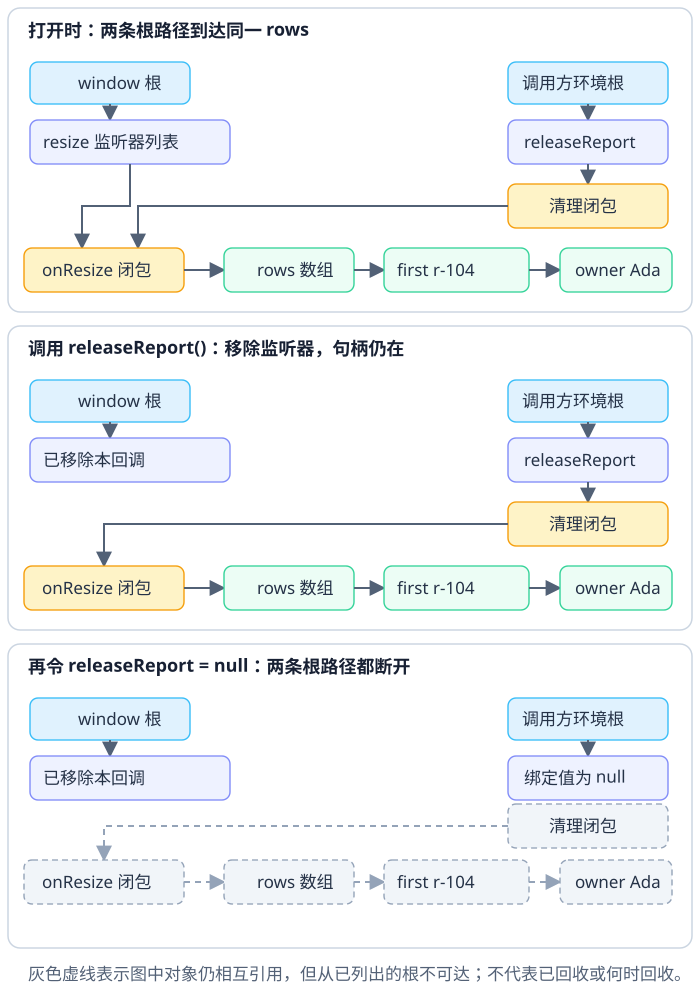

报表未关闭时，`window` 的事件监听器列表与 `releaseReport` 清理函数分别可达同一个 `onResize` 闭包；它再保留 `rows`、`first` 和嵌套 `owner`。执行 `releaseReport()` 会从 `window` 的事件监听器列表移除回调，但返回的清理函数仍在调用方绑定里，所以这一步单独做完后 `rows` 仍可达。再将绑定置为 `null`，图中这两条路径才都断开。如果还有其他所有者或根路径，对象仍会存活；即使这里没有已知路径，也只是具备回收条件，不能推断何时实际回收。

若某个 `WeakMap` 以 `first` 为键，手头持有这个对象的代码仍可用它查元数据。事件监听器仍在时，`first` 也沿着监听器路径存活；WeakMap 不会额外保住键，却不会替你删除 `window → callback → rows → first` 这条强引用路径。

常见保留路径还包括：

- `setTimeout`、`setInterval` 定时器、订阅或未结束任务仍持有回调；回调闭包保留旧报表。
- 应用级 `Map`（映射）缓存未删除条目，强持有键及关联值。
- 脱离文档对象模型（DOM）树且仍能从根到达的节点仍会被保留；仅有节点和自身监听器之间的引用环不足以证明泄漏。
- 调试器控制台、断点或堆分析工具暂时保留对象。

这些只是检查线索，必须沿实际对象的保留链确认，不能只凭“用了闭包”或“数组很大”就认定泄漏。

### 用重复操作和堆快照定位所有者

为比较重复操作后留下的对象，先把页面回到关闭状态并等它稳定：先打开报表、切换到固定筛选、正常关闭，再取基线 heap snapshot（堆快照）。随后按相同顺序重复打开报表、切换到该筛选、关闭；重复数次后再次回到关闭且稳定的状态，取第二份快照。让两次快照处于相同页面与应用状态，才能把新增的残留对象作为候选。Chrome DevTools 取快照前会先执行一次 GC；在 Comparison（比较）视图展开新增对象条目，查看实例属性，确认 `reportId` 是否为 `"r-104"`；也可从有辨识度的 `onResize` 回调查起。再选中对象检查 retainers（保留者）和到根的路径：本例应沿事件监听器、闭包捕获的行数组，或调用方仍持有的清理函数查找所有者。控制台或断点可能暂时保留对象，取快照前清除不必要的 console 结果并停用断点。

若路径来自 `window` 上的监听器，应由注册监听器的报表生命周期调用 `removeEventListener`；若来自应用缓存，则由缓存所有者删除条目；若来自定时器，创建它的生命周期应在关闭时调用 `clearInterval` 或 `clearTimeout`。清理点要与资源的真实所有权一致，而不是把 `FinalizationRegistry`（最终化注册表）当成释放按钮。

Chrome DevTools 的 Heap Snapshot 比较视图可检查打开再关闭是否持续留下对象，Retainers 区会显示选中对象的直接保留者。Node.js 也可通过 `v8.writeHeapSnapshot()` 生成 V8 堆快照；它会同步阻塞事件循环，采集时约需堆大小两倍的内存，应先评估实例余量。这些呈现和诊断功能属于运行时工具，不是 ECMAScript 语义。

> [!info]- 来源
> - 追踪式 GC 沿 root set 标记可达对象，以及 V8 的分代布局和 Orinoco 并行/增量/并发技术：[V8 “Trash talk: the Orinoco garbage collector” 的 Marking](https://v8.dev/blog/trash-talk#marking)、[Generational layout](https://v8.dev/blog/trash-talk#generational-layout) 与 [Orinoco](https://v8.dev/blog/trash-talk#orinoco)，2019-01-03；后两节是 V8 实现示例，不代表 ECMAScript 规定的算法。
> - 浏览器事件目标把监听回调加入 listener list，`removeEventListener` 可按 type/callback/capture 移除：[WHATWG DOM §2.7 EventTarget](https://dom.spec.whatwg.org/#interface-eventtarget)，Living Standard，核验于 2026-11-12。
> - ECMAScript 不保证不可达目标何时回收或最终化回调一定执行：[ECMAScript 2026 §9.9 Processing Model](https://tc39.es/ecma262/2026/multipage/executable-code-and-execution-contexts.html#sec-weakref-processing-model)。
> - 快照开始前执行 GC、比较操作前后快照并查看对象保留者：[Chrome DevTools “Record heap snapshots”](https://developer.chrome.com/docs/devtools/memory-problems/heap-snapshots) 中的 Take a snapshot、Comparison view 与 Retainers，访问于 2026-11-12。
> - 控制台或断点可能保留对象，官方建议清空 console 且不留活动断点再取快照：[Chrome DevTools “Memory terminology”](https://developer.chrome.com/docs/devtools/memory-problems/get-started)，访问于 2026-11-12。
> - Node.js 服务端快照工具、V8 格式及其同步阻塞和约两倍堆内存开销：[Node.js v26.13.1 `v8.writeHeapSnapshot()`](https://nodejs.org/api/v8.html#v8writeheapsnapshotfilenameoptions)，读取于 2026-11-12。
## 40. 回调、Promise 与 async 函数怎样组合异步工作？

### 案例背景

用户打开 `reportId="42"` 的报表，再把排序切到 `recent`。页面通过 Fetch API 经 HTTP（超文本传输协议）分别请求报表、摘要和访问权限；三项彼此独立，可以同时发出。本例接口以 JSON 返回数据；Fetch 先给出 `Response` 响应对象，正文还需另行读取。三份响应都成功、正文都能解析，并通过各自的运行时校验后，界面才收到一组可信数据。只有权限允许查看明细时，页面才继续读取行。用户离开页面时，页面持有的 `AbortController`（中止控制器）可以通过 `AbortSignal`（中止信号）通知支持取消的工作停止。

这条过程有几个不同边界：callback（回调）描述“之后要调用的函数”；Promise 表示将来成功值或失败原因；异步函数与等待运算符（`async`/`await`）写出等待与错误传播；宿主决定异步回调何时有机会运行；取消则由具体 API 的中止信号等机制处理。把 Promise 放进组合器不会自动启动限额调度或停止其他工作。

三次 `fetch()` 调用先启动三项请求。`Promise.all` 等待三份 `Response`，代码随后才检查 HTTP 状态；某项较早返回 404，也要等另外两份响应到达，才会在这份实现中被检查出来。

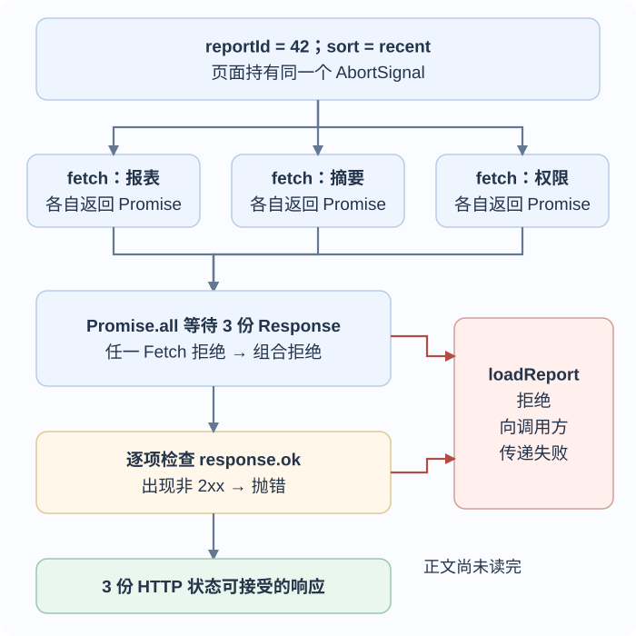

上图的成功出口只是三份 HTTP 状态可接受的响应，正文还没有被代码读完。接下来同时读取三份 JSON，再等待它们全部解析完成，最后运行同步校验器。只有这两道等待及校验都通过，`loadReport` 才交付数据；任一阶段失败都会拒绝它返回的 Promise。组合器本身不会取消其他已启动的工作。

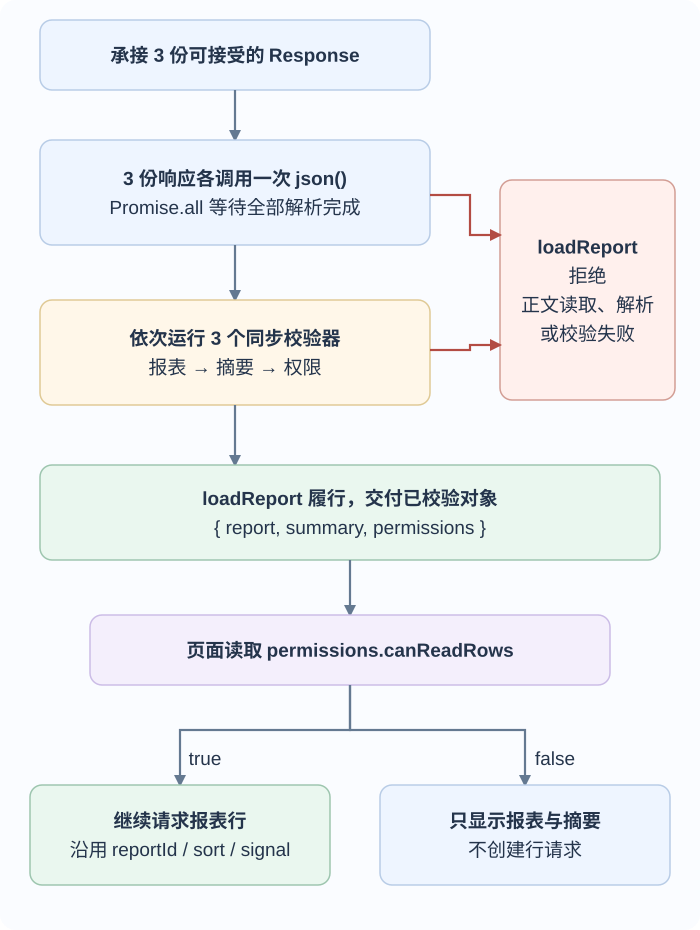

第二张图沿用同一 `reportId`、`sort` 和页面 signal。若权限允许且行页码已知，下一步可交给[并发池按上限启动任务](#41.%20%E6%80%8E%E6%A0%B7%E9%99%90%E5%88%B6%E5%BC%82%E6%AD%A5%E4%BB%BB%E5%8A%A1%E7%9A%84%E5%B9%B6%E5%8F%91%E5%B9%B6%E6%94%B6%E5%B0%BE%E5%A4%B1%E8%B4%A5%EF%BC%9F)；如果下一页要等前页给出 cursor（游标），就按页顺序推进，见[报表行怎样按页异步读取？](#%E6%8A%A5%E8%A1%A8%E8%A1%8C%E6%80%8E%E6%A0%B7%E6%8C%89%E9%A1%B5%E5%BC%82%E6%AD%A5%E8%AF%BB%E5%8F%96%EF%BC%9F)。Promise 只传递结果和失败，不会替页面完成结构校验、权限判断、限流或取消。

### 回调如何表示延后的工作？

callback（回调）是作为参数交给另一段代码、由那段代码决定何时调用的函数。回调不一定异步：`array.map(fn)` 会在当前调用中同步调用 `fn`，Fetch 的完成处理器则稍后运行。若每一步要等上一步的值，嵌套回调会把成功路径、失败路径和后续动作散落在多层函数中：

~~~javascript
readUser(userId, (error, user) => {
  if (error) return handle(error);
  readOrders(user.id, (error, orders) => {
    if (error) return handle(error);
    renderOrders(orders);
  });
});
~~~

Promise 把“未来的一个值或失败原因”作为可传递的对象。它从待定（`pending`）转为履行（`fulfilled`）或拒绝（`rejected`）之一；状态只改变一次。Promise 不持有一条通用的取消命令，也不意味着底层工作在另一个线程运行。

`new Promise(executor)` 会在构造时同步调用执行器；执行器若同步抛错，构造所得 Promise 会以该异常拒绝。`resolve` 与 `reject` 用来报告结果，但后续 `.then()` 注册的处理器不会在注册它的那段同步代码中内联运行。下面先输出“执行器”、再输出“构造完成”；计时器调用 `resolve` 后，Promise 处理器才有机会输出结果：

~~~javascript
const response = new Promise(resolve => {
  console.log("执行器");
  setTimeout(() => resolve("报表响应已到"), 20);
});

console.log("构造完成");
response.then(value => console.log(value));
~~~

这段程序先输出 `执行器`、`构造完成`。计时器的 20 毫秒是最早等待时间，不保证回调恰在该时刻运行；计时器属于宿主 API。在浏览器中，Promise 处理器（reaction）和 `await` 的续段会作为microtask（微任务）排队；当前 JavaScript 调用栈清空后，浏览器执行微任务检查点，把队列中的微任务逐个跑完，再继续事件循环的后续步骤。于是 `await` 先让出当前同步片段，而续段会在后续微任务中继续。绘制机会与其他任务（task）的交错由宿主决定，见[浏览器 JavaScript 何时运行，画面何时更新？](#5.%20%E6%B5%8F%E8%A7%88%E5%99%A8%20JavaScript%20%E4%BD%95%E6%97%B6%E8%BF%90%E8%A1%8C%EF%BC%8C%E7%94%BB%E9%9D%A2%E4%BD%95%E6%97%B6%E6%9B%B4%E6%96%B0%EF%BC%9F)和 [Node.js 事件循环阶段与微任务队列如何交互？](../../engineering-foundations/backend/node-event-loop-and-microtasks.md)。

### Promise 链怎样传递值和失败？

每次调用 `.then()` 都返回一个新 Promise。成功处理器返回普通值时，新 Promise 以该值履行；它抛出异常时，新 Promise 以该异常拒绝；若它返回 Promise，新 Promise 会采用该 Promise；若返回普通对象且它的 `then` 属性是函数（thenable），新 Promise 会调用这个 `then`，根据它调用的解析或拒绝回调决定结果。内建 Promise 同样有 `then` 方法，但 `Promise.resolve(p)` 遇到确为 Promise 且读到 `p.constructor === Promise` 的 `p` 时会直接返回它；普通 thenable 的getter（取值器）和采用作业不应套用到这条捷径上。`.catch(handler)` 等价于只提供拒绝处理器的 `.then(undefined, handler)`：处理器返回普通值或最终履行的 Promise/thenable，后续链才恢复成功。

~~~javascript
function parseReport(response) {
  if (!response.ok) throw new Error("报表响应 HTTP " + response.status);
  return response.json();
}

fetch("/api/reports/42?sort=recent")
  .then(parseReport)
  .then(validateReport)
  .then(renderReport)
  .catch(showRequestFailure);
~~~

若 `parseReport`、`validateReport` 或 `renderReport` 同步抛错，或 `response.json()` 返回的 Promise 拒绝，拒绝会沿后续链传播，直到某一层接手。处理器返回错误提示文案会把链恢复为成功；若界面层需要保留“请求失败”状态，就应返回或抛出符合该状态契约的结果。哪个层拥有足够上下文来恢复或上报，见[JavaScript 错误应在哪一层恢复、传播或上报？](#44.%20JavaScript%20%E9%94%99%E8%AF%AF%E5%BA%94%E5%9C%A8%E5%93%AA%E4%B8%80%E5%B1%82%E6%81%A2%E5%A4%8D%E3%80%81%E4%BC%A0%E6%92%AD%E6%88%96%E4%B8%8A%E6%8A%A5%EF%BC%9F)。

`.finally(cleanup)` 在履行或拒绝时都会运行，不接收原来的值或原因。回调返回的普通成功值会被忽略；清理成功则原值或原拒绝继续传递。若清理抛错或返回最终拒绝的 Promise / thenable，清理失败取代原结果。可让 `finally` 等待异步清理，但不要用其返回值改写业务结果。

异步函数（`async function`）调用时立即执行函数体，直到遇到第一个等待运算符（`await`）或结束；即使被等待的值已经可用，续行也不会在当前语句段内同步接着执行。调用总会返回 Promise。`await` 会让当前异步函数暂停并把控制权还给调用者，等被等待的值履行后再继续；若它拒绝，拒绝会像该处抛错一样进入 `try/catch` 或向外传播。`try` 的 `finally` 会在正常返回或抛错时运行；其中新的 `return` 或 `throw` 可以替换原先的完成结果。

~~~javascript
async function loadUserAndOrders(userId) {
  const user = await getUser(userId);
  const orders = await getOrders(user.id);
  return { user, orders };
}

loadUserAndOrders("u-42")
  .then(({ orders }) => renderOrders(orders))
  .catch(showRequestFailure);
~~~

这里第二个请求要用第一个请求给出的 `user.id`，所以顺序 `await` 是数据依赖；如果两个请求互不依赖，顺序 `await` 会白白等前一个完成，应先启动两项工作再组合。

### TypeScript 的 Promise 类型能保证什么？

`Promise<T>` 只能在编译期约束 TypeScript 代码中的类型，注解编译后不会检查服务端 JSON。把外部值先当作未知类型（`unknown`），读取正文后执行真正的运行时校验：

~~~typescript
async function parseReport(response: Response): Promise<Report> {
  if (!response.ok) {
    throw new Error("报表请求失败，HTTP " + response.status);
  }

  const value: unknown = await response.json();
  return validateReport(value);
}
~~~

`validateReport` 必须检查接口实际约束，并在数据不符时拒绝；只写 `Promise<Report>` 不会增加校验。

### 报表请求何时并发、何时顺序等待？

Fetch API（Fetch 应用程序接口）的调用会启动请求，然后返回一个 Promise。把已经启动的 Promise 交给 `Promise.all` 是等待它们的结果，不是把它们排进一个稍后启动的队列。独立请求可以先同时发出：

~~~javascript
async function loadReport(reportId, sort, signal) {
  const paths = [
    "/api/reports/" + encodeURIComponent(reportId) +
      "?sort=" + encodeURIComponent(sort),
    "/api/reports/" + encodeURIComponent(reportId) + "/summary",
    "/api/reports/" + encodeURIComponent(reportId) + "/permissions",
  ];

  const responses = await Promise.all(
    paths.map(path => fetch(path, { signal }))
  );

  const failed = responses.find(response => !response.ok);
  if (failed) throw new Error("HTTP " + failed.status);

  const [rawReport, rawSummary, rawPermissions] = await Promise.all(
    responses.map(response => response.json())
  );

  // 这三个校验器同步返回已校验值；无效数据时同步抛错。
  return {
    report: validateReport(rawReport),
    summary: validateSummary(rawSummary),
    permissions: validatePermissions(rawPermissions),
  };
}
~~~

`fetch()` 的 Promise 在可用的 `Response` 到达时履行；HTTP `404` 或 `500` 仍是一个响应，不会仅因状态码而拒绝。`response.ok` 只在 HTTP 状态码为 `200–299` 时为真，因此仍需显式检查。响应体由 `json()` 另行读取和解析，这一步仍可能等待，也可能因中止或无效 JSON 而拒绝。校验器再把未知的 JSON 形状变成应用接受的数据。

第一轮 `Promise.all` 等三项 Fetch Promise 全部履行才继续检查状态；任一 Fetch Promise 拒绝时，它会尽早以该原因拒绝，但不会取消其他已启动请求。三项 Response 都到达后，代码按输入顺序检查 HTTP 状态；有一项不是成功状态时立即抛错，因此不会开始读取任何正文。三项状态都成功后，第二轮才同时调用三个 `json()`，并等待三个解析 Promise 全部履行；其中一项解析拒绝时，后续同步校验都不会运行。最后三个校验器依次同步返回已校验值，或同步抛错。若把校验器改成 `async` 函数，返回对象里的字段会是 Promise；外层 `async` 函数不会递归等待普通对象的属性。

主例使用教学权限值 `{ canReadRows: true }`；校验器返回这个布尔字段后，页面在 `await loadReport` 的下一行分支。页面持有控制器，离开时发出中止信号：

~~~javascript
const controller = new AbortController();
window.addEventListener("pagehide", () => controller.abort(), { once: true });

const data = await loadReport("42", "recent", controller.signal);
if (data.permissions.canReadRows) {
  console.log("权限允许：继续读取报表行");
} else {
  console.log("权限不允许：只显示报表和摘要");
}
~~~

这里的 `canReadRows` 是合成教学字段；真实接口应按其实际权限契约定义和校验该值。前端分支只决定是否继续请求，明细 API 仍须独立验证调用者的读取权限。若它为 `true`，行读取会从这个分支开始；若为 `false`，主例停在报表与摘要。行页码已知时可把每页请求交给[并发池按上限启动任务](#41.%20%E6%80%8E%E6%A0%B7%E9%99%90%E5%88%B6%E5%BC%82%E6%AD%A5%E4%BB%BB%E5%8A%A1%E7%9A%84%E5%B9%B6%E5%8F%91%E5%B9%B6%E6%94%B6%E5%B0%BE%E5%A4%B1%E8%B4%A5%EF%BC%9F)；下一页必须等前页给出游标（cursor）时按页顺序推进，见[报表行怎样按页异步读取？](#%E6%8A%A5%E8%A1%A8%E8%A1%8C%E6%80%8E%E6%A0%B7%E6%8C%89%E9%A1%B5%E5%BC%82%E6%AD%A5%E8%AF%BB%E5%8F%96%EF%BC%9F)。页面离开时的 `abort()` 会通知 Fetch 及其他主动监听同一中止信号的 API；它不会强行终止任意 Promise，也不能撤销服务器已执行的副作用。

页面可把同一个 `AbortSignal` 传给三项 Fetch；控制器发出 abort 后，Fetch 按自己的中止协议响应。Promise 组合器不会代替页面调用 `abort()`，也不会撤回服务器已经执行的副作用。若 Promise 被超时竞速淘汰，工作也不会因此自动停止，后文会区分“停止等待”和“取消操作”。

多项异步工作的组合条件可按结果需求选择：

| 方法 | 组合 Promise 何时结束 | 报表场景中的含义 |
| --- | --- | --- |
| `Promise.all` | 全部履行才履行；任一拒绝就拒绝 | 报表、摘要和权限都必需；结果数组按输入顺序排列 |
| `Promise.allSettled` | 所有输入都结束后履行每项状态和值或原因 | 需要展示每个独立小部件的成功或失败 |
| `Promise.any` | 首个履行就履行；全部拒绝才以聚合错误（`AggregateError`）拒绝 | 多个镜像或备选端点中任一成功即可 |
| `Promise.race` | 首个履行或拒绝决定结果 | 观察任务与计时器谁先结束；组合结果不会取消没赢的工作 |

这些方法都消费同步 iterable（可迭代对象）。对空可迭代对象，`all([])` 与 `allSettled([])` 履行 `[]`；`any([])` 以空 `errors` 的聚合错误（`AggregateError`）拒绝；`race([])` 永远待定（pending）。若调用时输入是已启动的请求，任何组合器都不能限流。若需要在有槽位时才调用请求，必须把任务工厂交给[异步并发池](#41.%20%E6%80%8E%E6%A0%B7%E9%99%90%E5%88%B6%E5%BC%82%E6%AD%A5%E4%BB%BB%E5%8A%A1%E7%9A%84%E5%B9%B6%E5%8F%91%E5%B9%B6%E6%94%B6%E5%B0%BE%E5%A4%B1%E8%B4%A5%EF%BC%9F)。

#### 两个 Promise 结果怎样相加？

> [!example] 完成顺序不改结果位置
> 假设请求 A 在 20 ms 后履行 `2`，请求 B 在 60 ms 后履行 `5`。A 先完成，但 `Promise.all([A, B])` 最终给出 `[2, 5]`，再相加得到 `7`。
>
> 如果 A 在 50 ms 后履行 `10`，B 在 30 ms 后履行 `-12`，结果仍是 `[10, -12]`，相加为 `-2`。若任一项拒绝，`Promise.all` 拒绝；另一项仍可能继续并产生副作用。

#### 组合器如何保留输入顺序？

先看 `Promise.resolve` 怎样采用普通 thenable。读取 `then` getter 是同步步骤；调用取得的 `then` 函数则安排为后续 Promise 作业，因此这两个动作不在同一时刻发生：

~~~javascript
const events = [];
const thenable = {
  get then() {
    events.push("读取 then");
    return resolve => {
      events.push("调用 then");
      resolve("摘要已到");
    };
  },
};

Promise.resolve(thenable).then(value => events.push(value));
events.push("当前同步代码结束");
// 立即：["读取 then", "当前同步代码结束"]
// 随后：再依次追加 "调用 then"、"摘要已到"
~~~

原生组合方法接收可迭代值，并对每项执行 Promise 解析与结果登记。即使第二项先结束，它的处理器也写入第二个位置；所以数组顺序取决于输入，不取决于完成先后。下面的折叠实现用于观察这套最小机制，不是可替代原生 Promise 的兼容性填充（polyfill）：它假设普通内建 `Promise`，不模拟子类构造器、`Symbol.species` 或所有恶意 thenable 的防护。

> [!example]- 完整教学实现：四个 Promise 组合器
>
> ~~~javascript
> function allTeaching(iterable) {
>   return new Promise((resolve, reject) => {
>     const values = [];
>     let remaining = 1; // 哨兵：同步遍历还没有结束
>     let index = 0;
>
>     for (const item of iterable) {
>       const current = index++;
>       remaining++;
>       Promise.resolve(item).then(value => {
>         values[current] = value;
>         if (--remaining === 0) resolve(values);
>       }, reject);
>     }
>
>     if (--remaining === 0) resolve(values);
>   });
> }
>
> function allSettledTeaching(iterable) {
>   return new Promise(resolve => {
>     const results = [];
>     let remaining = 1;
>     let index = 0;
>
>     for (const item of iterable) {
>       const current = index++;
>       remaining++;
>       Promise.resolve(item).then(
>         value => {
>           results[current] = { status: "fulfilled", value };
>           if (--remaining === 0) resolve(results);
>         },
>         reason => {
>           results[current] = { status: "rejected", reason };
>           if (--remaining === 0) resolve(results);
>         }
>       );
>     }
>
>     if (--remaining === 0) resolve(results);
>   });
> }
>
> function anyTeaching(iterable) {
>   return new Promise((resolve, reject) => {
>     const errors = [];
>     let remaining = 1;
>     let index = 0;
>
>     for (const item of iterable) {
>       const current = index++;
>       remaining++;
>       Promise.resolve(item).then(
>         resolve,
>         reason => {
>           errors[current] = reason;
>           if (--remaining === 0) {
>             reject(new AggregateError(errors, "没有输入履行"));
>           }
>         }
>       );
>     }
>
>     if (--remaining === 0) {
>       reject(new AggregateError(errors, "没有输入履行"));
>     }
>   });
> }
>
> function raceTeaching(iterable) {
>   return new Promise((resolve, reject) => {
>     for (const item of iterable) {
>       Promise.resolve(item).then(resolve, reject);
>     }
>     // 空输入没有可决定胜负的项，输出保持 pending。
>   });
> }
> ~~~
>
> `remaining` 从 `1` 开始，把“同步遍历还在进行”也计作一个未完成项。以两项 `all` 为例，计数经历 `1 → 2 → 3`；遍历完先减掉哨兵成为 `2`；两个处理器再各减一次，归零时履行。空输入则 `1 → 0`，此时组合 Promise 已履行 `[]`，但后来附加的 `.then()` 仍会稍后运行。`any` 用同一哨兵等待所有拒绝，并按输入位置登记原因。
>
> 同步遍历可能执行输入对象上的代码。如果已经成功取出一项值，但处理这一项时发生同步异常，例如已有 Promise 的 `constructor` getter（取值器）抛错，组合 Promise 会拒绝，并尝试通过尚未结束的迭代器所提供的可选 `return()` 方法进行关闭。普通 thenable 对象需要被采用时，`Promise.resolve(thenable)` 会在当前调用读取它的 `then` 取值器；取值器抛错会变成该项的拒绝 Promise，所以组合器仍继续读取后续项。取出的 `then` 函数稍后通过 Promise 作业调用，之后的异步拒绝同样不会中止同步遍历。内建 Promise 也有 `then`，但 `Promise.resolve(p)` 对确为 Promise 且读到 `p.constructor === Promise` 的 `p` 有直接返回的捷径；组合器随后仍会在同步遍历中读取并调用输入的 `p.then`。若 `iterator.next()` 自己抛错，或读取迭代结果的 `done` / `value` 时抛错，规范会将迭代记录标记为完成；组合 Promise 拒绝，但不再调用该迭代器的 `return()`。

### 定时器和超时究竟能取消什么？

Promise 没有通用取消操作。`Promise.race` 只决定调用方先观察到哪个结果：超时先拒绝时，底层工作仍可能继续。定时器延迟到期只是回调获得运行机会的门槛；当前 JavaScript 不会被它打断，回调也可能更晚运行。

#### 怎样把定时器延迟包装成 Promise？

~~~javascript
function sleep(millis) {
  return new Promise(resolve => setTimeout(resolve, millis));
}

const start = Date.now();
sleep(100).then(() => console.log(Date.now() - start)); // 约 100 ms 或更久
~~~

这段 `sleep` 只等待一个宿主计时器，不会阻塞当前线程。浏览器与 Node.js 的定时器接口由各自宿主定义；零延时或短延时都不承诺实时执行。浏览器的 `setTimeout` / `setInterval` 返回数值 ID，Node.js 返回 `Timeout` 对象；TypeScript 中对应的声明取决于项目选择的宿主类型。

#### 怎样让异步操作与计时器竞速？

~~~javascript
function timeLimit(fn, millis) {
  // 在 ES module 或 strict mode 中定义，调用时的 this 才原样传递。
  return function (...args) {
    let timerId;
    const timeout = new Promise((_, reject) => {
      timerId = setTimeout(
        () => reject(new Error("Time Limit Exceeded")),
        millis
      );
    });

    let work;
    try {
      work = Promise.resolve(fn.apply(this, args));
    } catch (error) {
      work = Promise.reject(error);
    }

    return Promise.race([work, timeout])
      .finally(() => clearTimeout(timerId));
  };
}
~~~

包装器用普通函数保留调用时的 `this`，并把 `fn` 同步抛出的异常转成拒绝。工作先结束时，`finally` 清除仍待运行的计时器。只有超时回调实际得到调度时，竞速才会以超时拒绝包装 Promise；`fn` 仍可能完成。计时器到期不能抢占当前 JavaScript，包装器也不会停止工作。

> [!info] TypeScript 的 this 参数不改变运行时调用
> 可以用显式 this 参数保留包装函数的调用类型；它会在编译时擦除，不是实际传入的第一个参数。运行时仍要用普通 function 接住调用上下文，并像本例一样以 fn.apply(this, args) 调用原函数；箭头函数捕获外层 this，不适合此处。
>
> ~~~typescript
> type TimedFunction<This, Args extends unknown[], Result> =
>   (this: This, ...args: Args) => Promise<Result>;
> ~~~


> [!example] 50 ms 的等待上限不等于 50 ms 后强行中断
> 假设请求要 100 ms 才完成，`timeLimit(request, 50)` 会在超时回调得到调度后拒绝调用方，底层请求仍可能继续。若限制改为 150 ms，工作可以先成功返回。若函数等待 120 ms 后返回两参数之和，`timeLimit(fn, 150)(5, 10)` 在理想调度下得到 `15`；若函数同步抛错，拒绝直接传播且清除计时器，无须等满预算。
>
> 若 `fn` 同步占用 80 ms 后才返回一个已履行的 Promise，计时器无法在这段同步工作中抢占 JavaScript。同步代码让出后，Promise reaction 可先于到期的计时器任务运行，故这个运行可能成功；50 ms 不是硬实时截止线。

若操作支持取消，应使用它公开的取消契约。例如 Fetch 接收 `AbortSignal`，页面在不再需要请求时可调用对应控制器的 `abort()`。这个 signal 让 Fetch 及其他主动监听它的 API 有机会停止工作；任意 Promise 和任意同步函数不会因此强制终止。它也不能撤销服务端已经收到并执行的写入。

#### 取消一次或重复定时器时，哪些调用还会发生？

一次性计时器可把它的 ID 暴露给取消函数：

~~~javascript
function cancellable(fn, args, millis) {
  const timerId = setTimeout(() => fn(...args), millis);
  return () => clearTimeout(timerId);
}
~~~

| 输入 | 预期调用 | 原因 |
| --- | --- | --- |
| `fn(x)=x*5`，`args=[2]`，`t=20`，`cancelT=50` | 约 20 ms 调用一次，结果为 `10` | 回调先开始，后续取消不能撤回它 |
| `fn(x)=x²`，`args=[2]`，`t=100`，`cancelT=50` | 不调用 | 取消时回调仍在等待 |
| `fn(x,y)=x*y`，`args=[2,4]`，`t=30`，`cancelT=100` | 约 30 ms 调用一次，结果为 `8` | 回调在取消前已完成 |

这些毫秒是题目输入，不是精确计时保证。取消只能清掉仍待执行的回调；它不打断已开始运行的函数，也不把函数结果交给 `cancellable` 的调用者。若 `fn` 依赖 `this`，需显式传接收者（receiver）或先绑定。

原练习要求重复计时器立即调用一次，再按给定间隔安排后续调用：

~~~javascript
function cancellableInterval(fn, args, millis) {
  fn(...args); // 第一次同步调用
  const intervalId = setInterval(() => fn(...args), millis);
  return () => clearInterval(intervalId);
}
~~~

| 输入 | 理想化调用时刻 | 每次函数结果 |
| --- | --- | --- |
| `fn(x)=2*x`，`args=[4]`，`t=35`，`cancelT=190` | `0, 35, 70, 105, 140, 175 ms` | 每次 `8` |
| `fn(x,y)=x*y`，`args=[2,5]`，`t=30`，`cancelT=165` | `0, 30, 60, 90, 120, 150 ms` | 每次 `10` |
| `fn(x,y,z)=x+y+z`，`args=[5,1,3]`，`t=50`，`cancelT=180` | `0, 50, 100, 150 ms` | 每次 `9` |

`setInterval` 不等待 Promise 返回值。若 `fn` 是异步函数、一次执行比间隔更长，下一次调用仍可开始，多个调用可能重叠；`clearInterval` 只阻止后续计时器回调，不会取消已经启动的 Promise 工作。错误恢复和重叠策略必须由调用方另行定义。

### Promise 处理器为什么会交错？

要推导顺序，先区分“注册处理器”与“把处理器作业入队”。同步代码给已履行 Promise 调用 `.then` 时，规范会立即为处理器入队；给待定 Promise 调用 `.then` 时，先保存 reaction（反应记录），等 Promise 状态改变才入队。作业运行后若履行下游 Promise，也会把已保存的下游 reaction 排入队列尾部。浏览器将 Promise 处理器作业（Promise reaction job）放入微任务队列，在微任务检查点按入队顺序逐个处理；Node.js 另有宿主调度边界。以下第一组的两个源 Promise 已履行，所以同步代码先排好 `0` 和 `2`；执行 `0` 才使下游处理器 `1` 入队，队列中已有 `2`，因此输出为 `0, 2, 1, 3`。

~~~javascript
Promise.resolve().then(() => console.log(0)).then(() => console.log(1));
Promise.resolve().then(() => console.log(2)).then(() => console.log(3));
// Node.js v26.13.0 的 CommonJS 模块格式：0, 2, 1, 3
~~~

原归档练习还保留了三条链的交错以及处理器返回已履行 Promise 时的附加采用作业。先追踪第一段的关键作业，队列左侧是下一项：

| 步骤 | 动作 | 队列 |
| --- | --- | --- |
| 起始 | 两条链的首个处理器已注册在已履行 Promise 上 | `[输出 0, 输出 1]` |
| 1 | 输出 0 的处理器返回 `Promise.resolve(4)`，Promise 解析流程安排采用作业 | `[输出 1, 采用]` |
| 2 | 输出 1 的处理器运行，并使它的下游处理器入队 | `[采用, 输出 2]` |
| 3 | 采用作业调用所返回 Promise 的 `then`；该 Promise 已以 `4` 履行，于是转发值的作业入队 | `[输出 2, 转发 4]` |
| 4 | 输出 2 的处理器运行，并把输出 3 排到队尾 | `[转发 4, 输出 3]` |
| 5 | 转发作业履行第一条链的下游 Promise，输出 4 才入队 | `[输出 3, 输出 4]` |

这说明处理器运行会触发新的 Promise 状态转换和后续入队；不能只按 `.then` 的源代码注册位置排序。下列输出在 Node.js `v26.13.0` CommonJS 中逐段重放；它们展示当前例子的入队关系，不是跨宿主固定的“第几个 tick”公式。

~~~javascript
Promise.resolve().then(() => {
  console.log(0);
  return Promise.resolve(4);
}).then(value => console.log(value));

Promise.resolve().then(() => console.log(1))
  .then(() => console.log(2))
  .then(() => console.log(3))
  .then(() => console.log(5))
  .then(() => console.log(6));
// 0, 1, 2, 3, 4, 5, 6
~~~

~~~javascript
Promise.resolve().then(() => console.log(0))
  .then(() => console.log(1)).then(() => console.log(2));
Promise.resolve().then(() => console.log(3))
  .then(() => console.log(4)).then(() => console.log(5));
Promise.resolve().then(() => console.log(6))
  .then(() => console.log(7)).then(() => console.log(8));
// 0, 3, 6, 1, 4, 7, 2, 5, 8
~~~

~~~javascript
Promise.resolve().then(() => {
  console.log(0);
  return Promise.resolve(1);
}).then(() => console.log(2)).then(() => console.log(3));

Promise.resolve().then(() => {
  console.log(4);
  return Promise.resolve(5);
}).then(() => console.log(6)).then(() => console.log(7));
// 0, 4, 2, 6, 3, 7
~~~

几个旧 Promise reaction 顺序练习现已合并在本节；题目原页仍可从[归档入口](../../archive/front-end/Deprecated_Interview_Notes/promise-reaction-order-exercises.md)查找。浏览器事件循环、Node.js 定时器和微任务队列分别遵循各自宿主调度；不要把某个 Node 输出顺序直接推成浏览器计时器、绘制和 Promise 的固定先后。

> [!info]- 来源
> - **Promise 状态、链式传值、thenable 采用、组合器与 `async` 函数。** [ECMAScript 2027 草案（2026-11-08）](https://tc39.es/ecma262/)，核对日期：2026-11-12；异步函数在 §15.8，迭代抽象操作在 §7.4、迭代器对象在 §27.1，Promise 在 §27.5。对应 [Promise 对象](https://tc39.es/ecma262/#sec-promise-objects)、[`Promise.resolve`](https://tc39.es/ecma262/#sec-promise.resolve)、[thenable 采用作业](https://tc39.es/ecma262/#sec-newpromiseresolvethenablejob)、[`Promise.all`](https://tc39.es/ecma262/#sec-promise.all)、[`allSettled`](https://tc39.es/ecma262/#sec-promise.allsettled)、[`any`](https://tc39.es/ecma262/#sec-promise.any)、[`race`](https://tc39.es/ecma262/#sec-promise.race)、[`finally`](https://tc39.es/ecma262/#sec-promise.prototype.finally)、[PerformPromiseThen](https://tc39.es/ecma262/#sec-performpromisethen)、[TriggerPromiseReactions](https://tc39.es/ecma262/#sec-triggerpromisereactions)、[NewPromiseReactionJob](https://tc39.es/ecma262/#sec-newpromisereactionjob)、[IteratorStepValue](https://tc39.es/ecma262/#sec-iteratorstepvalue)、[IteratorClose](https://tc39.es/ecma262/#sec-iteratorclose) 与 [async function definitions](https://tc39.es/ecma262/#sec-async-function-definitions)。
> - **Promise 作业怎样进入宿主队列。** 浏览器把 Promise 作业放入微任务队列，并在微任务检查点运行它们，见 [WHATWG HTML §8.1.6.6.4 HostEnqueuePromiseJob](https://html.spec.whatwg.org/multipage/webappapis.html#hostenqueuepromisejob)、[§8.1.7 Event loops](https://html.spec.whatwg.org/multipage/webappapis.html#event-loops)、[§8.8 Microtask queuing](https://html.spec.whatwg.org/multipage/timers-and-user-prompts.html#microtask-queuing) 与 [Perform a microtask checkpoint](https://html.spec.whatwg.org/multipage/webappapis.html#perform-a-microtask-checkpoint)，Living Standard 更新时间：2026-11-11；Node.js v26.13.0 的 `process.nextTick()`、`queueMicrotask()` 与 Promise 微任务队列边界见 [Process 文档](https://nodejs.org/download/release/v26.13.0/docs/api/process.html#when-to-use-queuemicrotask-vs-processnexttick)。这些宿主规则不把某次 Node 输出推广成浏览器 task 与绘制之间的固定优先级。
> - **HTTP 响应、状态与正文读取。** [WHATWG Fetch Standard §2.2.6 Responses 与 §5.3 Body mixin](https://fetch.spec.whatwg.org/#responses)，Living Standard，核对日期：2026-11-12；[Response.ok](https://fetch.spec.whatwg.org/#dom-response-ok) 对应 200–299 状态，[Body.json()](https://fetch.spec.whatwg.org/#dom-body-json) 执行正文读取与解析。
> - **定时器。** [WHATWG HTML §8.7 Timers](https://html.spec.whatwg.org/multipage/timers-and-user-prompts.html#timers)，Living Standard，更新时间 2026-11-11，说明计时器回调的调度及不精确延迟；Node.js 定时器行为以[Node.js v26.13.0 Timers](https://nodejs.org/download/release/v26.13.0/docs/api/timers.html)为宿主边界。
> - **取消。** [WHATWG DOM §3 Aborting ongoing activities](https://dom.spec.whatwg.org/#aborting-ongoing-activities)，Living Standard，更新时间 2026-11-11；[WHATWG Fetch §5.5 Abort a fetch](https://fetch.spec.whatwg.org/#abort-fetch)，Living Standard，更新时间 2026-10-19。DOM 说明 Promise 本身没有内建中止机制，API 可选择接受并观察 `AbortSignal`。
> - **TypeScript 擦除。** [TypeScript Handbook：Erased Types](https://www.typescriptlang.org/docs/handbook/2/basic-types.html#erased-types)，访问日期：2026-11-12。
> - **包装函数的显式 `this` 类型。** [TypeScript Handbook：Declaring this in a Function](https://www.typescriptlang.org/docs/handbook/2/functions.html#declaring-this-in-a-function)，类型参数在编译时擦除；运行时调用仍由普通函数及 `apply` 保留接收者。
## 41. 怎样限制异步任务的并发并收尾失败？

上一章的报表案例已经收到 `reportId="42"`、`sort="recent"` 的三项基础数据并通过运行时校验；权限结果 `canReadRows === true`，所以页面现在可以读取明细。五个页码事先已知，页面还持有生命周期使用的 `AbortSignal` (中止信号)。本章把上一章控制器的 `controller.signal` 简称为 `pageSignal`；页面离开时仍由 `controller.abort()` 发出信号。本例把任务池同时追踪的活动任务数限为两个。`2` 是这个案例给出的资源限制，不代表所有服务的通用最佳值。

### 先把任务保持为惰性，再填满空槽位

调用 Fetch API 的 `fetch(url)` 时，请求就开始，并返回一个 Promise。若先创建五个 Fetch Promise 再交给 `Promise.all`，五个请求已经全部启动；组合器只会等它们的结果。

要控制启动时间，把每项工作写成task factory (任务工厂)：函数被调用时才创建请求。下面 `map` 只生成五个异步函数（`async` 函数），尚未请求任何一页：

~~~javascript
function createPageTasks(reportId, sort) {
  return [1, 2, 3, 4, 5].map(page => async ({ signal }) => {
    const query = new URLSearchParams({
      page: String(page),
      sort,
    });
    const url =
      "/api/reports/" + encodeURIComponent(reportId) + "/rows?" + query;
    const response = await fetch(url, { signal });
    if (!response.ok) throw new Error("页 " + page + " 请求失败");
    return response.json();
  });
}
~~~

任务池消费同步 iterable (可迭代对象)，其中每项都必须是函数。同时最多等待两个工厂调用，并把 `{ signal, index }` 作为参数传给每个被调用的工厂；代码用 `runTask` 的 Promise 等待调用返回值结算。若工厂启动额外工作却先返回，池会释放槽位，而那项工作仍可能继续；工厂若自行启动多项并发工作，池也不会分别限流。

Fetch 收到 HTTP 非成功状态时仍会履行并给出响应对象（`Response`）；本例检查 `response.ok`，并在收到响应后立即把非 2xx 状态转换为任务拒绝，没有读取或取消那条响应正文流。于是该工厂 Promise 已结算、槽位已释放，正文流却可能仍打开。成功状态下，`response.json()` 会继续读取并解析正文，工厂 Promise 要等这一步结算才释放槽位。因此 `limit` 限制池仍在等待的任务数，不限制物理 HTTP 请求、连接或响应体流的数量。并发池接收每个工厂的最终成功值或失败原因，不负责解释 HTTP 或 JSON 契约。

下图和后面的时间线使用从五页主例缩小出的三页合成输入：页 1、2 先占槽，页 2 随后失败，页 3 等待补位。

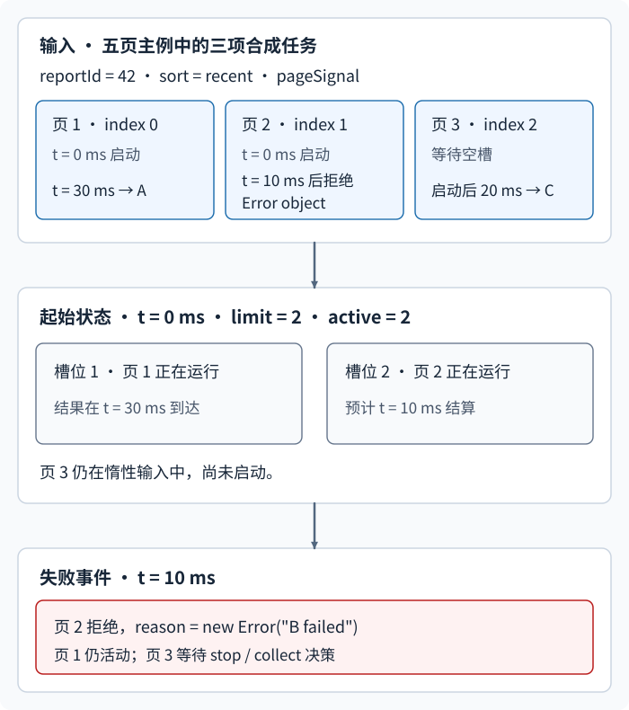

图一先把输入、起始状态和失败时刻固定下来：工厂 `index` 从 0 开始；页 1 用 30 ms 得到 A，页 2 用 10 ms 以 `new Error("B failed")` 失败，页 3 启动后用 20 ms 得到 C。接着看这个 Error 如何走向两种终态：

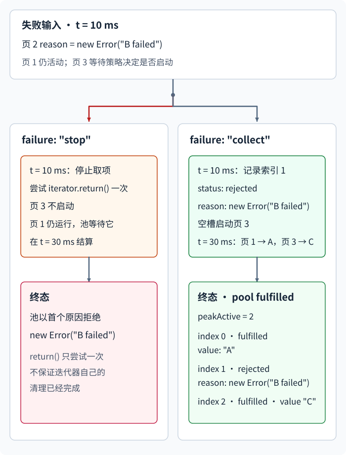

页码从 1 开始，工厂索引从 0 开始；因此页 2 对应 `results[1]`。`collect` 的履行值和拒绝原因分别保存在 `value` 与 `reason` 字段，结果按输入位置排列。

调度器用 `nextIndex` 记下一个输入位置，用 `active` 集合占住运行中的槽位，并用 `peakActive` 记实际活动数的峰值。它有空槽位时持续取项并启动任务；槽位填满后，用竞速组合器（`Promise.race`）等待一项任务结算或停止通知先到。任务结算会腾出槽位，调度器再填所有可用空位。每项结果写入 `results[index]`，所以完成先后不会改变输出位置。

### 用同一条时间线推算成功、失败和继续收集

为了逐步看清失败策略，下面沿用图中的三项惰性任务工厂，`limit` 为 2。页 1 在启动 30 ms 后履行并给出 `"A"`；页 2 在 10 ms 后以 `new Error("B failed")` 拒绝；页 3 在启动 20 ms 后履行并给出 `"C"`。这些延迟是合成输入，不是网络测量。

| 时刻 | 活动状态 | `failure: "stop"` | `failure: "collect"` |
| --- | --- | --- | --- |
| `0 ms` | 页 1、页 2 启动，活动数 `2` | `peakActive = 2` | `peakActive = 2` |
| `10 ms` | 页 2 拒绝，页 1 仍在运行 | 记录首次失败、停止取项，尝试调用 `return()` 一次；页 3 不启动 | 在结果位置 `1` 记录拒绝，腾出的槽位启动页 3 |
| `30 ms` | 页 1 完成；`collect` 中页 3 也已完成 | 排空后以 `new Error("B failed")` 拒绝池调用 | 按输入位置履行 A、Error 和 C 的三项状态记录，峰值仍是 `2` |

`stop`（停止）是默认策略：首个被池观察到的任务失败后，不再调用新任务工厂；池停止取项，并尝试对尚未耗尽的输入迭代器调用一次可选的 `return()`，然后等待已经启动的任务全部结算，再以第一个停止原因拒绝。一次 `return()` 调用不保证迭代器自己的清理已经完成。排空只表示池不再等待活动任务；它不会回滚已完成的写入，也不会把忽略 signal 的工作杀掉。

`collect`（收集）把每个实际启动任务的履行值或拒绝原因保存为状态记录，并继续填充空槽位，直到输入耗尽且活动任务排空。履行（`fulfilled`）表示任务成功，拒绝（`rejected`）表示任务失败；对应字段分别是 `value` 和 `reason`。未启动的任务没有结果记录。工厂索引从 0 开始，Fetch 的 `page` 参数从 1 开始；例如页 2 对应 `results[1]`。

### Abort 会停止调度，不会强行终止任意 Promise

中止信号收到 `abort` 事件时，池停止再取输入，尝试对未耗尽的同步迭代器调用一次可选的 `return()`，并唤醒正在等待活动任务结算的调度器。池把同一个中止信号传给在途工厂；Fetch 会按 Fetch 的取消协议响应它，普通 Promise 本身没有强制终止能力。若在途任务忽略该信号或永不结算，池就继续等待，调用不会提前结束。

| 时刻 | 池和输入 | 已启动任务 |
| --- | --- | --- |
| `0 ms` | 从页 1、页 2 开始，活动数为 `2` | 两个工厂都收到同一个 `pageSignal` |
| `5 ms`：页面调用 `controller.abort()` | 停止取项，尝试调用迭代器 `return()` 一次，不启动页 3，并立即唤醒调度器 | 支持中止的 Fetch 收到信号；忽略它的工作仍运行 |
| 已启动任务全部结算后 | 用选定的首个停止原因拒绝池调用 | 不会再启动任务；一次 `return()` 不保证迭代器清理已完成 |

停止原因按首先调用 `stop(reason)` 的事件确定。比如 stop 策略下若页 2 的失败先被池观察到，后来到达的外部 abort 不会替换这个失败；若 abort 先被观察到，随后到达的任务失败也不会替换中止原因。`collect` 不会因单项任务失败调用 `stop`，但外部 abort 仍会停止整池并拒绝。

页面取消与“任一任务失败就取消兄弟请求”是两项独立策略。本例只把页面生命周期已有的中止信号传给任务，任务失败不会自动调用控制器的 `abort()`。若调用方要求失败时中止仍在途的 Fetch，应定义相应控制器和失败策略。即使 Fetch 中止，也不能撤回服务器已经收到并执行的写操作。

在该报表案例中，`pageSignal` 是 `controller.signal`；页面离开处理器调用同一个 `controller.abort()`。调用方只在权限校验通过后创建任务：

~~~javascript
const pageSignal = controller.signal;
const pageTasks = createPageTasks("42", "recent");
const { results, peakActive } = await runBounded(pageTasks, 2, {
  failure: "collect",
  signal: pageSignal,
});

for (const [index, result] of results.entries()) {
  if (result.status === "fulfilled") {
    console.log(index, result.value);
  } else {
    console.error(index, result.reason);
  }
}
~~~

若外部 abort、输入迭代器错误或非法任务项使池整体拒绝，`await runBounded(...)` 会抛出原因，不会返回这份 `results`。

如果上游没有预先得到五个页码，而是每次要等上一页返回 `nextCursor` 才能确定下一项，就不适合提前构造这组任务；应从已知输入开始顺序读取，[报表行怎样按页异步读取？](#%E6%8A%A5%E8%A1%A8%E8%A1%8C%E6%80%8E%E6%A0%B7%E6%8C%89%E9%A1%B5%E5%BC%82%E6%AD%A5%E8%AF%BB%E5%8F%96%EF%BC%9F)解释了这种依赖。

### 可折叠查看：有限范围的教学实现

- `limit` 必须是大于 0 的安全整数；`failure` 只能是 `"stop"` 或 `"collect"`。
- 输入是同步可迭代对象，逐项产出的值必须是函数；池只在有槽位时调用它，并以 `{ signal, index }` 调用。
- 池仍在等待的活动任务数不会超过 `limit`；它等待工厂调用返回值的结算，不限制工厂启动但未纳入返回值的底层工作。成功时履行 `{ results, peakActive }`；`stop` 时以首次停止原因拒绝；`collect` 时履行已运行项目的状态和值或原因。
- 外部 abort、同步输入错误和非法任务项都会拒绝整个池，即使 `failure` 是 `"collect"`。输入中尚未取到的项目不会被检查。
- 停止或 abort 后停止取项，并尝试对未耗尽迭代器（iterator）调用一次可选的 `return()`；一次调用不保证迭代器完成自己的清理。清理异常不会覆盖已确定的首个停止原因。池会等待已启动任务的返回值结算。
- 只支持同步可迭代对象；不提供重试、异步迭代、持久配额或持久化。它限制调用工厂的并发，不限制工厂内部额外发起的工作。

同步 `iterator.next()` 可以在池调用期间触发用户代码。本例只说明 `next()` 函数体内同步触发 abort、并返回普通数据属性步骤的情况：若返回 `{ done: true }`，池记录输入耗尽，不再尝试 `return()`；若返回 `{ done: false, value: task }`，池尝试调用一次 `return()`，再次确认停止状态后不启动刚取到的任务。带自定义 `done` 或 `value` getter 的迭代步骤会在属性读取期间执行其他代码，不属于这项说明覆盖的重入路径。

> [!example]- 完整代码：runBounded
>
> ~~~javascript
> async function runBounded(tasks, limit, { failure = "stop", signal } = {}) {
>   if (!Number.isSafeInteger(limit) || limit < 1) {
>     throw new RangeError("limit 必须是正整数");
>   }
>   if (failure !== "stop" && failure !== "collect") {
>     throw new TypeError('failure 必须是 "stop" 或 "collect"');
>   }
>   if (tasks == null || typeof tasks[Symbol.iterator] !== "function") {
>     throw new TypeError("tasks 必须是同步 iterable");
>   }
>
>   const iterator = tasks[Symbol.iterator]();
>   if (iterator == null || typeof iterator.next !== "function") {
>     throw new TypeError("tasks 必须产生 iterator");
>   }
>
>   const results = [];
>   const active = new Set();
>   let nextIndex = 0;
>   let activeCount = 0;
>   let peakActive = 0;
>   let exhausted = false;
>   let pulling = false;
>   let returnAfterNext = false;
>   let iteratorReturnAttempted = false;
>   let stopped = false;
>   let stopReason;
>   let wakeStop;
>   const stopSignal = new Promise(resolve => {
>     wakeStop = resolve;
>   });
>
>   function attemptIteratorReturn() {
>     if (iteratorReturnAttempted || exhausted) return;
>     iteratorReturnAttempted = true;
>     const returnMethod = iterator.return;
>     if (returnMethod == null) return;
>     if (typeof returnMethod !== "function") {
>       throw new TypeError("iterator.return 必须是函数");
>     }
>     const result = returnMethod.call(iterator);
>     if (result === null ||
>         (typeof result !== "object" && typeof result !== "function")) {
>       throw new TypeError("iterator.return 必须返回对象");
>     }
>   }
>
>   function attemptIteratorReturnSafely() {
>     try {
>       attemptIteratorReturn();
>     } catch {
>       // 清理错误不覆盖原先确定的失败或 abort reason。
>     }
>   }
>
>   function stop(reason) {
>     if (!stopped) {
>       stopped = true;
>       stopReason = reason;
>     }
>     if (pulling) returnAfterNext = true;
>     else attemptIteratorReturnSafely();
>     wakeStop();
>   }
>
>   const onAbort = () => stop(signal.reason);
>   if (signal) {
>     if (signal.aborted) onAbort();
>     else signal.addEventListener("abort", onAbort, { once: true });
>   }
>
>   async function runTask(task, index) {
>     activeCount++;
>     peakActive = Math.max(peakActive, activeCount);
>     try {
>       const value = await task({ signal, index });
>       results[index] = failure === "collect"
>         ? { status: "fulfilled", value }
>         : value;
>     } catch (reason) {
>       if (failure === "collect") {
>         results[index] = { status: "rejected", reason };
>       } else {
>         stop(reason);
>       }
>     } finally {
>       activeCount--;
>     }
>   }
>
>   try {
>     while (!stopped && !exhausted) {
>       while (!stopped && !exhausted && active.size < limit) {
>         if (signal?.aborted) {
>           stop(signal.reason);
>           break;
>         }
>
>         pulling = true;
>         let step;
>         try {
>           step = iterator.next();
>         } finally {
>           pulling = false;
>         }
>
>         if (step === null ||
>             (typeof step !== "object" && typeof step !== "function")) {
>           throw new TypeError("iterator.next 必须返回对象");
>         }
>         if (step.done) {
>           exhausted = true;
>           returnAfterNext = false;
>           break;
>         }
>         if (returnAfterNext) {
>           returnAfterNext = false;
>           attemptIteratorReturnSafely();
>         }
>         if (stopped || signal?.aborted) {
>           if (!stopped) stop(signal.reason);
>           break;
>         }
>
>         const task = step.value;
>         if (stopped || signal?.aborted) {
>           if (!stopped) stop(signal.reason);
>           break;
>         }
>         if (typeof task !== "function") {
>           throw new TypeError("第 " + nextIndex + " 项不是任务函数");
>         }
>
>         const index = nextIndex++;
>         let tracked;
>         tracked = runTask(task, index).finally(() => active.delete(tracked));
>         active.add(tracked);
>       }
>
>       if (!stopped && active.size > 0) {
>         await Promise.race([...active, stopSignal]);
>       }
>     }
>   } catch (error) {
>     stop(error);
>   }
>
>   if (stopped && !exhausted) attemptIteratorReturnSafely();
>   await Promise.all(active);
>   if (signal) signal.removeEventListener("abort", onAbort);
>   if (stopped) throw stopReason;
>   return { results, peakActive };
> }
> ~~~

`runTask` 在每项任务内部接住抛出或拒绝，所以活动任务完成时池能统一等待。`stop` 把首次停止原因留在 `stopReason`；`collect` 则把项的状态写回 `results[index]`。`Promise.race([...active, stopSignal])` 只用于“任一活动任务结算”与“池已停止”之间唤醒调度器；它本身不取消输掉的 Promise。最后的 `Promise.all(active)` 负责排空已启动任务。

首个停止原因优先、尝试调用未耗尽迭代器的 `return()`、以及 abort 后等待活动任务 Promise，是这份 `runBounded` 的应用层契约；ECMAScript 规定同步迭代步骤怎样读取和调用迭代器的 `return()`，DOM/Fetch 规定哪些活动能响应 AbortSignal，但这些标准并没有定义这个教学池的 stop/collect 策略。

> [!info]- 来源
> - **同步迭代器步骤与关闭。** [ECMAScript 2027 草案（2026-11-08）§7.4.4、§7.4.10–7.4.11、§27.8.1.3](https://tc39.es/ecma262/#sec-iteratorclose)，核对日期：2026-11-12。`GetIterator`、`IteratorStepValue`、`IteratorClose` 和生成器的 `return()` 支持同步输入与关闭方法语义；一次生成器 `return()` 可以返回 `done: false`，因此池的单次尝试不保证生成器清理完毕。
> - **Promise 竞速。** [ECMAScript 2027 草案 §27.5.4.5 `Promise.race`](https://tc39.es/ecma262/#sec-promise.race)，核对日期：2026-11-12。它按首个结算输入决定组合 Promise；此处只拿它唤醒调度器，不把它当作活动任务取消机制。
> - **Fetch 响应与正文。** [WHATWG Fetch §2.2.3 Statuses、§5.3 Body mixin、§5.5 Response](https://fetch.spec.whatwg.org/)，Living Standard 更新时间：2026-10-19。`ok` 对应 200–299 状态；`json()` 消费并解析正文，解析可拒绝；Fetch 只有遇到网络错误等失败时才拒绝，HTTP 非成功状态仍可产生 Response。
> - **AbortSignal。** [WHATWG DOM §3 Aborting ongoing activities](https://dom.spec.whatwg.org/#aborting-ongoing-activities)，Living Standard 更新时间：2026-11-11；Promise 本身没有内建 abort，API 可以选择接受、响应或忽略 `AbortSignal`。
> - **Fetch 中止。** [WHATWG Fetch §5.6 Fetch methods — Abort a fetch](https://fetch.spec.whatwg.org/#abort-fetch)，Living Standard 更新时间：2026-10-19。Fetch 可响应 signal 并中止 Fetch/响应体处理；这不能撤销远端已发生的副作用。
> - **隔离执行范围。** 使用 Node.js `v26.13.0` / V8 `14.6.202.34-node.40` 实测顺序、`stop` / `collect`、abort、iterator `return()` 和本地 loopback HTTP 响应体场景。图和时间表的 10/20/30 ms 是合成延迟，只表达完成先后，不是网络测量或其他宿主的时间保证。
## 42. 链式接口如何先排队、再依次执行延后任务？

### 案例背景

用一个合成的 LazyMan 案例说明方法链如何变成按序执行的闭包队列。调用者希望先写完三项命令，再依次看到吃水果、等待后醒来、吃面包：

~~~javascript
new LazyMan("Ada").eat("fruit").sleep(10).eat("bread");
~~~

这里的 `Ada` 是这条链的示例身份；精简输出只打印食物和等待，不打印名字。链式调用在当前同步代码里把三项任务放进实例的 `tasks` 数组；构造函数安排的初始定时器回调稍后才启动第一项。队列不是宿主事件循环的任务队列，里面保存的是应用自己的函数。

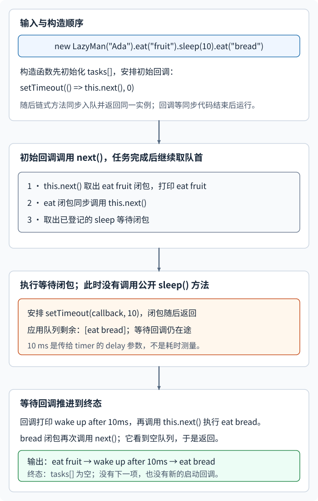

### 为什么构造时要延后第一项？

如果构造函数立刻调用 `next()`，当时 `tasks` 还是空数组；`shift()` 会取到 `undefined`，而后续 `.eat()` 与 `.sleep()` 尚未执行。构造函数改用 `setTimeout` 安排一个稍后的回调，让当前同步链先把三项工作登记好。JavaScript 不会在这段同步代码中途切去执行另一个普通定时器回调；具体回调何时获得调度由宿主决定。

下面是本例的完整教学队列。`name` 记录实例身份；任务输出为聚焦顺序而省略名字。

~~~javascript
class LazyMan {
  constructor(name) {
    this.name = name;
    this.tasks = [];
    setTimeout(() => this.next(), 0);
  }

  eat(food) {
    this.tasks.push(() => {
      console.log("eat " + food);
      this.next();
    });
    return this;
  }

  sleep(ms) {
    this.tasks.push(() => {
      setTimeout(() => {
        console.log("wake up after " + ms + "ms");
        this.next();
      }, ms);
    });
    return this;
  }

  next() {
    const task = this.tasks.shift();
    if (task) task();
  }
}
~~~

`.eat(food)` 和 `.sleep(ms)` 当场只把函数压入队列，并返回同一个 `this`，所以调用者可以继续链式调用。closure（闭包）保留入队时的 `food` 或 `ms`；箭头函数也在回调中继续使用同一个实例的 `this`。等 `next()` 取出函数时，工作才真正发生。

`next()` 取出并执行队首任务；若队列为空，它就返回。构造函数安排的定时器回调负责第一次调用 `next()`，之后由各项任务在自己的工作完成时调用一次。普通 `eat` 任务打印后立刻推进；轮到已登记的 `sleep` 闭包时，它才安排定时器并返回，等回调打印醒来消息后再推进。调用者按本例约定只使用 `.eat()`、`.sleep()` 这类登记方法，不直接调用 `next()`。

`next()` 是这个类自己定义的普通方法，不是浏览器、Node.js、定时器或 Promise 内建的队列推进接口。

### 队列怎样推进到最终输出？

继续跟踪同一条合成输入。`tasks` 中从左到右是下一项先执行；`next()` 取走队首后，任务可能同步推进，也可能把推进交给稍后的宿主回调。

| 阶段 | 应用队列剩余项 | 正在执行的工作 | 谁触发下一步 |
| --- | --- | --- | --- |
| 链式调用结束 | `eat fruit → sleep 10 → eat bread` | 尚未启动 | 构造函数安排的初始定时器回调；当前同步代码结束后才有机会运行 |
| 初始 `next()` 取出第一项 | `sleep 10 → eat bread` | `eat fruit` 打印，然后同步调用 `next()` | 当前 JavaScript 调用 |
| `next()` 取出已登记的等待闭包 | `eat bread` | 执行等待闭包，安排延时参数为 10 ms 的定时器，然后返回；队列暂不继续 | 宿主稍后调度的定时器回调 |
| 等待回调运行 | `eat bread` | 打印醒来消息，再调用 `next()` | 当前定时器回调中的 JavaScript |
| 最后一项完成 | 空 | `eat bread` 打印，再调用 `next()`；`shift()` 得到 `undefined`，调用结束 | 无下一项 |

输出顺序是：

> [!example] Ada 的三个排队命令
> 输入为 `eat("fruit")`、`sleep(10)`、`eat("bread")`。`sleep` 任务未在入队时等待；它直到轮到自己时才启动 10 ms 定时器。定时器回调运行后才推进到面包任务。
>
> ~~~text
> eat fruit
> wake up after 10ms
> eat bread
> ~~~

这里的 10 ms 是传给定时器的延时参数，醒来日志复用同一参数，不表示测得的经过时间。浏览器标准说明定时器会在指定延时后安排回调，但负载或其他任务可让实际执行变晚；Node.js v26.13.0 也明确不保证精确时刻或回调间的固定顺序。本例只依赖“等待回调推进队列”这一先后关系。

在原例中，若外部代码在 `sleep` 等待期间调用 `.eat("cake")`，新闭包追加到 `tasks` 尾部；回调推进后，原有 `eat bread` 先于 `eat cake` 执行。另一个变体以 `.sleep(10)` 作为最后一项：等待闭包已出队，所以 `tasks.length` 暂时为 0，但等待回调仍在途；此时追加的 `eat cake` 会在回调推进后运行。只有最后一项完成并调用 `next()`、而 `next()` 看到空队列返回之后，后续单纯追加任务才不会自动重启队列，因为登记方法只入队，不安排新的启动回调。

这个串行队列依赖一个明确约定：调用者只登记任务；每个出队任务只在自身工作完成时调用一次 `next()`。若漏调，队列就停住；若任务提前或重复调用，后续任务可能在当前工作完成前启动。调用者直接调用 `next()` 也可能绕过尚未完成的等待。任务抛错时本实现没有恢复策略；等待中的定时器没有保存句柄，不能由实例取消。连续的同步任务会通过 `next()` 递归推进，很多项可能耗尽调用栈。它只演示链式登记、闭包保存参数和显式推进，不是具备错误恢复或取消能力的生产队列。

若任务需要返回值、并发组合或把失败交给调用者处理，可以用 Promise 链或 `async function` (异步函数)；[回调、Promise 与 async 函数怎样组合异步工作？](#40.%20%E5%9B%9E%E8%B0%83%E3%80%81Promise%20%E4%B8%8E%20async%20%E5%87%BD%E6%95%B0%E6%80%8E%E6%A0%B7%E7%BB%84%E5%90%88%E5%BC%82%E6%AD%A5%E5%B7%A5%E4%BD%9C%EF%BC%9F)解释这些结果怎样传播。本页只回答链式命令如何排队并按序推进。

> [!info]- 来源
> - **浏览器定时器与事件循环。** [WHATWG HTML §8.7 Timers](https://html.spec.whatwg.org/multipage/timers-and-user-prompts.html#timers)、[§8.1.7 Event loops](https://html.spec.whatwg.org/multipage/webappapis.html#event-loops)，Living Standard 更新时间：2026-11-11。定时器初始化会创建稍后进入 timer task source（定时器任务源）的任务；事件循环先执行当前选中的任务步骤，之后再选择可运行任务。标准明确不保证定时器按精确延时准点运行。
> - **Node.js 计时器范围。** [Node.js v26.13.0 Timers](https://nodejs.org/download/release/v26.13.0/docs/api/timers.html)。Node 定时器采用不同的内部实现；文档说明实际时刻及回调顺序不作精确保证，且小于 1 ms（含 0）的延迟参数（`delay`）会设为 1 ms。本例不把浏览器定时器的延时规则外推到 Node。
> - **闭包与箭头函数。** [ECMAScript 2027 草案（2026-11-08）§10.2 ECMAScript Function Objects、§15.3 Arrow Function Definitions](https://tc39.es/ecma262/)，核对日期：2026-11-12。函数对象保存它闭合的词法环境；箭头函数不创建自己的 `this` 绑定。本例入队的函数稍后仍能读取 `food`、`ms` 参数，并通过外层方法的 `this` 调用 `next()`。
## 43. 迭代器与生成器怎样按需产出并清理数据？

### 案例背景

报表 42 的[基础资料、摘要和权限已校验](#%E6%8A%A5%E8%A1%A8%E8%AF%B7%E6%B1%82%E4%BD%95%E6%97%B6%E5%B9%B6%E5%8F%91%E3%80%81%E4%BD%95%E6%97%B6%E9%A1%BA%E5%BA%8F%E7%AD%89%E5%BE%85%EF%BC%9F)；用户有权读取明细。页面要用同一个报表 ID、当前排序和页面的 `AbortSignal`（中止信号）读取行。接口每页返回若干行和下一个 `cursor`（游标），而下一页的地址要等当前响应给出游标后才知道。页面希望逐行追加；找到目标行或用户取消时停止。本章所说的“清理”是关闭迭代器并处理它持有的资源，不是删除报表行。

这一条链路包含两个不同的按需边界：浏览器 Fetch API（网络请求接口）的 `fetch` 和 `response.json()` 先取得并解析**一整页**，异步生成器再把该页的行逐项交给消费者。本例循环等待 `await appendRow(row)` 完成当前行后，才请求下一项；当前页的行交付完毕后，生成器才请求下一页。它不是逐字节读取响应体。由于本接口下一页 URL 必须依赖上一页返回的游标，页与页之间必须顺序请求；若接口一开始就提供了独立页码或分片，可再按顺序需求、失败策略和资源限制选择串行或[有界并发池](#41.%20%E6%80%8E%E6%A0%B7%E9%99%90%E5%88%B6%E5%BC%82%E6%AD%A5%E4%BB%BB%E5%8A%A1%E7%9A%84%E5%B9%B6%E5%8F%91%E5%B9%B6%E6%94%B6%E5%B0%BE%E5%A4%B1%E8%B4%A5%EF%BC%9F)。

### 可迭代对象怎样交给消费者逐项读取？

iterable（可迭代对象）告诉消费者如何取得 iterator（迭代器）。普通可迭代对象通过 `Symbol.iterator` 提供同步迭代器；异步可迭代对象通过 `Symbol.asyncIterator` 提供异步迭代器。同步迭代器的 `next()` 当场返回 `{ value, done }` 结果对象；异步迭代器的 `next()` 返回 Promise，兑现值才是这种结构。消费者读取结果对象后，把 `done` 转成布尔值：真表示结束，假表示消费 `value` 后继续。缺少 `done` 等同于假；结束结果的 `value` 可以省略。

~~~javascript
const values = [10, 20];
const iterator = values[Symbol.iterator]();

iterator.next(); // { value: 10, done: false }
iterator.next(); // { value: 20, done: false }
iterator.next(); // { value: undefined, done: true }
~~~

数组、字符串、`Map`、`Set`、类型化数组和 `arguments` 对象都能迭代；普通对象仅有 `length` 或数字键，并不会因此可迭代。Document Object Model（文档对象模型，DOM）的 `NodeList`（节点列表）也可迭代，但它是宿主接口，集合实时变化还是静态快照由具体接口决定，见[DOM 集合何时实时变化？](#57.%20%E4%BF%AE%E6%94%B9%20DOM%20%E6%97%B6%EF%BC%8CHTMLCollection%20%E5%92%8C%20NodeList%20%E4%BC%9A%E6%80%8E%E6%A0%B7%E5%8F%98%E5%8C%96%EF%BC%9F)。

~~~mermaid
flowchart TD
  A["同步 iterable<br/>Symbol.iterator()"] --> B["iterator.next() 返回 result"]
  B --> C{"Boolean(result.done)"}
  C -- "false" --> D["消费 result.value"]
  D --> B
  C -- "true" --> E["结束"]
~~~

`iterable` 每次可以给出一个新迭代器，也可以返回同一个自身；协议并不保证可重用。数组每次通常提供新迭代器，而生成器实例是一次性状态机：

~~~javascript
const range = {
  start: 1,
  end: 3,
  [Symbol.iterator]() {
    let current = this.start;
    const end = this.end;
    return {
      next() {
        if (current <= end) return { value: current++, done: false };
        return { value: undefined, done: true };
      }
    };
  }
};

[...range]; // [1, 2, 3]
[...range]; // [1, 2, 3]，每次创建新的迭代器

const oneShot = (function* values() { yield 1; })();
oneShot[Symbol.iterator]() === oneShot; // true
[...oneShot]; // [1]
[...oneShot]; // []
~~~

展开语法、`for...of`、数组解构等消费者会按各自的规则使用这个协议。迭代器描述的是“怎样取得下一项”，不保证生产者内部没有预取、缓存或副作用。

### 生成器怎样暂停、接收值并委托工作？

`function*` 声明 generator function（生成器函数）。调用它会创建一个生成器对象，参数绑定和默认参数表达式在调用时处理，但函数体要到第一次 `next()` 才开始执行。每次 `yield` 暂停函数体并产出值；后续的 `next(value)` 恢复它，暂停处 `yield` 表达式的值就是传入的 `value`。第一次 `next(value)` 没有已暂停的 `yield` 可接收，所以参数被忽略。

~~~javascript
function* conversation() {
  const name = yield "你叫什么名字？";
  const hobby = yield "你好，" + name + "！你喜欢做什么？";
  return name + "喜欢" + hobby;
}

const chat = conversation();
chat.next("这个参数无人接收"); // { value: "你叫什么名字？", done: false }
chat.next("Ada");              // { value: "你好，Ada！你喜欢做什么？", done: false }
chat.next("编程");             // { value: "Ada喜欢编程", done: true }
~~~

最后一个 `return` 值放在 `value` 中，但 `done: true` 表示序列已经结束；它不是又一项普通产出。调用生成器时参数默认值可以运行，函数体内的 `try`、日志或副作用则还没有运行：

~~~javascript
const events = [];
function* sample(label = (events.push("参数初始化"), "报表")) {
  events.push("函数体开始：" + label);
  try {
    yield "第一行";
  } finally {
    events.push("清理");
  }
}

const rows = sample();
events; // ["参数初始化"]
rows.return("未启动"); // { value: "未启动", done: true }
events; // ["参数初始化"]；未开始的函数体没有进入 try/finally
~~~

当生成器已经开始并暂停在 `yield` 时，调用 `return(value)` 会把一次 return 控制流送回暂停点。若暂停点位于 `try` 中，`finally` 会运行；但 `finally` 自己也可以暂停：

~~~javascript
function* withCleanupYield() {
  try {
    yield "row";
  } finally {
    yield "cleanup step";
  }
}

const rows = withCleanupYield();
rows.next();             // { value: "row", done: false }
rows.return("finished"); // { value: "cleanup step", done: false }
rows.next();             // { value: "finished", done: true }
~~~

`rows.return()` 收到 `{ done: false }` 后不会继续替调用者拉取；生成器还暂停在 `finally` 里的第二个 `yield`。同样，`for...of` 的 `break` 只调用一次 `return()`，检查返回值是对象后便退出，不会因 `done: false` 再请求 `next()`。异步循环会等待这一次异步 `return()` 完成，但也不会重复关闭；所以清理代码若在 `yield` 后还要释放资源，`break` 后那部分仍可能悬停：

~~~javascript
const cleanup = [];
function* rowsWithCleanupYield() {
  try {
    yield "row";
  } finally {
    cleanup.push("开始清理");
    yield "清理步骤";
    cleanup.push("完成清理");
  }
}

const rowsToStop = rowsWithCleanupYield();
for (const row of rowsToStop) break;
cleanup; // ["开始清理"]；循环只调用一次 return()
rowsToStop.next();
cleanup; // ["开始清理", "完成清理"]；必须显式再恢复才完成
~~~

因此资源清理若要求一次关闭就完成，不要在清理路径中再次 `yield`。`return()` 是迭代器协议提供的通知，不是对任意工作或宿主资源的强制中断。

生成器还能通过 `yield*` 把一段迭代委托给另一个可迭代对象。后续 `next` 请求交给子迭代器必需的 `next()`；`throw` 和 `return` 的转发则取决于子迭代器是否实现对应方法。自然耗尽时，子迭代器的结束结果 `{ done: true, value }` 中的 `value` 成为 `yield*` 表达式的值，外层从该表达式之后继续；这能组合惰性序列并保留子生成器的最终结果。

强制关闭时，外部对外层调用 `return(v)`：若子迭代器没有 `return`，外层继续处理这次返回；若子 `return()` 给出 `done: false`，外层还可继续暂停，若给出 `done: true`，外层以这个子结果的 `value` 继续返回，但自己的 `finally` 仍可能改写结果。外部调用 `throw(e)` 而子迭代器没有 `throw` 时，委托会先尝试调用它可选的 `return` 来关闭。无论有没有 `return`，之后都会抛出 `TypeError`；若关闭本身先抛错，则传播关闭错误。直接对暂停中的生成器调用 `throw(e)`，则会在暂停处表现为抛错，可被生成器的 `catch` 捕获或沿 `finally` 展开：

~~~javascript
function* flatten(items) {
  for (const item of items) {
    if (Array.isArray(item)) yield* flatten(item);
    else yield item;
  }
}

[...flatten([1, [2, [3, 4]], 5])]; // [1, 2, 3, 4, 5]

function* child() {
  yield "item";
  return 42;
}
function* parent() {
  return yield* child();
}
const delegated = parent();
delegated.next(); // { value: "item", done: false }
delegated.next(); // { value: 42, done: true }
~~~

同一状态方式可以按需生成无限序列。停止读取的一方必须明确结束遍历，否则无限生成器不会自然结束：

~~~javascript
function* fibonacci() {
  let a = 0, b = 1;
  while (true) {
    yield a;
    [a, b] = [b, a + b];
  }
}

const fib = fibonacci();
fib.next().value; // 0
fib.next().value; // 1
fib.next().value; // 1
fib.next().value; // 2
~~~

序号也能按需生成，不必预分配一个大数组。下面只在同一个生成器实例内、计数没有超过 JavaScript 安全整数范围时保持唯一；不同实例使用同一前缀仍可能产生相同 ID：

~~~javascript
function* ids(prefix = "id") {
  let next = 0;
  while (true) yield prefix + "_" + next++;
}

const userIds = ids("user");
userIds.next().value; // "user_0"
userIds.next().value; // "user_1"
~~~

### 提前退出如何通知迭代器清理？

`for...of` 在循环体执行 `break`、`return` 或抛错等突然控制流离开时，会尝试调用迭代器可选的 `return()`。生成器把这次关闭请求变成暂停点处的 return 控制流，因此已进入 `try` 的生成器会运行 `finally`；需要清理生成器持有的资源时，应把清理放在该 `finally` 中：

~~~javascript
const source = {
  [Symbol.iterator]() {
    let value = 0;
    return {
      next() {
        return { value: value++, done: false };
      },
      return() {
        console.log("关闭迭代器");
        return { done: true };
      }
    };
  }
};

for (const value of source) {
  if (value === 2) break; // 退出时调用 return()
}
~~~

“关闭”表示消费者不再要下一项；它不表示迭代器一定释放了所有外部资源。同步 `for...of` 的 `next()` 自身抛错、或原生异步迭代器的 `next()` Promise 拒绝时，循环直接传播该错误，不能假定它还会调用 `return()`。循环体抛错则会请求关闭；若关闭钩子也抛错，原循环体错误仍优先传播，正常 `break` 时关闭钩子抛错则会传播。对需要可靠清理的资源，应把它放在生成器自己的 `try/finally` 中，并确认关闭路径没有挂起的 `yield`。

有一个不同的异步适配分支：`for await...of` 没有原生异步迭代器、改用同步迭代器时，适配器会等待每个 `{ done: false, value }` 的 `value`。若这个 Promise/thenable 拒绝，ECMAScript 2026 的同步转异步适配器会先关闭底层同步迭代器，再传播拒绝；本机 Node.js v26.13.0 对同步生成器实跑时确实进入其 `finally`。这与 `next()` 自身抛错或原生异步迭代器的 `next()` 拒绝不同。

> [!warning] 关闭请求不等于强制取消
> 调用 `return()` 只执行迭代器定义的关闭步骤。若 `next()` 正在等待网络、文件或流，普通同步迭代器协议不能抢占宿主 API；即使异步迭代器的关闭请求排队了，也要等正在运行的步骤让出控制权。应同时使用宿主资源提供的取消接口，例如把 `AbortSignal` 传给 Fetch。

异步生成器中的 `next()`、`return()` 和 `throw()` 都返回 Promise，恢复请求按顺序排队。若一个 `next()` 正等待 `await`，随后调用的 `return()` 不会跳到它前面；它要等当前请求推进后才执行关闭路径。这个次序保证生成器代码不被并发重入，却不取消它等待的 Fetch。

### 报表行怎样按页异步读取？

`for await...of` 优先使用 `Symbol.asyncIterator`：它等待异步迭代器 `next()` 返回的 Promise，但把兑现结果里的 `value` 原样交给循环体。若对象没有异步迭代方法，语法会把同步迭代器适配为异步迭代器；这个适配器还会等待每项的 Promise 或 thenable（带 `then` 方法、可被 Promise 接纳的对象）。异步生成器本身也会等待它的 `yield` 值，所以这三种入口在 `value` 本身是 Promise 时表现不同。`for await...of` 不只接受异步生成器：

~~~javascript
async function compareForAwaitValues() {
  const promiseValue = Promise.resolve("x");
  const nativeAsyncIterator = {
    [Symbol.asyncIterator]() { return this; },
    next() {
      return Promise.resolve({ value: promiseValue, done: false });
    }
  };
  const observed = [];

  for await (const value of nativeAsyncIterator) {
    observed.push(value === promiseValue); // true：原生 async iterator 的 value 未解包
    break;
  }
  for await (const value of [promiseValue]) observed.push(value); // "x"：同步适配器等待 value
  for await (const value of (async function* () { yield promiseValue; })()) {
    observed.push(value); // "x"：async generator 等待 yield 值
  }
  return observed;
}

compareForAwaitValues().then(console.log); // [true, "x", "x"]
~~~

报表接口返回一页 `items` 和 `nextCursor`。页面先等响应、检查 HTTP（超文本传输协议）状态、读取 JSON（JavaScript 对象表示法）并校验整页结构，再逐行 `yield`。只有当前页的行全部消费完毕，生成器才把游标放进下一次请求。下面沿用报表 42、当前排序和页面中止信号；每个响应可能包含任意数量的行，下一页只有非空游标可用时才存在。

把合成输入逐步展开：页 1 返回 `items: [r-101, r-102]` 和 `nextCursor: "c2"`；页 2 返回 `items: [r-201]` 和 `nextCursor: null`。第一次 `next()` 会取得并验证整页 1，然后停在 `yield r-101`，等待页面追加；下一次拉取才交付 `r-102`。若 `r-102` 是目标行，循环体 `break` 调用一次异步迭代器关闭，等待生成器 `finally`，不继续拉取到游标更新步骤，因此不会请求 `c2`。若继续消费，之后的那次 `next()` 才会读到 `c2` 并请求页 2；页 2 的行交付后，再次拉取遇到 `nextCursor: null` 才自然结束。坏结构在 `validateReportPage` 阶段、首次 `yield` 之前拒绝；重复游标则在当前页的行已经交付后检查。

| 消费者做什么 | 生成器推进到哪里 | 本次结果 / 是否请求下一页 |
|---|---|---|
| 第一次 `next()` | 请求并校验页 1，暂停在 `yield r-101` | 交付 `r-101`；页 1 还在内存里 |
| 追加完 `r-101` 后再 `next()` | 恢复当前页循环，暂停在 `yield r-102` | 交付 `r-102`；还没更新游标 |
| 目标是 `r-102`，追加后执行 `break` | 一次 `return()` 进入 `finally` | 关闭；不请求 `c2` |
| 若没有停止，追加完 `r-102` 后再 `next()` | 更新游标为 `c2`，请求并校验页 2 | 交付 `r-201` |
| 追加完 `r-201` 后再 `next()` | 发现页 2 的 `nextCursor: null`，结束并清理 | `done: true`；没有下一页 |

> [!example]- 分页生成器与逐行消费者的完整实现
> `appendRow` 返回当前行追加完成的 Promise，并绑定本次筛选自己的输出容器；`currentSort`、`selectedRowId`、取消按钮和错误展示函数由页面提供。两个信号检查分别守住“开始追加”和“再次拉取”的边界。
>
> ~~~javascript
> function validateReportRow(value) {
>   if (!value || typeof value !== "object" || Array.isArray(value) ||
>       typeof value.id !== "string") {
>     throw new Error("报表行缺少字符串 id");
>   }
>   return value;
> }
>
> function validateReportPage(value) {
>   if (!value || typeof value !== "object" || !Array.isArray(value.items)) {
>     throw new Error("报表分页响应缺少 items 数组");
>   }
>   if (value.nextCursor !== null &&
>       (typeof value.nextCursor !== "string" || value.nextCursor.length === 0)) {
>     throw new Error("nextCursor 必须是非空字符串或 null");
>   }
>   return {
>     items: value.items.map(validateReportRow),
>     nextCursor: value.nextCursor
>   };
> }
>
> async function* reportRows(reportId, sort, signal) {
>   let cursor = null;
>   const seenCursors = new Set();
>
>   try {
>     while (true) {
>       const query = new URLSearchParams({ sort });
>       if (cursor !== null) query.set("cursor", cursor);
>       const response = await fetch(
>         "/api/reports/" + encodeURIComponent(reportId) + "/rows?" + query,
>         { signal }
>       );
>       if (!response.ok) throw new Error("HTTP " + response.status);
>
>       const page = validateReportPage(await response.json());
>       for (const row of page.items) yield row;
>
>       if (page.nextCursor === null) return;
>       if (seenCursors.has(page.nextCursor)) {
>         throw new Error("报表接口重复返回分页游标");
>       }
>       seenCursors.add(page.nextCursor);
>       cursor = page.nextCursor;
>     }
>   } finally {
>     console.log("报表行迭代已关闭");
>   }
> }
>
> async function appendReportRows(reportId, sort, stopAfterId, signal, appendRow) {
>   try {
>     for await (const row of reportRows(reportId, sort, signal)) {
>       if (signal.aborted) throw signal.reason;
>       await appendRow(row);
>       if (signal.aborted) throw signal.reason;
>       if (row.id === stopAfterId) break;
>     }
>   } catch (error) {
>     if (signal.aborted && error === signal.reason) return;
>     throw error;
>   }
> }
>
> const controller = new AbortController();
> cancelButton.addEventListener("click", () => controller.abort(), { once: true });
> appendReportRows(42, currentSort, selectedRowId, controller.signal, appendRow)
>   .catch(showReportError);
> ~~~

每页的 JSON 已解析，验证后的 `page.items` 数组在内存中；生成器逐项交付这些已解析的行，不会把整份报表合成一个数组，也不保证宿主继续保留原始响应字节。消费者每处理完一行才继续拉取，但这种 backpressure（背压）只约束当前拉取、且生产者没有自行后台预取的部分。`seenCursors` 检查重复游标，防止错误响应令后续分页无休止；它占用与已读页数成正比的游标集合。

本例的 `finally` 只记录迭代已经关闭；网络和响应体读取的实际中止由传给 Fetch 的 signal 完成。用户取消时，信号传给 Fetch，可中止尚未收到响应的请求；若响应头已到达而 `response.json()` 仍在读响应体，中止仍可令这次读取拒绝。取消发生在 `appendRow` 等待中时，已开始的追加不能回滚，也仍可能写入当前筛选所显示的 tbody。这个 helper 在追加前检查一次 signal，防止启动新的追加；追加完成后再检查一次，避免向迭代器要下一项或尝试下一页；只有与当前 `signal.reason` 完全相同的取消拒绝会被吞掉，独立追加错误仍会向上传播。取消让分页 helper 正常返回，因此当前刷新处理器不会进入 `catch`，而会在分页返回后由 `finally` 关闭 loading。切换筛选则先递增代号、再中止旧信号、替换旧 tbody；旧追加即使完成，也只会写入已经移除的旧容器。详情见[报表请求的错误由谁接手？](#%E6%8A%A5%E8%A1%A8%E8%AF%B7%E6%B1%82%E7%9A%84%E9%94%99%E8%AF%AF%E7%94%B1%E8%B0%81%E6%8E%A5%E6%89%8B%EF%BC%9F)。

页码预先已知时，页与页可以串行，也可按顺序要求和失败策略用有界并发；当前接口的 `c2` 只能由页 1 给出，因此不能提前请求。`appendRow` 每次须完成后才会拉取下一行；若需并发处理行，也要另行规定顺序、背压和失败策略。

### 同步 Promise 数组何时不等于并发收集？

`for await...of` 也可消费包含 Promise 的同步可迭代对象；同步适配器按输入顺序等待值。Promise 可以在迭代前就启动，实际结局先后与循环交付顺序并不相同。

~~~javascript
let resolveFirst;
let resolveSecond;
const first = new Promise(resolve => { resolveFirst = resolve; });
const second = new Promise(resolve => { resolveSecond = resolve; });

async function collectInInputOrder() {
  const values = [];
  for await (const value of [first, second]) values.push(value);
  return values;
}

const collected = collectInInputOrder();
resolveSecond("second"); // 第二项先履行
resolveFirst("first");
collected.then(values => console.log(JSON.stringify(values)));
// ["first","second"]：交付仍按数组输入顺序
~~~

`Promise.all` 和 `Promise.allSettled` 履行时的结果数组也按输入顺序排列；区别是它们遍历普通数组时就给每个成员安装处理器。若较后的 Promise 在前项仍待定时拒绝，`for await...of` 还没请求到它，宿主之后可能报告这项拒绝暂时未处理；若前项先拒绝或一直未完成，循环可能永远不会走到后项。轮到后项时才观察拒绝，不是稳妥的并发收集方式。未处理拒绝的报告时机因宿主而异。

在 async/await 标准化以前，`co` 等库常用生成器作为控制流接口：runner 读到 `yield promise` 后等待它，成功时把值交给 `next(value)`，失败时用 `throw(error)` 恢复。理解这个模式能帮助维护旧代码；现代 `async function` 有自己的 Promise 语义，并非用户可见的生成器实例。

> [!info]- 来源
> - **迭代协议、关闭、生成器委托和异步适配：**[ECMAScript 2026](https://tc39.es/ecma262/2026/)，2026 年正式版。§7.4.11、§7.4.14 定义同步/异步 IteratorClose；§14.7.5.7 定义 `for...of` / `for await...of` 的遍历与关闭；§15.5.5 定义生成器函数和委托；§27.1.5.4 定义同步迭代器 Promise 值的异步适配与拒绝关闭；§27.5、§27.6 定义生成器状态和异步生成器请求排队。
> - **Promise 组合和输入顺序：**[ECMAScript 2026 §27.2.4](https://tc39.es/ecma262/2026/#sec-properties-of-the-promise-constructor)，正式版。§27.2.4.1 与 §27.2.4.2 分别定义 `Promise.all`、`Promise.allSettled` 对 iterable 的遍历和按输入位置收集结果。
> - **分页请求的取消、HTTP 响应与读取响应体：**[Fetch Standard：Response](https://fetch.spec.whatwg.org/#response-class)、[Body mixin](https://fetch.spec.whatwg.org/#body-mixin)、[Main fetch](https://fetch.spec.whatwg.org/#main-fetch) 与 [Abort fetch](https://fetch.spec.whatwg.org/#abort-fetch)，Living Standard，核对日期：2026-11-12（标准标注的最近更新为 2026-10-19）。HTTP 非成功状态仍是一个 Response；调用者要检查状态。取消 Fetch 与撤回服务端已经执行的业务副作用不是同一保证。
> - **异步工作未及时安装拒绝处理时的宿主报告：**[WHATWG HTML 8.1.4.7 Unhandled promise rejections](https://html.spec.whatwg.org/multipage/webappapis.html#unhandled-promise-rejections)，Living Standard，核对日期：2026-11-12（标准标注的最近更新为 2026-11-11）。HTML 按报告时是否已被处理派发事件；Node.js 等其他宿主有各自的报告机制。
> - **Node 实际运行：**Node.js v26.13.0；检查生成器启动/关闭、`yield*` 方法缺失分支、异步关闭等待、异步生成器排队、原生异步迭代器与同步适配器的 Promise 值差异、拒绝处理观察及同步适配器关闭。loopback 分页只覆盖两个固定游标页、坏结构、重复游标、目标行提前停止、Fetch 等待期中止和响应体读取期中止，不代表真实网络时延。
## 44. JavaScript 错误应在哪一层恢复、传播或上报？

### 案例背景

用户切换报表 42 的排序后，页面并发请求报表、摘要和权限。服务层校验响应；只有基础数据成功且权限允许，页面才继续读取游标分页的行。浏览器 Fetch API（网络请求接口）任一步都可能失败：网络中断、HTTP（超文本传输协议）404、响应 JSON（JavaScript 对象表示法）无法解析、数据结构不符合契约、分页重复游标，或行追加本身抛错。此时页面仍知道当前筛选、中止信号和 user interface（用户界面，UI）状态，适合决定显示提示、保留哪些旧数据或是否重试。错误边界处理另一类问题：组件树渲染失败时显示局部备用界面。全局事件可记录宿主报告到页面的异常或 Promise（表示异步结果的对象）拒绝，但事件可见范围不等同于应用内所有未恢复的错误，也不替代页面的恢复逻辑。

一条错误链要回答三个问题：**哪个操作失败、哪个层仍有足够上下文、该层选择恢复还是继续拒绝？** 错误在低层只记录日志后正常返回，会让上层误以为成功；页面若选择了可恢复状态，也应明确结束原拒绝链，而不是把原错误又变成一条未处理拒绝。

### 报表请求的错误由谁接手？

异步章节的 [`loadReport(id, sort, signal)`](#%E6%8A%A5%E8%A1%A8%E8%AF%B7%E6%B1%82%E4%BD%95%E6%97%B6%E5%B9%B6%E5%8F%91%E3%80%81%E4%BD%95%E6%97%B6%E9%A1%BA%E5%BA%8F%E7%AD%89%E5%BE%85%EF%BC%9F) 并发取得并校验报表、摘要和权限；它返回这三项已校验数据，或者以失败原因拒绝。每个筛选请求有自己的 AbortController（中止控制器）、AbortSignal（中止信号）与请求序号。中止旧信号尽力停止支持取消的网络工作；序号则防止仍然完成的旧请求覆盖较新的界面状态和 loading（加载中）状态。两者解决不同问题。

下面代码假定页面已有表格、刷新/取消按钮、排序控件、状态更新函数和 `diagnostics.capture` 应用记录器；同步初始化、DOM 替换和状态更新函数按本例契约正常运行。`loadReport`、`appendReportRows` 的输入输出契约分别如上和[游标分页迭代](#%E6%8A%A5%E8%A1%A8%E8%A1%8C%E6%80%8E%E6%A0%B7%E6%8C%89%E9%A1%B5%E5%BC%82%E6%AD%A5%E8%AF%BB%E5%8F%96%EF%BC%9F)。表格只有一个动态 `tbody`；每次筛选换上新容器，因此迟到的旧行最多写进已经脱离文档的旧容器。`prepareReportRow` 只创建行节点，`appendReportRows` 收到的 `appendRow` 才把它加入这一代容器。

> [!example]- 页面请求处理器的完整实现
> 同一个请求序号负责提交界面状态，同一个 `rowTarget` 负责隔离本代追加；`try/catch/finally` 决定失败如何被页面接手。下面保留完整代码，后文分别跟踪换代、HTTP 失败和取消的结果。
>
> ~~~javascript
> let latestReportRequest = 0;
> let activeController = null;
>
> function logReportError(error, context) {
>   try {
>     Promise.resolve(diagnostics?.capture?.({ error, context })).catch(() => {});
>   } catch {
>     // 诊断出口自己的失败不替换原错误，也不再创建一条未处理拒绝。
>   }
> }
>
> async function onRefreshClick(sort) {
>   const requestId = ++latestReportRequest;
>   activeController?.abort();
>
>   const controller = new AbortController();
>   activeController = controller;
>   setLoading(true);
>
>   const rowTarget = document.createElement("tbody");
>   const oldBody = rowsTable.tBodies[0];
>   if (oldBody) oldBody.replaceWith(rowTarget);
>   else rowsTable.append(rowTarget);
>
>   const appendRow = async row => {
>     const element = await prepareReportRow(row);
>     rowTarget.append(element);
>   };
>
>   try {
>     const { report, summary, permissions } =
>       await loadReport(42, sort, controller.signal);
>     if (requestId !== latestReportRequest) return;
>
>     setReport(report);
>     setSummary(summary);
>     setPermissions(permissions);
>     clearError();
>
>     // 权限字段已由服务层校验为布尔值；无权时不发起行请求。
>     if (permissions.canReadRows === true) {
>       await appendReportRows(42, sort, null, controller.signal, appendRow);
>     }
>   } catch (error) {
>     // 只静默本请求的取消原因；其他错误仍留下诊断记录。
>     if (controller.signal.aborted &&
>         error === controller.signal.reason) return;
>
>     if (!controller.signal.aborted) controller.abort();
>     logReportError(error, { requestId, sort });
>     if (requestId !== latestReportRequest) return;
>     setError(toUserMessage(error));
>   } finally {
>     if (requestId === latestReportRequest) {
>       setLoading(false);
>       activeController = null;
>     }
>   }
> }
>
> cancelButton.addEventListener("click", () => activeController?.abort());
> refreshButton.addEventListener("click", () => {
>   void onRefreshClick(sortSelect.value)
>     .catch(error => logReportError(error, { source: "refresh handler" }));
> });
> ~~~

> [!example] 两次筛选交错返回
> `recent` 请求先启动，随后 `oldest` 请求启动。新一代先递增序号，再中止旧信号并换上新 `tbody`。请求序号保护报表、摘要、权限、用户可见错误和 loading 状态；旧请求的 `finally` 不会关闭新请求的 loading。旧追加若已开始且不支持取消，完成后最多写入已移除的旧容器；追加 helper 在完成后检查信号，不再拉取下一行。旧请求若产生独立错误，仍交给 `logReportError` 记录，但不会覆盖当前提示。

`fetch()` 在得到可用的 `Response`（响应对象）时履行；HTTP 404 仍是响应，需由 `response.ok` 检查变成应用错误。若响应还没交到调用方就中止，Fetch Promise 可因该 signal 拒绝；若 Fetch 已履行，之后的中止不会改写这项履行，但仍在读取的 `response.json()` 会因响应体被中止而拒绝。JSON 已经履行后再中止，也不会撤回该值。JSON 解析可能因无效格式或响应体读取失败而拒绝；运行时结构校验可能同步抛错。

当前 `loadReport` 先对三项 Fetch Promise 做第一轮 `Promise.all`，全部交付 `Response` 后才检查状态；如果一项 Fetch Promise 先拒绝，`loadReport` 会立即以该原因拒绝，尚未运行 404 状态检查。若三项都履行，即使报表的 404 先到，也要等另外两项 `Response` 到达后才检查。`Promise.all` 拒绝本身不会中止其他请求；页面 `catch` 中的 `controller.abort()` 才是本例选择的同组取消策略。

> [!example] HTTP 404 如何走到界面提示？
> 假设报表 Fetch 得到 404，而摘要与权限 Fetch 也都履行为 `Response`。第一轮 `Promise.all` 才履行，`loadReport` 随后检查 `response.ok` 并抛错；因为状态检查先于 `json()`，这条路径不读取三份响应体，也不提交新的报表/摘要/权限状态。`onRefreshClick` 的 `catch` 用 `logReportError` 记录原始值并显示当前请求的错误；它显式中止当前控制器，`finally` 关闭最新请求的 loading。上一次已提交的报表、摘要和权限状态仍在，但页面开始刷新时已换上空的 `tbody`，因此旧行不保留；错误处理完成后，`onRefreshClick` 的 Promise 履行 `undefined`。若摘要或权限 Fetch 先拒绝，则它自己的拒绝会让第一轮 `Promise.all` 先拒绝，404 检查不会运行。

权限校验通过后，`appendReportRows` 逐页追加行。它沿用当前排序和中止信号；下一页依赖上一页给出的游标，不能被当作五个已知页码并发发起。客户端权限结果只决定是否发起行请求，行接口仍必须在服务端验证访问权。当前 signal 的取消会在两处被接手：基础三项请求若以完全相同的 `signal.reason` 拒绝，`onRefreshClick` 的 `catch` 会静默；分页 helper 自己也捕获并吞掉匹配原因，再正常返回，因此分页取消不会进入页面 `catch`。分页的独立错误（包括与 signal reason 不同的追加错误）仍会到页面处理器，记录并为当前筛选显示提示。

如果用户在 `prepareReportRow(r-101)` 等待时取消，已经开始的 `appendRow` 不会因此被撤回。当前筛选的 `tbody` 仍在页面上，所以这行完成后仍可能出现；helper 随即复查 signal、关闭迭代器并正常返回，不拉取缓存中的 `r-102` 或下一页。页面的 `await appendReportRows(...)` 因而正常履行并跳过 `catch`，最新请求随后由 `finally` 关闭 loading。换筛选则是另一条轨迹：先递增新请求序号，再中止旧 signal、创建新 signal 并替换 `tbody`；旧行若在等待中完成，只能写进已脱离文档的旧容器，旧 `finally` 也不能关闭新请求的 loading。取消不能撤销已开始的 DOM 追加，序号和容器身份负责隔离换代结果。分页消费和游标依赖见[报表行怎样按页异步读取？](#%E6%8A%A5%E8%A1%A8%E8%A1%8C%E6%80%8E%E6%A0%B7%E6%8C%89%E9%A1%B5%E5%BC%82%E6%AD%A5%E8%AF%BB%E5%8F%96%EF%BC%9F)。

| 等待行追加时发生什么 | 已开始的 `r-101` 追加完成后写到哪里 | 接下来谁结束 loading？ |
|---|---|---|
| 当前筛选点“取消” | 当前 `tbody` 仍在页面上，行仍可能出现 | helper 追加后查到中止，关闭迭代器并正常返回；当前请求的 `finally` 关闭 loading |
| 改为新筛选 | 旧 `tbody` 已移除，晚到的旧行不会混入新表格 | 旧请求退出但不改新 loading；新请求自行完成、失败或取消后才关闭 |

请求序号保护 `loading`、报表和用户可见错误；signal 则请求协作式取消。已开始但不支持取消的工作仍会完成，所以必须以序号和每代容器隔离其 UI 副作用。记录器 `logReportError` 接收原始拒绝值，不读取 `message`；无论注入记录器同步抛错还是返回拒绝 Promise，记录路径都不会替换页面中的原始错误或留下新的未处理拒绝。记录器自己的失败若必须保留，需要独立的诊断出口，不能递归调用同一记录器。

### try/catch/finally 覆盖哪段控制流？

`try/catch` 捕获当前同步调用栈中 `try` 语句执行时抛出的值；在 `try` 内 `await` 的 Promise 若拒绝，拒绝会在该 `await` 表达式处重新表现为抛错，也会进入对应的 `catch`。捕获后要么明确恢复并返回可说明成功的新结果，要么继续抛出，让更上层拿到错误。JavaScript 的 `throw` 可以抛任意值，不只 `Error` 实例。

~~~javascript
try {
  const data = await loadReport(42, currentSort, controller.signal);
  renderReport(data);
} catch (error) {
  showError(toUserMessage(error));
  throw error; // 本层只更新了提示，若契约仍需拒绝，就继续传播
} finally {
  setLoading(false);
}
~~~

普通函数在当前调用栈同步 `throw` 时会进入包围它的 `catch`。`async function` 即使在第一个 `await` 前抛错，调用本身也会返回一个拒绝的 Promise，不会同步抛出；调用方仍需 `await` 或安装拒绝处理器。下面等待的 Promise 是同一个 `try` 里的异步操作，`catch` 能处理其拒绝；计时器回调的 `throw` 则稍后在独立调用栈发生，并不会被当成原 `try` 中 Promise 的拒绝：

~~~javascript
try {
  setTimeout(() => {
    throw new Error("未来计时器回调中的抛错");
  }, 0);
} catch (error) {
  // 捕获不到计时器回调中的抛错
}

try {
  await loadReport(42, currentSort, controller.signal);
} catch (error) {
  // 可以捕获 loadReport 返回 Promise 的拒绝
}
~~~

语言级 `finally` 会在 `try` 正常结束、抛错或执行 `return` 时运行。若 `finally` 自己抛错或 return，会替换原先的控制流结果，可能覆盖真正的业务失败：

~~~javascript
async function languageFinally() {
  try {
    return "报表值";
  } finally {
    return "被 finally 替换的值";
  }
}

languageFinally().then(console.log); // 被 finally 替换的值
~~~

对尚未完成的 Promise，`return pendingPromise` 会先运行 `finally`，之后 async 函数返回的 Promise 才采用它的结局；若它拒绝，拒绝不会回到已经离开的 `catch`。`return await pendingPromise` 则在 `await` 处等待结局，拒绝会进入本层 `catch`，随后才运行 `finally`：

~~~javascript
async function returnWithoutAwait(pendingPromise) {
  try {
    return pendingPromise;
  } catch (error) {
    console.log("此 catch 看不到返回 Promise 的拒绝");
    throw error;
  } finally {
    console.log("return Promise 后先运行 finally");
  }
}

async function catchAfterAwait(pendingPromise) {
  try {
    return await pendingPromise;
  } catch (error) {
    logReportError(error, { operation: "pending report" });
    throw error;
  } finally {
    console.log("await 结束后 finally 才运行");
  }
}
~~~

`Promise.prototype.finally()` 是 Promise 链上的清理回调，并不等同于语法级 `finally`。它忽略回调返回的普通值，等回调返回的 Promise 或 thenable（带 `then` 方法、会被 Promise 接纳的对象）完成；若清理成功，原链的履行值或拒绝原因继续传递；若清理抛错或返回拒绝，链改为拒绝清理错误。

~~~javascript
Promise.resolve("报表值")
  .finally(() => Promise.resolve("清理结果"))
  .then(console.log); // 等清理 Promise 履行后，仍输出“报表值”

Promise.resolve("报表值")
  .finally(() => { throw new Error("清理失败"); })
  .catch(error => console.log(error.message)); // 清理失败
~~~

同理，`catch` / `then` 的拒绝处理器返回普通值或最终履行的 Promise，会把后续链恢复为履行；抛错或返回最终拒绝的 Promise，则继续拒绝。每次调用 `.catch()` 或 `.then()` 都会返回一个新的 Promise；若拒绝处理器记录后重抛，这个新 Promise 仍拒绝。要把它交回调用方，并由有上下文的页面接手：

~~~javascript
function loadReportWithDiagnostic(sort, signal) {
  return loadReport(42, sort, signal)
    .catch(error => {
      logReportError(error, { operation: "load report" });
      throw error; // 原 Promise 不变；这个 catch 返回的新 Promise 仍拒绝
    });
}

async function refreshAndRecover(sort, signal) {
  try {
    return await loadReportWithDiagnostic(sort, signal);
  } catch (error) {
    setError(toUserMessage(error));
    return undefined; // 页面已恢复，调用方收到履行
  }
}

void refreshAndRecover(currentSort, controller.signal)
  .catch(error => logReportError(error, { operation: "refresh handler" }));
~~~

### 错误值怎样补充上下文而保留根因？

在当前层能确认错误含义时，可给用户返回稳定且适合显示的消息，同时在诊断记录保留原始错误。不要假设服务端消息总适合直接显示：它可能含内部细节、用户数据或不稳定的实现文字。页面的 `toUserMessage` 应按已知错误类型或 code 映射到安全文案，未知值使用普通兜底消息。

`Error` 构造器自 ES2022 支持的 `cause`（原因）选项可在增加当前操作上下文时保留根因；`code` 等稳定字段可帮助调用方做类别分支。`instanceof` 适合同一构造函数身份的普通边界，但跨 iframe / realm（JavaScript 运行时领域）或重复加载不同构造函数副本时，对象可能继承另一份 `Error.prototype`，判断就会失败。跨边界契约可依赖明确的字段或序列化格式，而不是只依赖 `instanceof`。只有目标转译环境无法正确继承内置 `Error` 原型时，才考虑针对该环境用 `Object.setPrototypeOf` 修复继承链。

~~~javascript
class ReportDecodeError extends Error {
  constructor(message, cause) {
    super(message, { cause });
    this.name = "ReportDecodeError";
    this.code = "REPORT_DECODE_FAILED";
  }
}

function decodeReport(raw) {
  try {
    return validateReport(raw);
  } catch (cause) {
    throw new ReportDecodeError("报表数据无法读取", cause);
  }
}
~~~

记录器也应接受任意抛出值（thrown value），例如字符串、`null` 或普通对象；保持原值交给诊断通道，不先读取 `error.message`，避免把原始拒绝改成新的 `TypeError`。示例的 `logReportError` 也隔离记录器同步抛错和返回 Promise 的拒绝，不让记录失败替换原始业务错误或产生未处理的派生 Promise。面向 UI 的 `toUserMessage` 则要对任意值给出安全兜底。

### 浏览器全局处理器能兜住什么？

浏览器的 `window.onerror` 和全局 `error` 事件可观察宿主报告的脚本异常，但并非只有未被应用接住的错误才可能出现。React 开发构建中，错误边界已经接住的渲染错误仍可能被 window 级错误监听看到；生产构建的报告方式不同。HTML 的“muted errors（静音错误）”规则会在某些跨源经典脚本（classic script）错误中隐藏细节：页面可能只看到通用的 `Script error.`，无法读取完整错误详情；静音脚本还可能完全跳过 Promise 拒绝追踪。若要把脚本运行错误详情交给页面处理，需用 `crossorigin` 启用 Cross-Origin Resource Sharing（跨源资源共享，CORS）检查，并由服务器允许该来源；若 CORS 检查失败，脚本本身不会成功加载，这与“脚本已运行但错误详情被静音”处于不同阶段。

`unhandledrejection` 只在宿主派发报告任务时该拒绝仍未处理的情况下触发。若页面在宿主派发任务前就给 Promise 加上拒绝处理器，事件可以不派发；若宿主已报告、之后才安装处理器，页面还可能收到 `rejectionhandled`。因此这个事件既不表示拒绝发生的原调用栈，也不能替代页面请求层的恢复。

资源元素的失败还要区分事件目标。图片元素自己的 `error` 事件不冒泡；若要在 Document Object Model（文档对象模型，DOM）父容器集中记录，应注册捕获阶段监听器。`window.onerror` 处理器返回 `true` 会抑制该运行时错误的默认报告；下面改用事件监听器，只展示如何捕获非冒泡资源错误，不会抑制默认脚本错误报告：

~~~javascript
window.addEventListener("unhandledrejection", event => {
  logReportError(event.reason, { source: "unhandledrejection" });
  // 只有明确要取消 unhandledrejection 的默认报告时才调用 event.preventDefault()
});

window.addEventListener("error", event => {
  if (event.target === window) {
    logReportError(event.error, { source: "window error" });
  } else {
    logReportError(undefined, { source: "resource error", target: event.target });
  }
}, true); // 同时记录全局脚本错误与捕获阶段的资源 error
~~~

全局事件是诊断信号，不是“所有应用未处理错误”的完整清单，也不是每个异步操作的兜底 catch。预期失败应该尽早回到最有上下文的层；全局监听不应把可恢复的请求错误静默掉。

### React 错误边界覆盖哪个 UI 范围？

React 错误边界为子组件在渲染期间抛出的错误提供局部备用界面。类组件可用 `static getDerivedStateFromError` 切换失败状态，再用 `componentDidCatch` 记录错误和组件栈。边界不能捕获事件处理器或普通异步回调中发生的错误，也捕获不了服务端渲染错误、边界自身抛出的错误。按钮中的 Fetch 仍要像本章 `onRefreshClick` 一样显式 await 并处理拒绝。

~~~jsx
class ReportBoundary extends React.Component {
  state = { failed: false };

  static getDerivedStateFromError() {
    return { failed: true };
  }

  componentDidCatch(error, info) {
    logReportError(error, { componentStack: info.componentStack });
  }

  render() {
    if (this.state.failed) return <p>报表暂时无法显示。</p>;
    return this.props.children;
  }
}
~~~

把边界包在要替换的表格子树外，边界外的排序控件仍然可用：

~~~jsx
<div>
  <ReportSortControl />
  <ReportBoundary>
    <ReportTable />
  </ReportBoundary>
</div>
~~~

`ReportTable` 渲染抛错后，边界状态变为 `failed: true`，它用备用段落替换表格；`ReportSortControl` 位于边界外，不会被这次失败替换。这个最小边界没有自动恢复动作；备用界面会一直保留，直到应用重置边界状态或重新挂载该边界。React 开发构建可能同时把已接住错误报告到 `window`；这不表示 boundary 没有接手。

React 当前文档列出一个范围例外：由 `useTransition` 钩子返回的 `startTransition` 函数启动的 transition（过渡）函数中抛出的错误可被错误边界处理。不要把这条限定扩大到普通事件处理器、任意 Promise 或任何宿主异步回调。需要依赖特定框架版本或框架集成时，再按项目实际版本核对边界行为。

> [!info]- 来源
> - **语言级异常、`await` 与 `return`、Promise 组合/拒绝传播和 `finally`：**[ECMAScript 2026](https://tc39.es/ecma262/2026/)，正式版，§14.15、§15.8、§27.2.4.1、§27.2.5.1 与 §27.2.5.3。规范规定 try/catch/finally 控制流完成的优先级、async/await、`Promise.all` 首个拒绝、Promise `catch` 与 `finally` 的结果传递。
> - **Fetch 响应、响应体和取消：**[Response](https://fetch.spec.whatwg.org/#response-class)、[Body mixin](https://fetch.spec.whatwg.org/#body-mixin)、[Main fetch](https://fetch.spec.whatwg.org/#main-fetch)、[Abort fetch](https://fetch.spec.whatwg.org/#abort-fetch) 与 DOM [AbortSignal](https://dom.spec.whatwg.org/#interface-AbortSignal)，相关 Living Standards，核对日期：2026-11-12（Fetch 最近更新 2026-10-19，DOM 最近更新 2026-11-12）。HTTP 状态响应与网络错误/取消是不同结果；客户端取消不提供撤销服务端已发生副作用的保证。
> - **浏览器全局运行时错误与未处理拒绝：**[HTML runtime script errors](https://html.spec.whatwg.org/multipage/webappapis.html#runtime-script-errors)、[unhandled promise rejections](https://html.spec.whatwg.org/multipage/webappapis.html#unhandled-promise-rejections) 与 [HostPromiseRejectionTracker](https://html.spec.whatwg.org/multipage/webappapis.html#host-promise-rejection-tracker)，WHATWG HTML Living Standard，核对日期：2026-11-12（标准标注最近更新 2026-11-11）。后安装拒绝处理器可触发 `rejectionhandled`；静音经典脚本可能跳过拒绝追踪。
> - **资源元素错误事件：**[HTML 4.8.4.3.5 Updating the image data](https://html.spec.whatwg.org/multipage/images.html#updating-the-image-data) 与 [DOM event dispatch](https://dom.spec.whatwg.org/#concept-event-dispatch)，Living Standards，核对日期：2026-11-12。资源 `error` 在元素上触发且不冒泡，祖先监听要使用 capture。
> - **错误边界范围与 window 事件：**[React Component reference: `componentDidCatch`](https://react.dev/reference/react/Component#componentdidcatch) 与 [Catching rendering errors with an Error Boundary](https://react.dev/reference/react/Component#catching-rendering-errors-with-an-error-boundary)，官方文档当前显示 v19.3，核对日期：2026-11-12。列出边界捕获范围、开发构建下已接住错误向 `window` 冒泡、生产构建下被接住错误不冒泡，以及 `useTransition` Hook 返回的 `startTransition` 例外。
> - **Error 原因与跨构造函数边界：**[ECMAScript 2026](https://tc39.es/ecma262/2026/)，§20.5.1.1 与 §7.3.21。`Error` 支持 `cause`；`instanceof` 按右侧构造函数的 prototype 身份沿继承链检查。
> - **运行核对：**Node.js `v26.13.0`；实际检查 `return promise` / `return await promise`、Promise `finally` 和拒绝链、任意 thrown value、跨 realm Error、Promise.all 同组失败、计时器回调 throw 与后装拒绝处理器的 Node 宿主事件。Node 观测不外推为浏览器保证。
## 45. 收到不可信 JSON 后，TypeScript 怎样建立可信的类型？

月度报表页从接口或浏览器存储读入数据时，输入内容在运行时仍只是外部值。TypeScript 的类型注解会在输出 JavaScript 时擦除；它们能检查我们写下的代码，却不会替 `JSON.parse` 检查实际字段，也不会验证用户是否有权访问某份报表。

因此，数据要经过两个不同步骤：先解析 JSON（JavaScript 对象表示法）语法，再按运行时规则检查结构和取值。成功后从已检查字段重新构造应用对象，后续代码才可以依赖这个对象的静态类型。图只画运行时执行链；`unknown` 是编译期的静态边界，不是 JSON 解析后的运行时转换。

~~~mermaid
flowchart TB
  A[已取得的接口或存储文本] --> B{JSON.parse}
  B -- 语法错误 --> E[返回 syntax]
  B -- 解析成功 --> C[JavaScript 运行时值]
  C --> D{逐项检查字段和值}
  D -- 检查失败 --> F[返回 shape]
  D -- 检查通过 --> G[按已检查字段重建对象]
  G --> H[业务代码使用已检查对象]
~~~

如果文本来自浏览器存储，`getItem` 返回 `null` 时会在进入这条共用链之前返回 `missing`。

### 怎样在运行时检查报表数据？

`unknown`（未知类型）允许一个值暂时存在，但在缩窄到更具体类型前不允许任意读取属性。下面的解析器分别处理语法错误、缺失存储值和字段结构错误；每个通过的行都被重新构造成 `ReportRow`，而不是把外部对象直接断言成该类型。

~~~typescript
type Role = "admin" | "reader";
type ReportStatus = "open" | "published" | "archived";

type ReportRow = {
  id: string;
  title: string;
  month: string;
  region: string;
  status: ReportStatus;
  total: number;
  ownerEmail: string;
};

type ReportData = {
  viewer: { id: string; role: Role };
  rows: ReportRow[];
};

type ParseResult<T> =
  | { ok: true; value: T }
  | { ok: false; reason: "syntax" | "shape" | "missing" };

function isRecord(
  value: unknown
): value is Record<string, unknown> {
  return (
    typeof value === "object" &&
    value !== null &&
    !Array.isArray(value)
  );
}

function parseReportData(text: string): ParseResult<ReportData> {
  let input: unknown;
  try {
    input = JSON.parse(text);
  } catch {
    return { ok: false, reason: "syntax" };
  }

  if (
    !isRecord(input) ||
    !isRecord(input.viewer) ||
    typeof input.viewer.id !== "string" ||
    (input.viewer.role !== "admin" &&
      input.viewer.role !== "reader") ||
    !Array.isArray(input.rows)
  ) {
    return { ok: false, reason: "shape" };
  }

  const rows: unknown[] = input.rows;
  const checkedRows: ReportRow[] = [];
  for (const candidate of rows) {
    if (
      !isRecord(candidate) ||
      typeof candidate.id !== "string" ||
      typeof candidate.title !== "string" ||
      typeof candidate.month !== "string" ||
      !/^\d{4}-(0[1-9]|1[0-2])$/.test(candidate.month) ||
      typeof candidate.region !== "string" ||
      (candidate.status !== "open" &&
        candidate.status !== "published" &&
        candidate.status !== "archived") ||
      typeof candidate.total !== "number" ||
      !Number.isFinite(candidate.total) ||
      typeof candidate.ownerEmail !== "string"
    ) {
      return { ok: false, reason: "shape" };
    }

    checkedRows.push({
      id: candidate.id,
      title: candidate.title,
      month: candidate.month,
      region: candidate.region,
      status: candidate.status,
      total: candidate.total,
      ownerEmail: candidate.ownerEmail
    });
  }

  return {
    ok: true,
    value: {
      viewer: { id: input.viewer.id, role: input.viewer.role },
      rows: checkedRows
    }
  };
}

function readStoredReport(
  storage: Storage
): ParseResult<ReportData> {
  const text = storage.getItem("monthly-report");
  if (text === null) return { ok: false, reason: "missing" };
  return parseReportData(text);
}

const manualResult = parseReportData(`
{
  "viewer": {
    "id": "u-7",
    "role": "reader"
  },
  "rows": [
    {
      "id": "r-21",
      "title": "北区月报",
      "month": "2026-10",
      "region": "north",
      "status": "published",
      "total": 820,
      "ownerEmail": "ada@example.com"
    }
  ]
}
`);
~~~

TypeScript 标准库把 `JSON.parse` 的返回类型声明为 `any`。赋给 `let input: unknown` 只改变编译器看到的静态类型；运行时仍是 `JSON.parse` 得到的同一个值，并没有自动验证或转换。`isRecord` 内部的对象、非 `null`、非数组条件会实际运行；返回类型 `value is Record<string, unknown>` 则是函数向编译器作出的缩窄承诺，编译器依据它分析后续属性访问，不会替函数证明该承诺正确。实现中的布尔检查和类型谓词必须保持一致。`Array.isArray` 在 TypeScript 标准库中的类型谓词会把值缩窄为 `any[]`，所以这里立即把 `input.rows` 赋给 `unknown[]`，让循环中的每个 `candidate` 仍须先检查再读取。

解析器现在只保证字段形状和示例所写的格式规则。它在运行时检查月份符合 `YYYY-MM` 形式、`total` 是有限数值，但返回类型仍分别是普通 `string` 和 `number`，并未把这两条细则编码进静态类型。解析器按已检查字段重建 `ReportData`，因此忽略并丢弃未声明字段；它不证明 `viewer.id` 是当前登录用户，也不证明该用户可以查看报表，这些授权判断必须由受信任的服务端完成。若业务还要求金额非负、地区来自配置清单等约束，应把对应规则也写入运行时解析，而不是只扩大 TypeScript 类型。`readStoredReport` 把缺失项转换为 `missing`，但不捕获存储访问异常：调用时读取 `localStorage` 可能因来源或策略抛出 `SecurityError`，而 `getItem` 的其他异常也会向上抛出。调用方应按自身降级策略处理，不要把存储故障误报成 JSON 语法错误。

### 怎样用 Zod 在同一个输入边界生成运行时检查和静态类型？

如果手写检查开始重复字段路径和类型判断，可以在同一个报表 JSON 边界使用 schema（结构模式）。下面固定用 Zod `4.6.7`，声明与上例相同的字段形状，但两种检查的接纳规则并不相同：手写解析器重建已知字段并忽略额外键，`z.strictObject` 会拒绝额外键；默认的 `z.object` 则会剥除未知键。Zod 还要求 `ownerEmail` 符合邮箱格式，而手写版本只要求它是字符串。是否拒绝额外键、邮箱需要多严格，应按接口契约决定。不能只为了得到 `z.infer` 类型就把宽泛外部数据断言成模型。

~~~typescript
import * as z from "zod"; // zod@4.6.7

const ReportRowSchema = z.strictObject({
  id: z.string(),
  title: z.string(),
  month: z.string().regex(/^\d{4}-(0[1-9]|1[0-2])$/),
  region: z.string(),
  status: z.enum(["open", "published", "archived"]),
  total: z.number(), // Zod 4 的 number schema 只接受有限数值
  ownerEmail: z.email(),
});

const ReportDataSchema = z.strictObject({
  viewer: z.strictObject({
    id: z.string(),
    role: z.enum(["admin", "reader"]),
  }),
  rows: z.array(ReportRowSchema),
});

type ReportDataFromSchema = z.infer<typeof ReportDataSchema>;

function parseReportDataWithZod(
  text: string
): ParseResult<ReportDataFromSchema> {
  let input: unknown;
  try {
    input = JSON.parse(text);
  } catch {
    return { ok: false, reason: "syntax" };
  }

  const parsed = ReportDataSchema.safeParse(input);
  if (!parsed.success) {
    const firstIssue = parsed.error.issues[0];
    console.log(firstIssue?.path, firstIssue?.message);
    return { ok: false, reason: "shape" };
  }
  return { ok: true, value: parsed.data };
}

const zodResult = parseReportDataWithZod(`
{
  "viewer": {
    "id": "u-7",
    "role": "reader"
  },
  "rows": [
    {
      "id": "r-21",
      "title": "北区月报",
      "month": "2026-10",
      "region": "north",
      "status": "published",
      "total": "820",
      "ownerEmail": "ada@example.com"
    }
  ]
}
`);
// 第一个结构错误的 path 为 ["rows", 0, "total"]。
// 字符串不会被默默转成数字。
~~~

JSON 语法仍先由 `JSON.parse` 处理；成功后 `input` 是静态 `unknown`，`safeParse` 再实际检查字段和值。成功分支的 `parsed.data` 是已校验并推导出的 `ReportDataFromSchema`。失败分支的 `ZodError.issues` 保存结构化问题；`path` 用字段键和数组索引定位，例如 `rows` 第 0 项的 `total` 对应 `["rows", 0, "total"]`，不是 JSON 文本的行号和列号。遇到未声明键时，路径可能只到包含它的对象（如 `["rows", 0]`），具体键名在问题消息中。手写示例的 `total` 是数值 `820`，所以通过；Zod 示例将该字段改为字符串 `"820"`，虽然仍是语法合法的 JSON，Zod 结构检查会拒绝它。同一个字符串输入也会被手写解析器拒绝，因为它要求 `total` 的运行时类型是 `number`。包装函数打印首个 issue 后只向调用者返回 `{ ok: false, reason: "shape" }`，不会把完整 issue 传出去。后文的 `if (zodResult.ok)` 因此不会调用角色标签函数。

Zod 4 的 `z.number()` 已拒绝 `NaN` 与正负无穷，因此这里不再重复加有限数检查。服务器侧可用 Pydantic 模型检查请求，FastAPI 则从路由与模型声明生成 OpenAPI 契约；实际响应是否兑现契约仍需核验，见[HTTP API 如何描述实际运行的请求与响应契约](../../engineering-foundations/backend/http-api-contracts.md)。Zod 与 Pydantic 都检查运行时输入；TypeScript 的 `z.infer` 只帮助后续代码在编译期保持同一结构，不会自动让网络载荷、浏览器存储或授权可信。

### 类型联合新增分支时怎样让编译器提醒调用处？

解析器仅接受已知角色。调用端在分支中处理角色时，可以把默认分支赋给 `never`（不可能出现的类型）。若以后把 `editor` 加入 `Role`，但忘了补充下列分支，类型检查会在 `never` 赋值处报错。若 `editor` 是外部数据允许的新角色，还必须同步让上面的运行时解析器接受它；只扩充联合类型和显示分支不会使它通过输入检查。这里的标签仅用于界面显示，不是授权判断。

~~~typescript
function roleLabel(role: Role): string {
  switch (role) {
    case "admin":
      return "管理员";
    case "reader":
      return "只读用户";
    default: {
      const unhandled: never = role;
      throw new Error(`未处理的角色：${unhandled}`);
    }
  }
}

if (manualResult.ok) {
  console.log(roleLabel(manualResult.value.viewer.role));
}
if (zodResult.ok) {
  console.log(roleLabel(zodResult.value.viewer.role));
}
~~~

这两道检查覆盖不同边界：运行时解析器决定外部值是否进入应用；穷尽性检查提醒开发者是否处理了应用类型中所有已支持的分支。泛型和工具类型也只描述编译期关系，见[泛型怎样保留输入与输出之间的类型关系？](#46.%20%E6%B3%9B%E5%9E%8B%E6%80%8E%E6%A0%B7%E4%BF%9D%E7%95%99%E8%BE%93%E5%85%A5%E4%B8%8E%E8%BE%93%E5%87%BA%E4%B9%8B%E9%97%B4%E7%9A%84%E7%B1%BB%E5%9E%8B%E5%85%B3%E7%B3%BB%EF%BC%9F)与[怎样从报表类型派生数据形状并约束方法中的 `this`？](#47.%20%E6%80%8E%E6%A0%B7%E4%BB%8E%E6%8A%A5%E8%A1%A8%E7%B1%BB%E5%9E%8B%E6%B4%BE%E7%94%9F%E6%95%B0%E6%8D%AE%E5%BD%A2%E7%8A%B6%E5%B9%B6%E7%BA%A6%E6%9D%9F%E6%96%B9%E6%B3%95%E4%B8%AD%E7%9A%84%20this%EF%BC%9F)。

> [!info]- 来源
> - [TypeScript Handbook：unknown 与类型缩窄](https://www.typescriptlang.org/docs/handbook/2/narrowing.html)
> - [TypeScript Handbook：断言与类型兼容](https://www.typescriptlang.org/docs/handbook/2/everyday-types.html#type-assertions)、[类型兼容与健全性取舍](https://www.typescriptlang.org/docs/handbook/type-compatibility.html#a-note-on-soundness)
> - [TypeScript Handbook：穷尽性检查](https://www.typescriptlang.org/docs/handbook/2/narrowing.html#exhaustiveness-checking)
> - **Zod `4.6.7`：** [版本发布记录](https://github.com/colinhacks/zod/releases/tag/v4.6.7)、[4.6.7 文档与源码](https://github.com/colinhacks/zod/tree/v4.6.7/packages/docs/content)、[对象 schema 与 strict keys](https://zod.dev/api?id=objects)、[`safeParse` 与 `z.infer`](https://zod.dev/basics)、[错误 issue 路径](https://zod.dev/packages/core#issues)、[Zod 4 的格式 API](https://zod.dev/v4)。已在隔离的临时目录安装此版本，TypeScript 编译并于 Node `v26.13.0` 运行核对，2026-11-12。
>
> 按 `JSON.parse` 的语法错误、存储缺失值，以及报表结构检查整理；[TypeScript 类型注解会在输出 JavaScript 时擦除](https://www.typescriptlang.org/docs/handbook/2/basic-types.html#erased-types)，`localStorage` 属性访问可能抛出的 `SecurityError` 见 [HTML Standard：localStorage](https://html.spec.whatwg.org/multipage/webstorage.html#dom-localstorage)。来源核对日期：2026-11-12。
## 46. 泛型怎样保留输入与输出之间的类型关系？

报表页会处理很多种行数据和分页结果。若每个函数都复制一份实现，维护成本很高；若一律把参数和返回值写成 `any`（任意类型），调用处又会丢掉具体字段信息。generic（泛型）让同一段逻辑保留调用时的具体类型。

### 怎样把所选字段的类型一并保留下来？

type parameter（类型参数）像是类型层面的变量。编译器可以从调用参数推断它，也可以由调用者显式指定。下面的 `T` 代表整行类型，`K` 受 `keyof T`（类型键集合）约束，只能取该类型已有的键；indexed access type（索引访问类型）`T[K]` 则返回所选键对应的值类型。

~~~typescript
type ReportRow = {
  id: string;
  title: string;
  month: string;
  region: string;
  status: "open" | "published" | "archived";
  total: number;
  ownerEmail: string;
};

function getProperty<T, K extends keyof T>(row: T, key: K): T[K] {
  return row[key];
}

const row: ReportRow = {
  id: "r-21",
  title: "北区月报",
  month: "2026-10",
  region: "north",
  status: "published",
  total: 820,
  ownerEmail: "ada@example.com"
};

const reportId = getProperty(row, "id");       // string
const reportTotal = getProperty(row, "total"); // number
const statusOrTotalKey: "status" | "total" =
  Math.random() < 0.5 ? "status" : "total";
// ReportRow["status"] | number
const statusOrTotal = getProperty(row, statusOrTotalKey);
// getProperty(row, "owner");                  // 编译错误：不是 ReportRow 的键
~~~

`T` 与 `K` 是两个分别推断的类型参数：`T` 保留行形状，`K extends keyof T` 中的 `extends` 是 constraint（约束），要求本次传入的键属于该行已有的键。返回类型 `T[K]` 再按 `K` 取属性值类型，因此单键 `"id"` 得到 `string`，单键 `"total"` 得到 `number`。

把一次调用拆开看，编译器先从 `row` 得到 `T`，再把键限制在 `keyof T` 内，并由传入的字面量键推断 `K`，最后计算 `T[K]`：

| 调用与推导 | 返回类型 |
|---|---|
| `getProperty(row, "id")`：`T = ReportRow`，`K = "id"`，满足 `K extends keyof T` | `T[K]`，即 `ReportRow["id"]`，为 `string` |
| `getProperty(row, "total")`：`T = ReportRow`，`K = "total"`，满足 `K extends keyof T` | `T[K]`，即 `ReportRow["total"]`，为 `number` |
| `getProperty(row, statusOrTotalKey)`：`T = ReportRow`，`K` 是 `"status"` 和 `"total"` 组成的联合 | `T[K]` 是 `ReportRow["status"]` 与 `number` 的联合 |

单独保留 `K` 很重要：若签名只把参数写成 `keyof T`、返回值写成 `T[keyof T]`，即使传入字面量 `"id"`，返回类型也会包含字段值类型的联合。若调用者只掌握部分键组成的联合，`T[K]` 只合并这些键对应的字段类型；例如 `"status" | "total"` 得到 `ReportRow["status"] | number`。只有 `K = keyof ReportRow` 时才覆盖全部字段，本例的结果为 `string | number`。泛型约束保证编译器看到的键有效，不在运行时校验键或行数据。

### 怎样让分页与仓储接口为不同数据复用？

泛型也可把类型关系保留在对象结构和一组操作中。报表页面拿到 `ReportPage<ReportRow>`，下游仍知道 `rows` 里的每一项是报表行；同一容器也能装其他数据，而不必退化成 `unknown[]` 或 `any[]`。

~~~typescript
type ReportPage<T> = {
  rows: T[];
  total: number;
  nextCursor: string | null;
};

interface Repository<T> {
  getById(id: string): T | undefined;
  getAll(): T[];
  save(item: T): void;
}

function firstRow<T>(page: ReportPage<T>): T | undefined {
  return page.rows[0];
}

const reports: ReportPage<ReportRow> = {
  rows: [row],
  total: 1,
  nextCursor: null
};
const emptyPage: ReportPage<ReportRow> = {
  rows: [],
  total: 0,
  nextCursor: null
};
const first = firstRow(reports);
if (first) first.total.toFixed(2); // first.total 仍是 number
console.log(firstRow(emptyPage)); // undefined：空页没有第一行
~~~

`reports` 的类型是 `ReportPage<ReportRow>`；传给 `firstRow<T>` 时，参数形状让编译器推断 `T = ReportRow`，因此 `first` 是 `ReportRow | undefined`。`Repository<ReportRow>` 也把同一个 `T` 替换到每个操作：`getById` 返回 `ReportRow | undefined`，`getAll` 返回 `ReportRow[]`，`save` 接收 `ReportRow`。

泛型保留的是编译器掌握的关系；它不会在运行时检查服务器是否真的返回 `ReportRow`。来自网络或存储的外部输入应先保持为 `unknown` 并逐项验证，见[收到不可信 JSON 后，TypeScript 怎样建立可信的类型？](#45.%20%E6%94%B6%E5%88%B0%E4%B8%8D%E5%8F%AF%E4%BF%A1%20JSON%20%E5%90%8E%EF%BC%8CTypeScript%20%E6%80%8E%E6%A0%B7%E5%BB%BA%E7%AB%8B%E5%8F%AF%E4%BF%A1%E7%9A%84%E7%B1%BB%E5%9E%8B%EF%BC%9F)。工具类型则可进一步从 `ReportRow` 派生列表预览或更新请求形状，见[怎样从报表类型派生数据形状并约束方法中的 `this`？](#47.%20%E6%80%8E%E6%A0%B7%E4%BB%8E%E6%8A%A5%E8%A1%A8%E7%B1%BB%E5%9E%8B%E6%B4%BE%E7%94%9F%E6%95%B0%E6%8D%AE%E5%BD%A2%E7%8A%B6%E5%B9%B6%E7%BA%A6%E6%9D%9F%E6%96%B9%E6%B3%95%E4%B8%AD%E7%9A%84%20this%EF%BC%9F)。

> [!info]- 来源
> - [TypeScript Handbook：泛型与类型参数推断](https://www.typescriptlang.org/docs/handbook/2/generics.html)
> - [TypeScript Handbook：`keyof` 类型操作符](https://www.typescriptlang.org/docs/handbook/2/keyof-types.html)、[索引访问类型](https://www.typescriptlang.org/docs/handbook/2/indexed-access-types.html)
>
> 来源核对日期：2026-11-12。代码以 TypeScript 5.7.2 执行严格模式和 `noUncheckedIndexedAccess` 检查。
## 47. 怎样从报表类型派生数据形状并约束方法中的 `this`？

列表预览和局部更新可以从 `ReportRow` 派生；状态标签使用与 `ReportRow.status` 共用的 `ReportStatus`，避免两处状态定义漂移。对象字面量中的方法也需要知道调用接收者有哪些字段：`ThisType<T>` 或显式的 `this` 参数能提供编译期上下文。工具类型只影响静态检查，不会投影或验证运行时数据，也不会替方法绑定接收者；不可信的外部输入应在数据边界执行运行时检查。

### 哪些工具类型适合哪些数据形状？

下面用 `Pick` 从 `ReportRow` 选出列表预览字段，用 `Partial` 把允许编辑的字段变为可选项；`Record` 则为共享的 `ReportStatus` 联合要求每个状态都有标签。

~~~typescript
type ReportStatus = "open" | "published" | "archived";

interface ReportRow {
  id: string;
  title: string;
  month: string;
  region: string;
  status: ReportStatus;
  total: number;
  ownerEmail: string;
}

type ReportPreview = Pick<ReportRow, "id" | "title" | "month" | "total">;
type ReportPatch = Partial<Pick<ReportRow, "title" | "region">>;
type StatusLabels = Record<ReportStatus, string>;

const labels: StatusLabels = {
  open: "待审核",
  published: "已发布",
  archived: "已归档"
};

const input = { region: "north", ownerEmail: "ada@example.com" };
const patch: ReportPatch = input;
console.log(Object.keys(patch)); // ["region", "ownerEmail"]：仍是同一个运行时对象
~~~

`Partial<Pick<ReportRow, "title" | "region">>` 从内向外展开为 `{ title?: string; region?: string }`。示例变量 `input` 含有共同键 `region`，所以它可赋给这个部分类型；多出的 `ownerEmail` 仍留在同一个运行时对象中。若变量只有 `ownerEmail`，则与目标类型没有共同属性而不能赋值；直接把含 `ownerEmail` 的新对象字面量赋给 `ReportPatch` 也会触发多余属性检查。`Pick` 只筛选静态声明的字段，列表展示若需要实际投影，仍须在运行时构造新对象。

`ReportStatus` 增加 `"scheduled"` 后，`labels` 会因缺少该键而报错，提醒界面补上新状态。当前 `ReportPatch` 的字段是可选 `string`；在示例所用的 `strictNullChecks` 下，显式写入 `null` 不通过检查。只有当接口把 `null` 定义为清空字段等业务操作时，才应在对应属性类型中加入 `| null`，并让运行时边界按该语义解析。启用 `exactOptionalPropertyTypes`（要求 `strictNullChecks`）时，可选字段可以省略，但不能显式写 `undefined`，除非其类型包含 `undefined`；未启用时，编译器允许把 `undefined` 赋给可选字段。无论开关如何，读取 `patch.title` 都可能得到 `undefined`，因为属性可以缺席。

接收网络或存储中的更新数据时，运行时仍要按接口白名单检查字段，并区分省略、`null` 和具体值。这个检查针对不可信输入；本地按 `ReportPatch` 构造的对象仍由编译器检查。

常用变换可按目的理解：

| 需要 | 工具类型 | 结果与边界 |
|---|---|---|
| 列表类型只声明所需字段 | `Pick<T, K>` / `Omit<T, K>` | 选取或排除键；不会复制或投影对象 |
| 表达部分更新或完成默认值后的完整配置 | `Partial<T>` / `Required<T>` | 属性变为可选或必需；运行时仍需合并、检查 |
| 标出只读视图 | `Readonly<T>` | 浅层地禁止通过该类型重新赋值属性；不冻结对象 |
| 给一组键创建映射 | `Record<K, V>` | 约束对象键和值的类型；动态输入仍须验证 |
| 从联合类型中筛选成员 | `Exclude<U, X>` / `Extract<U, X>` | 移除或保留可赋给指定类型的成员 |
| 排除 `null` 与 `undefined` | `NonNullable<T>` | 仅改变静态类型，不会替值做空值检查 |
| 读取函数签名 | `Parameters<F>` / `ReturnType<F>` | 得到参数元组或返回类型；对重载函数取最后一个签名 |
| 读取构造签名 | `ConstructorParameters<C>` / `InstanceType<C>` | 得到构造参数元组或实例类型 |
| 解开 Promise 返回类型 | `Awaited<T>` | 递归解包 Promise 及兼容其 `then` 约定的类型；不会等待运行时值 |

这些工具大多通过 mapped type（映射类型）、conditional type（条件类型）或索引访问组合实现。阅读 `Partial<Pick<ReportRow, "title" | "region">>` 时，先用 `Pick` 取两个允许编辑的字段，再用 `Partial` 将它们变为可选；前文已展开其具体对象形状。

### 条件类型遇到联合类型时，为什么会逐项筛选？

条件类型（conditional type）若在被检查的位置直接写类型参数，例如 `T extends X`，传入联合类型时会把联合成员逐个代入条件。`Exclude` 就利用这个规则：成员可赋给排除类型时变成 `never`，剩余成员再组成联合。

~~~typescript
type WithoutArchived<T> = T extends "archived" ? never : T;
type VisibleStatus = WithoutArchived<ReportStatus>;
// "open" | "published" | never -> "open" | "published"

const visibleStatus: VisibleStatus = "published";
// @ts-expect-error "archived" 已被筛掉
const archivedStatus: VisibleStatus = "archived";

type IsArchived<T> = T extends "archived" ? true : false;
type DistributedCheck = IsArchived<ReportStatus>; // true | false -> boolean
const distributedTrue: DistributedCheck = true;
const distributedFalse: DistributedCheck = false;

type IsWholeUnionArchived<T> = [T] extends ["archived"] ? true : false;
type WholeStatusCheck = IsWholeUnionArchived<ReportStatus>; // false
const wholeStatusCheck: WholeStatusCheck = false;
// @ts-expect-error 整个 ReportStatus 联合并非全是 "archived"
const wholeStatusTrue: WholeStatusCheck = true;
~~~

`WithoutArchived<ReportStatus>` 会得到 `"open" | "published" | never`，而 `never` 没有可取值，所以结果只剩前两种状态。两个布尔条件使用相同的分支：裸 `T` 分配后得到 `true | false`（也就是 `boolean`）；把 `T` 包在元组中则比较整个联合，结果为 `false`。同样，`Exclude<ReportStatus, "archived">` 与 `VisibleStatus` 一样得到剩余状态。

### 对象字面量方法里的 `this` 怎样获得上下文类型？

`ThisType<T>` 是一个 contextual typing marker（上下文类型标记），可让对象字面量中的方法把 `this` 看作 `T`。它不会添加属性、绑定运行时接收者或改变对象；检查依赖 `noImplicitThis`。

~~~typescript
type ObjectDescriptor<Data, Methods> = {
  data: Data;
  methods: Methods & ThisType<Data & Methods>;
};

function makeObject<Data, Methods>(
  descriptor: ObjectDescriptor<Data, Methods>
): Data & Methods {
  return { ...descriptor.data, ...descriptor.methods };
}

const rowCounter = makeObject({
  data: { loadedRows: 0 },
  methods: {
    addLoadedRow() {
      this.loadedRows += 1; // 此处 this 有 loadedRows: number
    }
  }
});

rowCounter.addLoadedRow();
console.log(rowCounter.loadedRows); // 1
~~~

调用 `makeObject` 时，编译器从 `data` 推断 `Data = { loadedRows: number }`，从 `methods` 推断含 `addLoadedRow` 的 `Methods`；`ThisType<Data & Methods>` 再把两个对象的成员提供给方法体中的 `this`。返回表达式在运行时通过对象展开合并两个对象，再由 `rowCounter.addLoadedRow()` 的成员调用提供接收者，计数随后变为 1。这个小例只适用于数据和方法都是普通对象且所需成员是可枚举自有属性的情况；从原型继承的方法不会被对象展开复制。`Data & Methods` 本身不会禁止两个输入对象有重名键；重名时后展开的 `methods` 会覆盖 `data`，而交叉类型仍可能描述冲突字段。本例保持两边键名不重叠。

另一个做法是在普通函数签名中显式声明接收者：

~~~typescript
interface ReportViewer {
  name: string;
  describe(this: ReportViewer): string;
}

const viewer: ReportViewer = {
  name: "Ada",
  describe() { return `报表查看者：${this.name}`; }
};

console.log(viewer.describe()); // 报表查看者：Ada
~~~

`this: ReportViewer` 只是编译期接收者注解；调用 `viewer.describe()` 时仍由普通 JavaScript 成员调用提供 `this`。`ThisType<T>` 也只影响方法体中的静态检查，不会替你调用 `bind`。单独取出 `viewer.describe` 后直接调用，会因缺少显式接收者而报类型错误；单独取出 `rowCounter.addLoadedRow` 后直接调用可能通过静态检查，但运行时仍需要正确的接收者。如果 `ReportPatch` 来自网络或存储，需在该输入边界挑选并验证字段；类型工具不会过滤其运行时键。解析入口见[收到不可信 JSON 后，TypeScript 怎样建立可信的类型？](#45.%20%E6%94%B6%E5%88%B0%E4%B8%8D%E5%8F%AF%E4%BF%A1%20JSON%20%E5%90%8E%EF%BC%8CTypeScript%20%E6%80%8E%E6%A0%B7%E5%BB%BA%E7%AB%8B%E5%8F%AF%E4%BF%A1%E7%9A%84%E7%B1%BB%E5%9E%8B%EF%BC%9F)。

> [!info]- 来源
> - [TypeScript Utility Types 参考](https://www.typescriptlang.org/docs/handbook/utility-types.html)
> - [TypeScript Handbook：映射类型](https://www.typescriptlang.org/docs/handbook/2/mapped-types.html)、[条件类型](https://www.typescriptlang.org/docs/handbook/2/conditional-types.html)、[上下文类型](https://www.typescriptlang.org/docs/handbook/type-inference.html#contextual-typing)
> - [TSConfig：`exactOptionalPropertyTypes`](https://www.typescriptlang.org/tsconfig/exactOptionalPropertyTypes.html)
>
> 来源核对日期：2026-11-12。示例以 TypeScript 5.7.2、`strict` 模式、`noImplicitThis` 及文中说明的精确可选属性设置检查。
## 48. 项目使用哪种 TypeScript 装饰器模式？

报表服务可能要给方法加日志、缓存或指标统计。decorator（装饰器）在类或类成员定义时调用，可以替换被装饰的定义；本文聚焦方法装饰器。TypeScript 5.0 起可使用新版（提案）模式；`experimentalDecorators` 选择旧版（legacy）模式。两者的调用参数、可修饰位置和元数据配置不同，不能把一种模式的装饰器直接贴到另一种项目里。

| 模式与配置边界 |
|---|
| 新模式（TypeScript 5.0 起）：有效配置未启用 `experimentalDecorators`；新版**方法**装饰器收到原方法函数和上下文对象，可返回替代方法。不能装饰参数，也不能使用 `emitDecoratorMetadata`。字段装饰器的第一个参数是 `undefined`，调用约定并非所有成员相同。 |
| 旧模式（legacy）：有效配置设置 `experimentalDecorators: true`；方法装饰器收到 `target`、属性键和描述符。可使用参数装饰器；若框架要读取 TypeScript 生成的设计类型元数据，再按其要求启用 `emitDecoratorMetadata` 并加载 `reflect-metadata`。 |

TypeScript 5.0 的无标志模式采用 TC39 新装饰器提案的调用约定，常被称为“标准装饰器”以区别旧版实现；截至 2026-11-12，TC39 当前提案列表仍标为 Stage 2.7，尚未完成标准化。因此这里的“新版/标准”说明 TypeScript 的模式边界，不表示提案已成为正式 ECMAScript 标准。

### 新版方法装饰器怎样保留原方法的签名？

TypeScript 5.0 引入了不依赖 `experimentalDecorators` 的新版装饰器实现。执行类定义时，`@loggedMethod` 收到当前的 `loadMonth` 函数和方法上下文；它返回的包装函数会被安装为 `ReportService.prototype.loadMonth`。创建 `ReportService` 实例时不会因此记录日志；稍后调用 `service.loadMonth(...)` 才进入包装函数，日志后它用同一个 `this` 和参数调用原方法，再把原方法的返回值交还调用方。下面的 generic（泛型）保留这项转发的接收者、参数元组和返回值类型。

~~~typescript
function loggedMethod<This, Args extends unknown[], Return>(
  original: (this: This, ...args: Args) => Return,
  context: ClassMethodDecoratorContext<
    This,
    (this: This, ...args: Args) => Return
  >
) {
  const name = String(context.name);

  return function (this: This, ...args: Args): Return {
    console.log("报表方法调用：", name);
    return original.call(this, ...args);
  };
}

class ReportService {
  @loggedMethod
  async loadMonth(month: string): Promise<string[]> {
    return [`${month} 报表已加载`];
  }
}

const service = new ReportService();
void service.loadMonth("2026-10")
  .then(rows => console.log(rows));
// 先记录“报表方法调用： loadMonth”。
// Promise 完成后输出 ["2026-10 报表已加载"]。
~~~

源代码中的 `@` 不一定会原样出现在输出 JavaScript：编译器或构建器可能把它转换为运行时辅助代码；若构建流水线保留装饰器语法，目标运行时就必须支持相应语法和语义。应检查实际构建产物，而不能只凭 TypeScript 源文件判断。

### 旧版方法装饰器为什么不能沿用同一签名？

开启 `experimentalDecorators` 后，旧版方法装饰器接收原型或构造函数、属性键和属性描述符。下面装饰的是实例方法，所以 `target` 是类原型；`descriptor.value` 是 `loadMonth` 当前的方法函数槽位。装饰器把包装函数写回该槽位，TypeScript 的旧版装饰器运行时代码随后将更新后的描述符应用回原方法。许多既有框架依赖此约定，也可能使用参数装饰器或 `emitDecoratorMetadata`。

~~~typescript
function legacyLog(
  target: object,
  key: string | symbol,
  descriptor: PropertyDescriptor
) {
  const original = descriptor.value;
  descriptor.value = function (
    this: unknown, ...args: unknown[]
  ) {
    console.log("旧版报表方法调用：", key);
    return original.apply(this, args);
  };
}

class LegacyReportService {
  @legacyLog
  loadMonth(month: string): string {
    return `${month} 报表已加载`;
  }
}

const legacyService = new LegacyReportService();
console.log(legacyService.loadMonth("2026-10"));
// 依次记录“旧版报表方法调用： loadMonth”和“2026-10 报表已加载”。
~~~

要判断现有文件采用哪种模式，应查看**实际编译该文件的项目配置**。使用 `tsc` 时，可运行 `tsc -p path/to/tsconfig.json --showConfig` 查看合并 `extends` 后的有效值；TypeScript 5.0 起，有效的 `experimentalDecorators: true` 表示旧版，否则是新版。多配置仓库要选实际参与构建的配置；若另一个构建器还会转换装饰器，则再检查它的配置和最终 JavaScript 产物。

这两个例子都只是在方法调用周围加日志；它们不会验证网络响应，也不会证明调用者有查看报表的权限。需要在不可信数据入口检查实际值时，使用[收到不可信 JSON 后，TypeScript 怎样建立可信的类型？](#45.%20%E6%94%B6%E5%88%B0%E4%B8%8D%E5%8F%AF%E4%BF%A1%20JSON%20%E5%90%8E%EF%BC%8CTypeScript%20%E6%80%8E%E6%A0%B7%E5%BB%BA%E7%AB%8B%E5%8F%AF%E4%BF%A1%E7%9A%84%E7%B1%BB%E5%9E%8B%EF%BC%9F)。选择新版或旧版装饰器后，继续核对[ECMAScript 模块与 CommonJS 的加载边界](#49.%20ECMAScript%20%E6%A8%A1%E5%9D%97%E4%B8%8E%20CommonJS%EF%BC%88Node.js%20%E6%A8%A1%E5%9D%97%E6%A0%BC%E5%BC%8F%EF%BC%89%E5%9C%A8%E8%AF%AD%E6%B3%95%E3%80%81%E5%8A%A0%E8%BD%BD%E5%92%8C%E8%BF%90%E8%A1%8C%E6%97%B6%E6%9C%89%E4%BB%80%E4%B9%88%E4%B8%8D%E5%90%8C%EF%BC%9F)。

> [!info]- 来源
> - [TypeScript 5.0 发布说明：新版装饰器及其与旧版的差异](https://www.typescriptlang.org/docs/handbook/release-notes/typescript-5-0.html#decorators)
> - [TypeScript TSConfig：`experimentalDecorators`](https://www.typescriptlang.org/tsconfig/experimentalDecorators.html)、[`emitDecoratorMetadata`](https://www.typescriptlang.org/tsconfig/emitDecoratorMetadata.html)
> - [TC39 装饰器提案](https://github.com/tc39/proposal-decorators)、[TC39 当前提案阶段列表](https://github.com/tc39/proposals)
>
> 提案阶段按 2026-11-12 的当前列表核对。示例以 TypeScript 5.7.2 分别按无 `experimentalDecorators` 的新版模式和 `experimentalDecorators: true` 的旧版模式严格编译；`target: ES2022` 的产物已在 Node v26.13.0 运行，`target: ESNext` 是否保留 `@` 也已检查。
## 49. ECMAScript 模块与 CommonJS（Node.js 模块格式）在语法、加载和运行时有什么不同？

**案例背景。** 本章使用合成的月报页面。把数据读取、数字格式化和页面入口拆到不同文件后，写下 `import` 并不等于浏览器或 Node.js 已经知道去哪找文件。读者要分清三层：ECMAScript module（ECMAScript 模块，ESM）语法声明依赖与导出；宿主（浏览器或 Node.js）依各自规则定位、加载并执行文件；bundler（打包器）还能在构建时改写依赖图。下面沿报表页面从入口到数据响应，再切换到 Node.js 模块格式，追踪每一层接手的输入和交出的结果。

| 这一层 | 它决定什么 | 报表例子 |
| --- | --- | --- |
| ECMAScript 模块语法 | 哪些名字被导入、导出；依赖属于静态声明还是运行时请求 | `import { loadReport } from ...` |
| 宿主（浏览器或 Node.js） | 文件格式、模块说明符解析、读取/下载、执行环境 | 浏览器 URL 与 import map；Node.js 文件扩展名与包配置 |
| bundler（打包器） | 构建时怎样解析、转换、拆分并优化产物 | 可能保留 ESM、改成 CommonJS，或输出浏览器脚本 |

### ESM 静态导入怎样描述报表模块之间的依赖？

ECMAScript 2015（ES2015）定义了这种模块格式。static import（静态导入）与 `export` 声明依赖和公开名称；它们不规定浏览器要发哪个 HTTP 请求，也不规定 Node.js 要用哪个文件系统路径。静态依赖在模块代码运行前就能从语法结构中识别，因此宿主可先建立 module graph（模块图），再把导入名连到导出绑定。

下面的浏览器入口需要 HTML 和四个模块文件：让本地 HTTP 服务器以 `examples/browser/` 为文件根目录，并把 JavaScript 文件作为 `text/javascript` 返回，因为浏览器模块脚本要求 JavaScript MIME 类型；页面先加载 `reports/report-page.js`，import map（导入映射表）把 `@reports/` 指向同源 `reports/` 目录，入口再用相对说明符导入读取函数、用映射名导入格式化函数。服务器让 `/api/reports?month=2026-10` 返回含有限数值 `total: 1200` 的 JSON，页面便从“读取中”更新为 `1,200`。经典脚本的独立支线会另取 `lazy-tip.js` 并打印提示。模块不能从 `file:` 路径直接这样加载；入口用 top-level await（顶层 await，ES2022）等待读取结果。

**文件：** `examples/browser/index.html`

~~~html file=examples/browser/index.html
<!doctype html>
<meta charset="utf-8">
<title>报表</title>
<p>本月总额：<output id="total">读取中</output></p>
<script type="importmap">
{
  "imports": {
    "@reports/": "./reports/"
  }
}
</script>
<script type="module" src="./reports/report-page.js"></script>
<script>
  // 经典脚本不能写静态 import，但可以按需调用 import()。
  import("./lazy-tip.js").then(({ message }) => console.log(message()));
</script>
~~~

**文件：** `examples/browser/reports/report-page.js`

~~~javascript file=examples/browser/reports/report-page.js
import { loadReport } from "./report-api.js";
import formatTotal from "@reports/report-format.js";

const result = await loadReport("2026-10");
if (!result || !Number.isFinite(result.total)) {
  throw new TypeError("报表响应必须包含数值 total");
}
document.querySelector("#total").textContent = formatTotal(result.total);
~~~

**文件：** `examples/browser/reports/report-api.js`

~~~javascript file=examples/browser/reports/report-api.js
export async function loadReport(month) {
  // 当前页面没有跨源 <base>，所以此地址仍指向本地站点。
  const requestUrl = `/api/reports?month=${encodeURIComponent(month)}`;
  const response = await fetch(requestUrl);
  if (!response.ok) throw new Error(`报表请求失败：${response.status}`);
  return response.json();
}
~~~

**文件：** `examples/browser/reports/report-format.js`

~~~javascript file=examples/browser/reports/report-format.js
export default function formatTotal(total) {
  return new Intl.NumberFormat("zh-CN").format(total);
}
~~~

**文件：** `examples/browser/lazy-tip.js`

~~~javascript file=examples/browser/lazy-tip.js
export function message() {
  return "按需模块已加载";
}
~~~

| 模块步骤 | 输入与操作 | 输出 |
| --- | --- | --- |
| 定位入口 | HTML 解析到模块脚本后，按文档 base URL（基准 URL）定位并取回 `report-page.js` | 入口模块源代码 |
| 解析与取回依赖 | 读取入口的静态 `import`；相对说明符按导入者 URL 解析，`@reports/` 用 import map 解析；再递归处理各依赖的静态导入。浏览器会并行取回已发现的模块，但不会一次知道整个图 | `report-api.js`、`report-format.js` 等依赖模块源代码；跨源模块还须通过 Cross-Origin Resource Sharing（跨源资源共享，CORS） |
| 链接 | 将各模块的导入名连到目标模块的导出绑定，并检查名字是否存在 | 绑定已连接；名字不匹配时模块代码不会开始求值 |
| 求值 | 按模块图执行依赖，再执行入口；本例入口的顶层 await 等待 API 响应 | 数据检查通过后，入口把格式化结果写入 `output` |

链接不等于变量已经有值：若导出方的 `let` / `const` 绑定尚未初始化，提前读取仍会抛出 `ReferenceError`。本例没有循环依赖，先完成依赖求值才执行入口；循环中的提前读取与[作用域中的暂时性死区](#32.%20JavaScript%20%E4%BD%9C%E7%94%A8%E5%9F%9F%E4%B8%8E%E9%97%AD%E5%8C%85%E5%A6%82%E4%BD%95%E4%BF%9D%E7%95%99%E7%8A%B6%E6%80%81%EF%BC%9F)遵循同一初始化边界。

入口中的 `loadReport` 是 named export（命名导出），名称要与导入列表对应；`formatTotal` 是 default export（默认导出），导入方可自选本地名字。单个模块最多有一个默认导出，也可以同时有多个命名导出；导入方可用 `as` 为命名导入另取本地名字。API 响应经 `response.json()` 得到的是运行时数据；JavaScript 不会因为变量名或 TypeScript 类型声明就替服务端验证结构，TypeScript 类型也不会凭空成为 JavaScript 运行时导出，所以入口显式检查 `total` 是数值后才格式化。

若没有 `type="importmap"`，浏览器不能仅凭 `@reports/report-format.js` 猜测 Node Package Manager（npm）的包目录；映射表为 bare module specifier（裸模块说明符）提供目标 URL。相对导入则相对当前导入者的模块 URL 解析。HTML 中入口的 `src` 相对文档 base URL（基准 URL）解析。浏览器里的 `fetch("/api/...")` 也按当前 Window 环境的 API base URL 解析；它通常是文档 base URL，而文档若含跨源 `<base href>`，根相对路径会落到该 base 所在源，不一定与页面源相同；此时请求也受 CORS 限制。本例没有 `<base>`，所以请求落在提供页面的本地站点。Node.js 的 `fetch()` 没有浏览器文档基准，直接传 `"/api/..."` 会因缺少绝对基准 URL 而失败。模块文件定位与应用数据请求不要混作一回事。

导入会建立到导出绑定的连接（live binding，实时绑定），而不是在导入时复制一个值。导入方可以读取导出方之后写入的值，但不能直接给导入名赋值。下面两个文件演示读取同一绑定在更新前后的当前值：`before` 是普通变量，保存第一次读到的字符串；再次读取 `selectedMonth` 才会得到更新后的字符串。

**文件：** `examples/esm-binding/month-state.js`

~~~javascript file=examples/esm-binding/month-state.js
export let selectedMonth = "2026-10";

export function selectNextMonth() {
  selectedMonth = "2026-11";
}
~~~

**文件：** `examples/esm-binding/read-month.js`

~~~javascript file=examples/esm-binding/read-month.js
import { selectedMonth, selectNextMonth } from "./month-state.js";

const before = selectedMonth;
selectNextMonth();
console.log(JSON.stringify([before, selectedMonth]));
// selectedMonth = "2026-12"; // 导入绑定不能由此模块写入
~~~

默认导出也只是 ESM 公开接口的一种写法，不代表模块本身只返回一个值。ESM 可以保留一个明确的默认名称，同时具名暴露其他能力：

**文件：** `examples/esm-binding/report-format.js`

~~~javascript file=examples/esm-binding/report-format.js
export default function formatTotal(total) {
  return new Intl.NumberFormat("zh-CN").format(total);
}

export function formatMonth(month) {
  return month.replace("-", "年") + "月";
}
~~~

**文件：** `examples/esm-binding/use-format.js`

~~~javascript file=examples/esm-binding/use-format.js
import formatTotal, {
  formatMonth as monthLabel,
} from "./report-format.js";

console.log(JSON.stringify([monthLabel("2026-10"), formatTotal(1200)]));
// ["2026年10月","1,200"]
~~~

静态 `import` 声明必须位于模块顶层，不适合放进条件分支；要按用户选择延后读取某项功能，可用 dynamic import（动态导入）`import()`。它在调用处发起异步模块加载并返回 Promise，成功后兑现为模块命名空间对象；同一宿主此前已加载的模块可能被复用，因此调用不保证每次都重新取回文件。它不是静态导入声明。浏览器经典脚本、Node.js CommonJS 和 ESM 都可以调用动态导入，但是否被 bundler 拆成独立 chunk（代码块）取决于构建配置。

**文件：** `examples/esm-binding/load-optional.js`

~~~javascript file=examples/esm-binding/load-optional.js
export async function loadOptionalReport(shouldOpen) {
  if (!shouldOpen) return null;
  const { renderChart } = await import("./optional-chart.js");
  return renderChart();
}
~~~

**文件：** `examples/esm-binding/optional-chart.js`

~~~javascript file=examples/esm-binding/optional-chart.js
export function renderChart() {
  return "图表已加载";
}
~~~

ES2022 起，ESM 顶层可以使用 `await`。浏览器示例中的 `report-page.js` 在顶层等待数据；在本文无环依赖图中，依赖它的导入者要等它成功完成后才开始执行自己的模块体。独立依赖分支仍可继续求值。Promise continuation 与其他任务在事件循环中的顺序见[浏览器 JavaScript 何时运行，画面何时更新？](#5.%20%E6%B5%8F%E8%A7%88%E5%99%A8%20JavaScript%20%E4%BD%95%E6%97%B6%E8%BF%90%E8%A1%8C%EF%BC%8C%E7%94%BB%E9%9D%A2%E4%BD%95%E6%97%B6%E6%9B%B4%E6%96%B0%EF%BC%9F)。

#### 目录入口怎样重新导出一个模块的公开接口？

barrel（聚合导出模块）是用 `export` 转发其他模块接口的 ESM 文件。它把报表目录要公开的名称集中到一个入口，不会自动创建组件、切换宿主或保证减少最终文件：

**文件：** `examples/barrel/reports/index.mjs`

~~~javascript file=examples/barrel/reports/index.mjs
export { ReportTable } from "./ReportTable.mjs";
export { ReportToolbar } from "./ReportToolbar.mjs";
~~~

**文件：** `examples/barrel/ReportsPage.mjs`

~~~javascript file=examples/barrel/ReportsPage.mjs
import { ReportTable, ReportToolbar } from "./reports/index.mjs";

console.log(JSON.stringify([ReportTable.name, ReportToolbar.name]));
~~~

**文件：** `examples/barrel/reports/ReportTable.mjs`

~~~javascript file=examples/barrel/reports/ReportTable.mjs
export class ReportTable {}
~~~

**文件：** `examples/barrel/reports/ReportToolbar.mjs`

~~~javascript file=examples/barrel/reports/ReportToolbar.mjs
export class ReportToolbar {}
~~~

导出列表应有意挑选，避免无意公开内部模块。内部模块若又从同一聚合入口导入彼此，依赖图可能形成循环；同目录实现通常直接导入具体文件更清楚。若多个 `export *` 路径导出同名但指向不同绑定，该名称会有歧义；若它们最终解析到同一绑定，则不因此产生歧义。显式重导出或改名可让接口意图更清楚。barrel 仍会静态依赖被重导出的模块；最终可以删掉哪些未用代码，还取决于打包器怎样分析导出与副作用，见下文的 tree shaking（摇树优化）。

### CommonJS 与 ESM 的加载和文件识别有什么区别？

CommonJS（Node.js 模块格式，简称 CJS）是 Node.js 的包装函数与 `require()` / `module.exports` 机制；它不是另一套 ECMAScript 语言规范。ESM 在浏览器与 Node.js 都有模块语法，但文件解析、资源定位、取回规则仍由宿主决定。先看语言层面的差异，再分别看浏览器执行模式和 Node.js 文件格式，才能判断相同一行代码在哪个环境成立。

| 关注点 | ESM | CJS（Node.js） |
| --- | --- | --- |
| 导入与导出 | 静态 `import`、`export`；也可调用 `import()` | `require()` 运行时导入，`module.exports` 导出；也可调用 `import()` |
| 顶层 `this` | `undefined` | 包装函数最初收到的 `exports` 对象 |
| strict mode（严格模式） | 自动启用 | 默认不启用；文件可写 `"use strict"` |
| 顶层 `await` | 支持 | CJS 源文件不能直接使用；`import()` 可以加载异步 ESM |
| 解析者 | 浏览器或 Node.js 宿主 | Node.js 或构建工具 |

这里的 `require()` 是代码运行到调用表达式时才同步执行；静态 `import` 则在模块体运行前建立依赖。`import()` 是运行时异步加载，不会改变当前 CJS 文件格式。Node.js 26 另允许 `require()` 同步加载没有顶层 `await` 的 ESM 依赖图；这一互操作边界稍后单独核对。

#### 浏览器 classic script（经典脚本）与 module script（模块脚本）

| 脚本类型与加载 | 顶层代码环境 |
| --- | --- |
| 经典脚本 `<script>`：不能写静态 `import` / `export`，但可调用 `import()`。普通外部脚本在解析器遇到时暂停 HTML 解析，直到取回并执行；`async` 并行取回、完成后尽快执行；`defer` 并行取回，在文档解析后按顺序执行。 | 多个经典脚本在同一页面全局环境中运行；顶层 `this` 是页面全局 `this`。顶层 `var` 可成为 `window` 属性；`let` / `const` 是全局词法绑定。 |
| 模块脚本 `<script type="module">`：随 HTML 解析取回入口，并逐步发现、并行取回静态依赖；默认在文档解析完成后求值，`async` 在模块图就绪后可提前执行，`defer` 不改变时机。跨源模块请求需通过 CORS；裸模块说明符须由 import map 映射。 | 每个模块有自己的模块环境；模块自动处于 strict mode，顶层 `this` 为 `undefined`，顶层 `var` / `let` / `const` 不成为 `window` 属性。 |

两行分别对应 `<script>` 与 `<script type="module">`。两种脚本共用 JavaScript 引擎，但脚本类型会改变解析语法、名称环境和执行调度。把 `type="module"` 去掉，不只是改了请求方式：静态 `import` 语法也不再属于有效的经典脚本。

#### Node.js 怎样判定文件格式与解析说明符？

Node.js 同时支持 CJS 与 ESM。以下规则对应 Node.js 26.13.x；当模块加载器变化时，应按部署的 Node 主版本复核。

| 文件标记 | Node.js 处理格式 |
| --- | --- |
| `.mjs` | 总是按 ESM 处理 |
| `.cjs` | 总是按 CJS 处理 |
| `.js`，最近的 `package.json` 写有 `"type": "module"` | 按 ESM 处理 |
| `.js`，最近的 `package.json` 写有 `"type": "commonjs"` | 按 CJS 处理 |
| 没有显式格式标记的歧义 `.js` | Node 26 默认进行语法探测；源码含在 CJS 包装器中无法成立的语法时按 ESM 处理，否则按 CJS 处理。单独的 `import()` 可留在 CJS |

显式包类型示例：

**文件：** `examples/esm-binding/package.json`

~~~json file=examples/esm-binding/package.json
{
  "type": "module"
}
~~~

syntax detection（语法探测）在 Node.js 22.7.0 与 20.19.0 起默认开启；Node.js 26.13.1 官方文档仍标为 Release candidate（候选稳定阶段），并指出对歧义文件扫描语法会有额外开销。它会识别静态 `import` / `export`、`import.meta`、顶层 `await`，以及对包装器参数的顶层词法重声明（例如 `const require = 1`）等无法作为 CJS 执行的语法；`import()` 表达式也可用于 CJS，因此单独出现 `import()` 不会把 `.js` 文件改判为 ESM。新项目应在最近的 `package.json` 明确写 `"type"`，或使用 `.mjs` / `.cjs`，让宿主和构建工具不必猜测。

`require()` 走 CommonJS 的解析与同步调用路径；Node.js 26 满足条件时也可通过它同步加载 ESM。`import()` 走 ESM 的加载路径。CommonJS 的相对 `require()` 从当前文件出发解析，支持扩展名补全和目录/包入口；Node ESM 的相对路径也从导入者位置解析，但要求写出扩展名，也不能省略目录的 `index.js`。裸包名在 Node 中按 Node 的包查找规则解析，并可能受 `package.json` 的 `exports` 映射限制；浏览器则用 URL 和 import map。`fetch()` 又是应用发出的数据请求，不能因文件用了 ESM 就期待 Node 把 `"/api/..."` 自动补成某个服务器地址；Node 侧应传绝对 URL，或用已知的 API 基址创建 `new URL("/api/...", base)`。

#### CJS 包装函数如何影响顶层绑定与 this？

Node.js 会把每个 CJS 文件的内容放进类似下面的函数包装器中执行，并把 `exports`、`require`、`module`、`__filename` 与 `__dirname` 作为局部参数提供。月报税前金额 `100` 与税率 `0.08` 经 `read-math.cjs` 调用后得到 `108`。`exports` 起初只是与 `module.exports` 指向同一对象的局部快捷变量，因此给 `exports.totalWithTax` 赋属性会公开这个函数；重新给 `exports` 赋新值只改局部变量，替换模块导出必须给 `module.exports` 赋值。下例是真正可运行的 `.cjs` 文件：

**文件：** `examples/node-commonjs/math.cjs`

~~~javascript file=examples/node-commonjs/math.cjs
const taxRate = 0.08;

exports.totalWithTax = function totalWithTax(net) {
  return net * (1 + taxRate);
};
~~~

**文件：** `examples/node-commonjs/read-math.cjs`

~~~javascript file=examples/node-commonjs/read-math.cjs
const math = require("./math.cjs");
console.log(math.totalWithTax(100)); // 108
~~~

**文件：** `examples/node-commonjs/replace-exports.cjs`

~~~javascript file=examples/node-commonjs/replace-exports.cjs
const initialExports = this;
exports = { ignored: true };
const shortcutDidNotReplace = module.exports === initialExports;
module.exports = { replaced: true };
const pointsToInitial = this === initialExports;
const pointsToReplacement = this === module.exports;
const checks = [
  shortcutDidNotReplace,
  pointsToInitial,
  pointsToReplacement,
];
console.log(JSON.stringify(checks));
// [true,true,false]
~~~

把同一段赋值按时间排开，引用关系更容易看清。令 A 是初始导出对象，B 是 `{ ignored: true }`，C 是 `{ replaced: true }`：

| 时刻 | 局部 `exports` | `module.exports` | 顶层 `this` |
|---|---|---|---|
| 包装器刚开始执行 | A | A | A |
| 执行 `exports = B` 后 | B | A | A |
| 执行 `module.exports = C` 后 | B | C | A |

最终 `require()` 交给调用者的是 C；改变局部变量或替换模块导出，都不会把已经固定的顶层 `this` 改成 C。

`taxRate` 只在这个包装函数里可见。包装函数最初收到的 `exports` 对象同时是顶层 `this`；`replace-exports.cjs` 把 `module.exports` 换成另一个对象后，顶层 `this` 仍指向初始对象。ESM 不使用这个包装器：顶层声明是模块绑定，顶层 `this` 为 `undefined`，而模块自动处在严格模式。

#### `require()` 第一次调用怎样执行模块，第二次又返回什么？

CJS 的 `require()` 是运行到调用处时才执行的同步调用表达式，可放在条件或函数里；它不是静态依赖声明。普通无环首次加载时，Node 解析目标文件、执行包装函数，完成后把当时的 `module.exports` 值交回调用者。之后再次 `require()` 同一解析文件时，Node 不重新执行模块体，而是从缓存的模块记录读取此刻的 `module.exports`；若它未被替换，本例才会再次得到同一个对象。下例让已返回的对象把模块导出替换为另一个对象：

**文件：** `examples/node-commonjs/load-once.cjs`

~~~javascript file=examples/node-commonjs/load-once.cjs
console.log("module evaluated");
const october = { month: "October" };
module.exports = october;
october.replace = () => {
  module.exports = { month: "November" };
};
~~~

**文件：** `examples/node-commonjs/use-cache.cjs`

~~~javascript file=examples/node-commonjs/use-cache.cjs
console.log("before first require");
const first = require("./load-once.cjs");
console.log("after first require");
first.replace();
const second = require("./load-once.cjs");
const result = [first === second, first.month, second.month];
console.log(JSON.stringify(result));
~~~

运行 `use-cache.cjs` 时，输出顺序是调用前日志、模块体日志、首次调用返回后的日志、`[false,"October","November"]`；第二次调用没有再次打印 `module evaluated`。第一个变量仍引用旧对象，缓存中的模块记录则已指向新导出。清除缓存或解析到不同文件会改变是否命中同一项的前提。

#### Node.js 里 CJS 与 ESM 怎样互操作？

| 方向 | 规则与可依赖结果 |
| --- | --- |
| ESM 导入 CJS | CJS 的 `module.exports` 值作为默认导出；它可以是对象，也可以是数字、函数等其他值。Node 还可能从 CJS 源码静态分析出命名导出供兼容使用；该分析是启发式便利功能，不能依赖动态修改后的属性同步。 |
| CJS 用 `import()` 导入 ESM | 可异步导入，得到 Promise；适用于含顶层 `await` 的 ESM。 |
| CJS 用 `require()` 导入 ESM | Node 26 默认可同步加载没有顶层 `await` 的 ESM 依赖图，通常返回 module namespace object（模块命名空间对象）；默认导出位于 `.default`。若依赖图有顶层 `await`，抛出 `ERR_REQUIRE_ASYNC_MODULE`，改用 `import()`。 |

下面的 `.mjs` 明确没有顶层 `await`，所以 `use-modules.cjs` 可同步 `require()` 并得到命名空间对象；异步模块仍可通过 `import()` 读取。运行该文件时，第一行立即输出 `["October","1,200","legacy CJS"]`，随后显示 `ERR_REQUIRE_ASYNC_MODULE`，最后异步分支输出 `ready`。

**文件：** `examples/node-interop/modern-report.mjs`

~~~javascript file=examples/node-interop/modern-report.mjs
export const reportName = "October";
export default function formatTotal(total) {
  return new Intl.NumberFormat("en-US").format(total);
}
~~~

**文件：** `examples/node-interop/async-report.mjs`

~~~javascript file=examples/node-interop/async-report.mjs
await Promise.resolve();
export const ready = "ready";
~~~

**文件：** `examples/node-interop/legacy-report.cjs`

~~~javascript file=examples/node-interop/legacy-report.cjs
module.exports = { source: "legacy CJS" };
~~~

**文件：** `examples/node-interop/use-modules.cjs`

~~~javascript file=examples/node-interop/use-modules.cjs
const modern = require("./modern-report.mjs");
const legacy = require("./legacy-report.cjs");
const importedValues = [
  modern.reportName,
  modern.default(1200),
  legacy.source,
];
console.log(JSON.stringify(importedValues));

try {
  require("./async-report.mjs");
} catch (error) {
  console.log(error.code); // ERR_REQUIRE_ASYNC_MODULE
}

import("./async-report.mjs").then(({ ready }) => console.log(ready));
~~~

Node.js 的 ESM 默认导入 CJS 时，默认值就是 `module.exports`；这个值不保证是对象。先看上面的对象导出，再看下面把数字 `42` 直接赋给 `module.exports`、由 ESM 默认导入读取：

**文件：** `examples/node-interop/use-legacy.mjs`

~~~javascript file=examples/node-interop/use-legacy.mjs
import legacy from "./legacy-report.cjs";
console.log(legacy.source); // legacy CJS
~~~

**文件：** `examples/node-interop/number.cjs`

~~~javascript file=examples/node-interop/number.cjs
module.exports = 42;
~~~

**文件：** `examples/node-interop/use-number.mjs`

~~~javascript file=examples/node-interop/use-number.mjs
import value from "./number.cjs";
console.log(typeof value, value); // number 42
~~~

ESM 还可以显式写 `export { value as "module.exports" }`，让 CJS 的 `require()` 直接返回 `value`；这种兼容写法会替代命名空间对象，其他具名导出也不会自动并入该值。上面的 `.mjs` 默认导入直接读取 `module.exports`。ESM 导入 CJS 时，Node 会尝试从 CJS 源码静态探测部分命名导出；这是启发式互操作，不是 ECMAScript 保证。Node 先静态扫描可能的命名导出，在执行或复用 CJS 后，用当时的 `module.exports` 初始化这些命名导出的值；若 CJS 文件已被 `require()` 并修改属性，命名导入读到的是初始化这些命名导出时的值，之后的属性改动不会同步到它。这个例子先以 CJS 读出 `October`，在 ESM 导入发生前改为 `November`，导入完成后再改为 `December`：

**文件：** `examples/node-interop/mutable-month.cjs`

~~~javascript file=examples/node-interop/mutable-month.cjs
exports.month = "October";
exports.setMonth = (month) => { exports.month = month; };
~~~

**文件：** `examples/node-interop/read-month.mjs`

~~~javascript file=examples/node-interop/read-month.mjs
import legacy, { month } from "./mutable-month.cjs";
export { month };
export default legacy;
~~~

**文件：** `examples/node-interop/use-months.cjs`

~~~javascript file=examples/node-interop/use-months.cjs
const legacy = require("./mutable-month.cjs");
legacy.setMonth("November");
import("./read-month.mjs").then((namespace) => {
  const importedDefault = namespace.default;
  legacy.setMonth("December");
  console.log(JSON.stringify([importedDefault.month, namespace.month]));
});
~~~

运行该文件输出 `["December","November"]`：默认导入仍引用那个对象，因此能读到后来改成的 `December`；命名导入是在 ESM 为 CJS 初始化命名导出时取到的 `November`，不会跟着后续修改。

跨格式接口应以 Node.js 当前版本文档为准；要让应用在多个 Node 主版本或打包器间保持稳定，清晰声明文件格式并用实际目标运行时回放。

### 为什么 ESM 并不自动保证 tree shaking？

tree shaking（摇树优化）是 bundler（打包器）尝试删除未使用导出或模块的优化，不是 ESM 运行时保证。静态 `import` / `export` 让工具可以分析依赖与被引用的名字，但工具仍需判断模块执行是否有 side effect（副作用）。例如，一个已进入应用依赖图、需要靠它注册事件监听器或加载 CSS 的模块，即使没有被引用的导出，也必须保留其副作用；若包把它误标为 `sideEffects: false`，打包器可能删除该模块，导致监听器未注册或样式缺失。构建器输出的仍可能是 ESM、浏览器脚本或 CJS；最终产物由相应宿主按自己的规则加载。

barrel 能集中公开名字，但静态重导出仍会把上游纳入待分析的依赖图；它本身不保证减包。是否拆成独立 chunk、哪些未用导出能被删、怎样尊重副作用声明，都由具体构建工具、配置、包元数据和输出目标决定。开发服务器和生产构建的差异、构建器怎样生成最终产物，见[构建工具怎样把源码变成可发布产物？](#51.%20%E6%9E%84%E5%BB%BA%E5%B7%A5%E5%85%B7%E6%80%8E%E6%A0%B7%E6%8A%8A%E6%BA%90%E7%A0%81%E5%8F%98%E6%88%90%E5%8F%AF%E5%8F%91%E5%B8%83%E4%BA%A7%E7%89%A9%EF%BC%9F)。

> [!info]- 来源
> - ECMAScript 2026 §16：静态 import/export、Module Requests、模块请求加载、链接与求值：[Scripts and Modules](https://tc39.es/ecma262/2026/multipage/ecmascript-language-scripts-and-modules.html)，其中 §16.2.1.6 说明循环模块记录与异步求值，§16.2.1.7 说明源码模块记录、导出解析与环境初始化。导入绑定及模块顶层 this：[Module Environment Records](https://tc39.es/ecma262/2026/multipage/executable-code-and-execution-contexts.html#sec-module-environment-records)（§9.1.1.5，导入绑定间接读取目标绑定，模块 this 为 undefined）；ESM 严格模式：[Strict Mode Code](https://tc39.es/ecma262/2026/multipage/ecmascript-language-source-code.html#sec-strict-mode-code)。顶层 await 自 ES2022 起进入 ECMAScript 标准。
> - WHATWG HTML Living Standard（核对日期 2026-11-12）：经典脚本与模块脚本的语法、取回和执行时机、async / defer 与模块跨源 CORS 要求：[The script element](https://html.spec.whatwg.org/multipage/scripting.html#the-script-element)（§4.12.1）。
> - WHATWG HTML Living Standard（核对日期 2026-11-12）：浏览器 URL-like / bare module specifier 解析和 import map：[Module specifier resolution](https://html.spec.whatwg.org/multipage/webappapis.html#resolve-a-module-specifier)、[Import maps](https://html.spec.whatwg.org/multipage/webappapis.html#import-maps)；Window 环境的 API base URL 取文档当前 base URL，文档 base URL 可由 `<base href>` 改变：[Window script settings](https://html.spec.whatwg.org/multipage/nav-history-apis.html#script-settings-for-window-objects)、[Document base URLs](https://html.spec.whatwg.org/multipage/urls-and-fetching.html#document-base-urls)；`Request` 字符串输入按 API base URL 解析：[Fetch Standard §5.4](https://fetch.spec.whatwg.org/#dom-request)。
> - Node.js v26.13.1 官方文档：文件扩展名、最近的 package.json type、syntax detection 与显式声明格式建议：[Determining module system](https://nodejs.org/docs/v26.13.1/api/packages.html#determining-module-system)（v22.7.0 与 v20.19.0 起默认探测，Stability 1.2 — Release candidate）；CommonJS 包装器与顶层作用域：[The module wrapper](https://nodejs.org/docs/v26.13.1/api/modules.html#the-module-wrapper)；Node ESM 相对说明符解析：[Import specifiers](https://nodejs.org/docs/v26.13.1/api/esm.html#import-specifiers)；CommonJS 缓存与 `exports` 快捷变量：[Caching](https://nodejs.org/docs/v26.13.1/api/modules.html#caching)、[The exports shortcut](https://nodejs.org/docs/v26.13.1/api/modules.html#exports-shortcut)；ESM 导入 CJS 默认值和启发式命名导出：[CommonJS namespaces](https://nodejs.org/docs/v26.13.1/api/esm.html#commonjs-namespaces)；互操作与 `require(ESM)` 同步图限制：[Loading ECMAScript modules using require()](https://nodejs.org/docs/v26.13.1/api/modules.html#loading-ecmascript-modules-using-require)（该功能自 v25.4.0 起不再是实验性）。行为在 Node.js v26.13.0 实测。
> - Webpack 官方指南：[Tree shaking](https://webpack.js.org/guides/tree-shaking) 解释静态 ESM 使用分析、sideEffects 包字段与副作用误标。此处不把 Webpack 的优化行为推广成所有 bundler 的保证。

来源核对日期：2026-11-12。
## 50. 怎样判断目标浏览器或 Node.js 是否支持一项 JavaScript 特性？

**案例背景。** 月报页面已经拿到经过结构校验的 `ReportRow[]`，需要按状态把行分组。开发机上的 Chrome 能运行 `Object.groupBy`，但部署环境包含旧 WebView（嵌入式浏览器组件）；Node.js 服务也可能由不同主版本启动。要决定能否直接使用这项能力，不能只看它属于哪一版 ECMAScript：还要知道目标运行时何时实现、构建是否只转换语法、运行时 API 是否另有补丁，并在实际产物上检查。

本文沿同一组三行月报数据核对 `Object.groupBy`。它把规范版本、对象引用、同步迭代、异步输入、TypeScript 声明和 Vite 生产目标接成一条可复现的判断链。更一般的对象属性、数组复制、Promise 和模块加载机制仍由[JavaScript 值如何转换、比较，并成为属性键？](#28.%20JavaScript%20%E5%80%BC%E5%A6%82%E4%BD%95%E8%BD%AC%E6%8D%A2%E3%80%81%E6%AF%94%E8%BE%83%EF%BC%8C%E5%B9%B6%E6%88%90%E4%B8%BA%E5%B1%9E%E6%80%A7%E9%94%AE%EF%BC%9F)、[JavaScript 数组操作如何处理空位、修改与复制？](#30.%20JavaScript%20%E6%95%B0%E7%BB%84%E6%93%8D%E4%BD%9C%E5%A6%82%E4%BD%95%E5%A4%84%E7%90%86%E7%A9%BA%E4%BD%8D%E3%80%81%E4%BF%AE%E6%94%B9%E4%B8%8E%E5%A4%8D%E5%88%B6%EF%BC%9F)、[回调、Promise 与 async 函数怎样组合异步工作？](#40.%20%E5%9B%9E%E8%B0%83%E3%80%81Promise%20%E4%B8%8E%20async%20%E5%87%BD%E6%95%B0%E6%80%8E%E6%A0%B7%E7%BB%84%E5%90%88%E5%BC%82%E6%AD%A5%E5%B7%A5%E4%BD%9C%EF%BC%9F)和[ECMAScript 模块与 CommonJS 在语法、加载和运行时有什么不同？](#49.%20ECMAScript%20%E6%A8%A1%E5%9D%97%E4%B8%8E%20CommonJS%EF%BC%88Node.js%20%E6%A8%A1%E5%9D%97%E6%A0%BC%E5%BC%8F%EF%BC%89%E5%9C%A8%E8%AF%AD%E6%B3%95%E3%80%81%E5%8A%A0%E8%BD%BD%E5%92%8C%E8%BF%90%E8%A1%8C%E6%97%B6%E6%9C%89%E4%BB%80%E4%B9%88%E4%B8%8D%E5%90%8C%EF%BC%9F)分别解释。

### ECMAScript 版本能告诉我们什么？

ECMAScript 版次（edition）定义语言和内建对象的标准行为；它不是浏览器、Node.js 或 WebView 的同步发布清单。`Object.groupBy` 被纳入 2024 年版规范，而 Chrome、Firefox 和 Safari 按各自发行节奏实现：厂商分别在 Chrome 117（2023-09）、Firefox 119（2023-10）、Safari 17.4（2024-03）的发布说明中记录它；三者都早于 ECMA-262 2024 于 2024-06-26 获批。这个先后关系说明“规范年份”和“运行时从哪一版可用”必须分开核对，不能从版次标签推出引擎支持下限。

| 运行环境 | 可核对的发行记录或运行时探针 | 能得出的结论 |
| --- | --- | --- |
| Chrome | Chrome 117 发布说明列出该方法 | 厂商记录 Chrome 117 已实现；不能据此推断嵌入式 WebView 跟随同版 Chrome，或所有设备都可升级到该版 |
| Firefox | Firefox 119 发布说明列出该方法 | 厂商记录 Firefox 119 已实现；项目仍须核对自己支持的运行版本 |
| Safari / WebKit | Safari 17.4 发布说明列出该方法 | 厂商记录 Safari 17.4 已实现；不能从 Chrome 版本推断 Safari 版本 |
| Node.js | 在目标 Node 进程运行 `node -p 'process.version + " " + typeof Object.groupBy'` | 这次探针在 Node 20.15.1 返回 `undefined`，在 22.22.3 与 26.13.0 返回 `function`；这些实测点不构成所有发行版的最低支持承诺 |

合成输入如下；`id`、`period` 和 `status` 已由上一数据边界检查过：

~~~typescript
type ReportRow = {
  id: string;
  period: string;
  status: "open" | "published";
  title: string;
};

const rows: ReportRow[] = [
  {
    id: "r-101", period: "2026-05",
    status: "open", title: "May report",
  },
  {
    id: "r-102", period: "2026-04",
    status: "published", title: "April report",
  },
  {
    id: "r-103", period: "2026-03",
    status: "open", title: "March report",
  },
];

const callbackVisits: Array<[string, number]> = [];
const groups = Object.groupBy(rows, (row, index) => {
  callbackVisits.push([row.id, index]);
  return row.status;
});
rows[0].title = "May corrected";

const result = {
  openIds: (groups.open ?? []).map(row => row.id),
  publishedIds: (groups.published ?? []).map(row => row.id),
  callbackVisits,
  hasOpenGroup: Object.hasOwn(groups, "open"),
  sameRowReference: groups.open?.[0] === rows[0],
  titleThroughGroup: groups.open?.[0]?.title,
  nullPrototype: Object.getPrototypeOf(groups) === null,
};
console.log(JSON.stringify(result, null, 2));
~~~

`Object.groupBy` 对同步可迭代值逐项调用回调，第二个实参是从 `0` 开始的迭代序号；回调返回值会转成对象属性键。本例按 `open`、`published`、`open` 的顺序访问三行，因此结果为：

~~~json
{
  "openIds": ["r-101", "r-103"],
  "publishedIds": ["r-102"],
  "callbackVisits": [["r-101", 0], ["r-102", 1], ["r-103", 2]],
  "hasOpenGroup": true,
  "sameRowReference": true,
  "titleThroughGroup": "May corrected",
  "nullPrototype": true
}
~~~

方法新建了分组对象和各组数组，却没有复制行对象；`rows[0].title` 改为 `"May corrected"` 后，从 `groups.open?.[0]?.title` 读到同一修改。返回对象不继承 `Object.prototype`，所以不应调用 `groups.hasOwnProperty(...)`；检查组是否存在可用 `Object.hasOwn(groups, "open")`。例如本例结果为 `true`，即使分组对象没有原型。`rows.at(-1)` 仍按负索引取最后一行；`.at()` 和 `Object.hasOwn()` 分别来自 ES2022。上述都是运行语义，不是支持版本本身。

这份代码用 TypeScript 显式写出输入行和回调记录的类型。`Object.groupBy` 的类型结果是 `Partial<Record<K, T[]>>`：即使 `status` 的静态类型包含 `"open"`，任意一组输入也可能一行都没有该状态，所以 `groups.open` 和 `groups.published` 都可能是 `undefined`。`?? []` 让“没有该组”也能安全地显示为空数组；它不是多余的类型绕行。`callbackVisits` 的元组类型则避免严格模式把空数组推成隐式 `any[]`。

`Object.groupBy` 把回调结果转成对象属性键，适合本例这种字符串状态。如果回调值需要按 `Map` 的键规则保存（例如对象标识），`Map.groupBy` 返回 `Map`，不把键转成属性键；对象键按对象身份区分，之后用 `map.get(key)` 读取对应组。两种方法都依次处理同步可迭代值，并把原行引用放入分组数组。

下表列出可用来定位规范版次的代表性特性；年份只回答“何时进入标准”，不回答“所有目标何时实现”：

| ECMAScript 版次 | 代表特性与边界 |
| --- | --- |
| ES5 | `Object.keys` 只返回自有、可枚举的字符串键，不返回 `Symbol` 键 |
| ES2015 | `Object.assign` 修改传入的目标对象；`Object.is` 使用 SameValue（同值）规则；`Array.from` 接收可迭代或类数组输入，`Array.of` 由各实参组成数组；Promise 的 `all`、`race` 结算语义见异步章节 |
| ES2017 | `Object.values` 和 `Object.entries` 选取自有、可枚举的字符串键 |
| ES2020 | `Promise.allSettled` 等所有输入都结算后返回各项状态；`globalThis` 是当前 Realm (执行域) 的全局 `this` 值。在浏览器的 Window 环境中，该值是 `WindowProxy`；Node.js 进程有自己的全局对象 |
| ES2021 | `Promise.any` 在组合器最先观察到任一输入履行时成功，只有全部拒绝才以 `AggregateError` 拒绝 |
| ES2022 | `Array.prototype.at` 接受负索引；`Object.hasOwn` 检查自有属性 |
| ES2024 | `Object.groupBy` 按属性键分组，`Map.groupBy` 按 Map 键分组；`Promise.withResolvers` 创建 Promise 和它的控制函数 |
| ES2025 | `Set` 的并、交、差、对称差与包含/不相交判断；`RegExp.escape` 转义拼入正则表达式的字面文本 |

`structuredClone`（结构化克隆）是浏览器、Node.js 等宿主暴露的 API，不该被标成某个 ECMAScript 版次。它能复制支持的 `Date`、`Map`、`Set` 等值，也保留循环引用和共享引用；函数不能克隆，自定义类原型不会保留，不支持的值会抛出结构化克隆错误（`DataCloneError`）。需要为月报编辑器隔离嵌套快照时，具体复制范围和代价见[如何安全地深拷贝 JavaScript 值？](#31.%20%E5%A6%82%E4%BD%95%E5%AE%89%E5%85%A8%E5%9C%B0%E6%B7%B1%E6%8B%B7%E8%B4%9D%20JavaScript%20%E5%80%BC%EF%BC%9F)；不要假设结构化克隆一定比其他做法快。

### 语法转换、类型声明和 polyfill 有什么差别？

transpiler (转译器)处理的是解析器能否读懂源码中的语法，例如把箭头函数改写成旧语法。它通常不会把缺失的 `Object.groupBy` 凭空加入运行时。`typeof Object.groupBy` 这类运行时检查可以在代码已解析后分支处理缺失 API；若整个文件用了旧引擎无法解析的语法，执行不到检查处，必须先转换语法或提供兼容代码路径。

下面给出本例所需的窄回退：目标只接受已校验的行数组和字符串状态键。原生方法存在时调用它；缺失时创建无原型分组对象，并把原行引用放入对应数组。

~~~typescript
function groupRowsByStatus(rows: ReportRow[]) {
  if (typeof Object.groupBy === "function") {
    return Object.groupBy(rows, row => row.status);
  }

  const groups: Partial<
    Record<ReportRow["status"], ReportRow[]>
  > = Object.create(null);
  for (const row of rows) {
    const status = row.status;
    let bucket = groups[status];
    if (bucket === undefined) {
      bucket = [];
      groups[status] = bucket;
    }
    bucket.push(row);
  }
  return groups;
}

const fallbackGroups = groupRowsByStatus(rows);
const fallbackIds = {
  open: (fallbackGroups.open ?? []).map(row => row.id),
  published: (fallbackGroups.published ?? []).map(row => row.id),
};
console.log(JSON.stringify(fallbackIds));
~~~

在缺少原生 API 的环境中，只保留上方的类型与 `rows` 输入，再运行这一段兼容函数；不要先执行前面的原生 `Object.groupBy` 调用，否则程序会在那里中止。原生能力存在时，该函数走原生分支。两条分支都得到 `{ open: ["r-101", "r-103"], published: ["r-102"] }`。它先用无原型对象存桶，再对相同三行按同一顺序放入对应组；这里的结果也展示了原生缺失时如何检查真实分组，而不是只确认函数没有抛错。

这段回退只复现本例所需的数组和字符串键契约，不是完整的规范 polyfill (兼容补丁)：原生方法也接受其他同步可迭代值，回调键还可以是 `Symbol`。若应用依赖这些行为，应选用经过测试、实现完整契约的补丁，而不是扩展这个小回退后就称其等价。

同步迭代与异步到达也要分开。若上一步给出 `Promise<ReportRow[]>`，先在 `async` 函数中 `await` 得到数组，再调用 `groupRowsByStatus`；分组过程仍同步逐项运行。`Object.groupBy` 不会等待一个 Promise，也不会直接消费只有异步迭代器的来源。对异步生成器要先用 `for await...of` 收集或在取数时增量分组；否则输入缺少同步迭代接口，会抛类型错误（`TypeError`）。回调也应保持同步：写成 `async row => row.status` 会返回 Promise，`Object.groupBy` 不会等待状态字符串；本例的普通 Promise 被转成 `"[object Promise]"` 这个属性键，所以三行会落进同一组。异步组合器和取消边界见[回调、Promise 与 async 函数怎样组合异步工作？](#40.%20%E5%9B%9E%E8%B0%83%E3%80%81Promise%20%E4%B8%8E%20async%20%E5%87%BD%E6%95%B0%E6%80%8E%E6%A0%B7%E7%BB%84%E5%90%88%E5%BC%82%E6%AD%A5%E5%B7%A5%E4%BD%9C%EF%BC%9F)。

TypeScript 配置中的 `target` 和 `lib` 也不是运行时检测。`target` 决定 `tsc` 生成 JavaScript 时把哪些语法降级；`lib` 决定类型检查器认为哪些标准库声明可用。下面的配置带有 `noEmit: true`，所以该命令只检查类型，不会生成语法降级后的文件；它演示的是在 ES2022 语法目标下让类型检查器看见 `Object.groupBy` 声明：

~~~json
{
  "compilerOptions": {
    "target": "ES2022",
    "lib": ["ES2024", "DOM", "DOM.Iterable"],
    "strict": true,
    "noEmit": true
  }
}
~~~

对上方完整的 TypeScript 示例运行 `tsc --noEmit`，这个配置会检查 `Object.groupBy` 调用和显式类型，却不会给旧浏览器补上该方法。反过来，给 `lib` 加入 `"DOM"`、`"ES2024"` 或更高声明也不会在 Node.js 中创建浏览器对象或新 API。实际支持的 `target` / `lib` 名称还取决于安装的 TypeScript 版本：截至 2026-11-13，TypeScript 7.1 Beta 已新增稳定的 `es2026` 名称，但 Beta 本身仍是预发布版；`ESNext` 会随 TypeScript 版本移动，固定部署目标时不应把它当作恒定版次。

### Vite 的开发与生产目标分别由什么控制？

Vite 8.3 的开发服务器按需提供原生 ECMAScript modules (ECMAScript 模块，ESM)，并用 Oxc 转译源文件；开发时 `oxc.target` 默认是 `esnext`，因此尽量少做语法降级。生产 `vite build` 则生成最终 bundle（打包产物）。开发和生产是两条执行路径，开发页面能运行不能代替检查发布产物。

Vite 8 的生产默认值是 `baseline-widely-available`，依据 2026-01-01 固定的 Baseline Widely Available（广泛可用基线）：Chrome / Edge 111、Firefox 114、Safari / iOS 16.4。可是 `Object.groupBy` 分别在 Chrome 117、Firefox 119、Safari 17.4 才由厂商发布说明明确列出。因此，Vite 默认目标的较早最低版本不能保证本例的原生分组 API。

这些构建选项处理不同的输出和运行路径：

| 选项 | 处理哪条路径 | 它决定什么 |
| --- | --- | --- |
| Vite `build.target` | 未启用 legacy 插件的主生产 JavaScript bundle | 控制语法转换目标；普通 Vite 不补齐缺少的内建 API |
| `@vitejs/plugin-legacy` 的 `targets` | 插件生成的 legacy chunks | 这些旧语法分块的转换目标；不会因此给现代模块分块加入同一组 API 补丁 |
| 插件的 `modernPolyfills` | 现代 JavaScript 路径 | 另生成现代补丁分块；默认是 `false`，显式指定数组可选择需要的补丁 |
| 插件的 `modernTargets` | 现代分块的语法目标，以及自动收集现代补丁时的检测目标 | 插件 8.2.4 会在客户端构建中覆盖 `build.target`；未显式设置时也使用插件自己的现代默认值。`modernPolyfills: true` 才按目标自动探测，显式补丁列表直接选择模块 |

例如，要让仍加载现代模块的浏览器也获得这一项 API，可显式选择 core-js 的对象分组补丁：

~~~javascript
import legacy from "@vitejs/plugin-legacy";

export default {
  plugins: [
    legacy({
      modernPolyfills: ["es.object.group-by"],
    }),
  ],
};
~~~

普通 `vite build` 不会自动装入这项补丁；仅启用 legacy chunks 也不够。插件 8.2.4 会检查 ESM、动态导入、async generator 和 `import.meta.resolve` 等现代能力，通过这组检测才走现代分块；某些已经支持 ESM 的浏览器仍会走旧分块。若 `modernPolyfills` 留在默认 `false`，现代路径仍可能在调用 `Object.groupBy` 时失败；显式补丁被装入页面后，才覆盖这条现代模块路径。DOM 和其他宿主 API 仍须另选对应补丁。

未启用 legacy 插件时，Vite 生产用 `build.target` 决定语法输出目标；Vite 不以 `tsconfig.json` 的 `target` 作为这个浏览器目标。开发时 `oxc.target` 默认是 `esnext`；构建时 `build.target` 优先于 `oxc.target`。目标名称本身不代替运行时特性检查：即使某一配置写了较低浏览器版本，语法转换也不会让缺失的 `Object.groupBy` 凭空出现。

对这组数据可以选择提高支持下限，或保留较旧环境并提供与业务契约相符的局部回退/兼容补丁；两条路径都要在实际运行时检查分组结果。Node.js 则按服务真正启动的 Node 版本核对，浏览器的 `build.target` 不决定服务器内建 API。`package.json` 的 `engines.node` 可记录声明的兼容范围，但 npm 默认将其作为提示，除非启用 `engine-strict`；它不会替部署器选择 Node 版本，也不证明该进程拥有某个 API。CI 应用部署所选 Node 版本实际启动代码，并运行同一探针。

下表中的浏览器运行把真实 Vite 生产 bundle 装进 Chrome 157，并在模块执行前清除 `Object.groupBy`。这刻意让有 ESM 的现代路径遇到缺失 API，检查它会执行哪一份产物、是否得到两组结果：

| 生产产物 | 清除 API 后执行的路径 | 结果 |
| --- | --- | --- |
| 普通 Vite 8.3.8 `vite build` | 主现代模块分块 | 报 `Object.groupBy is not a function` |
| Vite 8.3.8 + legacy 插件 8.2.4，保留默认 `modernPolyfills: false` | 插件仍加载主现代模块分块 | 同样报错；插件生成旧语法分块并未修复这条路径 |
| 上项再设 `modernPolyfills: ["es.object.group-by"]` | 页面先加载现代补丁分块，再加载应用分块 | 得到 `open: ["r-101", "r-103"]` 和 `published: ["r-102"]` |

这项故障注入只模拟“浏览器支持 ESM，但目标内建 API 不存在”这个条件，证明该构建配置如何分支；它没有在 Chrome 111、Safari 16.4 或任一厂商 WebView 上运行，因此不能替代目标设备验收。

Vite 8 使用 Oxc 转译 TypeScript，但转译不等于完整类型检查；本例的运行时支持也不能由类型检查证明。需要类型诊断时另跑 `tsc --noEmit`；随后用声明支持的浏览器/WebView 执行前端发布产物，用部署所选 Node.js 版本启动对应服务入口，分别检查结果。`structuredClone` 等宿主 API 还要按宿主自身版本验证，不能由 ECMAScript 年份或 Vite 语法目标替代。

从源码到发布文件的构建步骤与部署检查见[构建工具怎样把源码变成可发布产物？](#51.%20%E6%9E%84%E5%BB%BA%E5%B7%A5%E5%85%B7%E6%80%8E%E6%A0%B7%E6%8A%8A%E6%BA%90%E7%A0%81%E5%8F%98%E6%88%90%E5%8F%AF%E5%8F%91%E5%B8%83%E4%BA%A7%E7%89%A9%EF%BC%9F)。

> [!info]- 来源
> - **规范版次与内建行为。** [ECMA-262 2024 §20.1.2.13 `Object.groupBy`](https://tc39.es/ecma262/2024/multipage/fundamental-objects.html#sec-object.groupby)规定逐项调用回调、迭代索引、属性键转换和无原型结果；[§24.1.2.1 `Map.groupBy`](https://tc39.es/ecma262/2024/multipage/keyed-collections.html#sec-map.groupby)规定结果为 `Map`，回调值作为 Map 键。ECMA-262 2024 于 2024-06-26 获批，见 [Ecma International 批准公告](https://ecma-international.org/news/ecma-international-approves-new-standards-9/)；[ECMA-262 2026](https://tc39.es/ecma262/2026/)是最新获批版次，Ecma International 于 2026-06-30 批准。
> - **全局对象。** [ECMA-262 2026 §19.1.1 `globalThis`](https://tc39.es/ecma262/2026/multipage/global-object.html#sec-globalthis)将初始值定义为当前 Realm 全局环境中的 `[[GlobalThisValue]]`；[HTML Standard 的 Window 环境](https://html.spec.whatwg.org/multipage/nav-history-apis.html#the-window-object)将其指向该浏览上下文的 `WindowProxy`。Node.js 的 [`globalThis`](https://nodejs.org/api/globals.html#global)指向 Node 全局对象。
> - **浏览器发行版。** [Chrome 117](https://developer.chrome.com/blog/new-in-chrome-117) 发布说明；[Firefox 119 开发者发布说明](https://developer.mozilla.org/en-US/docs/Mozilla/Firefox/Releases/119)；[WebKit Safari 17.4 发布说明](https://webkit.org/blog/15063/webkit-features-in-safari-17-4/)记录 Object.groupBy 与 Map.groupBy 的支持版本。
> - **TypeScript 7.0.2。** [target TSConfig](https://www.typescriptlang.org/tsconfig/target.html)控制 `tsc` 输出的语法降级；[lib TSConfig](https://www.typescriptlang.org/tsconfig/lib.html)提供内建 API 类型声明；[`lib.es2024.object.d.ts`](https://github.com/microsoft/TypeScript/blob/v7.0.2/src/lib/es2024.object.d.ts)把 `Object.groupBy` 返回类型声明为 `Partial<Record<K, T[]>>`；[TypeScript 7.1 Beta](https://devblogs.microsoft.com/typescript/announcing-typescript-7-1-beta/)发布于 2026-10-20，在该 Beta 中加入稳定的 `es2026` target / lib 名称。
> - **Vite 8.3 与 legacy 插件 8.2.4。** [Vite 的 TypeScript 转译](https://vite.dev/guide/features.html#typescript)与[生产浏览器目标](https://vite.dev/guide/build.html#browser-compatibility)；[legacy 插件 8.2.4 README](https://www.npmjs.com/package/@vitejs/plugin-legacy/v/8.2.4)中的 `targets`、`modernTargets`、`modernPolyfills` 和 [polyfill specifier](https://github.com/vitejs/vite/blob/main/packages/plugin-legacy/README.md#polyfill-specifiers)；[Vite `build.target`](https://vite.dev/config/build-options#build-target)。该例的三种产物以 Vite 8.3.8 / legacy 插件 8.2.4 构建并用 Chrome 157 实跑。
> - **Node.js 项目声明。** npm 11 [package.json 的 `engines` 字段](https://docs.npmjs.com/cli/v11/configuring-npm/package-json/#engines)说明它默认只是提示，除非启用 `engine-strict`；真正要检查的是部署启动的进程。
> - **结构化克隆。** [HTML Standard：structured data](https://html.spec.whatwg.org/multipage/structured-data.html#structured-cloning)；[Node.js 26.13 structuredClone](https://nodejs.org/api/globals.html#structuredclonevalue-options)。
>
> 浏览器发行说明、ECMAScript 版次、TypeScript 类型、Vite 与插件选项按 2026-11-13 核验。Node 20.15.1、22.22.3 与 26.13.0 的探针是本次实跑记录，不据此推断其他补丁版本或 WebView。
## 51. 构建工具怎样把源码变成可发布产物？

用一张合成的月度报表页跟踪源码如何变成浏览器请求的 URL。最后再看 v42 发布后，仍打开的 v41 页面为什么可能要取回旧的编辑器分块，以及发布时要保留什么。这个例子采用 Node.js 26.13.0、Vite 8.3.5 和 Webpack 5.109.0；文件名来自固定版本和配置的独立小项目，不代表产品默认值。

入口 `index.html` 引用 `src/main.ts`。主文件从 `rows.ts` 导入 `formatRow`，并静态导入 `report.css`；CSS 的 `url()` 引用图标；用户点击“打开编辑器”时，事件处理器才调用 `import("./editor.ts")`。`import()` 语法形成异步依赖边，点击处理器决定何时调用它。构建时会先找到并转换 `editor.ts`，但没有预加载时，浏览器等到这次调用才请求其生成文件。

`package.json` 中的脚本启动构建命令；它不是浏览器模块图的入口。Vite 默认以项目根目录的 `index.html` 开始。本例给 Webpack 显式设置 `entry: "./index.html"`，并配置生成页面的位置。

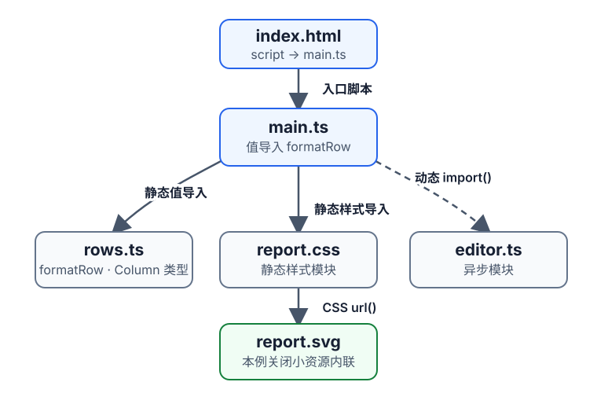

图只画本例源码的模块关系。`main.ts` 保留对 `rows.ts` 中 `formatRow` 的值导入；`rows.ts` 的 `Column` 只作类型标注，TypeScript 擦除后不进入 JavaScript。处理 `report.css` 时，CSS 解析器才发现 `url('./report.svg')` 并排入该资源请求；本例关闭小资源内联，所以图标输出为单独文件。编辑器的异步边由 `import()` 语法建立，点击处理器只决定调用时机。

构建器按请求逐步扩展这张图，再把图中的关系变成浏览器可访问的产物：

1. **选入口。** `package.json` 的脚本启动构建器，但不是模块图入口。Vite 默认从项目根目录的 `index.html` 开始；本例为 Webpack 显式设置 `entry: "./index.html"`。
2. **递归发现依赖。** 对每个待处理请求，模块解析器（resolver）从导入方定位资源，再由匹配的加载器（loader）或内置处理器读取并转换。解析器检查转换后的内容，记录发现的静态、动态和资源依赖边，再把尚未处理的目标请求入队；继续处理，直到待处理请求队列为空。比如相对请求 `./rows.ts` 从导入方目录定位，包名则按安装位置和包元数据解析；本例只使用相对请求。
3. **优化并分块。** 队列清空时，本例的模块图才完整。摇树优化（tree shaking）删除可证明未使用的导出；代码分割（code splitting）决定模块怎样组成初始或异步的代码分块（chunk）。因此 Webpack 的 `optimization.splitChunks` 等规则会影响文件分组，不能只看源码写了几个入口。本例实际输出中没有 `unusedChart` 的哨兵字符串。
4. **生成并改写引用。** 构建器写出 HTML、JavaScript、CSS 和资源文件，把源请求改为生成文件间的引用；可选 manifest 记录入口到输出文件的映射。v41/v42 表格展示同一配置的实际文件名。哈希还会受图中引用和其他构建输入影响，不能只用某个源文件或最终 JS 字节独立推算。
5. **部署并运行。** 将整套产物部署在与公开路径相配的位置。浏览器沿 HTML 请求初始 JS 和 CSS，CSS 再引用图标；运行到生成代码里的动态导入时，Vite 请求改写后的 ESM URL，Webpack 则用 chunk ID、运行时文件名映射和 `output.publicPath` 组装 URL。此例只有在首次调用且没有预加载或可复用缓存时才会产生编辑器网络请求；HTML 相对 URL 的具体结果见下文实测。

### 为什么要固定 Node.js 与包管理器版本？

要复现一份构建，至少需要知道 Node.js、包管理器、锁文件和构建器的版本。`package.json` 的 `packageManager` 字段可记录项目采用的管理器及版本，但不会安装 Node.js；Node 版本仍应由版本文件、CI 镜像或运行环境固定。锁文件复用依赖解析结果，却不能固定操作系统、环境变量、系统工具或构建脚本读取的任意外部输入。

Node.js 25 起不再随发行包提供 Corepack。若项目依赖 Corepack 提供的命令代理，应按当前 Corepack 文档单独安装；也可按所选包管理器的官方流程固定版本。比如 `package.json` 把 `build` 脚本映射到 `vite build`，再由 `pnpm build` 运行。CI 与本地使用相同工具和锁文件能减少解析差异，仍需检查实际生成路径和部署结果。

### Webpack 的模块加载器与插件分别处理什么？

先把合成页面的请求关系和浏览器看到的产物分开：

| 源码或入口 | 构建时发现的关系 | 本例浏览器何时请求生成文件 |
|---|---|---|
| `index.html` | Vite 默认入口；Webpack 显式指定 `./index.html` | 取得页面 HTML 时 |
| `src/main.ts` | HTML 的 `<script type="module" src="./src/main.ts">` 引入 | 页面启动时加载生成的初始 JavaScript |
| `src/rows.ts`、`src/report.css` | `main.ts` 静态导入 | 跟随入口的初始依赖加载；样式再引用图标 |
| `src/report.svg` | CSS 解析发现的 `url()` 请求 | 浏览器取 CSS 后请求，或由构建配置内联 |
| `src/editor.ts` | 点击处理器里的动态 `import()` | 本例第一次点击时请求生成的编辑器分块 |

在 Webpack 5.109.0 的实测配置中，HTML 输出名放在 `assets/` 目录，页面实际 URL 为 `/reports/assets/index-5248e5cf.html`。HTML 中的脚本 `../assets/__html_68cecd12_0-7cc84df8.js` 和样式 `../assets/__html_68cecd12_0-efdbfebc.css`，都要相对于这个 HTML URL 解析，因此请求落在 `/reports/assets/`。CSS 再引用 `/reports/assets/report-b1d5801f.svg`。如果把相同 HTML 原样放到 `/reports/index.html`，这两个 `../assets/…` 会解析到 `/assets/…`；本例的请求因此得到 404。HTML 的部署 URL 必须和它内部的相对引用及服务器挂载位置一致。

Webpack 输出的初始脚本把动态导入变为 chunk ID 与运行时映射；本例的运行时使用 `output.publicPath: "/reports/"`，点击后才请求 `/reports/assets/354-b92eb80e.js`。另有一个 stats 列出的 `assets/main-fa829d06.js` 没有被生成 HTML 引用，也没有浏览器请求。检查页面加载应沿 HTML、CSS 和脚本中的实际引用走，不能把每个 emitted asset 都当成必请求文件。

Webpack 由入口和导入边建立模块图。每个请求先解析到实际资源，再由匹配的加载器或内置处理器读取并转换；解析器根据转换后的文本发现后续边。加载器的常规阶段（normal）按 `use` 数组从右向左执行；若定义前置钩子（pitch），Webpack 会先从左向右调用它。某个 pitch 返回结果时，会跳过该加载器及它右侧尚未执行的常规函数，并把返回值交给左侧加载器，按 normal 顺序反向继续。下面的 Sass 配置先编译 Sass，再将结果交给 PostCSS：

~~~javascript
module: {
  rules: [
    {
      test: /\.s[ac]ss$/i,
      type: "css/auto",
      use: ["postcss-loader", "sass-loader"]
    }
  ]
}
~~~

这里 `type: "css/auto"` 明确让 Sass 转出的 CSS 交给 CSS 模块解析。若两步确实各有职责，才保留两个转换器；普通 CSS 已有原生处理时，不要仅为旧配置习惯重复加 loader。Sass、Less、Stylus 或 PostCSS 仍需各自的预处理器。

Webpack 5.109.0 中原生 CSS 和 HTML 的默认值是 `auto`。它不是按文件任意混用两套解析器：旧规则可能使原生处理在整个编译中关闭，所以要同时构建一个应走原生能力的文件和一个应走旧规则的文件。没有冲突配置时，原生 CSS 能处理常见 CSS、`@import`、`url()` 与 CSS Modules；原生 HTML 能据入口和模块图生成页面引用。模板型旧页面要按实际行为逐项迁移。

Webpack 5.107.0 加入原生 TypeScript 擦除，5.109.0 默认启用 `experiments.typescript: "auto"`。它只擦除类型，不做类型检查，也不处理 TSX、enum 等需要额外转换的语法。`module.stripTypeScriptTypes` 这个 Node API 在 Node 22 系列从 22.13.0 提供、在 23 系列从 23.2.0 提供；Node 22.6.0 提供的是命令行类型擦除选项，并没有这个 API。Webpack 5.109 的 `auto` 会检测 API 和相关 loader 规则。`ts-loader@9.6.2` 默认会检查类型；使用 `transpileOnly: true`、Webpack 原生擦除或 Vite 转译时，应另有 `tsc --noEmit` 等类型检查步骤。

以下 loader 仅做字符串替换，不理解 JavaScript 结构；要按语法节点改写代码，应使用抽象语法树（AST）转换器：

~~~javascript
export default function replaceReportTitle(source) {
  return source.replaceAll("__REPORT_TITLE__", "Monthly Reports");
}
~~~

Webpack Asset Modules（资源模块）可处理图片、字体、媒体与文本资源，在许多项目里可替代旧的 `file-loader`、`url-loader` 或 `raw-loader` 配置。图标最终是独立文件还是 CSS 中的 data URL，取决于工具版本、资源大小和内联配置。本例为观察浏览器 URL 明确将 Vite `assetsInlineLimit` 设为 `0`。

插件（plugin）处理一次构建中的共享状态或资源；新增产物应在 `compilation.hooks.processAssets` 选择合适阶段。下面的统计插件在 `done` 时把 JSON 写到运行命令时的当前目录；它不会自动写入 `dist/`，也不是 Webpack asset：

~~~javascript
import { writeFileSync } from "node:fs";

class BuildStatsPlugin {
  apply(compiler) {
    compiler.hooks.done.tap("BuildStatsPlugin", stats => {
      const json = stats.toJson({ assets: true, modules: false });
      writeFileSync("build-stats.json", JSON.stringify(json, null, 2));
    });
  }
}
~~~

`DefinePlugin` 在构建时替换代码表达式；写入客户端 bundle 的值会交给浏览器用户，不能放入密钥。

> [!info]- Webpack 5.109 自动探测、emit 阶段与旧插件迁移细节
> CSS 和 HTML 的 `auto` 在构建配置层先用 `/file.css`、`/file.module.css`、`/file.html` 等合成路径探测。`test`、`resource` 或 `include` 任一条件可能计入；规则中的 `exclude` 不参与这项宽松探测。探测还会把正则中明确引用扩展名的模式计入：例如 `/source\.css$/` 即使不匹配 `/file.css`，仍可关闭这一编译的原生 CSS。只有显式 `type` 或未设 `enforce` 的普通 `loader/use` 才算接管；`pre`、`post` loader 不触发关闭。若 `auto` 保持启用，真实模块只有在默认原生类型仍被选中、已应用 loader 且没有 `matchResource` 显式重定类型时，才沿旧解析路径退让给 loader 产物。
> 在使用默认 `resolve.extensions` 时，显式 `experiments.html: true` 会让 `.html` 排在 JavaScript 扩展名前，因此目录入口可优先解析为 `index.html`；`auto` 则把 `.html` 放在 JavaScript 后。自定义扩展名顺序时按实际配置判断。
>
> `processAssets` 的 stage 决定生成或读取资源的时点。`ADDITIONAL` 位于代码压缩、source map 和传输压缩之前，适合新增自有文件；若到 `SUMMARIZE` 才新增文件，`OPTIMIZE_SIZE` 已经过，Webpack 不会重跑整个阶段；若某个处理器订阅了 `additionalAssets`，仍可单独处理后续新增资源。Webpack 5.109 的默认 JavaScript minimizer 就使用这种订阅，因此不能仅凭新增阶段断言文件不会被压缩；还要看该处理器的匹配与处理条件。全部 `processAssets` 阶段完成并封存资源后，Webpack 才调用 `emit`，随后写入配置的 output filesystem；后注册的 emit tap 仍能看到较早 tap 的改动，但它新增的文件已错过先前 stage。`afterEmit` 已在输出后，修改不会回写刚才的文件。Webpack 5.109 默认 `backCompat: true`，此时写封存的 `Compilation.assets` 会警告；关闭兼容模式后该对象被冻结。需要新增或变换产物时使用正确 stage 的 `processAssets`，统计信息则可在 `done` 写到独立文件。
>
> `HtmlWebpackPlugin` 当前 README 标记为弃用；Webpack 5.109 原生 HTML 可覆盖常见页面产物，但模板插件的定制行为仍须逐项核对。CSS/HTML 内置压缩从 5.110.0 才开始。当前 `CompressionWebpackPlugin` 已弃用，压缩 generator 迁入 `minimizer-webpack-plugin`，迁移选项从 `minimizer-webpack-plugin@5.11.0` 起提供；生成 `.gz`/`.br` 文件不代表服务器已按内容协商返回相应 `Content-Encoding`。Webpack 5.109 默认 JavaScript 压缩仍使用 Terser；`terser-webpack-plugin` 于自身 5.6.0 更名。覆盖 `optimization.minimizer` 时，保留默认项需包含 `"..."`。更多历史选项见[归档的 Webpack 插件对照表](../../archive/front-end/Deprecated_Interview_Notes/webpack-plugin-history.md)。

### Vite 开发服务器为什么不能代替生产构建检查？

按 Vite 8.3.5 说明，开发服务器按请求提供转换后的原生 ESM，也用 Rolldown 预打包依赖；生产 `vite build` 由 Rolldown 生成静态 HTML、JavaScript、CSS 和资源。两条路径在分块、目标浏览器、公开路径和服务器行为上可能不同。HMR（热模块替换）是开发期机制：服务器通知变化并提供更新模块，浏览器运行时取得更新并调用模块的接受回调；当前模块边界无法处理时才会整页刷新。它不是生产文件发布。

Vite 默认以项目根目录 `index.html` 为生产入口。本例把生成的页面挂在 `/reports/`，并显式生成 manifest、关闭小 SVG 内联：

~~~javascript
import { defineConfig } from "vite";

export default defineConfig({
  base: "/reports/",
  build: { manifest: true, assetsInlineLimit: 0 }
});
~~~

生成的 HTML 指向初始脚本和样式，CSS 再指向 SVG；构建也会把源码中的动态导入改写为生成文件名：

~~~html
<script type="module" src="/reports/assets/index-gRN8M4PG.js"></script>
<link rel="stylesheet" href="/reports/assets/index-QsJV6IX7.css">
~~~

~~~css
background: url(/reports/assets/report-D2wE4vR2.svg);
~~~

v41 的入口脚本保留 `import('./editor-x2UHusWa.js')` 这个改写后的目标（实际输出由预加载辅助函数包装）：

~~~javascript
await import("./editor-x2UHusWa.js");
~~~

脚本从 `/reports/assets/` 加载，浏览器因此请求 `/reports/assets/editor-x2UHusWa.js`，而不是请求源码 `editor.ts`。本例用无界面 Chromium 首次打开页面时未请求编辑器；点击后该 URL 返回 200。

Vite 的 manifest 默认不生成。本例打开它是为核对源入口到输出文件的映射，例如 `"index.html"` 记录 `dynamicImports: ["src/editor.ts"]`，而 `"src/editor.ts"` 的 `file` 是 `"assets/editor-x2UHusWa.js"`。这些 `file` 值是相对输出目录的路径，不含 `/reports/` URL 前缀；浏览器按 HTML、CSS 和生成 JavaScript 中的引用请求文件，不请求 manifest。服务端或集成工具若需要这份映射，可打开 `build.manifest`。

若恢复默认内联阈值，本例的小 SVG 会变成 CSS 的 data URL，不再单独发 SVG 请求。部署到子路径时，`base` 要与静态站点挂载路径一致。`vite preview` 可预览生产构建，不是生产服务器；还要在实际部署 URL 检查 HTML、初始脚本/样式、异步分块、图像、缓存头、压缩和路由回退。Vite/Oxc 转译 TypeScript 不等于类型检查。Vite 8.3.5 的 `build.target` 默认面向 2026-01-01 的 Baseline Widely Available 浏览器范围；它决定语法转换范围，不补齐运行时 API，也不由 `tsconfig.json` 的 `target` 代替。若要支持更早浏览器，还要单独安排 API polyfill（应用程序接口兼容补丁）并在目标环境验证。参见[怎样判断目标浏览器或 Node.js 是否支持一项 JavaScript 特性？](#50.%20%E6%80%8E%E6%A0%B7%E5%88%A4%E6%96%AD%E7%9B%AE%E6%A0%87%E6%B5%8F%E8%A7%88%E5%99%A8%E6%88%96%20Node.js%20%E6%98%AF%E5%90%A6%E6%94%AF%E6%8C%81%E4%B8%80%E9%A1%B9%20JavaScript%20%E7%89%B9%E6%80%A7%EF%BC%9F)。

### 新入口与带哈希代码分块怎样作为同一版本发布？

独立构建的 v41 与 v42 只改变编辑器文字。构建器改写入口中的编辑器目标，所以即使 `main.ts` 源码不变，生成的入口 JavaScript 内容也变了，入口和编辑器文件名都随之变化。下面是这个合成 fixture 的实际输出；未变的 CSS 与 SVG 文件保持原名：

| 浏览器请求（`base` 为 `/reports/`） | v41 | v42 |
|---|---|---|
| 新页面从 HTML 取得的入口 JS | `/reports/assets/index-gRN8M4PG.js` | `/reports/assets/index-ClYpL0PO.js` |
| 首次点击时的编辑器分块 | `/reports/assets/editor-x2UHusWa.js` | `/reports/assets/editor-BLsXx8VX.js` |
| 初始 CSS | `/reports/assets/index-QsJV6IX7.css` | 相同 |
| CSS 图标 | `/reports/assets/report-D2wE4vR2.svg` | 相同 |

该命名来自这组构建器输出，不应推断为仅凭入口脚本最终字节就能独立计算文件名的通用规则。

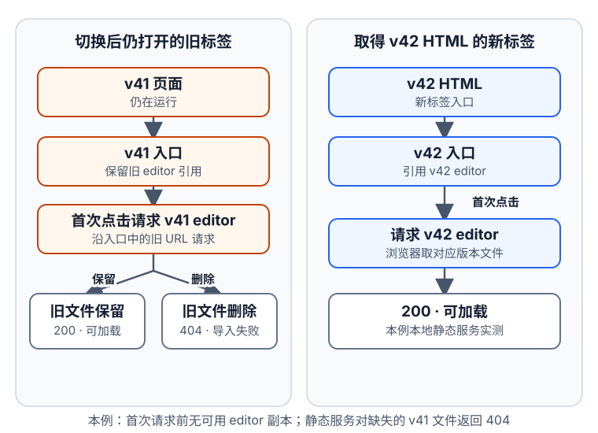

发布前把一整套 v42 入口、样式、图像和异步分块写到目标存储，再核对它们能从对应 URL 读取，最后切换源站的 HTML 或 release 指针。这个切换只能保证指针更新本身的原子性；CDN 边缘可能短时仍返回旧 HTML。因此不要覆写同一个哈希 URL 的内容，也不要在仍有旧 HTML、旧标签或旧 Service Worker 时删除其引用的文件。

上面的 200/404 来自实际浏览器测试。v41 标签已加载入口但尚未点编辑器；保留旧 chunk 后首次点击请求旧 URL 并返回 200，提前删除后该首次请求返回 404，导入失败。若编辑器已由该页面加载，之后重复调用通常复用已加载模块，不会再发同一请求；若浏览器/Service Worker 有可用副本，也可能不请求网络。若服务器把缺失 chunk 回退到 HTML，网络状态可以是 200，但动态导入仍会因响应不是 JavaScript 而失败。

回滚静态发布时，把入口 HTML 与其清单（若有服务端消费者）配对指回 v41；已打开的 v42 页面仍可能需要 v42 文件。旧版保留窗口要覆盖仍服务的 HTML、打开的页面和可能继续接管旧页面的 Service Worker。后端 API 是否兼容新旧页面是另一条发布边界。HTTP 缓存和 Service Worker Cache Storage 也需分开看：

| 资源 | 缓存边界 |
|---|---|
| 可变 HTML 或当前 release 指针 | 可用 `Cache-Control: no-cache` 保存响应，但复用前要重新验证；也可缩短新鲜时间 |
| 带哈希的脚本、CSS 与图片 | 只有同一路径永不改写内容时才适合长缓存和 `immutable` |
| manifest | 浏览器通常不请求；服务端读取时按版本保存，或与入口一同重新验证 |
| Service Worker Cache Storage | 独立于 HTTP 缓存；按版本保留旧页仍需的文件 |

`no-cache` 允许存储响应，但再次使用前要求验证；它不是 `no-store`。`immutable` 表示新鲜期内内容不变。遇到动态 chunk 加载失败时，应识别可恢复的发布错配，保留用户未保存的草稿，并让用户保存或选择刷新；不要把所有导入错误都判成发布错配，也不要无限重载。本页止于静态资源部署；构建一次、逐环境验证、渐进放量和服务端回滚见[如何晋级并回滚已验证的报表服务产物](../../engineering-foundations/infrastructure/application-deployment-and-ci-cd.md)。

### Source map 怎样用于调试，又会暴露什么？

Source map（源映射）记录生成代码位置与原始源码位置的对应关系。调试器或错误收集工具可用它把生成代码中的行列位置映回源码；映射本身不重建原始文件。映射粒度、loader 是否提供映射、文件内嵌或外置、是否含源码文本，会影响定位、构建成本和公开信息。

| Webpack `devtool` 例子 | 主要含义 | 适用边界 |
|---|---|---|
| `eval-source-map` | 逐模块用 `eval` 关联完整映射 | 开发定位精度高；官方将初次构建列为 slowest |
| `cheap-source-map` | 行级映射，忽略 loader 提供的映射 | 不支持列级断点；映射可能停留在转换后的行 |
| `cheap-module-source-map` | 使用 loader 映射后简化到行级 | 能映回更早源码，但不保留列级位置 |
| `source-map` | 外置完整映射，bundle 通常写引用 | 错误定位可恢复行列；需检查 `.map` 是否可公开请求 |
| `hidden-source-map` | 外置映射但 bundle 不写 `sourceMappingURL` | 可将 `.map` 单独上传到私有错误工具；隐藏引用不等于访问控制 |
| `nosources-source-map` | 不内嵌 `sourcesContent` | 仍可能泄露文件名和映射关系，不是源码权限边界 |

`cheap-` 只保留行级位置。`module-` 只在 cheap 组合中表示消费 loader 映射；完整 `source-map` 本身就会使用可用的 loader 映射。Webpack 5.105 起可用数组按 JavaScript、CSS 或两者设置 source map 类型；这里的 `all` 指 JavaScript 与 CSS，不是任意图像、字体或资源。当前完整语法还含 `-debugids`，Webpack 5.112.0 加入 `-scopes`；组合顺序与可用性按锁定版本核对。旧预设的详细映射见[Webpack source map 预设对照](../../archive/front-end/Deprecated_Interview_Notes/webpack-source-map-presets.md)。

Source map 不是权限边界：若 `.map` URL 仍由服务器公开提供，去掉 bundle 引用不能阻止知道路径的人请求。`nosources` 只去掉内嵌源码文本，仍可能暴露目录和文件名。发布时分别检查输出文件、服务器静态资源规则和错误收集工具的访问权限。

> [!info]- 来源
> - **Node 与包管理器：** [Node.js 25.0.0 发布说明](https://nodejs.org/en/blog/release/v25.0.0) 与 [Corepack 配置项目](https://nodejs.org/download/release/v25.8.0/docs/api/corepack.html)：Corepack 从 Node 25 起不随发行包提供；[Corepack 的 `packageManager` 字段](https://github.com/nodejs/corepack#when-authoring-packages)说明包管理器版本声明。[Node.js 22.6.0 发布说明](https://nodejs.org/en/blog/release/v22.6.0)说明当时加入的是 `--experimental-strip-types` 命令行功能；[`module.stripTypeScriptTypes()` 文档](https://nodejs.org/download/release/v22.13.0/docs/api/module.html#modulestriptypescripttypescode-options)、[22.13.0 发布说明](https://nodejs.org/en/blog/release/v22.13.0)、[23.2.0 发布说明](https://nodejs.org/en/blog/release/v23.2.0)确认 API 版本边界。核对日期：2026-11-12。
> - **Webpack 模块图与浏览器 URL：** [NormalModule.js](https://github.com/webpack/webpack/blob/v5.109.0/lib/NormalModule.js#L1576-L1650)、[Compilation.js](https://github.com/webpack/webpack/blob/v5.109.0/lib/Compilation.js#L1766-L1810) 及 [ImportParserPlugin.js](https://github.com/webpack/webpack/blob/v5.109.0/lib/dependencies/ImportParserPlugin.js#L580-L620)说明转换后解析依赖和异步边；[Webpack chunk runtime](https://github.com/webpack/webpack/blob/v5.109.0/lib/web/JsonpChunkLoadingRuntimeModule.js#L135-L196)说明运行时如何组合 public path 和文件名。Webpack HTML 配置和发布路径见[原生 HTML](https://webpack.js.org/guides/native-html/)与[输出管理](https://webpack.js.org/guides/output-management/)。
> - **Webpack CSS、HTML 与 TypeScript：** [v5.109 defaults.js](https://github.com/webpack/webpack/blob/v5.109.0/lib/config/defaults.js#L649-L686) 展示 `auto` 合成路径探测与原生 TypeScript 默认；[RuleSetCompiler.js](https://github.com/webpack/webpack/blob/v5.109.0/lib/rules/RuleSetCompiler.js#L473-L578) 包含宽松规则探测与扩展名正则判断；[implicitTypeLoaderFallback.js](https://github.com/webpack/webpack/blob/v5.109.0/lib/util/implicitTypeLoaderFallback.js#L13-L51) 展示 loader 逐模块退让条件。Native CSS/HTML 及[experiments.typescript](https://webpack.js.org/configuration/experiments/#experimentstypescript)文档核对 5.109/5.110 边界；[HtmlWebpackPlugin 当前 README](https://github.com/jantimon/html-webpack-plugin#readme)标记弃用。Node API feature detection 见 [TypeScriptPlugin.js](https://github.com/webpack/webpack/blob/v5.109.0/lib/typescript/TypeScriptPlugin.js#L119-L134)。
> - **Webpack loader、插件与压缩：** [processAssets 阶段与 additionalAssets](https://webpack.js.org/api/compilation-hooks/#processassets)说明新增产物的阶段顺序及后续资源回调；[minimizer-webpack-plugin v5.6.1](https://github.com/webpack/minimizer-webpack-plugin/blob/v5.6.1/src/index.js) 的 `OPTIMIZE_SIZE` 订阅启用 `additionalAssets: true`，匹配的后续资源仍可进入该处理器；[HTML 默认入口](https://webpack.js.org/configuration/experiments/#html-as-the-default-entry)说明默认扩展名顺序。[Loaders](https://webpack.js.org/concepts/loaders/)解释 pitch/normal 次序；[ts-loader `transpileOnly`](https://github.com/TypeStrong/ts-loader#transpileonly)说明默认类型检查和纯转译选项；[Asset Modules](https://webpack.js.org/guides/asset-modules/)解释资源处理；[Compiler.js](https://github.com/webpack/webpack/blob/v5.109.0/lib/Compiler.js#L1081-L1106)、[Compilation.js](https://github.com/webpack/webpack/blob/v5.109.0/lib/Compilation.js#L3806-L3834)和 [defaults.js backCompat 默认值](https://github.com/webpack/webpack/blob/v5.109.0/lib/config/defaults.js#L622-L623)核实 emit、processAssets、资源封存与兼容模式。[CompressionWebpackPlugin 当前 README](https://github.com/webpack/compression-webpack-plugin#readme)标记弃用；压缩迁移选项要求 `minimizer-webpack-plugin@5.11.0`，见[迁移文档](https://github.com/webpack/compression-webpack-plugin#migrating)。[Terser minimizer 5.6.0](https://github.com/webpack/minimizer-webpack-plugin/releases/tag/v5.6.0)记录包名变更。
> - **Vite 与 source map：** 固定版本 [Vite 8.3.5 build](https://github.com/vitejs/vite/blob/v8.3.5/docs/guide/build.md)、[assets](https://github.com/vitejs/vite/blob/v8.3.5/docs/guide/assets.md)、[features](https://github.com/vitejs/vite/blob/v8.3.5/docs/guide/features.md)、[HMR API](https://github.com/vitejs/vite/blob/v8.3.5/docs/guide/api-hmr.md)、[build options](https://github.com/vitejs/vite/blob/v8.3.5/docs/config/build-options.md)、[manifest](https://github.com/vitejs/vite/blob/v8.3.5/docs/guide/backend-integration.md)及[生产动态导入辅助逻辑](https://github.com/vitejs/vite/blob/v8.3.5/packages/vite/src/node/plugins/importAnalysisBuild.ts#L314-L344)。Source map 版本与预设见[Webpack devtool 表](https://webpack.js.org/configuration/devtool/)、[5.105 数组配置](https://webpack.js.org/blog/2026-02-03-webpack-5-105/)和[5.112 scopes](https://webpack.js.org/blog/2026-10-13-webpack-5-112/)。缓存语义见 [RFC 9111 §5.2](https://www.rfc-editor.org/rfc/rfc9111.html#section-5.2)、[RFC 8246](https://www.rfc-editor.org/rfc/rfc8246.html)与[Service Workers](https://www.w3.org/TR/service-workers/)。
>
> v41/v42 的具体文件名和请求是 Node.js 26.13.0、Vite 8.3.5 的合成 fixture 实测；Webpack HTML 路径与 chunk 文件名是 Node.js 26.13.0、Webpack 5.109.0 的独立 fixture 实测。它们是版本与配置结果，不是稳定 API。
## 52. 报表页面里的状态应该放在哪里？

案例背景：用户打开 `https://reports.example/reports/42?sort=recent#summary`，希望刷新后回到同一报表、复制链接分享当前排序，并在另一标签页改变列密度偏好后看到更新。报表 42 沿用[流式报表恢复案例](#54.%20%E6%B5%81%E5%BC%8F%E6%8A%A5%E8%A1%A8%E6%96%AD%E7%BA%BF%E9%87%8D%E8%BF%9E%E5%90%8E%EF%BC%8C%E7%95%8C%E9%9D%A2%E6%80%8E%E6%A0%B7%E4%BF%9D%E7%95%99%E6%AD%A3%E7%A1%AE%E7%8A%B6%E6%80%81%EF%BC%9F)的公开合成快照 `{ id: 42, version: 9, status: "running", event_cursor: "103" }`。这里 `sort=recent` 是 URL 状态，列密度是独立的本地偏好；报表快照本身仍由服务端维护。

重载时，浏览器先请求页面 URL `GET /reports/42?sort=recent`；片段 `#summary` 留在浏览器端，用于定位摘要，不会随 HTTP 请求发送。页面代码再从路径识别报表 42、从查询参数恢复排序，并请求数据接口 `GET /api/reports/42`。服务端返回上述版本 9 快照，页面以游标 `103` 接上快照之后的更新流。若断线后要让快照与流保持一致，见[流式报表恢复案例](#54.%20%E6%B5%81%E5%BC%8F%E6%8A%A5%E8%A1%A8%E6%96%AD%E7%BA%BF%E9%87%8D%E8%BF%9E%E5%90%8E%EF%BC%8C%E7%95%8C%E9%9D%A2%E6%80%8E%E6%A0%B7%E4%BF%9D%E7%95%99%E6%AD%A3%E7%A1%AE%E7%8A%B6%E6%80%81%EF%BC%9F)。

| 这份状态 | 放在哪里 | 刷新、分享和多标签页的结果 |
|---|---|---|
| 报表 42 的权限、进度、结果与版本 | 服务端 API | 跨设备共享且由服务端授权；浏览器缓存不能取代它 |
| `sort=recent` 与 `#summary` | URL | 查询参数随链接和历史记录恢复；片段在本地定位页面 |
| 列密度、隐藏提示等小型偏好 | `localStorage` | same-origin (同源) 且共享存储区的页面可读写；通常跨标签页与浏览器重载保留，但用户代理可能清除或限制访问 |
| 未提交的本标签页筛选草稿 | `sessionStorage` | 按来源和顶层浏览上下文隔离；同一来源的页面可跨导航和重载恢复，另一标签页或来源有自己的值 |
| 登录会话标识 | 服务端管理的 Cookie | 浏览器按请求主机名与 host-only/`Domain`、`Path`、`Secure`、`SameSite` 和凭证规则发送；端口不隔离 Cookie，`HttpOnly` 不向脚本开放 |

可以把关键边界记成一句话：链接描述用户想看的视图，客户端存储记住本地意图，服务端保存业务事实。下图把一次有效的 `localStorage` 写入和它可能触发的跨文档通知拆开。

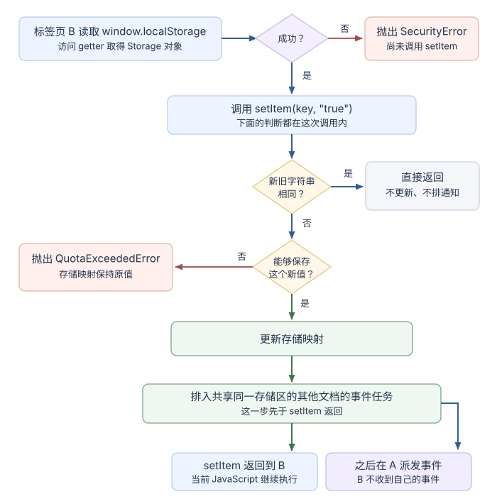

Web Storage (网页存储) 的 `localStorage` 和 `sessionStorage` 都是同步的字符串键值 API。读取和写入会占用当前 JavaScript 执行时间；它们没有条目级过期时间，也没有多键事务。小型偏好适合用它们，结构化大记录和多个键必须一起提交时可考虑 IndexedDB (索引数据库)：它用异步请求访问记录，并让同一 `readwrite` 事务范围内的改动原子提交。

`localStorage` 不按 URL 路径区分同一来源的页面；通常这些页面访问同一存储区，但浏览器可能限制第三方访问或按顶层站点分区，不能只凭来源相同就假定它们可共享存储。规范目前把 `localStorage` 和 `sessionStorage` 各自的建议配额设为每个存储端点 5 MiB；这是规范建议，实际浏览器策略仍可导致读取不可用或写入失败。`navigator.storage.estimate()` 返回当前 local storage shelf（本地存储架）的近似使用量和配额，不是 `localStorage` 这个端点还剩多少空间的精确读数。

`sessionStorage` 按来源和顶层浏览上下文隔离。同一标签页内切换到另一来源时，新来源读取自己的存储区；返回原来源或重载后，原来源仍可读到原值。另一个标签页有自己的值。标签页关闭通常结束这个页面会话；浏览器恢复已关闭标签页时是否恢复会话值，取决于用户代理的恢复策略，不能用它保存需要跨会话保留的数据。若带 `opener` 打开新的同源辅助浏览上下文，新上下文最初可能拿到一份 `sessionStorage` 副本；之后两边各自修改。这个初始复制不是持续共享。同一来源的页面若处于不同顶层站点的嵌入上下文，浏览器也可能限制或分区其存储；单看来源相同不足以证明两个上下文共用一份存储区。

> [!warning] 本地存储操作有真实失败分支
> 取得 `localStorage` 或 `sessionStorage` 对象时，策略限制或不透明来源可能抛出 `SecurityError`；`setItem()` 不能保存新值时会抛出 `QuotaExceededError`。失败时应用不能继续把“已写入”当成事实，应保留当前页内存中的选择并告诉用户该偏好没有保存。若应用需要多个本地记录原子更新，IndexedDB 的 `readwrite` 事务可以把同一事务范围内的改动一起提交，失败时回滚。

一次 `setItem()` 不是跨标签页的锁。假设标签页 A、B 都读取计数 `4`，各自算出 `5`，再依次写入 `5`，最终存储值仍是 `5`，尽管应用执行了两次增加。`storage` 事件只是变化通知，不能把这段读—改—写变成原子操作；需要协调更新时，必须把读取、计算和写入都放在覆盖这些记录的同一个 `readwrite` 事务内，或使用明确的跨上下文协议。

值发生变化且写入成功时，浏览器在这次 `setItem()` 调用中先更新存储区，再为共享同一存储区的其他文档排入 `storage` 事件任务，然后才从 `setItem()` 返回。其他文档的事件处理器在后续任务中运行，写入者不会收到自己的事件；新字符串与旧值相同时，`setItem()` 直接返回，不更新也不排通知任务。`removeItem()` 与 `clear()` 只在实际移除数据时排入通知，`clear()` 的事件 `key` 为 `null`。事件中的 `storageArea` 是接收文档自己的 `Storage` 对象，指向刚才变化的存储区；标签页 A 应与自己的 `window.localStorage` 比较，而不是把 A、B 当成共享同一个 JavaScript 对象。因此，收到事件表示“存储发生过变化”，不表示某个业务步骤已经被别的标签页处理或确认。

A 和 B 页面初始化时都从同一键读到字符串 `"false"`。A 先注册监听器，再读取当前值初始化画面；B 也先读取当前值，用户选择紧凑列时再调用 `chooseCompactColumns(true)`，把值改为 `"true"`。若 A 是重载或较晚打开的页面，它先读当前值即可；`storage` 事件没有历史重放。事件的 `newValue` 描述触发通知的那次写入，但若同一键之后又变过，处理器重读能得到读取时的当前偏好。

> [!example] 两个标签页怎样保存并同步偏好
> 示例假定两个标签页都能访问同一 `localStorage` 存储区；`applyCompactColumns` 与提示函数代表页面已有的界面更新。A 或 B 初始化读取失败时显示存储不可用；B 在用户选择后遇到读取或写入错误时仍在当前页面应用选择，但显示“未保存”。
>
> 标签页 A：
>
> ~~~javascript
> const compactKey = "reports:compact-columns";
>
> window.addEventListener("storage", event => {
>   try {
>     if (event.storageArea !== window.localStorage) return;
>     if (event.key !== compactKey && event.key !== null) return;
>     applyCompactColumns(window.localStorage.getItem(compactKey) === "true");
>   } catch {
>     showPreferenceStorageUnavailable();
>   }
> });
>
> try {
>   applyCompactColumns(window.localStorage.getItem(compactKey) === "true");
> } catch {
>   showPreferenceStorageUnavailable();
> }
> ~~~
>
> 标签页 B：
>
> ~~~javascript
> const compactKey = "reports:compact-columns";
>
> try {
>   applyCompactColumns(localStorage.getItem(compactKey) === "true");
> } catch {
>   showPreferenceStorageUnavailable();
> }
>
> function chooseCompactColumns(enabled) {
>   applyCompactColumns(enabled);
>   try {
>     localStorage.setItem(compactKey, String(enabled));
>     showPreferenceSaved();
>   } catch {
>     showPreferenceNotSaved();
>   }
> }
>
> chooseCompactColumns(true);
> ~~~

Web Storage 可被当前页面的脚本读取；若 `cross-site scripting` (跨站脚本攻击，XSS) 进入页面，其中的 `bearer token` (持有者令牌) 也可能被读走。`HttpOnly` Cookie 不向普通页面脚本开放，浏览器仍会按 Cookie 规则自动附带它，因此服务端仍须防护 `Cross-Site Request Forgery` (跨站请求伪造，CSRF)。若跨站请求需要选择 `SameSite=None`，当前 IETF Cookie 文稿要求同时设置 `Secure`。换用某种存储位置本身不会完成认证或授权；Cookie、XSS、CSRF 的服务端防护细节见[Web 安全与认证](../../engineering-foundations/security/web-security-and-authentication.md)。

列密度偏好这个例子只需要读写当前存储值。若多个标签页需要跟上服务端的报表版本，就需要明确何时通知其他页、接收方怎样读取服务端权威快照，以及怎样恢复遗漏；[同一报表在多个标签页中怎样交换变化？](#53.%20%E5%90%8C%E4%B8%80%E6%8A%A5%E8%A1%A8%E5%9C%A8%E5%A4%9A%E4%B8%AA%E6%A0%87%E7%AD%BE%E9%A1%B5%E4%B8%AD%E6%80%8E%E6%A0%B7%E4%BA%A4%E6%8D%A2%E5%8F%98%E5%8C%96%EF%BC%9F) 会沿用报表 42 说明这些协议。

> [!info]- 来源
> - URL 序列化器在排除片段时仍保留查询参数；导航请求中片段不随请求发送：[WHATWG URL Standard §4.5 URL serializing](https://url.spec.whatwg.org/#url-serializing)，Living Standard；2026-11-12 核对。
> - `localStorage`、`sessionStorage` 的接口、来源与顶层浏览上下文作用域、同值写入无事件、失败异常、事件任务以及读改写不保证锁定：[WHATWG HTML Standard，Web Storage §§12.1–12.2.4](https://html.spec.whatwg.org/multipage/webstorage.html)，Living Standard 更新于 2026-11-11；2026-11-12 核对。
> - 两种 Web Storage 端点各自建议 5 MiB；存储键当前按来源定义、第三方存储分区模型仍预期演进：[WHATWG Storage Standard §§4.1–4.2](https://storage.spec.whatwg.org/)，Living Standard 更新于 2026-10-19；2026-11-12 核对。
> - `navigator.storage.estimate()` 返回当前 local storage shelf 的近似用量与配额，而不是 `localStorage` 这个端点的剩余空间：[WHATWG Storage Standard §§6、8](https://storage.spec.whatwg.org/)，Living Standard 更新于 2026-10-19；2026-11-12 核对。
> - IndexedDB `readwrite` 事务的作用域、生命周期、原子提交与失败回滚：[Indexed Database API 3.0 §2.7.1](https://www.w3.org/TR/2026/WD-IndexedDB-3-20261030/)，W3C Working Draft，2026-10-30；2026-11-12 核对。
> - Cookie 的 `Domain`/host-only 和 `Path` 匹配范围、`Secure`、`HttpOnly` 与请求发送规则：[RFC 6265 §§4.1.2.3–4.1.2.6、§§5.1.3–5.1.4、§§5.3–5.4、§8.5](https://www.rfc-editor.org/rfc/rfc6265.html)，2011-04；§8.5 明确 Cookie 不按端口隔离。
> - `SameSite=None` 与 `Secure` 的组合要求：[IETF draft-ietf-httpbis-rfc6265bis-22 §§4.1.2.7、5.7](https://datatracker.ietf.org/doc/html/draft-ietf-httpbis-rfc6265bis-22)，2026-11-12 核对；Datatracker 当日仍标记 RFC Editor “Final Approval Pending”，因此按文稿规则表述。
> - 用户代理可限制第三方文档访问 `localStorage`；Chrome 对第三方存储按顶层站点分区（Chrome 115+），WebKit 对第三方 `localStorage` 与 IndexedDB 按第一方网站分区：[WHATWG HTML Standard §12.3.1](https://html.spec.whatwg.org/multipage/webstorage.html#user-tracking)，[Chrome Storage Partitioning](https://privacysandbox.google.com/cookies/storage-partitioning)，[WebKit Tracking Prevention](https://webkit.org/tracking-prevention/#partitioned-third-party-storage)，2026-11-12 核对。
## 53. 同一报表在多个标签页中怎样交换变化？

案例背景：标签页 A 正在显示报表 42 的服务端快照 `{ id: 42, version: 9, status: "running", event_cursor: "103" }`。上一章说明 URL、本地偏好、会话存储与服务端数据各自保存什么；这里继续追问：标签页 B 提交一次重新生成后，怎样让 A 知道旧画面可能过时，又怎样避免把通知误当成最新数据？本例假定服务端提交成功并返回版本 11、状态 `ready`；版本在同一报表 ID 下单调递增。前两节处理同一浏览器内的页面；若通信对象变成跨来源窗口或服务端，后两节给出对应选择。

| 要联系的对象 | 机制 | 解决什么问题 | 主要边界 |
|---|---|---|---|
| 符合相同 storage key (存储键) 和频道名的活动 browsing context (浏览上下文) | `BroadcastChannel` | 同一浏览器里的临时广播 | 不保存历史；发送方不收到自己发送的消息 |
| 共享同一存储区的其他文档 | `localStorage` + `storage` 事件 (存储事件) | 写入字符串并通知变化 | 不是跨标签页锁或事务；详见[浏览器页面里的状态应该放在哪里？](#52.%20%E6%8A%A5%E8%A1%A8%E9%A1%B5%E9%9D%A2%E9%87%8C%E7%9A%84%E7%8A%B6%E6%80%81%E5%BA%94%E8%AF%A5%E6%94%BE%E5%9C%A8%E5%93%AA%E9%87%8C%EF%BC%9F) |
| 需要集中管理端口或一条连接的页面 | `SharedWorker` (共享工作线程) | 让 worker (工作线程) 内存中的协调者向多个页面转发 | 连接和内存不是持久状态；页面离开时应显式注销，恢复后重连 |
| 跨来源窗口或 iframe | `postMessage()` | 在不同来源的两个窗口间定向发消息 | 必须限制目标来源，并检查发送窗口和数据 |
| 浏览器页面与服务端 | Server-Sent Events (服务器推送事件，SSE)、Fetch 流、WebSocket | 接收服务端事件或进行双向通信 | 认证、补发、去重和恢复需要服务端及应用协议 |

### 1. 先通知，再向服务端核实

`BroadcastChannel` 按频道名和存储键寻找可接收消息的活动上下文；发送者会从接收列表中排除。存储键可能把同一 origin (来源) 但处于不同顶层站点的页面隔开，所以 same-origin (同源) 本身并不保证互通。对象消息按 structured clone (结构化克隆) 序列化，接收方得到自己的副本。频道不会给刚打开、已关闭或当时不符合接收条件的页面补发历史。

下图把报表案例中的写入顺序拆开：A 先接好频道并向服务端对账；B 只有在服务端确认提交成功后才发送轻量提示；A 在自己的后续任务中校验提示，再取回权威快照。通知只说“可能有新版本”，不会证明业务更新已完成。

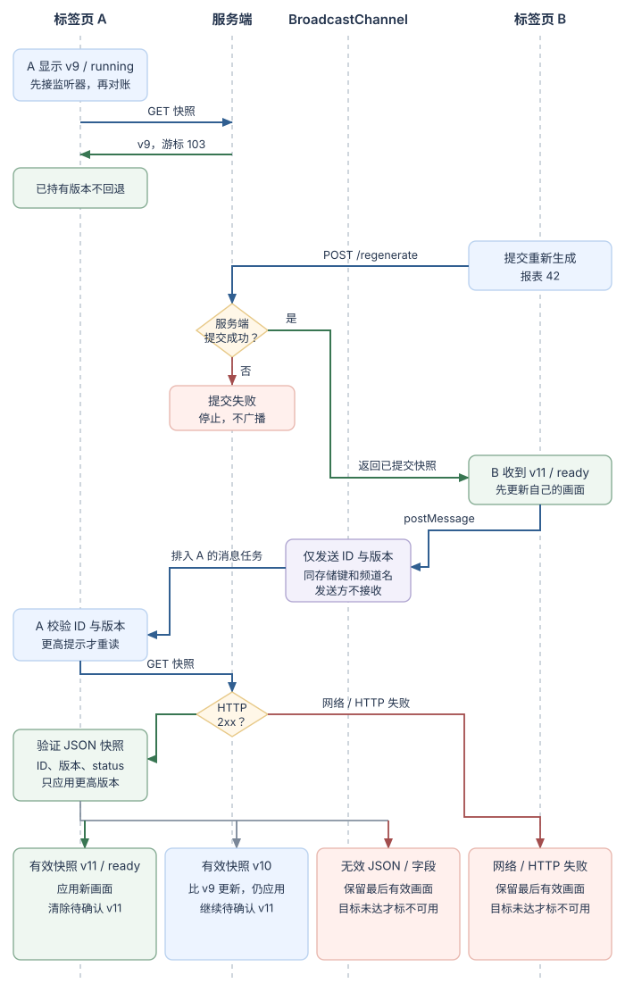

本例开始时 A、B 都展示版本 9。A 先安装监听器再主动读取快照，避免在“读快照”和“开始监听”之间错过一次更新。B 提交成功后，从响应中取得版本 11、状态 `ready`，先更新自己的画面，再广播报表 ID 与版本。广播方法把消息序列化并为接收方排入 message task (消息任务) 后返回；接收方的处理器在自己的 event loop (事件循环) 中运行，发送方不会等待它完成。若消息不能结构化序列化，发送方的调用会抛出 `DataCloneError`；接收方无法反序列化时会收到 `messageerror`。本例在该事件后提示协议异常并触发一次快照重读。

接收提示时，A 校验类型、报表 ID 和非负安全整数版本；比当前版本旧或相同的提示直接忽略。较新提示只提高待确认的版本门槛，然后调用与初次读取相同的快照函数。这里有两个不同阈值：A 当前显示 v9，收到 v11 提示后待确认 v11；如果 GET 返回有效 v10，A 仍会把画面推进到 v10，同时继续等待 v11。有效 v11 或更高版本才清除待确认状态。快照必须含本例渲染所需的 `status` 字符串；网络错误、非成功 HTTP 状态或缺少必需字段的响应保留最后有效画面。失败后不无限重试，后续新提示、BFCache 恢复、重载或用户主动重试再触发对账。普通标签页重新聚焦不会触发此处的恢复流程。

> [!example]- 可选实现：提示触发可恢复的重读
> 下面片段用于已经展示版本 9 的 A 和 B。界面函数（如 `renderReport`、`showRefreshUnavailable`）由页面提供。两页运行同一段频道与快照代码；只有 B 在服务端的重新生成请求成功后调用 `announceCommittedSnapshot`。本合成 API 约定非成功 HTTP 状态表示未提交。若 POST 断线或成功响应体无法解析，提交结果未知：显示“结果待确认”并 GET 对账，不据此报告失败，也不盲目重试。`showRefreshUnavailable(version)` 表示版本目标尚未核实；不带版本则表示初次或恢复读取失败，当前仍无可确认的新目标。测试若省略页面 UI，可用记录调用的替身函数代替它们。
>
> ~~~javascript
> const reportId = 42;
> let currentVersion = 9;
> let pendingVersion = currentVersion;
> let channel = null;
> let refreshRequestId = 0;
>
> function isReportSnapshot(value, id) {
>   return value !== null &&
>     typeof value === "object" &&
>     value.id === id &&
>     Number.isSafeInteger(value.version) &&
>     value.version >= 0 &&
>     typeof value.status === "string";
> }
>
> function receiveReportHint(message) {
>   if (!message ||
>       message.type !== "report:changed" ||
>       message.reportId !== reportId ||
>       !Number.isSafeInteger(message.version) ||
>       message.version < 0) return;
>   if (message.version <= currentVersion) return;
>
>   pendingVersion = Math.max(pendingVersion, message.version);
>   void reloadReportFromServer(reportId, pendingVersion);
> }
>
> async function reloadReportFromServer(
>   id,
>   minimumVersion = currentVersion,
>   { requireFreshRead = false } = {}
> ) {
>   const requestId = ++refreshRequestId;
>   const versionAtStart = currentVersion;
>   pendingVersion = Math.max(pendingVersion, minimumVersion);
>   try {
>     const response = await fetch("/api/reports/" + id, { cache: "no-store" });
>     if (!response.ok) throw new Error("Snapshot request failed");
>     const snapshot = await response.json();
>     if (!isReportSnapshot(snapshot, id)) throw new Error("Invalid snapshot");
>
>     if (snapshot.version > currentVersion) {
>       currentVersion = snapshot.version;
>       renderReport(snapshot);
>     }
>     if (currentVersion >= pendingVersion) {
>       pendingVersion = currentVersion;
>       clearRefreshMessage();
>     } else if (requestId === refreshRequestId) {
>       showRefreshPending(pendingVersion);
>     }
>   } catch {
>     if (requestId !== refreshRequestId) return;
>     if (currentVersion >= pendingVersion) {
>       pendingVersion = currentVersion;
>       clearRefreshMessage();
>       if (requireFreshRead && currentVersion === versionAtStart) {
>         showRefreshUnavailable();
>       }
>     } else {
>       showRefreshUnavailable(pendingVersion);
>     }
>   }
> }
>
> function connectReportChannel() {
>   channel?.close();
>   try {
>     channel = new BroadcastChannel("reports");
>     channel.addEventListener("message", event => receiveReportHint(event.data));
>     channel.addEventListener("messageerror", () => {
>       showMessageDecodeError();
>       void reloadReportFromServer(reportId, currentVersion, { requireFreshRead: true });
>     });
>   } catch {
>     channel = null;
>     showCrossTabSyncUnavailable();
>   }
>   void reloadReportFromServer(reportId, currentVersion, { requireFreshRead: true });
> }
>
> function closeReportChannel() {
>   channel?.close();
>   channel = null;
> }
>
> function announceCommittedSnapshot(committed) {
>   if (!isReportSnapshot(committed, reportId)) {
>     showRegenerationOutcomeUnknown();
>     void reloadReportFromServer(reportId, currentVersion, { requireFreshRead: true });
>     return;
>   }
>   if (committed.version > currentVersion) {
>     currentVersion = committed.version;
>     renderReport(committed);
>   }
>   pendingVersion = Math.max(pendingVersion, currentVersion);
>   if (currentVersion >= pendingVersion) {
>     pendingVersion = currentVersion;
>     clearRefreshMessage();
>   }
>   try {
>     if (!channel) throw new Error("Channel is unavailable");
>     channel.postMessage({
>       type: "report:changed",
>       reportId,
>       version: committed.version
>     });
>   } catch {
>     showOtherTabsMayBeStale();
>   }
> }
>
> async function regenerateReport() {
>   let response;
>   try {
>     response = await fetch("/api/reports/42/regenerate", { method: "POST" });
>   } catch {
>     showRegenerationOutcomeUnknown();
>     void reloadReportFromServer(reportId, currentVersion, { requireFreshRead: true });
>     return;
>   }
>   if (!response.ok) {
>     showRegenerationError();
>     return;
>   }
>   try {
>     announceCommittedSnapshot(await response.json());
>   } catch {
>     showRegenerationOutcomeUnknown();
>     void reloadReportFromServer(reportId, currentVersion, { requireFreshRead: true });
>   }
> }
>
> connectReportChannel();
> window.addEventListener("pagehide", closeReportChannel);
> window.addEventListener("pageshow", event => {
>   if (event.persisted) connectReportChannel();
> });
> ~~~
>
即使 B 的广播失败，服务端已经提交的报表仍然有效；A 需要在恢复或下一次对账时取回它。本例约定重新生成的非成功 HTTP 状态表示未提交，此时 B 不调用 `announceCommittedSnapshot`，也不广播更新。若请求断线或响应体无法解析，提交结果可能未知，代码显示不确定并主动重读；生产接口可用幂等键或操作状态查询解决重试时是否重复提交的问题。

多个页面同时收到提示时，快照请求可能并发结束。每个有效响应都只能把版本向前推进；`refreshRequestId` 只让最近启动的请求设置提示。更关键的是，失败分支会重新比较实时的 `currentVersion` 与 `pendingVersion`：若另一个 GET 已应用 v11，较晚失败的重复请求会清除旧提示，不会再把已确认的 v11 标成不可用；若当前仍是 v9 而待确认 v11，最新 GET 失败才显示 v11 暂不可用。初次连接、BFCache 恢复和结果未知后的强制对账即使没有更高目标，读取失败也显示通用不可用提示。

这里的 `pagehide` 只是协作式清理时机，不是可靠的“页面已退出”确认。进入 back-forward cache (前进/后退缓存，BFCache) 时 `pagehide` 的 `persisted` 可为真，返回该历史页面后 `pageshow` 的 `persisted` 也为真；因此页面关闭旧频道并在 BFCache 恢复时重建，再次请求快照。重载会重新执行初始化路径。页面若被浏览器直接丢弃，脚本可能没有机会运行清理代码；重新加载后仍会从初次连接路径主动读取。浏览器生命周期的具体冻结与丢弃行为由用户代理决定。

> [!warning] 通知不等于共享状态或确认
> `BroadcastChannel` 不保存最后一条消息，也不保证接收页面在你发送时正在运行。两个页面各自持有自己的 JS 对象；通知带来的版本只是“应该重读”的提示。服务端才是此报表的状态权威，A 必须通过快照接口校验并单调推进版本。

### 2. 多个页面需要一个协调者时使用 SharedWorker

若通知的值还要跨刷新保留，可以写入 `localStorage` 并监听 `storage` 事件：共享存储区的其他文档收到变化通知，写入文档不收到；写入相同字符串也不产生新事件。这个读写过程没有跨标签页事务或锁。更复杂的协调才需要下面的共享工作线程。

如果页面不只要广播，还要共享一个内存中的协调者或服务端连接，可以让它们连接到 `SharedWorker`。当前标准在 worker 是否复用时会比较调用者的存储键、脚本 URL、名字和相关选项；只写“同源页面共用 worker”会漏掉存储分区与构造参数条件。worker (工作线程) 通过每个页面对应的 `MessagePort` (消息端口) 收发消息。它可以维护连接端口集合并转发上面定义的 `report:changed` 提示，但不会因此成为报表数据的持久权威。`connect` 是排入 worker 的任务：页面仅取得并启动自己的端口后，worker 可能还没有把它加入转发集合。下面用 `worker:ready` 握手封住这个启动窗口：worker 先登记端口、安装监听并启动端口，再告知页面；页面收到 ready 后才发初始 GET。若 SharedWorker API 不可用、构造器抛错，或 worker/端口明确发出 error 或 messageerror，页面会用普通快照 GET 并提示其他页面可能暂时收不到通知。若 worker 静默且始终不发 ready，本例没有超时，也不会自动退回 GET。

下面展示 worker 收到页面连接、转发有效版本提示并移除显式断开的端口。页面侧复用上一节的 `receiveReportHint` 与 `reloadReportFromServer`，但必须等 ready 握手后才做初始对账；提交发生在握手前时，页面暂存该报表最新的一条版本提示，连接就绪后再转发。

> [!example]- 可选实现：SharedWorker 内存中继
> worker 独立运行，所以在 worker 内重复校验报表 ID 和版本字段；生产代码还应按报表权限过滤端口可以接收的记录。
>
> ~~~javascript
> const ports = new Set();
>
> function validReportHint(data) {
>   return data !== null &&
>     typeof data === "object" &&
>     data.type === "report:changed" &&
>     data.reportId === 42 &&
>     Number.isSafeInteger(data.version) &&
>     data.version >= 0;
> }
>
> function dropPort(port) {
>   ports.delete(port);
>   port.close();
> }
>
> self.addEventListener("connect", event => {
>   const port = event.ports[0];
>   ports.add(port);
>   port.addEventListener("message", ({ data }) => {
>     if (data?.type === "report:disconnect" && data.reportId === 42) {
>       dropPort(port);
>       return;
>     }
>     if (!validReportHint(data)) return;
>     for (const peer of ports) {
>       if (peer !== port) peer.postMessage(data);
>     }
>   });
>   port.addEventListener("messageerror", () => dropPort(port));
>   port.start();
>   port.postMessage({ type: "worker:ready" });
> });
> ~~~
>
> ~~~javascript
> let reportPort = null;
> let reportWorkerReady = false;
> let queuedWorkerHint = null;
>
> function connectReportWorker() {
>   if (typeof SharedWorker === "undefined") {
>     showWorkerUnavailable();
>     void reloadReportFromServer(reportId, currentVersion, { requireFreshRead: true });
>     return;
>   }
>   let worker;
>   try {
>     worker = new SharedWorker("/report-worker.js", { name: "reports" });
>   } catch {
>     showWorkerUnavailable();
>     void reloadReportFromServer(reportId, currentVersion, { requireFreshRead: true });
>     return;
>   }
>   reportWorkerReady = false;
>   worker.onerror = () => {
>     showWorkerUnavailable();
>     void reloadReportFromServer(reportId, currentVersion, { requireFreshRead: true });
>   };
>   const port = worker.port;
>   reportPort = port;
>   port.addEventListener("message", event => {
>     if (reportPort !== port) return;
>     const message = event.data;
>     if (message?.type === "worker:ready") {
>       reportWorkerReady = true;
>       if (queuedWorkerHint) {
>         try {
>           port.postMessage(queuedWorkerHint);
>           queuedWorkerHint = null;
>         } catch {
>           showOtherTabsMayBeStale();
>         }
>       }
>       void reloadReportFromServer(reportId, currentVersion, { requireFreshRead: true });
>       return;
>     }
>     if (reportWorkerReady) receiveReportHint(message);
>   });
>   port.addEventListener("messageerror", () => {
>     showMessageDecodeError();
>     void reloadReportFromServer(reportId, currentVersion, { requireFreshRead: true });
>   });
>   port.start();
> }
>
> function disconnectReportWorker() {
>   const port = reportPort;
>   reportPort = null;
>   reportWorkerReady = false;
>   if (!port) return;
>   port.postMessage({ type: "report:disconnect", reportId: 42 });
>   port.close();
> }
>
> function announceThroughWorker(snapshot) {
>   if (!isReportSnapshot(snapshot, reportId)) return;
>   if (snapshot.version > currentVersion) {
>     currentVersion = snapshot.version;
>     renderReport(snapshot);
>   }
>   pendingVersion = Math.max(pendingVersion, currentVersion);
>   if (currentVersion >= pendingVersion) {
>     pendingVersion = currentVersion;
>     clearRefreshMessage();
>   }
>   const hint = {
>     type: "report:changed",
>     reportId,
>     version: snapshot.version
>   };
>   if (!reportPort) {
>     showOtherTabsMayBeStale();
>     return;
>   }
>   if (!reportWorkerReady) {
>     if (!queuedWorkerHint || hint.version > queuedWorkerHint.version) {
>       queuedWorkerHint = hint;
>     }
>     return;
>   }
>   try {
>     reportPort.postMessage(hint);
>   } catch {
>     showOtherTabsMayBeStale();
>   }
> }
>
> connectReportWorker();
> window.addEventListener("pagehide", disconnectReportWorker);
> window.addEventListener("pageshow", event => {
>   if (event.persisted) connectReportWorker();
> });
> ~~~
>
选择 worker 方案时，POST 仍保留上一节的 HTTP 失败、断线和解析错误处理。B 收到成功响应体后，先用 `isReportSnapshot` 验证，只有有效快照才交给 `announceThroughWorker`；字段无效则显示结果待确认并 GET 对账。它和上一节的 `channel.postMessage` 是两种替代传输；选择 worker 示例时保留共享的快照函数，改用 worker 的初始化和生命周期监听，不同时连接两个通道。worker 的 `Set` 和页面端口都只存在于当前 worker 及页面生命周期内。正常 `pagehide` 可发送注销并关闭端口；崩溃或资源回收可能跳过清理。HTML 的端口接口定义了 `message` 和 `messageerror`，没有通用的对端关闭事件；若必须及时清除意外失联的端口，worker 可以按业务需要加心跳或租约。只有 BFCache 恢复（`pageshow.persisted === true`）会走本文演示的关闭后重连；重载自然重新执行初始化连接。重连收到 ready 后再用已复用的服务端快照函数补齐遗漏，普通标签页重新聚焦不会触发这条路径。

### 3. 跨来源窗口使用 postMessage

same-origin (同源) 限制阻止一个来源直接读取另一个来源的页面对象；合作的父页和跨来源 iframe 可以用 `postMessage(data, targetOrigin)` 交换有限消息。目标来源要写成精确的协议、主机名与端口，不包含路径；接收端再检查 `event.origin`、`event.source` 和数据字段。若目标窗口已导航到不匹配的来源，浏览器会丢弃定向消息。

父页先创建 iframe 并安装监听器，再设置 `src`。子页先安装 `message` 监听器，再发 `ready`；父页收到来自该 iframe 的 `ready` 后才发刷新命令。这避免父页消息早于子页监听器到达。跨来源不意味着要发送敏感数据，本例只交换报表 ID 和动作名，子页仍须通过服务端会话重新请求其有权访问的数据。

> [!example] 父页与报表 iframe 握手
> `https://app.example` 与 `https://reports.example` 是公开合成来源；部署时必须换成实际允许的精确来源。父页的容器 `#report-slot` 已存在。
>
> ~~~javascript
> // 父页：https://app.example
> const childOrigin = "https://reports.example";
> const frame = document.createElement("iframe");
>
> window.addEventListener("message", event => {
>   if (event.origin !== childOrigin || event.source !== frame.contentWindow) return;
>   if (!event.data ||
>       event.data.type !== "ready" ||
>       event.data.reportId !== 42) return;
>   frame.contentWindow.postMessage(
>     { type: "refresh", reportId: 42 },
>     childOrigin
>   );
> });
>
> frame.src = childOrigin + "/embed/reports/42";
> document.querySelector("#report-slot").append(frame);
> ~~~
>
> ~~~javascript
> // 子页：https://reports.example
> const parentOrigin = "https://app.example";
>
> window.addEventListener("message", event => {
>   if (event.origin !== parentOrigin || event.source !== window.parent) return;
>   if (!event.data ||
>       event.data.type !== "refresh" ||
>       event.data.reportId !== 42) return;
>   refreshEmbeddedReport();
> });
>
> window.parent.postMessage(
>   { type: "ready", reportId: 42 },
>   parentOrigin
> );
> ~~~
>
> 若发往非目标来源，消息会被丢弃；若发送的数据不能结构化克隆，发送方会得到 `DataCloneError`。来源检查仍不替代数据校验：可信页面也可能有 cross-site scripting (跨站脚本攻击，XSS)，因此只让允许的消息类型触发有限动作，不要把消息当成授权凭证。

### 4. 持续更新需要服务端时选择流协议

前面的频道和 worker 都只在当前浏览器上下文之间转发通知。若更新来自服务端或还要同步到其他设备，就必须通过服务端通信，再由各页面按自己的业务权限核实状态。

| 机制 | 方向与数据形式 | 断线后的恢复由谁负责 |
|---|---|---|
| SSE | 服务端到页面的文本事件流 | `EventSource` 通常会重连；提供过 `id:` 的事件可让浏览器在重连请求中发送 `Last-Event-ID`，是否重放取决于服务端保留的历史，HTTP 204 会停止重连 |
| Fetch response stream | Fetch 响应体的 `ReadableStream`，可使用自定义请求与响应处理 | 应用要读字节、按自己的格式解析事件，控制取消、重试和续读位置 |
| WebSocket | 建立连接后双向发送消息 | 应用协议要定义重连、事件 ID、确认、去重和补发 |

本案例入口的服务端快照带有 `event_cursor: "103"`。如果要进入[流式报表断线重连后，界面怎样保留正确状态？](#54.%20%E6%B5%81%E5%BC%8F%E6%8A%A5%E8%A1%A8%E6%96%AD%E7%BA%BF%E9%87%8D%E8%BF%9E%E5%90%8E%EF%BC%8C%E7%95%8C%E9%9D%A2%E6%80%8E%E6%A0%B7%E4%BF%9D%E7%95%99%E6%AD%A3%E7%A1%AE%E7%8A%B6%E6%80%81%EF%BC%9F)，该恢复章节用这份版本 9、状态 `running` 的快照，从 `after=103` 请求后续事件，首条新事件为 104。上面 B 提交得到版本 11 的频道提示是另一条并发状态更新示例；广播中只带版本，不替代流协议自己的事件游标。重连是否能补齐事件，仍取决于服务端是否保留了游标之后的事件。

WebSocket 适合与服务端双向通信，但不是同一浏览器里两个标签页互相提醒的默认方案。浏览器 WebSocket 握手与 Fetch 流程集成，并使用 WebSocket 专有的握手模式；它不是普通 Fetch 的 Cross-Origin Resource Sharing (跨来源资源共享，CORS) 响应授权。服务端可用握手 `Origin` 限制浏览器来源，但非浏览器客户端可以伪造这个头，所以它不是身份认证。仍须验证用户身份、逐条检查操作权限，并规定丢线重放、确认与去重方式。

本章先解决“怎样通知同一报表的其他页面并在恢复后读回权威状态”。[浏览器页面里的状态应该放在哪里？](#52.%20%E6%8A%A5%E8%A1%A8%E9%A1%B5%E9%9D%A2%E9%87%8C%E7%9A%84%E7%8A%B6%E6%80%81%E5%BA%94%E8%AF%A5%E6%94%BE%E5%9C%A8%E5%93%AA%E9%87%8C%EF%BC%9F) 负责 URL、Web Storage 和事务选择；[流式报表断线重连后，界面怎样保留正确状态？](#54.%20%E6%B5%81%E5%BC%8F%E6%8A%A5%E8%A1%A8%E6%96%AD%E7%BA%BF%E9%87%8D%E8%BF%9E%E5%90%8E%EF%BC%8C%E7%95%8C%E9%9D%A2%E6%80%8E%E6%A0%B7%E4%BF%9D%E7%95%99%E6%AD%A3%E7%A1%AE%E7%8A%B6%E6%80%81%EF%BC%9F) 从快照与游标继续处理实际服务端事件。

> [!info]- 来源
> - 跨窗口 `postMessage` 的目标来源、消息任务与安全校验；`BroadcastChannel` 的活动接收对象、存储键、频道名、排队任务、发送方排除及序列化错误；`MessagePort` 的消息事件与关闭方式：[WHATWG HTML Standard，Web Messaging §§9.3、9.4.4、9.5](https://html.spec.whatwg.org/multipage/web-messaging.html)，Living Standard 更新于 2026-11-12；2026-11-12 核对。
> - worker 消息、SharedWorker 连接、构造条件和 worker 生命周期：[WHATWG HTML Standard，Web Workers §§10.1.3.3、10.2.3、10.2.6.4](https://html.spec.whatwg.org/multipage/workers.html)，Living Standard 更新于 2026-11-12；2026-11-12 核对。
> - `pageshow` / `pagehide` 的 `persisted` 语义与历史缓存复用：[WHATWG HTML Standard §7.2.7.6](https://html.spec.whatwg.org/multipage/nav-history-apis.html#the-pagetransitionevent-interface)，Living Standard 更新于 2026-11-12；2026-11-12 核对。浏览器可能冻结或丢弃后台页面，丢弃时不会运行脚本：[Chrome Page Lifecycle API](https://developer.chrome.com/docs/web-platform/page-lifecycle-api)，最后更新于 2026-10-16；2026-11-12 核对。
> - 序列化对象副本及结构化克隆限制：[WHATWG HTML Standard，Structured data §2.7](https://html.spec.whatwg.org/multipage/structured-data.html)，Living Standard 更新于 2026-11-12；2026-11-12 核对。
> - 同源页面的 `storage` 事件只提供存储变化通知，不提供锁：[WHATWG HTML Standard，Web Storage §12.2.4](https://html.spec.whatwg.org/multipage/webstorage.html)，Living Standard 更新于 2026-11-12；2026-11-12 核对。
> - `fetch()` 的请求与响应、响应体流接口及 `websocket` 请求模式：[WHATWG Fetch Standard §§2.2.5、5.3、5.6](https://fetch.spec.whatwg.org/)，Living Standard 更新于 2026-10-19；2026-11-12 核对。
> - SSE 重连与 `Last-Event-ID` 请求头：[WHATWG HTML Standard §§9.2.2–9.2.5](https://html.spec.whatwg.org/multipage/server-sent-events.html)，Living Standard 更新于 2026-11-12；2026-11-12 核对。服务器保留事件历史并按 ID 重放是应用协议的条件。
> - WebSocket 握手与 Fetch 集成：[WHATWG WebSockets Standard §§2.1–2.2](https://websockets.spec.whatwg.org/)，Living Standard 更新于 2026-10-19；2026-11-12 核对。
> - 浏览器来源检查与非浏览器客户端可伪造 `Origin`：[RFC 6455 §§4.2.1、10.1–10.2](https://www.rfc-editor.org/rfc/rfc6455.html)，2011-12；2026-11-12 核对。
## 54. 流式报表断线重连后，界面怎样保留正确状态？

**合成案例。** 用户打开报表 42，页面读到同一服务端读取时点的状态与事件位置：`id=42, version=9, status=running, progress=0%, event_cursor="103"`。随后页面订阅 Server-sent Events (服务器发送事件，SSE) 进度流；连接在事件 104 后中断，浏览器自动重连，服务再发送事件 105。页面要保留最后有效状态、正确合并更新，并把传输连接与报表运行分开显示。初始快照和事件沿用[实时更新该选哪种传输？](../../engineering-foundations/networking/real-time-web-updates.md)中的公开 application programming interface (应用程序编程接口，API) 案例；所有 ID 与响应均为教学用合成数据。

同一个案例里有三个不同位置：快照字段 `id=42` 标识报表；状态字段 `version=9` 是报表视图的单调修订号；`event_cursor="103"` 和 SSE 帧的 `id: 104` 是同一报表事件日志的续读位置。它们分别回答“哪个资源”“页面已有哪个状态”“从日志哪里继续”，不可互相比较。服务端需在同一一致性点返回快照及其游标；若两者独立读取，期间写入的新事件可能落在二者之间而被跳过。

主线先完整跟完报表 42 的 SSE 恢复。最后的 Fetch 小节是延伸：换用一个独立的 NDJSON 作业例子，说明自行读取字节流时，字符、完整记录、应用游标和本地取消还需要哪些处理；它不改变前面的报表接口。

### 页面要显示两种状态

报表状态来自服务端快照或已验证事件；连接状态来自 `EventSource.readyState` 和页面当前操作。网络断开时页面尚有最后一份可用快照，所以可以标出它可能过时，却不能把报表改成 `failed`。浏览器标准给 `readyState` 三种值：`CONNECTING` 表示尚未连上或正在重连，`OPEN` 表示连接已开，`CLOSED` 表示不再连接（可能是显式 `close()` 或致命错误）。

| 服务端报表状态 | EventSource 状态 | 页面投影 |
|---|---|---|
| `running` | `OPEN` | 显示“已连接”和最近已验证的进度；尚不能据此判断回放已追平 |
| `running` | `CONNECTING` | 首次显示“正在连接”；断线后显示“正在重连，已有进度可能过时” |
| `ready` | `OPEN` / 页面主动 `CLOSED` | 显示服务端终态；本例随后关闭订阅 |
| `failed` 或 `canceled` | 任意 | 显示服务端终态；网络错误不能生成这些结果 |
| `running` | 意外 `CLOSED` | 浏览器不会再自动重连；应用按有限策略重取快照或提示恢复失败 |
| `running` | 旧 EventSource 已关闭、快照 GET 正在进行 | 保留最后有效进度，连接显示关闭；另显示“正在恢复快照” |

`error` 事件不能一概当成运行失败。若 `readyState` 回到 `CONNECTING`，浏览器还会重连；若状态是 `CLOSED`，它已停止重试。原生事件对象也不把 HTTP 响应状态和正文交给页面；标准规定 HTTP `204 No Content` 可以要求 EventSource 停止重连。本文的应用在意外关闭后最多做一次快照恢复；HTTP 204 不是浏览器自动触发的快照恢复。

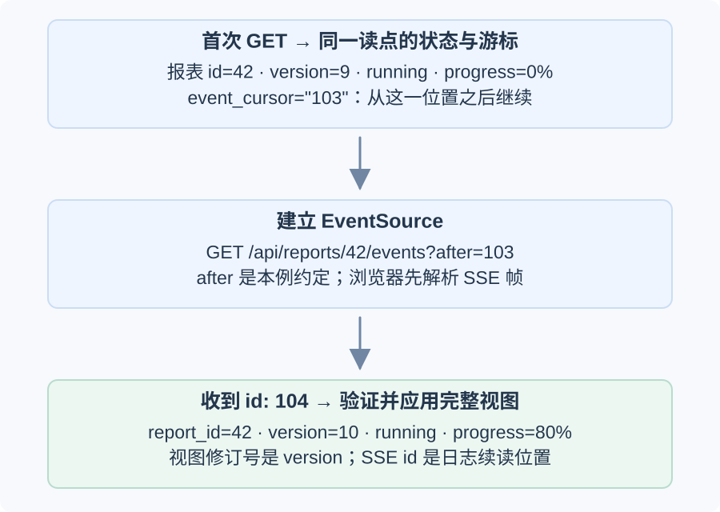

现在连接在事件 104 之后中断。页面保留已经收到的 v10，而原 EventSource 用浏览器记录的位置续连：

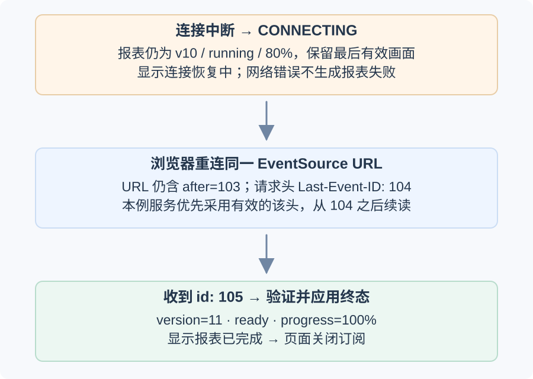

这两张图从同一个快照接续：页面先请求 `after=103`，收到事件 `id: 104` 后把视图应用到版本 10；连接中断时保留 v10。浏览器重连同一 EventSource URL，并自动附上 `Last-Event-ID: 104`。本例服务端契约优先使用这个有效请求头，从游标 104 之后续读 `id: 105`。事件 105 将完整页面视图更新为版本 11 的 `ready`，页面显示完成后关闭订阅。`event_cursor` 只由首次或恢复快照提供；后续解析位置由 EventSource 自己记录，页面不必逐帧改写订阅 URL。浏览器负责解析 `text/event-stream` 帧；页面仍须解析 JavaScript Object Notation (JavaScript 对象表示法，JSON)、检查资源 ID、字段类型和版本，再投影到界面。

### 怎样合并状态并从游标恢复？

Server-sent Events 的 `id` 供浏览器重连时发送 `Last-Event-ID`；URL 中的 `after` 是本例服务端 API 约定，因为原生 `EventSource` 初连不能设置任意请求头或请求正文。标准先更新 EventSource 的 last-event-ID，再排入 JavaScript 事件分发任务，所以它表示浏览器解析到哪里，不是应用处理器已经完成渲染、写本地存储或提交副作用的 acknowledgment (确认，ACK)。服务端可在 `retry:` 字段给出重连等待毫秒数提示；浏览器网络与实现仍会影响实际恢复时间，页面不应假定固定间隔。若本地要可靠处理每条事件，必须另有持久确认位置；只要求最新报表视图时，可以用完整快照校正状态。

报表服务按 `version` 而非 SSE `id` 合并业务视图。本例 `report.updated` 每帧携带页面需要的完整状态，因此收到更高版本可以替换当前视图，低版本或重复版本忽略。若另一个 API 发的是依赖前序状态的 patch，则只接受下一个连续版本；发现 v10 后直接收到 v12 时不能把 v12 patch 套到旧状态，应从权威快照重建。

```http
GET /api/reports/42 HTTP/1.1

HTTP/1.1 200 OK
Cache-Control: no-store
Content-Type: application/json

{"id":42,"version":9,"status":"running","progress":0,"event_cursor":"103"}
```

页面首次连接时，原生 `EventSource` 请求如下；本例服务在没有重连头时使用 `after`，并从 103 之后回放，再接到同一日志的实时尾部：

```http
GET /api/reports/42/events?after=103 HTTP/1.1
Accept: text/event-stream

HTTP/1.1 200 OK
Content-Type: text/event-stream

id: 104
event: report.updated
data: {"report_id":42,"version":10,"status":"running","progress":80}

```

连接中断后，浏览器重用原 URL，并按已解析到的 SSE `id` 发送 `Last-Event-ID`。本例服务优先使用有效的该请求头；没有请求头才使用 URL 的 `after`：

```http
GET /api/reports/42/events?after=103 HTTP/1.1
Accept: text/event-stream
Last-Event-ID: 104

HTTP/1.1 200 OK
Content-Type: text/event-stream

id: 105
event: report.updated
data: {"report_id":42,"version":11,"status":"ready","progress":100}

```

`event` 字段决定命名事件的监听器（缺省是 `message`），`data` 字段构成 `event.data`。空行结束一条 SSE 事件；没有 `data` 字段就不会派发事件，而显式的 `data:` 即使值为空也会被派发为 `event.data === ""`。因此游标过期时可发送 `event: reset\ndata: {}\n\n`；`reset` 是服务端与页面协商的事件名，不是浏览器的内建状态。收到它时，页面关闭旧 EventSource，再取一个**状态快照与游标一致**的响应，从新游标重新订阅。若恢复快照已是 v11 / `ready`，页面显示终态并停止；若仍是 `running`，则用返回的新游标继续订阅。应用也可在发现坏 JSON、无效字段时走同一恢复路径；只有改用依赖前序状态的 patch 时，才需在应用层检查版本缺口。

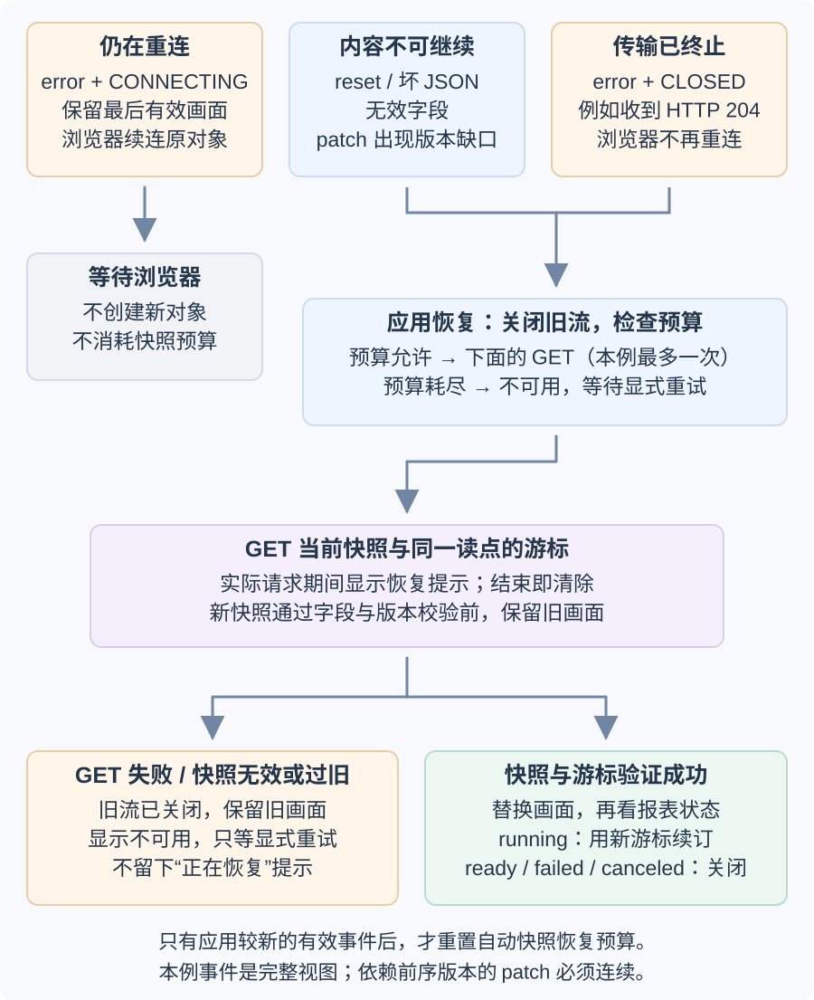

下面的代码从初次 GET 开始，直到报表终态或有限恢复失败；本例 `progress` 是 0–100 的百分比数值。`readSnapshot()` 将服务返回的扁平 JSON 规范化成 `{ report, event_cursor }`；两个值须来自同一一致读取位置，这是应用 API 合同，不是浏览器保证。快照请求使用 `cache: "no-store"`，避免 HTTP 缓存重用陈旧游标；服务端也以 `Cache-Control: no-store` 返回当前一致快照。示例事件负载是完整视图，所以较高版本可覆盖旧版；若负载改成 patch，应把比较条件改成 `update.version === report.version + 1`，缺号就恢复快照。

> [!example]- 代码：从首次快照到有界恢复的 EventSource 接收器
> ~~~javascript
> const statuses = new Set(["running", "ready", "failed", "canceled"]);
> const terminal = new Set(["ready", "failed", "canceled"]);
> let report;
> let source;
> let connectionState = "closed";
> let recoveryBusy = false;
> let recoveryAttempts = 0;
> let recoveryUnavailable = false;
>
> function setConnectionState(next) {
>   if (connectionState === next) return;
>   connectionState = next;
>   showConnectionState(next);
> }
>
> function validView(value, expectedId = 42) {
>   return value && value.id === expectedId &&
>     Number.isSafeInteger(value.version) && value.version >= 0 &&
>     statuses.has(value.status) && Number.isFinite(value.progress) &&
>     value.progress >= 0 && value.progress <= 100;
> }
>
> async function readSnapshot() {
>   const response = await fetch("/api/reports/42", { cache: "no-store" });
>   if (!response.ok) throw new Error("Snapshot HTTP " + response.status);
>   const body = await response.json();
>   if (!validView(body) || typeof body.event_cursor !== "string") {
>     throw new Error("Invalid snapshot or cursor");
>   }
>   return { report: body, event_cursor: body.event_cursor }; // 扁平响应来自同一一致性点
> }
>
> function closeCurrent(current) {
>   if (source !== current) return;
>   source = undefined;
>   current.close();
>   setConnectionState("closed");
> }
>
> function applyView(next) {
>   if (!validView(next) || (report && next.id !== report.id) ||
>       (report && next.version < report.version)) {
>     throw new Error("Invalid or older report view");
>   }
>   report = { id: next.id, version: next.version, status: next.status, progress: next.progress };
>   renderReport(report);
> }
>
> function subscribe(eventCursor) {
>   setConnectionState("connecting");
>   const current = new EventSource(
>     "/api/reports/42/events?after=" + encodeURIComponent(eventCursor),
>   );
>   source = current;
>   current.addEventListener("open", () => {
>     if (source === current) setConnectionState("connected");
>   });
>   current.addEventListener("report.updated", event => {
>     if (source !== current) return; // 忽略旧 EventSource 留下的任务
>     let update;
>     try {
>       update = JSON.parse(event.data);
>     } catch {
>       recoverFrom(current, "invalid JSON");
>       return;
>     }
>     if (!update || update.report_id !== report.id ||
>         !Number.isSafeInteger(update.version) || update.version < 0 || !statuses.has(update.status) ||
>         !Number.isFinite(update.progress) || update.progress < 0 || update.progress > 100) {
>       recoverFrom(current, "invalid event fields");
>       return;
>     }
>     if (update.version <= report.version) return; // 旧版本或重复视图不回退状态
>     try {
>       applyView({ id: report.id, version: update.version, status: update.status, progress: update.progress });
>     } catch {
>       recoverFrom(current, "invalid or older view");
>       return;
>     }
>     recoveryAttempts = 0; // 只在确实应用了较新、有效视图后重置预算
>     recoveryUnavailable = false;
>     if (terminal.has(report.status)) closeCurrent(current);
>   });
>   current.addEventListener("reset", () => recoverFrom(current, "server reset"));
>   current.addEventListener("error", () => {
>     if (source !== current || terminal.has(report.status)) return;
>     if (current.readyState === EventSource.CONNECTING) {
>       setConnectionState("reconnecting");
>     } else if (current.readyState === EventSource.CLOSED) {
>       recoverFrom(current, "event source closed");
>     }
>   });
> }
>
> function recoverFrom(current, reason) {
>   if (source !== current || recoveryBusy || terminal.has(report.status)) return;
>   closeCurrent(current);
>   void refreshSnapshotAndResume(reason);
> }
>
> async function refreshSnapshotAndResume(reason) {
>   if (recoveryBusy) return;
>   if (recoveryAttempts >= 1) {
>     recoveryUnavailable = true;
>     setConnectionState("closed");
>     showRefreshUnavailable(reason);
>     return;
>   }
>   recoveryAttempts += 1;
>   recoveryBusy = true;
>   showRefreshProgress(reason); // show only after the budget check, immediately before the actual snapshot GET
>   let nextCursor;
>   try {
>     const body = await readSnapshot();
>     if (report && body.report.version < report.version) {
>       throw new Error("Snapshot is older than the displayed view");
>     }
>     applyView(body.report);
>     recoveryUnavailable = false;
>     if (terminal.has(report.status)) {
>       setConnectionState("closed");
>     } else {
>       nextCursor = body.event_cursor;
>     }
>   } catch {
>     recoveryUnavailable = true;
>     setConnectionState("closed");
>     showRefreshUnavailable(reason); // 保留最后一份有效 report
>   } finally {
>     recoveryBusy = false;
>     clearRefreshProgress(); // the GET has resolved or failed; a resumed stream has its own connection state
>   }
>   if (nextCursor !== undefined) subscribe(nextCursor);
> }
>
> async function start() {
>   try {
>     const body = await readSnapshot();
>     applyView(body.report);
>     if (!terminal.has(report.status)) subscribe(body.event_cursor);
>   } catch {
>     showInitialUnavailable();
>   }
> }
>
> function retryAfterUserAction() {
>   if (!recoveryUnavailable || source || recoveryBusy || !report || terminal.has(report.status)) return;
>   recoveryUnavailable = false;
>   recoveryAttempts = 0;
>   void refreshSnapshotAndResume("user retry");
> }
>
> void start();
> ~~~

代码里的 `renderReport`、`showConnectionState`、`showRefreshProgress`、`clearRefreshProgress`、`showRefreshUnavailable` 和 `showInitialUnavailable` 是应用的显示函数。本例约定恢复提示共用一个区域：`showRefreshProgress` 用进度替换原来的不可用提示；`showRefreshUnavailable` 用错误替换进度；`clearRefreshProgress` 只清除仍在显示的进度，不擦掉错误提示。这样手动重试成功会清掉旧错误，失败则保留新的不可用提示。创建 EventSource 时先显示 `connecting`，`open` 只表示传输已连上，不代表服务端回放已追平。恢复路径先将当前 EventSource 从活动引用中移除并关闭，再检查恢复预算；只有预算允许实际 GET 时才显示“正在恢复快照”，并在 GET 成功或失败后明确清除该提示。失败会显示“恢复不可用”；成功且仍在运行则清除恢复提示后显示新流的 `connecting`。所以连接标签为 `closed` 与恢复提示是不同状态，后者只覆盖真实进行中的快照请求。自动恢复 GET 失败时，旧流已关闭且没有新流，页面只保留最后有效视图并提供显式重试。恢复最多尝试一次；收到并应用版本较新的有效 `report.updated` 事件后才重置自动恢复预算。`retryAfterUserAction()` 只接受“恢复不可用”状态，且要求没有活动流、没有正在进行的恢复、当前报表非终态；因此重复点击或在活动连接上调用都不会另建一个未跟踪的 EventSource。生产 API 还应通过认证、授权和游标保留策略保护每次 GET/订阅；游标本身不是凭证。

若应用只需最新视图，按业务版本合并完整快照并在 reset 后恢复即可。若一条日志事件代表必须完成的副作用，浏览器解析位置不够：`Last-Event-ID` 可能比应用完成位置更靠后，应持久记录连续 ACK、按事件 ID 幂等处理，并处理 ACK 与副作用之间的崩溃窗口；细节见[实时更新中快照恢复与逐事件确认的区别](../../engineering-foundations/networking/real-time-web-updates.md#%E6%96%AD%E7%BA%BF%E5%90%8E%EF%BC%8C%E5%AE%A2%E6%88%B7%E7%AB%AF%E8%A6%81%E9%87%8D%E5%BB%BA%E7%8A%B6%E6%80%81%E8%BF%98%E6%98%AF%E8%A1%A5%E9%BD%90%E6%AF%8F%E6%9D%A1%E4%BA%8B%E4%BB%B6%EF%BC%9F)。

### Fetch 自定义流和 SSE 有什么不同？

| 需求 | `EventSource`（SSE） | Fetch 响应流 |
|---|---|---|
| 请求形状 | 原生接口发 GET，只提供 URL 与 `withCredentials`；不能设置任意请求头或正文 | 可选方法、请求头、正文与 `AbortSignal` |
| 帧边界 | 浏览器解析 `text/event-stream` 字段并派发事件 | `reader.read()` 返回任意字节块，应用自行解码和组帧 |
| 断线恢复 | 可恢复的断开会自动重连并维护 `Last-Event-ID`；到 `CLOSED` 则不再自动重连，服务还须实现可读游标 | 没有 EventSource 式自动续读；应用按自己的 `runId` / `seq` 重连、去重与补缺 |
| 适合本例 | 订阅报表状态变化 | 提交带授权字段或正文的异步作业，并读取自定义响应协议 |

若 API 需要自定义请求头或 POST 查询，再考虑 Fetch 响应流。`reader.read()` 给出的是任意字节块，不保证一个块刚好是一条记录；UTF-8 字符和 JSON 记录都可能跨块。需要自己持续解码、缓冲到完整分隔符、校验字段和终止条件。传输方式比较见上述实时更新说明；本节聚焦界面和 parser (解析器) 的责任。

现在切换到一个独立的合成作业案例：自定义 newline-delimited JSON (按行分隔的 JSON，NDJSON) 作业协议模型。它不再是报表 42 的 SSE 服务：模型中的 `runId` 标识一次生成作业，`seq` 是该私有日志的应用游标；它既不是 SSE 的 `id`，也不是报表 `version`。客户端用幂等键提交作业并获得稳定 `runId`，续读时带已接受的 `seq`；旧序号可重放并丢弃，跳号则拒绝，作业最终状态仍以状态接口为准。该模型限制单条帧为 8,192 个 UTF-16 代码单元、可见输出为 64 Ki 代码单元，并覆盖坏 JSON、提早 EOF、超时和本地取消；end-of-file (文件结束，EOF) 本身不等于收到终态。为看清字节和消息的区别，先缩小为同一 `run-7` 的两帧：`seq=1` 输出“你好”，`seq=2` 宣告完成。UTF-8 将“好”编码为三个字节 `E5 A5 BD`；网络可能先给出 `E5`，下次才给出 `A5 BD`。单独一个 `E5` 还不能解成字符，增量 `TextDecoder` 会暂存它，等字节完整才输出“好”。字符解出来后仍不能立刻 `JSON.parse`：还要等完整 JSON 行和换行符。

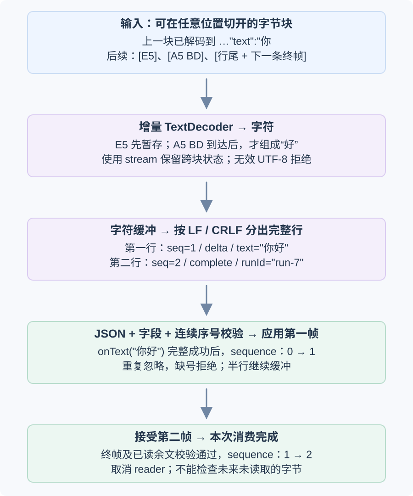

图里一条记录完整应用后，游标才从 0 到 1；缓冲中的下一条终帧通过校验后才结束消费。只收到“你好”就断流，会保留文本并报告本地读取失败，不能猜测服务器已完成。下面折叠的协议示例保留较长的英文输出与三帧序列，parser 的分块测试使用上图这组较小的中文输入；它们遵循同一条按序接受规则。

> [!example]- 自定义 Fetch/NDJSON 作业 parser 与断线案例
> 此实现是 Node Web Streams 与 Response API 上的合成协议模型，不是浏览器端到端或生产服务测试；十六组断言覆盖 UTF-8 与帧跨块、CRLF 分块边界、MIME 精确匹配、合并帧、重放与跳号、服务端错误、格式错误、提前结束、断线、超时、本地中止、回调竞争，以及终态后的已解码余文与未完成 UTF-8 字节。
>
> ~~~text
> POST /api/runs
> Idempotency-Key: submit-7f2a
> {"prompt":"Summarize the public release notes"}
>
> 202 Accepted
> {"runId":"run-7","status":"queued"}
>
> GET /api/runs/run-7/events?after=0
>
> 200 OK
> Content-Type: application/x-ndjson
>
> {"type":"delta","seq":1,"text":"The release adds "}
> {"type":"delta","seq":2,"text":"a search filter."}
> {"type":"complete","seq":3,"runId":"run-7"}
> ~~~
>
> 这个小协议展示提交幂等键、稳定作业 ID、续读序号与明确终态；它是应用契约示例，不是浏览器标准。若流在 `seq: 1` 后断开，客户端保留已应用文本和长度，用同一 `runId` 请求 `after=1`，并把 `afterSequence: 1` 与 `currentOutputChars` 传给 parser；重放的 1 被忽略，下一帧从 2 接上。下面的 parser 会逐块解码并验证序号，遇到没有终态的 EOF 时保留部分文本但不标为完成。
>
> ~~~javascript
> import assert from "node:assert/strict";
>
> const MAX_FRAME_CHARS = 8 * 1024;
> const MAX_OUTPUT_CHARS = 64 * 1024;
> const DECODE_SLICE_BYTES = 4 * 1024;
>
> function readWithSignal(reader, signal) {
>   if (!signal) return reader.read();
>   const abortReason = () => signal.reason ?? new DOMException("Aborted", "AbortError");
>   if (signal.aborted) return Promise.reject(abortReason());
>
>   return new Promise((resolve, reject) => {
>     const onAbort = () => reject(abortReason());
>     signal.addEventListener("abort", onAbort, { once: true });
>     reader.read().then(resolve, reject).finally(() => {
>       signal.removeEventListener("abort", onAbort);
>     });
>   });
> }
>
> async function consumeRun(response, {
>   runId,
>   signal,
>   afterSequence = 0,
>   currentOutputChars = 0,
>   onState = () => {},
>   onText = async () => {},
> } = {}) {
>   let state = "idle";
>   let sequence = afterSequence;
>   let outputChars = currentOutputChars;
>   let carry = "";
>   let terminal = false;
>   let errorCode;
>   let detail;
>   let reader;
>   const decoder = new TextDecoder("utf-8", { fatal: true });
>
>   const transition = next => {
>     const allowed = {
>       idle: ["connecting", "canceled"],
>       connecting: ["streaming", "completed", "failed", "canceled"],
>       streaming: ["connecting", "completed", "failed", "canceled"],
>     };
>     if (state === next) return;
>     if (!allowed[state]?.includes(next)) {
>       throw new Error("Invalid view-state transition: " + state + " -> " + next);
>     }
>     state = next;
>     onState(state);
>   };
>
>   const result = () => ({ state, sequence, outputChars, errorCode, detail });
>
>   async function acceptLine(line, hasBufferedDataAfterFrame = false) {
>     signal?.throwIfAborted();
>     if (terminal) throw new Error("Frame received after a terminal frame");
>     if (!line) throw new Error("Empty frame");
>     if (line.length > MAX_FRAME_CHARS) throw new Error("Frame exceeds the size limit");
>
>     let event;
>     try {
>       event = JSON.parse(line);
>     } catch {
>       throw new Error("Malformed JSON frame");
>     }
>
>     if (!event || Array.isArray(event) || typeof event !== "object") {
>       throw new Error("Frame must be a JSON object");
>     }
>     if (!Number.isSafeInteger(event.seq) || event.seq < 1) {
>       throw new Error("Frame has an invalid sequence number");
>     }
>     if (event.seq <= sequence) return; // replayed event already applied
>     if (event.seq !== sequence + 1) throw new Error("Event sequence gap");
>     if (typeof event.type !== "string") throw new Error("Frame has no event type");
>
>     if (event.type === "delta") {
>       if (typeof event.text !== "string") throw new Error("Delta text must be a string");
>       if (outputChars + event.text.length > MAX_OUTPUT_CHARS) {
>         throw new Error("Output exceeds the display limit");
>       }
>       if (state === "connecting") transition("streaming");
>       await onText(event.text, signal);
>       // onText 成功返回表示这一整帧已经应用；这才是可续读的位置。
>       sequence = event.seq;
>       outputChars += event.text.length;
>       signal?.throwIfAborted();
>       return;
>     }
>
>     if (event.type === "complete") {
>       if (event.runId !== runId) throw new Error("Terminal frame has the wrong runId");
>       if (hasBufferedDataAfterFrame) throw new Error("Frame buffered after terminal frame");
>       decoder.decode(); // flush fatal UTF-8 state so an incomplete byte in this read cannot hide after the terminal line
>       sequence = event.seq;
>       terminal = true;
>       transition("completed");
>       return;
>     }
>
>     if (event.type === "error") {
>       if (typeof event.code !== "string" || !event.code) {
>         throw new Error("Error frame has no error code");
>       }
>       if (hasBufferedDataAfterFrame) throw new Error("Frame buffered after terminal frame");
>       decoder.decode(); // 检查当前已读字节中的未完成 UTF-8 序列；后续网络块仍由终态协议结束
>       sequence = event.seq;
>       errorCode = event.code;
>       terminal = true;
>       transition("failed");
>       return;
>     }
>
>     throw new Error("Unknown event type");
>   }
>
>   async function feedText(text, moreBytesInRead = false) {
>     carry += text;
>     let newline;
>     while ((newline = carry.indexOf("\n")) !== -1) {
>       let line = carry.slice(0, newline);
>       carry = carry.slice(newline + 1);
>       if (line.endsWith("\r")) line = line.slice(0, -1);
>       const hasBufferedDataAfterFrame = carry.length > 0 || moreBytesInRead;
>       await acceptLine(line, hasBufferedDataAfterFrame);
>       if (terminal) return;
>     }
>     // A trailing CR may be the first half of a CRLF split across reads; measure it after the next byte decides the delimiter.
>     const pendingLineChars = carry.length - Number(carry.endsWith("\r"));
>     if (pendingLineChars > MAX_FRAME_CHARS) throw new Error("Frame exceeds the size limit");
>   }
>
>   transition("connecting");
>   try {
>     if (!response.body) throw new Error("Response has no body");
>     reader = response.body.getReader();
>     if (!response.ok) throw new Error("HTTP " + response.status);
>     const contentType = response.headers.get("content-type");
>     const mediaType = contentType?.split(";", 1)[0].trim().toLowerCase();
>     if (mediaType !== "application/x-ndjson") {
>       throw new Error("Unexpected response content type");
>     }
>
>     while (true) {
>       const { done, value } = await readWithSignal(reader, signal);
>       if (done) {
>         await feedText(decoder.decode());
>         if (terminal) return result();
>         if (carry.length) throw new Error("EOF inside an unterminated frame");
>         throw new Error("EOF before a terminal frame");
>       }
>
>       for (let offset = 0; offset < value.byteLength; offset += DECODE_SLICE_BYTES) {
>         const end = Math.min(offset + DECODE_SLICE_BYTES, value.byteLength);
>         const part = value.subarray(offset, end);
>         await feedText(decoder.decode(part, { stream: true }), end < value.byteLength);
>         if (terminal) return result();
>       }
>     }
>   } catch (error) {
>     detail = error instanceof Error ? error.message : String(error);
>     if (signal?.aborted && signal.reason?.name === "TimeoutError") {
>       transition("failed");
>     } else if (signal?.aborted) {
>       transition("canceled");
>     } else {
>       transition("failed");
>     }
>     return result();
>   } finally {
>     if (reader) {
>       try {
>         await reader.cancel();
>       } catch {
>         // Preserve the parse, read, timeout, or abort result.
>       }
>       reader.releaseLock();
>     }
>   }
> }
>
> const encoder = new TextEncoder();
> const asBytes = text => encoder.encode(text);
>
> function responseFrom(chunks, {
>   open = false,
>   status = 200,
>   contentType = "application/x-ndjson; charset=utf-8",
> } = {}) {
>   const body = new ReadableStream({
>     start(controller) {
>       for (const chunk of chunks) controller.enqueue(chunk);
>       if (!open) controller.close();
>     },
>   });
>   return new Response(body, {
>     status,
>     headers: { "content-type": contentType },
>   });
> }
>
> function responseDisconnectAfter(chunk) {
>   let sent = false;
>   const body = new ReadableStream({
>     pull(controller) {
>       if (!sent) {
>         sent = true;
>         controller.enqueue(chunk);
>       } else {
>         controller.error(new Error("Connection dropped"));
>       }
>     },
>   }, { highWaterMark: 0 });
>   return new Response(body, {
>     headers: { "content-type": "application/x-ndjson; charset=utf-8" },
>   });
> }
>
> async function check(name, response, expectedState, expectedText = "", options = {}) {
>   const states = [];
>   let text = "";
>   const result = await consumeRun(response, {
>     runId: "run-7",
>     ...options,
>     onState: state => states.push(state),
>     onText: chunk => { text += chunk; },
>   });
>   assert.equal(result.state, expectedState, name);
>   assert.equal(text, expectedText, name + " partial text");
>   return { result, states };
> }
>
> // Split one multibyte character and one record across reads; the final read
> // also contains a coalesced complete record.
> const multibyte = asBytes("好");
> const normal = await check(
>   "split UTF-8 and coalesced frames",
>   responseFrom([
>     asBytes('{"type":"delta","seq":1,"text":"你'),
>     multibyte.slice(0, 1),
>     multibyte.slice(1),
>     asBytes('"}\n{"type":"complete","seq":2,"runId":"run-7"}\n'),
>   ]),
>   "completed",
>   "你好",
> );
> assert.deepEqual(normal.states, ["connecting", "streaming", "completed"]);
> console.log("PASS normal, multibyte split, frame split, and coalesced frames");
>
> const serverError = await check(
>   "server error frame",
>   responseFrom([asBytes('{"type":"error","seq":1,"code":"MODEL_UNAVAILABLE"}\n')]),
>   "failed",
> );
> assert.equal(serverError.result.errorCode, "MODEL_UNAVAILABLE");
> console.log("PASS terminal server-error frame");
>
> const malformed = await check(
>   "malformed JSON",
>   responseFrom([asBytes("{not-"), asBytes("json}\n")]),
>   "failed",
> );
> assert.match(malformed.result.detail, /Malformed JSON/);
> console.log("PASS malformed frame split across reads");
>
> const prematureEof = await check(
>   "premature EOF",
>   responseFrom([asBytes('{"type":"delta","seq":1,"text":"partial"}\n')]),
>   "failed",
>   "partial",
> );
> assert.match(prematureEof.result.detail, /EOF before a terminal frame/);
> console.log("PASS EOF preserves partial text but does not complete");
>
> const disconnected = await check(
>   "abrupt disconnect",
>   responseDisconnectAfter(asBytes('{"type":"delta","seq":1,"text":"partial"}\n')),
>   "failed",
>   "partial",
> );
> assert.match(disconnected.result.detail, /Connection dropped/);
> console.log("PASS abrupt disconnect preserves partial text but does not complete");
>
> const timeoutController = new AbortController();
> const timeoutTimer = setTimeout(() => {
>   timeoutController.abort(new DOMException("Deadline exceeded", "TimeoutError"));
> }, 5);
> const timeout = await check(
>   "timeout",
>   responseFrom([], { open: true }),
>   "failed",
>   "",
>   { signal: timeoutController.signal },
> );
> clearTimeout(timeoutTimer);
> assert.match(timeout.result.detail, /Deadline exceeded/);
> console.log("PASS timeout remains a failure, not completion");
>
> const stopController = new AbortController();
> const stopTimer = setTimeout(() => {
>   stopController.abort(new DOMException("Stopped by user", "AbortError"));
> }, 5);
> const stopped = await check(
>   "explicit abort after partial text",
>   responseFrom([asBytes('{"type":"delta","seq":1,"text":"partial"}\n')], { open: true }),
>   "canceled",
>   "partial",
>   { signal: stopController.signal },
> );
> clearTimeout(stopTimer);
> assert.match(stopped.result.detail, /Stopped by user/);
> console.log("PASS explicit abort keeps partial text and marks only the local view canceled");
>
> const bufferedRaceController = new AbortController();
> const bufferedRaceStates = [];
> let bufferedRaceText = "";
> const bufferedRace = await consumeRun(responseFrom([
>   asBytes('{"type":"delta","seq":1,"text":"partial"}\n{"type":"complete","seq":2,"runId":"run-7"}\n'),
> ]), {
>   runId: "run-7",
>   signal: bufferedRaceController.signal,
>   onState: state => bufferedRaceStates.push(state),
>   onText: async chunk => {
>     bufferedRaceText += chunk;
>     await Promise.resolve();
>     bufferedRaceController.abort(new DOMException("Stopped while rendering", "AbortError"));
>   },
> });
> assert.equal(bufferedRace.state, "canceled");
> assert.equal(bufferedRace.sequence, 1);
> assert.equal(bufferedRace.outputChars, "partial".length);
> assert.equal(bufferedRaceText, "partial");
> assert.deepEqual(bufferedRaceStates, ["connecting", "streaming", "canceled"]);
> assert.match(bufferedRace.detail, /Stopped while rendering/);
> console.log("PASS abort after text callback returns prevents a buffered terminal frame");
>
> const trailingTerminal = await check(
>   "frame buffered after terminal",
>   responseFrom([asBytes(
>     '{"type":"complete","seq":1,"runId":"run-7"}\n{"type":"delta","seq":2,"text":"late"}\n',
>   )]),
>   "failed",
> );
> assert.match(trailingTerminal.result.detail, /Frame buffered after terminal/);
> console.log("PASS reject a frame already buffered after a terminal record");
>
> const replayedSequence = await check(
>   "duplicate sequence ignored",
>   responseFrom([asBytes(
>     '{"type":"delta","seq":1,"text":"once"}\n' +
>     '{"type":"delta","seq":1,"text":"duplicate"}\n' +
>     '{"type":"complete","seq":2,"runId":"run-7"}\n',
>   )]),
>   "completed",
>   "once",
> );
> assert.equal(replayedSequence.result.sequence, 2);
> console.log("PASS duplicate sequence is not applied twice");
>
> const sequenceGap = await check(
>   "sequence gap",
>   responseFrom([asBytes(
>     '{"type":"delta","seq":1,"text":"partial"}\n' +
>     '{"type":"complete","seq":3,"runId":"run-7"}\n',
>   )]),
>   "failed",
>   "partial",
> );
> assert.equal(sequenceGap.result.sequence, 1);
> assert.match(sequenceGap.result.detail, /Event sequence gap/);
> console.log("PASS sequence gap fails the local consumer without advancing its cursor");
>
> const terminalPrefix = '{"type":"complete","seq":1,"runId":"run-7","padding":"';
> const terminalSuffix = '"}';
> const maxLengthTerminal = terminalPrefix + "x".repeat(
>   MAX_FRAME_CHARS - terminalPrefix.length - terminalSuffix.length,
> ) + terminalSuffix;
> assert.equal(maxLengthTerminal.length, MAX_FRAME_CHARS);
> const splitCrlfLimit = await check(
>   "maximum-size frame with CRLF split across reads",
>   responseFrom([asBytes(maxLengthTerminal + "\r"), asBytes("\n")]),
>   "completed",
> );
> assert.equal(splitCrlfLimit.result.sequence, 1);
> console.log("PASS an 8192-code-unit JSON line followed by split CRLF stays within the frame limit");
>
> const sameChunkCrlfLimit = await check(
>   "maximum-size frame with CRLF in one read",
>   responseFrom([asBytes(maxLengthTerminal + "\r\n")]),
>   "completed",
> );
> assert.equal(sameChunkCrlfLimit.result.sequence, 1);
> console.log("PASS the same 8192-code-unit line also accepts CRLF in one read");
>
> const invalidMediaType = await check(
>   "NDJSON media type with a suffix is rejected",
>   responseFrom([asBytes('{"type":"complete","seq":1,"runId":"run-7"}\n')], {
>     contentType: "application/x-ndjsonx",
>   }),
>   "failed",
> );
> assert.match(invalidMediaType.result.detail, /content type/);
> assert.equal(invalidMediaType.result.sequence, 0);
> console.log("PASS application/x-ndjsonx is rejected before any frame is accepted");
>
> const terminalLineBytes = asBytes('{"type":"complete","seq":1,"runId":"run-7"}\n');
> const openTerminal = await check(
>   "terminal frame completes before an open stream reaches EOF",
>   responseFrom([terminalLineBytes], { open: true }),
>   "completed",
> );
> assert.equal(openTerminal.result.sequence, 1);
> console.log("PASS a terminal frame with a real LF completes while the stream remains open");
>
> const terminalWithPendingUtf8 = new Uint8Array(terminalLineBytes.length + 1);
> terminalWithPendingUtf8.set(terminalLineBytes);
> terminalWithPendingUtf8[terminalLineBytes.length] = 0xf0; // first byte of a four-byte UTF-8 sequence
> const pendingUtf8AfterTerminal = await check(
>   "incomplete UTF-8 byte after terminal in the same read",
>   responseFrom([terminalWithPendingUtf8], { open: true }),
>   "failed",
> );
> assert.equal(pendingUtf8AfterTerminal.result.sequence, 0);
> assert.match(pendingUtf8AfterTerminal.result.detail, /encoded data|encoding/i);
> console.log("PASS a pending UTF-8 lead byte in the same read prevents terminal success");
> ~~~

`consumeRun()` 返回的 `state` 是这次页面消费尝试的本地结果，不等于后台 `run` 的权威状态：本地超时、断线或 JSON 解析失败会得到 `failed`，但服务器上的作业仍可能运行或已经完成；显式查询状态接口后才可确认。收到合成协议的 `error` 终帧会记录 `errorCode` 并停止消费，但仍不能把任意本地 `failed` 当成服务器终态。

若一个读取块里已经同时缓冲终帧和后续的已解码内容，parser 在转入终态前拒绝它；也会 flush fatal `TextDecoder`，避免当前 `read()` 尾部未完成的 UTF-8 字节藏在解码器状态里。接受终帧后会取消 reader，不再读取未来网络数据，因此它不能证明服务端之后没有再发送内容；服务端协议仍须规定终帧后关闭流。

本地 `AbortController.abort()` 或取消 reader 只会结束当前页面对响应体的读取，不证明服务端工作停止。若产品允许取消作业，还要发取消请求并查询权威作业状态，直到服务端报告终态。`onText` 成功返回表示整帧文本已完整接收并应用，只有此后才推进 `sequence` 和输出长度；回调若先应用部分文本再拒绝，就无法安全确定续读点。解析器在等待 `onText` 时不能强行打断任意 Promise，回调必须有界并自行响应传入的取消信号，或让其完成后再处理中止。示例的竞争测试仅证明渲染回调返回后，中止会阻止消费同一缓冲区里的终态帧。解析器等待回调完成也形成背压：若回调将 Document Object Model (文档对象模型，DOM) 写入排入队列，应在队列保持较小时再读取下一块；可以用 `requestAnimationFrame` 合并可见更新，但它不提供恢复保证。路由卸载时释放 reader 和事件源，保留有用但不完整的文本，并将其标为部分结果。将收到的状态先交给本地 reducer 或事件总线再更新多个视图时，监听器重入也可能改变处理顺序；见[事件总线重入案例](#56.%20JavaScript%20%E4%BA%8B%E4%BB%B6%E6%80%BB%E7%BA%BF%E5%9C%A8%E7%9B%91%E5%90%AC%E5%99%A8%E4%B8%AD%E9%87%8D%E5%85%A5%E6%97%B6%E6%80%8E%E6%A0%B7%E4%BF%9D%E6%8C%81%E9%A1%BA%E5%BA%8F%EF%BC%9F)。

渲染本身也应有界：把同一帧中到达的文本增量合并后每帧更新一次，而不是每个 token 都刷新 DOM；输出很长时限制缓冲或只渲染可见窗口。状态区域可以用 `role="status"` 播报连接、完成或失败；它隐含 polite live-region 语义，不要逐字播报每个 token。

**延伸阅读：** [实时更新该选哪种传输？](../../engineering-foundations/networking/real-time-web-updates.md) 定义 SSE 的线格式、id/version 和重连边界；[API 可靠性与异步交付](../../engineering-foundations/reliability/api-reliability-and-async-delivery.md) 讨论未知结果与安全重试；[JavaScript 事件总线在监听器中重入时怎样保持顺序？](#56.%20JavaScript%20%E4%BA%8B%E4%BB%B6%E6%80%BB%E7%BA%BF%E5%9C%A8%E7%9B%91%E5%90%AC%E5%99%A8%E4%B8%AD%E9%87%8D%E5%85%A5%E6%97%B6%E6%80%8E%E6%A0%B7%E4%BF%9D%E6%8C%81%E9%A1%BA%E5%BA%8F%EF%BC%9F) 讨论把一个状态更新送到本地多个模块。

若应用交付的是持久 AI run 的完整事件，本篇负责传输解码、断线续读与本地取消边界；事件到达后如何把 `runId`、序号、工具调用与不完整 Markdown 安全地投影到聊天界面，见[一轮 AI 聊天怎样安全展示增量回答、工具状态与恢复操作](#55.%20%E4%B8%80%E8%BD%AE%20AI%20%E8%81%8A%E5%A4%A9%E6%80%8E%E6%A0%B7%E5%AE%89%E5%85%A8%E5%9C%B0%E5%B1%95%E7%A4%BA%E5%A2%9E%E9%87%8F%E5%9B%9E%E7%AD%94%E3%80%81%E5%B7%A5%E5%85%B7%E7%8A%B6%E6%80%81%E4%B8%8E%E6%81%A2%E5%A4%8D%E6%93%8D%E4%BD%9C%EF%BC%9F)。

> [!info]- 来源
> - SSE 字段解析、空 `data:` 派发、EventSource 自动重连和 `Last-Event-ID`：[WHATWG HTML Living Standard，Server-sent events](https://html.spec.whatwg.org/multipage/server-sent-events.html)，§9.2.2（EventSource 属性与构造器）、§9.2.3（CONNECTING/OPEN/CLOSED、停止重连）、§9.2.4（Last-Event-ID）、§9.2.5–9.2.6（字段解析、空行分发），标准页面 2026-11-12 更新并核对；报表 42 的 `id`、`version` 和终态沿用[实时更新协议案例](../../engineering-foundations/networking/real-time-web-updates.md)。
> - Fetch 响应状态和 `Response.body` 流：[WHATWG Fetch Standard §5.3 Response](https://fetch.spec.whatwg.org/#response-class)；`getReader()`、取消与释放 reader：[WHATWG Streams Standard](https://streams.spec.whatwg.org/)，§4.2、§4.3.3、§4.4、§4.9.3，2026-11-12 核对。
> - Fetch 请求缓存模式及 `cache: "no-store"`：[WHATWG Fetch Standard §5.4 Request](https://fetch.spec.whatwg.org/#request-class)，`no-store` 不使用 HTTP 缓存，2026-10-19 版本、2026-11-12 核对。
> - NDJSON 的 UTF-8、LF/CRLF 分隔和建议媒体类型：[NDJSON Specification 1.0.0](https://github.com/ndjson/ndjson-spec)，§3.1–3.3（2014-10-19）；本例 8,192 字符帧上限、序号、`runId` 与终态是教学协议扩展，不由 NDJSON 标准定义。
> - 增量 UTF-8 解码与 `TextDecoder` 的 `stream`/`fatal` flush 行为：[WHATWG Encoding Standard §7.2](https://encoding.spec.whatwg.org/#interface-textdecoder)，2026-10-19 版本、2026-11-12 核对。
> - `AbortController` 和 `AbortSignal` 的 API 语义：[WHATWG DOM Standard §3 Aborting ongoing activities](https://dom.spec.whatwg.org/#aborting-ongoing-activities)，2026-11-12 核对。
> - `role="status"` 的状态播报语义：[W3C WAI-ARIA 1.2，status role](https://www.w3.org/TR/wai-aria-1.2/#status)，2026-11-12 核对。
## 55. 一轮 AI 聊天怎样安全地展示增量回答、工具状态与恢复操作？

**案例背景。** 开发者要求：“解释 build 42 的失败并准备缺陷单；提交前让我审核。”运行服务已鉴权并创建合成运行 `run-r42-7`。只读工具 `read_build_log` 的模型调用标识为 `c1`；它查到 `unit-tests` 中 `reject_empty_name` 预期 HTTP（超文本传输协议）`400`、实际 `200`、进程退出状态 `1`。证据到达前，界面只能显示正在检查，不能先把根因写成结论。运行随后生成解释和持久化的待审核草稿，进入 `awaiting_approval`；审核人批准这份未变化的草稿后，同一运行才会调用创建工单动作。这里的运行 ID、日志序号和工具调用 ID 均为公开教学用合成值。

本篇接在[流式传输已经交付哪些完整事件](#54.%20%E6%B5%81%E5%BC%8F%E6%8A%A5%E8%A1%A8%E6%96%AD%E7%BA%BF%E9%87%8D%E8%BF%9E%E5%90%8E%EF%BC%8C%E7%95%8C%E9%9D%A2%E6%80%8E%E6%A0%B7%E4%BF%9D%E7%95%99%E6%AD%A3%E7%A1%AE%E7%8A%B6%E6%80%81%EF%BC%9F)之后：客户端已收到一条完整应用事件，要验证它属于哪次运行、按顺序只投影一次，再把分片累积成的 Markdown 和工具结果安全呈现。聊天组件展示服务端的运行投影；审批、取消和未知副作用的权威状态仍由[运行服务怎样断线恢复并避免副作用重复](../../ai-engineering/systems/ai-application-architecture.md)保存。断开连接、文本片段结束或浏览器关闭都不能替代运行记录。

| 序号与事件 | 客户端投影 | 此时不能误报什么 |
|---|---|---|
| `seq=1`：`run.status` → `running` | 为同一轮显示“正在检查” | 不能称为已完成 |
| `seq=2`：`assistant.delta` | 助手气泡出现“正在读取 build 42 日志” | 还没有失败证据，不能先写根因 |
| `seq=3`：`tool.started(c1)` | 建立“读取构建日志”卡片，状态为等待 | 重放不能再建第二张卡 |
| `seq=4`：`tool.completed(c1)` | 同一张卡显示 `reject_empty_name` 预期 HTTP 400、实际 HTTP 200、退出码 1 | 工具摘要是数据，不是可执行指令 |
| `seq=5`：`assistant.delta` | 同一气泡解释观测结果，并说明正在准备缺陷单草稿 | 草稿仍在生成 |
| `seq=6`：`run.status` → `awaiting_approval` | 显示已保存的仓库、标题、正文、证据摘要及审核入口 | 工单尚未创建 |
| `seq=7`：`run.status` → `running` | 审核人批准未变草稿后，同一轮恢复 | `runId` 不变，事件序号接续 |
| `seq=8`：`tool.started(c2)` | 建立“创建缺陷单”卡片 | `c2` 不是远端去重键 |
| `seq=9–10`：`tool.effect_unknown(c2)`、`run.status` → `effect_unknown` | 卡片与运行均显示“提交结果待对账” | 超时不等于失败或未创建 |
| `seq=11`：`tool.completed(c2)` | 同一张 `c2` 卡显示经对账确认的 `ISSUE-842` | 不新建运行或第二张卡 |
| `seq=12–13`：`assistant.delta`、`run.status` → `completed` | 同一气泡告知工单已存在，权威状态结束本轮 | 只有运行服务确认结果后才显示完成 |

这些字段属于本例的应用事件合同，不是 SSE、Fetch 或 Model Context Protocol（模型上下文协议，MCP）自动提供的通用格式。`runId` 标识持久运行，`seq` 是该运行对客户端可见的应用日志顺序，`toolCallId`（本例 `c1`、`c2`）把模型工具请求和结果配对；远端写操作另用稳定键 `run-r42-7:create-issue:v1`。连接 ID、MCP 的 JSON-RPC（基于 JSON 的远程过程调用）ID 和这些标识不能互相替代。

### 怎样应用重放事件而不重复消息或工具卡？

重开对话时，先取同一一致点上的完整可见投影快照和 `lastSeq`，再从该序号之后续读。快照游标与它所声称的文本、工具卡和运行状态必须来自同一版本。本例的 `lastSeq=3` 快照已含 `seq=2` 的“正在读取 build 42 日志”文本和 `seq=3` 建立的 `c1` 等待读取卡；所以 `seq=4` 的完成事件可以更新同一张卡。若快照跳到了 `lastSeq=3` 却漏了 `c1`，下一条完成事件就无处配对，客户端应拒绝这个不一致快照并重新取权威投影，不能只把游标改到最新值。若服务只能返回运行状态与最新游标，客户端要从已有本地投影及其对应游标续读，或从能够重建完整投影的保留历史起点重放；空白气泡不能直接配上服务端最新序号。历史已经清理、服务又不提供完整快照时，不能宣称可恢复全部内容。

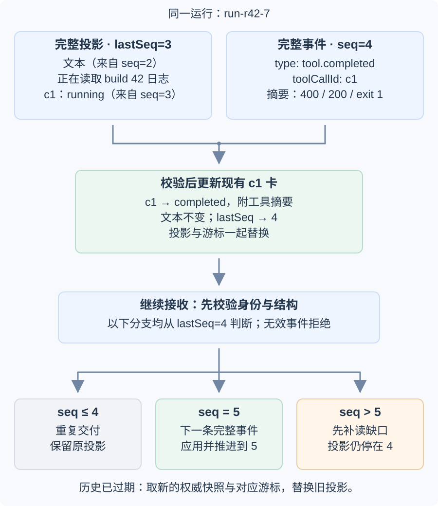

上图把三个接收结果分开：下一序号推进投影；不大于当前游标的重放被忽略；跳号先向同一个 `runId` 补读，或在服务已不保留历史时重新获取一份快照与游标一致的权威投影。在缺口补齐前，旧文本和卡片保持不变。图中快照 `lastSeq=3` 的可见文本来自 `seq=2`，`c1` 卡来自 `seq=3`；收到 `seq=4` 后更新卡片，不创建新卡。

下面的投影函数只处理应用事件层。快照响应也应按 schema（数据结构约束）校验运行 ID、非负游标和完整可见投影；本段代码展示事件边界。先将网络 JSON 当作 `unknown`，检查对象、身份、序号、事件类型与该事件必需的字段；TypeScript 声明本身不会校验网络内容。代码明确拒绝未知事件类型，并让重复和缺口分支返回原投影。生产 schema 还要限制正文大小、工具名称以及服务器允许的运行状态转换。

> [!example]- 代码：校验事件并按运行游标投影
> ~~~javascript
> const RUN_STATUSES = new Set([
>   "running", "awaiting_approval", "effect_unknown", "completed",
>   "failed", "rejected", "cancel_requested", "canceled"
> ]);
> const TOOL_NAMES = new Set(["read_build_log", "create_issue"]);
>
> function isRecord(value) {
>   return value !== null && typeof value === "object" && !Array.isArray(value);
> }
>
> function validateRunEvent(raw) {
>   if (!isRecord(raw) || typeof raw.runId !== "string" ||
>       !Number.isSafeInteger(raw.seq) || raw.seq < 1) {
>     throw new Error("Invalid event identity");
>   }
>   switch (raw.type) {
>     case "assistant.delta":
>       if (typeof raw.text !== "string") throw new Error("Invalid text delta");
>       break;
>     case "tool.started":
>       if (typeof raw.toolCallId !== "string" || !raw.toolCallId ||
>           !TOOL_NAMES.has(raw.toolName)) throw new Error("Invalid tool start");
>       break;
>     case "tool.effect_unknown":
>       if (typeof raw.toolCallId !== "string" || !raw.toolCallId) {
>         throw new Error("Invalid unknown effect");
>       }
>       break;
>     case "tool.completed":
>       if (typeof raw.toolCallId !== "string" || !raw.toolCallId ||
>           typeof raw.summary !== "string") throw new Error("Invalid tool result");
>       break;
>     case "run.status":
>       if (!RUN_STATUSES.has(raw.status)) throw new Error("Invalid run status");
>       if (raw.status === "awaiting_approval" &&
>           (!isRecord(raw.approvalDraft) ||
>            typeof raw.approvalDraft.repositoryId !== "string" ||
>            typeof raw.approvalDraft.title !== "string" ||
>            typeof raw.approvalDraft.body !== "string" ||
>            typeof raw.approvalDraft.evidenceSummary !== "string" ||
>            typeof raw.approvalDraft.payloadHash !== "string")) {
>         throw new Error("Missing persisted approval draft");
>       }
>       break;
>     default:
>       throw new Error("Unknown event type");
>   }
>   return raw;
> }
>
> function applyRunEvent(view, raw) {
>   const event = validateRunEvent(raw);
>   if (event.runId !== view.runId) throw new Error("Wrong run");
>   if (event.seq <= view.lastSeq) return { kind: "ignore", view };
>   if (event.seq !== view.lastSeq + 1) return { kind: "catch-up", view };
>
>   const next = { ...view, lastSeq: event.seq, tools: new Map(view.tools) };
>   switch (event.type) {
>     case "assistant.delta":
>       next.assistantText += event.text;
>       break;
>     case "tool.started": {
>       const prior = next.tools.get(event.toolCallId);
>       if (prior && prior.name !== event.toolName) throw new Error("Tool ID reused");
>       if (!prior) next.tools.set(event.toolCallId, {
>         name: event.toolName, status: "running"
>       });
>       break;
>     }
>     case "tool.effect_unknown": {
>       const prior = next.tools.get(event.toolCallId);
>       if (!prior || prior.status === "completed") throw new Error("Unknown tool card");
>       next.tools.set(event.toolCallId, { ...prior, status: "effect_unknown" });
>       break;
>     }
>     case "tool.completed": {
>       const prior = next.tools.get(event.toolCallId);
>       if (!prior || prior.status === "completed") throw new Error("No pending tool card");
>       next.tools.set(event.toolCallId, {
>         ...prior, status: "completed", summary: event.summary
>       });
>       break;
>     }
>     case "run.status":
>       next.runStatus = event.status;
>       if (event.status === "awaiting_approval") {
>         next.approvalDraft = event.approvalDraft;
>       }
>       break;
>   }
>   return { kind: "applied", view: next };
> }
>
> const snapshotAt3 = {
>   runId: "run-r42-7",
>   lastSeq: 3,
>   assistantText: "正在读取 build 42 日志",
>   tools: new Map([["c1", { name: "read_build_log", status: "running" }]]),
>   runStatus: "running"
> };
> const seq4 = {
>   runId: "run-r42-7", seq: 4, type: "tool.completed", toolCallId: "c1",
>   summary: "reject_empty_name: expected HTTP 400, actual HTTP 200, exit 1"
> };
> const after4 = applyRunEvent(snapshotAt3, seq4);
> const duplicate4 = applyRunEvent(after4.view, seq4);
> const seq5 = {
>   runId: "run-r42-7", seq: 5, type: "assistant.delta",
>   text: "；reject_empty_name 预期 HTTP 400，实际返回 HTTP 200，导致 unit-tests 失败（退出码 1）。正在准备缺陷单草稿。"
> };
> const seq6 = {
>   runId: "run-r42-7", seq: 6, type: "run.status",
>   status: "awaiting_approval",
>   approvalDraft: {
>     repositoryId: "build-service",
>     title: "Build 42: reject_empty_name returned HTTP 200",
>     body: "The unit-tests check for reject_empty_name expected HTTP 400 but returned HTTP 200 (process exit 1).",
>     evidenceSummary: "Build 42 / unit-tests / reject_empty_name: expected HTTP 400; actual HTTP 200; exit 1.",
>     payloadHash: "synthetic-build-42-draft-v1"
>   }
> };
> const gap6 = applyRunEvent(after4.view, seq6);
> const after5 = applyRunEvent(gap6.view, seq5);
> const after6 = applyRunEvent(after5.view, seq6);
> const seq7 = { runId: "run-r42-7", seq: 7, type: "run.status", status: "running" };
> const after7 = applyRunEvent(after6.view, seq7);
> globalThis.projectionDemo = { snapshotAt3, after4, duplicate4, seq5, seq6, seq7, gap6, after5, after6, after7 };
> ~~~

`after4` 更新由 `(runId, toolCallId)` 稳定标识的现有 `c1` 卡；相同 `seq=4` 第二次抵达时不会重复追加或推进游标。`gap6` 使用本例真实的 `seq=6, run.status=awaiting_approval` 事件和完整的持久 `approvalDraft`，包括仓库、标题、正文、证据摘要与合成 `payloadHash`。从 `lastSeq=4` 收到它会先返回补读并保留原投影；补上真实 `seq=5` 后，代码再应用原 `seq=6`，将文本推进到 5，再把完整待审草稿和 `awaiting_approval` 投影到 6。随后 `seq=7` 恢复运行态，历史草稿仍在投影里，但审批入口按 `runStatus` 隐藏。客户端每个 run 只有一个助手气泡时可用 `runId` 作气泡键；如果一个 run 可产生多条消息，事件和快照还需稳定的 `messageId`，气泡键改为 `(runId, messageId)`。工具卡键始终用 `(runId, toolCallId)`，不要用数组下标或随机值。

同一 `lastSeq` 必须代表同一个已应用前缀：若当前投影有 `seq=11`，重连得到旧的 `seq=8` 至 `seq=11` 只会命中重复分支；`seq=12` 才能继续追加。若服务返回 `reset` 或事件保留期已过，先以新的快照与游标替换旧投影，再继续订阅，不能把新快照附加到旧消息末尾。`seq` 是本应用客户端日志游标，不是模型工具 ID、MCP 请求 ID 或传输层的帧号。

### 不完整 Markdown 和工具结果怎样安全显示？

一条回答可能跨多个事件。以下分片之间不插入空格或换行；第二段结束于 `java`，第三段开头为 `script:`，所以拼接后的链接目标确实是 `javascript:alert(1)`。每个界面更新都应从同一条助手消息的完整累计 Markdown 重新解析，然后在交给 HTML（超文本标记语言）sink（写入浏览器文档的入口）之前消毒，而不是把事件片段直接拼成 HTML。

~~~javascript
const chunks = [
  "日志显示为：\n\n```text\n<not executed>\n",
  "```\n\n[打开链接](java",
  "script:alert(1))"
];
let accumulated = "";
const frames = [];
for (const chunk of chunks) {
  accumulated += chunk;
  frames.push(accumulated);
}
~~~

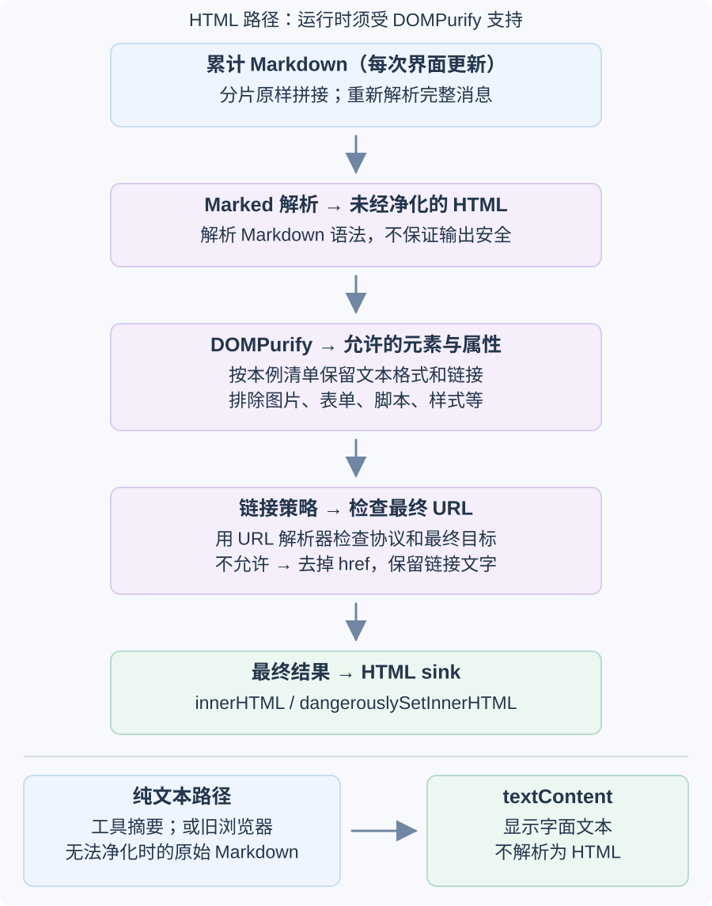

图中每一帧都重复相同路径：拼接完整消息、Markdown 转 HTML、DOMPurify 按允许元素和属性消毒、再检查链接最终解析到的 URL。工具摘要走文本节点路径，不经过 HTML。这里是一个聊天显示策略：允许常见段落、标题、强调、列表、引用和代码块，允许普通链接；不允许图片、表单控件、样式、脚本或新窗口属性。该 HTML 路径假设浏览器运行时受 DOMPurify 3.4.17 支持；其 README 明确不支持的旧浏览器上库会不做净化、原样返回输入。此类运行时必须把原始 Markdown 作为文本显示，不能把返回字符串交给 HTML sink。若产品不需要富文本，将助手内容作为普通文本子节点显示更简单。

> [!example]- 代码：Marked 18.2.0 与 DOMPurify 3.4.17 的最小显示策略
> ~~~javascript
> const chatPolicy = {
>   ALLOWED_TAGS: [
>     "a", "p", "br", "em", "strong", "del", "code", "pre",
>     "blockquote", "ul", "ol", "li", "h1", "h2", "h3", "h4",
>     "h5", "h6", "hr"
>   ],
>   ALLOWED_ATTR: ["href"],
>   ALLOW_DATA_ATTR: false,
>   ALLOW_ARIA_ATTR: false
> };
>
> function allowedHref(raw) {
>   if (typeof raw !== "string" || raw.trim() !== raw || raw === "") return null;
>   try {
>     const resolved = new URL(raw, window.location.href);
>     if (resolved.username || resolved.password) return null;
>     if (raw.startsWith("/") && !raw.startsWith("//") &&
>         resolved.origin === window.location.origin) return resolved.href;
>     if (raw.startsWith("#") && resolved.origin === window.location.origin &&
>         resolved.pathname === window.location.pathname &&
>         resolved.search === window.location.search) return resolved.href;
>     if (/^https?:\/\//i.test(raw) &&
>         (resolved.protocol === "http:" || resolved.protocol === "https:")) return resolved.href;
>   } catch {
>     return null;
>   }
>   return null;
> }
>
> function safeMarkdown(source) {
>   const generated = marked.parse(source, { async: false });
>   if (typeof generated !== "string") throw new Error("Expected synchronous HTML");
>   const sanitized = DOMPurify.sanitize(generated, chatPolicy);
>   const template = document.createElement("template");
>   template.innerHTML = sanitized;
>   template.content.querySelectorAll("a[href]").forEach((link) => {
>     const href = allowedHref(link.getAttribute("href"));
>     if (href) link.setAttribute("href", href);
>     else link.removeAttribute("href");
>   });
>   return template.innerHTML;
> }
> window.safeMarkdown = safeMarkdown;
> ~~~

`ALLOWED_TAGS` 与 `ALLOWED_ATTR` 是应用给出的明确许可范围；这里不使用 DOMPurify 的宽泛 HTML profile。链接只在消毒后的 DOM（文档对象模型）中读取，再用浏览器 `URL` 解析器检查最终目标，先统一拒绝包含用户名或密码的 URL，再按链接形式检查目标：`/docs/guide` 这样的站内根路径必须解析回当前 origin，`//other.example/path` 不在允许格式内，片段只能指向当前文档，绝对链接只允许无用户名密码的 HTTP(S)。这比用字符串前缀判断“看起来像站内路径”更直接。不允许的 URL 只移除锚点的 `href`，保留用户看到的链接文字；例如“打开链接”仍可读，但不再可点击。该策略是此合成组件的选择，不代表所有产品都应开放相同标签或协议。

React 的 `dangerouslySetInnerHTML` 会把提供的字符串交给 DOM 的 `innerHTML` 呈现；因此组件先检查 `DOMPurify.isSupported`：为真时才调用 `safeMarkdown`，把最终结果交给受限 HTML 路径；为假时用 `textContent` 或 React 普通文本子节点显示原始 Markdown。不能先调用净化函数，再把不支持环境返回的原文当成安全 HTML。HTML 经消毒之后若再交给语法高亮器、插件或其他会改写 DOM 的库，必须把最终结果重新通过同一受限策略。Marked 负责解析 Markdown，不负责净化 HTML；DOMPurify 支持可替换的标签/属性 allowlist。测试还覆盖外链、普通站内路径、代码围栏，以及 Markdown 图片和原始 HTML 图片/图片按钮：本例不让这些资源元素进入文档，因此也不会发出远程图片请求。

工具响应同样是不可信数据。对 `c1` 只读摘要，将已经校验的 `step`、`failed_test`、`expected`、`actual`、`exit_status` 映射为文本节点，例如 `summary.textContent = tool.summary`。卡片状态来自运行事件，而不是工具返回正文里的 HTML 或“success”字符串。渲染不执行模型工具请求；[应用如何校验并执行工具调用](../../ai-engineering/agents/tool-design-and-function-calling.md)是运行服务的责任。显示成功图标也不等同于服务端已确认操作。

### 停止、继续和重试分别改变什么？

客户端须把连接状态、运行状态和审批/副作用状态分开展示。EventSource 的连接是否打开不等于后台 run 是否运行；传输层重试只恢复事件交付。若要停止运行，客户端必须向运行服务发送已鉴权的控制请求，再查询权威运行记录。

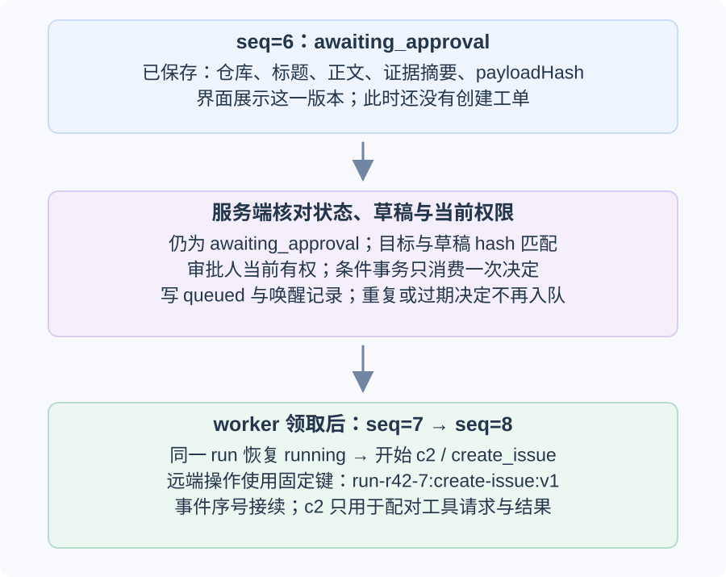

事件 `seq=6` 携带服务端已保存的完整待审草稿投影：仓库、标题、正文、证据摘要和 `payloadHash`。投影可以在 `seq=7` 的 `running` 状态后继续保留这份历史草稿，但界面只在最新收到的投影仍为 `awaiting_approval`、草稿仍是该投影的当前版本且用户有审批权限时，显示可操作入口；草稿字段存在本身不代表可批准。用户批准的是这个精确版本；客户端提交 `runId` 与 hash，服务端在处理时核对运行仍为 `awaiting_approval`、目标与当前草稿版本匹配、审批人当前有权批准，并以条件事务只消费一次决定；重复、过期或针对旧版本的决定不能再次入队。批准事务写入决定、`queued` 与同一 `runId` 的唤醒记录，worker 领取后才发出 `seq=7` 的 `running` 进度。这里的事件表只列客户端可见进度，不逐条复制后台排队和领取状态。客户端不在点击时重新拼装一个可能变化的写入载荷，`payloadHash` 也不是身份或授权凭据。恢复的仍是 `run-r42-7`；`c2` 发起的远端操作使用稳定键 `run-r42-7:create-issue:v1`。真正发出写请求前，运行服务还须在条件事务中复核当前批准版本、有效执行租约、当前写权限与未取消状态，并持久登记发送意图；批准过一次并不意味着以后都可直接发送。

若创建请求超时，远端可能已经建单，客户端看见的只是回执未知。保持原 `c2` 卡片和原运行的 `effect_unknown` 状态，等待只读对账：查到 `ISSUE-842` 后，用 `seq=11` 更新原卡，再显示 `seq=12–13` 的最终结果。暂时查不到记录不证明旧请求以后不会到达；未知仍未知时不盲目重发，也不另建一个同效 run。只有权威契约确认旧写未发生、任何已发请求都不可能再迟到，且用户仍要尝试时，才让新意图使用新的 `runId`。

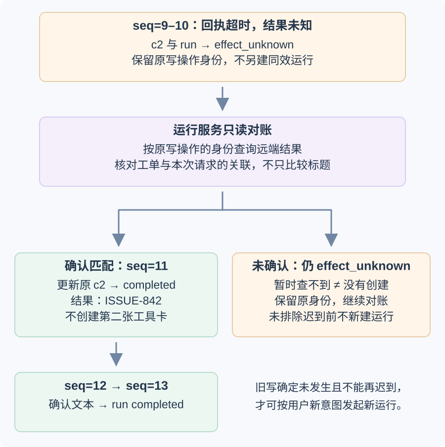

| 用户操作 | 客户端做什么 | 运行身份与显示 |
|---|---|---|
| 重连 | 用最后已应用 `seq` 续读；遇重放忽略，遇缺口补齐或重新取一致快照 | 仍是 `run-r42-7`；保留已有文本和卡片 |
| 停止 | 调用运行服务的取消操作并查询其权威状态 | 仍是 `run-r42-7`；取消确认前显示请求处理中；已有发送意图时仍要对账 |
| 继续 | 审批仍未变化的持久草稿，恢复已暂停的运行 | `runId` 与序号延续；变化的草稿必须重新审核 |
| 重试 | 仅在旧操作确定未发生且不能迟到后，按用户意图创建新运行 | 新请求用新 `runId`；旧运行与旧卡片留作审计 |

`AbortController.abort()` 会按 Fetch 的 abort 算法结束该 fetch 调用或响应体；关闭 SSE/Fetch reader 结束的是当前事件交付通道。这些客户端传输操作不会替应用写入持久取消状态，也不能证明服务端任务停止或工具副作用回滚。取消请求之后仍可能收到事件；界面保留已应用内容，继续依据服务端状态更新。如果用户要求停止时已有发送意图，未确认的外部结果不能显示为“取消成功”。普通问答也采用同样的快照、序号与连接恢复规则，只是没有审批和外部写操作分支。

> [!info]- 来源
> - **同一快照与事件游标、重连后恢复完整事件：** [流式传输怎样交付可恢复的完整事件](#54.%20%E6%B5%81%E5%BC%8F%E6%8A%A5%E8%A1%A8%E6%96%AD%E7%BA%BF%E9%87%8D%E8%BF%9E%E5%90%8E%EF%BC%8C%E7%95%8C%E9%9D%A2%E6%80%8E%E6%A0%B7%E4%BF%9D%E7%95%99%E6%AD%A3%E7%A1%AE%E7%8A%B6%E6%80%81%EF%BC%9F)；本文消费其完整应用事件，不把传输 ID 当业务身份。
> - **MCP 请求 ID 与应用事件序号的区别：** [MCP 2026-07-28 规范](https://modelcontextprotocol.io/specification/2026-07-28) 的 Overview/Base Protocol 说明 MCP 使用 JSON-RPC 2.0；[JSON-RPC 2.0 Request Object 第 4 节](https://www.jsonrpc.org/specification#request_object) 说明请求 ID 与响应 ID 用于关联请求和响应。它们不定义本文应用层的 run 序号。
> - **客户端所见的持久 run、审批、取消和效果未知状态：** [AI 运行怎样在断线或工作进程崩溃后恢复，并避免副作用重复](../../ai-engineering/systems/ai-application-architecture.md)；本文沿用 `run-r42-7`、`c1/c2`、`run-r42-7:create-issue:v1` 与 `ISSUE-842` 的合成案例。
> - **Marked 解析结果未净化：** [Marked 18.2.0 npm README](https://www.npmjs.com/package/marked/v/18.2.0) 的 README “Warning” 与 Browser/Node 使用段；版本页显示本次核对时的发布版本。核对日 2026-11-12。
> - **DOMPurify 的 sanitize、可配置标签/属性 allowlist 和旧浏览器不支持时不执行净化：** [DOMPurify 3.4.17 README](https://github.com/cure53/DOMPurify/blob/3.4.17/README.md) 的 Basic Usage、HTML-only profile、configuration 和 legacy browser sections；版本 [3.4.17 release](https://github.com/cure53/DOMPurify/releases/tag/3.4.17)，核对日 2026-11-12。
> - **动态 HTML 呈现边界：** [React DOM 常见组件文档](https://react.dev/reference/react-dom/components/common#dangerously-setting-the-inner-html) 的 “Dangerously setting the inner HTML”；不可信数据直接进入 raw HTML sink 会带来 XSS 风险。核对日 2026-11-12。
> - **传输取消与应用运行取消：** [DOM Standard 第 3 节 Aborting ongoing activities](https://dom.spec.whatwg.org/#aborting-ongoing-activities) 说明 signal 由接受它的 API 定义取消语义；[Fetch Standard 的 abort fetch call 算法](https://fetch.spec.whatwg.org/#abort-fetch) 处理 fetch 调用和可读请求/响应体。持久 run 与外部效果的取消、对账仍是上层应用协议，见本篇链接的 AI 运行章节。核对日 2026-11-12。
> - **工具摘要的纯文本呈现：** [WHATWG DOM `textContent`](https://dom.spec.whatwg.org/#dom-node-textcontent)；验证和赋值逻辑是本文客户端示例。
> - **实测：** Node.js 26.13.0、Marked 18.2.0、DOMPurify 3.4.17 与 Chromium 131.0.6778.33；运行完整事件投影序列、重复/缺口分支和浏览器渲染请求拦截。投影输入与校验代码、跨片段 Markdown 样例均在正文中；测试使用模拟运行事件，不代表生产服务或跨浏览器保证。
## 56. JavaScript 事件总线在监听器中重入时怎样保持顺序？

报表 42 的进度事件会通知摘要、旧界面和恢复模块。下面用一个合成的同步事件总线示例：监听器在处理事件时可以增删订阅并再次发布同名事件。要读懂最终顺序，先区分“当前分发开始时复制的快照”与“事件总线现在保存的监听器集合”。

这里的 event bus（事件总线）是应用层 publish–subscribe（发布订阅）实现，不是浏览器的文档对象模型（DOM）事件分发。示例用 Map（映射）按事件名索引一个 Set（集合）；对同一事件调用 `on` 重复注册同一个函数对象只占一个成员，Set 按插入顺序迭代。每次 emit 都先复制该事件当前的成员，再同步逐个调用快照中的函数。

### 当前分发使用自己的快照

> [!example]- 完整 EventBus 实现
>
> ~~~javascript
> class EventBus {
>   events = new Map();
>
>   on(type, listener) {
>     let listeners = this.events.get(type);
>     if (!listeners) this.events.set(type, listeners = new Set());
>     listeners.add(listener);
>     return () => this.off(type, listener);
>   }
>
>   once(type, listener) {
>     let fired = false;
>     const wrapper = (...args) => {
>       if (fired) return;
>       fired = true;
>       this.off(type, wrapper); // 在用户代码运行前注销
>       listener(...args);
>     };
>     return this.on(type, wrapper);
>   }
>
>   off(type, listener) {
>     const listeners = this.events.get(type);
>     if (!listeners) return;
>     listeners.delete(listener);
>     if (listeners.size === 0) this.events.delete(type);
>   }
>
>   emit(type, ...args) {
>     for (const listener of [...(this.events.get(type) ?? [])]) {
>       listener(...args);
>     }
>   }
> }
> ~~~

`once(type, listener)` 每次注册都会创建新的包装函数和独立的 `fired` 状态；因此对同一事件两次调用 `once`，Set 中会有两个包装器，原回调最多分别调用一次。

当一次 emit 开始时，表达式 `[...(this.events.get(type) ?? [])]` 立即建立数组快照。此后本次循环只沿该数组继续：

- 监听器从 Set 删除后，若它已在本次快照中，当前这次仍可能调用它。
- 新监听器不会进入已经建立的快照，但下一个 emit（包括同步嵌套的 emit）会从更新后的 Set 建立新快照。
- 若删除的是最后一个成员，off 也删除 Map 中该事件名；旧数组快照仍独立存在。

所以，“注销成功”表示后续快照不再包含该监听器，不等同于把所有已经创建的分发快照都改写。

### 逐层跟踪 v10、v11 与 v12

开始时顺序为 `summary`、一次性监听器 `once`、`legacy`。处理 `v10` 时，`summary` 移除 `legacy`、加入 `recovery`，然后同步发布 `v11`。处理 `v11` 时，`once` 先注销包装器，再运行用户回调；回调同步发布 `v12`。

> [!example] 三层同步调用怎样返回
> 报表 42 的服务端流可能报告 `version: 11` 已到 `ready` 终态；消费者仍须按业务版本拒绝旧状态，事件总线不会排序业务版本。这里的 `v10`、`v11`、`v12` 是区分三次合成本地发布的标签，不是服务端事件序列；本例只观察同步调用顺序。
>
> 每层快照和回调变化如下：
>
> | 当前分发 | 本层开始时的快照 | 本层发生的变化与返回顺序 |
> | --- | --- | --- |
> | `v10` | `[summary, once, legacy]` | `summary v10` 删除实时 Set 中的 `legacy`，加入 `recovery`，再进入 `v11`。外层旧快照不变。 |
> | `v11` | `[summary, once, recovery]` | `summary v11` 后执行 `once`。包装器先设 `fired = true` 并注销自己，再调用用户回调，进入 `v12`。 |
> | `v12` | `[summary, recovery]` | 实时 Set 已不含 `once`，依次记录 `summary v12`、`recovery v12`，然后返回 `v11`。 |
> | 返回 `v11`、`v10` | 各层仍继续原快照 | `v11` 接着记录 `recovery v11`。回到 `v10` 后，旧快照还会碰到 `once` 包装器，但 `fired` 使其直接返回；随后旧快照中的 `legacy` 仍记录 `legacy v10`。 |
>
> 日志的先后顺序如下；缩进表示嵌套调用深度，方便与上表对照：
>
> ```text
> summary v10
>   summary v11
>   once v11
>     summary v12
>     recovery v12
>   recovery v11
> legacy v10
> ```
>
> 在本例中，先注销包装器会让之后的 `v12` 快照不再包含它；`fired` 则保护仍持有该包装器的 `v10` 旧快照，阻止它再次进入用户函数。若用户回调抛错，本实现仍把该次 `once` 视为已消费，因为 `fired` 和注销都发生在调用用户代码之前。

> [!example]- 完整重入输入代码
>
> ~~~javascript
> const bus = new EventBus();
> const trace = [];
> let onceReentered = false;
> const legacy = e => trace.push(`legacy v${e.version}`);
> const recovery = e => trace.push(`recovery v${e.version}`);
>
> bus.on("report:updated", e => {
>   trace.push(`summary v${e.version}`);
>   if (e.version === 10) {
>     bus.off("report:updated", legacy);
>     bus.on("report:updated", recovery);
>     bus.emit("report:updated", { reportId: 42, version: 11 });
>   }
> });
> bus.once("report:updated", e => {
>   trace.push(`once v${e.version}`);
>   if (!onceReentered) {
>     onceReentered = true;
>     bus.emit("report:updated", { reportId: 42, version: 12 });
>   }
> });
> bus.on("report:updated", legacy);
> bus.emit("report:updated", { reportId: 42, version: 10 });
> console.log(trace.join(" → "));
> ~~~

### 选择事件总线还是观察者模式

Observer（观察者模式）通常由拥有状态的对象直接保存并通知观察者；事件总线则让发布者和订阅者通过事件名及中间总线通信。前者容易沿对象找到订阅关系，后者减少模块间直接引用，却更依赖明确的事件名、载荷契约和追踪工具。本节比较的是同一浏览上下文中的两种内存实现；跨标签页消息还需要浏览上下文间通信机制。

示例保留几项实现边界：

- 分发是同步的；嵌套 `emit` 会先完成，再回到外层监听器。
- 监听器抛出的同步异常会沿调用栈传播并停止当前循环中的后续监听器。
- 返回 Promise 的监听器不会被等待；Promise 的拒绝也不会由这个 `emit` 自动收集或处理。
- 移除或新增订阅不会撤销其他地方已保存的旧快照。若生产实现选择直接遍历实时集合、异步队列或隔离监听器异常，结果顺序和错误契约都会不同。

此页的插入顺序由 ECMAScript Set 保证；快照复制时机、同步重入和 `once` 的注销规则是这份应用实现自行选择的策略，不是所有事件总线的通用保证。文档对象模型（DOM）的事件传播、默认动作和取消规则由浏览器平台另行定义，不能从这个类推导。

**延伸阅读：** [修改 DOM 时，HTMLCollection 和 NodeList 会怎样变化？](#57.%20%E4%BF%AE%E6%94%B9%20DOM%20%E6%97%B6%EF%BC%8CHTMLCollection%20%E5%92%8C%20NodeList%20%E4%BC%9A%E6%80%8E%E6%A0%B7%E5%8F%98%E5%8C%96%EF%BC%9F) 跟踪状态通知后的节点增删；[同一报表在多个标签页中怎样交换变化？](#53.%20%E5%90%8C%E4%B8%80%E6%8A%A5%E8%A1%A8%E5%9C%A8%E5%A4%9A%E4%B8%AA%E6%A0%87%E7%AD%BE%E9%A1%B5%E4%B8%AD%E6%80%8E%E6%A0%B7%E4%BA%A4%E6%8D%A2%E5%8F%98%E5%8C%96%EF%BC%9F) 介绍跨标签页消息；[DOM 事件传播如何经过节点？](#4.%20%E6%B5%8F%E8%A7%88%E5%99%A8%E6%80%8E%E6%A0%B7%E6%9F%A5%E8%AF%A2%E3%80%81%E6%9B%B4%E6%96%B0%20DOM%20%E5%B9%B6%E5%93%8D%E5%BA%94%E7%94%A8%E6%88%B7%E8%BE%93%E5%85%A5%EF%BC%9F) 介绍浏览器自身的事件阶段和取消规则。

> [!info]- 来源
> - Set 至多保存每个不同值一次；`add` 不会重复加入相同值，`values`/`forEach` 按值的插入顺序遍历，这支持示例中快照的初始顺序：[ECMAScript 2026 §24.2、§24.2.4.1、§24.2.4.7、§24.2.4.17](https://tc39.es/ecma262/2026/multipage/keyed-collections.html#sec-set-objects)，核验于 2026-11-12。复制快照、`once` 包装器及异常传播是本文代码的可观察结果，不是该规范规定的事件总线语义。
> - 浏览器 `EventTarget` 的事件分发、传播路径、监听器移除和取消机制：[WHATWG DOM Living Standard §2.9–2.11 Events](https://dom.spec.whatwg.org/#events)，核验于 2026-11-12。它是平台事件系统，与本页自建 `EventBus` 分开。
## 57. 修改 DOM 时，HTMLCollection 和 NodeList 会怎样变化？

案例背景：报表列表准备显示新结果，先要清空现有行。Document Object Model（文档对象模型，DOM）查询能返回 `HTMLCollection`（元素集合）或 `NodeList`（节点列表）；成员是否随树变化，由具体 API 决定。若代码遍历实时集合时同时删除成员，后续索引会移动，递增索引可能跳过一行，旧行便会留在下一份结果中。

### 先查询到要操作的节点

`document.documentElement` 是 `<html>` 根元素，`document.body` 指向 `<body>`；如果脚本在 HTML parser（HTML 解析器）处理到相应标签前运行，`body` 可能还是 `null`。`getElementById()` 与 `querySelector()` 都返回一个元素或 `null`；后者的参数是 CSS 选择器。拿到容器后，在容器内查询可以避免把页面上另一个同类控件误当成报表控件：

~~~javascript
const reports = document.querySelector("#reports");
const controls = document.querySelector("#sort-controls");
const oldestButton = controls?.querySelector('button[data-sort="oldest"]') ?? null;
const directRows = reports?.querySelectorAll(":scope > li.report") ?? [];
~~~

`querySelectorAll()` 在没有匹配项时仍返回长度为 `0` 的 `NodeList`；`querySelector()` 则返回 `null`。选择器字符串若不是有效 CSS 语法，查询会抛出 `SyntaxError`，不会返回空结果。完整页面中 `body`、根元素和控件的关系见[浏览器如何把 URL 变成第一帧？](#1.%20%E6%B5%8F%E8%A7%88%E5%99%A8%E5%A6%82%E4%BD%95%E6%8A%8A%20URL%20%E5%8F%98%E6%88%90%E7%AC%AC%E4%B8%80%E5%B8%A7%EF%BC%9F)。

这里的可选链还处理了容器不存在的情况：找不到 `#reports` 时，`directRows` 是普通空数组；容器存在但没有匹配行时，它是空 `NodeList`。`:scope >` 把查询范围限定为容器本身的直接子元素。下面的教学列表只有报表行，因此 `children` 与 `.report` 查询开头都得到 `[r1, r2, r3]`；若以后加入状态提示行，`children` 也会包含它，而 `.report` 查询不会。

| 来源 | 返回类型 | 包含什么 | 查询后 DOM 改变时，集合成员怎样变化 |
|---|---|---|---|
| `element.children` | `HTMLCollection` | 直接子元素 | 实时反映当前树 |
| `getElementsByClassName()`、`getElementsByTagName()` | `HTMLCollection` | 匹配的后代元素，包含更深层级 | 实时反映当前树 |
| `element.querySelectorAll()` | `NodeList` | 匹配元素 | 保持查询时的成员列表 |
| `element.childNodes` | `NodeList` | 元素、文本、注释等直接子节点 | 实时反映当前树 |

因此，不能只看 `NodeList` 这个类型来判断它是否实时：`childNodes` 是实时集合，而 `querySelectorAll()` 返回静态列表。`childNodes` 中的缩进空白也会成为文本节点；通用节点应使用 `nodeName`，因为 `tagName` 只属于元素。两种集合都不是普通数组，不能直接调用 `map()`；`Array.from()` 可把当前成员引用复制进数组。

### 删除实时集合时，索引为什么会跳过一行？

> [!example] 正向删除实时集合会留下 r2
> 报表行的教学 ID 是 `r1`、`r2`、`r3`，它们只是合成标识，与真实报表 ID、业务版本或事件游标无关。开始时，循环变量 `i = 0`，实时集合和 `querySelectorAll(":scope > .report")` 的静态结果都按树顺序包含 `[r1, r2, r3]`。这份列表的直接子元素全是报表行，所以 `children` 与按 `.report` 选择的范围相同。
>
> ~~~html
> <ul id="reports">
>   <li class="report" id="r1">报告 1</li>
>   <li class="report" id="r2">报告 2</li>
>   <li class="report" id="r3">报告 3</li>
> </ul>
> ~~~
>
> ~~~javascript
> const list = document.querySelector("#reports");
> const liveRows = list.children;
> const queriedRows = list.querySelectorAll(":scope > .report");
>
> for (let i = 0; i < liveRows.length; i += 1) {
>   liveRows[i].remove();
> }
> // 最后 r2 仍在列表中。
> // queriedRows 仍有 3 个成员；queriedRows[0].isConnected 为 false。
> ~~~
>
> 第一次执行 `i = 0` 时，循环移除 `liveRows[0]`，也就是 `r1`。实时集合立即变成 `[r2, r3]`，`r2` 从索引 `1` 移到索引 `0`。循环递增 `i` 到 `1` 后，`liveRows[1]` 现在是 `r3`，于是第二次移除 `r3`。集合此时只剩 `[r2]`。第二轮循环体结束后，`for` 语句先把 `i` 再递增到 `2`，然后才检查条件；此时 `2 < liveRows.length`（即 `2 < 1`）为假，循环结束。
>
> 清理步骤结束后 `r2` 还在列表里；如果接下来把新结果插入这份列表，旧行就会和新结果同时显示。
>
> 
>
> 静态结果 `queriedRows` 仍含三个节点引用，但已移除的 `r1`、`r3` 的 `isConnected` 会变成 `false`。静态只固定成员列表，不冻结节点对象。可以在改树之前先复制实时成员，或从末尾向前删除：
>
> ~~~javascript
> // 与上面的错误循环二选一，并从同一份初始列表开始。
> for (const row of Array.from(liveRows)) row.remove();
> // 也可以倒序删除：
> for (let i = liveRows.length - 1; i >= 0; i -= 1) {
>   liveRows[i].remove();
> }
> ~~~

实时集合适合读取 DOM 当前有哪些成员；若遍历期间修改它，递增索引就可能不再指向预期节点。静态查询结果适合按查询时确定的成员执行任务。查询列表是否变化、列表里的节点是否仍连接到文档，是两个不同问题。这里的“实时”描述读取时可见的成员结果，不规定浏览器内部怎样或多久计算一次。

**延伸阅读：** [JavaScript 事件总线在监听器中重入时怎样保持顺序？](#56.%20JavaScript%20%E4%BA%8B%E4%BB%B6%E6%80%BB%E7%BA%BF%E5%9C%A8%E7%9B%91%E5%90%AC%E5%99%A8%E4%B8%AD%E9%87%8D%E5%85%A5%E6%97%B6%E6%80%8E%E6%A0%B7%E4%BF%9D%E6%8C%81%E9%A1%BA%E5%BA%8F%EF%BC%9F) 说明状态更新如何触发本地模块；[用户离开报表页时，分析事件怎样尽力发送？](#58.%20%E7%94%A8%E6%88%B7%E7%A6%BB%E5%BC%80%E6%8A%A5%E8%A1%A8%E9%A1%B5%E6%97%B6%EF%BC%8C%E5%88%86%E6%9E%90%E4%BA%8B%E4%BB%B6%E6%80%8E%E6%A0%B7%E5%B0%BD%E5%8A%9B%E5%8F%91%E9%80%81%EF%BC%9F) 说明导航期间的遥测边界；[浏览器如何从输入到绘制界面？](#1.%20%E6%B5%8F%E8%A7%88%E5%99%A8%E5%A6%82%E4%BD%95%E6%8A%8A%20URL%20%E5%8F%98%E6%88%90%E7%AC%AC%E4%B8%80%E5%B8%A7%EF%BC%9F) 讨论 DOM 与后续渲染。

> [!info]- 来源
> - `Document.body` 可能为空；HTML Standard 将它定义为可返回 `null` 的元素属性：[WHATWG HTML §3.1.1、§3.1.7，Document tree accessors](https://html.spec.whatwg.org/multipage/dom.html#dom-document-body)，Living Standard，核对于 2026-11-12。
> - `NodeList` 与 `HTMLCollection` 的集合规则：默认集合为实时集合；`HTMLCollection` 只包含元素，`NodeList` 可包含节点。[WHATWG DOM Standard §4.2.10，NodeList 与 HTMLCollection](https://dom.spec.whatwg.org/#old-style-collections-node-list-and-htmlcollection)，Living Standard，核对于 2026-11-12。
> - `querySelector()` 返回首个匹配项或 `null`；无匹配的 `querySelectorAll()` 返回空列表，且其算法返回静态结果：[WHATWG DOM Standard §4.2.6，ParentNode](https://dom.spec.whatwg.org/#interface-parentnode)，Living Standard，核对于 2026-11-12。
> - `children`、`childNodes`、`getElementsBy*()` 的成员筛选与实时性按具体接口算法定义；`nodeName`、`tagName` 属于通用节点和元素接口各自的字段：[WHATWG DOM Standard §4.2.6 ParentNode](https://dom.spec.whatwg.org/#interface-parentnode)、[§4.4 Node](https://dom.spec.whatwg.org/#interface-node)、[§4.5 Document](https://dom.spec.whatwg.org/#interface-document) 与 [§4.9 Element](https://dom.spec.whatwg.org/#interface-element)，Living Standard，核对于 2026-11-12。
## 58. 用户离开报表页时，分析事件怎样尽力发送？

analytics event (分析事件)记录页面使用情况，例如打开报表或改变筛选。它们可以帮助产品理解使用情况，但通常不决定报表本身是否正确。本文跟踪一个合成案例：用户打开 `/reports/42`，改变一次筛选，再导航到另一个完整页面。页面只把 `report_opened`、`filter_applied` 和受控页面代号放入内存队列；它既不收集筛选原文，也不把离页发送当作服务器已记账。

### 先限制采集内容和积压量

允许列表先限定事件名和页面代号，再限定每条事件的字段。案例中的两条事件只有事件 ID（标识符）、名称、页面代号和时间戳；搜索框原文、完整 URL、用户令牌和身份字段不进入载荷。选择退出可选采集时，停止新入队并清空应用内存中的未发送事件。已经交给浏览器的请求无法由这个开关撤回。

| 时点 | 页面内存队列 | 接下来发生什么 |
| --- | --- | --- |
| 打开 `/reports/42` | `report_opened` | 事件尚未离开页面 |
| 改变筛选 | `report_opened`、`filter_applied` | 载荷不含筛选值；两条仍在内存 |
| 10 秒定时器前离开当前文档 | 同上 | `visibilitychange` 到 `hidden` 时取出一批并尝试发送 |

队列最多保留 200 条；满时丢弃最旧的一条。达到 50 条时安排一次分批发送；10 秒定时器也会尝试一批。发送时先试 Beacon API（信标接口）；若接口不可用或拒绝排队，就尝试 Fetch API（资源获取接口）的 `keepalive`（页面环境结束后仍允许请求继续）选项。单看条数不能约束请求体大小，所以例子再把序列化后的请求体限制为 8 KiB。字段值来自固定允许列表，事件 ID 使用安全上下文中的 `crypto.randomUUID()` 生成 UUID（通用唯一标识符）v4，时间戳是数字；这组有界字段让每条事件都能放进空批次。若以后加入自由文本或其他字段，必须重新检查字节上限和过大单条的处理。

下面的实现把事件在入队时生成的 ID 保留在载荷中。`takeBatchBody()` 只在同时满足条数和 UTF-8 编码字节上限时取出事件；它在调用发送 API 前就把所选事件从内存队列移除，API 拒绝或网络失败后也不会自动放回。下面的合成运行假设用户已允许可选采集；生产页面应从实际同意状态调用启用函数，不要固定开启。

> [!example]- 实现：同一事件 ID、大小限制与尽力发送
>
> 完整样例只发送两个允许的事件。离页时取出它们；正文载荷不含筛选值。
>
> ~~~javascript
> const MAX_PENDING = 200;
> const BATCH_SIZE = 50;
> const MAX_BATCH_BYTES = 8 * 1024;
> const allowedNames = new Set([
>   "report_opened",
>   "filter_applied",
> ]);
> const allowedScreens = new Set([
>   "report_list",
>   "report_detail",
> ]);
> const queue = [];
> const encoder = new TextEncoder();
> let collectionEnabled = false;
> let flushScheduled = false;
>
> function setCollectionEnabled(enabled) {
>   collectionEnabled = enabled;
>   if (!enabled) queue.length = 0;
> }
>
> function takeBatchBody() {
>   const batch = [];
>   let body = "[]";
>   while (queue.length && batch.length < BATCH_SIZE) {
>     const candidate = [...batch, queue[0]];
>     const candidateBody = JSON.stringify(candidate);
>     if (encoder.encode(candidateBody).byteLength > MAX_BATCH_BYTES) break;
>     batch.push(queue.shift());
>     body = candidateBody;
>   }
>   return batch.length ? body : null;
> }
>
> function flushOneBatch() {
>   const body = takeBatchBody();
>   if (body === null) return;
>   const payload = new Blob([body], { type: "application/json" });
>   // 同源端点。true 只表示浏览器接受了排队，不是服务器确认。
>   if (navigator.sendBeacon?.("/analytics", payload)) return;
>   // Beacon 不可用或拒绝时尝试 Fetch；两者共用 keepalive 在途字节额度。
>   void fetch("/analytics", {
>     method: "POST",
>     body: payload,
>     keepalive: true,
>     credentials: "same-origin",
>   }).catch(() => {});
> }
>
> function scheduleFlush() {
>   if (flushScheduled) return;
>   flushScheduled = true;
>   setTimeout(() => {
>     flushScheduled = false;
>     flushOneBatch();
>     if (queue.length >= BATCH_SIZE) scheduleFlush();
>   }, 0);
> }
>
> function trackEvent(name, screen) {
>   if (
>     !collectionEnabled ||
>     !allowedNames.has(name) ||
>     !allowedScreens.has(screen)
>   ) return;
>   if (queue.length === MAX_PENDING) queue.shift();
>   queue.push({
>     id: crypto.randomUUID(),
>     name,
>     screen,
>     ts: Date.now(),
>   });
>   if (queue.length >= BATCH_SIZE) scheduleFlush();
> }
>
> setInterval(flushOneBatch, 10_000);
> document.addEventListener("visibilitychange", () => {
>   if (document.visibilityState === "hidden") flushOneBatch();
> });
>
> setCollectionEnabled(true);
> trackEvent("report_opened", "report_detail");
> trackEvent("filter_applied", "report_detail");
> ~~~

运行条件：代码假设用户已允许采集、页面运行在 HTTPS 或本机 loopback 等安全上下文，且 `/analytics` 与页面同源。复现离页分支时，应在 10 秒定时器触发前点击会加载新文档的普通链接，例如 `<a href="/help">帮助</a>`；只在单页应用内改路由不会触发这里的 `hidden` 处理器。

`visibilitychange` 到 `hidden` 是页面变为不可见的信号；它也会在切换标签或应用进入后台时出现，所以不代表用户永久离开。对于**同一文档内的单页应用路由切换**，文档仍可见，通常不会触发这个信号；如果产品需要在路由边界提交队列，应由路由层显式调用队列模块提供的分批函数，不能假定页面生命周期事件会替它运行。hidden 处理器每次只尝试一批；页面离开前队列余量可能来不及发送。达到门槛后的定时任务可以继续排下一批，但页面离开不保证这些后续任务都能运行。

### “已排队”不等于“已记录”

离开页面时可监听 `visibilitychange`，并在状态变为 `hidden` 时调用 Beacon API。规范要求浏览器在这个状态变化时安排已提交给它的信标请求；但浏览器进程随后仍可能被系统终止。`hidden` 只是一次尽力发送的时机，不能证明页面一定要关闭，也不能证明服务器收到数据。

`pagehide` 表示一个会话历史条目不再是当前页面；其 `persisted` 为 `true` 时，页面可能进入往返缓存（back-forward cache，BFCache），之后还能恢复。它也不是所有后台或关闭场景都能观察到的信号。不要用 `unload` 作为最后发送钩子；移动端进程被系统结束时，脚本可能没有机会再运行。

| 观察到的阶段 | 这能证明什么 | 不能证明什么 |
| --- | --- | --- |
| 事件进入 JavaScript 内存队列 | 本页面暂存了事件 | 页面销毁后还能恢复 |
| `sendBeacon()` 返回 `true` | 浏览器接受了请求排队 | 网络请求完成或服务器已处理 |
| 服务端日志出现请求 | 请求到达了这个服务端入口 | 事件已写入耐久存储或业务事务已提交 |
| 服务端按事件 ID 完成去重并提交 | 服务端按自己的事务契约记录了该事件 | 浏览器知道提交结果；Beacon 没有响应回调 |

Beacon 是非阻塞的尽力传输。它自动使用 `keepalive`，不提供响应回调，也不允许调用者自定义请求头。普通 Fetch 请求默认不带 `keepalive`；文档销毁、Fetch 组结束时，尚未完成的普通请求可以被终止。样例只有在 Beacon 不存在或返回 `false` 时才改用 Fetch API 并设置 `keepalive: true`，使请求可以越过发起页面环境的销毁而继续处理。Fetch 的 Promise（异步结果对象）可能得到服务器响应，但页面离开后不能靠这个回调确认记录结果；`keepalive` 也不保证请求一定到达服务器。请求已被页面取消，也不代表服务端一定没读到正文：本地延迟响应测试中，普通 Fetch 的正文已到服务端，但导航后响应连接先关闭；keepalive Fetch 则等到了延迟的 `204` 响应。

Beacon 与 Fetch 的 `keepalive` 请求共享同一个 fetch group（Fetch 组）的在途请求体额度。Fetch 标准在 `contentLength + inflightKeepaliveBytes` 超过 64 KiB（65,536 字节）时拒绝请求；这计入尚未完成的其他 keepalive 请求，不只是当前这一批。因此样例的 8 KiB 是留有余量的应用上限，不是浏览器保证接受的大小；若其他请求占用了额度，8 KiB 请求仍可能被拒。此时回退到 Fetch 不能绕过限制。

同源 `/analytics` 端点让认证边界可见：Beacon 规范的凭证模式是 `include`，同源请求可带上适用的 Cookie；Fetch 样例明确选 `credentials: "same-origin"`。浏览器实测的同源测试请求携带了合成 Cookie `report_session=synthetic`。不要把身份令牌放进事件正文。若把端点改成跨源地址，JSON Blob 产生的 `Content-Type: application/json` 不符合 CORS 安全列表条件；预检缓存没有匹配项时，浏览器会先发不带凭证的 `OPTIONS`，成功后才发送实际 Beacon POST。实际 Beacon 的凭证模式固定为 `include`，服务端还需按规范回应允许的来源、凭证与请求头。Fetch 默认只发送同源凭证；跨源要显式设置 `include`，并满足 CORS 和 Cookie 的站点策略。

事件正文不放完整 URL，也不等于服务端看不到页面 URL：浏览器还可能在请求头中自动带 `Referer`。本地 Chromium `157.0.8103.51` 复现的同源请求，在页面没有设置 `Referrer-Policy` 时带上了来源页的路径与合成查询参数。若路径或查询串可能含敏感值，应通过文档响应头设置 `Referrer-Policy: strict-origin`（同源请求只发来源）或 `no-referrer`；`sendBeacon()` 不能单独改请求头，需在文档/站点策略处控制。Fetch 可设置单次 `referrerPolicy`，但两条发送路径都应遵守应用实际需要的策略。

样例在尝试发送前已把一批从内存队列取出。若 Beacon 返回 `false` 且 Fetch 因额度或网络失败而拒绝，这些事件不会自动回到队列；即使 Beacon 返回 `true`，异步请求也仍可能没有到达服务端。浏览器复现中，`sendBeacon()` 返回 `true` 后拦截并中止网络请求，服务端没有收到任何记录。

这属于可丢失的分析遥测。若数据丢失不可接受，需要另行实现持久化发件箱、重试与服务器确认。重试必须沿用入队时生成的同一个事件 ID；服务器为事件 ID 预先建立唯一约束，并在写入事务中按该键去重或执行幂等写入。浏览器不会按正文里的 ID 替应用去重：复现实验是应用代码**主动调用两次** Beacon，浏览器接受了两次，服务端看到了两个请求和两行原始事件；只有服务端按 ID 去重后，唯一事件数才是 1。这个实验说明重复提交需要服务端去重，不表示一次调用会被浏览器自行重发。当前样例不重试，因此可能丢失，但不会自行创建无限重试流。`setCollectionEnabled(false)` 只能清空尚在本地的队列，不能撤回已经交给浏览器的批次。

**延伸阅读：** [报表页面里的状态应该放在哪里？](#52.%20%E6%8A%A5%E8%A1%A8%E9%A1%B5%E9%9D%A2%E9%87%8C%E7%9A%84%E7%8A%B6%E6%80%81%E5%BA%94%E8%AF%A5%E6%94%BE%E5%9C%A8%E5%93%AA%E9%87%8C%EF%BC%9F) 说明偏好与业务状态的归属；[流式报表断线重连后，界面怎样保留正确状态？](#54.%20%E6%B5%81%E5%BC%8F%E6%8A%A5%E8%A1%A8%E6%96%AD%E7%BA%BF%E9%87%8D%E8%BF%9E%E5%90%8E%EF%BC%8C%E7%95%8C%E9%9D%A2%E6%80%8E%E6%A0%B7%E4%BF%9D%E7%95%99%E6%AD%A3%E7%A1%AE%E7%8A%B6%E6%80%81%EF%BC%9F) 说明不能和可丢弃分析数据混为一谈的业务消息；[WebView 怎样安全地开放原生能力并更新页面包？](#59.%20WebView%20%E6%80%8E%E6%A0%B7%E5%AE%89%E5%85%A8%E5%9C%B0%E5%BC%80%E6%94%BE%E5%8E%9F%E7%94%9F%E8%83%BD%E5%8A%9B%E5%B9%B6%E6%9B%B4%E6%96%B0%E9%A1%B5%E9%9D%A2%E5%8C%85%EF%BC%9F) 讨论混合应用中的宿主权限。

> [!info]- 来源
> - `sendBeacon()` 的返回值只表示浏览器成功排队；它没有响应回调，自动使用 `keepalive`，并在文档 `visibilityState` 变为 `hidden` 时安排传输：[W3C Beacon API](https://www.w3.org/TR/beacon/)，§3.1、§3.2，2026-11-12 核对。
> - Beacon 凭证模式、`Blob` 的 `Content-Type` 与 CORS 模式选择：[W3C Beacon API](https://www.w3.org/TR/beacon/)，§3.2，2026-11-12 核对。
> - keepalive 请求组的在途字节累计规则与 64 KiB 上限：[WHATWG Fetch Standard](https://fetch.spec.whatwg.org/)，“HTTP-network-or-cache fetch”中对 `inflightKeepaliveBytes` 的检查，2026-11-12 核对。
> - 文档 Fetch 组销毁时，未完成且未设 `keepalive` 的请求会被终止；keepalive 请求可在环境设置对象销毁后继续处理：[WHATWG Fetch Standard](https://fetch.spec.whatwg.org/)，§2.2.5、§2.4；HTML 文档销毁步骤：[WHATWG HTML Standard](https://html.spec.whatwg.org/multipage/document-lifecycle.html)，§7.5.10，2026-11-12 核对。
> - 跨源预检使用 `OPTIONS`，预检缓存决定是否要重新发起检查：[WHATWG Fetch Standard](https://fetch.spec.whatwg.org/)，§§3.3.2、4.8–4.10；Beacon 载荷类型与 CORS 选择：[W3C Beacon API](https://www.w3.org/TR/beacon/)，§3.2，2026-11-12 核对。
> - `visibilityState` 及页面可见性变化：[WHATWG HTML Standard](https://html.spec.whatwg.org/multipage/interaction.html#page-visibility)，Page visibility；`pagehide` 与文档生命周期顺序：[WHATWG HTML Standard](https://html.spec.whatwg.org/multipage/document-lifecycle.html)，Document lifecycle，2026-11-12 核对。
> - `hidden` 往往是移动端最后可靠观察到的生命周期状态；`pagehide` 可能伴随进入往返缓存，`unload` 不可靠：[Chrome for Developers, Page Lifecycle API](https://developer.chrome.com/docs/web-platform/page-lifecycle-api)，Developer recommendations for each state 和 Events，页面核对于 2026-11-12。
> - `crypto.randomUUID()` 生成 v4 UUID 且仅在安全上下文可用：[MDN Web Crypto API](https://developer.mozilla.org/en-US/docs/Web/API/Crypto/randomUUID)，2026-11-12 核对。
> - 同源 Cookie 与 Fetch credentials 行为、跨源凭证的 CORS 要求：[MDN, Using the Fetch API](https://developer.mozilla.org/en-US/docs/Web/API/Fetch_API/Using_Fetch)，“Including credentials”，2026-11-12 核对。
> - 同源请求的 `Referer` 可含来源 URL 路径/查询串；`strict-origin` 仅发送 origin，`no-referrer` 不发送：[W3C Referrer Policy](https://www.w3.org/TR/referrer-policy/)，§§3.4–3.5、8.3，2026-11-12 核对；本页的同源合成请求核对了默认策略与 `strict-origin` 下的请求头。
> - 代码分支、导航期间的生命周期顺序、队列/额度/重复/凭证/Referer 实测：Chromium `157.0.8103.51`，本地 HTTP 页面与 Node 服务器；合成两事件在离页时成批 POST，回退、在途额度、主动重复提交、网络拦截以及 Referer 分支按正文所述逐项验证；这些观察仅限本地浏览器和合成环境，不代表跨浏览器送达保证。
## 59. WebView 怎样安全地开放原生能力并更新页面包？

**合成案例。** 报表应用把页面包 **report-web-17** 放在 Android 或 Apple 的 WebView 中。用户在报表 42 上点“打开详情”，页面想请宿主显示原生详情界面；稍后，服务器发布页面包 **report-web-18**，它要求 bridge API **2.1**，而当前原生应用只实现 **2.0**。本章沿两次信任判断走完：页面请求怎样被确认、授权、执行并回传；更新包怎样验证、兼容、切换或拒绝。版本、来源和返回值都是公开教学用合成数据。

这里有两个不同的版本号：bridge API 2.0/2.1 表示页面可调用的宿主能力契约；消息里的 `protocolVersion: 1` 表示 `{id, operation, payload}` 这套 envelope 字段格式。兼容的 API 版本不自动保证消息格式兼容，反过来也一样。

WebView 提供网页运行环境，原生 API 由宿主显式接入。来源检查回答“哪一个网页上下文发来消息”，参数校验回答“请求是什么”，授权回答“当前用户此刻能否做这件事”；这三项不能互相替代。Android 与 Apple WebKit 的桥接接口也不能拼成一个假想的统一 API。

### 一条消息怎样变成原生操作？

页面调用的是一个很窄的能力：打开报表详情，而不是传入类名、方法名或任意 JavaScript。合成请求如下：

~~~json
{
  "protocolVersion": 1,
  "id": "web-17:request-17",
  "operation": "openReport",
  "payload": { "reportId": 42 }
}
~~~

id 只用于把回复关联回这次等待中的页面请求；它不是身份凭证，也不代表调用已获准。宿主从 WebView 回调取得来源和 frame 元数据，不能接受正文中的 origin、isMainFrame 或 userId 来证明这些事实。

| 平台 | 桥接形状 | 一项关键边界 |
|---|---|---|
| Android 现代入口 | 异步消息对象 | 回调给来源、frame 与回复代理；匹配规则的子 frame 也会得到对象 |
| Android 旧入口 | 注入的 Java 对象 | 所有 frame 可见、没有逐消息来源；页面同步等待 Java 方法返回 |
| Apple WebKit | 单向 handler 或逐调用回复 | 回调带 frame 信息；WithReply 的 Promise 属于发起它的那次调用 |

Android 现代入口是 AndroidX WebKit 的 `WebViewCompat.addWebMessageListener()`。它从 AndroidX WebKit 1.3.0 起提供，但应用还须在运行时用 `WebViewFeature.WEB_MESSAGE_LISTENER` 确认当前 WebView 支持，并在 `loadUrl()` 等导航前注册对象。没有该能力时可以禁用原生功能或走不含桥接的网页路径，不能静默降级为无来源检查的旧接口。对象会注入所有匹配来源的 frame；`allowedOriginRules` 匹配 scheme、host、port，不匹配 path，所以每条消息仍要拒绝非主 frame。回调提供 `sourceOrigin`、`isMainFrame`、消息和 `JavaScriptReplyProxy`。

旧入口 `addJavascriptInterface()` 把带 `@JavascriptInterface` 的方法放到网页可见对象上。Android 4.2/API 17 起、且应用 target API 17 或更高时，只有带此标注的方法可从 JavaScript 调用；面向更旧 target 的应用可能暴露更多 Java 方法。无论哪种情况，对象都对 WebView 里的 frame 可见，平台不给逐消息来源身份；Java 方法在后台线程执行，而调用 JavaScript 会同步等待其返回。只适用于内容与导航都由宿主严格控制的遗留 WebView。

Apple 在创建 `WKWebView` 前把 `WKUserContentController` 放入 configuration，再注册具名 `WKScriptMessageHandler` 或 `WKScriptMessageHandlerWithReply`。WithReply 和按 `WKContentWorld` 指定 handler 的注册方式要求 iOS 14/macOS 11 或更新系统；较旧系统应关闭这条回复式能力，或另行定义并审查一个平台专属通道，不能把新 API 当成可用。普通 `WKScriptMessageHandler` 只通知宿主，不返回值；WithReply 的 `postMessage(body)` 返回属于本次调用的 Promise。Apple 没有 Android 那样的注册时 origin allowlist，因此宿主从 `WKScriptMessage.frameInfo` 读取来源与 frame，并逐次检查。


**先用宿主元数据过来源门。** Android `allowedOriginRules` 可用精确规则 `https://reports.example`；不要用 `*`。规则只看 scheme、host 和 port，不看 path；同一个来源下的 `/app/report-web-17/` 与其他路径仍是同一 origin。对象也会被提供给匹配规则的子 frame，因此回调里的 `isMainFrame` 还要为真。Apple 在 handler 回调内读取 `frameInfo.securityOrigin` 的 scheme、host、port，并检查 `frameInfo.isMainFrame`；本例注册自定义 `reportassets` handler，页面实际入口为 `reportassets://bundle/<bundleId>/index.html`，只接受 `(reportassets, bundle, 无端口)`；本例把 `WKSecurityOrigin.port` 的 0 规范成无端口。比较 HTTPS origin 时按有效端口规范化，不能把该默认值表示直接和 443 作字面比较。`WKFrameInfo` 是当前回调的瞬时资料，不是可存起来代表该 frame 永远不变的身份。

更新包下载自 `https://updates.example/packages/<bundleId>.zip`，但下载地址不会成为 WebView 的文档 origin。这里先以已经完成稳定启动握手的 report-web-17 解释业务调用；实际资源装载、`bridgeHello` 和新包试启在下一节展开。

这道检查确认的是“被允许的来源文档中的主 frame 发来消息”。在该文档里执行的每段脚本都会处于同一来源和 frame 权限下，origin/frame 不是逐段脚本的身份检查；页面供应、导航策略、第三方脚本和 XSS 因而属于桥接可信边界。若同一个 WebView 还要装载不受宿主控制的同源内容，应把它隔离到另一来源或另一 WebView，或不给它原生能力。

Apple 的 WKContentWorld 可以隔离宿主脚本与网页脚本的 JavaScript 变量；它不隔开 DOM，也不能代替 frame/origin 判断。页面要主动调用的 handler 必须安装在网页可调用的 content world。Android 来源规则或 Apple 内容世界解决的是接口暴露范围，不表示该网页能执行任意操作。

**再校验协议和实际授权。** 宿主把平台回调整理成两部分：平台提供的可信元数据，以及仍不可信的请求 body。建议顺序是：

1. 来源必须等于当前 WebView 的平台配置 origin，且消息来自主 frame；不符合就不执行操作。
2. 限制消息大小和字段，解析 protocolVersion、id、operation、payload；拒绝未知协议版本和错误类型。
3. 在业务门打开前只接受受限的 `bridgeHello` 引导操作：它必须使用协议 1、有效 id，并且自报 bundleId 与宿主绑定的实际包一致。宿主仍以实际装载记录为准。
4. `openReport` 等业务操作还要求宿主已置 `businessReady=true`，并只接受一个正的安全整数 reportId。拒绝任意类名、方法名、URL、文件路径、JavaScript 字符串或通用 evaluate 请求。
5. 从原生登录态取当前主体，检查该主体当前是否能执行 report:read 并访问请求中的报表 ID（本例是 42）。正文中的用户 ID、隐藏按钮和难猜的报表编号都不能授权。
6. 通过后才调用一个固定原生方法；再把规范化结果或稳定错误码回到同一个请求 ID。

来源或 frame 不可信时不执行。Android 可以不发回业务事件，让页面在本地 timeout 结束等待；Apple WithReply 应用通用错误调用 `replyHandler(nil, "BRIDGE_REJECTED")`，页面的原生 Promise 会 reject，并由页面端 `request()` 映射为 `BRIDGE_TRANSPORT_ERROR`。Apple 若在调用 reply handler 前释放它，Promise 也会 reject；因此不能把两端的“没有业务 envelope”都写成只会 timeout。body 格式错误时同样不执行；对已通过来源门且 ID 可用的请求，可回不泄露资源细节的 `{ protocolVersion: 1, id, ok: false, error: { code: "FORBIDDEN" } }`，其他稳定错误码也用同一形状。页面只结束该 ID 对应的等待，不把错误或 timeout 当作操作已取消。

下面的宿主算法把来源门、引导操作与业务操作放在同一入口。它是中立伪代码；其中 `bridgeHello` 的试启分支将在下一节接着解释。

> [!example]- 宿主共用入口：先验证来源与文档，再分派操作
> ~~~text
> handle(platformContext, isMainFrame, untrustedBody):
>   reject without executing unless platformContext.origin == platformContext.packageOrigin
>   reject without executing unless isMainFrame
>   reject without executing unless platformContext.callbackBelongsToBoundDocument
>     # host-owned binding from actual package loading/navigation, never a body field
>   request = parseAndValidateEnvelope(untrustedBody)
>   if this is the selected trial document and its bridgeHello is malformed, rejected,
>      has the wrong id/bundle/API, or its check fails before startupDeadline:
>     keep businessReady = false; restore stable bundle in the current process
>     clear pending durably, or retain it so the next startup restores stable first
>     return { protocolVersion: 1, id: request.id, ok: false, error: { code: "TRIAL_FAILED" } }
>       only when a valid id and live reply channel remain
>   if request.operation == "bridgeHello":
>     require valid protocol 1, id, and request.payload.bundleId == boundBundleId
>     require selectedBridgeApi in verifiedManifest.apiRange
>     run host-owned document/API checks and harmless health probe before startupDeadline
>     if trialPending: atomically persist stable=candidate, pending=false before deadline
>       # this durable commit is the recovery cutoff; a late reply timeout cannot undo it
>     businessReady = true  # only after successful checks and durable promotion
>     return { protocolVersion: 1, id: request.id, ok: true,
>              payload: { bridgeApi: selectedBridgeApi, businessReady: true } }
>   reject unless request.operation == "openReport" and businessReady
>   reject unless request.payload.reportId is a positive safe integer
>   reportId = request.payload.reportId
>   reject unless currentNativeUser may perform report:read on reportId
>   result = openNativeReportDetail(reportId)
>   return { protocolVersion: 1, id: request.id, ok: true,
>            payload: normalize(result) }
> ~~~

这里的 `bridgeHello` 是同一消息通道上的引导操作，不另开一个绕过安全门的处理器：平台 origin、主 frame、宿主维护的实际文档/包绑定、envelope 解析、协议与 ID 校验都先执行。`callbackBelongsToBoundDocument` 表示宿主装载器和导航策略把此回调绑定到当前实际加载的已验证包；它不是页面 body 自报字段，也不假设平台提供了可直接比较的文档 ID。它是 `businessReady` 仍为 false 时唯一可接受的操作；宿主完成握手前不能执行 `openReport`。

例中成功响应带回 id `web-17:request-17` 和 `{ opened: true, reportId: 42 }`。Android 把序列化后的响应字符串交给回调提供的 `replyProxy.postMessage()`；`JavaScriptReplyProxy` 对应发消息的 frame，可保留并用于向该 frame 发送多条消息，frame 导航或销毁后再发送会被静默忽略。页面从注入对象的 `message` 事件收到结果，仍须按 envelope ID 找到具体等待项。Apple 的 handler 调用 `replyHandler(responseDictionary, nil)`，该次 `postMessage()` 返回的 Promise 得到字典；Promise 已和发起调用绑定，页面适配器只需把它交给 `request()`。Android 代理与 Apple Promise 是不同的原生回包接口。

请求 ID 还负责异步顺序。页面可能先发 request-17 和 request-18，宿主处理耗时不同，response-18 可以先到；页面应按 ID 找到对应的等待项，而不是按“最早发出的请求”接收。未知 ID、已超时 ID 和重复回复都忽略。ID 只做关联，不防重放；会改变状态的操作还须在宿主按调用 ID 或业务幂等键限制重复执行。

> [!example]- 页面端请求等待与清理
> 下例的 transport.send() 是每个平台各自实现的适配器：Android 调用注入对象的 postMessage(JSON.stringify(envelope))，并把其 message 事件交给 bridge.receive(event.data)；Apple 只调用 window.webkit.messageHandlers.reportBridge.postMessage(envelope)，并把返回的原生 Promise 直接交给 request()。request() 用本次请求的 ID 检查 Promise 结果；不要在 Apple 适配器再调用一次通用 receive()。这段通用代码管理页面侧的请求 ID、乱序、超时和离页清理；它不实现原生授权，也不是 Native API 运行桩。
> 上面的 `web-17:request-17` 是便于追踪的一次合成 ID；代码实际拼出 `generation:递增序号`。协议不要求固定字符串格式，只要求每个未完成请求能被唯一关联。
> 调用时传入当前文档新建的 generation；在安全上下文且 `crypto.randomUUID` 可用时，可用它生成代号，否则由宿主或 `crypto.getRandomValues` 提供新值。这个代号只减少复用传输通道时的 ID 碰撞，不是身份凭证。
>
> ~~~javascript
> function createPageBridge(transport, generation, timeoutMs = 8000) {
>   if (typeof generation !== "string" || generation.length === 0) {
>     throw new TypeError("A page-instance generation is required");
>   }
>   const pending = new Map();
>   let nextId = 0;
>   let disposed = false;
>
>   function fail(id, code) {
>     const waiter = pending.get(id);
>     if (!waiter) return false;
>     pending.delete(id);
>     clearTimeout(waiter.timer);
>     waiter.reject(new Error(code));
>     return true;
>   }
>
>   function receive(value, expectedId) {
>     let reply;
>     try {
>       reply = typeof value === "string" ? JSON.parse(value) : value;
>     } catch {
>       return false;
>     }
>     if (!reply || reply.protocolVersion !== 1 || typeof reply.id !== "string") return false;
>     if (expectedId !== undefined && reply.id !== expectedId) return false;
>     const waiter = pending.get(reply.id);
>     if (!waiter) return false; // 超时、重复或旧页面代号的迟到响应
>     pending.delete(reply.id);
>     clearTimeout(waiter.timer);
>     if (reply.ok === true) {
>       waiter.resolve(reply.payload);
>     } else if (reply.ok === false && typeof reply.error?.code === "string") {
>       waiter.reject(new Error(reply.error.code));
>     } else {
>       waiter.reject(new Error("INVALID_BRIDGE_REPLY"));
>     }
>     return true;
>   }
>
>   function request(operation, payload, requestTimeoutMs = timeoutMs) {
>     if (disposed) return Promise.reject(new Error("BRIDGE_CONTEXT_GONE"));
>     const id = generation + ":" + (++nextId);
>     const envelope = { protocolVersion: 1, id, operation, payload };
>     return new Promise((resolve, reject) => {
>       const timer = setTimeout(() => fail(id, "BRIDGE_TIMEOUT"), requestTimeoutMs);
>       pending.set(id, { resolve, reject, timer });
>       try {
>         const response = transport.send(envelope);
>         if (response && typeof response.then === "function") {
>           response.then(
>             value => {
>               if (!receive(value, id)) fail(id, "INVALID_BRIDGE_REPLY");
>             },
>             () => fail(id, "BRIDGE_TRANSPORT_ERROR"),
>           );
>         }
>       } catch {
>         fail(id, "BRIDGE_SEND_FAILED");
>       }
>     });
>   }
>
>   function dispose() {
>     if (disposed) return;
>     disposed = true;
>     for (const id of pending.keys()) fail(id, "BRIDGE_CONTEXT_GONE");
>   }
>
>   return { request, receive, dispose };
> }
> ~~~
>
> Apple Promise 的成功回调传入该次调用的 expectedId。若 A 的 Promise 意外收到声称属于 B 的 envelope，`receive` 会在查找 pending[B] 前判为错配，A 以 `INVALID_BRIDGE_REPLY` 结束，B 仍等待自己的 Promise 并可接收正确结果。Android message 事件没有逐调用 Promise，因此按 envelope ID 匹配。
>
> 页面进入离页路径时调用 dispose()，清空计时器并以本地错误结束所有等待；Android 的后续 reply 事件或 Apple Promise 回应若在超时之后才到，会因 ID 不再 pending 而丢弃。超时和卸载只结束当前页面的等待，不保证宿主操作被撤销；如宿主已打开详情，页面也不能把“没收到回复”解释为“操作没有发生”。对有业务副作用的操作，必须另定宿主取消/查状态/幂等策略，不能自动盲目重放。原生侧在更换或销毁 WebView 时也要撤销 handler、取消对旧页面的回调并释放等待对象；若使用 BFCache，恢复时重新建立页面代号与通道，不沿用旧 pending 请求。

取消是另一条协议消息，不等于页面清掉计时器：只有当某个宿主操作本身可取消、原生侧保存了它的取消句柄并校验取消消息的请求 ID 与权限时，取消才能停止工作。对已发生的副作用，超时或取消都不能保证回滚；可以提供查询状态或业务幂等键。若操作不可取消，宿主继续完成，旧页面的迟到结果被丢弃。

更早的隐藏 iframe 自定义 URL scheme（例如 `myapp://api/location`）曾用于触发宿主拦截，但参数长度、回复通道、回调 ID 和错误处理都要自行实现。它的导航拦截不是现代 bridge 的逐消息来源/frame 通道：Android `WebResourceRequest.isForMainFrame()` 说明这次请求是否在取主 frame 文档，URL 是目标地址；隐藏 iframe 请求通常会得到 `false`，不能靠这两个字段证明调用来自哪段页面脚本。Apple 导航回调可检查 `WKNavigationAction.sourceFrame`，但这不代表 Android 拦截器也有相同元数据。旧系统若必须保留 URL scheme，只有在对应平台能建立等价的来源约束时才承载能力；若拦截器只有目标 URL，就限于 WebView 中内容和导航都由宿主全程控制的页面，并继续校验消息 schema、当前业务权限和超时。不要把它写成新桥接的等价替代。

宿主对两个平台的回调都应尽快返回：Android WebMessageListener 与 Apple 的消息处理回调运行在应用 UI/main actor 上，不能在那里等待网络或执行长耗时数据库工作；可异步查询，再把 UI 更新或回复送回平台要求的线程。Android 旧 addJavascriptInterface() 则是不同线程模型，不能照搬这条处理方式。

如果页面原本只需要浏览器已有能力，先比较 Web API 与自建桥接。例如，Android WebView 中的 navigator.geolocation 并不会绕开宿主权限：在安全 origin 上发起、且 WebView 尚无该 origin 的权限决定时，会进入 WebChromeClient.onGeolocationPermissionsShowPrompt(origin, callback)；宿主通过 callback 决定网页是否可用 Web API，原生应用还须按 Android 的运行时位置权限流程决定能否访问设备位置。这个回调只说明该网页来源请求了位置，不替宿主决定是否授权。不要只为转发一个已有 Web API 就额外开放泛化桥接方法。

### 下载更新包怎样进入桥接信任区？

页面包里的 HTML、JavaScript、CSS 和图片看似资源文件，但 WebView 执行其中的 JavaScript 后就可能调用已经开放的原生能力。包完整性、包与当前 bridge API 的兼容性、每条请求的授权是三道独立检查；签名通过不能代替 bridge 权限，bridge 权限也不能证明包来源可信。

本例在原生 bridge API 2.0 下运行 report-web-17。更新清单含不可变包 ID、所需 bridge API 范围、入口文件与资源列表、每个文件的大小和摘要。活动指针只说明宿主选中了哪个目录，不证明当前 WebView 真正在执行该目录的文件。这里的宿主装载器从选中的不可变目录读取入口 HTML、JavaScript 和其他可执行资源；包内找不到脚本或其他包资源就加载失败，不回源到同域网络。本例的内容策略也不载入包外可执行脚本；若产品需要远程脚本，该脚本供应方同样进入可信边界，不能算作已由本地包摘要验证。带原生能力的 WebView 同时限制主 frame 导航，只装载宿主认可的包入口。本例每次换包或重新载入均创建独立 WebView 和 handler，handler 捕获包 ID 与该实例的代号；宿主只接受仍然有效、且等于当前绑定的回调。切换或销毁前先关闭旧业务门、使旧绑定失效，旧实例迟到的消息不能使用新实例的权限。主 frame 导航只允许约定入口；需要重新载入时也重新建立绑定和启动握手。实际载入后，宿主把该 WebView 选中的包 ID 与消息回调上下文绑定；页面在握手里报出的包 ID 只用于发现不匹配，不单独证明脚本来源。握手通过前不开放业务方法。若产品还需在同一 origin 装载普通网页，应把它隔离到另一 WebView/来源，不能仅凭同源和主 frame 检查就授予原生能力。

1. **先恢复或启动稳定版本。** 应用启动时读持久化的稳定包记录。若上一次宿主进程退出时仍有待确认的试启记录，先恢复上一个稳定包，再创建有桥接能力的 WebView；否则启动当前稳定包。网络更新在后台进行，不阻挡首屏。
2. **从允许的更新源取独立候选。** 本例通过 `https://updates.example/packages/<bundleId>.zip` 获取包并按策略限制重定向；这是下载端点，不是 Android 或 Apple 回调应匹配的文档 origin。本例还用原生应用内信任锚验证发布者签名，覆盖 CDN/源站被攻陷的威胁；同一未认证响应里带的 hash 只比对字节，不独立证明发布者身份。
3. **临时下载并逐文件验证。** 将清单和资源写入候选目录，核对签名、不可变包 ID、文件大小和摘要；全部通过前不改变正在运行的稳定目录。签名或资源不匹配就删除候选，继续使用 report-web-17。
4. **逐个候选检查 API 范围。** `report-web-18` 的最低要求是 2.1，而宿主实现 2.0，因此拒绝它。`report-web-18a` 是更新源提供的另一个独立包，它有自己的清单、签名和资源摘要；其兼容范围包括 2.0，所以才有资格进入试启。不是把已拒绝的 18 改名成 18a。


#### 候选验证通过后，怎样试启并确认稳定版本？

5. **持久化试启状态再切换。** 在启动 18a 前，先可靠持久化 `{ stable: "report-web-17", trial: "report-web-18a", pending: true }`，确认该记录已写入后再原子选择 18a。若进程在晋升提交前退出，下一次启动必须先读 pending 并恢复 17，不能仅因 18a 的文件验签通过就把它当成健康稳定包。
6. **绑定当前文档并完成握手。** 从 18a 的已验证清单取出兼容范围，按各平台的精确入口装载并建立上述宿主绑定。页面通过同一个消息入口发出 `bridgeHello`；来源、主 frame、实际文档绑定、协议和 ID 都通过校验后，才进入宿主健康检查。这时业务门仍然关闭，`openReport` 不能执行。

页面加载后先请求 `bridgeHello`，例如 `{ protocolVersion: 1, id: "web-18a:hello-1", operation: "bridgeHello", payload: { bundleId: "report-web-18a" } }`。Android 通过同一 message event 按 ID 等待；Apple 的 WithReply handler 以这次 `postMessage()` 的 Promise 回复。宿主不在握手开始时先回 API 选择结果；它让该请求等待健康检查，并且只在检查通过、原子晋升完成后回完整成功 envelope：`{ protocolVersion: 1, id: "web-18a:hello-1", ok: true, payload: { bridgeApi: "2.0", businessReady: true } }`。页面的 `request()` 先匹配这次调用的 ID，随后仅当 `payload.businessReady === true` 时开放“打开详情”入口。若宿主在 hello 中途回退，它会在可用时用同一 ID 返回错误；页面计时器只结束页面等待，宿主自己的 15 秒 deadline 才负责恢复稳定包。普通业务请求仍用默认 8 秒计时器；启动握手把页面等待设为 20 秒，给宿主在 15 秒恢复后回传错误或销毁旧页面留出时间。


候选包试启的 deadline 从 `{ stable: "report-web-17", trial: "report-web-18a", pending: true }` 持久化成功后开始，总计 15 秒，覆盖导航与包资源装载、有效 `bridgeHello`、宿主健康检查和原子晋升提交。宿主把 deadline 与 `pending` 状态的持久化转换串行化：提交 `stable=18a, pending=false` 成功就是恢复分界；只有提交前失败或到期才回退 17。

资源缺失或导航失败、握手拒绝或协议/ID/包不匹配、健康检查失败、晋升提交前持久化失败，或提交前 deadline 到期，都进入同一恢复路径：业务桥保持关闭，当前进程销毁试启 WebView 并重新装载 17；能用原回复通道时按原 ID 回稳定错误，通道已断则释放旧 handler 和等待项。清除 `pending` 成功后，本次更新周期不再试同一不可变包 ID，后续更新检查仍按既定退避策略调度；若清除写入失败则保留 pending，让下一次启动仍先恢复 17。进程在 pending 写入后、晋升提交前的任何时点退出，下一次启动也先读 pending、恢复 17，再创建 WebView。

若 `stable=18a, pending=false` 已提交，即使进程还未设置内存中的 `businessReady` 或 hello 成功回复尚未送达，18a 已是稳定包；下次启动先装载 18a，再以相同 origin/frame/协议/文档检查和稳定启动握手打开业务门。稳定 17 的重载使用相同的 origin/frame/协议/文档检查和健康门；只有 `bridgeHello` 成功才返回业务就绪信号。稳定页自身加载或握手失败时保持桥关闭并显示宿主错误/重试界面。

握手只证明所选 WebView 文档与宿主对话时使用了匹配的 envelope，并且宿主协商的 API 版本与候选清单兼容；可信内容身份来自宿主对入口与可执行资源的实际装载控制，不来自页面自报字段。页面通过试启后仍逐次验证来源、frame、操作 schema 和当前权限。若更新包切到新 origin，宿主须在导航和桥接配置中明确允许那个 origin；不要为了版本滚动而放宽成任意来源。

资源装载也因平台而异。Android `WebViewAssetLoader` 把本例已验证目录映射到 `https://reports.example/app/<bundleId>/index.html`；它本身不验证更新包签名，而且默认 path-handler 未命中可回退到网络，因此持有原生能力的装载器必须对包内资源未命中 fail closed。Apple `WKURLSchemeHandler` 只服务 WebKit 不原生处理的自定义 scheme，不能注册 `https`；本例用 `reportassets://bundle/<bundleId>/index.html`，并在 handler 中从对应不可变目录读取入口与资源。在固定 WebKit Cocoa 分支中，旧链接行为在 URL 有效且通过 no-access 检查后直接返回非 opaque；新链接行为则要求自定义 scheme 已注册 handler，本例的 `reportassets` 满足此条件，也返回非 opaque。因此在这两种分支及本例前置条件下，`WKSecurityOrigin` 可对应 `(reportassets, bundle, 无端口)` tuple；错误或 opaque/null 回调仍须拒绝。宿主要在目标 app SDK/系统组合中实测。若改为 `loadFileURL`，它的回调 origin 不能沿用上面的 custom-scheme tuple，也不能假设是 Android 的 HTTPS origin。每个平台都把选中的实际文档、入口和可执行资源绑定到具体 WebView；更新源的 HTTPS 仅负责下载，不是页面来源门的值。

应用商店分发政策还会约束下载并执行页面代码。Apple 当前审核指南限制下载或执行会改变 App 功能的代码；若产品属于指南列出的 HTML5/JavaScript 小程序等软件类别，还适用额外规则，其中包括未经 Apple 事先许可不得向这些软件开放原生平台 API。Google Play 对解释执行代码另有适用条件：JavaScript 在 WebView 中属于解释执行例外的一种，但解释代码仍不得造成违反 Play 政策的功能；这不是任意热更新的批准。原子切换、签名或桥接白名单解决的是工程信任问题，不能替代对目标分发政策的适用性判断。

页面包不应持有长期密钥、原生登录凭证或最终权限；把秘密留在原生安全存储或服务端，每次敏感调用仍从当前原生会话和业务数据做授权。按包版本记录签名/摘要验证和兼容结果，按调用记录操作、授权结果与关联 ID，可帮助定位错误和决定回滚；日志不要写入会话秘密或完整敏感 payload。

**延伸阅读：** [报表页面里的状态应该放在哪里？](#52.%20%E6%8A%A5%E8%A1%A8%E9%A1%B5%E9%9D%A2%E9%87%8C%E7%9A%84%E7%8A%B6%E6%80%81%E5%BA%94%E8%AF%A5%E6%94%BE%E5%9C%A8%E5%93%AA%E9%87%8C%EF%BC%9F) 解释本地副本不能冒充服务端事实；[如何逐次授权租户内的报表资源？](../../engineering-foundations/security/web-security-and-authentication.md) 解释服务端主体和资源授权。WebView 宿主还必须在本地对其实际开放的每种能力单独作出当前授权决定。

> [!info]- 来源
> - **现代 Android 桥接。** Android Developers，[Access native APIs with JavaScript bridge](https://developer.android.com/develop/ui/views/layout/webapps/native-api-access-jsbridge)，Use addWebMessageListener、Initialization、Key features、addJavascriptInterface（旧入口）及线程/帧边界，2026-11-12 核对。
> - **AndroidX 接口细节。** [WebViewCompat addWebMessageListener](https://developer.android.com/reference/androidx/webkit/WebViewCompat)（1.3.0 起、需运行时 feature check、origin rule 格式、对象注入和回复代理）；[WebMessageListener 回调](https://developer.android.com/reference/androidx/webkit/WebViewCompat.WebMessageListener)（sourceOrigin、isMainFrame、replyProxy、UI 线程和 opaque file:/content: origin），2026-11-12 核对。
> - **Android 旧桥接风险和导航拦截语义。** Android Developers，[WebView addJavascriptInterface](https://developer.android.com/reference/android/webkit/WebView) 的全 frame 暴露、旧 target 的注解边界、调用线程与返回行为；[Insecure WebView native bridges](https://developer.android.com/privacy-and-security/risks/insecure-webview-native-bridges)；[WebResourceRequest](https://developer.android.com/reference/android/webkit/WebResourceRequest) 对 `isForMainFrame()` 和目标 URL 的定义，2026-11-12 核对。
> - **Apple 消息、回复和 frame。** Apple Developer Documentation，[WKScriptMessageHandler](https://developer.apple.com/documentation/webkit/wkscriptmessagehandler)、[WKScriptMessageHandlerWithReply](https://developer.apple.com/documentation/webkit/wkscriptmessagehandlerwithreply)、[WKUserContentController](https://developer.apple.com/documentation/webkit/wkusercontentcontroller)、[WKFrameInfo](https://developer.apple.com/documentation/webkit/wkframeinfo)、[WKNavigationAction.sourceFrame](https://developer.apple.com/documentation/webkit/wknavigationaction/sourceframe)，frameInfo.securityOrigin / isMainFrame、导航来源 frame 与移除接口，2026-11-12 核对。
> - **Apple WithReply 版本与 Promise 失败。** WebKit 开源 Cocoa API 头文件 [`WKScriptMessageHandlerWithReply.h`](https://github.com/WebKit/WebKit/blob/main/Source/WebKit/UIProcess/API/Cocoa/WKScriptMessageHandlerWithReply.h) 规定 reply handler 最多调用一次、传入 error 字符串会 reject JavaScript Promise、在调用前释放 handler 也会 reject；[`WKUserContentController.h`](https://github.com/WebKit/WebKit/blob/main/Source/WebKit/UIProcess/API/Cocoa/WKUserContentController.h) 标注 WithReply 和 contentWorld 指定的注册入口为 iOS 14/macOS 11 起可用。Apple WWDC20，[Discover WKWebView enhancements](https://developer.apple.com/videos/play/wwdc2020/10188/) 09:03–09:55 说明 content world 的脚本变量隔离，13:47–14:45 说明 WithReply Promise；[WKContentWorld](https://developer.apple.com/documentation/webkit/wkcontentworld) 同时说明 DOM 仍由不同 world 共用。WWDC 作为语义说明，版本边界与当前 API 由公开头文件/文档核对，2026-11-12。
> - **Apple origin 规范化。** [WKSecurityOrigin](https://developer.apple.com/documentation/webkit/wksecurityorigin) 的 scheme/host/port 属性与 [WebKit 实现](https://github.com/WebKit/WebKit/blob/e95d3cb282b586c54897b153b498c4fa46310d0a/Source/WebKit/UIProcess/API/Cocoa/WKSecurityOrigin.mm#L53-L66)，2026-11-12 核对；比较前按 origin 语义使用有效端口。
> - **WebView 中的 Web API 权限。** Android [WebChromeClient.onGeolocationPermissionsShowPrompt](https://developer.android.com/reference/android/webkit/WebChromeClient#onGeolocationPermissionsShowPrompt(java.lang.String,android.webkit.GeolocationPermissions.Callback))：无 origin 权限状态时把网页来源与 callback 交给宿主；[Request location permissions](https://developer.android.com/develop/sensors-and-location/location/permissions)：原生应用自身的位置权限类型，2026-11-12 核对。
> - **本地资源 origin 与回源行为。** Android Developers，[Load in-app content](https://developer.android.com/develop/ui/views/layout/webapps/load-local-content) 的 WebViewAssetLoader 与未命中 path 回源行为；Apple [WKURLSchemeHandler](https://developer.apple.com/documentation/webkit/wkurlschemehandler)、[setURLSchemeHandler](https://developer.apple.com/documentation/webkit/wkwebviewconfiguration/seturlschemehandler%28_%3Aforurlscheme%3A%29) 明确不能接管 `https`，以及 WebKit [`SecurityOriginData.cpp`](https://github.com/WebKit/WebKit/blob/e95d3cb282b586c54897b153b498c4fa46310d0a/Source/WebCore/page/SecurityOriginData.cpp#L211-L231) 的 Cocoa 条件分支：旧链接行为直接非 opaque，新链接行为继续看 scheme handler 是否注册；本例需同时满足 URL 有效与 no-access 检查通过。入口示例用 Android `https://reports.example/app/<bundleId>/index.html` 和 Apple `reportassets://bundle/<bundleId>/index.html`；更新源 `https://updates.example/...` 与文档 origin 分开配置，2026-11-13 核对。
> - **页面代码的应用商店分发。** Apple，[App Review Guidelines](https://developer.apple.com/app-store/review/guidelines/) §2.5.2 自包含与下载/执行功能变更代码，§4.7.2 对该类别小程序暴露原生 API 的限制；Google Play，[Developer Program Policy](https://support.google.com/googleplay/android-developer/answer/18265346) Device and Network Abuse，解释器代码例外与运行时加载脚本不得违反其他 Play 政策（该版自 2026-10-29 生效），2026-11-12 核对。具体应用是否符合政策取决于实际产品与当前规则。
## 60. Redux 如何组织共享界面状态与异步工作？

**合成案例。** 教学报表页打开 `/reports?sort=recent#summary`。以下 May、April、ID `may` / `april`、预览接口及返回值都是合成示例，不代表真实产品契约。本例把报表读取放在路由提交地址之后的组件查询中。路由拥有排序条件；查询缓存的 query key（查询键）包含 `sort`，所以 May、April 行按当前地址取得或复用。用户选择 **Oldest first** 后，路由把 `sort=oldest` 写入新历史项，再以新查询键读取 April、May；浏览器 Back 恢复 `recent` 和对应查询。片段 `#summary` 只用于浏览器定位，不发送给服务器。

现在让报表行、批量操作栏和导出预览区在 Redux（共享状态管理库）的 store（状态容器）中共享另一份客户端 state（状态）：用户已选中的报表 ID，以及针对这份选择的预览请求。行组件负责派发选择动作，工具栏发起预览，预览区显示结果。预览接口在本例中只计算数量与字节估算，不创建文件或作业。

### 先确定什么状态需要共享

状态由谁拥有，决定了刷新、Back 和请求完成时谁负责恢复或更新它：

| 状态 | 所有者 | 本例中的行为 |
| --- | --- | --- |
| `sort=recent` 或 `sort=oldest` | URL 与路由 | 分享地址、刷新和浏览器历史恢复排序条件；Back 不会自动改动 Redux 中的已选 ID。 |
| May、April 等报表行 | 服务器；TanStack Query 保存客户端缓存副本 | 查询身份包含 `sort`；相同查询可复用缓存，是否重取由缓存策略决定。不要再把同一批行复制到 Redux。 |
| 已选报表 ID | Redux store | 报表行、批量工具栏能读取同一组稳定 ID；排序或列表位置变化后仍指向同一份报表。 |
| 预览状态与结果 | 本例的 Redux 工作流 | 工具栏和另一个预览区共用；选择改变时能与 ID 在同一 reducer 更新中一起失效。 |
| 当前弹层是否打开 | 使用它的组件 | 若只影响单个组件的展示，就留在组件本地 state。 |

若只有一个组件使用某值，就让它留在组件中；两个相邻组件共享时，先比较提升到最近共同父组件是否更简单，见[如何在 React 中组合组件与复用行为？](#%E6%8A%8A%E7%8A%B6%E6%80%81%E6%94%BE%E5%9C%A8%E5%85%B1%E5%90%8C%E4%BD%BF%E7%94%A8%E8%80%85%E4%B9%8B%E4%B8%8A%E7%9A%84%E6%9C%80%E8%BF%91%E4%B8%80%E5%B1%82)。当多个部分需要共享某个状态，或需要统一、可追踪的更新时，再评估 Redux。若预览结果可按选择集合复用，也要比较已有查询缓存是否更合适；本例的单份预览随选择失效，所以用 slice（状态切片）展示这一工作流。

路由和数据缓存仍有自己的责任：路由把地址变化交给查询层，查询键区分排序结果；请求缓存复用或更新服务器数据。若使用其他缓存库，也应为这批行选定一个缓存所有者。Redux Toolkit Query 是 Redux 应用的一种服务器数据缓存方案；本例已有 TanStack Query，因此不在 Redux 再保存同一份报表行。[排序如何构成服务端查询身份](#%E6%8E%92%E5%BA%8F%E5%80%BC%E6%9E%84%E6%88%90%E6%9F%A5%E8%AF%A2%E8%BA%AB%E4%BB%BD)

Redux store 默认只在当前应用运行时保存已选 ID；刷新后是否恢复它，取决于是否另外实现持久化。本例没有把选择编码进 URL，也没有启用持久化。

### action 怎样经过 store 更新共享选择

表格中的复选框派发的是“某个报表被选中或取消选择”这个事实。Redux 的 action（动作）是描述变化的普通数据；其中 `payload`（载荷）携带这次变化所需的值。reducer（状态归约函数）根据当前 state 计算下一份 state。行组件不需要找到批量工具栏并改它的 props：行 selector（选择器）从 ID 数组派生一个布尔值，工具栏订阅数组引用。

假设开始时 `selectedIds=[]`。点击 April 行会派发类似 `{ type: "reportSelection/reportToggled", payload: "april" }` 的 action。同步 reducer 把下一状态算成 `selectedIds=["april"]`，所有订阅值因此重新检查。行 selector 从该数组得到 `true`，工具栏读到新的数组引用；列表排序不会改变 `"april"` 的身份，不要用数组下标代替报表 ID。

Redux Toolkit（Redux 官方工具集）2.14.0 的 `createSlice` 将初始状态、reducers 和生成的 action creator 放在一起。reducer 中像 `push`、`splice` 这样的局部写法由 Immer 记录为 draft 更新，产出新的不可变 state；它没有直接修改 store 已发布的对象。reducer 只计算状态，不能在里面发网络请求、启动计时器或取消请求。

### middleware 与 thunk 分别插入哪一步

普通 action 经已配置的 middleware（中间件）正常转发到核心 `dispatch` 后，根 reducer 同步计算新状态，store 保存结果并通知订阅者。中间件包裹 `dispatch`，可以观察 action、扩展 dispatch 接受的输入，或在 action 到达 reducer 前后执行副作用。

thunk middleware（thunk 中间件）让 `dispatch` 接受一个函数；这个 thunk（函数式动作）在 reducer 外运行，可以读取 `getState`、派发普通 action 并等待异步操作；Redux 核心 store 本身仍然只根据普通 action 同步更新状态。Redux Toolkit 的 `configureStore` 默认加入 thunk middleware、开发期检查与 Redux DevTools 集成；添加自定义中间件时，用 `getDefaultMiddleware().concat(...)` 保留默认项。DevTools 可看到已派发的 action 与 state，因此不要放入凭证，也不要把 `AbortController`、Promise 等运行对象保存到 Redux state。

`createAsyncThunk` 是生成常见请求生命周期 action 的工具；正常启动时它先派发 `pending`，再调用 payload creator（载荷函数）执行请求，完成后按结果派发 `fulfilled` 或 `rejected`。slice 用 `extraReducers` 响应这些 action；这些生命周期不是任意 thunk 自动附带的行为。若工作要响应后续 action 或状态变化，再评估 listener middleware；一般不必为普通按钮请求手写一套异步 middleware。

### 异步结果怎样避免覆盖较新的选择

预览请求携带开始时的 ID 快照。假设用户先选择 May 并点击预览，第一份请求是 `["may"]`；之后用户又选 April，reducer 会立即清空旧预览和当前请求 ID。用户再次点击后，第二份请求是 `["may", "april"]`。第二份响应可能先于第一份返回，所以 reducer 不能只看“收到成功”，还要确认这份结果仍对应当前工作流。`requestId` 由 thunk 在客户端生成；本例用生命周期 action 的 `meta` 识别请求归属，不把它写进 HTTP，也不需要服务器回传；HTTP body 只含 `reportIds`。

本例接口约定 `POST /api/reports/export-preview` 只读取给定 ID 并返回非负安全整数 `reportCount`、`estimatedBytes`，不创建文件、作业或其他远端效果。服务器仍须按当前调用者及租户范围逐个授权这些 ID；客户端选中状态不能代替[服务器资源权限检查](../../engineering-foundations/security/web-security-and-authentication.md)。网络 JSON 先作为 `unknown` 处理，因为 TypeScript 类型声明不会检查实际响应；边界校验见 [TypeScript 如何处理不可信 JSON？](#45.%20%E6%94%B6%E5%88%B0%E4%B8%8D%E5%8F%AF%E4%BF%A1%20JSON%20%E5%90%8E%EF%BC%8CTypeScript%20%E6%80%8E%E6%A0%B7%E5%BB%BA%E7%AB%8B%E5%8F%AF%E4%BF%A1%E7%9A%84%E7%B1%BB%E5%9E%8B%EF%BC%9F)。

**点击预览后，先记录请求身份，再开始网络读取：**

~~~mermaid
flowchart TD
    CLICK["工具栏派发预览 thunk"] --> PENDING["createAsyncThunk 先派发 pending"]
    PENDING --> SAVE["reducer 记录<br/>state.preview.currentRequestId = action.meta.requestId"]
    SAVE --> POST["payload creator 再发 POST<br/>body 只有 reportIds 快照"]
~~~

对本例的 `createAsyncThunk`，每次正常启动都会先派发 `pending`，其中唯一 `requestId` 被记到 `state.preview.currentRequestId`。完成时，reducer 只接受 ID 仍匹配的 fulfilled 或 rejected；选择变化已清空该字段，新请求开始也会换成新 ID。因而，过期请求即使没有被取消、较晚成功或失败，也不能覆盖当前预览。

**完成或取消会产生生命周期 action，再检查结果是否仍属于当前预览：**

~~~mermaid
flowchart LR
    ACTION["fulfilled / rejected action<br/>requestId 在 action.meta"] --> CHECK{"与<br/>state.preview.currentRequestId<br/>匹配？"}
    CHECK -->|是| APPLY["按结果更新<br/>fulfilled → ready<br/>rejected → error 或 idle"]
    CHECK -->|否| IGNORE["忽略过期结果"]
~~~

> [!example] 两份预览按请求身份接收，不按返回先后接收
>
> `req-1` 和 `req-2` 是便于跟踪的请求标签，实际 ID 由 thunk 生成。响应中的 `4096` 与 `1024` 字节也是合成教学值。
>
> | 操作或返回 | `selectedIds` | 当前预览状态 |
> | --- | --- | --- |
> | 初始 | `[]` | `idle`；`state.preview.currentRequestId = null` |
> | 选 May，启动 `req-1` | `["may"]` | `pending`；当前 ID 是 `req-1`，POST body 是 `{"reportIds":["may"]}` |
> | 选 April | `["may", "april"]` | `idle`；旧预览与当前 ID 清为 `null` |
> | 再次启动 `req-2` | `["may", "april"]` | `pending`；当前 ID 是 `req-2`，POST body 是 `{"reportIds":["may","april"]}` |
> | `req-2` 先返回 `{reportCount: 2, estimatedBytes: 4096}` | `["may", "april"]` | `meta.requestId` 匹配，转为 `ready`；当前 ID 清为 `null` |
> | `req-1` 后返回 `{reportCount: 1, estimatedBytes: 1024}` | `["may", "april"]` | `meta.requestId` 与 `null` 不匹配，忽略旧结果；预览仍是 `req-2` 的结果 |
>
> 浏览器 Back 只恢复路由的 `sort` 和相应的报表查询；本例没有把已选 ID 放进 URL，所以 `["may", "april"]` 不随 Back 改变。

`requestId` 负责结果归属，取消负责尽量停止客户端工作，两者不是同一件事。派发 thunk 会返回带 `.abort()` 的任务；需要取消时，调用该方法，payload creator 收到的 `signal` 已传给 `fetch`。当前请求收到取消结果时，reducer 将预览状态恢复为 `idle`，保留用户选择。若它已经被新选择清空或被新请求取代，取消产生的旧 rejected action 也会因 ID 不匹配而忽略。当前工具栏没有保留 dispatch 返回的任务；若接入取消，调用方需保存它并在适当时机调用 `.abort()`。客户端中止读取不保证服务器已经停止处理请求。这里的单个状态槽只保存当前选择的一份预览；若要同时保留多个并发预览或导出作业，应按请求或服务端作业 ID 分别存储状态。

普通 HTTP 错误、无效 JSON 或不符合响应结构都会成为 rejected action。payload creator 将这些错误统一转换成固定文案 `无法计算导出预览，请稍后重试`，不会把 parser 的原始 `SyntaxError` 或响应片段放进 Redux action、state、界面或 DevTools。`dispatch(thunk)` 返回的 Promise 会以 fulfilled 或 rejected action 结束；若调用方需要失败时进入 `catch`，可用 `.unwrap()` 读取成功 payload，非取消失败会在 `catch` 中收到本例的固定文案。本例从 Redux state 驱动预览区，因此不需要额外等待它。当 rejected action 的 `requestId` 仍匹配当前值时，界面进入 `error` 并显示固定文案；已选 ID 保留；因为本例接口只读，用户可以用相同选择再次请求预览。取消当前请求则不显示为错误。若服务器定义了结构化错误载荷，先按运行时 schema 校验，再用 `rejectWithValue` 保存允许展示的字段。

本例没有对用户选择做乐观更新：选择 action 是已发生的本地意图；预览错误不会把 ID 回滚成旧数组。预览接口也没有远端写入，因此不需要补偿操作。若把按钮改为“创建导出作业”，网络超时就不能证明服务器没有创建作业；那是有外部效果的命令，需要由接口提供幂等键、作业 ID 或核对流程，不能照搬这个只读预览的重试结论。

> [!example]- Slice 与异步请求的完整实现
>
> ~~~typescript
> // features/report-selection/reportSelectionSlice.ts
> import { createAsyncThunk, createSlice, type PayloadAction } from "@reduxjs/toolkit";
>
> type Preview = { reportCount: number; estimatedBytes: number };
> type PreviewState = {
>   status: "idle" | "pending" | "ready" | "error";
>   currentRequestId: string | null;
>   result: Preview | null;
>   error: string | null;
> };
> type ReportSelectionState = {
>   selectedIds: string[];
>   preview: PreviewState;
> };
>
> function isRecord(value: unknown): value is Record<string, unknown> {
>   return typeof value === "object" && value !== null && !Array.isArray(value);
> }
>
> function isNonNegativeSafeInteger(value: unknown): value is number {
>   return typeof value === "number" && Number.isSafeInteger(value) && value >= 0;
> }
>
> function parsePreview(value: unknown): Preview {
>   if (
>     !isRecord(value) ||
>     !isNonNegativeSafeInteger(value.reportCount) ||
>     !isNonNegativeSafeInteger(value.estimatedBytes)
>   ) {
>     throw new Error("报表服务返回了无效的导出预览");
>   }
>   return { reportCount: value.reportCount, estimatedBytes: value.estimatedBytes };
> }
>
> const previewFailedMessage = "无法计算导出预览，请稍后重试";
>
> export const loadExportPreview = createAsyncThunk<
>   Preview,
>   string[],
>   { rejectValue: string }
> >(
>   "reportSelection/loadExportPreview",
>   async (reportIds, { signal, rejectWithValue }) => {
>     try {
>       const response = await fetch("/api/reports/export-preview", {
>         method: "POST",
>         headers: { "Content-Type": "application/json" },
>         body: JSON.stringify({ reportIds }),
>         signal,
>       });
>       if (!response.ok) return rejectWithValue(previewFailedMessage);
>
>       const payload: unknown = await response.json();
>       return parsePreview(payload);
>     } catch (error) {
>       // Keep aborts recognizable; normalize all other errors before they reach UI or DevTools.
>       if (signal.aborted) throw error;
>       return rejectWithValue(previewFailedMessage);
>     }
>   }
> );
>
> const emptyPreview = (): PreviewState => ({
>   status: "idle",
>   currentRequestId: null,
>   result: null,
>   error: null,
> });
>
> const reportSelectionSlice = createSlice({
>   name: "reportSelection",
>   initialState: {
>     selectedIds: [],
>     preview: emptyPreview(),
>   } satisfies ReportSelectionState as ReportSelectionState,
>   reducers: {
>     reportToggled(state, action: PayloadAction<string>) {
>       const index = state.selectedIds.indexOf(action.payload);
>       if (index === -1) state.selectedIds.push(action.payload);
>       else state.selectedIds.splice(index, 1);
>
>       // 旧选择的结果不可继续代表当前 ID 集合。
>       state.preview = emptyPreview();
>     },
>     selectionCleared(state) {
>       state.selectedIds = [];
>       state.preview = emptyPreview();
>     },
>   },
>   extraReducers: builder => {
>     builder
>       .addCase(loadExportPreview.pending, (state, action) => {
>         state.preview = {
>           status: "pending",
>           currentRequestId: action.meta.requestId,
>           result: null,
>           error: null,
>         };
>       })
>       .addCase(loadExportPreview.fulfilled, (state, action) => {
>         if (state.preview.currentRequestId !== action.meta.requestId) return;
>
>         state.preview = {
>           status: "ready",
>           currentRequestId: null,
>           result: action.payload,
>           error: null,
>         };
>       })
>       .addCase(loadExportPreview.rejected, (state, action) => {
>         if (state.preview.currentRequestId !== action.meta.requestId) return;
>
>         const aborted = action.meta.aborted;
>         state.preview = {
>           status: aborted ? "idle" : "error",
>           currentRequestId: null,
>           result: null,
>           error: aborted ? null : action.payload ?? previewFailedMessage,
>         };
>       });
>   },
> });
>
> export const { reportToggled, selectionCleared } = reportSelectionSlice.actions;
> export const reportSelectionReducer = reportSelectionSlice.reducer;
> ~~~

### React 组件怎样读取并派发类型安全的状态

这里向 `configureStore` 传入 reducer 映射，由它组合根 reducer，再推导根状态与 dispatch 类型；React-Redux 自 9.1.0 起提供 `.withTypes()`，让 typed hooks 复用这两个类型，本篇按 9.3.1 核验。应用根节点用 `<Provider store={store}>` 提供 store。下面 `hooks.ts` 仅导入 store 的类型，不增加反向的运行时依赖。

~~~typescript
// app/store.ts
import { configureStore } from "@reduxjs/toolkit";
import { reportSelectionReducer } from "../features/report-selection/reportSelectionSlice";

export const store = configureStore({
  reducer: { reportSelection: reportSelectionReducer },
});

export type RootState = ReturnType<typeof store.getState>;
export type AppDispatch = typeof store.dispatch;
~~~

~~~typescript
// app/hooks.ts
import { useDispatch, useSelector } from "react-redux";
import type { AppDispatch, RootState } from "./store";

export const useAppDispatch = useDispatch.withTypes<AppDispatch>();
export const useAppSelector = useSelector.withTypes<RootState>();
~~~

行组件读取一个布尔值并派发选择动作。工具栏发起请求；远处的预览区订阅同一 slice 的生命周期状态：

> [!example]- 行复选框、预览按钮与结果面板的接线
>
> ~~~tsx
> import { useAppDispatch, useAppSelector } from "../../app/hooks";
> import { loadExportPreview, reportToggled } from "./reportSelectionSlice";
>
> type Report = { id: string; period: string; title: string };
>
> function ReportRow({ report }: { report: Report }) {
>   const selected = useAppSelector(state =>
>     state.reportSelection.selectedIds.includes(report.id)
>   );
>   const dispatch = useAppDispatch();
>
>   return (
>     <li>
>       <label>
>         <input
>           type="checkbox"
>           checked={selected}
>           onChange={() => dispatch(reportToggled(report.id))}
>         />
>         {report.period} — {report.title}
>       </label>
>     </li>
>   );
> }
>
> function ExportPreviewToolbar() {
>   const selectedIds = useAppSelector(state => state.reportSelection.selectedIds);
>   const previewStatus = useAppSelector(state => state.reportSelection.preview.status);
>   const dispatch = useAppDispatch();
>
>   return (
>     <button
>       type="button"
>       disabled={selectedIds.length === 0 || previewStatus === "pending"}
>       onClick={() => void dispatch(loadExportPreview([...selectedIds]))}
>     >
>       预览导出范围
>     </button>
>   );
> }
>
> function ExportPreviewPanel() {
>   const preview = useAppSelector(state => state.reportSelection.preview);
>
>   if (preview.status === "pending") return <p role="status">正在计算导出范围…</p>;
>   if (preview.status === "error") return <p role="alert">{preview.error}</p>;
>   if (preview.status === "ready" && preview.result) {
>     return (
>       <p role="status">
>         {preview.result.reportCount} 份报表，约 {preview.result.estimatedBytes} 字节
>       </p>
>     );
>   }
>   return <p>尚无当前选择的预览</p>;
> }
> ~~~

store 通知订阅者后，React-Redux 先检查根 state 的快照。如果 `Object.is` 判断快照未变，可以复用已有选取结果，不必因为这次通知重新运行 selector；快照变化时再计算选取结果，并默认用严格相等 `===` 比较新旧结果。行组件返回布尔值：若某个与它无关的 action 没改变该行的选择，布尔值仍相同，订阅本身不会因此触发行组件更新；当该 ID 的选择改变，布尔值才变化。工具栏直接读取 store 中的数组引用，预览区读取当前的预览对象。

不要每次 selector 都临时拼一个对象，例如 `state => ({ selected: state.reportSelection.selectedIds.includes(id), status: state.reportSelection.preview.status })`；即使字段没变，这个对象每次都是新引用，Redux state 有更新时默认比较会认为结果不同。需要合并多个值时，可分别调用 Hook、用记忆化 selector，或在确认浅比较语义合适后传入 `shallowEqual`。selector 应是纯函数。这里说明 store 通知触发的检查路径；组件仍可能因父组件更新而 render（渲染），selector 也可能在渲染或开发期检查中运行。是否继续优化应通过[React 工作测量](#14.%20%E5%A6%82%E4%BD%95%E6%B5%8B%E9%87%8F%E5%B9%B6%E5%87%8F%E5%B0%91%E4%B8%8D%E5%BF%85%E8%A6%81%E7%9A%84React%E5%B7%A5%E4%BD%9C%EF%BC%9F)判断。

> [!info]- 来源
> 版本按公开包登记与官方文档核对，日期：2026-11-12。
>
> - **store 默认项与 reducer 合并。** [Redux Toolkit `configureStore` — Purpose and Behavior](https://redux-toolkit.js.org/api/configureStore#purpose-and-behavior) 说明它组合 reducer、默认加入 thunk、开发期检查并启用 DevTools；[npm 上的 Redux Toolkit 版本列表](https://www.npmjs.com/package/@reduxjs/toolkit?activeTab=versions) 将 2.14.0 标为 latest。
> - **slice 与不可变更新。** [Redux Toolkit `createSlice`](https://redux-toolkit.js.org/api/createSlice) 说明它生成 action creator 和 reducer；[Writing Reducers with Immer](https://redux-toolkit.js.org/usage/immer-reducers) 说明 draft 写法如何产出不可变更新。
> - **异步生命周期、请求身份、取消与错误。** [Redux Toolkit `createAsyncThunk`](https://redux-toolkit.js.org/api/createAsyncThunk) 说明三种生命周期 action、`requestId`、`signal`、`.abort()`、`meta.aborted`、序列化错误与 `rejectWithValue`。本例只接收仍匹配当前请求 ID 的规则，是应用级的状态归属选择；网络错误在 thunk 边界转成固定文案。
> - **副作用工具选择。** [Redux Toolkit — Asynchronous Logic and Data Fetching](https://redux-toolkit.js.org/usage/usage-guide#asynchronous-logic-and-data-fetching) 建议先用 thunk 处理通常的命令式异步逻辑，使用 RTK Query 管理 Redux 应用中的服务器数据，并在需要响应后续 action/state 时考虑 listener middleware。本文没有把 TanStack Query 缓存的行复制进 Redux。
> - **TypeScript hooks。** [Redux Toolkit — Usage with TypeScript](https://redux-toolkit.js.org/usage/usage-with-typescript#getting-the-dispatch-type) 示例从 store 推导 `AppDispatch` 并用 `.withTypes()` 建立 Hook；[React-Redux TypeScript 使用说明](https://react-redux.js.org/using-react-redux/usage-with-typescript) 展示 `useSelector.withTypes()`；[npm 上的 React-Redux 版本列表](https://www.npmjs.com/package/react-redux?activeTab=versions) 将 9.3.1 标为 latest。
> - **selector 引用比较。** [React-Redux Hooks API — Equality Comparisons and Updates](https://react-redux.js.org/api/hooks#equality-comparisons-and-updates) 说明默认严格 `===` 比较、返回新对象会触发更新，以及分开选择、记忆化 selector 和 `shallowEqual` 这些处理方式。 同快照复用见 [React 19.3.1 selector helper](https://github.com/react/react/blob/v19.3.1/packages/use-sync-external-store/src/useSyncExternalStoreWithSelector.js) 的 `Object.is` 检查；[React-Redux 9.3.1 useSelector](https://github.com/reduxjs/react-redux/blob/v9.3.1/src/hooks/useSelector.ts) 将 store 快照和 selector 接到此 helper。
> - **路由与服务端数据交接。** [React 路由如何把地址映射到界面并加载数据](#%E6%95%B0%E6%8D%AE%E6%A8%A1%E5%BC%8F%E5%85%88%E5%8C%B9%E9%85%8D%E8%B7%AF%E7%94%B1%EF%BC%8C%E5%86%8D%E5%8A%A0%E8%BD%BD%E5%8C%B9%E9%85%8D%E9%A1%B5%E9%9D%A2%E7%9A%84%E6%95%B0%E6%8D%AE) 负责历史导航与路由输入；[服务端状态章节](#%E6%8E%92%E5%BA%8F%E5%80%BC%E6%9E%84%E6%88%90%E6%9F%A5%E8%AF%A2%E8%BA%AB%E4%BB%BD) 负责查询键、缓存与过期请求。URI fragment（片段）不属于服务器请求目标，见 [RFC 3986 §3.5](https://www.rfc-editor.org/rfc/rfc3986#section-3.5)。
## 61. 如何为产品选择前端框架？

**案例背景。** 以报表页面为例：浏览器地址是 `/reports?sort=recent#summary`，服务端实际收到 `/reports?sort=recent` 并据此返回 May、April 两行；`#summary` 只供浏览器定位。用户点 **Oldest first** 后，`pushState` 新增 `sort=oldest` 历史项，可见顺序成为 April、May；按浏览器 Back 会恢复 `sort=recent` 和 May、April。完整历史行为见[浏览器导航路径](#%E8%AE%A9%E6%8E%92%E5%BA%8F%E7%8A%B6%E6%80%81%E8%B7%9F%E9%9A%8F%E5%9C%B0%E5%9D%80%E6%A0%8F%E4%B8%8E%E5%89%8D%E8%BF%9B%E5%90%8E%E9%80%80)。框架选择要回答的是团队怎样可靠地交付这类更新，以及页面还需要怎样的路由、服务端渲染、无障碍和运维支持。单说“有虚拟 DOM”不能回答这些问题。

### virtual DOM（虚拟 DOM）模型说明什么？

React 组件以当前 props（属性）和 state（状态）返回元素描述。React 将新旧描述进行 reconciliation（协调），再把必要变化 commit（提交）到宿主环境，例如 DOM（文档对象模型）。virtual DOM（虚拟 DOM）是这类描述与协调模型的简称，不是一张真实 DOM 的副本，也不自动表示更新更快。

报表排序改变的是行的顺序。React 可以借助稳定的 `key` 将新旧行对应起来；改变的 JSX 之后是否产生 DOM 修改、修改多少，以及浏览器是否需要布局和绘制，是不同阶段的问题。完整的状态身份与提交过程见[React如何把一次用户操作变成界面更新？](#6.%20React%E5%A6%82%E4%BD%95%E6%8A%8A%E4%B8%80%E6%AC%A1%E7%94%A8%E6%88%B7%E6%93%8D%E4%BD%9C%E5%8F%98%E6%88%90%E7%95%8C%E9%9D%A2%E6%9B%B4%E6%96%B0%EF%BC%9F)。

```jsx
{reports.map(report => (
  <ReportRow key={report.id} report={report} />
))}
```

React 用组件类型、树中的位置和同级 key 判断状态能否保留。其他框架可以使用虚拟树协调、编译期转换或更细粒度的依赖追踪；这些是实现取舍，不是产品性能排名。框架各自的更新成本还取决于组件结构、数据量、浏览器工作和具体版本。

### 用一个真实交互比较候选方案

先把报表页的一项代表性交互做成纵向切片：初始 URL 与服务端响应、排序控件、错误与加载状态、键盘使用、测试和部署都在范围内。比较候选时记录用户实际需要的行为，而不是只测孤立的组件基准。

| 需要核对的部分 | 对这张报表页的具体问题 |
|---|---|
| 页面交付 | 首次打开是否要先看到服务端生成的报表，还是可以等客户端请求？ |
| 导航与状态 | `sort`、片段 `#summary`、刷新和浏览器返回是否保持一致？ |
| 交互与无障碍 | 排序控件是否可用键盘操作，结果顺序变化是否容易理解？ |
| 数据与错误 | 服务端结果怎样缓存、过期、重试，以及局部失败时显示什么？ |
| 团队与运行 | 团队能否调试、测试、升级候选框架及其路由和构建工具？ |
| 迁移成本 | 已有页面行为、集成和验证证据需要重做多少？ |

若切片中真正耗时的是服务端网络，换渲染模型不能缩短请求；若测得长任务来自本地计算，服务端查询或 Web Worker（网页工作线程）可能比调整组件树更合适；若大量已挂载行让 DOM 工作变重，再评估虚拟滚动。用实际交互的证据判断瓶颈，后续章节分别解释这些机制。

### 决定前验证边界

框架不是唯一变量。真实环境还包括数据形状、设备、浏览器、访问性需求、发布约束和团队维护能力。保留一个候选框架的理由，应能说清它满足了哪条必要约束、测试了哪条路径，以及哪类工作仍由浏览器或服务端承担。

React 的逐次更新模型见[React如何把一次用户操作变成界面更新？](#6.%20React%E5%A6%82%E4%BD%95%E6%8A%8A%E4%B8%80%E6%AC%A1%E7%94%A8%E6%88%B7%E6%93%8D%E4%BD%9C%E5%8F%98%E6%88%90%E7%95%8C%E9%9D%A2%E6%9B%B4%E6%96%B0%EF%BC%9F)；路由与客户端导航的判断见[React路由如何把 URL 映射到视图？](#62.%20React%20%E8%B7%AF%E7%94%B1%E6%80%8E%E6%A0%B7%E6%8A%8A%E5%9C%B0%E5%9D%80%E6%98%A0%E5%B0%84%E5%88%B0%E7%95%8C%E9%9D%A2%E5%B9%B6%E5%8A%A0%E8%BD%BD%E6%95%B0%E6%8D%AE%EF%BC%9F)。

> [!info]- 来源与版本核验（2026-11-06）
> - 本文关于 React 描述、render 与 commit 的边界：React 19.3 当前文档，[Render and Commit](https://react.dev/learn/render-and-commit)、[Versions](https://react.dev/versions)，核验日期 2026-11-06。
> - 框架实现可采用不同渲染机制：React 文档同上；Vue 官方文档，[Rendering Mechanism](https://vuejs.org/guide/extras/rendering-mechanism)，核验日期 2026-11-06。
> - URI 片段只在客户端用于定位，不属于发给服务端的请求：[RFC 3986 §3.5](https://www.rfc-editor.org/rfc/rfc3986#section-3.5)，核验日期 2026-11-06。
## 62. React 路由怎样把地址映射到界面并加载数据？

**合成案例。** 用户先打开Uniform Resource Locator（统一资源定位符，URL）`/reports?sort=recent#summary`；报表 API（应用程序编程接口）返回 May、April 两行。用户点 **Oldest first** 后，`sort=oldest` 的 API 返回 April、May；地址应新增对应历史项并显示这两行；按浏览器 Back（后退）后，地址和数据应回到 recent 与 May、April。浏览器导航章已经说明 path（路径）、query（查询）和 fragment（片段）怎样影响文档、网络请求与历史；这里接着解释 React Router 如何把这些输入变成路由、loader（加载器）请求和已提交的界面。

本篇以 **React Router v8.5.1 Data Mode（数据模式）**、`createBrowserRouter` 和 `RouterProvider` 为准。案例是浏览器端数据路由：它匹配页面、运行 loader 并显示等待状态；不把 React Router Framework Mode（框架模式）与 Next.js App Router 的路由约定当成同一套 API。

### 路径、查询和片段各自表达什么

同一个地址的三个部分负责不同工作：

| 地址部分 | 本例 | 谁使用它 |
|---|---|---|
| 路径 | `/reports` | 路由器按路径匹配报表页面。`/reports/:reportId` 这样的动态段可匹配单份报表，`useParams()` 读取它。 |
| 查询 | `?sort=recent` 或 `?sort=oldest` | 报表 loader 读取排序条件，再请求对应结果。它也让筛选可复制、刷新和通过历史恢复。 |
| 片段 | `#summary` | 浏览器或客户端用于页面内定位；它不会随 Hypertext Transfer Protocol（超文本传输协议，HTTP）请求发送给服务器。 |

排序只保存在 URL 中。loader 从当前请求 URL 读取 `sort`，组件用已提交的 loader 数据渲染行；若再单独用 React state 保存一份排序值，两份状态就可能在 Back、刷新或直接打开链接时分叉。需要理解 `pushState()`、`popstate` 和片段导航的浏览器层行为，可读[浏览器导航与历史如何恢复筛选状态？](#2.%20%E6%AF%8F%E6%AC%A1%20URL%20%E5%8F%98%E5%8C%96%E9%83%BD%E4%BC%9A%E5%8A%A0%E8%BD%BD%E6%96%B0%E6%96%87%E6%A1%A3%E5%90%97%EF%BC%9F)。

详情路径 `/reports/:reportId` 用 `useParams()` 读出该份报表的 ID；更深的页面也可以用 `/teams/:teamId/reports/:reportId` 同时匹配团队和报表。下方代码中的详情组件只展示这个参数；真实详情页还应有自己的 loader，按 ID 读取记录，并在记录不存在时抛出 404。列表路由的错误提示不应把未知详情 ID 误报成“列表加载失败”。

### 数据模式先匹配路由，再加载匹配页面的数据

React Router 有三种使用模式。Declarative Mode（声明式模式）负责路径匹配、`Link` 和程序化导航；Data Mode 在路径匹配之外提供 `loader`、`action`（动作处理器）、导航等待状态和路由错误边界；Framework Mode（框架模式）再提供 Route Module API（路由模块 API）、类型生成、代码拆分，以及 single-page application（单页应用，SPA）、server-side rendering（服务端渲染，SSR）和静态渲染策略。它们是同一 React Router 产品的不同接口层；Next.js App Router 有自己的文件路由、Server Components（服务端组件）和服务端数据约定，不能把这里的 loader 代码直接套过去。Framework Mode 的路由模块可提供服务端 loader；本篇的独立 Data Mode 示例让 loader 在浏览器中运行。

路径 `/reports` 命中 route object（路由对象）；`reportsLoader` 从 `request.url` 读取 `sort`，将值带到同源 API，并把 `request.signal` 传给 `fetch`。成功返回的 `{ sort, reports }` 成为匹配路由的 loader data（加载数据），组件用 `useLoaderData()` 读取。`useNavigation()` 则描述当前等待中的导航，适合显示“正在切换到最早顺序…”。这些对象回答不同问题：`useNavigation().location` 是目标地址；`useLoaderData()` 仍是当前已提交页面的数据。

首次直接打开页面时还没有已提交的 loader data，`useNavigation()` 不表示这次初始化读取。本例在 `/reports` route object 上配置 `HydrateFallback`，让首次等待显示“正在首次读取报表…”。Fallback 仍渲染与最终页面相同的 `<main>` 和 `h1#summary`，因此首次 URL 的片段定位在 loader 等待期间已有目标；后续导航才由 `useNavigation()` 显示新目标，同时保留旧列表。


下表中的 recent / oldest 表示完整地址中的 `sort` 值，路径仍为 `/reports`、片段仍为 `#summary`。

| 时点 | 浏览器地址与历史 | 屏幕上的内容 |
|---|---|---|
| 首次打开，等待 recent loader | recent；已有初始文档历史项 | 还没有列表；`HydrateFallback` 显示首次读取状态。 |
| 首次加载完成 | recent | May → April，没有等待提示。 |
| 点击 **Oldest first**（PUSH），等待 loader | 仍为 recent；目标历史项尚未提交 | 仍为 May → April，提示正在切换到 oldest。 |
| oldest loader 成功 | 提交 oldest 地址，新增历史项 | April → May，结束等待。 |
| oldest loader 失败 | 仍提交 oldest 地址和历史项 | `ErrorBoundary` 显示错误，替换旧列表。 |
| 等 oldest 成功后按 Back（POP），等待 loader | 浏览器先回到 recent 历史项 | 暂留 April → May，显示正在加载的提示。 |

这张表假设第一次 recent 加载成功，而且用户等到 oldest 导航结束后才按 Back。PUSH 的加载阶段不会先把新地址写入已提交的路由状态；POP 则由浏览器先移动现有历史指针，因此地址栏会先变。两种导航在 loader 结算前都能通过 `useNavigation().location` 读到目标地址，但当前路由组件仍依据旧的已提交 loader data 渲染。POP 的 loader 结算后，才换为 recent 列表或它对应的错误界面。这里会重读旧 URL，不保证恢复首次访问时的数据快照。

本例的排序链接保留 `#summary`。若根组件挂载 Data Mode 提供的 `<ScrollRestoration />`，对于本例普通 GET 导航，它会管理窗口滚动：有保存位置时恢复该位置；没有保存位置时先尝试滚到目标 fragment 的元素，否则回到页面顶部。默认位置键是本次 location 的 `key`，位置存于 `sessionStorage`。因此最近一次按 Back 可恢复之前保存的 recent 滚动位置；若尚无保存位置，则 `#summary` 提供定位目标。该组件只管理窗口滚动；自定义滚动容器仍由应用负责。`<Link preventScrollReset />` 可阻止新位置在无法恢复位置时回到顶部，但不关闭 Back/Forward 的位置恢复。

在 v8.5.1 中，如果 pathname 和查询不变，且导航只是从无片段变为有片段，或把一个非空片段换成另一个非空片段，在没有显式重验证时，路由器会直接提交新位置而不运行 loader。移除已有片段（例如 `#other` 变为空）不走这个快速路径，而继续按默认规则重验证；本例会再次读取同一个排序。查询变化也默认让相关 loader 重验证；链接上的 `defaultShouldRevalidate` 可改变默认重验证值；若路由定义了 `shouldRevalidate`，它会收到这个值并作最终决定。调整时必须确认不会跳过实际影响结果的 `sort`。

一个 loader 的核心工作可归纳为：

1. 从本次导航的 `request.url` 解析并校验 `sort`；不要把 URL 输入直接当作任意服务端查询值。
2. 按该值构造 `/api/reports?sort=…`，传递 `request.signal`，等待响应。
3. 检查 HTTP 状态并验证返回行；成功时返回与这个排序对应的 `{ sort, reports }`。
4. 组件只从 `useLoaderData()` 取已提交结果；等待中的目标由 `useNavigation()` 提供。

完整实现放在下方折叠示例中。运行它时，应用需挂载一次 `App`，同源 `GET /api/reports?sort=…` 需返回 `{ id, period, title }` 组成的 JSON 数组；React Router v8.5.1 的 peer 约束要求 `react` 与 `react-dom` 均为 19.2.7 或更高。部署时，直接打开或刷新 `/reports` 必须由站点入口返回应用文档；`/api/reports` 仍由 API 应答，不能被同一个 HTML fallback 吞掉。

> [!example]- 完整 Data Mode 路由实现（loader、等待状态、失败重试与滚动恢复）
>
> ~~~tsx
> import {
>   createBrowserRouter,
>   data,
>   isRouteErrorResponse,
>   Link,
>   Outlet,
>   ScrollRestoration,
>   useLoaderData,
>   useNavigation,
>   useParams,
>   useRevalidator,
>   useRouteError,
>   type LoaderFunctionArgs
> } from "react-router";
> import { RouterProvider } from "react-router/dom";
>
> type SortOrder = "recent" | "oldest";
> type Report = { id: string; period: string; title: string };
>
> function isReport(value: unknown): value is Report {
>   if (typeof value !== "object" || value === null) return false;
>   const row = value as Record<string, unknown>;
>   return typeof row.id === "string" &&
>     typeof row.period === "string" &&
>     typeof row.title === "string";
> }
>
> function parseReports(value: unknown): Report[] {
>   if (!Array.isArray(value)) {
>     throw data("报表服务返回的不是列表", { status: 502 });
>   }
>   return (value as unknown[]).map(row => {
>     if (!isReport(row)) {
>       throw data("报表服务返回了无效行", { status: 502 });
>     }
>     return row;
>   });
> }
>
> async function reportsLoader({ request }: LoaderFunctionArgs) {
>   const pageUrl = new URL(request.url);
>   const rawSort = pageUrl.searchParams.get("sort") ?? "recent";
>   if (rawSort !== "recent" && rawSort !== "oldest") {
>     throw data({ kind: "unsupported-sort" }, { status: 400 });
>   }
>   const sort: SortOrder = rawSort;
>
>   const apiUrl = new URL("/api/reports", pageUrl.origin);
>   apiUrl.searchParams.set("sort", sort);
>   const response = await fetch(apiUrl, { signal: request.signal });
>   if (!response.ok) {
>     throw data("报表读取失败", { status: response.status });
>   }
>
>   const payload: unknown = await response.json();
>   return { sort, reports: parseReports(payload) };
> }
>
> function Root() {
>   return (
>     <>
>       <Outlet />
>       <ScrollRestoration />
>     </>
>   );
> }
>
> function ReportsPage() {
>   const { sort, reports } = useLoaderData<typeof reportsLoader>();
>   const navigation = useNavigation();
>   const loading = navigation.state !== "idle";
>   const pendingSort = navigation.location
>     ? new URLSearchParams(navigation.location.search).get("sort")
>     : null;
>
>   return (
>     <main>
>       <h1 id="summary">报表</h1>
>       <nav aria-label="报表排序">
>         <Link
>           to="/reports?sort=recent#summary"
>           aria-current={sort === "recent" ? "page" : undefined}
>         >
>           Recent
>         </Link>
>         {" · "}
>         <Link
>           to="/reports?sort=oldest#summary"
>           aria-current={sort === "oldest" ? "page" : undefined}
>         >
>           Oldest first
>         </Link>
>       </nav>
>       {loading && (
>         <p role="status">
>           {pendingSort === "oldest" ? "正在切换到最早顺序…" : "正在加载所选排序…"}
>         </p>
>       )}
>       <ol aria-label="报表" aria-busy={loading}>
>         {reports.map(report => (
>           <li key={report.id}>
>             <Link to={"/reports/" + encodeURIComponent(report.id)}>
>               {report.period} — {report.title}
>             </Link>
>           </li>
>         ))}
>       </ol>
>     </main>
>   );
> }
>
> function ReportDetail() {
>   const { reportId } = useParams();
>   return <h1>报表 ID：{reportId}</h1>;
> }
>
> function ReportsHydrateFallback() {
>   return (
>     <main>
>       <h1 id="summary">报表</h1>
>       <p role="status">正在首次读取报表…</p>
>     </main>
>   );
> }
>
> function ReportsErrorBoundary() {
>   const error = useRouteError();
>   const revalidator = useRevalidator();
>   const status = isRouteErrorResponse(error) ? error.status : undefined;
>   const errorData = isRouteErrorResponse(error) ? error.data : undefined;
>   const unsupportedSort = status === 400 &&
>     typeof errorData === "object" && errorData !== null &&
>     "kind" in errorData && errorData.kind === "unsupported-sort";
>
>   return (
>     <section>
>       <p role="alert">
>         {unsupportedSort ? "不支持这个排序方式。" : "报表列表暂时无法显示。"}
>       </p>
>       {(!isRouteErrorResponse(error) || (status !== undefined && status >= 500)) && (
>         <button
>           type="button"
>           onClick={() => { void revalidator.revalidate(); }}
>           disabled={revalidator.state !== "idle"}
>         >
>           重新加载
>         </button>
>       )}
>     </section>
>   );
> }
>
> const router = createBrowserRouter([
>   {
>     path: "/",
>     Component: Root,
>     children: [
>       {
>         path: "reports",
>         loader: reportsLoader,
>         Component: ReportsPage,
>         HydrateFallback: ReportsHydrateFallback,
>         ErrorBoundary: ReportsErrorBoundary
>       },
>       { path: "reports/:reportId", Component: ReportDetail },
>       { path: "*", Component: () => <h1>页面不存在</h1> }
>     ]
>   }
> ]);
>
> export function App() {
>   return <RouterProvider router={router} />;
> }
> ~~~
>
> 报表数组的结构检查只说明客户端接收到的 JSON 符合本例需要的字段；它不是身份、授权或数据完整性的服务端边界。

### 请求取消、过期响应与错误边界

若用户在 oldest loader 尚未完成时又发起另一条导航，React Router 会中断前一轮导航并处理新目标。传入底层 `fetch` 的 `request.signal` 会在导航被打断时发出 abort（中止）信号；原生 `fetch` 会据此停止该客户端请求，路由器也会丢弃过期导航结果，避免它覆盖更新的界面。该信号能否停止更深层的工作，取决于对应 API 是否遵守取消约定；请求已抵达服务器后，服务器仍可能继续处理。取消客户端读取不能替代服务端写操作的幂等、权限或事务约束。

loader 抛出的状态数据或运行异常交给最近匹配的路由 `ErrorBoundary`；它也能处理匹配路由组件树中由 React 边界捕获的渲染错误，以及子组件 Effect setup 同步抛出的异常。按钮事件处理器或 timer（定时器）中随后产生的 Promise 拒绝仍须在触发处处理，详见[React 错误边界能恢复哪些失败？](#11.%20React%E9%94%99%E8%AF%AF%E8%BE%B9%E7%95%8C%E8%83%BD%E6%81%A2%E5%A4%8D%E5%93%AA%E4%BA%9B%E5%A4%B1%E8%B4%A5%EF%BC%9F)。因此本例 `sort=other` 的本地标记 400 显示参数错误；API 返回的非成功状态（包括 400）或网络失败显示列表错误，只有 5xx 与非路由异常提供重试按钮。`useRevalidator()` 用于这类页面外部原因的重读，例如聚焦窗口或轮询；这里把它用作明确的“重新加载”按钮。表单 action、`Form`、`useFetcher` 和 `useSubmit` 的正常写入会自动触发页面数据重验证，不应为普通增删改重复手动刷新。若还要理解组件事件处理器、timer（定时器）与 Promise 拒绝分别在哪一层恢复，见[JavaScript 错误应在哪一层恢复、传播或上报？](#44.%20JavaScript%20%E9%94%99%E8%AF%AF%E5%BA%94%E5%9C%A8%E5%93%AA%E4%B8%80%E5%B1%82%E6%81%A2%E5%A4%8D%E3%80%81%E4%BC%A0%E6%92%AD%E6%88%96%E4%B8%8A%E6%8A%A5%EF%BC%9F)。

传给 loader 的 `request.url` 不含 fragment，但它仍是包含来源、路径和查询的完整 URL；片段留在客户端位置。按 v8.5.1 的上述规则，添加或替换非空片段通常不重读同一报表，移除片段会回到默认重验证判定。本例的排序改变了 loader 输入，所以必须按目标查询读取结果。若把 loader 改为多个嵌套路由，还要检查每个匹配路由的默认重验证条件，不能从“只改排序”推断所有其他 loader 都不会运行。

### 客户端导航与整页导航怎么选

同一应用内的 `Link` 用客户端路由切换，保留浏览器 `<a href>` 的链接语义；外部 URL、下载或明确要浏览器请求另一份完整文档时，使用普通 `<a>`，或对路由链接设置 `reloadDocument`。普通链接通常把当前项留在历史里并新增目标项；要替换当前项可用 `replace`。`useNavigate()` 适合提交成功后的程序化跳转，`useLocation()` 读取已经提交的当前位置。不要在 Link 处理之外手动再调用 `history.pushState()`，否则路由器和应用会争夺历史状态。

客户端导航保留文档，不会让服务器重新发送整个 HTML；所以服务器仍需把直接打开的应用路径（如 `/reports`）交给应用入口，并让 `/api/reports` 继续交给 API。SPA 与 multi-page application（多页应用，MPA）描述页面间导航的常见方式；服务端渲染（SSR）或静态预渲染说明初始文档怎样产生，这是不同维度，可以组合。若需要爬虫或不执行 JavaScript 的读者直接看到内容，首先要让初始 HTML 包含这些内容；后续点击仍可采用客户端导航。需要共享布局和路由内数据交互时，客户端导航更容易保留上下文。React Router Framework Mode 提供这些渲染策略；本篇示例仍是独立的 Data Mode 浏览器路由。Next.js App Router 的文件段、`page` / `layout`、服务端组件与缓存按[Next.js 如何把文件路由、服务端数据与客户端交互连接起来？](#63.%20Next.js%20%E5%A6%82%E4%BD%95%E6%8A%8A%E6%96%87%E4%BB%B6%E8%B7%AF%E7%94%B1%E3%80%81%E6%9C%8D%E5%8A%A1%E7%AB%AF%E6%95%B0%E6%8D%AE%E4%B8%8E%E5%AE%A2%E6%88%B7%E7%AB%AF%E4%BA%A4%E4%BA%92%E8%BF%9E%E6%8E%A5%E8%B5%B7%E6%9D%A5%EF%BC%9F)解释，不能将两者的 loader、服务端执行边界或导航 API 互换。

若部署环境不能提供路径回退，可用 Data Mode 的 `createHashRouter` 并继续传给 `RouterProvider`，保留本例的 loader 和错误边界；它把应用路径放进 URL 片段，因此地址形式会变，`#summary` 也不能再单独占用片段作为普通页面锚点。测试或非浏览器环境可用 `createMemoryRouter`，它以内存历史运行并保留数据路由能力。`HashRouter` 和 `MemoryRouter` 属于 Declarative Mode，直接替换会失去本例使用的 loader。

旧 React Router v5 代码中的 `component={Post}`、`withRouter` 与 `match.params` 属于旧路由上下文；旧版 `StaticRouter` 的固定 location 服务端匹配也不能直接当作当前 Framework Mode 的服务端入口。维护旧项目时先查看它实际安装的主版本，按对应版本文档处理，不要把 v5 API 混入这里的 v8 route object。

React 本身的状态提交与一次用户操作如何变成画面，见[React 如何把一次用户操作变成界面更新？](#6.%20React%E5%A6%82%E4%BD%95%E6%8A%8A%E4%B8%80%E6%AC%A1%E7%94%A8%E6%88%B7%E6%93%8D%E4%BD%9C%E5%8F%98%E6%88%90%E7%95%8C%E9%9D%A2%E6%9B%B4%E6%96%B0%EF%BC%9F)；若同一报表还需要查询缓存、乐观更新和账户隔离，见[React 界面如何维护服务端数据与乐观更新的正确性？](#9.%20React%E7%95%8C%E9%9D%A2%E5%A6%82%E4%BD%95%E7%BB%B4%E6%8A%A4%E6%9C%8D%E5%8A%A1%E7%AB%AF%E6%95%B0%E6%8D%AE%E4%B8%8E%E4%B9%90%E8%A7%82%E6%9B%B4%E6%96%B0%E7%9A%84%E6%AD%A3%E7%A1%AE%E6%80%A7%EF%BC%9F)。

> [!info]- 来源与版本核验（截至 2026-11-12）
> - React Router 当前稳定文档选择器显示 v8.5.1；Changelog 将 v8.5.1 标为 2026-10-27 发布：[React Router Changelog](https://reactrouter.com/changelog)。
> - 三种模式及其能力范围：[Picking a Mode（v8.5.1）](https://raw.githubusercontent.com/remix-run/react-router/refs/tags/react-router@8.5.1/docs/start/modes.md)；Framework 服务端 loader 与 clientLoader 的区别见 [Framework Data Loading（v8.5.1）](https://raw.githubusercontent.com/remix-run/react-router/refs/tags/react-router@8.5.1/docs/start/framework/data-loading.md)。
> - Data Mode 路由对象、loader、查询参数变化时的默认重验证：[Route Object（v8.5.1）](https://raw.githubusercontent.com/remix-run/react-router/refs/tags/react-router@8.5.1/docs/start/data/route-object.md)、[Data Loading（v8.5.1）](https://raw.githubusercontent.com/remix-run/react-router/refs/tags/react-router@8.5.1/docs/start/data/data-loading.md)。
> - 浏览器数据路由与路由器的创建边界：[createBrowserRouter（v8.5.1）](https://raw.githubusercontent.com/remix-run/react-router/refs/tags/react-router@8.5.1/docs/api/data-routers/createBrowserRouter.md)、[useLoaderData（v8.5.1）](https://raw.githubusercontent.com/remix-run/react-router/refs/tags/react-router@8.5.1/docs/api/hooks/useLoaderData.md)、[useNavigation（v8.5.1）](https://raw.githubusercontent.com/remix-run/react-router/refs/tags/react-router@8.5.1/docs/api/hooks/useNavigation.md)。
> - 外部原因的显式重读、action 成功后的自动重验证，以及默认规则的覆盖方式：[useRevalidator（v8.5.1）](https://raw.githubusercontent.com/remix-run/react-router/refs/tags/react-router@8.5.1/docs/api/hooks/useRevalidator.md)、[Actions（v8.5.1）](https://raw.githubusercontent.com/remix-run/react-router/refs/tags/react-router@8.5.1/docs/start/data/actions.md)、[Revalidation Optimization（v8.5.1）](https://raw.githubusercontent.com/remix-run/react-router/refs/tags/react-router@8.5.1/docs/how-to/optimize-revalidation.md)。
> - Data Mode 的路由错误处理与错误边界：[Error Boundaries（v8.5.1）](https://raw.githubusercontent.com/remix-run/react-router/refs/tags/react-router@8.5.1/docs/how-to/error-boundary.md)。
> - 首次数据读取期间的 `HydrateFallback` 与路由属性：[createBrowserRouter（v8.5.1）](https://reactrouter.com/api/data-routers/createBrowserRouter)、[Route（v8.5.1）](https://reactrouter.com/api/components/Route)。
> - 保留 Data Mode 能力的哈希和内存路由器：[createHashRouter（v8.5.1）](https://reactrouter.com/api/data-routers/createHashRouter)、[createMemoryRouter（v8.5.1）](https://reactrouter.com/api/data-routers/createMemoryRouter)。
> - 片段变化时的 loader 快速路径与默认重验证判定：[v8.5.1 路由器实现](https://github.com/remix-run/react-router/blob/react-router%408.5.1/packages/react-router/lib/router/router.ts#L7126)。
> - loader / fetcher 请求取消、过期重验证与服务端可能继续处理：[Race Conditions（v8.5.1）](https://raw.githubusercontent.com/remix-run/react-router/refs/tags/react-router@8.5.1/docs/explanation/race-conditions.md)。
> - 页面内链接、fragment 和滚动恢复 API：[Link（v8.5.1）](https://raw.githubusercontent.com/remix-run/react-router/refs/tags/react-router@8.5.1/docs/api/components/Link.md)、[ScrollRestoration（v8.5.1）](https://raw.githubusercontent.com/remix-run/react-router/refs/tags/react-router@8.5.1/docs/api/components/ScrollRestoration.md)；hash 定位、位置保存与恢复流程另核对了[同版本实现](https://github.com/remix-run/react-router/blob/react-router%408.5.1/packages/react-router/lib/dom/lib.tsx)。
## 63. Next.js 如何把文件路由、服务端数据与客户端交互连接起来？

**案例背景。** 用户通过 URL (统一资源定位符) 打开合成报表页 `/reports?sort=recent#summary`，要先看到摘要和最近的报表，再按 **Oldest first** 改为最早顺序，并在搜索框中筛选标题。上游提供 May、April 两行和总数 2。本页跟随这份数据，从文件路由、服务端读取、浏览器首屏，一直走到排序、Back 和失败后重试。

主例采用 Next.js 16.4.6 App Router (应用路由)，以 Server Component (服务端组件) 读取数据、Client Component (客户端组件) 接收用户输入，启用当前新项目推荐配置的 Cache Components (组件缓存) 与 Partial Prefetching (部分预取)。页面把可先显示的标题留在静态外壳，将本次 URL 查询参数与需要新鲜数据的部分放进 Suspense 边界。完整实现折叠在机制旁边；不用展开代码也可以跟完输入怎样成为页面。

### 文件路由把路径落到页面与布局

App Router 用 `app` 下的特殊文件组成路径：`app/reports/page.tsx` 对应 `/reports`，`app/reports/[reportId]/page.tsx` 对应 `/reports/:reportId`。括号动态段把路径片段交给页面的 `params`；`layout.tsx` 为一组子路由提供共享外壳，共享段在客户端导航时可以保留。`app/api/reports/route.ts` 对应独立的 `/api/reports` HTTP 端点；Route Handler（路由处理器）按 HTTP 方法导出 `GET`、`POST` 等函数并返回 Web `Response`，它不会像 `page.tsx` 那样生成页面。`app/reports/error.tsx` 是报表路由段的错误边界文件，不是 HTTP 端点。从零搭建至少要有根 `app/layout.tsx`；本例另假设上游提供表中三个 `GET` 请求。本例的 Cache Components 要求 Node.js runtime (运行时)，不支持 Edge 或路由段里的 `runtime` 导出。托管平台可以把 Node.js 服务打包为 serverless function (无服务器函数)；运行时与托管形态是两个不同选择。

Next.js 16 中页面收到的动态 `params` 和查询 `searchParams` 都是 Promise，读取时要 `await` 或用 React `use` 解包。`searchParams` 解包后是普通对象：`?sort=recent` 得到字符串，重复的 `?sort=recent&sort=oldest` 得到字符串数组，不是 `URLSearchParams`。它代表这次请求的查询串，因此读取它的组件必须等待本次请求；共享 layout 不接收 `searchParams`，因为它可能跨查询变化而保持复用。需要在客户端观察查询时可用 `useSearchParams`，但静态页面中读取该 hook 需要最近的 `Suspense` 边界；本例让 Suspense 下的服务端子组件解析并只向客户端传列表展示字段。

URL 的 path (路径) `/reports` 决定匹配的页面，query string (查询串) `sort=recent` 决定服务端排序；fragment (片段标识符) `#summary` 留给浏览器定位到本例标题的 `id="summary"`，不随 HTTP 请求发送。三者共同出现在地址栏，但跨越不同边界。

### 服务端与客户端组件在哪条线交接

layout 和 page 默认是 Server Component：它们可以在服务端读数据库、非公开环境变量或后端 API (应用程序编程接口)，而这些模块不会因此进入浏览器 JavaScript。组件需要本地 state (状态)、事件处理器、Effect (副作用) 或浏览器 API 时，才在最小交互子树的文件顶部加 `"use client"`。这条指令划分的是 module graph（模块图）：该文件直接和间接导入的运行时模块也进入客户端模块图，不需要在每个子组件重复标记。

首屏从服务端到浏览器经过三种表示。先把 Server Component 渲染成 React Server Component Payload (React 服务端组件载荷，RSC payload)：其中有服务端组件的渲染结果、Client Component 的位置占位与 JavaScript 文件引用，以及传给客户端组件的 props (组件属性)。Next.js 再用这个载荷和 Client Component 生成初始 HTML (超文本标记语言)；这次 server-side rendering（服务端渲染，SSR）负责给首次文档可显示的标记，不会因此把 Server Component 的代码发给浏览器。浏览器先显示不交互的 HTML，接着用载荷对齐两侧组件树，最后运行客户端 JavaScript 进行 hydration (水合)，接上事件处理器。图中画的是一个交互区域从可见到可操作的条件；流式页面可以逐区完成，数据交付和水合会交错进行。服务器渲染与浏览器第一次渲染若用了不同的时间、随机数、地区设置或浏览器专属值，就可能产生水合不匹配；需要浏览器值时先渲染稳定占位，再在首次提交后的 Effect 中读取。

图里的用户先在搜索框输入 `April`，再点 Oldest first，所以右栏保留的是已有输入。


排序后客户端导航不用重新下载完整 HTML，而由新的 RSC payload 更新页面；Client Component 在客户端渲染。若组件保留在同一个树位置，它可以继续保留本地输入 query；如果被卸载、key 改变或整页重新加载，未写入 URL 的 query 不会自动恢复。服务端可把一个已渲染的 Server Component 作为 `children` 交给 Client Component，但不能从 Client Component 的模块图导入并执行需要服务端能力的组件。props 必须满足 React 的可序列化规则，且会进入 RSC payload：可序列化不代表保密，所以只传标题、期间和 ID 等展示字段，不传凭证或内部记录；普通回调和数据库连接也不应作为 props 传递。`NEXT_PUBLIC_` 前缀变量会编入客户端 bundle（客户端包）；服务端密钥不能用它命名。

### 用 URL 选排序，并并行加载可独立等待的数据

先看服务端怎样把等待分开。外层 `ReportsPage` 立即返回标题和“正在读取排序”的 fallback (等待占位)。它把仍未解包的 `searchParams` Promise 传给 Suspense 内的 `ReportsContent`。只有这个子组件 `await` 本次请求参数，决定 `recent` 或 `oldest`，再同时启动 `getReports(sort)` 和 `getSummary()`。

两个请求各自把 Promise 交给列表与摘要的局部 Suspense。摘要先完成就先显示“报表数量：2”，不必等列表；列表准备好后，把 May、April 的展示字段作为 props 交给客户端搜索组件；这些值就是前图随 RSC payload 交付、用于生成初始列表的内容。Suspense 处理的是等待，数据读取失败则向错误边界传播。实际哪份 fallback 先被用户看到，取决于完成顺序和传输是否被缓冲；边界存在不意味着每次都能看见它。


这个嵌套顺序有实质作用：如果 Page 在返回 JSX **之前**就 `await searchParams`，Page 自己创建的 Suspense 还不存在，不能保护这次等待。必须有外部祖先边界，例如同段 `loading.tsx`；本例则显式把读取放到子组件中，让标题先形成静态外壳。

这条数据链路不同于 React Router 浏览器 loader：Next 服务端访问外部上游 `https://reports.example.test`，不是浏览器访问本应用同源 `/api/reports`；两种路由器的数据加载位置和导航协议分别由[React Router Data Mode 示例](#%E6%95%B0%E6%8D%AE%E6%A8%A1%E5%BC%8F%E5%85%88%E5%8C%B9%E9%85%8D%E8%B7%AF%E7%94%B1%EF%BC%8C%E5%86%8D%E5%8A%A0%E8%BD%BD%E5%8C%B9%E9%85%8D%E9%A1%B5%E9%9D%A2%E7%9A%84%E6%95%B0%E6%8D%AE)与本篇解释。该 `.test` 域名仅作示意，运行时必须替换成可达的合成或真实 API 服务。本篇合成数据只有两行；上游按 `sort` 返回它们的相应顺序，摘要返回 2：

~~~json
[
  { "id": "may", "period": "2026-05", "title": "May report" },
  { "id": "april", "period": "2026-04", "title": "April report" }
]
~~~

| 上游请求 | 上游响应 | 页面呈现 |
| --- | --- | --- |
| `GET /api/reports?sort=recent` | May → April | May、April |
| `GET /api/reports?sort=oldest` | April → May | April、May |
| `GET /api/reports/summary` | `{ "totalReports": 2 }` | `报表数量：2` |

> [!example]- 实现：静态标题、请求参数与两个独立等待区
>
> ~~~tsx
> // app/reports/page.tsx
> import { Suspense } from "react";
> import Link from "next/link";
> import { ReportSearch } from "./report-search";
>
> type SortOrder = "recent" | "oldest";
> type Report = {
>   id: string;
>   period: string;
>   title: string;
> };
> type Summary = { totalReports: number };
> type PageProps = {
>   searchParams: Promise<{ sort?: string | string[] }>;
> };
>
> function isReport(value: unknown): value is Report {
>   if (typeof value !== "object" || value === null) return false;
>   const row = value as Record<string, unknown>;
>   return typeof row.id === "string" &&
>     typeof row.period === "string" &&
>     typeof row.title === "string";
> }
>
> function parseReports(value: unknown): Report[] {
>   if (!Array.isArray(value)) throw new Error("Invalid report response");
>   return (value as unknown[]).map(row => {
>     if (!isReport(row)) throw new Error("Invalid report row");
>     return { id: row.id, period: row.period, title: row.title };
>   });
> }
>
> function parseSummary(value: unknown): Summary {
>   if (typeof value !== "object" || value === null) {
>     throw new Error("Invalid summary response");
>   }
>   const summary = value as Record<string, unknown>;
>   if (typeof summary.totalReports !== "number" ||
>       !Number.isSafeInteger(summary.totalReports) || summary.totalReports < 0) {
>     throw new Error("Invalid report count");
>   }
>   return { totalReports: summary.totalReports };
> }
>
> async function getReports(sort: SortOrder): Promise<Report[]> {
>   const response = await fetch(
>     "https://reports.example.test/api/reports?sort=" + encodeURIComponent(sort),
>     { cache: "no-store" }
>   );
>   if (!response.ok) throw new Error("Could not load reports");
>   const payload: unknown = await response.json();
>   return parseReports(payload);
> }
>
> async function getSummary(): Promise<Summary> {
>   const response = await fetch(
>     "https://reports.example.test/api/reports/summary",
>     { cache: "no-store" }
>   );
>   if (!response.ok) throw new Error("Could not load report summary");
>   const payload: unknown = await response.json();
>   return parseSummary(payload);
> }
>
> export default function ReportsPage({ searchParams }: PageProps) {
>   return (
>     <main>
>       <h1 id="summary">报表摘要</h1>
>       <Suspense fallback={<p role="status">正在读取排序…</p>}>
>         <ReportsContent searchParams={searchParams} />
>       </Suspense>
>     </main>
>   );
> }
>
> async function ReportsContent({ searchParams }: PageProps) {
>   const { sort: rawSort } = await searchParams;
>   const sort: SortOrder = rawSort === "oldest" ? "oldest" : "recent";
>   const reportsPromise = getReports(sort);
>   const summaryPromise = getSummary();
>
>   return (
>     <>
>       <nav aria-label="报表排序">
>         <Link
>           href="/reports?sort=recent#summary"
>           aria-current={sort === "recent" ? "page" : undefined}
>         >
>           Recent
>         </Link>
>         {" · "}
>         <Link
>           href="/reports?sort=oldest#summary"
>           aria-current={sort === "oldest" ? "page" : undefined}
>         >
>           Oldest first
>         </Link>
>       </nav>
>       <Suspense fallback={<p role="status">正在取得摘要…</p>}>
>         <ReportSummary promise={summaryPromise} />
>       </Suspense>
>       <Suspense fallback={<p role="status">正在取得报表…</p>}>
>         <ReportList promise={reportsPromise} />
>       </Suspense>
>     </>
>   );
> }
>
> async function ReportSummary({ promise }: { promise: Promise<Summary> }) {
>   const summary = await promise;
>   return <p>报表数量：{summary.totalReports}</p>;
> }
>
> async function ReportList({ promise }: { promise: Promise<Report[]> }) {
>   const reports = await promise;
>   return <ReportSearch reports={reports} />;
> }
> ~~~

`ReportSearch` 放在独立文件 `app/reports/report-search.tsx`，因为它需要输入 state 和 `onChange`。数据先在服务端取得，再以普通可序列化数组传入：

> [!example]- 客户端搜索只过滤收到的展示字段
>
> ~~~tsx
> "use client";
>
> import { useState } from "react";
>
> type Report = {
>   id: string;
>   period: string;
>   title: string;
> };
>
> export function ReportSearch({ reports }: { reports: Report[] }) {
>   const [query, setQuery] = useState("");
>   const visible = reports.filter(report =>
>     report.title.toLowerCase().includes(query.toLowerCase())
>   );
>
>   return (
>     <section>
>       <label>
>         搜索报表
>         <input value={query} onChange={event => setQuery(event.target.value)} />
>       </label>
>       <ol aria-label="报表">
>         {visible.map(report => (
>           <li key={report.id}>{report.period} — {report.title}</li>
>         ))}
>       </ol>
>     </section>
>   );
> }
> ~~~

输入和本地过滤属于客户端交互；读取权限、访问私有服务和决定服务端排序应在服务端完成。本例没有身份提供者，因此省略鉴权接线；真实读取要先验证会话，再确认用户有权看这份报表。只把三个展示字段传到浏览器；如果数据量大、分页或过滤受权限影响，就把条件写入 URL 并让服务端按条件查询。若之后加入“标记已读”，可用 Server Action (服务端动作) 处理表单变更；它是一个用 `"use server"` 标记的 Server Function（服务端函数），通过 POST 从客户端调用。不能因按钮隐藏或 action ID 不易猜到就当作私有接口；每次调用都要重新认证、授权并验证输入。需要独立 HTTP API 的消费者则用 Route Handler。`response.json()` 的静态类型不能验证运行时形状；示例在服务边界先把它视为 `unknown`，逐行检查并投影成 Data Transfer Object (数据传输对象，DTO)，避免把上游行中可能存在的内部字段传入 RSC payload。摘要中的 `totalReports` 也必须是非负安全整数。

参数策略是：只有值为单个字符串 `oldest` 时采用最早顺序；缺失、`recent`、其它非法值和重复值（`string[]`）都回退到 `recent`。这是本例的输入契约，不是框架替我们验证参数；相邻 React Router 例子选择了另一种契约，对非法值回 400。

#### 缓存保存哪一层，决定导航会做多少工作

Cache Components 允许静态外壳先返回，把本次请求才能知道的数据留在等待边界内。它没有把所有数据都自动变成可跨请求复用的值：本例两次 `fetch` 使用 `cache: "no-store"`，实际执行时不读写 Next 的持久 Data Cache (数据缓存)。若某项数据允许过时一段时间，可以对取数函数或组件使用 `use cache`，并通过 `cacheLife` 明确生命周期；输入与捕获的可序列化值参与缓存键。与身份有关的数据还需把权限范围纳入设计，不能把一个用户的结果共享给另一个用户。

这里至少有两个不同的复用对象：服务端数据或组件返回值，以及浏览器保存的 RSC 页面载荷。`no-store` 约束的是该 fetch，不能迫使每次 Link 或 Back 都重跑服务端。Back 可能恢复客户端已经保存的路由结果，也可能请求新的载荷；URL 记住排序条件，却没有冻结上游数据版本。

`fetch(..., { cache: "force-cache" })` 是显式保存 fetch 响应的另一机制，键依据请求信息；启用 Cache Components 后它仍可工作，不等于 `use cache` 的函数/组件结果缓存。选择时要说清缓存的是哪一层、能陈旧多久、变更后如何失效，不能仅因为页面变快就推断数据仍然正确。

> [!example]- 本例的配置与旧项目识别
>
> ~~~ts
> // next.config.ts
> import type { NextConfig } from "next";
>
> const nextConfig: NextConfig = {
>   cacheComponents: true,
>   partialPrefetching: true,
> };
>
> export default nextConfig;
> ~~~
>
> 16.4.6 的推荐新建配置已经启用二者；手动创建的项目应明确配置。维护未开启 Cache Components 的旧项目时，按上一缓存模型解释行为：动态页面的默认 fetch 可在请求时执行，静态页面则可能在构建时读取；`dynamic`、`revalidate` 等路由段选项也不能原样套到新模型。开发模式的 Hot Module Replacement (热模块替换，HMR) 可能复用部分 `no-store` 结果，应以生产运行检验实际缓存合同。

### 加载、失败和重试各有自己的边界

`app/reports/loading.tsx` 自动在该路由段的 Page 和后代外建立一个 Suspense 边界；它可以在该子树尚未准备好时提供整段等待壳。本例 Page 已经能立即返回静态标题，并把请求参数、摘要与列表的等待放入更小的边界，所以每块完成后可独立替换。段级 loading 是否实际可见仍取决于导航和完成时序；它不包住同目录 `layout.tsx`，也不会捕获读取失败。若 layout 自己要等未缓存数据，需要在对应位置安排等待边界。

> [!example]- 段级等待外壳
>
> ~~~tsx
> // app/reports/loading.tsx
> export default function Loading() {
>   return <p role="status">正在打开报表…</p>;
> }
> ~~~

在同一段创建 `app/reports/error.tsx`，用 Client Component 显示可恢复的错误状态。本例故意让请求失败或不合约的响应抛出异常，以展示路由错误边界；因一个摘要请求失败，整个 `/reports` 页面段都会换成 fallback，而不只替换摘要的小 Suspense 区域。产品若把上游 503 视作可预期状态，也可以在数据组件内捕获并呈现局部失败结果，不必把整段都判为异常。`error.tsx` 会捕获当前段的 Page 和子段，但不会捕获同段 `layout.tsx` 自己抛出的错误，错误会到更高一级边界。Next.js 16.3 起，`retry` 稳定；调用它会重新读取并渲染边界内子树。根 `layout.tsx` 失败时由 `app/global-error.tsx` 接手，它需自己包含 `html` 与 `body`。

> [!example]- 当前页面失败后的重新读取
>
> ~~~tsx
> // app/reports/error.tsx
> "use client";
>
> import { useEffect } from "react";
>
> export default function ReportsError({
>   error,
>   retry
> }: {
>   error: unknown;
>   retry: () => void;
> }) {
>   useEffect(() => {
>     console.error(error);
>   }, [error]);
>
>   return (
>     <section>
>       <p role="alert">报表暂时无法显示。</p>
>       <button type="button" onClick={() => retry()}>
>         重新读取
>       </button>
>     </section>
>   );
> }
> ~~~

此页的 `<Link>` 使用客户端过渡。Partial Prefetching 可以预取可复用的外壳与等待状态；需要当前请求数据的部分仍由导航时的新载荷补全。点 Oldest first 后，服务器按 `oldest` 获取 April、May，浏览器将新载荷合入现有组件树。可用预取内容和完成时序决定期间看到旧内容还是等待界面，不能从一次点击推出固定的 URL 更新时点。若搜索组件仍处于相同树位置，它保留本地 query，并对新列表继续过滤。

Back 把地址恢复到 `sort=recent`，但可能恢复客户端已有路由状态，也可能再取服务器载荷；不能断言一定发生上游网络读取，也不保证恢复某个旧数据快照。若数据没变，顺序仍是 May、April；若数据变了，URL 只固定排序值。页面 Server Component 没有 React Router Data Mode loader 所提供的 `request.signal`；切换路由不等于 Next 已取消服务器端 fetch 或数据库操作。只有客户端自己创建的 fetch 可由客户端 `AbortController` 在组件清理时取消等待；服务端工作要靠请求超时、幂等性和一致性约束。浏览器 History API 与片段定位见[浏览器导航与历史如何恢复筛选状态？](#2.%20%E6%AF%8F%E6%AC%A1%20URL%20%E5%8F%98%E5%8C%96%E9%83%BD%E4%BC%9A%E5%8A%A0%E8%BD%BD%E6%96%B0%E6%96%87%E6%A1%A3%E5%90%97%EF%BC%9F)，服务端状态缓存与 mutation 见[React界面如何维护服务端数据与乐观更新的正确性？](#9.%20React%E7%95%8C%E9%9D%A2%E5%A6%82%E4%BD%95%E7%BB%B4%E6%8A%A4%E6%9C%8D%E5%8A%A1%E7%AB%AF%E6%95%B0%E6%8D%AE%E4%B8%8E%E4%B9%90%E8%A7%82%E6%9B%B4%E6%96%B0%E7%9A%84%E6%AD%A3%E7%A1%AE%E6%80%A7%EF%BC%9F)。

`app/reports/error.tsx` 的 `retry()` 会重新读取并渲染边界内的页面内容。例如 URL 仍是 `sort=oldest` 时，重试会沿同一个查询值重新渲染当前边界；成功后列表随页面段一起恢复为 April、May，不会悄悄改回 recent。服务端组件错误传给客户端时不应把原始私密错误消息展示给用户；生产环境可用 `error.digest` 关联服务端日志，用户看到通用提示。

### 旧版 Pages Router（页面路由器）代码怎样与 App Router 区分

当前例子使用 App Router；旧 Pages Router 应按它自己的运行模型维护，不要把两套 API 拼进一个文件。

> [!info]- 维护 Pages Router 时查阅的入口与再生规则
>
> | 需求 | Pages Router 旧入口 | 当前 App Router |
> |---|---|---|
> | 动态路径参数 | `next/router` 的 `router.query` | 页面收到 Promise `params`，`await` 后读取 |
> | 查询参数 | `router.query`；自动静态优化期间首屏可能暂时为空，客户端代码应在 Effect（副作用）中等 `router.isReady` | 页面收到 Promise `searchParams`；读取会使用请求时 URL |
> | 服务端数据 | `getServerSideProps` 按请求读取；`getStaticProps` 读取静态数据；动态路径再用 `getStaticPaths` 列出构建路径 | 默认 Server Component 读取服务端数据；本篇等待边界内的 `no-store` fetch 在实际执行时取新数据 |
> | 刷新静态结果 | `getStaticProps` 的 `revalidate` 支持 Incremental Static Regeneration（增量静态再生，ISR） | 按当前 App Router 缓存配置选择重新读取或缓存 |
> | API 端点 | `pages/api` 的默认处理器 | `app/**/route.ts` 按 HTTP 方法导出处理器 |
>
> Pages Router 的 `revalidate: 60` 不是后台每分钟定时重建：构建页先被缓存，60 秒后遇到的第一个请求仍拿到旧页，并触发后台生成；成功后后续请求才拿新页。对构建时未列出的动态路径，`getStaticPaths` 的 `fallback: false` 直接 404；`true` 在普通浏览器首次直达时可先给 fallback 并后台生成，但爬虫以及经 `next/link` 或 `next/router` 的客户端导航按 blocking 行为等待；`"blocking"` 则对首次访问也等生成完成后再返回页面。这里的 Pages Router ISR 规则用于识别旧 `getStaticProps`/`getStaticPaths` 项目，不与本篇 App Router 主例的 `no-store` 请求混用。

App Router 的客户端导航优先用 `next/link`；需要在客户端代码中编程导航时，使用 `next/navigation` 的 `useRouter`。旧 `next/router`、`router.query` 和 Pages Router 数据函数不适用于 `app/` 页面。当前客户端组件和服务端组件的边界不因保留 Pages Router 而消失：同一项目可以逐段迁移，但每段代码都必须明确属于哪种路由器。

本例的当前配置已在隔离生产运行中检查：Next.js 16.4.6、React 19.3.1、Node 26.13.0 与 Chrome 157，采用本地合成上游。排序、Back 与输入保留通过；列表延迟 700 ms 时，摘要先出现而列表仍显示等待；摘要第一次失败后，重试仍按当前 `oldest` 读取。它验证的是这份主例，真实身份授权和不同托管链路仍由应用接线决定。

> [!info]- 来源与版本核验（Next.js 16.4.6；2026-11-12）
> - 当前稳定版本为官方 [v16.4.6 release](https://github.com/vercel/next.js/releases/tag/v16.4.6)，发布于 2026-11-09；本页 App Router 事实按 Next.js 16.4.6 官方文档核验于 2026-11-12。
> - App Router 文件约定、动态段、layout/page 共享与 Route Handler 的 HTTP 方法导出：[Project Structure](https://nextjs.org/docs/app/getting-started/project-structure)、[Dynamic Segments](https://nextjs.org/docs/app/api-reference/file-conventions/dynamic-routes)、[Route Handler](https://nextjs.org/docs/app/api-reference/file-conventions/route)。
> - `params` 与 `searchParams` 的 Promise 形状、重复查询参数变成数组、读取 `searchParams` 使上一模型按请求渲染，以及共享 layout 不接收它：[page.js — Props](https://nextjs.org/docs/app/api-reference/file-conventions/page#props)。
> - Server Component 到 RSC payload、初始 HTML 与客户端 hydrate 的顺序；`"use client"` 模块边界、children 插槽和序列化 props：[Server and Client Components — How they work](https://nextjs.org/docs/app/getting-started/server-and-client-components#how-do-server-and-client-components-work-in-nextjs)。水合一致性与 Effect 只在客户端运行：[React hydrateRoot](https://react.dev/reference/react-dom/client/hydrateRoot)、[React useEffect](https://react.dev/reference/react/useEffect)。
> - `<Link>` 客户端导航，动态路由的跳过或部分预取、loading fallback 和后续 RSC 载荷：[Linking and Navigating — Prefetching/Streaming/Client-side transitions](https://nextjs.org/docs/app/getting-started/linking-and-navigating#prefetching)。
> - `cacheComponents` 要求 Node.js runtime、不支持路由段 `runtime` 导出；在 Next.js 16.0 稳定；Cache Components 与 Partial Prefetching 配置、新建项目推荐默认值和 `use cache`：[cacheComponents](https://nextjs.org/docs/app/api-reference/config/next-config-js/cacheComponents)、[Caching — Enabling Cache Components](https://nextjs.org/docs/app/getting-started/caching#enabling-cache-components)、[`use cache` directive](https://nextjs.org/docs/app/api-reference/directives/use-cache)。`searchParams` 等运行时 API 置于 Suspense 下的 build/dev 提示与参数 Promise 下传方式：[Uncached data was accessed outside of Suspense](https://nextjs.org/docs/messages/blocking-route#params-and-searchparams)。
> - 上一缓存模型与 Cache Components 分别使用 `fetch` 响应缓存和 `use cache` 的函数/组件结果缓存；启用新模型后，显式的 `fetch` 缓存仍然工作：[Caching and Revalidating (Previous Model)](https://nextjs.org/docs/app/guides/caching-without-cache-components)、[Migrating to Cache Components](https://nextjs.org/docs/app/guides/migrating-to-cache-components)、[Cache Components — `use cache`](https://nextjs.org/docs/app/api-reference/directives/use-cache)、[fetch — options.cache/Memoization/Troubleshooting](https://nextjs.org/docs/app/api-reference/functions/fetch#optionscache)。
> - `loading.tsx` 包围 Page/后代但不包同目录 layout；`error.tsx` 捕获范围、`retry` 重取和全局边界文档结构：[loading.js — Behavior](https://nextjs.org/docs/app/api-reference/file-conventions/loading#behavior)、[error.js — retry/Global Error](https://nextjs.org/docs/app/api-reference/file-conventions/error#retry)。`retry` 从 16.3.0 稳定。
> - Server Actions/Server Functions 使用 POST、可被直接请求；每次调用都应验证客户端输入、认证调用者并授权该操作：[Mutating Data — What are Server Functions](https://nextjs.org/docs/app/getting-started/mutating-data#what-are-server-functions)、[Data Security — Validating Client Input](https://nextjs.org/docs/app/guides/data-security#validating-client-input)、[Authentication and Authorization](https://nextjs.org/docs/app/guides/data-security#authentication-and-authorization)。
> - Pages Router 的请求期 `getServerSideProps`、构建期 `getStaticProps`、未列路径 fallback（含直达与客户端导航差别）和按需再生时序：[getServerSideProps](https://nextjs.org/docs/pages/building-your-application/data-fetching/get-server-side-props)、[getStaticProps](https://nextjs.org/docs/pages/api-reference/functions/get-static-props)、[getStaticPaths](https://nextjs.org/docs/pages/api-reference/functions/get-static-paths#fallback-true)、[Incremental Static Regeneration](https://nextjs.org/docs/pages/guides/incremental-static-regeneration)。`router.isReady`：[Pages Router useRouter](https://nextjs.org/docs/pages/api-reference/functions/use-router)。
## 64. Lodash 何时适合处理报表列表，哪些方法会修改输入？

**案例背景。** 用户在 `/reports?sort=recent#summary` 看到 May、April 两份报表；切换到 oldest 后，完整顺序由服务端变成 April、May。这里用同一数据观察 Lodash 4.18.1 的三个常见行为：排序如何返回新数组、合并如何改变已有对象，以及延迟搜索调用时怎样保留正确的参数。完整远端排序归服务端是本例的选择；组件若拥有完整本地数据，也可以在本地排序。

### 排序逻辑应跟着数据来源走

这里约定服务端决定远端报表的完整顺序，返回值已经按 `recent` 或 `oldest` 排好；这是本例的数据归属选择，不是每个应用都必须服务端排序。若组件已经拥有完整的相关数据集，本地排序也成立。下面刻意切到只有 May、April 的本地数组，沿用同一数据来单独观察 Lodash 的返回值和对象身份；它不是上面那条远端查询路径。`_.orderBy` 按指定字段和方向返回新数组，不会改动传入的 recent 数组：

~~~javascript
const recent = [
  { id: "may", period: "May", month: "2026-05" },
  { id: "april", period: "April", month: "2026-04" }
];

const oldest = _.orderBy(recent, ["month"], ["asc"]);

oldest.map(report => report.period); // ["April", "May"]
recent.map(report => report.period); // ["May", "April"]
oldest[0] === recent[1]; // true：新数组仍共享 April 行对象
~~~

`_.sortBy` 同样返回新数组，按升序排列；要写清升降序或多个字段时用 `_.orderBy`。新数组只是行引用的新顺序，`oldest[0]` 仍是 `recent[1]` 那个 April 对象；改行对象会同时改到两边。若本例确实需要完整数据在组件内排序，就不要再让另一份排序状态和 URL 互相覆盖；而已经由路由 loader 返回顺序的数据，不需要再走这段本地转换。

### 深合并为什么会改到已有报表数据

`_.merge(target, ...sources)` 会递归合并并修改第一个参数，然后返回这个目标对象。数组按索引合并，不会拼接：

~~~javascript
const cached = {
  reports: [
    { id: "may", period: "May", owner: { team: "Ops" } },
    { id: "april", period: "April" }
  ]
};
const patch = {
  reports: [{ owner: { reviewed: true } }]
};

const changed = _.merge(cached, patch);
changed === cached; // true
cached.reports[0].owner.reviewed; // true
cached.reports.length; // 2，patch 的第 0 项合并进原第 0 项
~~~

把同一个引用传回 React state，可能因引用没变而跳过渲染；若 `cached` 还被请求缓存、其他组件或测试共享，也会一起看到被改的值。要建立新值，可以把新对象作为目标：

~~~javascript
const next = _.merge({}, cached, { reports: [{ owner: { reviewed: false } }] });
next !== cached; // true
next.reports !== cached.reports; // true：reports 数组也重新建立
next.reports[0].owner !== cached.reports[0].owner; // true：嵌套 owner 也重新建立
next.reports[0].id; // "may"：数组仍按索引合并
next.reports[0].owner.reviewed; // false
cached.reports[0].owner.reviewed; // true：原对象未被这次合并改写
next.reports.length; // 2
~~~

此例把数组中的对象也合并到新目标，因此 `reports` 与嵌套 `owner` 是新对象，原 `cached` 保持 `reviewed: true`。但它仍不会让数组按 ID 匹配；合并按索引进行。纯列表补项应显式拼接，例如 `[...cached.reports, newReport]`。`_.assign` 也会修改目标，只做浅层赋值。用库方法前，先看它返回哪个对象以及是否改变输入。

同一个 `patch.reports[0]` 会随当前排序改到不同报表：

| 正在合并的顺序 | 第 0 行 | 补丁结果落到 |
|---|---|---|
| recent：May、April | May | May 的 `owner.reviewed` |
| oldest：April、May | April | April 的 `owner.reviewed` |

如果补丁实际针对某个 `report.id`，先按 ID 找到那一行再更新，别把“第 0 行”当成报表身份。

需要写入嵌套路径时，`_.set` 也会原地修改目标：

~~~javascript
const draft = {};
const result = _.set(draft, "owner.team", "Ops");
result === draft; // true
draft.owner.team; // "Ops"
~~~

### 深路径默认值要区分缺失与 null

`_.get` 只在路径结果为 `undefined` 时采用默认值；如果接口明确返回 `null`，结果仍是 `null`：

~~~javascript
const missingOwner = { owner: {} };
const emptyOwner = { owner: { name: null } };

_.get(missingOwner, "owner.name", "Unknown"); // "Unknown"
_.get(emptyOwner, "owner.name", "Unknown");   // null
const name = emptyOwner.owner?.name;
name === undefined ? "Unknown" : name;         // null，保留接口明确返回的 null
name ?? "Unknown";                            // "Unknown"，null 也触发这个回退
~~~

当报表确实允许“没有负责人”和“负责人字段未返回”表达不同状态时，这个差异会改变空态文案。字段路径固定时，原生可选链和显式回退值通常更直接；只有业务也把 `null` 当成缺失时，才用 `??` 统一回退。

### 其他方法先看返回值和边界

| 方法 | 对界面数据的实际契约 |
|---|---|
| `_.concat(array, ...values)` | 返回浅拼接的新数组；把传入数组展开一层，数组里再嵌套的数组保持嵌套。 |
| `_.drop(array, n = 1)` | 返回去掉前 `n` 项后的新切片。 |
| `_.find(collection, predicate, fromIndex = 0)` | 返回第一条匹配项；数组可从 `fromIndex` 开始，不会返回全部匹配行。 |
| `_.each(collection, iteratee)` | 遍历后返回原集合；`_.forEach` 是别名，不适合当作变换后的新列表。 |
| `_.keys(object)` | 普通对象返回自有、可枚举的字符串键，不含 Symbol（符号）键；稀疏数组会把空位也列为数字索引，例如 `_.keys([, "April"])` 是 `["0", "1"]`，而 `Object.keys` 只给 `["1"]`。 |
| `_.uniq(array)` | 返回保留首次出现顺序的新数组；若只需原生值集合，Set（集合）可能更清楚。 |
| `_.compact(array)` | 移除输入数组中的所有假值，包括 `0`、`false` 和空字符串；清理指标值数组时会删掉可能合法的 `0`。报表行对象即使字段值为 `0` 仍是真值，不会因该字段被过滤。 |
| `_.times(n, iteratee)` | 调用迭代器 `n` 次并返回结果数组。 |

`_.uniqueId(prefix)` 只使用当前 Lodash 模块实例的递增计数器；结果受先前调用影响，不保证跨进程或多份模块全局唯一，也不是安全令牌。列表行优先用服务端稳定的 `report.id`；认证能力令牌应使用具备相应安全契约的生成器。

### 搜索输入可以延迟，排序导航不应延迟

搜索可以等待用户暂停输入，排序导航则应立即交给路由器。本例用 React Router v8.5.1 Data Mode（数据模式）：父级 loader（路由数据加载函数）从本次请求的 `request.url` 读取并校验目标 `sort`，读取完整列表后返回 `{ sort, reports }`。搜索 Hook（React 自定义钩子）只消费已经提交的 loader 数据中的 `sort`。Uniform Resource Locator（统一资源定位符，URL）保存排序，本地 `query` 保存搜索词；同一个搜索面板在查询参数导航中保持挂载，因此搜索词可跨排序保留。

先分清“导航目标”和“当前显示的数据”。点击 **Oldest first** 发起 PUSH（新增历史项）后，目标 loader 已收到 oldest，但等待期间浏览器地址、历史当前项、`useLocation()`、`useLoaderData()` 和列表仍属于 recent；`useNavigation().location` 才是等待中的 oldest。成功后，地址和 April、May 列表一起提交。Back / Forward 触发 POP（历史遍历）时，浏览器地址先变，已提交路由和列表暂留原值，等 loader 成功才换。这里采用默认的查询参数重验证，没有自定义 `shouldRevalidate` 跳过 sort 变化；完整导航时序见[React 路由怎样把地址映射到界面并加载数据？](#62.%20React%20%E8%B7%AF%E7%94%B1%E6%80%8E%E6%A0%B7%E6%8A%8A%E5%9C%B0%E5%9D%80%E6%98%A0%E5%B0%84%E5%88%B0%E7%95%8C%E9%9D%A2%E5%B9%B6%E5%8A%A0%E8%BD%BD%E6%95%B0%E6%8D%AE%EF%BC%9F)。

下图只比较 loader 成功返回后的两个已提交状态，等待阶段仍按上面的规则处理：

~~~mermaid
flowchart LR
    Recent["loader 成功后的已提交状态<br/>sort=recent<br/>May、April"]
    Oldest["loader 成功后的已提交状态<br/>sort=oldest<br/>April、May"]
    Recent -->|Oldest first，PUSH 成功| Oldest
    Oldest -->|Back，POP 成功| Recent
~~~

`_.debounce` 实现 debounce（防抖）：默认等最后一次调用后静默一段时间，再处理仍待执行的最后一次输入。`leading`（首沿）、`trailing`（尾沿）和 `maxWait`（最大等待时间）会改变触发时机。本例等待 300ms，同时设置 `maxWait: 1000`，避免一直输入就永远不发搜索。

同一面板必须持续复用同一个 debounce 实例。每次输入更新参数和请求代次，不能在每次 `query` 变化时取消这个实例，否则 `maxWait` 也会被重置。只有清空输入、排序成功提交或组件卸载才取消旧计时器；请求代次同时让过时响应失效。

> [!example] maxWait 已处理的输入，不会被尾沿重复发送
> 假设第一次输入发生在 0ms，之后每隔 120ms 输入一次，依次为 `Ops 0`、`Ops 1`……。下表是计时到期顺序；真实事件循环可能推迟执行，不保证精准到毫秒。
>
> | 输入情况 | 1000ms 的 maxWait | 停止输入之后 |
> |---|---|---|
> | 共 9 次，最后一次在 960ms | 处理最后一词 `Ops 8` | 再静默 400ms 也不新增调用，因为没有待处理输入。 |
> | 共 12 次，最后一次在 1320ms | 先处理当时最新的 `Ops 8` | 后来又输入了新词，1620ms 的尾沿处理 `Ops 11`。 |
>
> 尾沿会处理最后一次输入，前提是它仍待执行，且下一次 maxWait 尚未先处理它。

把它接回报表页面，数据依次变化：

1. recent 的基础列表是 May、April。输入 `Ops` 后，计时器调用 `fetchReports({ sort: "recent", query: "Ops" })`；合成服务返回 `[May Ops, April Ops]`。只有请求代次及 `(committedSort, query)` 仍有效，结果才替代基础列表。
2. 点击 oldest 后立即导航。PUSH 等待期间，搜索仍属于当前 recent 页面。loader 成功提交 oldest 后，Hook 保留 `Ops`；Effect 清理旧计时器、使旧 recent 请求失效，再排入 `(oldest, Ops)`。等待搜索时先显示基础 April、May，得到当前结果后显示 `[April Ops, May Ops]`。
3. Back / Forward 也以成功提交的 sort 驱动重查，不能只观察排序按钮点击或地址栏。点击已提交的当前排序是空操作，不取消当前搜索，也不重复导航。

query 改变或 sort 提交后先清空旧结果。页面用 `searchResults ?? loaderReports` 选择当前搜索结果或基础列表，错误也按同一对 `(committedSort, query)` 匹配。

`_.debounce.cancel()` 只撤销尚未执行的调用，不中止已发出的网络请求；请求代次负责阻止旧响应写回当前界面。若还要停止浏览器传输，由调用方创建 `AbortController`，把 `controller.signal` 交给使用 `fetch` 的请求函数，并在排序提交或卸载时调用 `controller.abort()`。该请求函数需要接收并使用 signal。

> [!example]- React Hook 实现：复用计时器、按已提交排序重查、拒绝过时响应
>
> ~~~javascript
> import { useEffect, useRef, useState } from "react";
> import _ from "lodash";
> import { fetchReports } from "./report-api";
>
> function useReportSearch(committedSort, navigate) {
>   const [query, setQuery] = useState("");
>   const queryRef = useRef("");
>   const [searchResult, setSearchResult] = useState(null);
>   const [searchFailure, setSearchFailure] = useState(null);
>   const [searching, setSearching] = useState(false);
>   const requestGenerationRef = useRef(0);
>   const scheduleRef = useRef(null);
>   if (scheduleRef.current === null) {
>     scheduleRef.current = _.debounce(
>       async (queryAtInput, sortAtInput, generation) => {
>         try {
>           const reports = await fetchReports({ sort: sortAtInput, query: queryAtInput });
>           if (generation === requestGenerationRef.current) {
>             setSearchResult({ sort: sortAtInput, query: queryAtInput, reports });
>           }
>         } catch (error) {
>           if (generation === requestGenerationRef.current) {
>             setSearchFailure({ sort: sortAtInput, query: queryAtInput, error });
>           }
>         } finally {
>           if (generation === requestGenerationRef.current) setSearching(false);
>         }
>       },
>       300,
>       { trailing: true, maxWait: 1000 }
>     );
>   }
>   const scheduleReportSearch = scheduleRef.current;
>
>   useEffect(() => {
>     const generation = ++requestGenerationRef.current;
>     const latestQuery = queryRef.current;
>     setSearchResult(null);
>     setSearchFailure(null);
>     setSearching(Boolean(latestQuery));
>     if (latestQuery) scheduleReportSearch(latestQuery, committedSort, generation);
>     return () => {
>       requestGenerationRef.current += 1;
>       scheduleReportSearch.cancel();
>     };
>   }, [scheduleReportSearch, committedSort]);
>
>   function onSearchInput(nextQuery) {
>     queryRef.current = nextQuery;
>     setQuery(nextQuery);
>     setSearchResult(null);
>     setSearchFailure(null);
>     const generation = ++requestGenerationRef.current;
>     if (!nextQuery) {
>       scheduleReportSearch.cancel();
>       setSearching(false);
>       return;
>     }
>     setSearching(true);
>     scheduleReportSearch(nextQuery, committedSort, generation);
>   }
>
>   function onSortNavigation(nextSort) {
>     if (nextSort === committedSort) return; // 当前排序不再导航，也不取消当前搜索
>     navigate(`/reports?sort=${encodeURIComponent(nextSort)}#summary`); // 立即发起导航
>   }
>
>   const currentSearchResult =
>     searchResult?.sort === committedSort && searchResult?.query === query ? searchResult.reports : null;
>   const currentSearchError =
>     searchFailure?.sort === committedSort && searchFailure?.query === query ? searchFailure.error : null;
>
>   return {
>     query,
>     searchResults: currentSearchResult,
>     searchError: currentSearchError,
>     searching,
>     onSearchInput,
>     onSortNavigation
>   };
> }
> ~~~

同时开启首沿 `leading` 和尾沿 `trailing` 时，尾沿只在等待窗口内发生多次调用后才会再执行；若调用方需要立即提交尚待执行的尾部输入，可用 `.flush()`：

~~~javascript
const search = _.debounce(fetchReports, 300, { leading: true, trailing: true });
search({ sort: "recent", query: "O" });
search({ sort: "recent", query: "Ops" }); // 窗口内第二次调用，结束时会执行 trailing
search.flush(); // 若 trailing 尚待执行，现在就执行
~~~

Lodash 的 throttle（节流）方法 `_.throttle` 则限制调用频率，适合按固定间隔响应滚动或连续事件，不等同于 debounce。若要理解这两种计时包装函数怎样用闭包保存 timer、最新参数和触发时刻，见[原生闭包如何实现定时防抖与首沿节流？](#%E5%AE%9A%E6%97%B6%E5%9B%9E%E8%B0%83%E6%80%8E%E6%A0%B7%E7%94%A8%E9%97%AD%E5%8C%85%E4%BF%9D%E7%95%99%E8%B0%83%E5%BA%A6%E7%8A%B6%E6%80%81)。

### 何时优先用原生操作

路径明确时，原生可选链、`Array.prototype.flat`（数组扁平化）、Set 或对象展开常常更易读。需要 Lodash 的边界行为时，先核对版本和输入形状，再决定是否使用。按方法导入可以帮助构建器裁剪依赖，但最终包体还受模块格式和构建配置影响；要用生产产物测量，不能只凭写法推断体积。

相关内容见[现代 JavaScript 特性](#50.%20%E6%80%8E%E6%A0%B7%E5%88%A4%E6%96%AD%E7%9B%AE%E6%A0%87%E6%B5%8F%E8%A7%88%E5%99%A8%E6%88%96%20Node.js%20%E6%98%AF%E5%90%A6%E6%94%AF%E6%8C%81%E4%B8%80%E9%A1%B9%20JavaScript%20%E7%89%B9%E6%80%A7%EF%BC%9F)与[前端性能测量](#13.%20%E5%A6%82%E4%BD%95%E6%B5%8B%E9%87%8F%E5%B9%B6%E8%AF%8A%E6%96%AD%E7%BD%91%E9%A1%B5%E6%80%A7%E8%83%BD%E9%97%AE%E9%A2%98%EF%BC%9F)。

> [!info]- 来源与版本核验（Lodash 4.18.1、React Router 8.5.1；当前稳定版于 2026-11-12 核验）
> - 当前稳定版本及 4.18.1 发布记录：[Lodash 4.18.1 release](https://github.com/lodash/lodash/releases/latest)，发布于 2026-04-01；latest 在 2026-11-12 仍指向 4.18.1。
> - 排序、深合并、数组按索引合并、对象路径、集合和计时方法：[Lodash 4.18.1 API 文档](https://github.com/lodash/lodash/blob/4.18.1/doc/README.md)；[`_.debounce` 的 maxWait 与 cancel 说明](https://github.com/lodash/lodash/blob/4.18.1/doc/README.md#_debouncefunc-wait0-options)、[稀疏数组键枚举实现](https://github.com/lodash/lodash/blob/4.18.1/lodash.js#L2430)；本轮使用对应官方 4.18.1 source 执行例子。
> - React [`useRef`](https://react.dev/reference/react/useRef) 与 [`useEffect`](https://react.dev/reference/react/useEffect) 用于计时器和排序提交后的清理。React Router v8.5.1 Data Mode 的 [Data Loading](https://reactrouter.com/8.5.1/start/data/data-loading)、[Navigating](https://reactrouter.com/8.5.1/start/data/navigating)、[Pending UI](https://reactrouter.com/8.5.1/start/data/pending-ui) 与[默认 loader 重验证条件](https://reactrouter.com/8.5.1/start/data/route-object#shouldrevalidate)；浏览器 POP 地址变化依据 [HTML Standard 历史条目应用算法](https://html.spec.whatwg.org/multipage/browsing-the-web.html#update-document-for-history-step-application)。核验日期 2026-11-12。
> - 浏览器请求取消由 [AbortController.abort()](https://developer.mozilla.org/en-US/docs/Web/API/AbortController/abort) 触发，并由 [Fetch 使用 AbortSignal](https://developer.mozilla.org/en-US/docs/Web/API/Fetch_API/Using_Fetch#canceling_a_request) 支持；取消请求的代码归发起请求的客户端。
> - 原生数组展平与空值运算符：[Array.prototype.flat](https://developer.mozilla.org/en-US/docs/Web/JavaScript/Reference/Global_Objects/Array/flat)、[Nullish coalescing](https://developer.mozilla.org/en-US/docs/Web/JavaScript/Reference/Operators/Nullish_coalescing)，原有核验日期 2026-11-06。
## 65. ahooks 怎样管理报表请求、分页与列表身份？

**案例背景。** 报表从 `/reports?sort=recent#summary` 打开时，Uniform Resource Locator（统一资源定位符，URL）中的 `sort=recent` 是排序和历史状态的来源。

基准时间线假定搜索框为空、路由正常复用同一页面组件，且 **Oldest first** 使用默认的 PUSH（新增历史项）导航：点击后路由发起导航并运行父级 loader；等待期间 `navigation.location` 已指向 oldest，但 `window.location`、历史项和页面数据仍是 recent，loader 成功后才把新 URL 写入历史并提交 oldest。按 Back 时地址先回到 recent 并触发 loader；完成前路由的已提交 sort 仍是 oldest。搜索框的 `Ops` 值只存在组件本地，不在 URL 中；输入后再切换排序并按 Back，复用的组件会保留 `Ops`。下表先走空搜索的 `useRequest` 方案；分页和游标加载是替代读取方式，可编辑列表则是单独的编辑会话。

下表把父级 loader 提交与报表请求成功分开。精确请求序列假定正常挂载；根级开发 StrictMode 可能额外执行挂载 Effect。

| 时点 | 已提交的 `sort` | `useRequest` 与屏幕上的列表 |
|---|---|---|
| 父级 loader 提交首次 `recent` | `recent` | 组件挂载，`useRequest` 开始请求 `(recent, "")`；列表请求尚未成功。 |
| recent 请求成功 | `recent` | 显示 May、April。 |
| 点击 Oldest first，目标路由尚未结算 | `recent` | 组件仍收到 recent；不提前发 oldest 请求，最近成功的列表仍可见。 |
| 父级 loader（路由数据加载函数）结算并提交 `oldest` | `oldest` | `refreshDeps` 发起 oldest 请求；等待期间 `data` 可保留 May、April。 |
| oldest 请求成功 | `oldest` | `data` 更新为 April、May。 |
| 按 Back，recent loader 尚未结算 | `oldest` | 已提交值仍是 oldest；不提前发 recent 请求。 |
| Back 的 loader 提交 `recent` | `recent` | `refreshDeps` 请求 `(recent, "")`；列表仍显示上次成功的 April、May。 |
| recent 请求成功 | `recent` | `data` 更新为 May、April。 |

### 请求 Hook（钩子）管本地请求状态，不自动取得传输控制权

下面的例子假定采用 React Router 的 Data Mode，且父级只负责路由：它从 URL loader 的**已提交数据**中取出 `sort` 并传给组件；不要把 `navigation.location` 中尚未提交的目标值提前传入。父 loader 在这个替代方案中只解析并校验 `sort`，不取报表：其返回值为 `{ sort }`，父组件再将 `useLoaderData()` 中已提交的 `sort` 传给 `ReportPanel`。发起默认 PUSH 导航后，`navigation.location` 已指向 oldest，但 `window.location` 和历史项还停在 recent，页面也保留已提交数据；loader 成功后 React Router 才把目标 URL 推入历史并提交新页面，随后复用 `ReportPanel` 实例，因此未写进 URL 的本地搜索值会继续保留。此处由组件独自拥有列表请求，不同时配置 React Router loader 或 TanStack Query 请求同一份列表。`fetchReports` 是会校验响应形状的 Application Programming Interface（应用程序编程接口，API）客户端。初次渲染会自动请求；`refreshDeps` 改变时，Hook 使用最新的服务函数再次请求。等待期间 `data` 可以保留上次成功的列表：

~~~tsx
import { useState } from "react";
import { useDebounce, useRequest } from "ahooks";
import { fetchReports } from "./report-api";

type SortOrder = "recent" | "oldest";
type Report = { id: string; period: string; title: string };

function ReportPanel({ sort }: { sort: SortOrder }) {
  const [query, setQuery] = useState("");
  const settledQuery = useDebounce(query, { wait: 300 });
  const { data: reports, loading, error } = useRequest(
    () => fetchReports({ sort, query: settledQuery }),
    { refreshDeps: [sort, settledQuery] }
  );

  return (
    <section>
      <label>
        搜索报表
        <input
          value={query}
          onChange={event => setQuery(event.target.value)}
        />
      </label>
      {loading && <p role="status">正在加载报表…</p>}
      {error && <p role="alert">报表读取失败。</p>}
      <ol aria-label="报表" aria-busy={loading}>
        {reports?.map((report: Report) => (
          <li key={report.id}>{report.period} — {report.title}</li>
        ))}
      </ol>
    </section>
  );
}
~~~

`useDebounce` 返回延迟后的值，不返回网络请求。假设输入前搜索条件为空，用户输入 `Ops` 后立刻切换到 oldest，且路由在 300 ms 防抖到期前已经提交 oldest，服务调用顺序是 `recent/"" → oldest/"" → oldest/"Ops"`：排序导航一开始，路由仍保留 recent 的已提交页面；等 oldest loader 成功，父级才把 `sort=oldest` 交给这个组件，随后 `refreshDeps` 触发请求；300 ms 到期后搜索值再触发一次。若路由更慢，搜索值会先在 recent 下生效，调用顺序也随之改变；决定请求参数的是当时已提交的 sort 和已稳定的搜索值。

新的 `useRequest` 调用会让前一次结果过期，但等新数据成功前，屏幕上的旧列表仍是最近一次成功结果，不代表它已经符合 oldest 或 `Ops` 条件。

排序 URL 不包含搜索值；若 oldest/`Ops` 已成功，按 Back 只把排序改回 recent，服务会请求 `(recent, "Ops")`，而非空搜索的 `(recent, "")`。这条完整路径的服务参数是 `recent/"" → oldest/"" → oldest/"Ops" → recent/"Ops"`。输入防抖不延迟路由导航。若 React Router loader 或 TanStack Query 已经负责同一份列表，就不要再挂这段 `useRequest` 重复读取。

`useRequest` 默认自动运行（且 `ready` 为 true）；`manual: true` 才等待调用 `run` 或 `runAsync`。`ready: false` 会阻止请求，即使手动调用 `run` 也不会绕过它。`run` 返回 `void`，失败由 `onError` 等回调处理；`runAsync` 返回 Promise，调用方应处理失败。v3.11.0 的 `Fetch.runAsync` 会等服务 Promise 结算后才比较请求代次；若它已过期，才以 `CancelledError` 拒绝，`run` 会处理这个取消错误。`cancel()` 会立即让 Hook 忽略当前 Promise 的结果并结束 Hook 的等待状态，但 `runAsync` 仍需等原服务 Promise 结算后才能拒绝；如果服务 Promise 永不结算，调用方的 `runAsync` 也可能一直 pending。它不会撤销已经发给浏览器或服务端的网络请求。若传输必须停止，服务本身还要接收并响应 AbortSignal（请求取消信号），通常由 AbortController（请求控制器）发出。

常用状态和控制各自回答不同问题：

| 返回值 | 契约 |
|---|---|
| `data / error / loading / params` | 保留的数据、最近记录的错误、当前等待状态和最近一次传给 `run` 的参数；这些值可能来自不同请求。 |
| `run` | 启动服务，返回 `void`；普通失败走 Hook 的错误回调。 |
| `runAsync` | 启动服务并返回 Promise；取消的调用也可能拒绝。 |
| `refresh / refreshAsync` | 使用最近一次参数重新请求。 |
| `mutate` | 改变 Hook 当前展示的数据；不等于写入服务端，也不自动同步其他数据所有者。 |
| `cancel` | 忽略当前请求结果；不等于底层请求的 AbortController。 |

上面的 `ReportPanel` 通过闭包读取 `sort` 和 `settledQuery`，自动请求没有把它们作为参数传给 `run`；此处的 `params` 不会因此保存这两个闭包值。

v3.11.0 的其他 `useRequest` 选项还包括首次自动调用时使用的 `defaultParams`、`onBefore` / `onSuccess` / `onError` / `onFinally` 回调，以及 `retryCount` / `retryInterval` 重试控制；重试适合可安全重放的读取。维护 v2 项目时会遇到 `debounceInterval` / `throttleInterval`；v3 将名称改为 `debounceWait` / `throttleWait`，并以 `usePagination`、`useInfiniteScroll` 替代 `pagination`、`loadMore` 请求选项，原来的 `formatResult` 转换要放在服务层。升级代码前先核对实际依赖版本，别把两代选项混用。

### 分页服务返回 total 与 list，滚动加载返回下一段

`usePagination` 的服务接收 `current` 和 `pageSize`，解析为 `{ total, list }`；排序变化时 `refreshDeps` 会把页码重置到第 1 页并重新请求。下表是假定 recent 与 oldest 都各有 42 条报表、每页 20 条的成功轨迹：

| 操作 | 服务收到的参数 | 返回列表长度 | `current` 与总数 |
|---|---|---:|---|
| 打开 recent | `(recent, 1, 20)` | 20 | `1`，共 42 条 |
| 下一页 | `(recent, 2, 20)` | 20 | `2`，共 42 条 |
| 再下一页 | `(recent, 3, 20)` | 2 | `3`，已到末页 |
| 排序切到 oldest | `(oldest, 1, 20)` | 20 | 重置到 `1`，共 42 条 |

分页 Hook 以最近一次调用参数计算 `pagination.current`。若第 2 页失败，`data` 仍可能是第 1 页的列表，而 `current` 已是 2；若首次请求失败，列表为空。下方示例把错误显示出来，并用 `refresh()` 重试当前页。若 URL 是页码来源，控件也须从 URL 读取并通过导航更新 URL；只把 URL 页码传进服务函数，不会把 `usePagination` 自己的 `current` 同步成路由状态。

~~~tsx
import { usePagination } from "ahooks";
import { fetchReportPage } from "./report-api";

// 沿用上文的 SortOrder、Report 类型。
function PagedReports({ sort }: { sort: SortOrder }) {
  const { data, loading, error, refresh, pagination } = usePagination(
    ({ current, pageSize }) =>
      fetchReportPage({ sort, current, pageSize }),
    { defaultPageSize: 20, refreshDeps: [sort] }
  );

  return (
    <section>
      {error && (
        <p role="alert">
          {loading
            ? data
              ? `正在重试第 ${pagination.current} 页；下方仍是最近一次成功结果。`
              : `正在读取第 ${pagination.current} 页；尚无成功结果。`
            : data
              ? `第 ${pagination.current} 页读取失败；下方仍是最近一次成功结果。`
              : `第 ${pagination.current} 页读取失败；尚无成功结果。`}
          <button type="button" onClick={refresh} disabled={loading}>
            {loading ? "正在重试…" : `重试第 ${pagination.current} 页`}
          </button>
        </p>
      )}
      <ol aria-label="报表" aria-busy={loading}>
        {data?.list.map(report => (
          <li key={report.id}>{report.period} — {report.title}</li>
        ))}
      </ol>
      <button
        type="button"
        onClick={() => pagination.changeCurrent(pagination.current + 1)}
        disabled={
          loading || Boolean(error) || !data ||
          pagination.current * pagination.pageSize >= data.total
        }
      >
        下一页
      </button>
    </section>
  );
}

// API 响应形状：{ total: 42, list: Report[] }；pageSize 为 20 时可依次到第 2、3 页。
~~~

`useInfiniteScroll` 把已累计数据交回服务，让服务用当前游标获取下一页；Hook 会把新列表接到已有列表后面。本例把游标看作排序专属：父级用已提交的 `sort` 作为子组件的 React key，切换排序时新挂载一个空 Hook 实例。这样旧排序的累计数据和游标不会被新排序复用；代价是切换时旧列表暂时消失。如果产品必须保留旧列表，就要同时记录列表所属的 sort，并在新首页成功前禁止以旧游标续页。下面只用显式按钮触发后续页，便于看清每次请求的来源。

~~~tsx
import { useInfiniteScroll } from "ahooks";
import { fetchNextReportPage } from "./report-api";

type ReportPage = { list: Report[]; nextCursor: string | null };

function SortedReportFeed({ sort }: { sort: SortOrder }) {
  return <ReportFeed key={sort} sort={sort} />;
}

function ReportFeed({ sort }: { sort: SortOrder }) {
  const { data, loading, loadingMore, error, noMore, loadMore, reload } =
    useInfiniteScroll(
      (current?: ReportPage) =>
        fetchNextReportPage({ sort, cursor: current?.nextCursor ?? null }),
      { isNoMore: current => current != null && current.nextCursor === null }
    );

  return (
    <div style={{ height: 360, overflow: "auto" }}>
      {loading && <p role="status">正在读取报表…</p>}
      {error && (
        <p role="alert">
          {loading || loadingMore
            ? "正在重试报表页。"
            : data ? "继续加载失败。" : "首页读取失败。"}
          <button
            type="button"
            onClick={data ? loadMore : reload}
            disabled={loading || loadingMore}
          >
            {loading || loadingMore ? "正在重试…" : data ? "重试这一页" : "重试首页"}
          </button>
        </p>
      )}
      <ol>
        {data?.list.map(report => (
          <li key={report.id}>{report.period} — {report.title}</li>
        ))}
      </ol>
      <button
        type="button"
        onClick={loadMore}
        disabled={loading || loadingMore || noMore || Boolean(error)}
      >
        {noMore ? "没有更多报表" : "加载更多"}
      </button>
    </div>
  );
}
~~~

假定 recent 和 oldest 各有两页，表中返回值是这个公开合成案例的输入。它展示首页失败和续页失败时，各自应重试哪一段：

| 操作 | 服务输入与返回 | 累计 `data.list` | 界面状态与下一步 |
|---|---|---|---|
| 首次读取 recent | `(recent, null) → [May], recent:page-2` | `[May]` | 可加载下一页。 |
| 加载 recent 下一页 | `(recent, recent:page-2) → [April], null` | `[May, April]` | `noMore` 为真，按钮禁用。 |
| sort 提交 oldest；key 更换后首页失败 | `(oldest, null) → error` | 空 | 只有“重试首页”可用；“加载更多”保持禁用，旧 recent 游标已随旧组件丢弃。 |
| 重试 oldest 首页 | `reload() → (oldest, null) → [April], oldest:page-2` | `[April]` | 可加载下一页。 |
| oldest 续页失败 | `(oldest, oldest:page-2) → error` | `[April]` | 仍显示已成功的首页；“重试这一页”再次调用同一游标。 |
| 重试 oldest 续页成功 | `(oldest, oldest:page-2) → [May], null` | `[April, May]` | `noMore` 为真，按钮禁用。 |

若选择滚动自动续页，可另传滚动容器 `target` 与 `threshold`；短首屏未填满容器时，Hook 可能自动继续取下一页。若同时提供自动滚动和按钮，两个触发可能撞上同一个在途游标，应在服务边界合并相同 `(sort, cursor)` 请求。上例只使用手动按钮。

这里 `fetchNextReportPage` 的响应有 `list` 和 `nextCursor`；`isNoMore` 在游标为 null 时停止。实际接口要校验分页响应，并限制重复请求和授权范围。ahooks v3.11.0 修复了空页导致连续自动请求的问题；仍应处理空列表、错误和没有下一页的状态。

### 可编辑表单行要用可复现的稳定身份

`useState(() => reports)` 只把 props 当作首次初始化值；父路由后来传来 oldest 列表时，已编辑列表不会自动同步。下面明确把表单定义成一次编辑会话的快照：要放弃草稿并换数据时，调用者应显式开始新会话或重置列表。服务端报表使用自己的 `report.id`；新增草稿在点击事件中只生成一次 ID：

~~~tsx
function EditableReportList({ reports }: { reports: Report[] }) {
  const [list, setList] = useState(() => reports);

  return (
    <>
      <button
        type="button"
        onClick={() => {
          const draft = {
            id: `draft:${crypto.randomUUID()}`,
            period: "草稿",
            title: "待补报表"
          };
          setList(current => [draft, ...current]);
        }}
      >
        添加草稿
      </button>
      {list.map(report => (
        <div key={report.id}>
          {report.period} — {report.title}
          <button
            type="button"
            onClick={() => setList(current => current.filter(row => row.id !== report.id))}
          >
            移除
          </button>
        </div>
      ))}
    </>
  );
}
~~~

假设 May 行的输入框已保存了局部值 `"检查空名称"`，April 行保存了 `"核对响应码"`。若用数组下标作 key，插入草稿后位置 0 仍复用原 key 0，草稿会接到 May 的输入值；May 移到位置 1 后又会接到 April 的值。用 `report.id` 时，May 的身份 key 随行移动，局部输入仍留在 May。

ahooks v3.11.0 文档把 `useDynamicList.getKey(index)` 描述为可保持列表项身份的 key；但在 React 19.3.1 开发 StrictMode 下实测，初始化和 `insert(0, draft)` 都触发其内部 key ref 的重复递增：插入前是 `[May:2, April:3]`，插入后是 `[Draft:5, May:4, April:2]`，和常见使用者预期不符。这是该版本与开发 StrictMode 的实测问题，不应泛化为 React 的 key 契约；主例因此用业务 `report.id` 和每次新增只生成一次的草稿 ID。若维护依赖 `getKey` 的代码，应在实际 React、ahooks 版本和 StrictMode 配置下覆盖插入、移动、重置行为。`useDynamicList` v3.11.0 还提供 `move`、`batchRemove`、`replace`、`push` / `pop`、`unshift` / `shift` 和 `resetList`；`merge(index, items)` 是把多项插入列表的位置操作，不是 Lodash 的对象深合并。`sortList` 会保留 `0`、`false` 和空字符串，只剔除 `null` 与 `undefined`。

`useVirtualList` 在 v3.11.0 返回 `[visibleRows, scrollTo]`，每项带 `data` 和源 `index`，通过 `containerTarget` / `wrapperTarget` 配置滚动容器；`itemHeight` 可为固定数值或按行计算的函数，行高要与实际布局相符。源数组每次渲染都换引用时，计算可见范围的 Effect 会再次运行并写入新的可见列表 state，带来额外渲染；内容未变时保持引用稳定，或用 `useMemo` 记住。归档 ahooks v2.6 使用对象返回值 `{ list, containerProps, wrapperProps, scrollTo }`；其 `itemHeight` 函数按源索引给出高度，没有独立的 `estimateSize` 参数，不要混用版本。虚拟化只减少挂载的 Document Object Model（文档对象模型，DOM）行数，不会减少网络分页或完整源数组的内存；变高行、可访问边界与滚动成本见[大列表如何在网络、DOM 和可访问性之间取舍？](#15.%20%E9%95%BF%E6%8A%A5%E8%A1%A8%E5%88%97%E8%A1%A8%E4%BD%95%E6%97%B6%E9%80%82%E5%90%88%E8%99%9A%E6%8B%9F%E6%BB%9A%E5%8A%A8%EF%BC%9F)。

### 轻量状态和时序工具也有边界

`useBoolean` 提供显式布尔动作，`useToggle` 切换两个值，`useMap` 和 `useSet` 管集合；`useCreation(factory, deps)` 按依赖复用创建结果，但不提供资源生命周期或永久语义缓存保证。不要在其 factory 中做 Effect 副作用。

`useLatest(value)` 在 ahooks v3.11.0 的实现中会在每次 render（渲染）期间直接写入 `ref.current = value`。已安装的长生命周期回调因此不必重建即可读取新 render 的值；但 React 把组件渲染和提交分成两个阶段，并要求不要在 render 中读写 ref。若 React 正在进行一次 concurrent rendering（并发渲染），这次写入发生在提交前；如果这次渲染最终被放弃，共享 ref 仍可能保留该值，所以回调可能读到未提交的值；这是由实现与 React 渲染规则推得的边界，不是 `useLatest` 的“最新已提交值”保证。

若某段逻辑只由 Effect（副作用）调用，且确实要读取最新已提交的 props/state 而不重建 Effect，可用 React 19.2 起提供的 `useEffectEvent`（效果事件）；它只能由所属组件中的 Effect 或另一个 Effect Event 调用，不能作为普通事件回调或传给子组件，详见[React 如何在 Effect 中读取最新已提交值？](#%E7%94%A8%E8%87%AA%E5%AE%9A%E4%B9%89Hook%E5%A4%8D%E7%94%A8%E7%8A%B6%E6%80%81%E8%A1%8C%E4%B8%BA)。

`useMemoizedFn(fn)` 返回身份稳定的函数包装器，并在渲染期间把传入的新函数写入内部 ref；和 `useLatest` 返回调用者可读写的 ref 不同，它解决的是函数身份是否变化。与 `useLatest` 一样，不应把“最新函数体”理解成只读取最新已提交的闭包：被放弃的渲染也可能先改写该 ref。

`useLocalStorageState` 方便持久化浏览器设置。v3.11.0 的 `listenStorageChange` 默认是 `false`；要在同源标签页间同步，需显式设为 `true`。`getInitialValueInEffect` 也默认是 `false`，浏览器初始化时会读存储；若服务端渲染不能在初始 render 读取浏览器存储，可设为 `true`，先用默认值渲染，再在客户端挂载后读取并更新。Storage（浏览器存储）可能不可用或被用户改写，不能当作可信权限来源。

`useMount` / `useUnmount` 是 Effect 建立与清理的封装，不等于进程生命周期内绝对只运行一次。根级 React StrictMode 开发模式会额外执行一次 setup → cleanup → setup；订阅或计时器等副作用要能正确清理，首次载入也不能产生不可逆的重复动作。

| Hook | 返回 / 默认时序 |
|---|---|
| `useDebounce(value)` | 延迟后的值，`wait` 默认 1000 ms，`leading` 默认 false，`trailing` 默认 true；`maxWait` 可选。 |
| `useThrottle(value)` | 限频后的值，`wait` 默认 1000 ms，`leading` 与 `trailing` 默认 true。 |
| `useDebounceFn(fn)` | `{ run, cancel, flush }`；默认 `wait` 1000 ms、leading false、trailing true。 |
| `useThrottleFn(fn)` | `{ run, cancel, flush }`；默认 `wait` 1000 ms、leading / trailing true。 |

debounce 的 `cancel` 只取消尚未执行的函数调用；请求已经开始后，必须另行管理网络取消。排序点击应立即发起导航，地址与列表的提交时点由路由决定；输入搜索适合等待停顿后再查。更多 React Hook 生命周期见[React 组件如何组合状态与行为？](#7.%20%E5%A6%82%E4%BD%95%E5%9C%A8%20React%20%E4%B8%AD%E7%BB%84%E5%90%88%E7%BB%84%E4%BB%B6%E4%B8%8E%E5%A4%8D%E7%94%A8%E8%A1%8C%E4%B8%BA%EF%BC%9F)，服务端查询与乐观更新见[React界面如何维护服务端数据与乐观更新的正确性？](#9.%20React%E7%95%8C%E9%9D%A2%E5%A6%82%E4%BD%95%E7%BB%B4%E6%8A%A4%E6%9C%8D%E5%8A%A1%E7%AB%AF%E6%95%B0%E6%8D%AE%E4%B8%8E%E4%B9%90%E8%A7%82%E6%9B%B4%E6%96%B0%E7%9A%84%E6%AD%A3%E7%A1%AE%E6%80%A7%EF%BC%9F)。

> [!info]- 来源与版本核验（ahooks v3.11.0；当前稳定版于 2026-11-12 核验）
> - 当前稳定版本和 v3.11.0 的分页、取消、空页、动态列表假值修复：[ahooks v3.11.0 release](https://github.com/alibaba/hooks/releases/tag/v3.11.0)，发布于 2026-10-27；GitHub 的 latest release 在 2026-11-12 仍指向 v3.11.0。
> - `useRequest` 的默认自动执行、手动控制与状态：[useRequest](https://ahooks.js.org/hooks/use-request/)；`ready` 为 false 时阻止调用：[v3.11.0 useAutoRunPlugin](https://github.com/alibaba/hooks/blob/v3.11.0/packages/hooks/src/useRequest/src/plugins/useAutoRunPlugin.ts)，L34–41；调用参数、状态更新、失败保留数据、取消与 refresh：[v3.11.0 Fetch source](https://github.com/alibaba/hooks/blob/v3.11.0/packages/hooks/src/useRequest/src/Fetch.ts)，L61–65、L90–114、L142–154。
> - 请求回调、默认参数、重试和 v3 `debounceWait` / `throttleWait`：[v3.11.0 option types](https://github.com/alibaba/hooks/blob/v3.11.0/packages/hooks/src/useRequest/src/types.ts)；v2 到 v3 的旧请求选项迁移：[upgrade guide](https://ahooks.js.org/guide/upgrade/)，2026-11-06。
> - 分页响应、页码参数和 `refreshDeps`：[usePagination](https://ahooks.js.org/hooks/use-pagination/) 与 [v3.11.0 implementation](https://github.com/alibaba/hooks/blob/v3.11.0/packages/hooks/src/usePagination/index.ts)，L32–45、L57–67；累积列表、游标服务、成功时替换/追加列表、`loadMore` 复用累计数据及 `reload()` 从首页重试：[useInfiniteScroll](https://ahooks.js.org/hooks/use-infinite-scroll/) 与 [v3.11.0 implementation](https://github.com/alibaba/hooks/blob/v3.11.0/packages/hooks/src/useInfiniteScroll/index.tsx)，L29–30、L46–70、L94–100、L115–118。
> - 切换 `key` 会重置该子组件状态：[React Preserving and Resetting State](https://react.dev/learn/preserving-and-resetting-state#option-2-resetting-state-with-a-key)，19.3 版；按数据 ID 保持行状态：[React Rendering Lists](https://react.dev/learn/rendering-lists#keeping-list-items-in-order-with-key)。
> - `useDynamicList` 的文档 key 契约、操作与 `sortList`：[useDynamicList](https://ahooks.js.org/hooks/use-dynamic-list/)、[v3.11.0 type definition](https://github.com/alibaba/hooks/blob/v3.11.0/packages/hooks/src/useDynamicList/index.ts)、[v3.11.0 release changes](https://github.com/alibaba/hooks/releases/tag/v3.11.0)。开发 StrictMode key 漂移是 v3.11.0 + React 19.3.1 的本地实测，不作为通用 API 语义。
> - `useLatest`、`useMemoizedFn` 在渲染期更新 ref 的行为：[v3.11.0 useLatest](https://github.com/alibaba/hooks/blob/v3.11.0/packages/hooks/src/useLatest/index.ts)、[v3.11.0 useMemoizedFn](https://github.com/alibaba/hooks/blob/v3.11.0/packages/hooks/src/useMemoizedFn/index.ts)；React 将渲染与提交分阶段，并要求不在渲染中读写 ref：[React `useRef` caveats](https://react.dev/reference/react/useRef#caveats)、[Render and Commit](https://react.dev/learn/render-and-commit)；最新已提交值和 Effect Event 的调用边界：[React `useEffectEvent`](https://react.dev/reference/react/useEffectEvent)，核验日期 2026-11-12。
> - `useLocalStorageState` 默认不监听 storage 变化，也默认在初始化读取存储；两个配置项的默认值与挂载后读取分支：[v3.11.0 createUseStorageState](https://github.com/alibaba/hooks/blob/v3.11.0/packages/hooks/src/createUseStorageState/index.ts)，L21–25、L59–73、L130–157；API 用途：[useLocalStorageState](https://ahooks.js.org/hooks/use-local-storage-state/)。同源 `localStorage` 变更会通知其他标签页的事实由 [MDN `storage` event](https://developer.mozilla.org/en-US/docs/Web/API/Window/storage_event) 核验，2026-11-12；React `useMount` / `useUnmount` 的用途：[useMount](https://ahooks.js.org/hooks/use-mount/)、[useUnmount](https://ahooks.js.org/hooks/use-unmount/)，原有核验日期 2026-11-06。
> - React Router Data Mode 的 loader 等待与 pending 导航：[Pending UI](https://reactrouter.com/start/data/pending-ui) 和 [useLoaderData](https://reactrouter.com/api/hooks/useLoaderData)，按 8.5.1 官方文档核验；默认 PUSH 在成功完成导航后才写入新历史项：[v8.5.1 `completeNavigation`](https://github.com/remix-run/react-router/blob/react-router%408.5.1/packages/react-router/lib/router/router.ts#L1613-L1619)，2026-11-12。根级开发挂载 Effect 的额外执行：[React StrictMode](https://react.dev/reference/react/StrictMode)，19.3 版。
> - 当前虚拟列表结果形状与行高函数：[useVirtualList](https://ahooks.js.org/hooks/use-virtual-list/)、[v3.11.0 implementation](https://github.com/alibaba/hooks/blob/v3.11.0/packages/hooks/src/useVirtualList/index.ts)；v2.6.0 旧结果形状：[v2.6.0 source](https://github.com/alibaba/hooks/blob/v2.6.0/packages/hooks/src/useVirtualList/index.ts)。
> - debounce / throttle 返回值与默认选项：[useDebounce](https://ahooks.js.org/hooks/use-debounce/)、[useDebounceFn](https://ahooks.js.org/hooks/use-debounce-fn/)、[useThrottle](https://ahooks.js.org/hooks/use-throttle/)、[useThrottleFn](https://ahooks.js.org/hooks/use-throttle-fn/)。
> - 隔离重放：2026-11-06 以 Node 26.11.1、React 19.3.1、Chrome 157、Playwright 1.65.0 和 ahooks 3.11.0 核对请求代次、分页重置、手动游标追加、草稿会话和取消；短首屏自动加载与按钮并用可重复请求同一游标。2026-11-12 以 Node 26.13.0、React 19.3.1、React Router 8.5.1、ahooks 3.11.0 和 jsdom 26.1.0 进一步重放排序切换、首页失败重试、续页同游标重试、PUSH/Back 时序与开发 StrictMode 的 key 序列。服务使用模拟 Promise；这些结果不涵盖真实 HTTP、SSR 或实际滚动表现。
## 66. 前端测试怎样证明报表排序、历史恢复和发布产物正确？

**案例背景。** 用户打开 `/reports?sort=recent#summary`，看到 May、April。Uniform Resource Locator（统一资源定位符，URL）中的 `sort=recent` 让服务端返回该顺序；点击 **Oldest first** 后，地址变成 `sort=oldest`，列表为 April、May；按 Back 则回到 recent 和 May、April。测试要验证用户看到的结果、真实地址历史和请求边界；点击事件触发过或内部状态等于某值，都不足以证明整条流程可用。

### 先按风险选择测试边界

| 测试边界 | 适合验证 | 报表排序例子 |
|---|---|---|
| 单元测试 | 无 Document Object Model（文档对象模型，DOM）的纯转换与解析 | 无效 `sort` 被拒绝；报表响应字段映射正确。 |
| 组件集成测试 | 组件、Hook（钩子）、可访问控件和请求边界一起工作 | 点排序控件后显示等待状态，成功后行序变为 April、May，失败时出现错误提示。 |
| 浏览器端到端测试 | 浏览器历史、真实 URL、路由、资源和服务组合 | 从 recent 点 Oldest first，确认 URL 和行序，再按 Back 恢复 recent。 |

保持单元测试简单纯粹；请求和 React 组件的关系用组件测试；浏览器 Back、片段锚点、生产资源路径等风险由真实浏览器覆盖。组件测试不模拟出真实浏览器历史时，不能替代 Back 测试。

### 用用户能找到的名称和内容断言

React Testing Library 的查询名称表达等待契约：`getByRole` 表示元素现在应存在且唯一；`queryByRole` 在没有匹配时返回 `null`，适合断言不存在，但有多个匹配仍会抛错；`findByRole` 返回 Promise，等待唯一匹配出现。优先使用角色和可访问名称，避免检查组件内部状态、CSS class 或 hook 调用次数。

组件集成测试可以用 `user-event` 的用户操作模拟器执行点击和键盘交互；异步数据出现时等待可见行或状态，而不是固定睡眠。`waitFor` 的回调必须在未满足时抛出断言错误，返回 `false` 不会要求它重试；也不要把点击等副作用放进会重跑的回调。完整异步 Mock（模拟）与计时例子见[Jest 怎样验证报表请求中的异步状态和结果？](#67.%20Jest%20%E6%80%8E%E6%A0%B7%E9%AA%8C%E8%AF%81%E6%8A%A5%E8%A1%A8%E8%AF%B7%E6%B1%82%E4%B8%AD%E7%9A%84%E5%BC%82%E6%AD%A5%E7%8A%B6%E6%80%81%E5%92%8C%E7%BB%93%E6%9E%9C%EF%BC%9F)。

React Testing Library 16.3.3 也从 `@testing-library/react` 导出 `renderHook`，适合单独验证作为复用接口的 Hook 契约；只被一个组件使用的 Hook 通常直接测那个组件，更能表达用户行为。Testing Library 的 `render` 和 `user-event` 操作工具已处理一般交互的 React `act` 边界；测试从这些工具外部直接触发更新时，再显式包在 `act` 中。快照适合记录稳定的小结构，较大的快照本身说不清用户需要看到什么，排序和错误行为仍应使用有含义的断言。

### 浏览器测试应经过同一条 URL 和 Back 流程

下面的端到端测试约定被测 React Router 数据模式（Data Mode）页面部署在站点根路径，并将 Playwright `baseURL` 指向该站点根地址：浏览器 loader（路由数据加载器）从当前页面 URL 读取唯一的 `sort` 值，向同源 `GET /api/reports?sort=…` 请求报表，再按响应顺序渲染名为“报表”的列表；“Oldest first”链接将地址变为 `/reports?sort=oldest#summary` 并创建历史项，Back 恢复 recent 地址。若应用注册 Service Worker（服务工作线程），还须在 Playwright `use` 配置中阻断它，使 `page.route` 能观察该请求。`page.route` 只拦截浏览器页面发出的请求；Next.js Server Component（服务端组件）在服务器进程发出的上游 `fetch` 不会经过它，要为 Next.js 配置可达的服务端测试上游。

测试为 recent 和 oldest 两种响应分别设置只会由该响应提供的标记标题。除了检查地址和行序，测试还用精确的来源（origin）与路径名（pathname）限定路由，记录整个流程收到的 `sort` 值，并要求两种排序都至少命中过一次。预取也可以满足该请求要求，所以不固定请求发生在点击的哪个时点或总次数；各页的独有标题则证明页面消费的是对应排序的响应，而不是把 recent 行在客户端反转：

不用展开代码，可以先核对这三次页面结果：

| 用户步骤 | 页面地址中的排序 | 应看到的列表 |
| --- | --- | --- |
| 打开报表 | `sort=recent` | May、April；两行标题都带 `Recent API:`。 |
| 点击 Oldest first | `sort=oldest` | April、May；两行标题都带 `Oldest API:`。 |
| 按 Back | `sort=recent` | 恢复 May、April 及 `Recent API:` 标题。 |

三个地址都保留 `#summary`。标题标记只属于测试输入：即使应用发了 oldest 请求，却丢弃响应、只倒序排列旧行，第二步也会因仍显示 `Recent API:` 而失败。

> [!example]- 完整 Playwright 浏览器测试
>
> ~~~ts
> import { expect, test } from "@playwright/test";
>
> const recentRows = [
>   {
>     id: "may-recent",
>     period: "May",
>     title: "Recent API: Operations"
>   },
>   {
>     id: "april-recent",
>     period: "April",
>     title: "Recent API: Finance"
>   }
> ];
> const oldestRows = [
>   {
>     id: "april-oldest",
>     period: "April",
>     title: "Oldest API: Finance"
>   },
>   {
>     id: "may-oldest",
>     period: "May",
>     title: "Oldest API: Operations"
>   }
> ];
>
> test(
>   "sorts reports and restores the previous URL with Back",
>   async ({ page }) => {
>     const configuredBaseURL = test.info().project.use.baseURL;
>     if (typeof configuredBaseURL !== "string") {
>       throw new Error(
>         "This test requires a configured Playwright baseURL."
>       );
>     }
>
>     const appOrigin = new URL(configuredBaseURL).origin;
>     const reportURL = (sort: "recent" | "oldest") => {
>       const url = new URL("/reports", configuredBaseURL);
>       url.searchParams.set("sort", sort);
>       url.hash = "summary";
>       return url.href;
>     };
>     const servedSorts = new Set<string>();
>
>     await page.route(
>       url =>
>         url.origin === appOrigin && url.pathname === "/api/reports",
>       async route => {
>         expect(route.request().method()).toBe("GET");
>         const requestURL = new URL(route.request().url());
>         const sorts = requestURL.searchParams.getAll("sort");
>         expect(sorts).toHaveLength(1);
>         const sort = sorts[0];
>         if (sort !== "recent" && sort !== "oldest") {
>           throw new Error(
>             `Unexpected sort value: ${sort ?? "(missing)"}`
>           );
>         }
>         servedSorts.add(sort);
>         const rows = sort === "oldest" ? oldestRows : recentRows;
>         await route.fulfill({
>           status: 200,
>           contentType: "application/json",
>           body: JSON.stringify(rows)
>         });
>       }
>     );
>
>     await page.goto(reportURL("recent"));
>     const rows = page
>       .getByRole("list", { name: "报表" })
>       .getByRole("listitem");
>     await expect(rows).toHaveText([
>       "May — Recent API: Operations",
>       "April — Recent API: Finance"
>     ]);
>
>     await page.getByRole("link", { name: "Oldest first" }).click();
>     await expect(page).toHaveURL(reportURL("oldest"));
>     await expect(rows).toHaveText([
>       "April — Oldest API: Finance",
>       "May — Oldest API: Operations"
>     ]);
>
>     await page.goBack();
>     await expect(page).toHaveURL(reportURL("recent"));
>     await expect(rows).toHaveText([
>       "May — Recent API: Operations",
>       "April — Recent API: Finance"
>     ]);
>
>     expect(servedSorts.has("recent")).toBe(true);
>     expect(servedSorts.has("oldest")).toBe(true);
>   }
> );
> ~~~

这类测试把 `#summary` 留在页面地址，并让 API 只按查询参数读取排序；浏览器不会把片段发给服务端。URL 断言只证明片段仍在地址栏，不证明页面滚动到了 `id="summary"` 的位置；若页面确有滚动契约，应单独断言锚点与视口位置。DOM 角色查询按 DOM 的角色和可访问名称匹配，不证明屏幕阅读器实际播报。`page.route` 不会拦截已被 Service Worker 接管的请求，Playwright 项目配置须让本例可观察到预期的请求，例如设置 `serviceWorkers: "block"`；启用路由还会禁用 HTTP 缓存，因此不能用此 Mock 测试证明浏览器缓存行为。测试应用可以把 `page.route` 换成测试服务或 Mock Service Worker（请求拦截工具），但不要在同一案例里一边 Mock 页面实现、一边又声称覆盖了真实路由。

### 验证将发布的构建产物

开发热更新服务主要验证开发链路，不会完整覆盖打包后的资源地址、分块加载或部署路径。常用交付检查顺序是：

~~~text
typecheck -> unit/component tests -> production build
  -> serve that build -> critical browser journey
  -> promote the same artifact
~~~

用接近生产的服务器启动刚生成的构建产物，再冷开一个深链或刷新页面，确认实际代码分块（chunk）加载并执行关键用户流程；本例从根路径进入且 Mock 了 API，所以本地构建检查只覆盖该配置下的前端资源与行为。目标部署若使用子路径、不同的单页应用（SPA）回退规则、真实 API 代理或 Service Worker，另在该基础路径（base）与服务器配置下冷开深链/刷新，并按发布风险决定是否使用真实 API。使用 Vite 时，`vite preview` 可以本地预览刚构建的 `dist`，但官方不把它定位为生产服务器。发布时晋级同一份通过检查的产物，避免重新构建后部署了另一份代码。Source map（源码映射）应绑定发布版本并受控上传；若 `.map` 文件仍随产物发布且可从公开路径访问，隐藏 sourceMappingURL 注释本身不会阻止外部直接请求该文件。公共的构建产物晋级、运行时和发布门禁见[应用部署与持续集成及持续交付（CI/CD）](../../engineering-foundations/infrastructure/application-deployment-and-ci-cd.md)，通用测试边界见[软件测试策略](../../engineering-foundations/testing/software-testing-strategy.md)。

> [!info]- 来源与版本核验（React Router 8.5.1；React Testing Library 16.3.3；user-event 14.6.10；Playwright 1.65.0；Vite 8.3.8；2026-11-12）
> - React Testing Library 当前包版本：[npm package](https://www.npmjs.com/package/@testing-library/react)，16.3.3；角色查询、异步行为、`renderHook` 与 `act`：[ByRole](https://testing-library.com/docs/queries/byrole/)、[Async Methods](https://testing-library.com/docs/dom-testing-library/api-async/)、[API](https://testing-library.com/docs/react-testing-library/api/)，核验日期 2026-11-12。
> - user-event 当前版本：[npm package](https://www.npmjs.com/package/@testing-library/user-event)，14.6.10；用户交互模型与假时钟设置：[Introduction](https://testing-library.com/docs/user-event/intro/)、[Options](https://testing-library.com/docs/user-event/options/)，核验日期 2026-11-12。
> - React Router Data Mode 用 route `loader` 提供组件数据：[Data Loading](https://reactrouter.com/start/data/data-loading)；本例使用 React Router 8.5.1 实跑。
> - Playwright 当前包版本：[npm package](https://www.npmjs.com/package/@playwright/test)，1.65.0；浏览器端断言、精确请求拦截、URL predicate 与 Service Worker 边界：[Assertions](https://playwright.dev/docs/test-assertions)、[Page route](https://playwright.dev/docs/api/class-page#page-route)、[Network](https://playwright.dev/docs/network)、[Configuration (use)](https://playwright.dev/docs/test-use-options)，核验日期 2026-11-12。
> - 测试产物服务器配置：[Playwright webServer](https://playwright.dev/docs/test-webserver)。
> - Vite 当前包版本：[npm package](https://www.npmjs.com/package/vite)，8.3.8；`vite preview` 用于本地预览构建产物，不是生产服务器：[Vite CLI](https://vite.dev/guide/cli.html#vite-preview)、[Static deployment](https://vite.dev/guide/static-deploy.html)，核验日期 2026-11-12。
## 67. Jest 怎样验证报表请求中的异步状态和结果？

**案例背景。** 报表页从 recent 的 May、April 开始；用户点 **Oldest first** 后，页面应显示等待状态，读取完成再展示 April、May。生产路由还要确认 `sort` 写进 URL 并能按 Back 恢复；这里的 Jest 组件测试只隔离点击、定时 Mock（模拟）和可见列表，不声称模拟了真实浏览器历史，完整 Back 流程见[前端测试怎样证明报表排序、历史恢复和发布产物正确？](#66.%20%E5%89%8D%E7%AB%AF%E6%B5%8B%E8%AF%95%E6%80%8E%E6%A0%B7%E8%AF%81%E6%98%8E%E6%8A%A5%E8%A1%A8%E6%8E%92%E5%BA%8F%E3%80%81%E5%8E%86%E5%8F%B2%E6%81%A2%E5%A4%8D%E5%92%8C%E5%8F%91%E5%B8%83%E4%BA%A7%E7%89%A9%E6%AD%A3%E7%A1%AE%EF%BC%9F)。

### 测试必须等待承载断言的异步工作

在 Promise 风格的 Jest 测试里，框架会等待测试返回或 `await` 的 Promise；另一种受支持的异步方式是 `done` 回调，不要在同一个测试中混用两种完成协议。若启动请求却不等待，测试可能在断言执行前就结束。`rejects` / `resolves` 自身也会返回 Promise，必须 `return` 或 `await`；`toThrow` 只检查同步调用抛错，异步拒绝应写成 `await expect(loadReports()).rejects.toThrow("unavailable")`。先按界面契约拆出可观察结果：本例要分别确认点击后旧行保留且显示等待、成功后顺序更新、失败后显示错误并保留旧行；只断言加载函数被调用不能覆盖这些结果。

### 用用户操作和假时钟控制请求返回

下例用 300 ms 定时器模拟报表服务。运行 TypeScript JSX（TSX）前要配置独立的 `jest-environment-jsdom` 套件、`testEnvironment: "jsdom"` 和 TypeScript/JSX transformer（代码转换器）；Jest 默认 `node` 环境没有 Document Object Model（文档对象模型，DOM）。此代码按 Babel `@babel/preset-react` 的自动 JSX 运行时（automatic runtime）编译，并保留 Jest 默认的 `injectGlobals: true`，让 React Testing Library 自动注册的 `afterEach(cleanup)` 生效。本例以这两项配置为前提；若使用传统 JSX（classic runtime），生成 `React.createElement` 的 TSX 模块还须导入 `React`。测试全局从 `@jest/globals` 显式导入。Fake timers（假时钟）让测试控制响应时机：先点击控件、确认等待状态和旧列表还在，再只推进所需时间，最后检查新行序。这个小组件仅用于隔离请求状态；真正的 sort URL 与 Back 由浏览器测试覆盖：

这组测试里的时间由测试推进，页面仍通过正常的 Promise 与 React 更新路径变化：

| 测试操作 | 被测组件发生什么 | 此时断言什么 |
| --- | --- | --- |
| 渲染初始组件 | 使用 recent 的旧行。 | 后续步骤以 May、April 为基线。 |
| 点击 Oldest first，暂不推进 300 ms | `loadReports("oldest")` 返回尚未兑现的 Promise；组件进入 loading。 | 请求参数为 oldest；等待提示出现，May、April 仍在。 |
| 在 `act` 中推进 300 ms | timer 兑现 Promise，处理函数续跑，React 提交新行并结束 loading。 | April、May 已出现，等待提示消失。 |
| 另一独立用例：请求直接拒绝 | 组件捕获错误，保留初始旧行并结束 loading。 | 等到错误提示出现，检查 May、April 仍在且没有等待提示。 |

> [!example]- 完整组件与 Jest 异步测试代码
>
> ~~~tsx
> import { useState } from "react";
> import {
>   act,
>   render,
>   screen,
>   within
> } from "@testing-library/react";
> import userEvent from "@testing-library/user-event";
> import "@testing-library/jest-dom/jest-globals";
> import {
>   afterEach,
>   beforeEach,
>   expect,
>   jest,
>   test
> } from "@jest/globals";
>
> type SortOrder = "recent" | "oldest";
> type Report = { id: string; period: string; title: string };
> type LoadReports = (sort: SortOrder) => Promise<Report[]>;
>
> const recentRows: Report[] = [
>   { id: "may", period: "May", title: "Operations" },
>   { id: "april", period: "April", title: "Finance" }
> ];
> const oldestRows = [...recentRows].reverse();
>
> function ReportPanel({
>   loadReports
> }: { loadReports: LoadReports }) {
>   const [rows, setRows] = useState(recentRows);
>   const [loading, setLoading] = useState(false);
>   const [error, setError] = useState(false);
>
>   async function showOldest() {
>     setLoading(true);
>     setError(false);
>     try {
>       setRows(await loadReports("oldest"));
>     } catch {
>       setError(true);
>     } finally {
>       setLoading(false);
>     }
>   }
>
>   return (
>     <section>
>       <button
>         type="button"
>         disabled={loading}
>         onClick={() => void showOldest()}
>       >
>         Oldest first
>       </button>
>       {loading && <p role="status">正在读取 oldest 排序…</p>}
>       {error && <p role="alert">报表读取失败。</p>}
>       <ol aria-label="报表" aria-busy={loading}>
>         {rows.map(report => (
>           <li key={report.id}>{report.period} — {report.title}</li>
>         ))}
>       </ol>
>     </section>
>   );
> }
>
> beforeEach(() => {
>   jest.useFakeTimers();
> });
>
> afterEach(() => {
>   jest.runOnlyPendingTimers();
>   jest.useRealTimers();
> });
>
> test(
>   "keeps the visible rows pending, then shows the oldest order",
>   async () => {
>     const loadReports = jest.fn<LoadReports>(
>       sort =>
>         new Promise(resolve => {
>           setTimeout(
>             () =>
>               resolve(
>                 sort === "oldest" ? oldestRows : recentRows
>               ),
>             300
>           );
>         })
>     );
>     const user = userEvent.setup({
>       advanceTimers: jest.advanceTimersByTime
>     });
>
>     render(<ReportPanel loadReports={loadReports} />);
>     await user.click(
>       screen.getByRole("button", { name: "Oldest first" })
>     );
>
>     expect(loadReports).toHaveBeenCalledWith("oldest");
>     expect(screen.getByRole("status")).toBeInTheDocument();
>     const list = screen.getByRole("list", { name: "报表" });
>     const rowsText = () =>
>       within(list)
>         .getAllByRole("listitem")
>         .map(row => row.textContent);
>     expect(rowsText()).toEqual([
>       "May — Operations",
>       "April — Finance"
>     ]);
>
>     await act(async () => {
>       await jest.advanceTimersByTimeAsync(300);
>     });
>
>     expect(screen.queryByRole("status")).not.toBeInTheDocument();
>     expect(rowsText()).toEqual([
>       "April — Finance",
>       "May — Operations"
>     ]);
>   }
> );
>
> test(
>   "shows an alert and keeps the old rows when loading rejects",
>   async () => {
>     const loadReports = jest.fn<LoadReports>()
>       .mockRejectedValue(new Error("service unavailable"));
>     const user = userEvent.setup({
>       advanceTimers: jest.advanceTimersByTime
>     });
>
>     render(<ReportPanel loadReports={loadReports} />);
>     await user.click(
>       screen.getByRole("button", { name: "Oldest first" })
>     );
>
>     const alert = await screen.findByRole("alert");
>     expect(alert).toHaveTextContent("报表读取失败。");
>     const list = screen.getByRole("list", { name: "报表" });
>     const rowsText = () =>
>       within(list)
>         .getAllByRole("listitem")
>         .map(row => row.textContent);
>     expect(rowsText()).toEqual([
>       "May — Operations",
>       "April — Finance"
>     ]);
>     expect(screen.queryByRole("status")).not.toBeInTheDocument();
>   }
> );
> ~~~

`user-event` 在输入或点击过程中也会安排定时任务；启用 Jest 假时钟时，把 `jest.advanceTimersByTime` 传给 `userEvent.setup`。不要用 `delay: null` 绕过假计时器。对只需立即完成的服务 Mock 可用 `mockResolvedValue`；需要验证防抖或加载延迟时，让 Mock Promise 用明确的定时器解决，并调用 `advanceTimersByTimeAsync`。现代假时钟的异步定时器 API 会让已排入的 Promise 回调有机会在计时器推进时执行；旧式 fake timers 不支持它。每例结束时先调用 `runOnlyPendingTimers` 再恢复真实计时器，可避免第三方库留下的定时任务泄漏到后续测试或清理代码。

此处推进 300 ms 会让定时器调用 Mock Promise 的 `resolve`；`act` 再等 React 把 `setRows` 和 `setLoading(false)` 提交到 DOM，之后同步查询才观察得到 April、May 和消失的等待提示。按钮在 `loading` 时禁用，因此本例定义的是一次只处理一个请求；若产品允许连续切换或重试，要另测并发返回次序和过期结果保护。

当目标元素本来就不存在且需要异步出现时，`findByRole` 返回等待 Promise；如果整条断言需要重试，用 `waitFor`，其回调应在未满足时抛错。固定等待 1 秒既慢又不说明等的是什么。代码中的失败分支使用 `mockRejectedValue`，等待可见 `role="alert"`，并确认 May、April 旧行仍在、等待提示已消失；这能检查拒绝是否映射成页面状态。

### Mock 要停在真实依赖边界

`jest.fn` 可记录参数、调用和 Promise 结果；例如 `mock.results[0].value` 是 Mock 返回的 Promise 对象，不是它之后兑现的报表数组。组件例最后断言的是 Promise 结算后用户实际看到的行序。`jest.spyOn(object, method)` 创建 spy（监视函数），默认仍会执行原实现，需调用 `mockReturnValue` / `mockImplementation` 才替换，并在测试后用 `mockRestore` 恢复。普通函数 Mock（模拟函数）应断言业务代码如何处理 May、April，不要只复述自己设置了什么结果。

在 Babel 转换为 CommonJS（通用模块系统）的配置中，`babel-jest` 会把 `jest.mock` 提升到导入前；不要把这一转换行为假设为所有 transformer（代码转换器）的通用规则。ECMAScript Module（ECMAScript 模块，ESM）的静态导入先执行；本例用 `unstable_mockModule` 显式登记 factory 时，应先登记它，再动态导入被测模块：

~~~javascript
import { jest } from "@jest/globals";

jest.unstable_mockModule("./report-api.js", () => ({
  fetchReports: jest.fn()
}));

const { reportsLoader } = await import("./reports-loader.js");
~~~

`reports-loader.js` 应在模块中导入 `./report-api.js` 的 `fetchReports`；测试先登记该依赖的 Mock，再动态导入真正使用它的 loader。Jest 30.5 的 ESM 测试支持整体仍标为实验性，`unstable_mockModule` 也带 unstable 前缀；原生 ESM 测试还须关闭转换或让 transformer 输出 ESM，并用 Node 的 `--experimental-vm-modules` 启动 Jest。示例只展示 mock 登记顺序，实际 `.mjs` 文件或 `type: "module"` 配置须与项目一致。Jest 30.5.2 对 Node 24.9+ 同步可求值的 ESM 图也支持 automock（自动 Mock）和手写 Mock；包含顶层 `await` 或异步 resolver（模块解析器）/ transformer 的图仍要按当前 ESM 文档选方法。

### 断言要匹配数据结构和观察方式

| 断言 | 适合检查 |
|---|---|
| `toBe(value)` | 原始值或引用相同，使用 `Object.is` 语义。 |
| `toEqual(value)` | 数组和对象的递归值。 |
| `toStrictEqual(value)` | 还要区分缺失属性、`undefined` 属性等结构差异。 |
| `toHaveBeenCalledWith(args)` | Mock 在实际调用边界收到的参数。 |
| `toThrow(error)` | 同步抛错；传入函数本身，而非已经执行的结果。 |

Mock 清理方法不会互相替代：

- `jest.clearAllMocks()` 清空调用、上下文、实例与结果记录，保留 Mock 实现和一次性返回值设置。
- `jest.resetAllMocks()` 清空调用记录并重置 Mock 实现；`spyOn` 目标仍指向替换后的 Mock，不会恢复原属性。
- `jest.restoreAllMocks()` 把 `spyOn` / `replaceProperty` 改过的对象属性恢复为原方法或原值。独立的 `jest.fn()` 和手动赋值不会自动还原；已保存的 spy 变量仍是 Mock 引用，对象属性恢复不会清空这条引用的调用记录。

`beforeAll` / `afterAll` 可为整组测试打开和关闭共享资源；`beforeEach` / `afterEach` 负责逐测试建立和恢复假时钟、spy 与 DOM；不要让一个用例的调用记录或待处理计时器泄漏到另一个用例。Jest 的 `--coverage` 报告哪些分支执行过，不代表断言已验证了用户要的 May/April 顺序、错误恢复或历史行为。

> [!info]- 来源与版本核验（Jest 30.5.2；React Testing Library 16.3.3；user-event 14.6.10；jest-dom 7.0.1；2026-11-12）
> - 当前包版本：[Jest](https://www.npmjs.com/package/jest)，30.5.2；[`jest-environment-jsdom`](https://www.npmjs.com/package/jest-environment-jsdom)，30.5.2；[React Testing Library](https://www.npmjs.com/package/@testing-library/react)，16.3.3；[user-event](https://www.npmjs.com/package/@testing-library/user-event)，14.6.10；[jest-dom](https://www.npmjs.com/package/@testing-library/jest-dom)，7.0.1，均按 npm registry 核验于 2026-11-12。Jest 30.5.2 的发行时间为 2026-09-18：[release](https://github.com/jestjs/jest/releases/tag/v30.5.2)。
> - Jest 的 Promise 测试、显式全局导入与环境设置：[Globals](https://jestjs.io/docs/api)、[Configuring Jest](https://jestjs.io/docs/configuration)，Jest 30.5，核验日期 2026-11-12。
> - 例子所用的 JSX automatic runtime 与 RTL 自动 cleanup 前提：[Babel preset-react runtime](https://babeljs.io/docs/babel-preset-react#runtime)、[Jest `injectGlobals`](https://jestjs.io/docs/configuration#injectglobals-boolean)、[RTL cleanup](https://testing-library.com/docs/react-testing-library/api/#cleanup)，核验日期 2026-11-12。
> - 现代/legacy 假时钟、异步 timer API 与 `runOnlyPendingTimers`：[Timer Mocks](https://jestjs.io/docs/timer-mocks)、[Jest Object API](https://jestjs.io/docs/jest-object)，Jest 30.5，核验日期 2026-11-12。
> - Mock 返回记录、`spyOn`、清理与恢复：[Mock Functions](https://jestjs.io/docs/mock-function-api)、[Jest Object API](https://jestjs.io/docs/jest-object)，Jest 30.5，核验日期 2026-11-12。
> - `babel-jest` 的 mock 提升与 ESM 静态导入、`unstable_mockModule`、Node 24.9+ automock 的边界：[Manual Mocks](https://jestjs.io/docs/manual-mocks)、[ECMAScript Modules](https://jestjs.io/docs/ecmascript-modules)，Jest 30.5，核验日期 2026-11-12。
> - 用户操作中的假时钟推进及其回调签名：[user-event Options](https://testing-library.com/docs/user-event/options/)，v14.6.10；`findBy`、`waitFor` 的重试条件和等待 Promise：[Async Methods](https://testing-library.com/docs/dom-testing-library/api-async/)；`act`、自动 cleanup：[React Testing Library API](https://testing-library.com/docs/react-testing-library/api/)，核验日期 2026-11-12。
